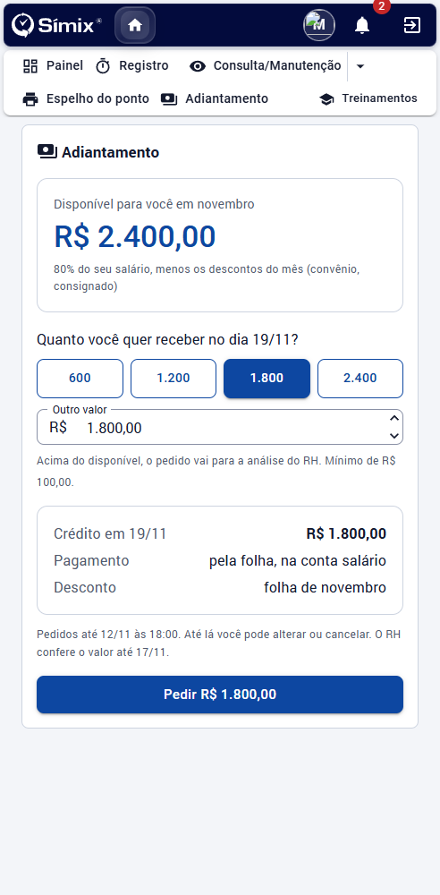
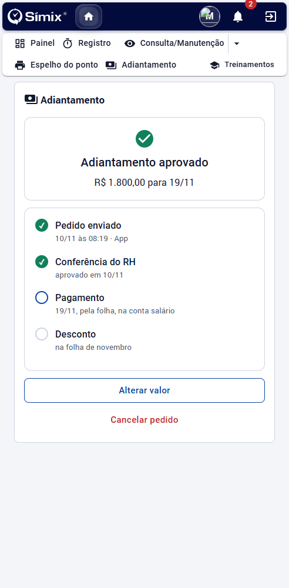

# Pedir o meu adiantamento

**Para o colaborador** · Como pedir o adiantamento salarial pelo portal e acompanhar o resultado. Voltar à [visão geral](Visao-geral.md).

## Onde fica

No portal do colaborador, abra **Adiantamento**. O que a tela mostra depende do momento:

- **Ainda não abriu**: mostra quando os pedidos abrem.
- **Período de pedidos**: mostra o valor disponível para você e o formulário.
- **Já pediu**: mostra a situação do pedido.
- **Sem adiantamento no mês**: avisa o motivo e quando abre o próximo período.

## Fazer o pedido

1. Veja o **valor disponível**. Ele é uma parte do seu salário, menos os descontos do mês, como convênio e consignado; a linha abaixo do valor explica a conta. Em algumas empresas ele cresce a cada dia trabalhado.
2. Escolha um dos **valores sugeridos** ou digite **outro valor**. Respeite o valor mínimo, quando houver.
3. Confira o resumo: data do crédito, pagamento pela folha na conta salário e o mês do desconto.
4. Toque em **Pedir**.

Pedindo acima do disponível, o pedido não é negado: ele vai para a análise do RH.

Em algumas empresas o valor é fixo (um percentual do salário): você só confirma que quer receber.

## Alterar ou cancelar

Até o prazo mostrado na tela você pode **alterar o valor** ou **cancelar o pedido**, inclusive depois de ajustado ou reprovado (o novo valor volta para o RH).

## Acompanhar

Depois do pedido a tela mostra a situação e os passos: **pedido enviado**, **conferência do RH**, **pagamento** e **desconto**.

| Situação | Significa |
| --- | --- |
| Pedido enviado | Aguardando a análise |
| Adiantamento aprovado | Será pago na data indicada |
| Aprovado com outro valor | O RH ajustou o valor; o motivo aparece na tela |
| Pedido não aprovado | O motivo aparece na tela; você pode pedir outro valor até o prazo |

O valor é pago pela folha, na conta salário, e descontado na folha do mês.

## Não aparece a opção de pedir

Você não recebe adiantamento no mês se estiver de férias, afastado, demitido ou em aviso prévio na data do pagamento, ou conforme as regras da empresa (por exemplo, admissão recente). A tela informa o motivo. Em caso de dúvida, fale com o RH.
