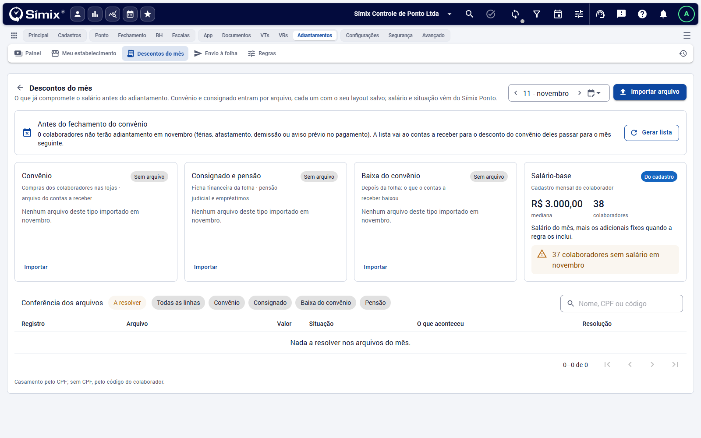
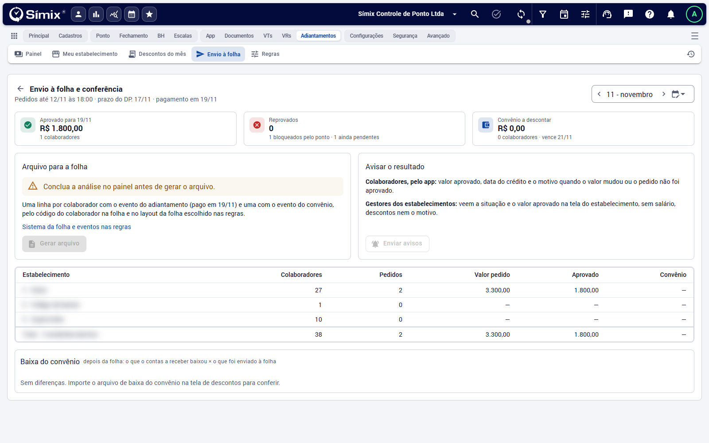

# Descontos e envio à folha

**Adiantamentos** · O que já compromete o salário entra antes do adiantamento, e o resultado vai para a folha depois da análise. Voltar à [visão geral](Visao-geral.md).

## Descontos do mês

Em *Adiantamentos › Descontos do mês* entram, por arquivo, o que o colaborador já tem a descontar:

- **Convênio** (compras nas lojas);
- **Consignado e pensão**;
- **Baixa do convênio**.

Cada tipo usa o seu **layout de importação**, salvo nas [regras](Regras.md). O salário e a situação do colaborador vêm do próprio Símix Ponto: o card **Salário-base** mostra a mediana do mês, quantos colaboradores têm salário e avisa quantos estão **sem salário** (esses ficam bloqueados no painel).

1. Escolha o mês e clique em **Importar arquivo** (ou em **Importar**, no card do tipo).
2. Confira o card: total, colaboradores e linhas. **Ver linhas** mostra o detalhe do arquivo.
3. Em **Conferência dos arquivos**, o filtro **A resolver** lista as linhas que não casaram com um colaborador. O casamento é pelo CPF; sem CPF, pelo código do colaborador.
4. Se os pedidos já tinham sido calculados, use **Refazer a conta dos pedidos** no painel.

### Lista de quem fica sem desconto

Colaborador bloqueado (férias, afastamento, demissão ou aviso prévio) não recebe adiantamento, e o convênio dele precisa passar para o mês seguinte. **Gerar lista** monta essa relação antes do fechamento do convênio para o contas a receber, com a data de geração registrada.

## Envio à folha e conferência

Em *Adiantamentos › Envio à folha*, depois de **concluir a análise**:

1. **Gerar arquivo**: uma linha por colaborador com o evento do adiantamento (pago na data do pagamento) e outra com o evento do convênio, pelo código do colaborador na folha e no layout escolhido nas regras. O botão fica desabilitado enquanto a análise não for concluída.
2. **Baixar arquivo** e entregar ao DP.
3. Depois que o DP importar, **Marcar como importado pelo DP**.
4. **Enviar avisos**: o colaborador vê o valor aprovado, a data do crédito e o motivo quando o valor mudou ou o pedido não foi aprovado; o gestor do estabelecimento vê só a situação e o valor aprovado. **Avisar os que faltam** reenvia só aos que ainda não receberam.

A tela também mostra o total aprovado, os reprovados, os bloqueados pelo ponto e o convênio a descontar, a conferência **por estabelecimento** (colaboradores, pedidos, valor pedido, aprovado e convênio) e a **Baixa do convênio**: depois da folha, compara o que o contas a receber baixou com o que foi enviado. Para isso, importe o arquivo de baixa em *Descontos do mês*.

> Sem o **sistema da folha** e os **eventos** configurados nas regras, o arquivo não sai.
