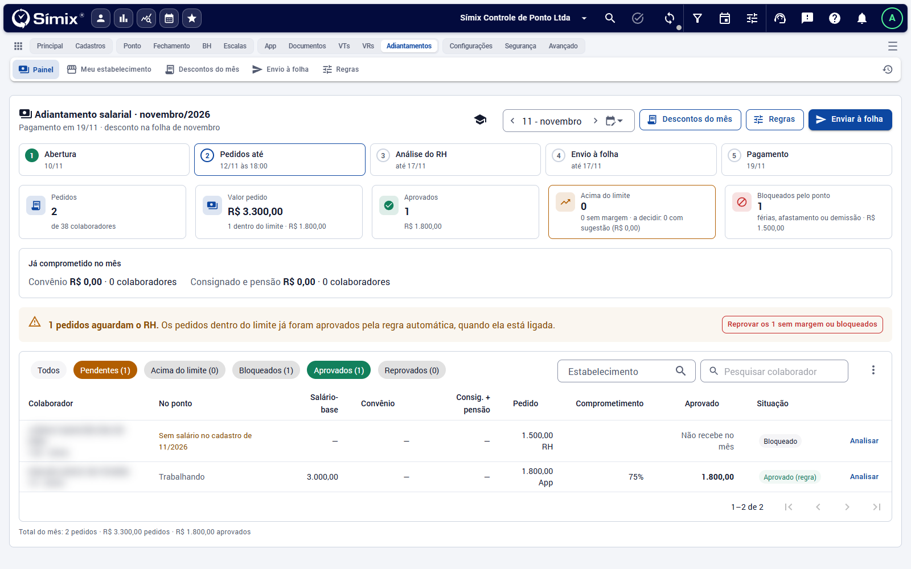
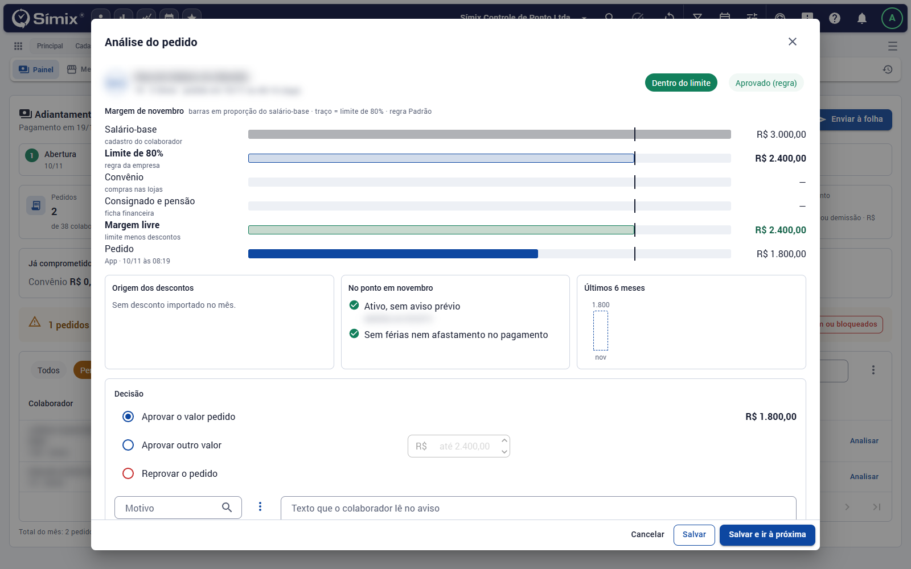
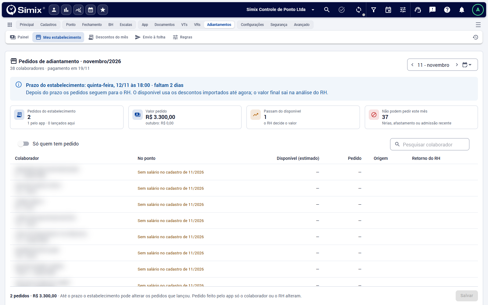

# Pedidos e análise

**Adiantamentos** · O painel do RH em *Adiantamentos* mostra o mês e a lista de pedidos. Voltar à [visão geral](Visao-geral.md).

## O painel

No alto, as **etapas do mês** com a data de cada uma. Abaixo, os indicadores:

| Indicador | O que mostra |
| --- | --- |
| Pedidos | Quantos colaboradores pediram, do total do mês |
| Valor pedido | Soma dos pedidos e quanto está dentro do limite |
| Aprovados | Quantidade e valor aprovado |
| Acima do limite | Pedidos acima do disponível ou sem margem, e quantos têm sugestão |
| Bloqueados pelo ponto | Férias, afastamento ou demissão na data do pagamento |

O quadro **Já comprometido no mês** soma o convênio e o consignado com pensão.

A lista tem filtros por **Todos, Pendentes, Acima do limite, Bloqueados, Aprovados e Reprovados**, além do estabelecimento e da pesquisa por colaborador. Cada linha mostra o salário-base, os descontos, o valor pedido e quanto ele **compromete** do salário (acima de 100% aparece em destaque).

## Pedidos pendentes

Quando há pedidos aguardando o RH, o painel avisa e oferece duas ações em lote:

- **Aceitar as sugestões**: aprova cada pedido com a sugestão do sistema (a margem livre, arredondada).
- **Reprovar os sem margem ou bloqueados**.

## Analisar um pedido

**Analisar** abre o pedido com a **margem do mês** em barras (salário-base, limite da regra, convênio, consignado e pensão, margem livre e o pedido), a origem dos descontos, a situação no ponto e os pedidos dos últimos 6 meses. Na **Decisão**:

- **Aprovar a sugestão**, quando o pedido passa do disponível (a margem livre, arredondada);
- **Aprovar o valor pedido**;
- **Aprovar outro valor**, até a margem livre;
- **Reprovar o pedido**, com o motivo e o texto que o colaborador lê no aviso.

> Quando o colaborador está bloqueado, a janela já abre em **Reprovar**. Confira antes de salvar.

**Salvar e ir à próxima** acelera a análise de uma fila.

## Lançar pedido pelo RH

No menu ⋮ da lista, **Lançar pedido pelo RH** cria o pedido de um colaborador que não pediu pelo portal. Os pedidos também podem ser carregados em lote por planilha (veja [Importar planilhas](../Integracoes/Importar-planilhas.md)).

## Gestor do estabelecimento

Em *Adiantamentos › Meu estabelecimento*, o gestor vê os colaboradores do estabelecimento dele, com o **disponível estimado**, o pedido, a origem (app ou lançado ali) e o **retorno do RH**. Ele lança o valor na coluna do pedido e clica em **Salvar**. **Só quem tem pedido** esconde os demais.

- O aviso no alto mostra o **prazo do estabelecimento**: depois dele, os pedidos seguem para o RH.
- Até o prazo, o estabelecimento altera os pedidos que lançou. Pedido feito pelo app só o colaborador ou o RH alteram.
- O disponível é uma estimativa com os descontos importados até o momento; o valor final sai na análise do RH.
- O gestor não vê salário, descontos nem o motivo da análise.

## Concluir a análise

No menu ⋮, **Concluir a análise** fecha o mês para o envio à folha. Se precisar corrigir algo depois, **Reabrir a análise**. Enquanto o mês está aberto, **Refazer a conta dos pedidos** recalcula depois de uma importação de descontos ou de salário.

## Por que um pedido fica bloqueado

| Motivo | O que fazer |
| --- | --- |
| Sem salário no cadastro do mês | Cadastre ou importe o salário e use **Refazer a conta** |
| Férias, afastamento ou demissão na data do pagamento | O colaborador não recebe no mês; o convênio dele passa para o próximo |
| Aviso prévio | Mesmo tratamento, conforme a regra |
| Admissão recente ou muitas faltas | Conforme a regra configurada |
