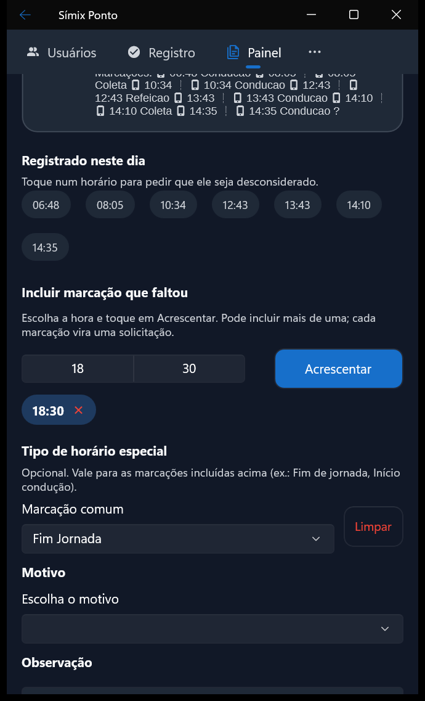
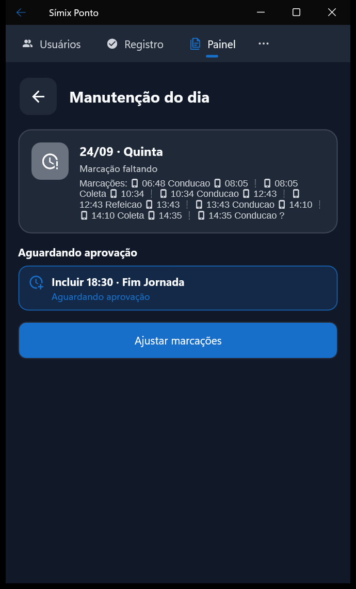
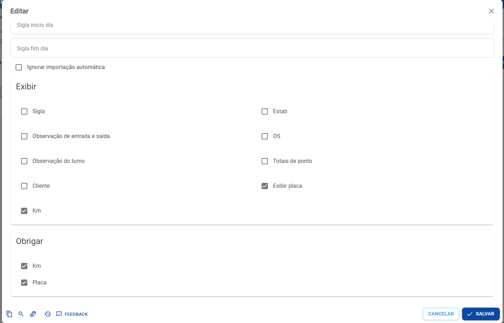

# 28/10/2026

Versão **4.0.03** do aplicativo (Android, iOS e Windows).

## Resumo

- 🔒 Registro pelo aplicativo: opção geral e Padrão, Sempre ou Nunca por colaborador
- 🚫 Marcação recusada pela empresa aparece no aplicativo, sem comprovante
- 🕓 Tipo de horário especial ao pedir a marcação que faltou na manutenção do dia
- 🚚 Km e Placa obrigatórios para motoristas mesmo sem layout de ações
- 📍 Registro sem GPS deixa de sair a 6.333 km do estabelecimento

## Bloqueio do registro pelo aplicativo ✨

A empresa passa a definir quem registra o ponto pelo aplicativo, com uma opção que vale para todos e a exceção de cada colaborador.

- Nova opção **Permitir registro pelo aplicativo** em **App › Configurações do app**, aba Segurança. Desligada, o aplicativo esconde os botões de registro, inclusive no modo quiosque, e mostra o aviso "Registro pelo aplicativo desligado pela empresa".
- No cadastro do colaborador, **Permitir registro App** deixa de ser uma caixa de marcar e passa a ter três opções: **Padrão** segue a opção geral, **Sempre** registra mesmo com ela desligada e **Nunca** não registra mesmo com ela ligada. O **Permitir registro Web** ganhou as mesmas três opções.
- A regra vale desde o login no aplicativo e é conferida de novo a cada sincronização e na hora do registro. Antes, quem não podia registrar ainda conseguia logo depois de entrar no aplicativo ou de sincronizar, e o sistema aceitava a marcação mesmo com a opção desmarcada.
- **Marcação recusada**: quando a empresa recusa uma marcação feita pelo aplicativo, ele não emite comprovante e mostra "Marcação recusada" com o motivo na tela do registro, no detalhe, na consulta e nos registros do dia. No sistema, a marcação fica na consulta de registros como **Bloqueado**, com o motivo, e fora do cálculo.
- Os cadastros atuais foram convertidos sem mudar quem registra hoje: quem estava com o registro pelo aplicativo desmarcado ficou com **Nunca**, e os demais ficaram no **Padrão**.

- Nova opção nas Configurações do app, aba Segurança:

## Motoristas no aplicativo

- **Tipo de horário especial na manutenção do dia**: ao incluir a marcação que faltou, motoristas e colaboradores com layout livre escolhem o tipo de horário especial (Fim de jornada, Início condução…), como já acontece na manutenção do sistema. As opções são as mesmas dos botões da tela de registro, e o pedido aguardando aprovação mostra o tipo escolhido ("Incluir 18:30 · Fim Jornada"). Para os demais colaboradores a tela continua igual.
- **Km e Placa obrigatórios**: o layout de horário do tipo Motorista com "Obrigar Km" ou "Obrigar Placa" passa a obrigar no aplicativo mesmo sem layout de ações vinculado. Antes, sem layout de ações, o aparelho ficava com a configuração do dia em que o aplicativo foi instalado, e quem instalou antes de marcarem "Obrigar Km" nunca era obrigado. Agora a obrigação acompanha o cadastro a cada sincronização, e o Km e a Placa obrigatórios aparecem na tela de registro mesmo quando o layout esconde esses campos.

- Motorista incluindo a marcação que faltou (18:30) como "Fim Jornada":

- Depois de enviar, o pedido aguardando aprovação com o tipo escolhido:

- Layout de horário Motorista com Km e Placa obrigatórios, sem layout de ações, que passa a valer no aplicativo:

## Outras melhorias e correções

- **Registro sem GPS**: quando o aparelho não tem a posição, a marcação fica sem distância ao estabelecimento. Antes ela saía com cerca de 6.333 km, o que atrapalhava saber se o colaborador estava na empresa, e o endereço do estabelecimento ainda era usado no lugar do endereço da marcação.
