## Trilha do conhecimento ✨

Novo módulo para aprender o sistema no seu ritmo, com trilhas que guardam o progresso de cada pessoa.

- Nova tela **Minhas trilhas**, com "Continuar de onde parou" e as guias Em andamento, Obrigatórias, Disponíveis e Concluídas.
- Cada trilha tem etapas e itens — vídeo, documento, demonstração guiada e texto — e guarda o percentual, o item onde parou e a data de conclusão.
- A demonstração guiada abre a tela certa e conclui o item sozinha ao terminar; o vídeo conclui com 90% assistido e volta do ponto em que a pessoa parou.
- Três trilhas prontas da Símix: **Primeiros passos**, **Fechamento do mês** e **Banco de horas**, montadas com as demonstrações guiadas que já existem.
- A empresa monta as próprias trilhas em **Módulos › Trilhas**: criar, montar as etapas (inclusive com itens do catálogo Símix), publicar, duplicar uma trilha da Símix e atribuir a colaboradores ou usuários. Gravar não muda a trilha para quem está fazendo; só o Publicar muda.
- O portal do colaborador ganha o item **Trilhas**, com o número de obrigatórias pendentes, e um card no painel. A página de Treinamentos ganha a faixa "Suas trilhas", e o Início mostra o card do próximo passo.

> Perfis **DP** já existentes nos clientes não recebem sozinhos as permissões de Trilhas: é preciso concedê-las em Permissões.

- Minhas trilhas, com as três trilhas iniciais da Símix:

- Visão da trilha: etapas, itens e o progresso ao lado:

- Item de demonstração guiada concluído pelo fim da demonstração, com o índice da trilha:

- Vídeo dentro da trilha, com o percentual assistido:

- Faixa "Suas trilhas" na página de Treinamentos:

- Catálogo de trilhas da Símix:

## Nova tela de processos ✨

Os processos — rotinas que alteram os cartões conforme regras que você define — ganharam tela nova, com execução em lote e simulação antes de gravar.

- Processos em **cards**, com pesquisa, filtro por rotina e por tags, favoritos primeiro, duplicar e excluir.
- Cadastro com descrição, ícone, tags, favorito e as rotinas em que o processo aparece (Manutenção e/ou Em lote).
- **Editor de ações**: escolhe onde o processo age (dia, turno ou marcação), o que altera (local da marcação, afastamento, horário do dia…) e em quais casos (ex.: só nos dias trabalhados), com um resumo em uma frase de cada ação.
- **Execução em lote**: período de até 12 meses e filtro de colaboradores, com opção de **simular antes de gravar**. Roda em segundo plano, aparece no monitor de tarefas e pode ser cancelada.
- Resultado com os dias alterados (antes e depois) e atalho para a manutenção de cada cartão.
- Menu **Processos** de volta na barra da Manutenção: aplica o processo no cartão aberto e deixa os dias marcados para conferir e salvar.
- Nova permissão **Executar**, para quem pode gravar em lote.
- As condições das ações passam a ser conferidas antes de alterar o dia, o turno ou a marcação — antes a ação alterava tudo sem olhar as condições —, e a ação lida de um layout salvo voltou a funcionar.

- Lista de processos em cards, com as rotinas e o botão de executar:

- Cadastro: ação que marca como home office as marcações dos turnos trabalhados:

- Simulação em lote: um dia mudaria, com o antes e o depois da marcação:

- Menu Processos na barra da manutenção:

- Processo aplicado no cartão aberto: o dia ganha o ícone de home office e fica para salvar:

## Barra do topo, favoritos e foto do usuário ✨

A barra do topo foi reorganizada e ganhou favoritos e foto de perfil.

- Os atalhos ao lado do logo ficaram menores e sem contorno próprio; Gestão ganhou o ícone de casa e entrou o atalho do **Calendário**.
- **Estrela de Favoritos** ao lado dos atalhos, com os atalhos de um grupo (telas, comandos, registros, dashboards e widgets). Na primeira vez ela pede o grupo, ou cria um, e a escolha fica salva. Pela estrela dá para criar, editar e excluir atalhos e renomear, compartilhar e excluir grupos.
- **Foto do usuário** no avatar do topo. Quem já tinha foto no cadastro de colaborador recebe essa foto uma vez; sem foto, continua a inicial do nome. A troca é feita em "Alterar foto" no menu do avatar ou em "Sua foto" em Minha conta, por arquivo ou pela webcam — e vale só para o usuário, sem mexer na foto do cadastro.
- O painel do botão de configurações virou **Preferências**, mais estreito, com ícone e explicação em cada opção. A engrenagem ao lado do som abre a tela de alertas, e com Ofuscar dados ligado a foto do avatar também fica borrada.
- O item "Configurações" do avatar virou **Minha conta** (senha e foto); "Configurações" fica só para a aba do sistema.
- Voltou a escolha da forma de exibir o menu (Normal, Compacto ou Escondido), agora salva no usuário e valendo em qualquer navegador. Os botões do menu mostram a descrição ao parar o mouse em cima, e botão com cadeado mostra o motivo.
- Todos os ícones da barra mostram o nome ao passar o mouse (a pesquisa mostra também o atalho Ctrl+Espaço), e os botões de VTs e VRs ganharam ícones próprios.
- No celular, a borda das faixas que rolam para o lado esmaece quando há mais itens.

- Antes: quatro atalhos grandes e o botão de tela cheia ao lado do sino:

- Depois: atalhos menores logo depois do logo e avatar com foto:

- A estrela de Favoritos depois do Calendário:

- Na primeira vez a estrela pede o grupo de atalhos, ou cria um novo:

- Os atalhos do grupo escolhido; editar e excluir aparecem ao passar o mouse:

- Menu do avatar com a foto, Alterar foto e Minha conta:

- Troca da foto por arquivo ou webcam, só no usuário:

- Seção "Sua foto" em Minha conta:

- Antes: painel largo e opções sem explicação:

- Depois: Preferências com ícone e descrição em cada opção:

- A escolha da forma de exibir o menu de volta, salva no usuário:

- Descrição do botão ao parar o mouse em cima:

- No celular, as abas e os botões do menu esmaecem na borda:

## Atalhos no painel inicial ✨

Cada usuário monta grupos de atalhos para o que usa todo dia.

- Card de atalhos no Início, acima do Calendário, mostrando um grupo por vez.
- Tipos de atalho: link (tela do sistema ou endereço externo), tela ou comando da pesquisa global, registro (qualquer colaborador, horário, cargo… achado pela pesquisa, abrindo direto no cadastro dele), dashboard e widget de dashboard.
- Cada atalho tem ícone, cor, nome, descrição e um **recorte de colaboradores** opcional, que soma ao filtro do sistema sem alterá-lo. Consulta diária, Férias, Inconsistências, Manutenção, Colaboradores e Exportar folha abrem já filtradas.
- Widget abre num popup no próprio Início, com Nova guia, Imprimir e Exportar Excel. Os widgets do Painel e dos dashboards gerenciais ganharam o botão **Criar atalho**.
- Grupos do usuário e grupos disponíveis para todos; arrastar muda a ordem, e grupos podem ser renomeados e compartilhados.
- Atalho cujo destino foi excluído aparece como indisponível, com o motivo; sem permissão para a tela, o atalho não aparece.

- Card de atalhos no Início:

- Organização dos grupos e atalhos:

- Atalho com recorte de colaboradores:

- Widget aberto pelo atalho, no próprio Início:

## Módulo de férias ✨

Primeira entrega do módulo de férias: saldo por período aquisitivo calculado a partir do ponto, painel de acompanhamento e importação do histórico.

- **Saldo por período aquisitivo**, calculado pelo ponto: desconto de faltas pela tabela da CLT (art. 130), perda do direito por INSS acima de 6 meses ou licença remunerada acima de 30 dias (art. 133), sugerida para o RH confirmar, proporcional na rescisão e recesso de estagiário.
- **Painel de férias** com vencidas, a vencer, a conferir, perda a confirmar e em férias hoje, respeitando o filtro global.
- **Ficha do colaborador** com os períodos, o que definiu o direito de cada um, ajuste de saldo com motivo e histórico. Também disponível na aba **Férias** do cadastro.
- **Política de férias** da empresa e limite de ausentes por setor.
- **Importação do histórico**: férias já lançadas no ponto viram parcelas do período certo, e uma planilha acerta o total de cada período. Nada é gravado antes da conferência e reimportar não duplica.
- Recálculo diário dos saldos e avisos ao RH quando faltam 120, 90 e 60 dias para o limite e quando ele passa. Na adoção, o que já venceu aparece no painel sem gerar excesso de avisos.
- Período com mais faltas do que a tabela permite (em geral, quem não registra ponto) fica "a conferir", em vez de zerar o direito sem aviso.
- O perfil DP recebe as permissões de férias.
- As férias passam a ser reconhecidas pelo tipo do afastamento (antes, o total de dias de férias do cálculo saía zerado na maioria das bases); o mesmo vale para INSS.
- Aprovar um afastamento sobre outro pede confirmação; na aprovação em lista, um conflito recusa o lote inteiro e mostra os colaboradores envolvidos.
- A aplicação de escala não grava mais por cima de dia de férias.
- Os módulos de **Férias** e de **Adiantamento salarial** são ativados por cliente pelo suporte Símix e vêm desligados por padrão. Desligados, somem do menu.

> **Atenção (integrações externas):** os totais de dias de férias e de INSS do cálculo deixam de sair zerados para quem tinha afastamentos sem tipo. Exportações de folha e dashboards que usam esses campos podem mudar de valor depois do próximo cálculo.

- Painel de férias com os cards de situação e a lista por colaborador:

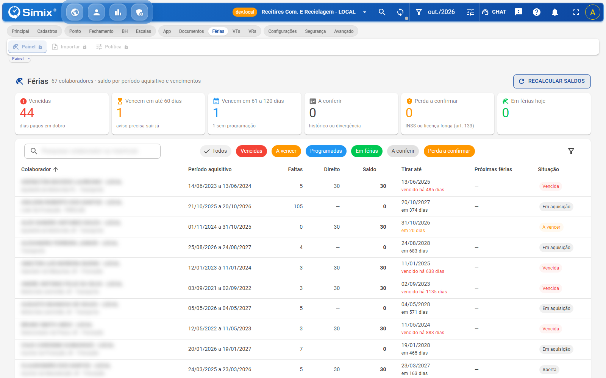

- Ficha do colaborador com períodos, direito, ajustes e histórico:

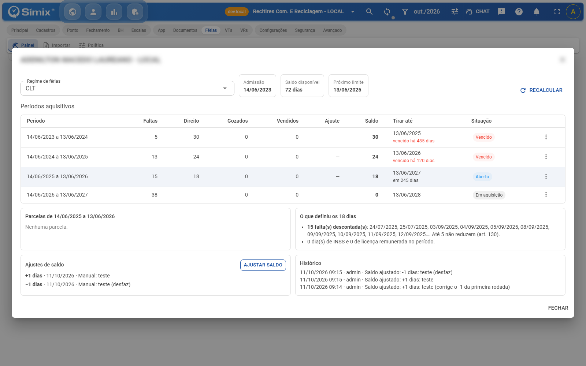

- Importação do histórico, antes de gravar:

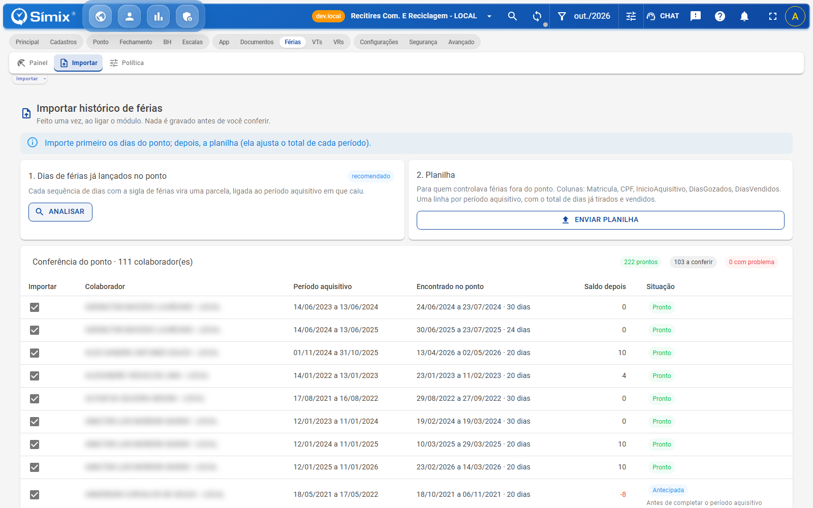

- Política de férias da empresa:

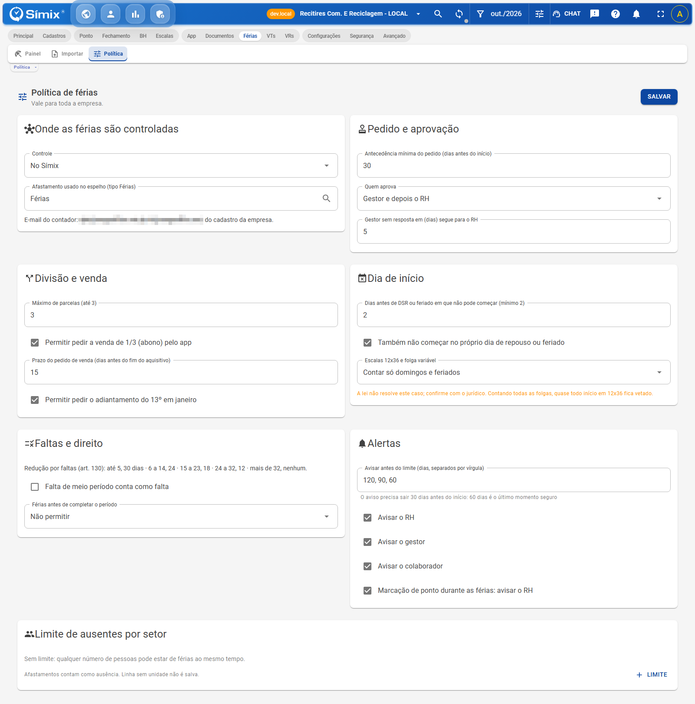

- Aba Férias no cadastro do colaborador:

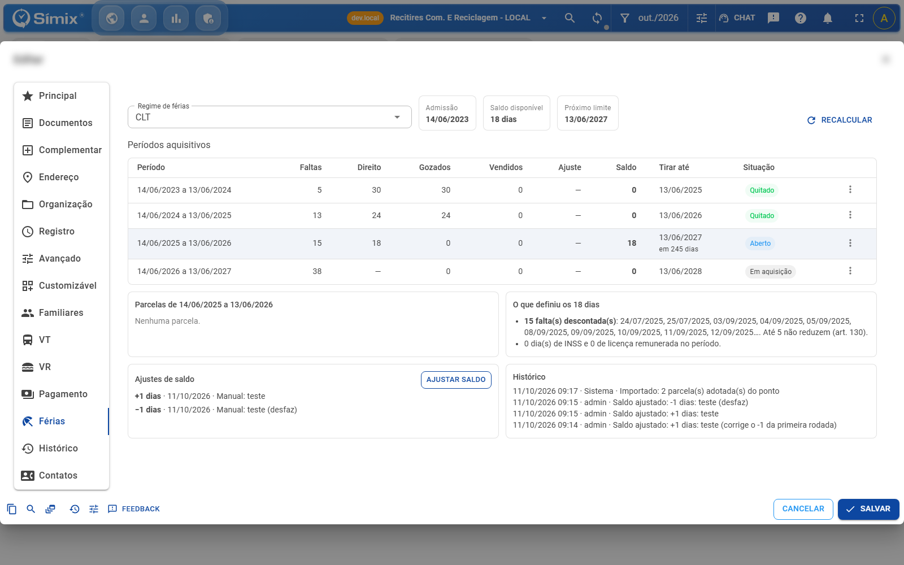

- Manutenção em lote deixando de fora os dias com afastamento:

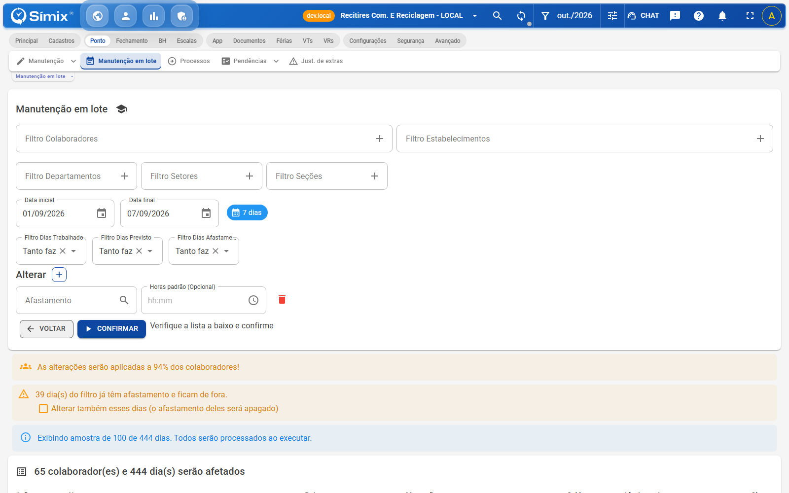

## Módulo de adiantamento salarial ✨

Novo módulo para gerenciar os pedidos de adiantamento salarial do mês, do pedido do colaborador até o envio à folha, com regras, margem e descontos.

- **Painel do RH** com os pedidos do mês: salário-base, convênio, consignado e pensão, quanto o pedido compromete do limite, o valor aprovado e a situação. Aceita as sugestões de uma vez e reprova em lote quem está sem margem ou bloqueado, respeitando o filtro global.
- **Análise de cada pedido**: margem do mês em barras, origem dos descontos, situação no ponto, últimos meses e a decisão com o texto do aviso ao colaborador. Dá para navegar entre as pendências sem fechar a janela.
- **Portal do colaborador**: o colaborador vê quanto tem disponível, pede o valor, acompanha a conferência e pode alterar ou cancelar até o prazo. O resultado chega como aviso no app, inclusive se o RH mudar a decisão.
- **Gestor do estabelecimento**: lança os pedidos da equipe e pode repetir os do mês anterior, vendo só o disponível e a situação (sem salário, descontos ou motivo do RH). Requer a permissão **Lançar pedidos** e lotação fixa no filtro do usuário.
- **Descontos do mês**: convênio, consignado, pensão e baixa do convênio importados por arquivo, com conferência antes de gravar. O colaborador é localizado pelo CPF ou pelo código; pendências ficam para resolver, e reimportar mantém o que já foi resolvido.
- **Envio à folha**: arquivo com os eventos do adiantamento e do convênio, aviso do resultado aos colaboradores, totais por estabelecimento e conferência da baixa do convênio.
- Pedido aprovado que depois encontra férias, afastamento, demissão ou aviso prévio no pagamento volta para a decisão do RH.
- **Regras**: valor pedido, percentual fixo ou proporcional aos dias trabalhados; teto de 80% do salário (configurável), arredondamento, valor mínimo e máximo; calendário com antecipação ou adiamento em fins de semana e feriados; bloqueios por férias, afastamento, demissão, aviso prévio, admissão recente, faltas e vínculo; aprovação automática do que está no limite; exceções por grupo e simulação ao lado.
- O mês abre sozinho no dia configurado e os pedidos são recalculados todo dia. Regras alteradas valem a partir do próximo mês.
- O cadastro do colaborador ganha o campo **Adicionais fixos**, que pode entrar na base do adiantamento.

- Painel do RH no mês, com as etapas, os totais e os pedidos:

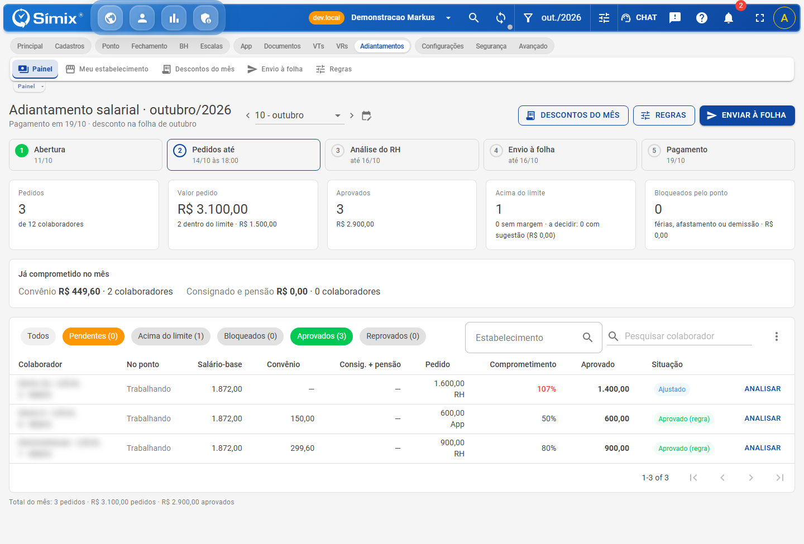

- Análise de um pedido acima do disponível, com a sugestão pela margem livre:

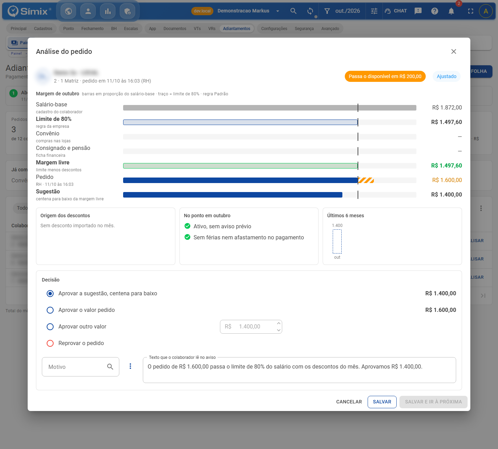

- Portal do colaborador: o pedido e o acompanhamento depois de aprovado:

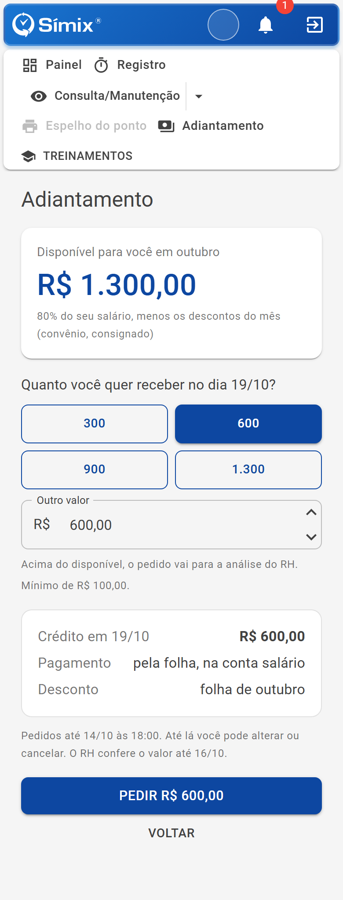

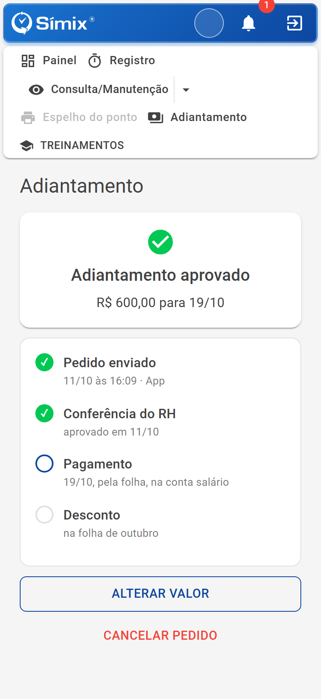

- Tela do gestor do estabelecimento:

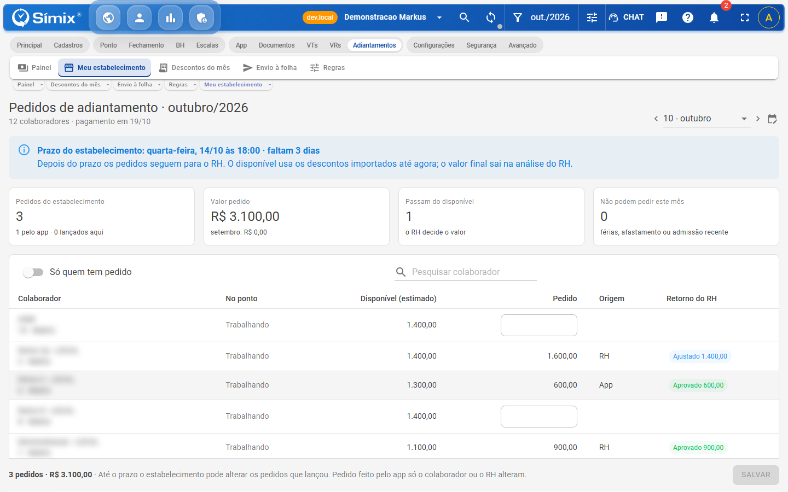

- Descontos do mês com o arquivo do convênio importado e linhas a resolver:

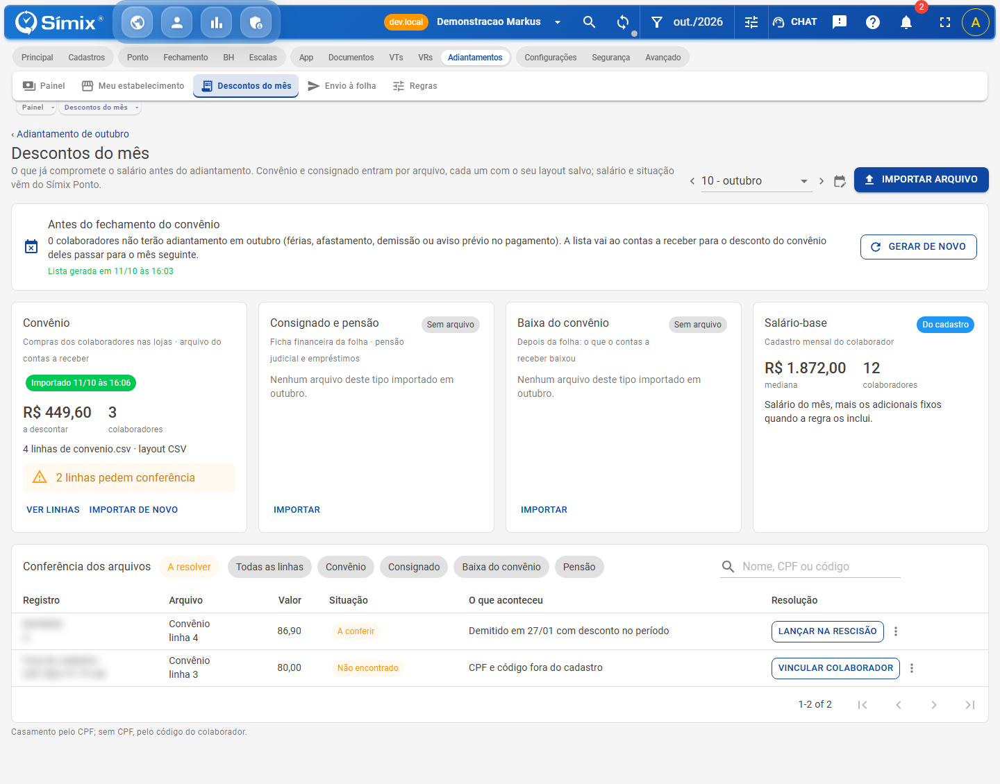

- Envio à folha durante o prazo dos pedidos:

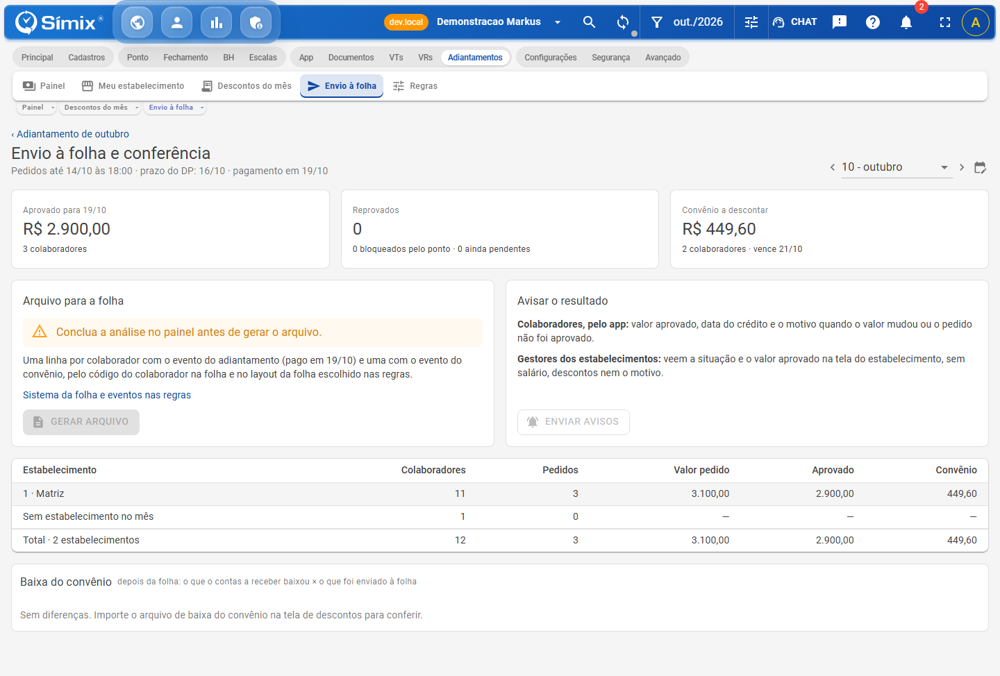

- Regras com a simulação do valor disponível:

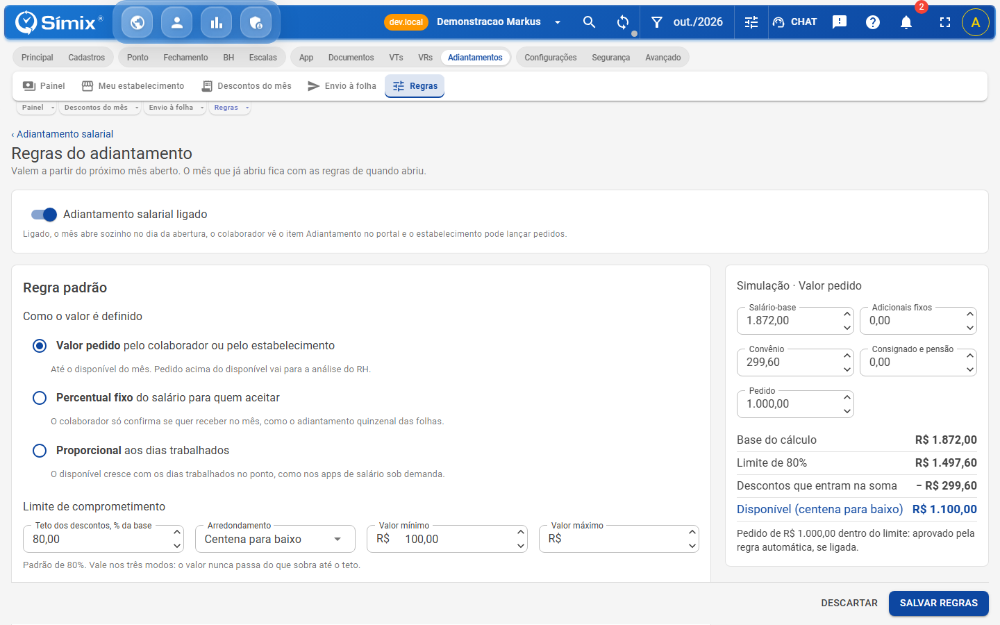
