# 15/10/2026

## 🐛 Mudar o dia de início ajusta o banco de horas em vez de dar erro [#2976](https://github.com/simixsistemas/Simix.Ponto.Cloud/pull/2976)

### Objetivo

Fix: [#x](https://github.com/simixsistemas/Simix.Ponto.Cloud/issues/x)

### Alterações
- 🐛 Mudar o dia de início dava "Um erro interno ocorreu durante a requisição!" e não salvava nada sempre que o banco de horas precisava de ajuste. Agora a mudança é salva e o banco de horas é ajustado.
- 🐛 A mudança segue a ordem do desktop:
  - os períodos do mês escolhido em diante recebem o novo dia, e **todos os períodos anteriores** recebem o dia anterior (no teste local isso reescreveu 810 períodos antigos, de 2013 a 2021);
  - a configuração passa a ter o novo dia de início;
  - o banco de horas do mês anterior ao escolhido em diante é ajustado;
  - quando algo foi ajustado, o banco de horas é recalculado em segundo plano, alguns segundos depois de salvar.
- 🐛 Repetir a mesma mudança não altera mais nada. Se o ajuste do banco de horas falhar no meio, os períodos e a configuração ficam gravados, o banco de horas fica como estava e a tela pede para repetir a operação, que completa o ajuste.
- ✨ Só o suporte Símix pode mudar o dia de início, como no desktop: é preciso ter a nova permissão **e** ser do suporte.
  - Antes, o servidor não fazia checagem nenhuma nessa mudança. Agora ela é restrita.
  - A permissão fica em Ferramentas > "Mudar o dia de início dos períodos".
  - Novo item de menu: Avançado > Suporte > "Dia de início do período", e um novo card na tela de Suporte. Quem não é do suporte não vê o item, o card nem a tela, mesmo com a permissão.
- ✨ A tela tem as validações do desktop: dias de 1 a 28, o 15 não é aceito no dia novo, o dia anterior é obrigatório, o dia atual aparece na tela e o mês padrão é o mês atual do cartão. Antes de salvar, uma confirmação explica o que vai acontecer.
- ♻ A frase de que o recálculo aparece no monitor só é mostrada quando o recurso beta do monitor de tarefas está ligado.
- Limites mantidos do desktop:
  - a lacuna antes do mês anterior ao escolhido não é ajustada (no teste, de 21/08 a 31/08);
  - colaboradores demitidos ficam com os saldos antigos, porque o recálculo os ignora;
  - no mês atual, o saldo conta até ontem;
  - os cartões de ponto dos meses alterados não são recalculados.
- **Deploy:** em produção, rodar o DbMigrator depois do deploy. O seed leva a nova permissão ao perfil admin, mas a tela continua só para o suporte.

### Demonstração

Base local de um cliente com banco de horas mensal. Os períodos passam ao dia 21 a partir de 10/2026 (dia anterior 1), e o banco de horas é ajustado a partir de 09/2026, o mês anterior.

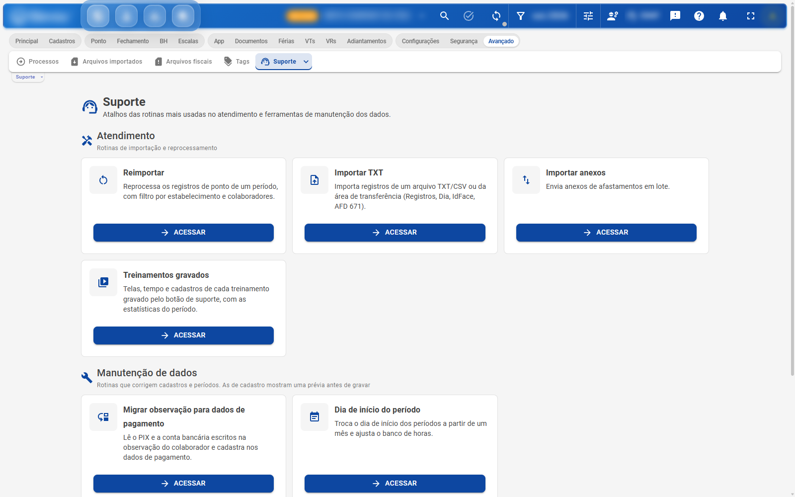

O card novo aparece em Suporte para o suporte Símix com a permissão.

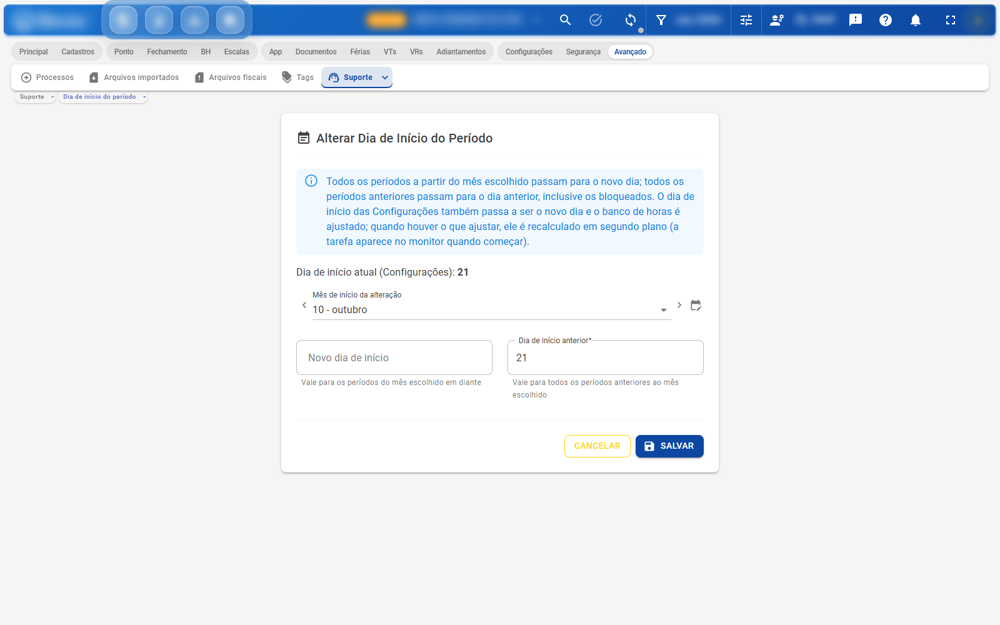

A tela mostra o dia de início atual e já vem com o mês atual do cartão.


O dia 15 é recusado no dia novo.

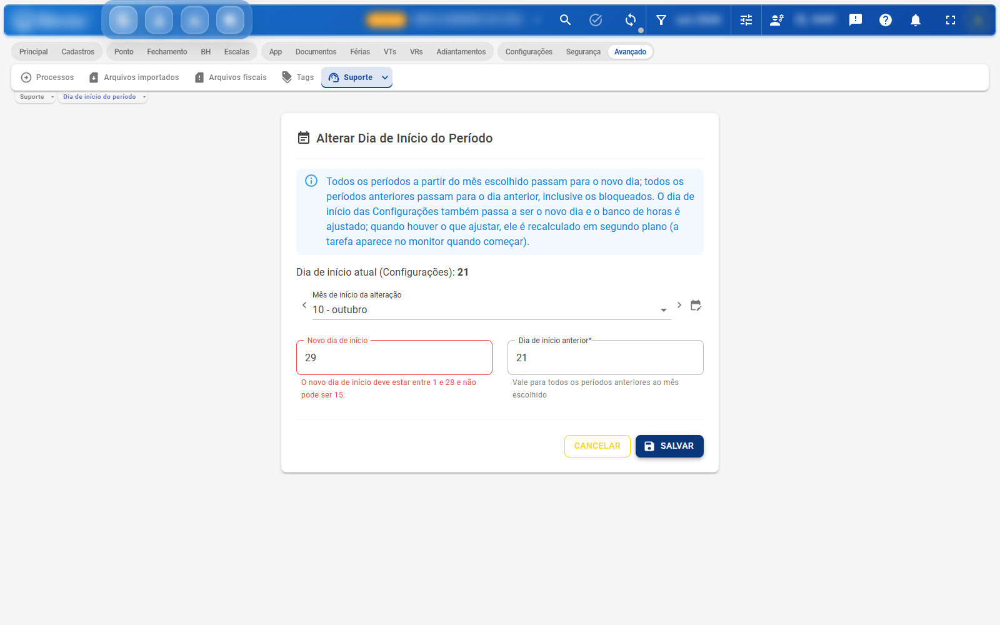

Dias acima de 28 são recusados, sem corrigir o valor em silêncio.

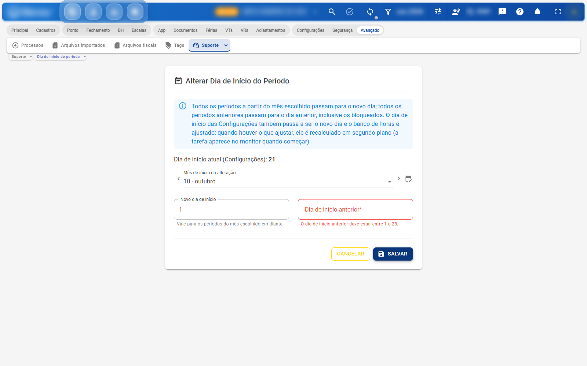

O dia anterior é obrigatório.

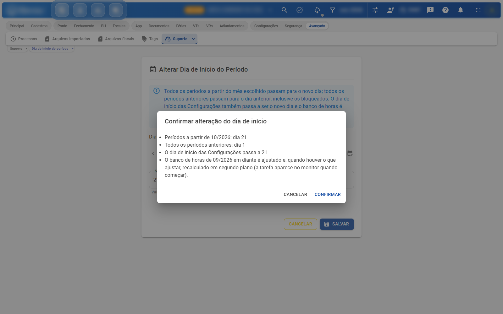

A confirmação diz o que vai acontecer com os períodos, a configuração e o banco de horas, que é ajustado a partir de 09/2026.

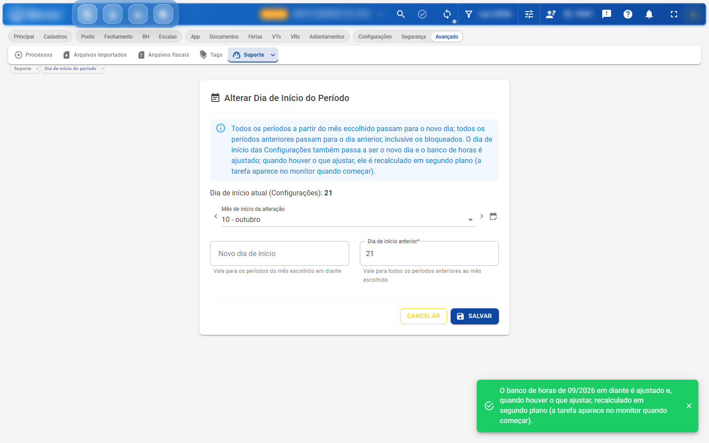

Depois de salvar, a tela avisa e recarrega com o novo dia atual.

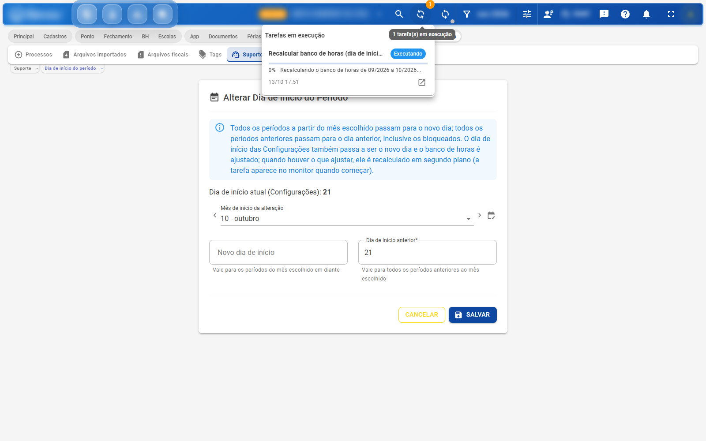

O recálculo do banco de horas roda em segundo plano e aparece no monitor, com o monitor de tarefas (beta) ligado.


Sem a permissão, o card não aparece.

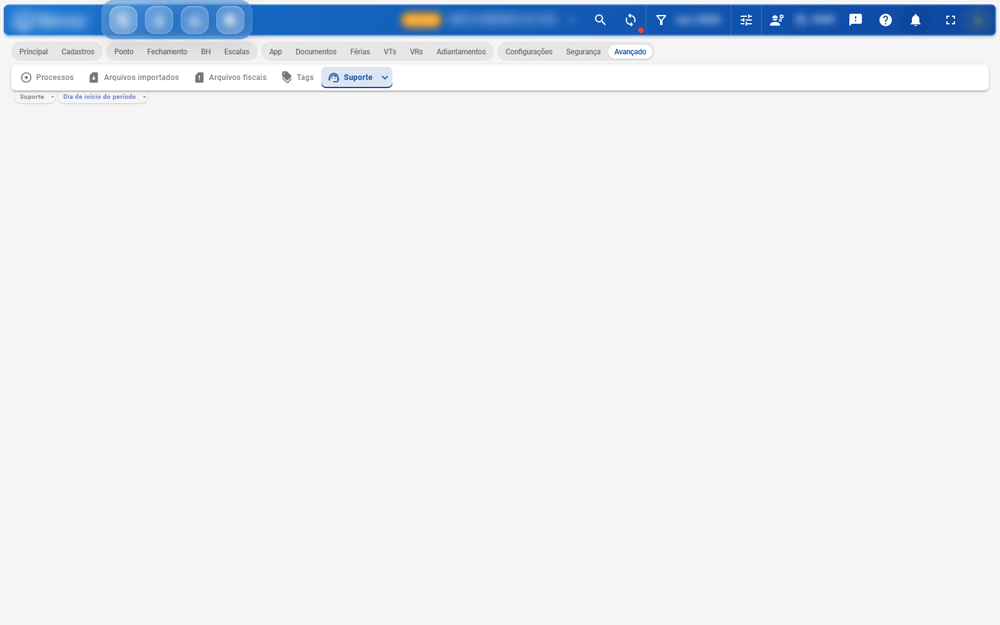

Abrindo a tela direto sem a permissão, nada é mostrado e nada é gravado.

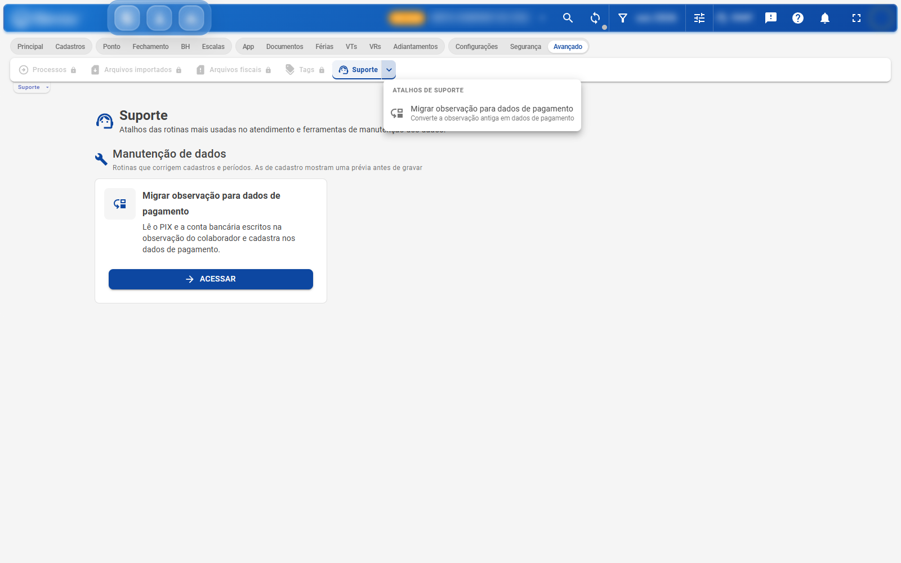

Com a permissão, mas sem ser do suporte Símix, o card e o item do menu não aparecem. Abrindo a tela direto, ela só avisa que a mudança é do suporte, e o servidor recusa a gravação.

🤖 Generated with [Claude Code](https://claude.com/claude-code)


## ♻ Melhorias visuais na barra das listas [#2974](https://github.com/simixsistemas/Simix.Ponto.Cloud/pull/2974)

### Objetivo

Fix: [#1082](https://github.com/simixsistemas/Simix.Ponto.Cloud/issues/1082)

### Alterações
- ♻ Botão Visões em cinza, com contorno, mostrando o nome da visão aberta (a visão atual aparece marcada no menu)
- ♻ Botão de filtro passou para depois do botão de inativos
- ♻ Situação (Ativos/Demitidos/Todos), inativos e filtro com o mesmo contorno e a mesma altura
- ♻ Botão de treinamentos foi para o lado direito da barra, ao lado da pesquisa

### Demonstração


Barra da lista de Colaboradores: Visões com o nome da visão, situação, inativos e filtro alinhados, treinamentos à direita.

🤖 Generated with [Claude Code](https://claude.com/claude-code)


## Corrige testes que quebraram o Deploy (beta) [#2972](https://github.com/simixsistemas/Simix.Ponto.Cloud/pull/2972)

Corrige as 2 falhas do Application.Tests no [Deploy (beta)](https://github.com/simixsistemas/Simix.Ponto.Cloud/actions/runs/38652624905/job/116154819553).

- **ProxiesEstaticosTests**: `IPeriodosAppService.SimularAlteracaoLoteAsync` e `AlterarLoteAsync` estavam no proxy C# gerado mas sem ação no `app-generate-proxy.json` (o client falharia em tempo de execução). Adicionadas à mão: `POST api/app/periodos/simular-alteracao-lote` e `POST api/app/periodos/alterar-lote`, com a policy `Ponto.Periodos.Edit` — mesma rota convencional do ABP dos outros `Alterar*`/`Gerar*`. Uma regeneração com `etc/proxies/gerar-proxies.ps1` deve produzir o mesmo.
- **PontoClientObjectMappingProviderTests**: `FiltroLayoutDto.Compartilhado` é calculada (`=> UsuarioId == null`) e não recebe cópia; o teste passa a comparar só as propriedades graváveis do destino.

Verificado localmente: as duas classes de teste passam (898 testes). A suíte completa roda no CI.

🤖 Generated with [Claude Code](https://claude.com/claude-code)


## 🐛 Motivo de desligamento vindo de outro tipo de histórico [#2971](https://github.com/simixsistemas/Simix.Ponto.Cloud/pull/2971)

### Objetivo

Relacionado: [#2943](https://github.com/simixsistemas/Simix.Ponto.Cloud/issues/2943)

### Alterações
- 🐛 O motivo de desligamento deixa de mostrar o texto de um histórico que não é de desligamento. Os tipos de histórico são cadastrados por cliente no PcPonto, e o sistema considerava sempre o tipo 3 (na Vancosty, o tipo 3 é "Mudança de função")
- 🐛 Para quem não tem motivo de desligamento cadastrado, vale o histórico mais recente cujo tipo tenha "desligamento", "demissão" ou "rescisão" no nome
- ♻ Clientes antigos, cujo histórico não está ligado a nenhum tipo, continuam com a regra anterior (tipo 3)

### PR's referências
- simixsistemas/Simix.Ponto.Cloud#2945

### Demonstração

Migração completa da Vancosty simulada com o código atual (1.153 lançamentos de histórico, 10 tipos):

| Cenário | Linhas com motivo vindo do histórico | Do tipo 3 ("Mudança de função") | Do tipo 5 ("Parecer de rescisão") |
|---|---|---|---|
| Antes | 48 | 48 | 0 |
| Depois — histórico ligado aos tipos | 4 | 0 | 4 |
| Depois — base antiga, sem tipos ligados | 48 | 48 | 0 |

Também conferido em banco criado do zero, sem a coluna do código do tipo: a consulta é criada sem erro.


## 🐛 Agente local reconhecido como conectado na sincronização dos coletores [#2970](https://github.com/simixsistemas/Simix.Ponto.Cloud/pull/2970)

### Objetivo

Sincronização de coletores pelo agente local acusava "O agente não está conectado ao servidor" mesmo com o agente conectado (o "Testar conexão" respondia OK).

### Alterações
- 🐛 A sincronização que roda em segundo plano passa a reconhecer o agente conectado — antes ela só enxergava a conexão quando rodava no mesmo servidor em que o agente estava conectado
- ♻ A mensagem de agente desconectado orienta a verificar se o serviço do agente está em execução no computador em que foi instalado

### Demonstração

🤖 Generated with [Claude Code](https://claude.com/claude-code)


## ✨ Atalho para bloquear/liberar períodos e acessos dos usuários do PcPonto na migração [#2969](https://github.com/simixsistemas/Simix.Ponto.Cloud/pull/2969)

### Objetivo

Fix: [#2901](https://github.com/simixsistemas/Simix.Ponto.Cloud/issues/2901)

### Alterações
- ✨ Atalho **Bloquear/Liberar períodos** na lista de Períodos:
  - **Bloquear períodos**: bloqueia, na gestão e no portal, todos os períodos anteriores ao mês escolhido
  - **Liberar períodos**: libera todos os períodos a partir do mês escolhido (inclusive)
  - O diálogo já abre com o mês selecionado na lista e permite filtrar por estabelecimentos (vazio = todos), com opção de incluir o período geral
  - Antes de gravar, mostra quantos e quais períodos serão alterados; só entram os que realmente mudam de situação
  - Ao liberar um período cuja data de bloqueio automático já passou, essa data é limpa, para ele não voltar a ser bloqueado em seguida
- ✨ As alterações dos períodos passam a ficar registradas nos logs (histórico do cadastro)
- 🐛 Migração do PcPonto: os usuários do sistema antigo (gestores e administradores, inclusive quem não registra ponto) agora viram acessos no Símix Ponto
  - Antes, os acessos eram criados antes da cópia dos dados, quando a tabela de usuários ainda estava vazia
  - Usuários sem e-mail, ou com e-mail já usado por outro acesso, recebem um e-mail substituto
  - Todos recebem o perfil de RH (DP), inclusive quem era Administrador no PcPonto; o perfil Admin fica só com o usuário admin do banco. Usuários inativos entram inativos e quem tem colaborador vinculado fica ligado a ele
  - A mensagem da implantação informa quantos acessos foram criados, quem ficou sem senha (para o suporte definir) e quem não pôde ser criado
  - Testado migrando localmente o PcPontoHortaPomar (5 de 5 usuários) e o PcPontoAtivaMedicina (44 de 44)
  - Ainda não migra a senha: a conversão das senhas do PcPonto depende do componente antigo (COM), que não está disponível no servidor. Os acessos são criados sem senha e listados na mensagem da implantação

### Demonstração

Atalho na barra da lista de Períodos:

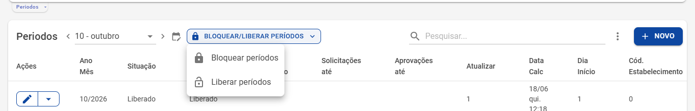

Diálogo com o mês da lista e o filtro de estabelecimentos; ao continuar, mostra quantos e quais períodos serão alterados antes de confirmar:

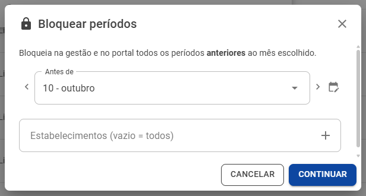


## ✨ Histórico de evolução de cargo e efetivação ao salvar o colaborador [#2967](https://github.com/simixsistemas/Simix.Ponto.Cloud/pull/2967)

### Objetivo

Fix: [#2830](https://github.com/simixsistemas/Simix.Ponto.Cloud/issues/2830)

### Alterações
- ✨ Ao salvar o colaborador com o cargo ou o tipo alterado, abre a janela "Adicionar ao histórico" com a descrição pronta e a data de hoje, ambas editáveis. Cada linha pode ser desmarcada, e "Não adicionar" salva sem histórico
- ✨ Cargo alterado: "Evolução de cargo de X para Y", tipo **Evolução de cargo**
- ✨ Estagiário que passa a Mensalista ou Horista: "Efetivado de Estagiário para Mensalista/Horista", tipo **Efetivação**. As outras trocas de tipo entram como **Alteração de tipo**
- ✨ O tipo do histórico é criado automaticamente na primeira vez em que é usado; depois, o mesmo tipo é reaproveitado. Os três tipos também aparecem nas sugestões da janela "Tipos de histórico"
- A janela só aparece na edição (não no cadastro novo) e para quem tem permissão de incluir histórico

### Demonstração

Cargo alterado de Recepcionista para Camareira e tipo de Estagiário para Mensalista: ao salvar, a janela oferece as duas linhas.

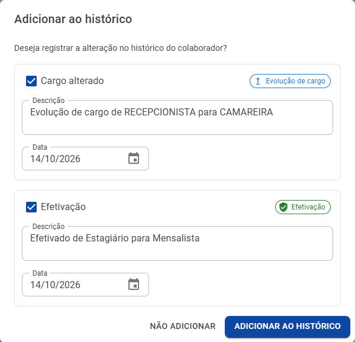

As duas linhas gravadas na guia Histórico do colaborador.

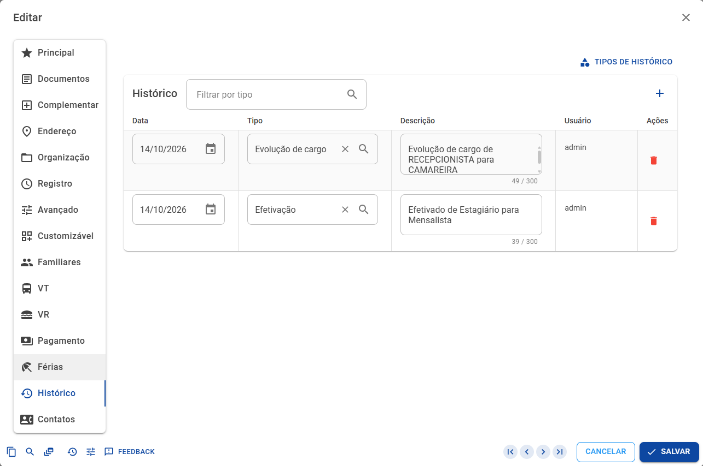


## 🐛 Tratamento dos erros nos widgets dos dashboards [#2966](https://github.com/simixsistemas/Simix.Ponto.Cloud/pull/2966)

### Objetivo

Fix: [#2954](https://github.com/simixsistemas/Simix.Ponto.Cloud/issues/2954)

### Alterações
- 🐛 Widgets com uma coluna sem nome na configuração voltam a carregar no painel e nos dashboards gerenciais, em vez de mostrar "zero-length delimited identifier" (correção na lib de dashboards)
- 🐛 Quando a consulta de um widget falha, o aviso mostra o erro real da consulta, e não mais "An error occurred while writing to logger(s). (Format_IndexOutOfRange)"

### PR's referências
- simixsistemas/DevShare.RX.Cloud#160

### Demonstração
Antes: o widget Estabelecimentos do dashboard Cadastros (banco do Facta) falhava por causa de uma coluna sem nome salva no widget.
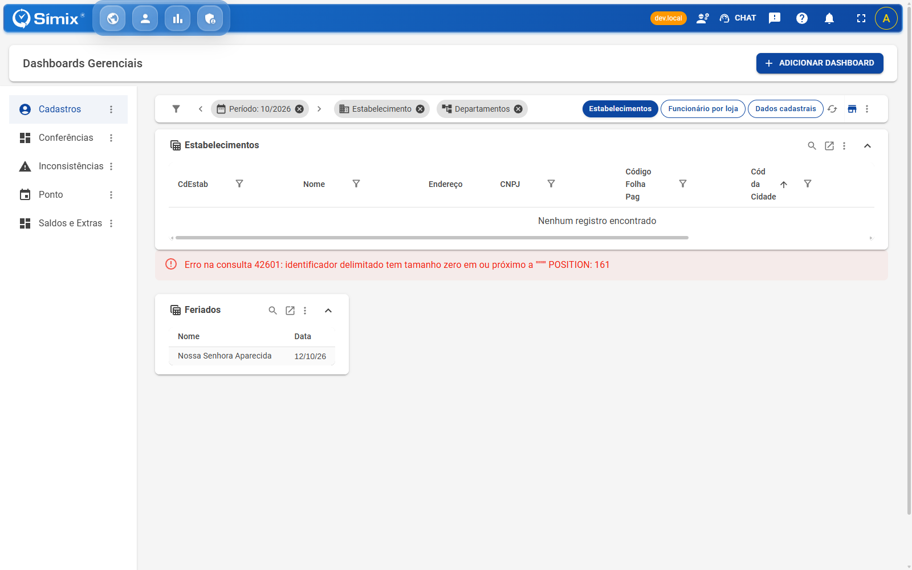

Depois: a coluna sem nome é ignorada e o widget carrega (valores borrados no print).
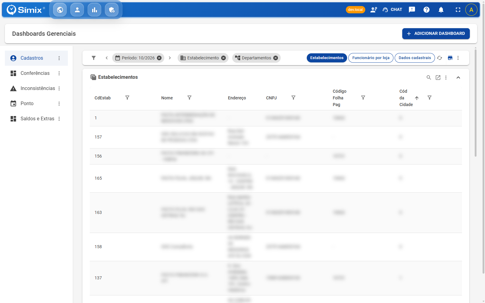

🤖 Generated with [Claude Code](https://claude.com/claude-code)


## ✨ Extras em colunas separadas no Excel e na impressão das tabelas [#2964](https://github.com/simixsistemas/Simix.Ponto.Cloud/pull/2964)

### Objetivo

Pedido do suporte no Teams: [Suporte Símix - Dev](https://teams.microsoft.com/dl/launcher/launcher.html?url=%2F_%23%2Fl%2Fmessage%2F19%3Ab8a2ad43e9ad4e95812880346e3a6f1d%40thread.tacv2%2F1791979860162%3FtenantId%3D40f4f4bc-eeaf-423d-8f46-a8a4ef3c2300%26groupId%3D50fa611d-d8f1-4db2-93d6-094a3788e236%26parentMessageId%3D1791979860162%26teamName%3DS%25C3%25ADmix%26channelName%3DSuporte%2520S%25C3%25ADmix%2520-%2520Dev%26createdTime%3D1791979860162%26ngc%3Dtrue&type=message&deeplinkId=96f701c5-2dee-4777-ac57-978f2a328359&directDl=true&msLaunch=true&enableMobilePage=true&suppressPrompt=true)

### Alterações
- ✨ Na **impressão** das tabelas dos dashboards, a coluna "Extras" passa a sair em uma coluna por percentual (Extras 50%, Extras 70%, Extras 100%…), cada uma só com as horas daquele percentual, igual ao Exportar Excel
- ✨ Nas tabelas agrupadas, a linha "Totais" de cada grupo soma as horas de cada percentual
- Quando nenhuma linha tem extras, continua a coluna única de antes. A tabela na tela não muda

### PR's referências
- simixsistemas/DevShare.RX.Cloud#159

### Demonstração

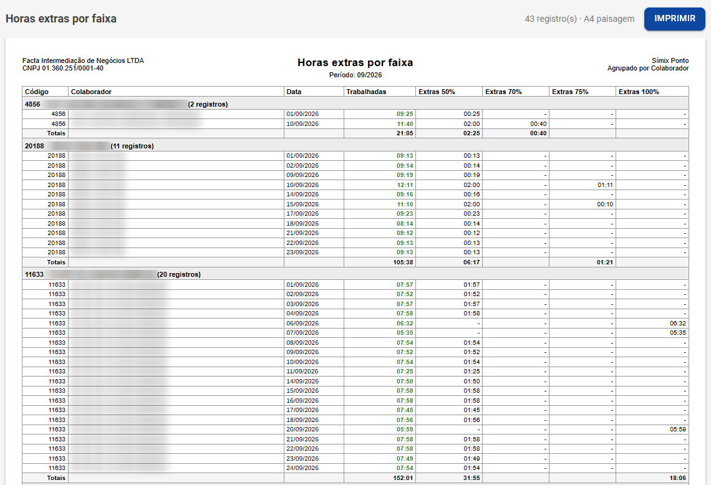
Impressão de uma tabela de dias calculados, agrupada por colaborador: uma coluna por percentual (50%, 70%, 75%, 100%) e os totais de cada grupo.

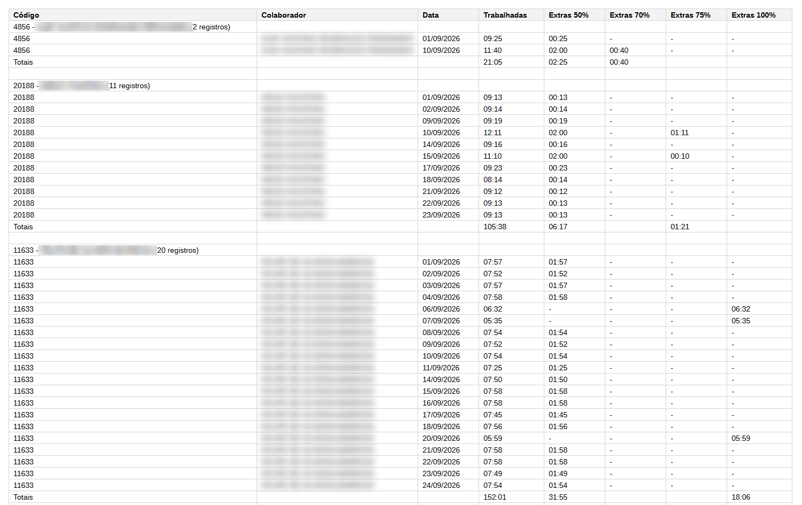
A mesma tabela no Exportar Excel (planilha convertida para imagem).

🤖 Generated with [Claude Code](https://claude.com/claude-code)


## ♻ Comandos da migração sem erro de coluna já existente [#2963](https://github.com/simixsistemas/Simix.Ponto.Cloud/pull/2963)

### Objetivo

Relacionado: [#2943](https://github.com/simixsistemas/Simix.Ponto.Cloud/issues/2943)

### Alterações
- ♻ Os comandos que a migração do PcPonto roda no banco novo antes de copiar os dados não acusam mais "coluna já existe": a coluna só é criada quando falta
- ♻ Os 12 comandos que falhavam em todo banco novo, por tabela ou coluna que não existe mais, ficam comentados no início do arquivo, com a data de retirada
- ♻ O log da implantação deixa de trazer erros desses comandos; o resultado no banco continua o mesmo

### PR's referências
- simixsistemas/Simix.Ponto.Migracao#34

### Demonstração

Banco recém-criado com a estrutura do Símix Ponto, comandos rodados do mesmo jeito que a migração roda:

| | Comandos | Com erro |
|---|---|---|
| Antes | 187 | 30 (18 de "coluna já existe" e 12 de tabela/coluna que não existe) |
| Depois, 1ª execução | 175 | 0 |
| Depois, 2ª execução | 175 | 0 |

Comandos comentados (tabela ou coluna que não existe num banco novo):

| Tabela | Comandos | Motivo |
|---|---|---|
| ContatosTipos | 1 | tabela não é criada pelo Símix Ponto |
| RegistrosImp | 5 | tabela não é mais criada |
| Scripts | 4 | tabela não é mais criada |
| BHTot | 1 | coluna FuncNome não existe |
| FuncVTsMesDias | 1 | tabela só existe no banco principal |


## ✨ Melhorias gerais: aviso de atualização, novidades do filtro global e dos bloqueios e filtros na manutenção em lote [#2962](https://github.com/simixsistemas/Simix.Ponto.Cloud/pull/2962)

### Objetivo

Fix: [#2953](https://github.com/simixsistemas/Simix.Ponto.Cloud/issues/2953)

### Alterações
- ✨ Aviso de atualização no meio da barra do topo, configurado no appsettings (chave `Banner`, com Ativo, Mensagem e Link). Clicar na mensagem leva para as novidades e o X fecha o aviso, que não volta mais naquele navegador. Se a mensagem mudar, o aviso aparece de novo para todos
- ✨ Quando falta espaço na barra, o aviso fica só com o ícone (a mensagem aparece ao parar o mouse) e, sem espaço nem para isso, ele não aparece
- ✨ Novidade "Filtro global": como funciona agora o funil do topo (mais campos, igual ou diferente, gravado no usuário), o botão Filtros de cada tela com filtros salvos e favoritos, e o filtro definido no cadastro de usuários
- ✨ Novidade "Bloqueio de períodos": o prazo nas Configurações, a data própria de cada período, o aviso dois dias antes, o que fica travado, a situação do portal e os prazos do portal
- ✨ Manutenção em lote: novos filtros por Cargo e por Quadro de horário, que se somam aos demais

### Demonstração

Aviso de atualização no meio da barra do topo:


Manutenção em lote filtrando por cargo e quadro de horário (setembro/2026: 3 colaboradores e 90 dias, os mesmos números conferidos no banco):
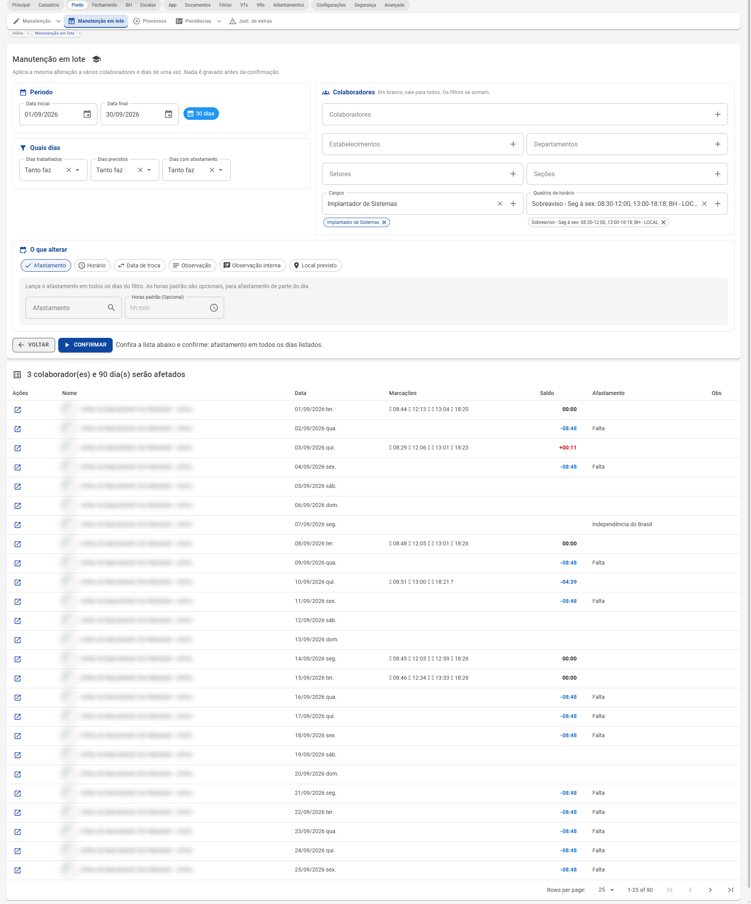

Novidade do filtro global:
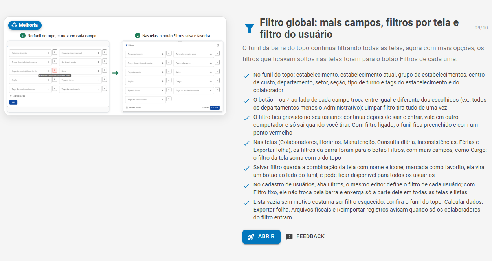

Novidade do bloqueio de períodos:
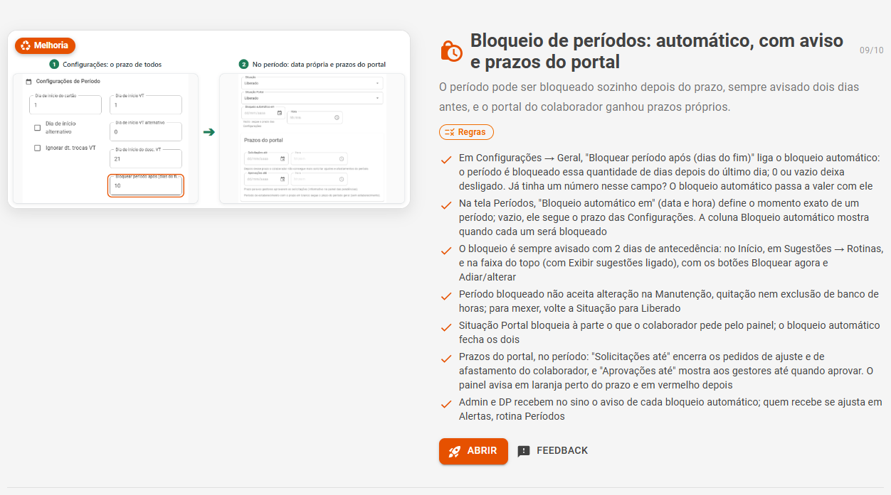


## ♻ Considerar extras após as no cadastro de horário por dia [#2961](https://github.com/simixsistemas/Simix.Ponto.Cloud/pull/2961)

### Objetivo

Fix: [#2894](https://github.com/simixsistemas/Simix.Ponto.Cloud/issues/2894)

### Alterações
- ♻ No cadastro de horário por dia, a opção "Considerar extras após as" vem antes do horário; o horário só fica liberado com a opção marcada e passa a ser obrigatório nesse caso (sem ele, o dia inteiro viraria extra)
- ✨ Dica no campo explicando a regra: o que for trabalhado depois do horário informado vira extra, mesmo sem completar as horas previstas, e o que faltou antes dele fica como falta

### PR's referências
- simixsistemas/Simix.Ponto.Calc#524

### Demonstração

A opção no cadastro de horário por dia, com o horário ao lado:

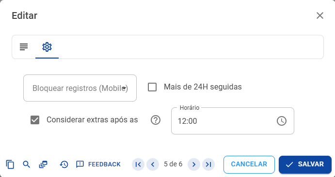

A dica do campo:

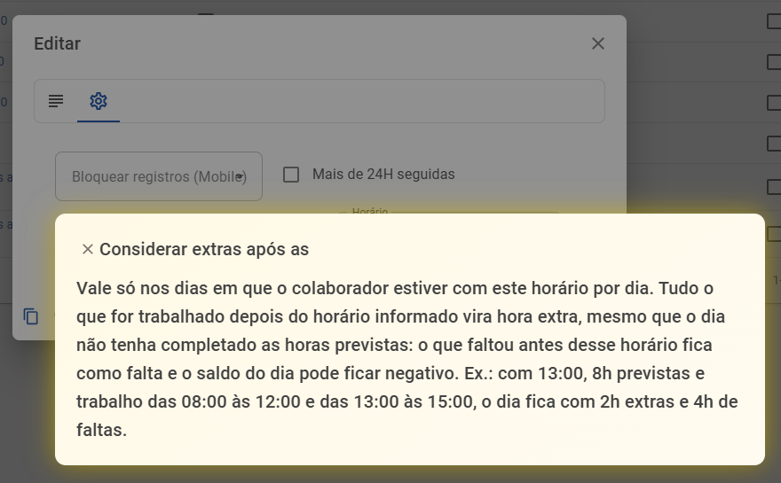

Resultado na manutenção do cartão (dia com 3h previstas, extras após as 12:00 e trabalho das 10:00 às 16:00): 04:00 de extras e 01:00 de falta.

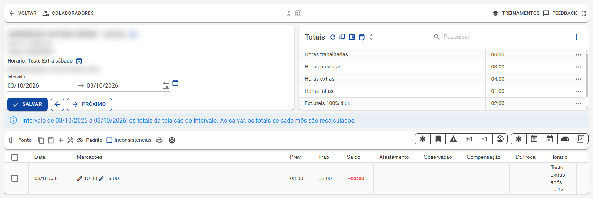


## ♻ Férias e Adiantamentos por feature e ajustes da revisão do release [#2955](https://github.com/simixsistemas/Simix.Ponto.Cloud/pull/2955)

### Objetivo

Ajustes da revisão do release dev → main: [simixsistemas/Simix.Ponto.Cloud#2952](https://github.com/simixsistemas/Simix.Ponto.Cloud/pull/2952)

### Alterações
- ♻ Os módulos de **Férias** e de **Adiantamento salarial** passam a ser ligados por cliente, em Suporte > Features, e vêm desligados por padrão. Com o módulo desligado:
  - o grupo some do menu;
  - as telas não respondem;
  - a tarefa diária não roda para aquele cliente;
  - o item "Adiantamento" não aparece para o colaborador.
- ♻ A data em que os saldos de férias foram recalculados não entra mais no histórico de alterações da ficha. Antes, o recálculo diário gerava uma alteração por período todo dia.
- ♻ Nos avisos da regra de alertas do registro, "Avisar antes" e "Lembrar depois" já nascem vazios em banco novo (vazio = sem aviso), em vez de 0.

> Atenção no deploy: cliente que já usa Férias ou Adiantamentos precisa ter a feature ligada no tenant, senão perde o acesso.

🤖 Generated with [Claude Code](https://claude.com/claude-code)


## ✨ Painel de inconsistências admin: menu e conferências de registros bloqueados e de outro layout [#2951](https://github.com/simixsistemas/Simix.Ponto.Cloud/pull/2951)

### Objetivo

Fix: [#2934](https://github.com/simixsistemas/Simix.Ponto.Cloud/issues/2934)

### Alterações
- ✨ Painel de inconsistências dos clientes no menu da administração (Principal → Inconsistências), agora com o menu e a barra da administração
- ✨ Nova conferência **Registros bloqueados por afastamento**: marcação feita num dia que continua com afastamento lançado (atestado, férias…) e que por isso ficou fora do cálculo
- ✨ Nova conferência **Marcações em outro layout (Livre/Motorista)**: dia com marcação num layout diferente do layout do horário do colaborador e nada no layout certo, que deixa o cartão vazio; o Reimportar traz as marcações para o layout atual
- 🐛 "Registros potencialmente irregulares" não lista mais o que a manutenção também deixa de fora de propósito (duplicados, ignorados, aguardando aprovação, bloqueados pela regra do registro web e os bloqueados por afastamento, que têm conferência própria)
- 🐛 Conferências de registros bem mais rápidas (em um cliente, de ~50 s para menos de 1 s)
- 🐛 Cliente aberto enquanto a contagem ainda rodava, ou depois de carregar de novo, ficava em "Nenhum dado carregado"
- 🐛 Mês da conferência "Mês potencialmente irregular" formatado como mês/ano

### Demonstração

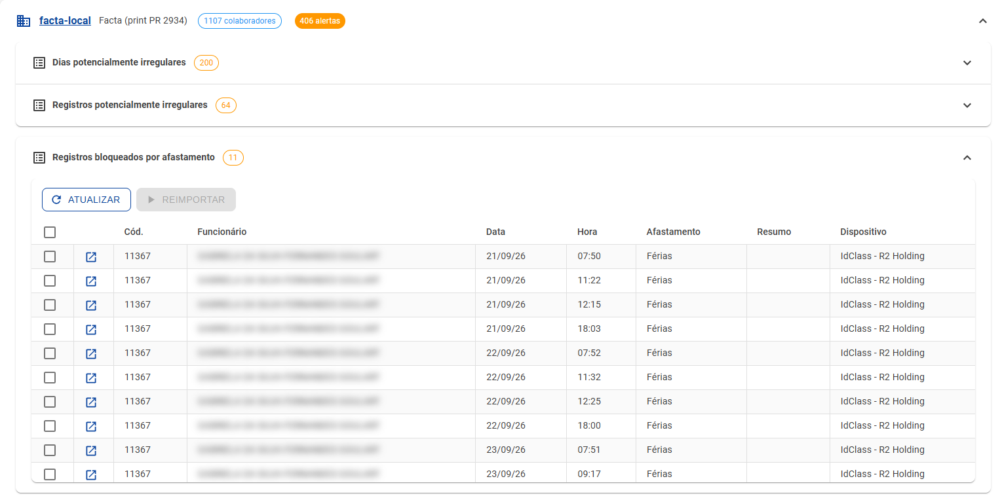
Marcações de uma colaboradora em férias, guardadas sem ir para o cálculo.

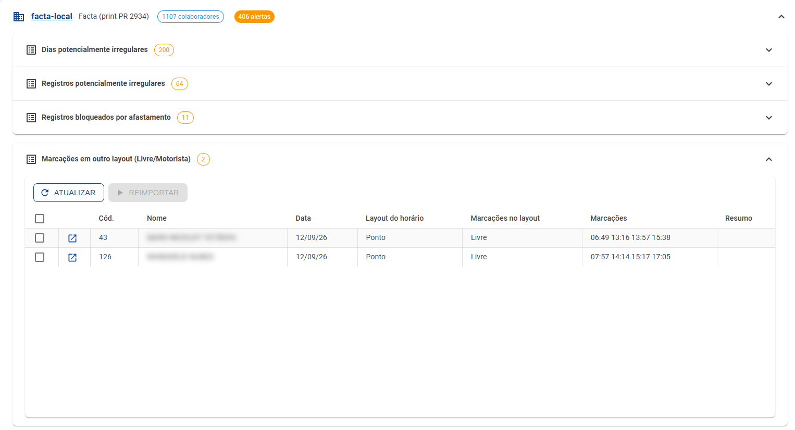
Dias com marcação só no layout Livre para colaboradores com horário no layout Ponto (caso montado no banco local para o print e removido depois).

🤖 Generated with [Claude Code](https://claude.com/claude-code)


## 🐛 Ajustes na Máquina do tempo da manutenção [#2950](https://github.com/simixsistemas/Simix.Ponto.Cloud/pull/2950)

### Objetivo

Fix: [#2936](https://github.com/simixsistemas/Simix.Ponto.Cloud/issues/2936)

### Alterações
- 🐛 A máquina do tempo mostra todas as marcações incluídas e retiradas na manutenção, inclusive as de lanche, que não apareciam
- 🐛 Marcação que só mudou de posição no dia (sem ter sido incluída nem retirada) não aparece mais como alteração
- 🐛 Clicar no chip volta a desfazer a alteração na tela, e clicar de novo refaz. Salvar a manutenção grava
- ✨ Dá para desfazer marcação, afastamento (junto com as horas gravadas na mesma vez), horas de afastamento, observação e data de troca. Turno especial, horário, almoço, janta e situação aparecem só para consulta
- ✨ O chip aparece riscado sempre que o dia está de novo como antes da alteração, também depois de salvar ou de reabrir a tela
- ✨ Quando o dia mudou depois da alteração, aparece um aviso em vez de aplicar. Num dia com Férias, o aviso diz para desfazer o afastamento antes das marcações
- 🐛 A opção "Máquina do tempo" do menu Ferramentas voltou a ficar disponível, e os botões Inserir e Ferramentas da barra ganharam o nome ao passar o mouse

### Demonstração

Ferramentas → Máquina do tempo:

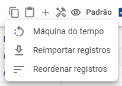

Dia em que as férias foram lançadas e as duas marcações retiradas na mesma gravação:

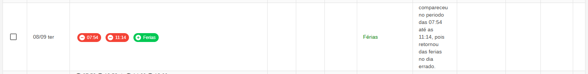

Depois de clicar em Férias, 07:54 e 11:14: as marcações voltam ao dia e os chips ficam riscados (desfeitos):

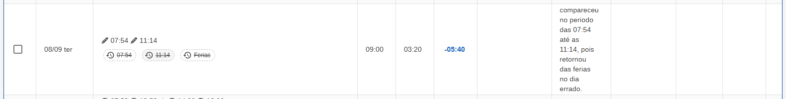

Afastamento com as horas gravadas juntas num chip só, antes e depois de desfazer:

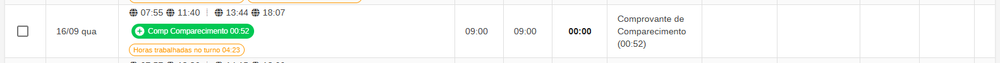

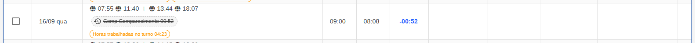

🤖 Generated with [Claude Code](https://claude.com/claude-code)


## Ajustes gerais e da migração 🐛 [#2949](https://github.com/simixsistemas/Simix.Ponto.Cloud/pull/2949)

### Objetivo

Fix: [#2933](https://github.com/simixsistemas/Simix.Ponto.Cloud/issues/2933)

### Alterações
- 🐛 Notificações voltam a abrir depois da migração do banco (antes aparecia o erro "Reading as 'System.DateTime' is not supported…")
- 🐛 As notificações trazidas do PcPonto entram como lidas: o sino não aparece mais com +99 logo após migrar
- 🐛 A implantação passa a guardar o link do backup enviado
- ✨ Menu de sincronização com atalho direto para Importar AFD
- ♻ O sistema abre por padrão no Início, em vez do Painel (também o atalho Gestão da barra do topo)

### Demonstração

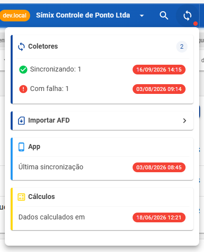
Menu de sincronização com o novo atalho "Importar AFD".


## 🐛 Login dos testes de UI do deploy dev aguenta o app frio [#2948](https://github.com/simixsistemas/Simix.Ponto.Cloud/pull/2948)

### Objetivo

Fix: [Deploy (dev) 38457757085](https://github.com/simixsistemas/Simix.Ponto.Cloud/actions/runs/38457757085)

### Alterações
- 🐛 Os testes de cadastro (colaborador, horário e calcular dados) não falham mais quando são os primeiros a rodar depois do deploy no dev. Nessa situação o app ainda está frio, e a tela inicial depois do login passava do limite de 30 s. O limite agora é de 3 minutos, o mesmo que os testes de navegação ganharam no PR anterior.

### PR's referências
- simixsistemas/Simix.Ponto.Cloud#2946

🤖 Generated with [Claude Code](https://claude.com/claude-code)


## ✨ Melhorias de feedbacks: permissão do salário, manutenção em lote e espelho [#2947](https://github.com/simixsistemas/Simix.Ponto.Cloud/pull/2947)

### Objetivo

Fix: [#2916](https://github.com/simixsistemas/Simix.Ponto.Cloud/issues/2916)

### Alterações
- ✨ Nova permissão **Ver salário e valor hora** (em Colaboradores). Sem ela, o valor do salário, o valor hora e os adicionais fixos não aparecem no cadastro do colaborador e não são enviados pelo sistema; ao salvar, os valores já gravados são mantidos. O administrador recebe a permissão na atualização do sistema; os modelos de permissão que incluem Colaboradores também a concedem
- ✨ Manutenção em lote com novo layout: filtros agrupados em Período, Quais dias e Colaboradores, e escolha de um único tipo de alteração por lote (afastamento, horário, data de troca, observação, observação interna ou local previsto), com uma explicação curta de cada um
- ✨ Manutenção em lote: aviso ao lado do Executar de que ele mostra a prévia dos dias e colaboradores que terão alteração, sem gravar nada
- ✨ Espelho de ponto: a data e a hora da última geração do período aparecem em destaque no cabeçalho, e a data de geração do card deixou de ficar em cinza

### Demonstração

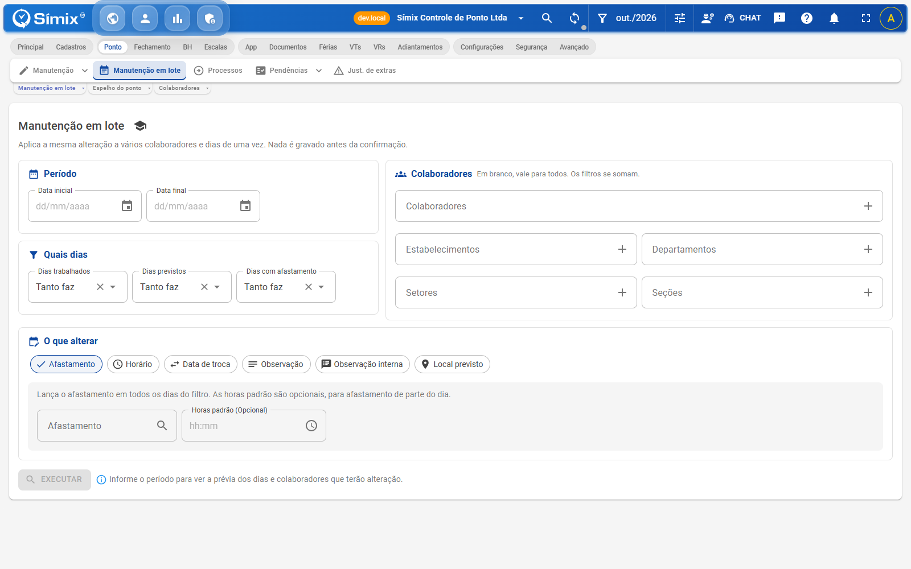
Filtros agrupados, tipo de alteração único e o aviso da prévia ao lado do Executar.

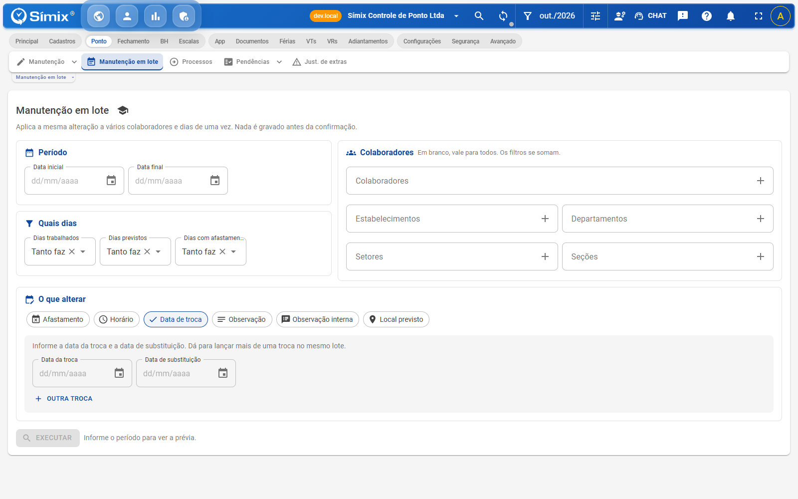
Ao trocar o tipo, os campos de baixo mudam para o tipo escolhido.

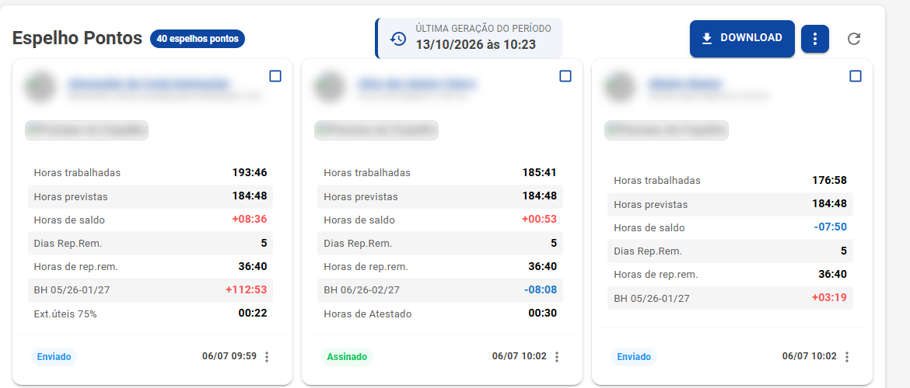
Última geração do período em destaque no cabeçalho e data do card na cor normal.


## 🐛 Testes de navegação do deploy dev aguentam o app frio [#2946](https://github.com/simixsistemas/Simix.Ponto.Cloud/pull/2946)

### Objetivo

Fix: [Deploy (dev) 38413248079](https://github.com/simixsistemas/Simix.Ponto.Cloud/actions/runs/38413248079)

### Alterações
- 🐛 Os testes de navegação das telas de manutenção não falham mais quando são os primeiros a rodar depois do deploy no dev. Nessa situação o app ainda está frio, e o login ou a primeira tela passavam do limite de 30 s/60 s. O limite agora é de 3 minutos.
- A ordem dos testes é sorteada a cada execução, por isso a falha aparecia só em algumas runs: em 07/10 e em 13/10. Nas outras, os testes de cadastro rodavam antes e aqueciam o app.

🤖 Generated with [Claude Code](https://claude.com/claude-code)


## 🐛 Histórico de colaboradores migrados do PcPonto não aparecia [#2945](https://github.com/simixsistemas/Simix.Ponto.Cloud/pull/2945)

### Objetivo

Fix: [#2943](https://github.com/simixsistemas/Simix.Ponto.Cloud/issues/2943)

### Alterações
- 🐛 O histórico dos colaboradores trazido do PcPonto volta a aparecer na guia Histórico do cadastro
- 🐛 Cada registro migrado mostra o tipo que tinha no PcPonto, e o usuário que fez o lançamento quando ele tem acesso ao Símix Ponto com o mesmo e-mail, login ou nome
- 🐛 No fim da implantação, os ajustes dos dados migrados passam a rodar no banco do cliente. Antes rodavam no banco principal, e o histórico ficava sem ligação com o colaborador
- ✨ As próximas migrações do PcPonto já trazem os tipos de histórico ligados aos registros

### Demonstração


## ✨ Ajustes gerais SSM: CPF em dois cadastros, atalho do AFD e regra de feriados [#2944](https://github.com/simixsistemas/Simix.Ponto.Cloud/pull/2944)

### Objetivo

Fix: [#2941](https://github.com/simixsistemas/Simix.Ponto.Cloud/issues/2941)

### Alterações
- ✨ A Solução de problemas da manutenção avisa quando outro cadastro tem o mesmo CPF ou PIS: mostra qual deles está recebendo as marcações, quantas recebeu no período, um botão para abrir o cartão dele e como resolver
- ✨ A Solução de problemas lista os arquivos AFD do período com o atalho **Visualizar AFD**, que já abre filtrado pelo colaborador e pelas datas do cartão
- ✨ Ao cadastrar um colaborador novo com o CPF de outro colaborador e nome diferente, o sistema avisa e pergunta se deseja cadastrar mesmo assim. Ao cancelar, o cadastro continua aberto para corrigir
- 🐛 A busca de cadastros com o mesmo CPF/PIS passa a encontrar também os documentos gravados com máscara
- 🐛 A regra de inconsistência "Feriados seguidos trabalhados" sem Qtd Min. nem Qtd Max. passa a ser recusada também pelo servidor
- 🐛 Pela Calc (PR abaixo): feriado não trabalhado deixa de gerar "0 Feriados seguidos". E, no horário noturno com o intervalo depois da meia-noite, a interjornada passa a contar a madrugada no dia certo (era "Interjornada 00:32" em vez de 24:32), e as marcações deixam de pular para o 2º turno, que gerava "Horas de atraso 19:17". Dias já gravados com os turnos deslocados precisam ser reimportados pela manutenção

### PR's referências
- simixsistemas/Simix.Ponto.Calc#522

### Demonstração

Solução de problemas no colaborador da issue (cópia local do SSM): o outro cadastro com o mesmo CPF recebe todas as marcações do relógio. O arquivo AFD listado é um registro de teste do banco local.

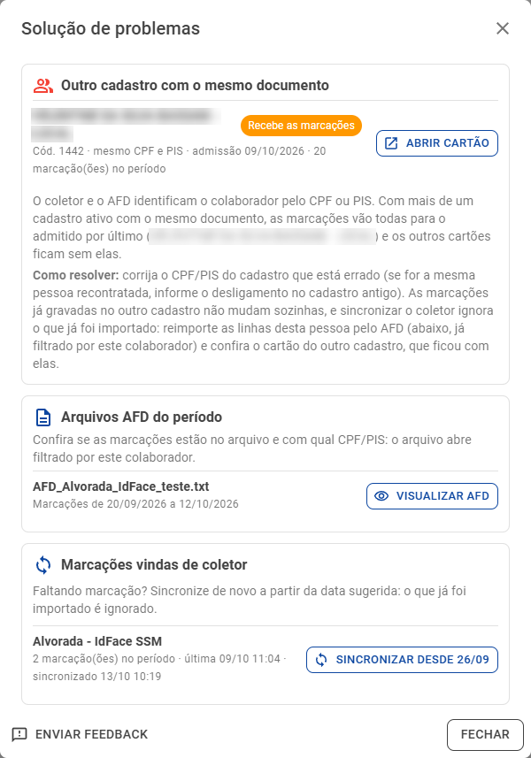

Cadastro novo com o CPF desse colaborador e outro nome: o sistema pergunta antes de gravar.

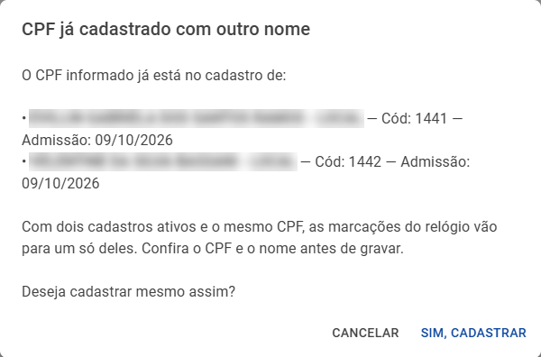

🤖 Generated with [Claude Code](https://claude.com/claude-code)


## ♻ Ajustes na retenção dos builds dos deploys [#2942](https://github.com/simixsistemas/Simix.Ponto.Cloud/pull/2942)

### Objetivo

Evitar que o armazenamento do GitHub Actions da organização lote de novo e bloqueie os deploys.

### Alterações
- ♻ O build gerado em cada deploy (dev, beta e worker beta) passa a ficar guardado por 3 dias, em vez dos 90 dias padrão. Ele só serve para levar o build ao deploy da mesma execução, e 3 dias ainda permitem repetir um deploy que falhou (inclusive depois de um fim de semana)
- ♻ Os builds antigos (294 arquivos, ~79 GB, acumulados desde julho) já foram apagados; ficou o último de cada deploy

🤖 Generated with [Claude Code](https://claude.com/claude-code)

## ✨ Melhorias nos lançamentos de cálculo: exemplos, asterisco e edição pela Manutenção [#2940](https://github.com/simixsistemas/Simix.Ponto.Cloud/pull/2940)

### Objetivo

Fix: [#2932](https://github.com/simixsistemas/Simix.Ponto.Cloud/issues/2932)

### Alterações
- ✨ Exemplos prontos no cadastro de lançamento novo: Somar 1 desconto DSR (Regra não prevista/especial), Mais uma hora extra (Ajuste mês anterior) e Valor de desconto (Desconto adicional em folha). Um clique preenche ação, campo, conteúdo e observação, sem trocar colaborador e mês
- ✨ Nos Totais da Manutenção, o total alterado por um lançamento (Substituir, Somar ou Diminuir) ganha um asterisco ao lado do nome; parando o mouse sobre ele, aparece o que o lançamento fez
- ✨ O botão "..." do total com lançamento abre Editar lançamento e Explicação; gravou, o mês é recalculado. Sem lançamento, o botão continua abrindo a explicação direto. No modo somente leitura fica só o asterisco
- 🐛 Total criado pelo lançamento aparecia na Manutenção com o nome técnico ("HorasExtras", "DiasDescRepRem"); agora mostra o nome do campo ("Horas extras", "Dias de desconto do repouso remunerado")
- ✨ Card na página de novidades

### PR's referências
- simixsistemas/Simix.Ponto.Calc#523

### Demonstração

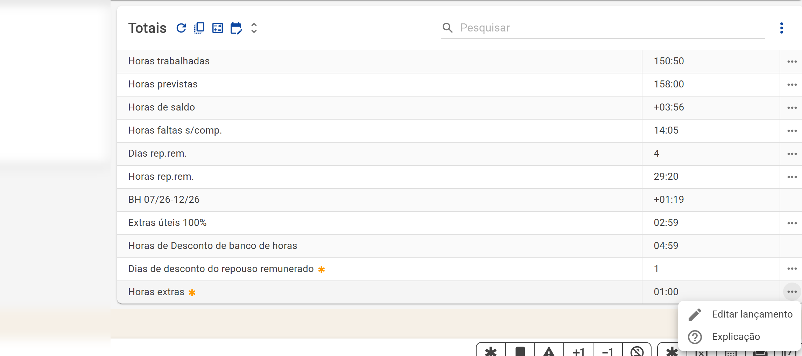
Totais da Manutenção: asterisco nos totais alterados pelos lançamentos e o menu "..." com Editar lançamento e Explicação.

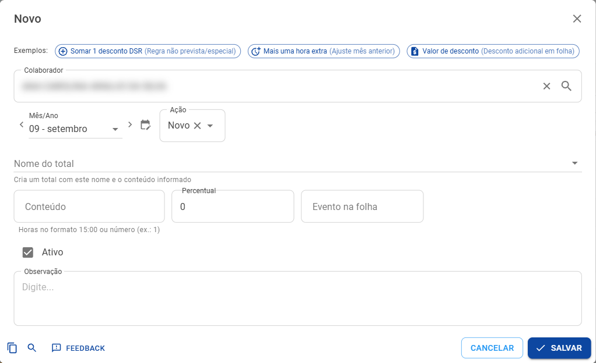
Lançamento novo com os exemplos no topo.

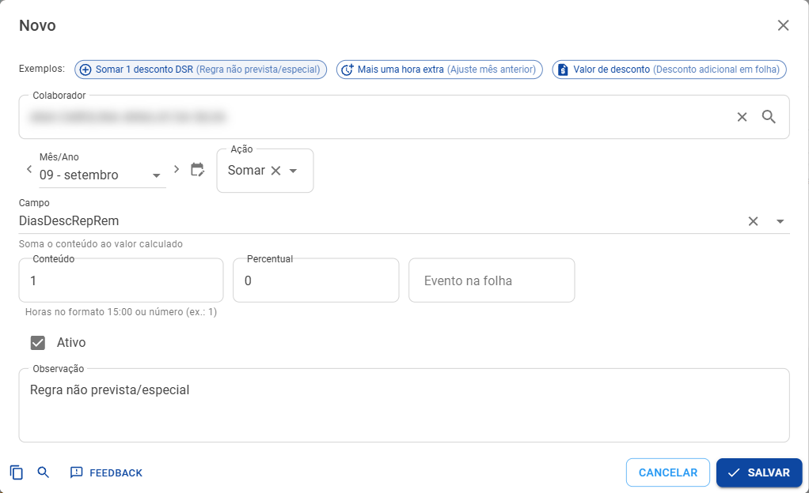
Depois de clicar em "Somar 1 desconto DSR": ação, campo, conteúdo e observação preenchidos.

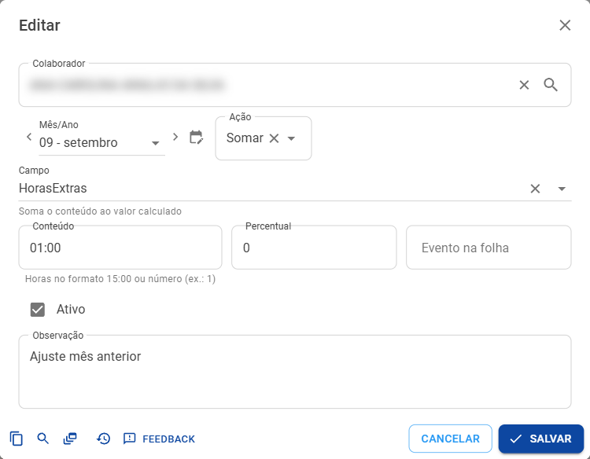
Editar lançamento aberto pelo "..." do total de horas extras.

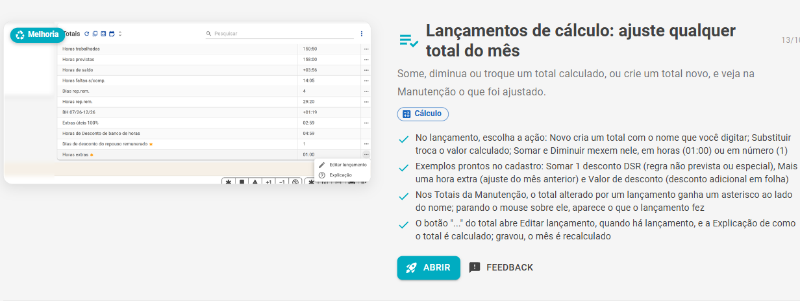
Card na página de novidades.

🤖 Generated with [Claude Code](https://claude.com/claude-code)


## ♻ Demais entradas da Calc assíncronas (12.6) e tenant nas escalas [#2939](https://github.com/simixsistemas/Simix.Ponto.Cloud/pull/2939)

### Objetivo

### Alterações
- ♻ As partes do sistema que ainda chamavam a Calc da forma antiga (síncrona) agora usam a versão assíncrona da 12.6. São 15 pontos, nestas partes:
  - a importação de marcações, no caminho comum a todas as origens;
  - a geração de escalas;
  - a exportação da folha;
  - o vale-transporte e o vale-refeição (4 pontos: validar e gerar, em cada um);
  - os arquivos fiscais (AEJ, AFDT e ACJEF);
  - a mudança do dia de início do cartão e a verificação do período do banco de horas que ela faz;
  - a geração do ano/mês dos colaboradores (2 pontos);
  - o recálculo do banco de horas de um colaborador, usado pela quitação do banco de horas e pela rota de recálculo da API;
  - a rota antiga da API de ajuste de período do banco de horas, que nenhuma tela usa (2 pontos);
  - o processo, que hoje não tem uso na tela.

  Enquanto espera o banco de dados, o servidor fica livre para atender as outras telas. A compilação não tem mais nenhum aviso de método obsoleto da Calc (eram 15).
- 🐛 A geração de escalas passa a gravar o tenant nos dias de ponto e no histórico que ela cria. Antes, essas linhas ficavam sem tenant, e as telas que filtram pelo tenant não as mostravam: agora os dias e o histórico criados pelas escalas aparecem nelas. O processo também passa a receber o tenant.
- ♻ Quando a data de troca de um dia muda, a Calc agora prepara antes, de forma assíncrona, o horário da nova data. A preparação vale para a Manutenção, a aplicação de escala, a importação de TXT com informações do dia e o salvar da Manutenção. Assim, o recálculo do dia não consulta mais o banco de forma síncrona.
  - Na Manutenção, enquanto a nova data é preparada, os botões e o calendário da data de troca ficam desligados. Um Salvar clicado nesse meio-tempo espera a preparação terminar e grava a troca junto.
  - Quando a nova data é coberta por um quadro de horário por período, o recálculo do dia segue o que a regra da Calc define para uma nova carga do cartão. Por exemplo, se o horário do período tem intervalo pré-assinalado:
    - se o dia já tem a saída e a volta do intervalo marcadas, elas passam a pré-assinaladas (P). Foi o caso testado: só essas duas marcações mudaram de tipo, e as horas e os totais ficaram iguais;
    - se o intervalo não está marcado no dia, a Calc pode inserir o intervalo pré-assinalado, e aí as horas do dia mudam.
  - Marca pré-assinalada alterada à mão na Manutenção é respeitada: a Calc não a refaz naquele dia.
  - **Se depois a data de troca for removida, as marcas P (ou o intervalo inserido) continuam no dia.** As horas só voltam ao que eram no caso de reclassificação, que é o testado. A Calc não apaga marca pré-assinalada no recálculo quando a data sai: isso faz parte da regra acima e não é erro desta alteração.
- 🐛 Limpeza única, em cada banco, das linhas vazias (todas as colunas de dados nulas) que o log antigo de vale-transporte deixava. A limpeza roda com a atualização do banco e pode rodar de novo sem efeito. Nos 15 bancos locais eram 177 linhas, e nenhuma linha com dado foi tocada.
- ♻ O build de Release passa a usar o pacote `Simix.Ponto.Calc` `12.6.*`. **Ele precisa do pacote 12.6.x, que é publicado quando o simixsistemas/Simix.Ponto.Calc#521 entra na `dev` da Calc.** O #521 entrou na `dev` em 12/10, o deploy publicou a 12.6.1, e o build Release do Application já resolve a 12.6.1.

### Como foi conferido
- **Banco local de um cliente** (mês 06/2026, cartão de 21/05 a 20/06), comparado com a `dev` atual compilada contra a mesma Calc. A `dev` rodou duas vezes, para separar o que muda sozinho entre execuções.
- **19 operações pela API e por tarefa:**
  - geração do ano/mês;
  - recálculo do banco de horas;
  - dia de início, sem e com mudança do período do banco de horas;
  - importação de marcações: as que entram, uma que falha porque já existe e uma com erro antigo;
  - geração de escalas, duas vezes seguidas;
  - vale-transporte e vale-refeição (este em dois meses);
  - folha;
  - arquivos fiscais;
  - troca de data pela aplicação de escala: dentro do cartão, fora do cartão (com quadro por período comum e com intervalo pré-assinalado) e removendo cada uma das duas trocas de fora do cartão.
- **Resultado:** depois de cada operação, as linhas gravadas em 35 tabelas (cerca de 354 mil linhas) foram as mesmas da `dev`, fora as duas diferenças esperadas. As respostas e a quantidade de linhas incluídas, alteradas e apagadas por tabela também foram as mesmas, e o tempo ficou na mesma faixa.
  - **Diferença (a), escalas:** as 217 linhas de ponto e as 217 de histórico criadas pela geração de escalas saem com o tenant; na `dev`, saem sem. Nenhuma outra coluna muda. Gerar de novo não grava nada nos dois lados.
  - **Diferença (b), troca de data:** vale para uma troca para fora do cartão, coberta por quadro por período com intervalo pré-assinalado. Muda só o dia trocado, de um colaborador: 2 marcações passam de W (Web) a P (pré-assinalada), e o resumo do dia acompanha. Removendo a troca, as duas marcas P ficam, com o resumo do dia, e só isso difere da `dev`.
    - Com quadro por período comum, sem pré-assinalado, não houve diferença.
    - Nenhum horário do banco local tinha pré-assinalado, então o caso foi montado por SQL.
- **Na Manutenção, pelo navegador, nos dois sistemas.** Trocas de data salvas:
  - com "Próximo domingo", dentro do mês;
  - pelo calendário, para fora do cartão (o caso da diferença (b));
  - removendo cada uma das duas trocas.
  - O gravado foi igual ao da `dev`, fora a diferença (b) no dia trocado. O total do dia na tela foi igual ao gravado nos dois sistemas, inclusive o tipo de cada marcação.
  - Uma data de troca antes da admissão dá o mesmo resultado nos dois: a célula da data de troca fica vazia, o log registra "Funcionário (…) inativo na data de troca (…)", e nada é gravado.
- **Cliques durante a preparação da nova data**, num dia cujo próximo domingo fica fora do cartão. Para os cliques caírem durante a preparação, ela foi alongada de propósito (uma tabela presa por 4 s no banco); o clique duplo e o Remover rodaram também no tempo normal.
  - Clique duplo em "Próximo domingo": os botões e o calendário da data de troca ficam desligados até o fim da preparação, a troca entra uma vez só e não aparece erro.
  - "Remover" logo depois de "Próximo domingo": no tempo normal, o Remover vale. Com a preparação alongada, o Remover está desligado enquanto ela não termina e o clique não conta; clicado depois, remove a troca.
  - Salvar logo depois de "Próximo domingo": a troca foi gravada. Este teste não separa as duas versões, porque a tabela presa segurou também o Salvar da versão anterior. A espera do Salvar está garantida pelo código, não por este teste.
  - A troca para fora do cartão pelo calendário (o caso da diferença (b)) foi refeita com esta versão e gravou o mesmo de antes.
- **Testes:** os de domínio passaram todos (965). Nos de aplicação, 1377 de 1378: a única falha já existia antes desta alteração (mapeamento do filtro de layout).

### Pontos de atenção
- **Deploy:** em produção, rodar o DbMigrator depois do swap. Os workflows de beta e de produção não rodam o DbMigrator, e a limpeza do log de vale-transporte (`SQLs/Ajustes/20261012_FuncVTsMesLog.LinhasNulas.sql`) só roda com ele. O script pode rodar de novo sem efeito.
- Erros que já existiam e **não** foram corrigidos aqui (fora do escopo):
  - a rota antiga da API de ajuste de período do banco de horas, que a tela não usa, continua falhando com erro de referência nula;
  - mudar o dia de início do cartão quando o período do banco de horas muda falha no Postgres (`UPDATE BHTot` sem aspas, erro 42P01). A falha e a mensagem são as mesmas da `dev`, e nada é gravado. A correção fica para um PR próprio;
  - o recálculo do banco de horas resolve o mês civil, e não o do cartão, para quem tem dia de início a partir de 16. É uma decisão de negócio;
  - o botão "Filtrar" da geração de escalas manda o nome do tipo no filtro de estabelecimento, e o servidor ignora esse filtro;
  - a manutenção em lote muda a data de troca dentro da própria Calc, ainda sem a preparação assíncrona. Fica para a próxima fase da Calc;
  - a importação de marcações continua sem cancelamento. Cada marcação é curta, e as tarefas que podem ser canceladas já conferem o pedido entre uma marcação e outra;
  - a importação de marcações grava sem tenant o histórico do registro que ela ignora por já ter sido computado (no teste, 2 linhas, iguais na `dev`). Não é das escalas e fica fora desta alteração;
  - as linhas de ponto e de histórico gravadas sem tenant pelas escalas antigas continuam no banco (`SQLs/Manutencoes/DiagnosticoTenantIdOrfao.sql` já as lista). Esta alteração só corrige as novas.
- Caso raro: ao salvar a Manutenção, se a Calc ajustar a data de troca pela admissão ou pela demissão, a data ajustada não passa pela preparação e é consultada de forma síncrona, como antes.
- Não testado localmente de ponta a ponta:
  - a importação de TXT com informações do dia, que também ganhou a preparação da data de troca;
  - o processo e a rota antiga de ajuste de período do banco de horas: sem uso hoje, conferidos só pela compilação;
  - o conteúdo do vale-refeição e da folha: no banco local, o vale-refeição não gravou nada e o layout de folha usado não exportou nenhum colaborador (o fluxo rodou igual nos dois lados);
  - períodos novos gravados com tenant pela Calc 12.6: nenhum período novo foi criado nos testes.

### PR's referências
- simixsistemas/Simix.Ponto.Calc#521

### Demonstração
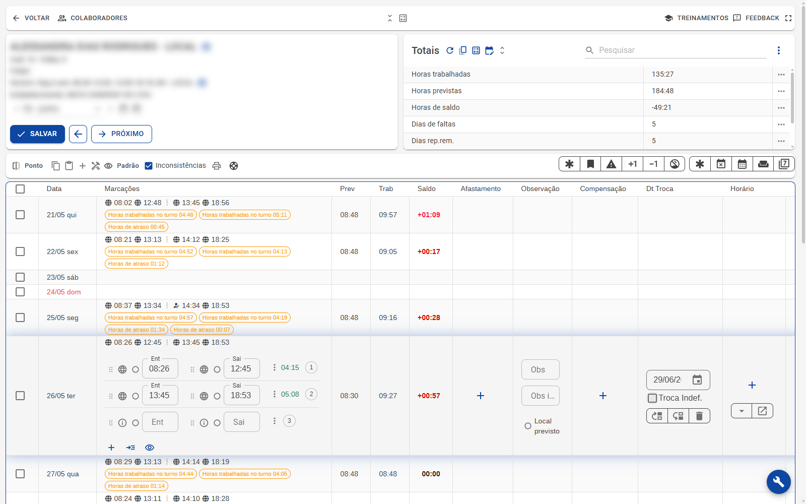
Na `dev`: a troca de 26/05 para 29/06, fora do cartão, num dia coberto por quadro de horário por período. As marcações continuam Web.


Com esta alteração, no mesmo dia: as marcações de 12:45 e 13:45 passam a pré-assinaladas (P), como a regra da Calc define para uma nova carga do cartão. Previstas, trabalhadas e saldo (08:30, 09:27 e +00:57) são os mesmos da `dev`.

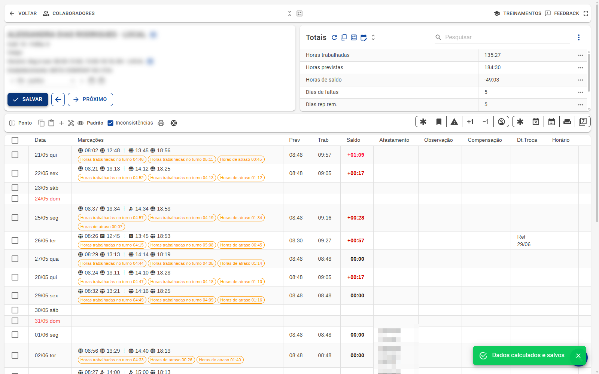
Depois de salvar, o dia mostra a referência 29/06 e o mesmo total, que é o que ficou gravado.


Depois de remover a troca e salvar, o dia volta a 08:48, 09:27 e +00:39, e as marcas P continuam.

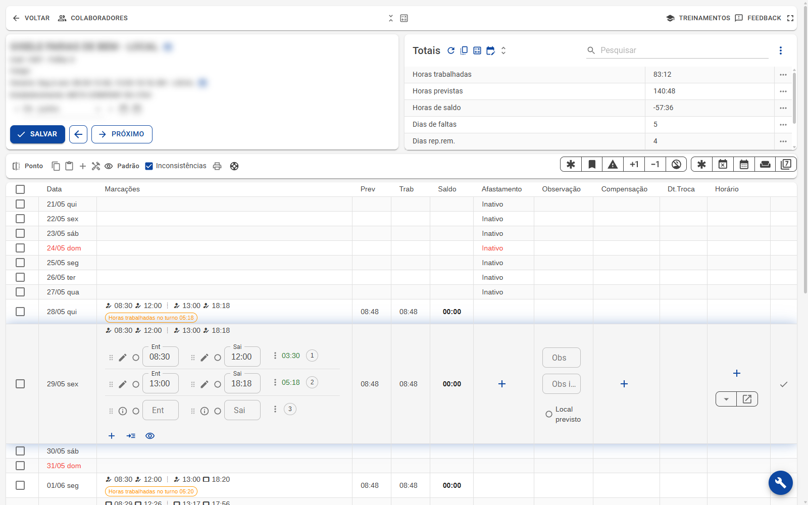
Com uma data de troca antes da admissão, a célula fica vazia e nada é gravado, igual na `dev`.

🤖 Generated with [Claude Code](https://claude.com/claude-code)


## 🐛 Correção do teste de UI de inclusão de colaborador [#2938](https://github.com/simixsistemas/Simix.Ponto.Cloud/pull/2938)

### Objetivo

Fix: [falha nos testes de UI do Deploy (dev)](https://github.com/simixsistemas/Simix.Ponto.Cloud/actions/runs/38179114217)

### Alterações
- 🐛 O teste automático de inclusão de colaborador voltou a funcionar. Desde a chegada do novo botão de filtro, a tela de colaboradores tem um campo "Estabelecimento" no painel de filtro, que fica escondido, além do campo do cadastro. O teste encontrava os dois e parava com erro.
- ♻ Os testes de tela agora só preenchem campos que estão visíveis, então o painel de filtro escondido não atrapalha os outros testes de cadastro.

🤖 Generated with [Claude Code](https://claude.com/claude-code)


## ♻ Melhorias ao entrar na linha da Manutenção [#2930](https://github.com/simixsistemas/Simix.Ponto.Cloud/pull/2930)

### Objetivo

Deixar mais rápida a entrada em um dia da Manutenção e corrigir o clique que às vezes não abria o dia.

### Alterações
- ♻ Ao clicar em um dia da Manutenção, a tela volta a responder bem mais cedo: numa conexão comum, a espera depois do clique caiu de cerca de 2,5 s para 0,5 s. Os menus e painéis de cada marcação (tipo de local, informação da marcação, estabelecimento, OS e os menus do turno) passam a ser carregados só quando abertos
- 🐛 Com a justificativa obrigatória ligada, depois de alterar uma hora, o primeiro clique em outro dia só fechava o dia atual e era preciso clicar de novo. Agora o dia abre no primeiro clique, e a justificativa continua sendo cobrada ao salvar
- 🐛 A tela acumulava memória a cada dia aberto, o que pesava ao longo do uso e ao trocar de colaborador
- ♻ A lista de justificativas é carregada uma vez por colaborador, e não mais a cada dia aberto

### Demonstração

Medido localmente, com a conexão simulada (cerca de 50 ms de ida e volta e 10 Mbps), em 6 dias × 2 rodadas:

| | Antes | Depois |
|---|---|---|
| Espera depois de clicar em um dia | 2,5 s | 0,5 s |
| Espera depois de alterar uma hora e clicar em outro dia | 2,8 s | 0,4 s |
| Dia abriu no primeiro clique (após alterar uma hora) | 6 de 12 | 12 de 12 |

O menu de tipo de local é carregado no primeiro clique e abre no mesmo lugar:

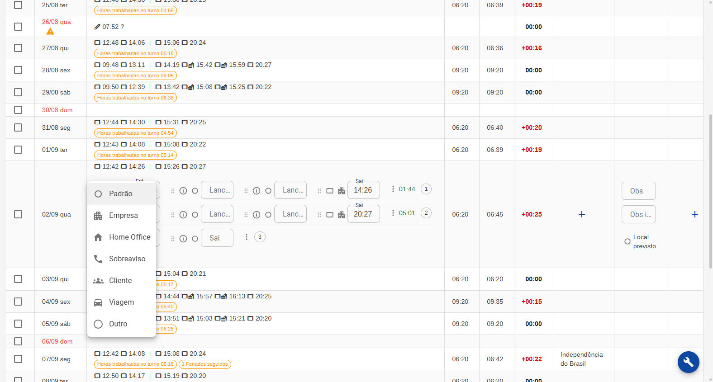

O painel de informação da marcação só existe enquanto está aberto:

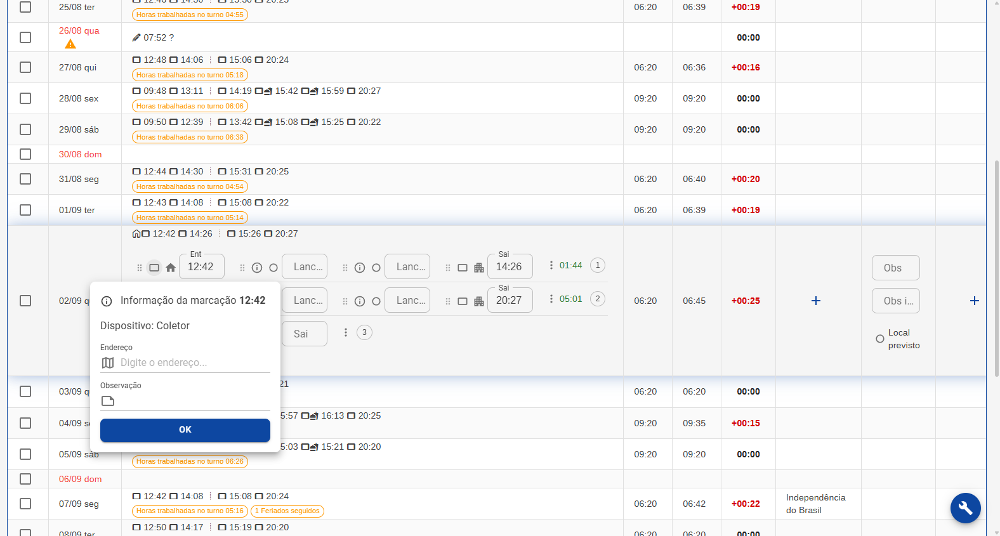

🤖 Generated with [Claude Code](https://claude.com/claude-code)


## ✨ Módulo de adiantamento salarial [#2929](https://github.com/simixsistemas/Simix.Ponto.Cloud/pull/2929)

### Objetivo

Fix: [#2914](https://github.com/simixsistemas/Simix.Ponto.Cloud/issues/2914)

### Alterações
- ✨ Painel do RH com os pedidos do mês: salário-base, convênio, consignado e pensão, quanto o pedido compromete do limite, o valor aprovado e a situação de cada colaborador. Aceita as sugestões de uma vez e reprova em lote quem está sem margem ou bloqueado. Tudo segue o filtro global da barra do topo, inclusive as ações em lote
- ✨ Análise de cada pedido: a margem do mês em barras (salário, limite, descontos, pedido e sugestão), a origem dos descontos, a situação no ponto, os últimos meses e a decisão, com o texto que o colaborador recebe no aviso. Navega entre as pendências sem fechar a janela
- ✨ O colaborador pede o adiantamento pelo portal: vê quanto tem disponível, escolhe o valor, acompanha a conferência do RH e pode alterar ou cancelar até o prazo. O resultado chega como aviso no app, e chega de novo se o RH mudar a decisão depois
- ✨ O gestor do estabelecimento lança os pedidos da sua equipe e pode repetir os pedidos do mês anterior. Vê só o disponível e a situação de cada pedido, sem salário, descontos nem o motivo do RH. A tela pede a permissão "Lançar pedidos" e lotação fixa no filtro do usuário; pedido feito pelo app ou pelo RH só o colaborador ou o RH alteram. Sair da tela com valores não salvos pede confirmação
- ✨ Descontos do mês: o convênio, o consignado e pensão e a baixa do convênio entram por arquivo, lido por um layout de integração salvo, com conferência antes de gravar. O colaborador é achado pelo CPF e, sem CPF no arquivo, pelo código. Linhas fora do cadastro ou de demitidos ficam para resolver, importar de novo mantém o que já foi resolvido, e a lista de quem fica sem desconto no mês vai para o contas a receber
- ✨ Envio à folha: arquivo com os eventos do adiantamento e do convênio (pelo código do colaborador na folha), aviso do resultado aos colaboradores depois da análise concluída, totais por estabelecimento e conferência da baixa do convênio
- ✨ Pedido aprovado vai para a folha. Se depois da aprovação aparecerem férias, afastamento, demissão ou aviso prévio no pagamento, o pedido volta para a decisão do RH
- ✨ Regras: valor pedido, percentual fixo ou proporcional aos dias trabalhados; teto de 80% do salário (configurável), arredondamento, valor mínimo e máximo; calendário com antecipação ou adiamento em fim de semana e feriado; bloqueios por férias, afastamento, demissão, aviso prévio, admissão recente, faltas e vínculo; aprovação automática do que está no limite; exceções por grupo de colaboradores e simulação ao lado. Regras e calendário são gravados juntos
- ✨ O mês abre sozinho no dia configurado e a conta dos pedidos é refeita todo dia. Regra alterada vale a partir do próximo mês: o mês aberto fica com as regras de quando abriu
- ✨ Cadastro do colaborador com o campo de adicionais fixos, que pode entrar na base do adiantamento
- ✨ Layouts de integração com finalidade: os de adiantamento são usados na importação dos descontos
- ♻ Os tipos de motivo ficam numa lista só, com o novo tipo "Adiantamento"

### Demonstração

Painel do RH no mês, com as etapas, os totais e os pedidos (nomes ofuscados):


Análise de um pedido acima do disponível, com a sugestão pela margem livre:


Portal do colaborador: o pedido e o acompanhamento depois de aprovado:


Tela do gestor do estabelecimento, com a situação de cada pedido:


Descontos do mês, com o arquivo do convênio importado e as linhas a resolver:


Envio à folha durante o prazo dos pedidos: o arquivo e os avisos esperam a análise:


Regras com a simulação (salário de R$ 1.872,00 e R$ 299,60 de convênio dão R$ 1.100,00 disponíveis):


🤖 Generated with [Claude Code](https://claude.com/claude-code)


## ✨ Módulo de férias: saldo por período aquisitivo, painel e importação do histórico [#2928](https://github.com/simixsistemas/Simix.Ponto.Cloud/pull/2928)

### Objetivo

Fix: [#2919](https://github.com/simixsistemas/Simix.Ponto.Cloud/issues/2919)

Primeira entrega do módulo de férias (fases 0 e 1 da [proposta](https://claude.ai/artifact/Nz67YLLsvnMJvpTjd2weAn)). Ela traz o saldo de férias por período aquisitivo, calculado a partir do ponto, e corrige como as férias já lançadas são tratadas hoje. Pedido pelo colaborador, aprovação, aviso assinado, férias coletivas e envio ao contador ficam para as próximas fases.

### Alterações

**Correções no que já existe (fase 0)**
- 🐛 As férias passam a ser reconhecidas pelo tipo do afastamento. Antes, o total de dias de férias do cálculo saía zerado na maioria dos bancos. A sigla INSS também passa a ser reconhecida pelo tipo.
- 🐛 Aprovar um afastamento num período que já tem outro afastamento pede confirmação antes de gravar por cima. Na aprovação em lista, um conflito recusa o lote inteiro e mostra os nomes dos colaboradores, sem deixar nada aprovado pela metade.
- 🐛 A Manutenção em lote deixa de fora os dias que já têm afastamento. Para alterar esses dias, é preciso marcar a opção, que avisa que o afastamento será apagado.
- 🐛 A aplicação de escala não grava por cima de dia de férias.

**Módulo de férias (fase 1)**
- ✨ Saldo por período aquisitivo, calculado pelo ponto:
  - desconto de faltas pela tabela da CLT (art. 130);
  - perda do direito por INSS acima de 6 meses ou licença remunerada acima de 30 dias (art. 133), sugerida para o RH confirmar;
  - proporcional na rescisão;
  - recesso de estagiário.
- ✨ Painel de férias com vencidas, a vencer, a conferir, perda a confirmar e em férias hoje. Respeita o filtro global.
- ✨ Ficha do colaborador com os períodos, o que definiu o direito de cada um, ajuste de saldo com motivo e histórico. Também aparece como aba "Férias" no cadastro.
- ✨ Política de férias da empresa e limite de ausentes por setor.
- ✨ Importação do histórico: as férias já lançadas no ponto viram parcelas do período certo, e uma planilha acerta o total de cada período. Nada é gravado antes da conferência, e importar de novo não duplica.
- ✨ Recálculo diário dos saldos e avisos ao RH quando faltam 120, 90 e 60 dias para o limite e quando o limite passa. Na adoção, o que já venceu aparece no painel sem gerar uma avalanche de avisos.
- ✨ Período com mais faltas do que a tabela permite (em geral, quem não registra ponto) fica "a conferir" em vez de zerar o direito sem aviso.
- ✨ A role DP já existente recebe as permissões de férias.

**Atenção na publicação:** o total de dias de férias e de INSS do cálculo deixa de sair zerado nos clientes cujo afastamento não tinha tipo. Exportações de folha e dashboards que usam esses campos vão mudar de valor depois do próximo cálculo.

### Demonstração

Painel de férias com os cards de situação e a lista por colaborador:


Ficha do colaborador: períodos, o que definiu o direito, ajustes de saldo e histórico:


Importação do histórico: os blocos de férias encontrados no ponto, ligados ao período aquisitivo, antes de gravar:


Política de férias da empresa:


Aba Férias no cadastro do colaborador:


Manutenção em lote deixando de fora os dias que já têm afastamento:


🤖 Generated with [Claude Code](https://claude.com/claude-code)


## ♻ Cálculo do ponto assíncrono e cache de cadastros da Calc [#2927](https://github.com/simixsistemas/Simix.Ponto.Cloud/pull/2927)

### Objetivo

Fix: [#x](https://github.com/simixsistemas/Simix.Ponto.Cloud/issues/x)

### Alterações
- ♻ O cálculo do ponto agora usa a versão assíncrona da Calc (12.5). Isso vale para o "Calcular dados", o recálculo do banco de horas, a reimportação de registros, as aprovações, a manutenção em lote, a aplicação de escalas e a exportação do cálculo. Enquanto espera o banco de dados, o servidor fica livre para atender as outras telas.
- 🐛 Cancelar o "Calcular dados" pelo monitor de tarefas agora para de verdade, em poucos segundos. O pedido é conferido a cada 2 segundos: o colaborador que está sendo calculado, e os que começarem até o pedido ser visto, terminam; os seguintes não são calculados, e nenhum cartão fica gravado pela metade.
- ♻ O aviso de progresso do cálculo ficou mais leve: "Processando…" sai no máximo uma vez por segundo.
- ✨ O cálculo guarda em memória os cadastros que lê a toda hora (feriados, horários, afastamentos, regras de inconsistência, configurações…). Ao salvar um desses cadastros, a cópia em memória é atualizada: no mesmo servidor, o cálculo seguinte já usa o dado novo; nos outros servidores (site e processo de tarefas), em até cerca de 5 segundos.
- ✨ Esse cache pode ser desligado sem publicar uma nova versão: basta configurar `Calc:Cache:Ativo = false` e reiniciar o site e o processo de tarefas (a configuração é lida quando eles sobem). Desligado, o cálculo também deixa de consultar o Redis.
- ♻ Se o Redis falhar, cada servidor passa a usar a própria cópia por cerca de 30 segundos de cada vez, em vez de ficar esperando por ele.
- ♻ "Reimportar registros" na Manutenção não trava mais a tela. A barra de processamento aparece e a grade fica parada até o fim da reimportação, quando é redesenhada com o resultado. Enquanto a reimportação roda, a grade fica coberta: cliques na tabela, na barra de ferramentas e nos totais não fazem nada. O botão de modo compacto, no topo da página, continua respondendo, mas a grade só muda de modo no fim.
- ♻ Na importação de TXT, a pausa entre as etapas deixou de prender a tela (mudança de código, não testada localmente).

### Como foi conferido
- Banco local de um cliente (38 colaboradores, mês 06/2026), comparado com a `dev` atual em 24 operações:
  - calcular dados e recalcular o banco de horas;
  - reimportar o dia e reimportar registros;
  - desfazer e refazer alteração pelo histórico;
  - cálculo avulso;
  - ajustar e alterar o período do banco de horas;
  - aprovar afastamento e marcações;
  - manutenção em lote, aplicação de escala e exclusão de bancos de horas;
  - incluir um feriado no meio do mês e recalcular.
- Em todas as 24 operações, com o cache ligado e desligado, as linhas gravadas foram as mesmas: cerca de 93 mil linhas em até 21 tabelas.
  - O feriado incluído entrou no recálculo seguinte também com o cache ligado.
  - O tempo ficou igual ao da `dev`. Exemplo: o conjunto principal de operações somou 56–61 s na `dev` e 58–67 s aqui; a diferença é do tamanho da variação entre duas rodadas da própria `dev`.
- Cancelamento do "Calcular dados" pelo monitor: a tarefa ficou "Cancelada" 2,2 s depois do pedido.
  - 8 colaboradores ficaram calculados, iguais ao cálculo completo. Os outros 30 ficaram como estavam, e nenhum ficou pela metade.
- Exportação do cálculo (06/2026): os quatro arquivos saíram iguais, byte a byte, aos da `dev`.
- Reimportação na Manutenção: o aviso de dias alterados foi o mesmo da `dev` (31 dias, mesmo colaborador). O modo compacto continua preso no topo, e o popup de comprovantes abre por cima da página.

### Pontos de atenção
- Erro que já existia e **não** foi corrigido aqui: a rota antiga da API de ajuste de período do banco de horas, que a tela não usa, já falhava antes desta mudança. A tela de ajuste usa outro caminho, que funciona.
- Se o Redis estiver fora do ar quando um cadastro é salvo, a atualização vale só no servidor que salvou, e só por cerca de 30 segundos. Ela não é reenviada quando o Redis volta: depois disso, em qualquer servidor, o cálculo pode usar o dado antigo por até 10 minutos. Depois disso, a cópia em memória vence sozinha.
- Recomendo conferir em homologação, com Redis de verdade e o processo de tarefas separado do site:
  - salvar um feriado no site e, depois de uns 5 segundos, calcular pelo processo de tarefas: o feriado tem de entrar no cálculo;
  - derrubar o Redis com um cálculo rodando: o cálculo segue, e o log mostra um aviso a cada 30 segundos enquanto ele estiver fora;
  - configurar `Calc:Cache:Ativo = false`, reiniciar e calcular: o resultado tem de ser o mesmo.
- Mudanças feitas pelo DbMigrator só chegam ao cálculo depois desses 10 minutos ou depois de reiniciar o site.
- Na Manutenção, durante a reimportação, o teclado (Tab) ainda alcança os controles debaixo da cobertura. As ações que alteram o cartão continuam bloqueadas.
- Na Manutenção, quem trocar de colaborador na lista da página durante a reimportação perde o cartão que estava sendo reimportado. Ele não chegou a ser salvo, então nada fica gravado pela metade.
- Uma conexão auxiliar com o banco aberta pelo cálculo não é fechada por ninguém. Isso já acontecia antes desta alteração.
- Não testado localmente, de ponta a ponta:
  - a geração de espelhos de ponto em segundo plano;
  - a aplicação de um plano de escala aprovado, feita em segundo plano;
  - o "Calcular dados" no modo automático (só os períodos pendentes) e com o filtro de lotação;
  - o lançamento de banco de horas pela grade da Manutenção;
  - a tela de importação de TXT;
  - a atualização do cache entre o site e o processo de tarefas, que em produção passa pelo Redis (no ambiente local o Redis fica desligado);
  - a atualização do cache quando dados são gravados direto por SQL e quando o banco inteiro é trocado (restauração, migração, exclusão);
  - a atualização do cache ao salvar outros cadastros além do feriado;
  - a grade parada durante a reimportação: esse ajuste veio depois das capturas de tela abaixo e foi conferido só pelo código e pela compilação.

### PR's referências
- simixsistemas/Simix.Ponto.Calc#520

### Demonstração
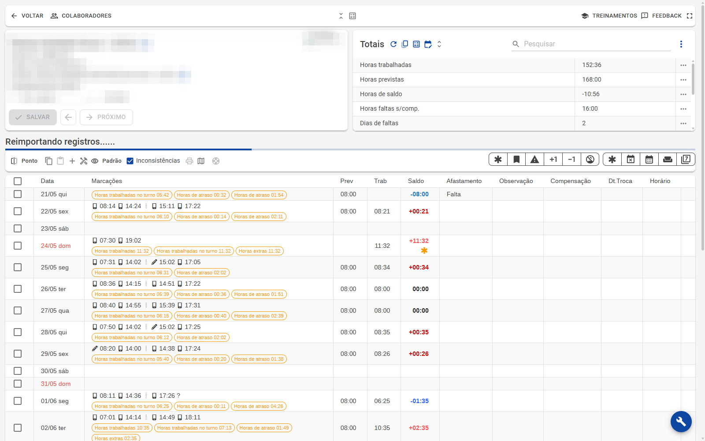
A reimportação em andamento: a barra de processamento aparece, Salvar e Próximo ficam desabilitados e a grade fica coberta contra cliques. A captura é de antes do ajuste que deixa a grade parada até o fim.

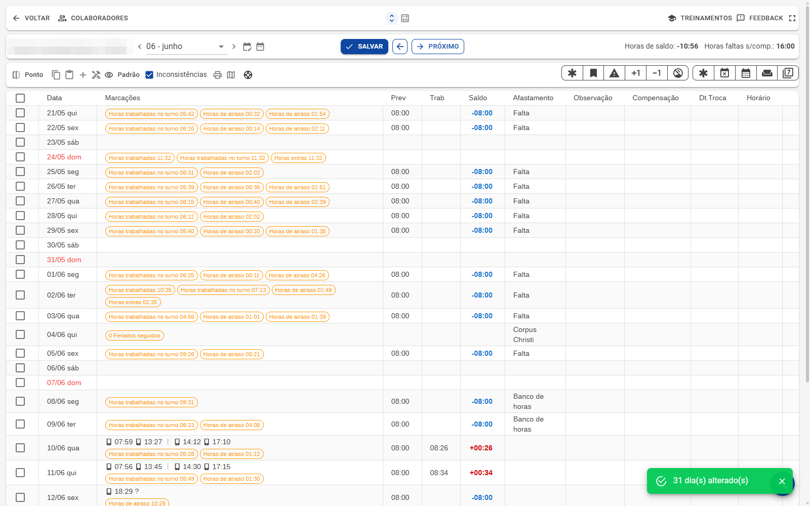
Fim da reimportação: o aviso "31 dia(s) alterado(s)", o mesmo número da `dev`.

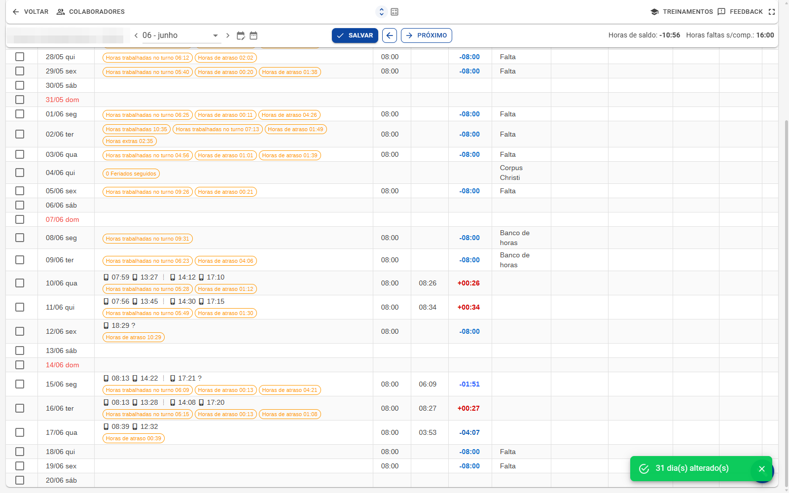
Com o modo compacto e a página rolada, a barra da página e a barra compacta continuam presas no topo.

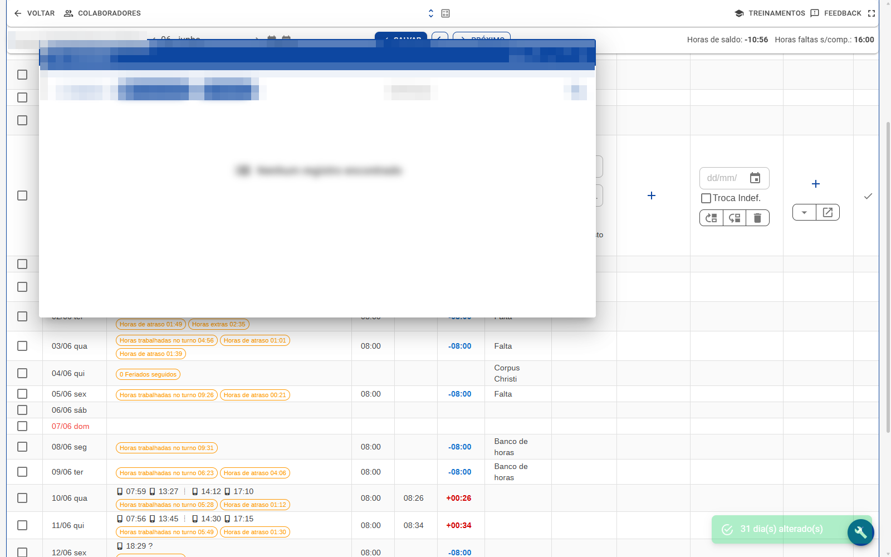
O popup de registros e comprovantes abre por cima da grade.

🤖 Generated with [Claude Code](https://claude.com/claude-code)


## 🐛 Filtro de registros faltantes sem os dias de falta [#2926](https://github.com/simixsistemas/Simix.Ponto.Cloud/pull/2926)

### Objetivo

O filtro "Registros faltantes" da consulta de inconsistências trazia também os dias de falta e os dias sem nenhuma marcação (feriado, DSR, férias, atestado), em vez de só os dias com marcação ímpar (relato do suporte no kern).

### Alterações
- 🐛 O filtro "Registros faltantes" volta a mostrar só os dias com marcação sem par (entrada sem saída). Faltas, feriados e afastamentos sem marcação ficam de fora
- 🐛 O total de "Registros faltantes" do assistente segue a mesma regra
- 🐛 No resumo do mês, feriados e afastamentos sem marcação deixam de ser contados como "Registros faltantes"

### PR's referências
- simixsistemas/Simix.Ponto.Cloud#2902

### Demonstração

Kern, últimos 40 dias com o filtro "Registros faltantes":

| | Dias | Faltas | Sem marcação |
|---|---:|---:|---:|
| Antes | 788 | 147 | 719 |
| Depois | 52 | 0 | 0 |

🤖 Generated with [Claude Code](https://claude.com/claude-code)


## ✨ Melhorias de feedbacks: print automático, estabelecimento atual e solicitação de sobreaviso [#2925](https://github.com/simixsistemas/Simix.Ponto.Cloud/pull/2925)

### Objetivo

Fix: [#2898](https://github.com/simixsistemas/Simix.Ponto.Cloud/issues/2898)

### Alterações
- ✨ Ao enviar um feedback pelo botão do cadastro ou pela barra do topo, o print da tela que estava aberta é anexado sozinho. O próprio formulário de feedback fica fora da imagem, e o anexo pode ser removido antes do envio.
- 🐛 Ao salvar o colaborador, o estabelecimento atual do cadastro passa a ser gravado, como no PcPonto: o "Estab. atual" do mês e, se ele estiver vazio, o estabelecimento do mês. Antes ficava o valor antigo da migração, usado pelo cálculo quando o mês não tem estabelecimento atual.
- ✨ Nova opção no Portal, "Permitir solicitação de sobreaviso", desligada por padrão.
- ✨ Com a opção ligada, o painel do colaborador mostra os dias trabalhados na folga (DSR, feriado ou dia sem horas previstas) com o botão "Solicitar sobreaviso".
- ✨ Na consulta do ponto do colaborador, cada dia ganhou o menu "..." com "Solicitar sobreaviso".
- ✨ O pedido de sobreaviso segue o mesmo caminho da solicitação de horário: fica aguardando aprovação do gestor/RH conforme o tipo de aprovação configurado e só muda o dia depois de aprovado. Reprovado, o dia não muda.
- ✨ O pedido respeita o bloqueio do período no portal e o prazo de solicitação. Depois disso, só a gestão altera o sobreaviso.
- ✨ O painel de pendências ganhou o tipo Sobreaviso, com guia própria quando há pedidos em aberto.

### Demonstração


Formulário de feedback aberto pelo cadastro, com o print anexado.


Imagem anexada: a tela que estava aberta, sem o formulário de feedback.


Painel do colaborador: dias trabalhados na folga com "Solicitar sobreaviso" e os pedidos já feitos aguardando aprovação.


Consulta do ponto: dia já aprovado com o ícone de sobreaviso, pedidos pendentes e o menu "..." para solicitar.


Painel de pendências: pedidos de sobreaviso para aprovar ou reprovar.


## ✨🐛 Tipo de tutorial (vídeo ou documento) e Treinamentos na página de registro [#2923](https://github.com/simixsistemas/Simix.Ponto.Cloud/pull/2923)

### Objetivo

Fix: [#2921](https://github.com/simixsistemas/Simix.Ponto.Cloud/issues/2921)

### Alterações
- ✨ Cadastro de tutoriais com o novo campo **Tipo**: Vídeo ou Documento
  - **Documento** aceita qualquer link (artigo do Movidesk, página da documentação...) e abre numa nova guia
  - **Vídeo** continua abrindo no player da tela
  - Vale na página de Treinamentos, no botão Treinamentos das telas, no card "Ajuda e novidades" do Início e na pesquisa
  - Novo filtro "Documentos" na página de Treinamentos
- 🐛 Botão **Treinamentos** na página de **Registro** do colaborador: antes não abria nada, agora leva a uma página com os treinamentos do portal do colaborador
  - Nas demais telas do portal o botão continua abrindo a janela, sempre com todos os treinamentos das telas do colaborador

### Demonstração

Cadastro do tutorial com o tipo Documento:


Página de Treinamentos filtrada pelos documentos, com o botão Abrir (nova guia):


Página de Registro com o botão Treinamentos:


Treinamentos do colaborador, aberta pelo botão da página de Registro:


## ✨ Botão de suporte e gravação de treinamentos [#2922](https://github.com/simixsistemas/Simix.Ponto.Cloud/pull/2922)

### Objetivo

Fix: [#2900](https://github.com/simixsistemas/Simix.Ponto.Cloud/issues/2900)

### Alterações
- ✨ Novo **botão de suporte** na barra do topo, só para a equipe Símix:
  - **Abrir Beta / Abrir Oficial**: abre a mesma tela, do mesmo cliente, no outro ambiente (aparece só no oficial e no beta)
  - **Ferramentas**: atalho para a página de Suporte
  - **Iniciar treinamento** e **Treinamentos gravados**
- ✨ **Gravação de treinamento**: ao iniciar (com assunto e participantes), a barra mostra o tempo gravado com os botões de pausar e parar. A gravação registra as telas abertas e o tempo em cada uma, os cliques, os campos alterados (sem o que foi digitado), as janelas e as mensagens. Ao parar (com observações), entram também os cadastros gravados no banco durante o treinamento, lidos do histórico de alterações
  - Continua ao trocar de tela, recarregar a página, abrir outra aba ou passar do Oficial para o Beta. Aba fechada sem parar encerra a gravação como "Interrompida" depois de 30 minutos sem sinal
  - Os cadastros gravados no banco vêm do histórico de alterações do sistema: cadastro que não guarda histórico (ex.: Feriados) não aparece nessa parte, só na linha do tempo (o clique em Salvar)
- ✨ **Treinamentos gravados** (Suporte > Treinamentos gravados): totais do período (treinamentos, tempo gravado, duração média, clientes e cadastros gravados), telas mais treinadas, treinamentos por pessoa e a lista. O detalhe de cada gravação mostra o resumo por tela, o que foi gravado no banco, a linha do tempo com filtros e o botão **Copiar resumo**, com o texto pronto para colar no atendimento
- ♻ Histórico de alterações: cadastros como Tipos de contato passam a aparecer com o nome da tela em vez do nome técnico

### Demonstração

Botão de suporte na barra do topo (no ambiente local o Abrir Beta/Oficial não aparece):


Início do treinamento:


Gravando e pausado:


Ao parar, as observações do treinamento:


Detalhe da gravação: resumo por tela, o que foi gravado no banco e a linha do tempo:


Treinamentos gravados, com os totais do período:


🤖 Generated with [Claude Code](https://claude.com/claude-code)

## ✨ Melhorias nas Escalas: trocas e afastamentos direto no cartão [#2920](https://github.com/simixsistemas/Simix.Ponto.Cloud/pull/2920)

### Objetivo

Fix: [#2869](https://github.com/simixsistemas/Simix.Ponto.Cloud/issues/2869)

### Alterações
- ✨ Novo menu **Escalas > Trocas/Afastamentos**: a mesma grade do planejamento, sem precisar criar um plano. O **Salvar grava direto no cartão de ponto** (registrado no log como "Manutenção de escala"). O menu **Escalas > Planejamento** continua como está
  - Seleção do mês com opção de **intervalo de datas**, que pode passar do fim do mês
  - Filtro pelo **estabelecimento atual** do colaborador; quando ele já vem do filtro global, vale o do filtro global
  - Sem o botão Aprovar e sem salvamento automático. Ao trocar de mês, de página ou sair da tela com alterações não gravadas, a tela pergunta se grava, descarta ou cancela
  - Pede a mesma permissão de **aprovar o planejamento de escala**, que é a que já gravava a escala no cartão
- ✨ **Horas no afastamento**: no editor do dia, o afastamento ganhou o campo Horas. Ao escolher um afastamento, ele já vem com as horas padrão do cadastro
- ✨ **Troca de folga** com o ícone de troca, o **dia trocado dentro de um círculo** e o texto **Folga** no dia que vira descanso, na grade e na impressão (com legenda)
- ✨ **Sugestões no painel lateral** para o dia selecionado: trocar pelo domingo anterior ou pelo próximo domingo (fora do domingo), e inserir o último afastamento e o último horário usados
- ✨ **Manutenção**: nova opção da visão para **ocultar a sigla do turno especial** (ex.: REG) nas marcações da listagem. A sigla continua no dia, no espelho e ao abrir o dia para editar

### Demonstração

Acesso pelo menu **Escalas > Trocas/Afastamentos**, ao lado do Planejamento (aparece para quem pode aprovar o planejamento de escala):


Trocas/Afastamentos, com as sugestões do dia selecionado no painel lateral:


Troca pela sugestão "Trocar pelo próximo domingo": o dia vira Folga, o domingo recebe a jornada, cada um mostra o dia com que trocou e o Salvar grava no cartão:


Afastamento com horas no editor do dia, e o painel sugerindo o último afastamento usado:


Intervalo de datas na seleção do mês:


Alterações não gravadas ao trocar o mês:


Impressão: Folga e o dia trocado no círculo:


Manutenção: opção da visão para ocultar a sigla do turno especial:


Antes e depois, no mesmo dia:


🤖 Generated with [Claude Code](https://claude.com/claude-code)


## 🐛 Ajustes no código na folha do colaborador [#2918](https://github.com/simixsistemas/Simix.Ponto.Cloud/pull/2918)

### Objetivo

Fix: [#2905](https://github.com/simixsistemas/Simix.Ponto.Cloud/issues/2905)

### Alterações
- 🐛 Com a regra "Código na folha", o colaborador que já tinha o código na folha (ou a matrícula) diferente do código não perde mais esse valor ao salvar: o código só é copiado para eles quando estão vazios
- ✨ No colaborador já cadastrado, o campo do topo passa a ser o código na folha, que pode ser alterado
- ✨ Quando o código na folha é diferente do código do colaborador, o código aparece ao lado
- ♻ Ajuda do campo e demonstração guiada atualizadas

### Demonstração


Código na folha (20371) editável, com o código do colaborador (22066) ao lado por ser diferente.


Quando os dois são iguais, só o código na folha aparece.

🤖 Generated with [Claude Code](https://claude.com/claude-code)


## ✨ Extras diurnas e noturnas nos totais e view VPontoCalcExtras [#2917](https://github.com/simixsistemas/Simix.Ponto.Cloud/pull/2917)

### Objetivo

Fix: [#2550](https://github.com/simixsistemas/Simix.Ponto.Cloud/issues/2550)

### Alterações
- ✨ Os totais do mês guardam as horas extras de cada percentual separadas em diurnas e noturnas
- ✨ Nova fonte de dados "VPontoCalcExtras" para os widgets: uma linha por colaborador, mês e percentual, com as extras totais, diurnas e noturnas e os saldos do mês
- ✨ Na fonte de dados "VPontoCalc", as extras diurnas e noturnas também ficam disponíveis
- Para os meses já calculados, as extras diurnas e noturnas aparecem depois de calcular o período de novo

### PR's referências
- simixsistemas/Simix.Ponto.Calc#518
- simixsistemas/DevShare.RX.Cloud#158

### Demonstração

Widget de tabela com as extras de cada percentual separadas em diurnas e noturnas, junto com o total e o saldo do mês.


Widget de tabela com um colaborador por linha e uma coluna por percentual (inclusive 101%, que não tem coluna própria nos totais), montado com a nova fonte de dados.


Widget de tabela com as extras de cada percentual por dia, uma linha por colaborador e dia. Ele usa a fonte de dados "VPontoCalcDia", que já existia. Por dia não há a separação entre diurnas e noturnas.


## ♻ Ajustes nos proxies do client para evitar conflitos entre PRs [#2913](https://github.com/simixsistemas/Simix.Ponto.Cloud/pull/2913)

### Objetivo

Facilitar o trabalho com os proxies HTTP do client e evitar os conflitos no `app-generate-proxy.json`: hoje, sempre que um PR é mergeado, todos os PRs abertos passam a dar conflito nesse arquivo.

### Alterações
- ♻ O `app-generate-proxy.json` passa a ficar indentado no repositório. Ele era gravado numa linha só, e numa linha só o git não consegue juntar duas versões: qualquer regeneração, de uma branch ou do Deploy, conflitava com todas as outras. Indentado, o git junta sozinho as mudanças em AppServices diferentes. Conflito só quando duas branches mexem no mesmo AppService.
- ♻ O que vai para o navegador não muda: o build compacta o arquivo antes de embuti-lo, com o mesmo conteúdo e o mesmo nome de hoje.
- ♻ O diff dos proxies fica legível no review.
- Os PRs que já estão abertos ainda têm esse conflito uma última vez, ao trazer esta alteração da dev: fique com a versão da dev e, se a branch criou ou mudou AppService, regenere os proxies (`etc/proxies/gerar-proxies.ps1`), como já se faz hoje.

### Demonstração

Teste com o conflito real entre a branch do #2908 e a dev de hoje:

| Formato do arquivo | Resultado do merge |
|---|---|
| Uma linha (como hoje) | conflito no arquivo inteiro |
| Indentado | sem conflito; os 186 AppServices corretos, inclusive o novo da branch |

O arquivo que o build embute é idêntico byte a byte ao que está na dev hoje (mesmo SHA-256, 2.806.896 bytes, mesmo nome de recurso).

🤖 Generated with [Claude Code](https://claude.com/claude-code)


## ✨ Troca de código do colaborador [#2911](https://github.com/simixsistemas/Simix.Ponto.Cloud/pull/2911)

### Objetivo

Fix: [#2897](https://github.com/simixsistemas/Simix.Ponto.Cloud/issues/2897)

### Alterações
- ✨ Novo botão **Trocar código** ao lado do código no cadastro do colaborador (como o "Trocar Sigla" do afastamento e a troca de código do PcPonto)
- ✨ A troca atualiza o código em todos os dados do colaborador: dados mensais, marcações e registros, cálculos, banco de horas, vales, pendências, espelhos, digitais e logs — tudo de uma vez; se algo falhar, nada é alterado
- ✨ Não permite código zero, igual ao atual ou que já pertença a outro colaborador (inclusive excluído), mostrando de quem é o código
- ✨ Na regra "Código na folha", o código na folha e a matrícula acompanham o novo código
- A troca fica registrada no histórico do colaborador
- Filtros salvos que citam o código antigo e as faixas de código dos estabelecimentos não são alterados

### Demonstração


Modal com o código atual e o novo código.


Após a troca, o cadastro já mostra o novo código.

## ✨ Regras de alertas de registro para o app [#2910](https://github.com/simixsistemas/Simix.Ponto.Cloud/pull/2910)

### Objetivo

Fix: [#2904](https://github.com/simixsistemas/Simix.Ponto.Cloud/issues/2904)

### Alterações
- ✨ Novo cadastro **Alertas de registro** (menu App e tela Cadastros), que define:
  - se o app mostra a jornada em andamento;
  - quantos minutos antes avisa da próxima marcação (0 avisa no horário; vazio não avisa);
  - quantos minutos depois lembra, se a marcação não foi feita (0 lembra no horário; vazio não lembra);
  - o tempo do botão "Lembrar em" da notificação;
  - se o celular vibra
- ✨ Todo cliente já vem com a regra **Padrão**: avisa 1 min antes, lembra 10 min depois, botão "Lembrar em 15 min", jornada e vibração ligadas
- ✨ Regra geral em **Configurações do app** e regra própria no cadastro do colaborador (aba Registro > App). Vale a do colaborador; sem ela, a geral; sem as duas, a Padrão
- ✨ O aplicativo passa a receber a regra de cada colaborador e os horários da semana do quadro de horários do mês, para agendar os avisos no próprio celular. Horário de escala vai sem os dias da semana

### PR's referências
- simixsistemas/Simix.Ponto.App#500
- simixsistemas/Simix.Ponto.Cloud.Client#29

### Demonstração

Cadastro das regras, no menu App:


Uma regra aberta, com a explicação de cada campo no ícone de ajuda:


Regra geral, em Configurações do app > Exibição e Notificações:


Regra própria do colaborador, na aba Registro do cadastro:


🤖 Generated with [Claude Code](https://claude.com/claude-code)


## 🐛 Erros de importação e cálculo em rodosilver, pontual, osana e EAC [#2909](https://github.com/simixsistemas/Simix.Ponto.Cloud/pull/2909)

### Objetivo

Fix: [#2895](https://github.com/simixsistemas/Simix.Ponto.Cloud/issues/2895)

### Alterações
- 🐛 Solicitação de marcação do colaborador passa a guardar só o dia. Ela chegava com hora (ex.: 06/10 13:00) e, depois de aprovada, o cartão do colaborador deixava de carregar e todas as marcações seguintes dele davam erro (rodosilver e pontual)
- 🐛 O cálculo automático não para mais quando há dois estabelecimentos ativos com o mesmo código (osana: o tenant inteiro ficava sem cálculo toda noite)
- 🐛 O cálculo por período funciona em empresa sem estabelecimento cadastrado: calcula os colaboradores "Sem estabelecimento" (EAC)
- 🐛 Marcação do aplicativo encontra o colaborador pelo login quando o PIS enviado pelo aparelho é diferente do cadastro (osana: "Colaborador não encontrado" de colaboradores ativos)
- 🐛 Botão Reprocessar da consulta de comprovantes: com a mesma data no início e no fim respondia "Nenhum registro para reprocessar", e reprocessava do mais novo para o mais antigo, o que embaralha os turnos dos motoristas
- ✨ Testes dos casos acima

Precisa da correção da Calc (PR abaixo) publicada para os erros "Object reference not set…" e "Conversion from string … to type 'Date'" sumirem. Depois do deploy, as marcações que estão com situação Erro precisam ser reprocessadas (rodosilver desde 19/09 e pontual desde 01/10).

Ajustes de cadastro que continuam com o suporte: osana com dois estabelecimentos de código 9 e um login do aplicativo sem colaborador cadastrado; EAC com 5 colaboradores duplicados (mesmo código) e sem estabelecimento.

Diagnóstico completo: https://claude.ai/artifact/HUL38ZdK5m54CzQ7rMCpeY

### PR's referências
- simixsistemas/Simix.Ponto.Calc#517

### Demonstração

Rodosilver, 06/10: comprovantes dos motoristas com ERRO ("Erro ao importar o dia: Object reference not set to an instance of an object").


Depois do Reprocessar com a correção: todos importados, com os turnos na ordem certa (InJor 05:40–12:40, FimRef 12:40–12:41, IniRef 12:41–13:45, FimRef 13:45–21:37, FimJor 21:37).


Pontual, 08/10: marcações com erro de conversão de data, por causa de uma solicitação aprovada com hora no dia.


Depois do Reprocessar: importadas.


🤖 Generated with [Claude Code](https://claude.com/claude-code)


## ✨ Reestruturação do filtro global e filtros salvos por tela [#2908](https://github.com/simixsistemas/Simix.Ponto.Cloud/pull/2908)

### Objetivo

Fix: [#2891](https://github.com/simixsistemas/Simix.Ponto.Cloud/issues/2891)

### Alterações
- ✨ Filtro global (barra do topo e cadastro do usuário) com novos campos: grupo de estabelecimentos, centro de custo, tipo de turno, tags do estabelecimento e tags do colaborador
- ✨ Cada campo do filtro aceita "igual" ou "diferente" (ex.: todos os estabelecimentos, menos X e Y)
- ✨ O filtro do usuário fica guardado em um lugar só; os filtros que já existiam são convertidos na atualização do banco
- ✨ Filtro fixo do usuário vale em todas as consultas e dashboards, mesmo que a tela mande outro
- ✨ Com filtro global preenchido (fixo ou não), os campos de escolha mostram só o que é do filtro: estabelecimentos, departamentos, setores, seções, grupos, centros de custo e colaboradores. Ao limpar o filtro, volta a mostrar tudo; o editor do próprio filtro global continua mostrando tudo
- ✨ Nos dashboards, as opções dos filtros de estabelecimento, departamento, setor e cargo também mostram só o que é do filtro do usuário
- ✨ Escalas de sobreaviso seguem o filtro global: só os colaboradores e estabelecimentos do filtro no mês; as escalas de quem está fora continuam gravadas
- ✨ Tarefas disparadas pelas telas (Calcular dados, Arquivos fiscais, Reimportação, Exportação da folha, espelhos) processam só os colaboradores do filtro global de quem disparou, e as telas avisam qual filtro vale. O cálculo com filtro não dá o período como calculado para os demais colaboradores
- ✨ Botão de filtro nas telas Manutenção, Consulta diária, Inconsistências, Exportação da folha, Colaboradores e Horários, com os campos em um painel e um contador do que está preenchido
- ✨ Filtros salvos por tela: salvar, carregar, alterar, excluir e deixar disponível para todos os usuários; os favoritos viram botões ao lado do filtro (um clique aplica, outro clique tira)
- ✨ Tags no cadastro de estabelecimentos
- ✨ Ao abrir um colaborador pela lista da Manutenção, o Anterior/Próximo e a lista lateral seguem o filtro da lista
- ✨ A Exportação da folha mostra o filtro com os nomes (estabelecimento, departamento...) em vez dos códigos
- ♻ Índice novo para as consultas por estabelecimento no mês
- 🐛 Campos numéricos voltam a ficar vazios ao limpar filtros

### PR's referências
- simixsistemas/DevShare.RX.Cloud#157

### Demonstração

Filtro global da barra do topo com os campos novos e o departamento como "diferente de":


Botão de filtro da tela de Colaboradores, com os campos em um painel:


Salvar o filtro como favorito:


O favorito fica ao lado do filtro: um clique aplica (38 → 34 colaboradores), outro tira:


Filtro salvo ativo no painel (atualizar, alterar, excluir) e a lista de filtros salvos da tela:


Com filtro global de departamento, o campo de departamento só oferece o do filtro:


Calcular dados avisa qual filtro vale e só lista os colaboradores dele:


Exportação da folha com o filtro escrito por nome:


Tags no cadastro de estabelecimento:


Escalas de sobreaviso só com os estabelecimentos e colaboradores do filtro:


No dashboard, o filtro de departamentos só oferece o do filtro global:


🤖 Generated with [Claude Code](https://claude.com/claude-code)


## ♻ Melhorias de layout nos cadastros [#2907](https://github.com/simixsistemas/Simix.Ponto.Cloud/pull/2907)

### Objetivo

Fix: [#2880](https://github.com/simixsistemas/Simix.Ponto.Cloud/issues/2880)

### Alterações
- ✨ Cadastros com uma guia só não mostram mais a barra de guias (OSs, Centro de custo, Departamentos, Tags, Médicos, CIDs e outros)
- ✨ Campos com código de outro cadastro viraram pesquisa: estabelecimento da OS, OS do turno especial e grupo de ações da empresa e do estabelecimento
- ♻ Campo de descrição mais largo quando fica na mesma linha de outros campos (Horário, Escalas, Escalas especiais, Centro de custo, Layout de totais, Processos, Regras de prêmio)
- ♻ Removida a ajuda (?) de campos que se explicam sozinhos, como Código, Ativo, Descrição, Cor, Ordem, Telefone e E-mail (Horário, Estabelecimento, Empresa, Coletor)
- ♻ Botões ao lado dos campos com contorno e na mesma altura do campo (troca de sigla e lista de códigos da folha do afastamento, sugestão de descrição e de adicional noturno do horário)
- ♻ Botões de adicionar das escalas e layouts padronizados
- 🐛 Rótulos corrigidos: Descrição, Endereço, Responsável, Estabelecimento padrão

### Demonstração

OS sem a barra de guias e com o estabelecimento por pesquisa:


Horário sem as ajudas de Código/Ativo/Descrição, descrição na largura toda e botão de sugestão com contorno, na altura do campo:


Escala com código, descrição larga e ativo na mesma linha, e botões de adicionar no novo estilo:


Afastamento com o botão de trocar sigla no mesmo estilo:


🤖 Generated with [Claude Code](https://claude.com/claude-code)

## Ajustes no cadastro de Contratos [#2906](https://github.com/simixsistemas/Simix.Ponto.Cloud/pull/2906)

### Objetivo

Fix: [#2896](https://github.com/simixsistemas/Simix.Ponto.Cloud/issues/2896)

### Alterações
- 🐛 Editar um contrato agora grava todos os campos (nome, tolerância, tipo e ativo); antes só a observação era salva, mesmo com a mensagem de sucesso
- 🐛 Contrato do tipo Intermitente pode ser salvo (antes dava "Method arguments are not valid")
- 🐛 Os dias do contrato são alterados, incluídos e removidos corretamente ao editar
- 🐛 Excluir um contrato remove também os seus dias, e os vencimentos de contratos excluídos deixam de aparecer no painel
- 🐛 Código de contrato repetido mostra a mensagem de código em uso em qualquer modo da tela
- ✨ Campo "Ativo" no cadastro, marcado ao criar um contrato novo
- ✨ Opção "Duplicar" na lista de contratos: cria a cópia com código novo e os mesmos dias
- ♻ Histórico (Logs) do contrato inclui os dias, e a cópia avançada leva os dias como lista

### Demonstração


Novo contrato já vem com o próximo código e marcado como ativo.


Contrato reaberto depois de editar nome, observação e tipo Intermitente: os valores foram gravados.


Duplicar pela lista: a cópia ganha código novo e mantém todos os campos e dias.

## ✨ Melhorias de feedbacks: acesso dos gerentes e prazos dos períodos [#2903](https://github.com/simixsistemas/Simix.Ponto.Cloud/pull/2903)

### Objetivo

Fix: [#2881](https://github.com/simixsistemas/Simix.Ponto.Cloud/issues/2881)

### Alterações
- ✨ Acesso dos gerentes: os grupos Admin e Suporte não aparecem mais como opção de permissão dos cargos
- ✨ Acesso dos gerentes: gerente sem e-mail ganhou o botão "Abrir cadastro", que abre o cadastro do colaborador em janela para completar o e-mail (fica na guia Complementar)
- 🐛 Quantidade de usuários da licença: passa a contar só os acessos ativos do cliente, sem os usuários admin, suporte e api, e é atualizada a cada indexação (antes contava a tabela antiga de usuários e só na primeira vez)
- ✨ Períodos: novos campos "Solicitações até" e "Aprovações até", com data e hora
- ✨ Depois do prazo de solicitação, o colaborador não consegue mais solicitar ajustes e afastamentos do período pelo portal
- ✨ Período de estabelecimento com o prazo em branco segue o prazo do período geral
- ✨ Aviso com os prazos no painel do colaborador (prazo de solicitação) e no painel das pendências (solicitação e aprovação); fica amarelo perto do prazo e vermelho depois dele. O prazo de aprovação é só informativo

### Demonstração


Cadastro do período com os prazos de solicitação e de aprovação.


Painel das pendências mostrando até quando os colaboradores podem solicitar e até quando os gestores devem aprovar.


Painel do colaborador com o prazo de solicitação encerrado: o aviso fica vermelho e os dias com inconsistência deixam de oferecer a solicitação.


Acesso dos gerentes: a lista de permissões sem Admin e Suporte e o botão "Abrir cadastro" para o gerente sem e-mail.


## 🐛 Registros faltantes no widget do gerencial mesmo com outra inconsistência no dia [#2902](https://github.com/simixsistemas/Simix.Ponto.Cloud/pull/2902)

### Objetivo

Dias com marcação faltando não apareciam no widget "Registros faltantes" dos dashboards gerenciais quando o colaborador também tinha outra inconsistência no mesmo dia (horas trabalhadas no turno, atraso etc.).

### Alterações
- 🐛 O widget "Registros faltantes" passa a mostrar todo dia com marcação faltando, mesmo quando outra regra de inconsistência também foi apontada no dia (antes só aparecia o dia em que a marcação faltante era a única inconsistência)
- 🐛 A descrição da inconsistência desses dias começa com "Registros faltantes: N", seguida das demais inconsistências do dia
- 🐛 O filtro "Registros faltantes" da consulta de inconsistências passa a incluir também os dias com lanche incompleto, como já fazia o resumo do mês

### Demonstração

Antes: com o colaborador pesquisado no widget, só aparece o dia de falta; os dias 30/09 e 02/10, com 3 marcações, ficam de fora.


Depois: os dois dias com marcação faltando aparecem, com as outras inconsistências do dia na mesma descrição.


🤖 Generated with [Claude Code](https://claude.com/claude-code)


## ♻ Ajustes no tema: páginas do ABP e páginas de erro no visual do sistema [#2892](https://github.com/simixsistemas/Simix.Ponto.Cloud/pull/2892)

### Objetivo

Fix: [#2889](https://github.com/simixsistemas/Simix.Ponto.Cloud/issues/2889)

### Alterações
- ♻ As telas de conta (entrar, registrar-se, esqueci a senha, e-mail de recuperação enviado, senha redefinida, desconectado e acesso negado) ficaram com o visual do sistema: logo e cartão branco no centro, sem a barra preta com os menus do ABP
- ♻ Minha conta, Sessões e Logs de segurança ganharam a barra azul do sistema, com "Voltar ao sistema" e "Sair", no lugar dos menus do ABP (Administração, idioma, contas vinculadas)
- ♻ A Documentação ficou com as cores do sistema: barra lateral azul com o logo Símix, links e destaques no azul do sistema e a mesma fonte das telas, também no celular
- ✨ Quando uma tela dá erro, aparece uma página no visual do sistema dizendo o que houve (erro inesperado, regra não atendida, sem permissão ou sessão encerrada), com botões para seguir. No erro inesperado aparece um código para informar ao suporte
- 🐛 Página protegida aberta sem login mostrava "Página não encontrada"; agora mostra "Entre para continuar", com o botão Entrar
- ♻ A página de endereço não encontrado continua a mesma, dentro do sistema; agora ela também aparece quando o registro aberto pelo link não existe mais

### Demonstração

Erro inesperado numa tela (forçado numa rota de teste): antes, a página do ABP com os menus dele; depois, a página do sistema com o código para o suporte.


Erro de regra de negócio: a mensagem da regra aparece para o usuário.


Página protegida sem login.


Tela de entrar.


A tela que aparece depois do "Esqueci a senha" já não mostra a barra preta.


Minha conta (campos borrados).


Documentação com as cores do sistema.


No celular: entrar, Minha conta, Documentação e erro.


🤖 Generated with [Claude Code](https://claude.com/claude-code)


## ✨ Descontar DSR em data de feriado original [#2890](https://github.com/simixsistemas/Simix.Ponto.Cloud/pull/2890)

### Objetivo

https://github.com/simixsistemas/Simix.Ponto.Cloud/issues/2893

Opção no horário para descontar o DSR do feriado com data de troca pela semana da data original do feriado.

### Alterações
- ✨ Nova opção "Descontar DSR em data de feriado original" na guia DSR do horário, no quadro Desconto DSR, com ajuda explicando a regra
- ✨ Com a opção ligada, o feriado trocado para outro dia só é descontado se houver falta na semana da data original do feriado, e não na semana em que a folga é gozada
- ✨ A explicação do total "Horas desconto rep.rem." (botão "..." na manutenção) mostra a regra quando a opção está ligada
- Opção desligada por padrão: nenhum horário existente muda

### PR's referências
- simixsistemas/Simix.Ponto.Calc#515

### Demonstração

A opção no quadro Desconto DSR do horário.


Colaboradora com o feriado de 07/09 trocado para 17/09 e falta em 15/09: com a opção ligada, o desconto da semana de 17/09 fica só com o domingo (07:20, 1 dia; antes eram 14:40, 2 dias), e a explicação do total traz a regra.


## ✨ Melhorias nos Treinamentos e no Painel do colaborador [#2887](https://github.com/simixsistemas/Simix.Ponto.Cloud/pull/2887)

### Objetivo

Fix: [#2868](https://github.com/simixsistemas/Simix.Ponto.Cloud/issues/2868)

### Alterações
- ✨ A pesquisa global passa a encontrar os treinamentos: vídeos e demonstrações guiadas aparecem com a etiqueta "Vídeo" ou "Demonstração". A demonstração começa na própria tela e o vídeo abre na página de Treinamentos já tocando
- 🐛 No módulo do colaborador, o botão de Treinamentos agora é um botão pequeno no canto do menu, como na Manutenção, e abre uma janela com os treinamentos do colaborador — não leva mais para o layout da Gestão
- ✨ O painel de Pendências mostra a foto do colaborador (as iniciais quando não há foto), respeitando o "Ofuscar dados"
- 🐛 Com o tipo de layout de consulta "Mínimo", o Painel do colaborador não mostra mais os saldos do período e do banco de horas: mostra as horas trabalhadas, como a Consulta

### PR's referências

### Demonstração

Treinamentos na pesquisa global, com a etiqueta de vídeo ou demonstração:


Vídeo escolhido na pesquisa abrindo na página de Treinamentos:


Botão de Treinamentos no canto do menu do colaborador e a janela com os treinamentos dele:


Foto do colaborador no painel de Pendências (com "Ofuscar dados" ligado):


Painel do colaborador com o layout de consulta "Mínimo": só as horas trabalhadas, sem os saldos:


## 🐛 Bloqueio automático de períodos após o prazo configurado [#2886](https://github.com/simixsistemas/Simix.Ponto.Cloud/pull/2886)

### Objetivo

Fix: [#2854](https://github.com/simixsistemas/Simix.Ponto.Cloud/issues/2854)

### Alterações
- 🐛 Os períodos passam a ser bloqueados automaticamente depois do prazo de "Bloquear período após" (em dias, contados do fim do período), na gestão e no portal do colaborador
- ✨ Nova data e hora de "Bloqueio automático" no cadastro do período: preenchida, o período é bloqueado exatamente nesse momento; vazia, vale o prazo das Configurações
- ✨ O bloqueio sempre é avisado com 2 dias de antecedência: o painel inicial (e o banner de sugestões) mostra "Em X dias o período será bloqueado", com os botões **Bloquear agora** e **Adiar/alterar**. Períodos que já tinham vencido há tempo também recebem esses 2 dias de aviso antes de bloquear
- ✨ Ao bloquear automaticamente, é enviada uma notificação pelos alertas (nova rotina "Períodos", evento "Bloqueado"). A regra de alerta é criada para os perfis admin e DP e pode ser alterada em Alertas
- ♻ Liberar à mão um período que já foi bloqueado limpa a data vencida, para ele não ser bloqueado de novo na rodada seguinte; o prazo programa um novo bloqueio, com os 2 dias de aviso

### PR's referências

### Demonstração


## ✨ Melhorias de feedbacks: Início pela data de instalação, inconsistências do assistente e sincronização dos coletores [#2885](https://github.com/simixsistemas/Simix.Ponto.Cloud/pull/2885)

### Objetivo

Fix: [#2821](https://github.com/simixsistemas/Simix.Ponto.Cloud/issues/2821)

### Alterações
- ✨ Painel Início: o card Sugestões abre sozinho em **Implantação** nos primeiros 7 dias da instalação da empresa e, depois disso, sempre em **Rotinas**. A troca feita no seletor vale enquanto a tela estiver aberta. Empresas novas passam a gravar a data de instalação ao serem criadas; as antigas sem essa data usam a data de criação
- 🐛 Painel Início: a lista aberta (Implantação ou Rotinas) volta a aparecer destacada no seletor
- ✨ Assistente de fechamento com visual novo, no mesmo estilo do painel Início: as etapas do mês aparecem numa lista numerada, com a etapa atual destacada e as anteriores marcadas como concluídas; as quantidades de inconsistências, marcações faltando, atestados e pendências viraram indicadores clicáveis (verdes quando zerados, atestados em vermelho); os atalhos ficam num card ao lado e os filtros se ajustam ao tamanho da tela
- ✨ Assistente de fechamento: o botão Sincronizar abre direto a janela de sincronização dos coletores, e sai o aviso fixo "Todos comunicando", que aparecia mesmo com coletor parado
- ✨ Assistente de fechamento: as inconsistências abrem a mesma tabela da consulta de inconsistências, com os cards por tipo, os atalhos e a formatação dela, no período do cartão do mês. Os números do assistente passam a ser os mesmos da consulta com as mesmas datas, respeitando todos os filtros do assistente (inclusive grupo de estabelecimentos) e o filtro global
- ✨ Assistente de fechamento: o botão de abrir da linha leva à manutenção já filtrada — a lista de colaboradores e o Anterior/Próximo ficam só com quem tem inconsistência no filtro do assistente, com um aviso no topo da tela
- 🐛 Assistente de fechamento: os ícones dos dispositivos nos horários e a descrição da inconsistência voltam a aparecer na lista, e a janela ganhou o botão de fechar
- ✨ Ícone de sincronização da barra do topo: no cartão Coletores, o título abre direto a janela de sincronização e o resumo abaixo dele abre o painel de coletores
- 🐛 Consulta de inconsistências: "Comprovantes do dia" mostra os comprovantes do dia da linha (mostrava os da data final do filtro)

### Demonstração

Empresa instalada há poucos dias: o card abre em Implantação.


Depois dos 7 dias, abre em Rotinas, com a lista aberta destacada no seletor.


Assistente de fechamento no visual novo: etapas numeradas, indicadores clicáveis (atestados em vermelho) e atalhos ao lado.


Inconsistências do assistente na mesma tabela da consulta de inconsistências: cards por tipo, atalhos e o mesmo total da consulta com as mesmas datas.


Manutenção aberta pelo assistente: aviso no topo e lista só com os colaboradores com inconsistência.


Cartão Coletores sem botões: o título abre a sincronização e o resumo abre o painel.


## 🐛 Tratamento da conexão ao abrir a página e facial nas configurações do app [#2883](https://github.com/simixsistemas/Simix.Ponto.Cloud/pull/2883)

### Objetivo

Fix: [#2879](https://github.com/simixsistemas/Simix.Ponto.Cloud/issues/2879)

### Alterações
- 🐛 Ao voltar para uma página que estava aberta há muito tempo, ela não fica mais parada com a barra vermelha "An error has occurred": se a conexão com o servidor falha logo ao abrir a página, o sistema tenta conectar de novo sozinho por cerca de 1 minuto. Com a guia em segundo plano, a nova tentativa espera a guia voltar a aparecer
- 🐛 O mesmo vale quando o servidor está reiniciando (atualização do sistema): a página, que ficava para sempre em "Carregando...", conecta assim que ele volta
- ✨ Configurações do app: "Solicitar reconhecimento facial" e "Processar facial no servidor" não ficam mais marcadas juntas — marcar uma desmarca a outra
- ✨ Configurações do app: as duas opções de facial ganharam um ícone de ajuda explicando quando o registro prossegue em cada uma

### Demonstração

Configurações do app, guia Segurança: marcar uma das opções de facial desmarca a outra.


A ajuda de cada opção:


🤖 Generated with [Claude Code](https://claude.com/claude-code)


## ✨ Inconsistências na Manutenção e no Monitor de registros [#2882](https://github.com/simixsistemas/Simix.Ponto.Cloud/pull/2882)

### Objetivo

Fix: [#2874](https://github.com/simixsistemas/Simix.Ponto.Cloud/issues/2874)

### Alterações
- 🐛 Manutenção: as inconsistências do dia voltaram a aparecer, abaixo das marcações, em etiquetas pequenas na cor da regra. Entram as regras marcadas como "Exibir manutenção" e a lista é atualizada ao salvar ou recalcular. O filtro "Inconsistências" da barra também passou a funcionar
- ✨ Manutenção: opção "Inconsistências" na barra para mostrar ou ocultar as inconsistências. A escolha fica salva no navegador e, desmarcada, elas nem são verificadas, deixando a tela mais leve. Escolher o filtro "Inconsistências" marca a opção de novo
- ✨ Monitor de registros: exclamação dentro do turno em que a inconsistência aconteceu; passando o mouse sobre ela (ou sobre o turno) aparece a lista. O que não pertence a um turno, como "Faltando 1 registro", fica ao lado do colaborador
- ✨ Monitor de registros: botão **Visão**, como o da Manutenção, com as colunas Km, Previsto e Afastamento, todas ocultas por padrão. A visão escolhida fica salva no navegador, e ao atualizar o banco cada empresa ganha a visão "Padrão" do monitor, sem colunas
- O dia de hoje não mostra inconsistências: o cálculo só verifica os dias que já passaram

### PR's referências
- simixsistemas/Simix.Ponto.Calc#516

### Demonstração

Monitor: a exclamação fica no turno da inconsistência (atraso na entrada do 2º turno, no 1º turno, atraso e extras no mesmo turno):


Criando uma visão com as três colunas e aplicando no monitor:


Colunas da visão, com os afastamentos do dia ("Atestado (01:00)", "Falta"):


Km de um colaborador com quilometragem lançada no dia:


Manutenção com as inconsistências de cada dia e a opção "Inconsistências" marcada na barra:


Com a opção desmarcada, as inconsistências somem (e continuam ocultas ao abrir a tela de novo):


Filtro "Inconsistências" da barra, mostrando só os dias com inconsistência (com a opção desmarcada, o filtro a marca de novo):


🤖 Generated with [Claude Code](https://claude.com/claude-code)


## ✨ Lançamentos de cálculo: ação, cadastro, menu e atalho na Manutenção [#2878](https://github.com/simixsistemas/Simix.Ponto.Cloud/pull/2878)

### Objetivo

Fix: [#2875](https://github.com/simixsistemas/Simix.Ponto.Cloud/issues/2875)

### Alterações
- ✨ Cadastro de lançamentos de cálculo refeito: colaborador pela pesquisa, mês/ano, campo escolhido da lista de campos do cálculo (ou nome livre), conteúdo em horas (15:00) ou número (1), percentual, evento na folha, ativo e observação
- ✨ Nova opção **Ação** no lançamento: Novo (cria um total), Substituir, Somar ou Diminuir o valor calculado
- ✨ Menu **Ponto › Calcular dados › Lançamentos**
- ✨ Atalho na Manutenção (grade de totais, menu de cálculo): inserir lançamento já com o colaborador e o mês abertos, recalculando ao gravar, e abrir a lista de lançamentos
- ♻ Os modelos de permissão Manutenção e Fechamento passam a incluir os lançamentos de cálculo

### PR's referências
- simixsistemas/Simix.Ponto.Calc#519

### Demonstração

Atalho na Manutenção (menu de cálculo da grade de totais): inserir lançamento ou abrir a lista.


Lançamento aberto pelo atalho, já com o colaborador e o mês, com a nova opção Ação.


Menu Ponto › Calcular dados › Lançamentos e a lista com as novas colunas.


Com a Calc do simixsistemas/Simix.Ponto.Calc#519, um lançamento de cada ação muda os totais da Manutenção. Antes, sem lançamentos:


Depois: Horas previstas substituídas (160:00), saldo somado (+03:08), dias de faltas somados (2), faltas s/comp. diminuídas (20:00) e o total novo "Desconto indevido" (03:30).


🤖 Generated with [Claude Code](https://claude.com/claude-code)


## ✨ Quitação de saldo de banco de horas [#2876](https://github.com/simixsistemas/Simix.Ponto.Cloud/pull/2876)

### Objetivo

Fix: [#2843](https://github.com/simixsistemas/Simix.Ponto.Cloud/issues/2843)

### Alterações
- ✨ Na **Consulta geral de banco de horas**, o menu **Ferramentas do período** ganhou **Quitar saldo positivo** e **Quitar saldo negativo**, aplicados aos colaboradores selecionados
- ✨ A quitação é feita por **lançamento de banco de horas**: cada colaborador recebe um lançamento com o saldo de sinal contrário, na data escolhida, e o banco de horas é recalculado até o saldo do período ficar em **00:00**
- ✨ Quem não tem saldo do tipo escolhido é ignorado e fica como está; o resumo mostra quantos foram quitados, o total de horas e os que tiveram problema
- ✨ A data do lançamento vem preenchida (hoje no período em andamento, o último dia no período que já terminou) e pode ser alterada dentro do período; período bloqueado não permite quitar
- ✨ Nova opção **Desfazer quitação**: mostra as quitações feitas para os colaboradores selecionados, permite escolher quais desfazer e devolve o saldo que eles tinham antes; lançamentos manuais comuns não entram nessa lista
- ✨ Quitar e desfazer rodam em segundo plano, com o andamento no ícone de tarefas, e exigem permissão de edição do banco de horas e de lançamentos
- ✨ O saldo é recalculado antes de quitar, para a quitação partir do saldo real do colaborador mesmo quando o saldo exibido estiver desatualizado

### Demonstração

As novas opções no menu de ferramentas do período, para os colaboradores selecionados:


Antes de confirmar, o resumo mostra quantos colaboradores serão quitados, o total de horas e a data do lançamento:


Ao terminar, o resultado da quitação:


Os colaboradores quitados ficam com o saldo em 00:00 na lista:


Para desfazer, aparecem só as quitações dos colaboradores selecionados, com a data e as horas lançadas:


E o saldo volta ao que era antes:


## ✨ Justificativas, cores dos turnos e ícone do afastamento no espelho [#2873](https://github.com/simixsistemas/Simix.Ponto.Cloud/pull/2873)

### Objetivo

Fix: [#1717](https://github.com/simixsistemas/Simix.Ponto.Cloud/issues/1717)

### Alterações
- ✨ Espelho do ponto com as marcações de cada turno na cor do tipo de turno
- ✨ Justificativas das marcações numa linha menor abaixo do dia; quando a mesma justificativa vale para todas as marcações do dia, aparece só o texto
- ✨ Afastamento no espelho com o ícone e a cor do cadastro
- ✨ Espelho de motoristas: o resumido continua com Início/Fim e ganha as justificativas e o afastamento colorido; o completo ganha as cores e as justificativas
- ✨ Manutenção: a linha de resumo do dia mostra cada turno na cor do tipo de turno
- ✨ Os turnos do dia (marcações, cor e justificativas) ficam guardados junto do cálculo, prontos para o espelho e outras consultas
- 🐛 Espelho de motoristas no modo completo (paisagem) deixava de mostrar os últimos dias do mês
- Dias calculados antes desta versão mostram as cores e as justificativas depois de recalcular o período

### PR's referências
- simixsistemas/DevShare.RX.Cloud#155
- simixsistemas/Simix.Ponto.Calc#514

### Demonstração


Colaborador da Símix (banco local): os turnos "RP" na cor do cadastro, as justificativas do dia 21 abaixo das marcações e o Atestado com ícone e cor.


Carbonicfa: justificativa abaixo das marcações e as folgas com o ícone e a cor do cadastro.


Recitires, espelho de motoristas resumido: continua com Início/Fim, ganha as justificativas e o afastamento sai na cor do cadastro.


Recitires, espelho de motoristas completo: horários coloridos por turno e justificativas abaixo do dia.


Fim do mês no espelho de motoristas completo: antes parava em 17/09; agora vai até 20/09.


Manutenção da Recitires (a tela do print da issue): a linha de resumo do dia segue as cores dos turnos.

🤖 Generated with [Claude Code](https://claude.com/claude-code)


## ✨ Melhorias na cópia avançada, pesquisa e navegação dos cadastros [#2872](https://github.com/simixsistemas/Simix.Ponto.Cloud/pull/2872)

### Objetivo

Fix: [#2870](https://github.com/simixsistemas/Simix.Ponto.Cloud/issues/2870)

### Alterações
- ✨ Cópia avançada: os campos de escolher numa lista (Escala, Cargo, Estabelecimento, Departamento…) agora podem ser marcados
- ✨ Cópia avançada de listas inteiras: faixas de extras e horários da semana no quadro de horário, vale-transporte e vale-refeição no colaborador, condições do mês e dos dias na regra de prêmio. O registro de destino fica com a mesma lista
- ✨ No quadro de horário, quando a cópia muda o cálculo, o sistema pergunta uma vez a partir de qual mês a configuração vale, como ao salvar o próprio horário
- ✨ A lista de registros de destino da cópia mostra só os ativos (no quadro de horário vinham também os históricos inativos)
- ✨ Os campos marcados para a cópia ficam destacados; o código, os campos bloqueados e o registro ainda não salvo não podem ser copiados
- 🐛 Colaboradores: a lista de destinos da cópia trazia cada colaborador uma vez por mês; agora traz os colaboradores do mês aberto
- 🐛 Colaboradores: CPF, endereço e os demais dados do cadastro pessoal não chegavam ao colaborador de destino
- 🐛 Regras de prêmio: a lista de destinos da cópia mostrava um código interno no lugar do nome da regra
- 🐛 Pesquisa de campos: algumas pesquisas, como "lanche" no quadro de horário, escondiam todas as guias
- ✨ Quadro de horário: no **?** de cada campo, o botão "Clientes que usam esta opção" lista os outros clientes que usam a opção, quantos horários de cada um e o conteúdo, com as horas em hh:mm. Opção vazia, 0 ("Padrão") ou desmarcada não conta
- ✨ Navegação entre registros: a barra não aparece quando a lista tem um registro só, e a troca de registro não pisca mais
- ✨ Card de Novidades com demonstração guiada da pesquisa e da cópia avançada

### Demonstração

Pesquisa de campos: "lanche" mostra só a guia Lanche e os campos dela.


Cópia avançada no quadro de horário: marcar as faixas de extras e um campo, escolher o horário de destino e responder a partir de quando a configuração vale.


Lista de faixas de extras marcada e destacada.


Campo de escolher numa lista (Escala) marcado; o código fica sem caixa.


Lista de destinos da cópia só com os horários ativos.


Pergunta de "a partir de quando", feita uma vez para todos os horários de destino.


Regra de prêmio: destinos com o nome da regra, copiando as condições do mês e dos dias.


Botão no **?** do campo do quadro de horário.


Clientes que usam a opção, com quantos horários de cada um: banco de horas.


Horas no formato hh:mm (gravadas como 0900 ou 09:00 nos horários).


Combo com o "Padrão" (0): não conta como opção usada.


Troca de registro pela barra de navegação, sem piscar.


Lista com um registro só: o cadastro abre sem a barra de navegação.


Card de Novidades.


🤖 Generated with [Claude Code](https://claude.com/claude-code)


## ✨ Melhorias de feedbacks: senha do coletor, anexos em comentários e layout de ações [#2871](https://github.com/simixsistemas/Simix.Ponto.Cloud/pull/2871)

### Objetivo

Melhorias vindas de feedbacks:
- [Botão para ver a senha do coletor](https://simixponto-beta.app/feedbacks/3a24250a-6b25-3df1-7a21-1c8496621974)
- [Criar turnos especiais direto no Layout de ações](https://simixponto-beta.app/feedbacks/3a241e69-74b3-d794-40ec-8d8d2b5d91d1)
- [Explicação dos campos do Layout de ações](https://simixponto-beta.app/feedbacks/3a241e67-b833-c7b9-fe24-2dddb01858a3)

### Alterações
- ✨ Cadastro e assistente de coletores: botão de "olho" para ver a senha, disponível só para administradores
- ✨ Feedbacks: comentários aceitam anexos (prints, PDF, planilhas…), inclusive comentário só com o arquivo. Anexo de comentário interno só aparece para a equipe Símix, e quem comenta um feedback público de outra empresa não anexa arquivos
- 🐛 Fechamento > Assistente > Gerar espelhos dava erro e não abria; agora abre a tela de espelhos com a janela de geração no período escolhido
- ✨ Layout de ações: a tabela larga virou uma lista com a prévia de cada botão (como o colaborador vê) e um painel ao lado só com as opções do botão selecionado; os botões sobem/descem pelas setas e podem ser duplicados
- ✨ Layout de ações: os dias da semana são marcados um a um (qualquer combinação, gravada no mesmo formato de antes)
- ✨ Layout de ações: cada campo tem o "?" com a explicação
- ✨ Layout de ações: o campo Sigla ganhou o menu (⋮) para cadastrar ou editar o turno especial sem sair da tela, e a sigla escolhida voltou a aparecer inteira no campo
- 🐛 O menu Novo/Editar ao lado dos campos de busca ficava aberto por cima da janela que ele abre
- ✨ Novo treinamento guiado "Montar um layout de ações"; os treinamentos agora também rolam tabelas largas até o campo que estão mostrando

### Demonstração

Senha do coletor com o botão de ver (só administrador):


Comentários de feedback com anexos e o botão "Anexar arquivo" no novo comentário:


Fechamento > Assistente > Espelho > Gerar todos abrindo a tela de espelhos com a janela de geração:


Layout de ações com a prévia dos botões e o painel do botão selecionado:


Fim do painel: dias da semana marcados um a um e as regras explicadas:


No celular a lista fica em cima e o painel embaixo:


Menu da Sigla e o cadastro de turno especial aberto por ele:


Treinamento da tela e o passo que mostra os dias da semana:


🤖 Generated with [Claude Code](https://claude.com/claude-code)


## ♻ Justificativa no lugar da Observação nos relatórios de manutenção [#2864](https://github.com/simixsistemas/Simix.Ponto.Cloud/pull/2864)

### Objetivo

Fix: [#2863](https://github.com/simixsistemas/Simix.Ponto.Cloud/issues/2863)

### Alterações
- ♻ O Histórico de manutenções passa a mostrar a Justificativa informada ao salvar a manutenção
- ♻ No Relatório de manutenções, a coluna Observação dá lugar à Justificativa

### PR's referências
- simixsistemas/DevShare.RX.Cloud#153

### Demonstração

## ✨ Envio do cartão RFID ao Control iD na sincronização de cadastros [#2860](https://github.com/simixsistemas/Simix.Ponto.Cloud/pull/2860)

### Objetivo

Fix: [#2865](https://github.com/simixsistemas/Simix.Ponto.Cloud/issues/2865)

### Alterações
- ✨ Ao enviar os cadastros para o Control iD, o cartão RFID vai junto para os colaboradores com "Permitir registro por RFID"
- ✨ O código do cartão é convertido com a mesma regra do sistema antigo, conforme o formato de crachá configurado no coletor (Rfid Control ID, Hexa Control ID, Wiegand, Hexadecimal ou padrão)
- ✨ Vale também para os coletores sincronizados pelo agente local

### PR's referências
- simixsistemas/Simix.Ponto.Integracoes#29
- simixsistemas/Simix.Ponto.Cloud.Client#28
- simixsistemas/Simix.Agente.Cloud#22


## ✨ Permitir intervalo de datas na Manutenção [#2859](https://github.com/simixsistemas/Simix.Ponto.Cloud/pull/2859)

### Objetivo

Fix: [#2856](https://github.com/simixsistemas/Simix.Ponto.Cloud/issues/2856)

### Alterações
- ✨ Na Manutenção, ao lado do mês, há um botão de intervalo de datas: ele abre o período do cartão (ex.: 01/07/2026 → 31/07/2026) e permite estendê-lo (ex.: até 10/08/2026), mostrando todos esses dias na grade
- ✨ O intervalo continua ao passar para o próximo colaborador; o mesmo botão volta para o mês
- ✨ Com o intervalo ativo, a tela avisa que os totais exibidos são do intervalo
- ✨ Ao salvar no intervalo, são gravadas só as marcações; os totais, prêmios e demais dados de cada mês que teve dia alterado são recalculados como mês inteiro (os totais do intervalo nunca são gravados no mês)
- ✨ Se um mês com dia alterado estiver bloqueado, o salvar é recusado sem gravar nada; um mês fechado que aparece no intervalo só para consulta não impede o salvar
- ✨ Solicitações pendentes aparecem também nos dias do intervalo que passam do mês
- O intervalo vale só na Manutenção; as demais telas continuam por mês
- ✨ Card na página de Novidades com o passo a passo e a demonstração guiada (Me mostre)

### PR's referências
- simixsistemas/Simix.Ponto.Calc#513

### Demonstração

Botão novo ao lado do mês:


Ao clicar, o seletor abre com o período do cartão, mostrando dois meses:


Intervalo de 01/07 a 10/08 salvo, com o aviso sobre os totais:


Os dias de agosto no fim da grade:


Agosto bloqueado e um dia de agosto alterado: o salvar do intervalo de 20/07 a 10/08 é recusado sem gravar nada:


No modo compacto:


O card nas Novidades:


🤖 Generated with [Claude Code](https://claude.com/claude-code)


## 🐛 Ajustes ao salvar dashboards [#2858](https://github.com/simixsistemas/Simix.Ponto.Cloud/pull/2858)

### Objetivo

Fix: [#2833](https://github.com/simixsistemas/Simix.Ponto.Cloud/issues/2833)

### Alterações
- 🐛 Nos Dashboards Gerenciais, trocar de visão ou mudar o período e os filtros da barra do dashboard não marca mais o dashboard como "Não Salvo", e abrir outro dashboard não pergunta mais se deseja salvar quando nada foi alterado
- 🐛 Colar, editar ou excluir uma visão pelo botão direito (e editar o texto de uma nota) agora marca o dashboard como alterado e entra no salvamento. Antes nada indicava a alteração, e ela se perdia ao sair da tela
- 🐛 No Painel, a visão ou o widget colado é gravado na hora, uma vez só; trocar de visão ou de filtro não grava mais o dashboard
- 🐛 Um dashboard gerencial aberto só para consulta não grava mais nada sozinho: antes o salvamento automático podia regravar uma cópia antiga por cima do que outra pessoa tinha acabado de salvar
- ✨ Sair da tela, criar um dashboard ou instalar um pack com alterações pendentes pergunta antes (Salvar e continuar, Descartar ou Cancelar), como já acontecia ao trocar de dashboard. Se o salvamento falhar, o dashboard continua aberto com as alterações

### PR's referências
- simixsistemas/DevShare.RX.Cloud#154

### Demonstração

Passando por todas as visões do dashboard e depois abrindo outro dashboard: nenhum aviso de alteração.


Copiando uma visão e colando sobre outra: o dashboard fica "Não Salvo", sair da tela pergunta antes e o Salvar grava.


No Painel, nota colada pelo menu da visão, aberta de novo em outro navegador:


🤖 Generated with [Claude Code](https://claude.com/claude-code)


## ✨ Filtros dos botões no registro web [#2855](https://github.com/simixsistemas/Simix.Ponto.Cloud/pull/2855)

### Objetivo

Fix: [#2840](https://github.com/simixsistemas/Simix.Ponto.Cloud/issues/2840)

### Alterações
- ✨ O registro pelo navegador passa a respeitar os filtros do layout de botões, como o aplicativo: horário inicial, horário final e dias da semana. Os botões continuam na tela e, fora do permitido, o clique mostra o motivo ("Registro não permitido depois das 10:00.", "Registro não permitido no dia de hoje.")
- ✨ Faixa de horário que passa da meia-noite (ex.: das 22:00 às 06:00) vale de um dia para o outro
- 🐛 Com layout de botões, não é mais possível registrar sem escolher um dos botões (esse envio passava por cima dos filtros)
- 🐛 No cadastro do layout, a opção de dias "Segunda a sexta" aparecia como "Segunda a sábado"

### Demonstração

Filtros no cadastro do layout: Presencial das 07:50 às 18:00 de segunda a sábado, Home Office até as 10:00 e Serviço externo só no domingo.


Home Office depois das 10:00:


Serviço externo numa terça-feira:


🤖 Generated with [Claude Code](https://claude.com/claude-code)


## ✨🐛 Sobreaviso: escalas gravadas e marcação na manutenção [#2853](https://github.com/simixsistemas/Simix.Ponto.Cloud/pull/2853)

### Objetivo

Fix: [#2834](https://github.com/simixsistemas/Simix.Ponto.Cloud/issues/2834)

### Alterações
- 🐛 Escalas/Sobreaviso: os colaboradores escalados agora ficam gravados. Antes, um erro na gravação era escondido e a tela mostrava "salvo com sucesso", e o estabelecimento do dia era trocado pelo do painel clicado, o que fazia a escala "sumir" depois do recálculo
- ✨ O que não puder ser gravado aparece na tela
- ✨ Cada colaborador aparece no painel do próprio estabelecimento, e ao escolher dias de um estabelecimento a lista mostra só os colaboradores dele; o botão Salvar avisa quando há alterações pendentes
- ♻ Explicação do total de sobreaviso atualizada: desconta só o que foi trabalhado dentro do horário do sobreaviso

### PR's referências
- simixsistemas/Simix.Ponto.Calc#512

### Demonstração
Escala de sobreaviso salva em 01/09 e 05/09, continuando no painel do estabelecimento depois de recarregar:


🤖 Generated with [Claude Code](https://claude.com/claude-code)


## ✨ Período lembrado entre as telas e código liberado ao cancelar [#2852](https://github.com/simixsistemas/Simix.Ponto.Cloud/pull/2852)

### Objetivo

Fix: [#2831](https://github.com/simixsistemas/Simix.Ponto.Cloud/issues/2831)

### Alterações
- ✨ O período escolhido passa a valer em todas as telas de período: lista da Manutenção, Colaboradores, Inconsistências por mês, Justificativa de extras, pendências de afastamentos e de marcações, Exportar para folha, Espelho do ponto, Painel e Gerencial. Trocar em qualquer uma delas (ou na barra do topo) já atualiza as outras, inclusive as que estão abertas
- ✨ O período fica lembrado ao recarregar ou reabrir o sistema no mesmo dia; no dia seguinte volta ao mês atual
- ✨ Fora do mês atual, o período aparece em destaque (laranja) na barra do topo, com a dica do mês atual
- ✨ Link que já traz o mês (por exemplo, o Espelho de um mês específico ou a exportação aberta pelo Espelho) continua abrindo no mês do link
- 🐛 Ao cancelar o cadastro de um registro novo (Cancelar, X ou Esc), o código sugerido é liberado e o próximo cadastro não pula o número
- 🐛 No assistente, o "Novo colaborador" pulava um código a cada abertura e não conseguia salvar

### PR's referências
- simixsistemas/DevShare.RX.Cloud#152

### Demonstração


No mês atual o período aparece como sempre; fora dele, em destaque.


Trocando o mês na lista da Manutenção, a barra do topo acompanha.


A exportação já abre no período escolhido.


O Espelho, aberto pelo menu, também.


E o filtro de período do Painel.


Inconsistências por mês também abre no período escolhido…


…assim como o filtro de período das pendências.


Novo cargo com o código 47; depois de cancelar, o próximo cadastro sugere o 47 de novo.

🤖 Generated with [Claude Code](https://claude.com/claude-code)


## Migrations [#2850](https://github.com/simixsistemas/Simix.Ponto.Cloud/pull/2850)


## 🐛 Usuário em branco no Histórico de Manutenções [#2849](https://github.com/simixsistemas/Simix.Ponto.Cloud/pull/2849)

### Objetivo

Fix: [#2838](https://github.com/simixsistemas/Simix.Ponto.Cloud/issues/2838)

### Alterações
- 🐛 O Histórico de manutenções volta a mostrar quem fez cada alteração no ponto: as manutenções feitas no sistema anterior, antes da migração para o Cloud, apareciam com o usuário em branco
- 🐛 No widget "Histórico de Manutenções" da loja de dashboards acontecia o contrário: as manutenções feitas no Cloud é que apareciam sem usuário

### Demonstração


Relatório de manutenções do cliente (período 09/2026): todas as linhas trazem o usuário, inclusive as alterações feitas antes da migração.


Widget da loja: as manutenções feitas no Cloud passam a mostrar o usuário.


## Ajustes gerais - comandos SQL [#2848](https://github.com/simixsistemas/Simix.Ponto.Cloud/pull/2848)

### Objetivo

Fix: [#2847](https://github.com/simixsistemas/Simix.Ponto.Cloud/issues/2847)

### Alterações
- 🐛 Comando para preencher a observação e a justificativa dos logs de manutenção sem observação, dos dois meses anteriores em diante (cobre quem fecha o período no dia 20/21): usa a observação registrada no mesmo dia do colaborador e, quando não houver, grava "Esquecido". Registros excluídos não entram
- 🐛 Comando para preencher o estabelecimento do mês do colaborador (mês anterior, atual e o seguinte) com o estabelecimento atual do cadastro, quando estiver vazio
- ♻ Os períodos são calculados pela data em que o comando é executado, então ele pode ser reaproveitado em outros meses

### PR's referências

### Demonstração


## ✨ Acesso dos gerentes no painel Início [#2846](https://github.com/simixsistemas/Simix.Ponto.Cloud/pull/2846)

### Objetivo

Fix: [#2826](https://github.com/simixsistemas/Simix.Ponto.Cloud/issues/2826)

### Alterações
- ✨ Novo passo **Acesso dos gerentes** em Início → Sugestões → Implantação, mostrado quando existe algum cargo que começa com "Gerente". A linha informa quantos cargos estão sem permissão padrão e quantos gerentes ainda não têm acesso
- ✨ O passo abre uma janela com a lista dos **cargos de gerente** (nome e permissão padrão, que pode ser escolhida ali mesmo) e a lista dos **gerentes** (nome, cargo, e-mail, estabelecimento e se já tem acesso)
- ✨ **Enviar acesso** por e-mail aos gerentes marcados: quem ainda não tem usuário recebe o link de registro com o passo a passo; quem já tem recebe o endereço e o usuário, e passa a ter a permissão do cargo
- ✨ Gerente sem e-mail não pode ser marcado, e cargo sem permissão padrão aparece com aviso (o gerente teria só o acesso de colaborador)
- ♻ O registro pelo link e o novo assistente usam a mesma regra para dar a permissão do cargo
- ♻ A view **VCalendario** continua disponível para os dashboards e agora cobre o ano atual e o seguinte, para o filtro de data ("este mês", "este ano") pegar o período inteiro

### Demonstração


Permissão padrão dos cargos de gerente e lista dos gerentes para enviar o acesso.


## 🐛 Limitar o cálculo dos meses futuros ao replicar dados mensais [#2845](https://github.com/simixsistemas/Simix.Ponto.Cloud/pull/2845)

### Objetivo

Fix: [#2829](https://github.com/simixsistemas/Simix.Ponto.Cloud/issues/2829)

### Alterações
- 🐛 Ao alterar os dados mensais de um colaborador e replicar para os meses seguintes, o cálculo vai no máximo até o mês seguinte ao atual (ex.: em 10/2026, alterando 05/2026 ou 10/2026, calcula até 11/2026). Antes ele calculava até o último mês futuro cadastrado e, com um mês muito distante vindo da migração, gerava todos os meses do caminho (5 h de cálculo no Super Ramos)
- 🐛 Ao alterar diretamente um mês que já passa desse limite, só esse mês é calculado

### PR's referências
- simixsistemas/Simix.Ponto.Migracao#33

### Demonstração


## 🐛 Ajustes no Importar Feriados [#2844](https://github.com/simixsistemas/Simix.Ponto.Cloud/pull/2844)

### Objetivo

Fix: [#2835](https://github.com/simixsistemas/Simix.Ponto.Cloud/issues/2835)

### Alterações
- 🐛 **Importar Feriados** agora completa a lista da empresa com os próximos feriados que ainda faltam. Antes, bastava existir um único feriado cadastrado, de qualquer ano, para o botão não importar nada — era o caso das empresas migradas, que chegam com os feriados dos anos anteriores
- 🐛 A mensagem passou a mostrar o resultado real: quantos feriados foram importados, ou o aviso de que não havia nenhum feriado novo. Antes aparecia "Feriados importados com sucesso!" mesmo quando nada era importado
- ✨ Feriado que a empresa já tem na mesma data não é duplicado, mesmo cadastrado com outro nome (ex.: "Nossa Sra Aparecida")
- 🐛 Feriado municipal só é importado para a empresa que tem estabelecimento naquela cidade (antes podia entrar como feriado do estado inteiro)
- ♻ Empresa nova continua recebendo os feriados automaticamente na criação, como antes
- ♻ Texto do treinamento da tela de Feriados atualizado

### Demonstração

Lista vazia: os próximos feriados são importados e a mensagem informa quantos entraram.


Com um feriado próprio da empresa já cadastrado (20/11), os demais são importados e o dela é mantido.


Com "Nossa Sra Aparecida" já cadastrado em 12/10, o feriado da mesma data não é duplicado: só os outros 3 entram.


Importando de novo sem faltar nenhum, a tela avisa que não há feriado novo. Com apenas feriados de 2025 cadastrados (situação das empresas migradas), os 4 próximos feriados também foram importados.


## ✨ Documentos restritos por categoria [#2842](https://github.com/simixsistemas/Simix.Ponto.Cloud/pull/2842)

### Objetivo

Identificação de privacidade em documentos

### Alterações
- ✨ Nas categorias de documentos, um cadeado marca a categoria como **restrita** e define quais perfis (roles) podem abrir os documentos dela. Sem nenhum perfil marcado, ninguém abre pelas telas do RH, nem o administrador
- ✨ Categoria nova com nome de contracheque, holerite, recibo de pagamento ou informe de rendimentos já nasce restrita (dá para liberar no cadeado)
- ✨ As categorias de contracheque que já existem passam a ser restritas na atualização, sem nenhum perfil marcado — cada empresa escolhe quem pode abrir
- ✨ Documento restrito aparece com cadeado no lugar de "Ver" e "Abrir em outra aba" na lista de documentos dos colaboradores, na aba de documentos do colaborador, na edição do documento e no painel do colaborador aberto pelo RH; ao clicar no cadeado o sistema diz quem pode abrir
- ✨ Quem não pode abrir continua vendo de quem é o documento, o período, a situação da assinatura e o comprovante
- ✨ O colaborador sempre abre os próprios documentos, no portal, no aplicativo e nas telas do RH

### Demonstração


Categoria "Contracheques" restrita e sem perfil marcado: ninguém abre.


O documento sem categoria abre normalmente; os contracheques ficam com o cadeado.


Com o perfil do usuário marcado na categoria, os contracheques voltam a abrir.


O colaborador abre o próprio contracheque; os dos colegas continuam trancados.


Na edição, o arquivo aparece como restrito, mas dá para substituí-lo.


No painel aberto pelo RH, o contracheque também fica trancado.

🤖 Generated with [Claude Code](https://claude.com/claude-code)


## 🐛 Ajustes no envio de espelhos por e-mail [#2839](https://github.com/simixsistemas/Simix.Ponto.Cloud/pull/2839)

### Objetivo

Fix: [#2832](https://github.com/simixsistemas/Simix.Ponto.Cloud/issues/2832)

### Alterações
- 🐛 O registro de cada e-mail de espelho é gravado no momento do envio. Antes ele só era gravado no fim de todo o envio: se algo falhasse nessa hora (por exemplo, um colaborador assinando o espelho enquanto os e-mails ainda saíam), nenhum registro ficava e o envio era repetido para todos
- 🐛 Espelho assinado ou já enviado enquanto o envio está em andamento não recebe o e-mail de novo
- 🐛 O portal do colaborador não mostra mais os botões "Gerar" e "Enviar" para quem tem perfil de gestão: ali a lista é só dos próprios espelhos, mas os botões agiam sobre a empresa inteira. Gerar e enviar continuam na tela Espelho do ponto, inclusive o "Enviar Todos Pendentes"
- 🐛 O envio não sai mais sem espelhos escolhidos (antes, uma lista vazia mandava para todos os pendentes da empresa)
- ✨ O histórico de e-mails mostra quem fez o envio (coluna "Enviado por")

### Demonstração

Portal do colaborador com perfil de gestão: só os próprios espelhos, sem os botões de gerar e enviar.


Histórico de e-mails com a coluna "Enviado por".


🤖 Generated with [Claude Code](https://claude.com/claude-code)


## ✨ Localização, raio e bloqueio no registro web [#2837](https://github.com/simixsistemas/Simix.Ponto.Cloud/pull/2837)

### Objetivo

Fix: [#2724](https://github.com/simixsistemas/Simix.Ponto.Cloud/issues/2724)

### Alterações
- ✨ Configuração Web ganhou a seção **Registro web: local e dispositivo**: conferir o local por endereço IP ou por geolocalização, raio máximo em metros e "Autorizar novos dispositivos" (mesma ideia do aplicativo)
- ✨ O local é comparado com o estabelecimento do colaborador; o "Raio máximo" do cadastro do colaborador (Sempre/Nunca) vence a configuração, e ações de registro marcadas para ignorar o raio (home office, externo) não são conferidas
- ✨ Com a geolocalização ligada, a tela de registro pede a localização ao navegador e avisa que o registro confere o local
- ✨ Com "Autorizar novos dispositivos" desmarcado, cada navegador novo entra como pendente em Dispositivos, com o nome do colaborador, e só registra depois de autorizado pelo RH
- ✨ Nova situação **Bloqueado**: a marcação recusada é guardada completa (horário, localização, distância, IP, dispositivo e motivo), sem comprovante e sem entrar no cartão
- ✨ As consultas de comprovantes mostram a marcação bloqueada com o motivo
- ✨ Cada estabelecimento tem a sua lista de **Endereços IP** (nova aba no cadastro): o registro web por IP aceita só os endereços ativos dela, aceitando IP, faixa (200.10.5.0/24) ou prefixo (200.10.5.*)
- ✨ Ao trocar o IP no cadastro do estabelecimento, o novo entra na lista automaticamente e os anteriores ficam guardados como histórico, podendo ser desativados com uma observação
- ♻ Os IPs já informados nos estabelecimentos entram na lista na atualização do banco
- ♻ Nada muda para quem não configurar: o padrão é não conferir o local e autorizar novos dispositivos

### Demonstração

Seção nova na Configuração Web:


Lista de endereços IP do estabelecimento, com uma faixa incluída e o IP anterior desativado:


Endereço inválido não pode ser incluído:


Registro fora do raio permitido:


Registro de um navegador ainda não autorizado:


Marcações bloqueadas na consulta de comprovantes do colaborador:


🤖 Generated with [Claude Code](https://claude.com/claude-code)


## ✨ Novidade do Sobreaviso: card e demonstração guiada [#2836](https://github.com/simixsistemas/Simix.Ponto.Cloud/pull/2836)

### Objetivo

Fix: [#2636](https://github.com/simixsistemas/Simix.Ponto.Cloud/issues/2636)

### Alterações
- ✨ Novo card do Sobreaviso na página Novidades: quando o dia é de sobreaviso, as opções do quadro de horário (faixa de sobreaviso e horário de sobreaviso) e o resultado na manutenção, com um exemplo de conta (faixa de 09:00 às 18:00 com 3:15 de chamado = 5:45 de sobreaviso)
- ✨ "Me mostre" do Sobreaviso: o assistente abre o quadro de horário na guia Controles, passa pela tela de escalas de sobreaviso e, na manutenção do colaborador, aponta o dia de sobreaviso e o "..." de Horas de sobreaviso, que explica a conta
- ✨ "Abrir" do card com o passo a passo para configurar e conferir o sobreaviso
- 🐛 O assistente não rolava até um item escondido dentro de um quadro com rolagem própria (como os Totais da manutenção) e o destaque ficava solto na tela

### PR's referências
- simixsistemas/Simix.Ponto.Cloud#2776
- simixsistemas/Simix.Ponto.Cloud#2809

### Demonstração

O card na página Novidades, com as opções do quadro de horário, o dia de sobreaviso no cartão e a explicação do total.


Último passo do "Me mostre", na manutenção: o assistente rola os Totais até Horas de sobreaviso e aponta o "..." da explicação.


## ✨🐛 Melhorias no Calcular dados e no serviço de tarefas [#2828](https://github.com/simixsistemas/Simix.Ponto.Cloud/pull/2828)

### Objetivo

Fix: [#2823](https://github.com/simixsistemas/Simix.Ponto.Cloud/issues/2823)

### Alterações
- ✨ **Calcular dados** e **Exportar folha** ganharam o campo **Local de execução** (Serviço ou Site), visível só para o suporte Símix. Pelo Site a rotina roda na hora, fora da fila do serviço: serve para quando o serviço travou, foi reiniciado ou está com a fila cheia.
- ✨ **Comando de emergência** em Logs de Tarefas (host, menu ⋮), para os usuários Símix (e-mail @simix.com.br): "Interromper tarefas em andamento", só as do serviço ou todas. As telas que estavam esperando destravam na hora, e a tarefa que o serviço ainda pegar termina sem executar.
- ✨ No **monitor de tarefas** do topo, a tarefa que não responde ao cancelamento pode ser encerrada no segundo clique (Forçar encerramento).
- 🐛 **Fila do serviço**: tarefa concluída não saía da fila (1,47 milhão de registros acumulados em produção em 05/10), e a tarefa interrompida por um reinício do serviço esperava 2 horas para voltar. Agora ela sai da fila ao concluir e volta na hora depois do reinício.
- 🐛 O painel do serviço (`/servico`) deixa de mostrar "A tarefa foi abortada" e "há 3 horas" para tarefas que estão rodando normalmente.
- 🐛 Logs de Tarefas mostra o nome da rotina ("Calcular Dados", "Exportar Folha") em vez de "TarefaCalcProxy", inclusive nos registros antigos.

### Demonstração

Sem o serviço de tarefas no ar, o cálculo pelo Serviço fica parado na fila, como aconteceu na sexta:


O suporte interrompe as tarefas em andamento pelos Logs de Tarefas do host:


A tela que estava esperando destrava sozinha, sem recarregar:


Com o serviço ainda fora do ar, o cálculo pelo Site conclui:


Tarefa que não respondeu ao cancelamento, com o botão para forçar o encerramento:


Painel do serviço com o Calcular dados rodando. Antes, o aviso de tarefa abortada e "há 3 horas", como em produção:


Depois, sem o aviso e com o horário certo:


Logs de Tarefas com o nome da rotina, inclusive nos registros antigos:


Fila do serviço validada no Linux, com as mesmas versões e opções de produção (processo em `America/Sao_Paulo`, sessão do banco em UTC como no Azure):

| | Antes | Depois |
|---|---|---|
| Registros que ficam na fila após 20 tarefas concluídas | 20 | 0 |
| Tarefa interrompida pelo reinício do serviço | não volta (espera 2 h) | volta em 1 s |
| Aviso "abortada" no painel com a tarefa rodando | sim | não |
| Tarefa agendada e tarefa recorrente | ok | ok |

🤖 Generated with [Claude Code](https://claude.com/claude-code)


## ✨ Imprimir para as tabelas dos dashboards [#2825](https://github.com/simixsistemas/Simix.Ponto.Cloud/pull/2825)

### Objetivo

Fix: [#2824](https://github.com/simixsistemas/Simix.Ponto.Cloud/issues/2824)

### Alterações
- ✨ Novo botão **Imprimir** na tabela aberta em tela cheia (botão "Abrir" do widget), ao lado do Exportar Excel: abre o relatório numa nova guia, com os mesmos filtros, período, pesquisa e agrupamento da tela
- ✨ Relatório no mesmo desenho do relatório de escalas: razão social e CNPJ (do estabelecimento, quando o filtro é de um só), título do widget e período no cabeçalho, repetido em todas as folhas, e "Página N de M" no rodapé
- ✨ Imprime todas as páginas da tabela, com os valores formatados como na tela e no Excel: números alinhados à direita e as horas de saldo, trabalhadas e faltas em destaque
- ✨ Tabela agrupada sai com o título de cada grupo e a linha de totais
- ✨ Folha em paisagem para as tabelas largas e em retrato para as de até 6 colunas; pelo próprio navegador dá para imprimir ou salvar em PDF
- ✨ Até 10.000 linhas por impressão: acima disso o relatório avisa quantas ficaram de fora, para filtrar
- ♻ O relatório de escalas passou a usar a mesma folha, sem mudança no que ele mostra

### PR's referências
- simixsistemas/DevShare.RX.Cloud#151

### Demonstração


O botão novo fica ao lado do Exportar Excel, na tabela aberta em tela cheia.


O relatório abre numa nova guia, com o botão Imprimir no topo.


Relatório de manutenções (widget do Super Ramos) filtrado por um estabelecimento: o CNPJ e o nome dele vão para o cabeçalho.


Relatório de turnover e absenteísmo (widget do Indio): 18 colunas em A4 paisagem.


Tabela agrupada por estabelecimento: título e totais de cada grupo, em A4 retrato.

🤖 Generated with [Claude Code](https://claude.com/claude-code)


## 🐛 Tratamento de meses futuros que deixavam as Inconsistências lentas [#2820](https://github.com/simixsistemas/Simix.Ponto.Cloud/pull/2820)

### Objetivo

A tela de Inconsistências levava cerca de 30 segundos para carregar no cliente superramos. Alguns clientes trouxeram do sistema antigo o cadastro mensal dos colaboradores preenchido até o ano 2526 (milhões de meses que não existem), e o sistema varria tudo isso a cada consulta. Diagnóstico completo: https://claude.ai/artifact/GTUA2mXYxKvx9o3ynmRfRW

### Alterações
- 🐛 A tela de Inconsistências volta a carregar em menos de 1 segundo (antes, de 11 a 20 segundos por consulta no superramos)
- 🐛 Meses muito à frente (mais de 12 meses além do mês atual) são removidos automaticamente na próxima atualização do sistema e depois de cada implantação de cliente. Só sai o que o sistema gera sozinho quando o mês chega; marcações, afastamentos e lançamentos de banco de horas não são apagados
- 🐛 "Replicar dados para os próximos meses" no cadastro do colaborador e o cálculo param nesse limite. Antes, uma única alteração disparava horas de cálculo até 2526 e criava milhares de períodos
- ♻ Consulta de Inconsistências mais leve, com o mesmo resultado (conferido linha a linha)

### Demonstração

Medido no banco espelho do superramos (filtro padrão da tela, últimos 7 dias):

| Consulta | Antes | Depois |
|---|---|---|
| Contagem | 11,8 s | 0,06 s |
| Página de 50 linhas | 11,5 s | 0,3 s |
| Resumo dos cartões | 11,2 s | 0,3 s |

Outros clientes com o mesmo problema nos bancos espelho: indio3 (7,4 milhões de meses), demo-indio, keppler, facta2 e facta.

🤖 Generated with [Claude Code](https://claude.com/claude-code)


## ✨🐛 Ajustes no painel Início, Calendário e canais da loja [#2817](https://github.com/simixsistemas/Simix.Ponto.Cloud/pull/2817)

### Objetivo

Fix: [#2808](https://github.com/simixsistemas/Simix.Ponto.Cloud/issues/2808)

### Alterações
- 🐛 Sugestões do Início: o botão de cada passo da Implantação ("Configurar", "Abrir", "Ver"...) agora abre o passo, como o clique na linha
- ♻ Início sem a data e a saudação no topo: os cards começam logo abaixo do menu
- ✨ Calendário mostra aniversários, tempo de casa, vencimentos de contrato e feriados de qualquer mês, com o filtro global e os filtros por tipo; o clique abre o painel do colaborador ou a lista de feriados
- ✨ Loja: o canal Oficial aparece no domínio oficial e no -beta, o Beta só no -beta e o Dev só no -dev, que tem loja própria. Vale para packs e itens
- ✨ Cadastro de packs e itens da loja explica a regra dos canais e avisa quando o canal escolhido não vai aparecer no domínio em que se está cadastrando

### Demonstração


O Início abre direto nos cards, sem a data e a saudação.


O botão "Ver" do passo Baixar apps abre a janela do passo.


Calendário do mês com aniversários, tempo de casa e feriados.


Em dezembro a grade já traz os feriados de 1º de janeiro.


Cadastro do pack com a explicação de onde cada canal aparece.


## 🐛 Colaborador demitido no mês exportado não aparecia na exportação da folha [#2816](https://github.com/simixsistemas/Simix.Ponto.Cloud/pull/2816)

### Objetivo

Na exportação para a folha, o colaborador em rescisão não aparecia para seleção quando a exportação era feita no mês seguinte ao da demissão (ex.: demitido em 30/09 e folha de setembro exportada em 02/10). Era preciso tirar a data de demissão, selecionar o colaborador e voltar com a data para conseguir exportar.

### Alterações
- 🐛 A lista de colaboradores da exportação segue o **período escolhido na tela**, e não mais o mês de hoje: aparecem os ativos e os demitidos a partir do mês anterior ao período (cobre os períodos que começam no mês anterior, como 26 a 25)
- Ao trocar o período, a lista acompanha
- As demais telas continuam com a lista como antes

### PR's referências

### Demonstração


Período de setembro: os colaboradores demitidos em agosto e setembro aparecem na busca (nomes ofuscados).


Período de novembro: os mesmos colaboradores já não aparecem, porque saíram antes do período.

🤖 Generated with [Claude Code](https://claude.com/claude-code)


## ✨ Formato do login e chip de registros faltantes no Assistente [#2815](https://github.com/simixsistemas/Simix.Ponto.Cloud/pull/2815)

### Objetivo

Fix: [#2810](https://github.com/simixsistemas/Simix.Ponto.Cloud/issues/2810)

### Alterações
- ✨ Nova opção **Formato do login** na Configuração Web: Livre, CPF, nome.sobrenome ou E-mail
- ✨ Em Colaborador > Gerenciar usuário, o usuário novo já vem com o login no formato configurado e o e-mail do cadastro do colaborador
- ✨ No registro de novo usuário (tela de login), uma dica mostra o padrão configurado. Com CPF ou E-mail, o usuário é preenchido enquanto a pessoa digita. Com nome.sobrenome, se o campo ficar em branco, o login é montado pelo nome do cadastro
- ✨ Novo chip **Registros faltantes** em Assistente > Fechamento > Manutenções, com a mesma regra da consulta de inconsistências. Ao clicar, abre a lista desses dias
- 🐛 Os chips de inconsistências do Assistente mostravam no máximo 20 e agora mostram o total do mês

### Demonstração


Configuração Web com o novo campo "Formato do login".


Usuário novo de um colaborador já com o login no formato nome.sobrenome e o e-mail do cadastro (dados borrados).


Registro com o formato CPF: o usuário é preenchido ao digitar o CPF (CPF fictício).


Chip "Registros faltantes" ao lado das inconsistências, com o total do mês.


Lista aberta pelo chip, com os dias que têm marcação faltando (nomes borrados).

🤖 Generated with [Claude Code](https://claude.com/claude-code)


## ✨ Me mostre do card Solução de problemas na Manutenção [#2814](https://github.com/simixsistemas/Simix.Ponto.Cloud/pull/2814)

### Objetivo

Fix: [#2678](https://github.com/simixsistemas/Simix.Ponto.Cloud/issues/2678)

### Alterações
- ✨ Card "Solução de problemas na Manutenção" nas Novidades ganhou o botão **Me mostre**: o assistente leva da lista da Manutenção até o cartão do colaborador e mostra o botão de suporte, o que a janela encontra (marcações fora do cartão, marcações em outro layout, coletores) e o feedback
- ✨ A demonstração segue para o painel de coletores e mostra onde fica a solução de problemas do coletor, no menu do card
- ✨ A demonstração também aparece no botão Treinamentos da Manutenção, e o passo a passo escrito do card passa a seguir os mesmos passos

### PR's referências
- simixsistemas/Simix.Ponto.Cloud#2770

### Demonstração


O Me mostre aberto a partir do card, com o passo a passo ao lado.


Na manutenção do colaborador, o assistente aponta o botão de suporte da barra da grade.


A janela aberta mostrando as marcações que não entraram no cartão, com o motivo de cada uma.


O quadro dos coletores de onde vieram as marcações, com a sincronização desde a data sugerida.


A demonstração continua no painel de coletores, apontando o menu do card.

🤖 Generated with [Claude Code](https://claude.com/claude-code)


## ✨ Me mostre do card Feriados pela cidade certa [#2813](https://github.com/simixsistemas/Simix.Ponto.Cloud/pull/2813)

### Objetivo

Fix: [#2644](https://github.com/simixsistemas/Simix.Ponto.Cloud/issues/2644)

### Alterações
- ✨ O card "Feriados pela cidade certa" da página de Novidades ganhou o botão **Me mostre**, com a demonstração guiada (cerca de 3 min) e o passo a passo escrito
- ✨ A demonstração abre um horário, vai até a guia DSR, apresenta o campo "Cidade dos feriados municipais e estaduais" e explica cada opção: Estabelecimento, Estabelecimento atual e Colaborador
- ✨ Lembra que o feriado estadual depende da UF da cidade e que é preciso recalcular o período para os feriados mudarem; o Salvar fica sempre com o usuário
- ✨ O mesmo roteiro aparece no botão de Treinamentos da tela de horários

### Demonstração

O card com o botão Me mostre e o passo a passo escrito.


Na guia DSR do horário, o assistente aponta o campo novo.


A demonstração escolhe "Colaborador" e explica quando usar.


No fim, o lembrete de recalcular o período.


🤖 Generated with [Claude Code](https://claude.com/claude-code)


## ✨ Relatório de Escalas [#2812](https://github.com/simixsistemas/Simix.Ponto.Cloud/pull/2812)

### Objetivo

Fix: [#2806](https://github.com/simixsistemas/Simix.Ponto.Cloud/issues/2806)

### Alterações
- Novo botão **Imprimir** na barra do planejamento de escalas: abre o relatório numa nova guia. Se houver alteração ainda não salva, ela é salva antes de abrir, para o relatório sair igual à tela
- Novo relatório de escalas no mesmo desenho do PcPonto (Escalas/Afastamentos): um colaborador por linha, com nome e cargo, um dia por coluna e a coluna de assinatura no fim. Domingos e feriados ficam destacados
- Cada dia mostra o mesmo que a grade da escala: o afastamento ou a sigla do horário com a cor do cadastro e, quando a escala não define nada, as horas que o colaborador já cumpre naquele dia
- Dia reprovado no planejamento sai com o que vale no cartão, e os dias antes da admissão ou depois da demissão saem como "Inativo"
- Cabeçalho com a razão social e o CNPJ (do estabelecimento, quando o planejamento é de um só), o período por extenso, o nome do planejamento e a situação
- Impressão em A4 paisagem pelo próprio navegador (também dá para salvar em PDF), com o cabeçalho repetido em todas as páginas e "Página N de M" no rodapé
- No fim do relatório: o total de colaboradores, a legenda das siglas que aparecem e os feriados do período
- O relatório abre rápido mesmo em planejamentos grandes: com 462 colaboradores, abre em pouco mais de 1 segundo

### PR's referências

### Demonstração


O botão novo fica na barra da escala, ao lado da ajuda.


O relatório abre numa nova guia, com o botão Imprimir no topo.


A primeira página impressa (A4 paisagem): férias, folgas e atestado lançados no planejamento, domingos e o feriado de 12/10 destacados.


A última página, com o cabeçalho repetido, o total de colaboradores, a legenda das siglas e os feriados do período.

🤖 Generated with [Claude Code](https://claude.com/claude-code)


## 🐛 Ajustes no Novo/Editar da Categoria pela nota [#2811](https://github.com/simixsistemas/Simix.Ponto.Cloud/pull/2811)

### Objetivo

Fix: [#2807](https://github.com/simixsistemas/Simix.Ponto.Cloud/issues/2807)

### Alterações
- 🐛 No cadastro da nota, o **Novo** do campo Categoria abre o cadastro da categoria em vez de travar a tela com erro; a categoria gravada já aparece para escolher no campo
- 🐛 O **Editar** do mesmo campo abre a categoria escolhida para alterar
- 🐛 No cadastro do estabelecimento, o **Novo/Editar** do campo Grupo tinha o mesmo erro e passa a abrir o cadastro do grupo de estabelecimento
- 🐛 No cadastro do colaborador, o **Novo/Editar** do campo Grupo de ações buscava no cadastro de grupos de estabelecimento; agora abre e grava no cadastro de grupos de ações

### Demonstração

Categoria criada pelo **Novo** da nota e já escolhida no campo:


O cadastro da categoria abre por cima da nota:


O **Editar** abre a categoria escolhida no campo:


**Novo** do campo Grupo no cadastro do estabelecimento:


**Novo** do campo Grupo de ações no cadastro do colaborador:


🤖 Generated with [Claude Code](https://claude.com/claude-code)


## ✨ Explicação das horas de sobreaviso conforme o quadro de horário [#2809](https://github.com/simixsistemas/Simix.Ponto.Cloud/pull/2809)

### Objetivo

Fix: [#2636](https://github.com/simixsistemas/Simix.Ponto.Cloud/issues/2636)

### Alterações
- ✨ Explicação das horas de sobreaviso no menu "..." dos totais da Manutenção: quando um dia é de sobreaviso, como a faixa de sobreaviso do quadro de horário é usada e por que o tempo trabalhado no chamado sai do sobreaviso (sem deixar de contar nas horas trabalhadas, extras e banco de horas)
- ✨ A explicação considera o quadro de horário do colaborador: mostra a faixa configurada, avisa quando ela não está preenchida e diz se os dias de sobreaviso usam um horário por dia próprio ou o horário normal do dia
- ✨ Conta com os números do período (faixa prevista × sobreaviso que sobrou)
- ♻ Revisão do texto das horas de sobreaviso previstas

### Demonstração

Horas de sobreaviso: o horário prevê sobreaviso das 09:00 às 18:00; no sábado de sobreaviso o colaborador atendeu um chamado (3:15 trabalhadas), então ficaram 05:45 de sobreaviso.


## 🐛 Reordenar o dia ao aprovar pendência de desconsiderar [#2804](https://github.com/simixsistemas/Simix.Ponto.Cloud/pull/2804)

### Objetivo

Fix: [#2788](https://github.com/simixsistemas/Simix.Ponto.Cloud/issues/2788)

### Alterações
- 🐛 Ao aprovar uma solicitação de **Desconsiderar** marcação, o dia agora é reordenado: as marcações seguintes sobem e não ficam mais posições vazias (`?`) na manutenção
- 🐛 No layout **Motorista**, a marcação desconsiderada sai das duas pontas (fim de uma atividade e início da seguinte), e a atividade anterior passa a terminar onde terminava a removida. Ex.: `06:49 Condução 07:58 ┆ 07:58 FimJor 12:52 ┆ 12:52 FimJor`, desconsiderando 07:58, fica `06:49 Condução 12:52 ┆ 12:52 FimJor`
- 🐛 Atividades seguidas com a mesma ação (ex.: vários FimJor) não se perdem mais ao reordenar o dia depois de desconsiderar
- Vale para a aprovação feita em **Pendências** e em **Pendências do ponto**; a reprovação continua sem alterar o dia

### Demonstração


## 🐛 Ajuste das colunas de login e de sessão nos bancos antigos [#2803](https://github.com/simixsistemas/Simix.Ponto.Cloud/pull/2803)

### Objetivo

### Alterações
- 🐛 O login do app **Símix Ponto Suporte** dava erro logo depois da tela de login, no oficial e no beta. A atualização do banco passa a corrigir, nos bancos antigos, o tamanho da coluna que guarda o código desse login
- 🐛 A mesma atualização corrige o tamanho da descrição do dispositivo das sessões de login, no host e nos bancos dos tenants, que também tinha ficado menor que o esperado

> ⚠️ **Produção e beta.** O ajuste entra sozinho na próxima execução do DbMigrator. Em 01/10 o comando abaixo já foi aplicado à mão no banco de produção, e o login do app passou a funcionar no beta. Diferente do que dizia o #2689, a produção também estava com a coluna em 50.
>
> ```sql
> ALTER TABLE "OpenIddictTokens" ALTER COLUMN "Type" TYPE character varying(150);
> ```

> 🔎 **A conferir na produção.** Outras colunas alargadas por migrations antigas não têm script e estão menores nos bancos locais: `Depa.Descricao` (30 → 50), `HorariosDiaFExtras.Horas` (4 → 5) e `VTsMes.TpPag` (1 → 2). Também sem script, mas certas no local: `HorariosFExtras.Horas`/`HorasMes` (4 → 5) e `PontoTurnosEsp.TpTurnos` (1 → text).

### PR's referências
- simixsistemas/Simix.Ponto.Suporte#5

### Demonstração

Validado com o DbMigrator em bancos descartáveis, no host e num tenant com banco próprio: com as colunas encolhidas para os tamanhos da produção, a execução as alarga, e a segunda execução não muda nada. O login do app no beta está em simixsistemas/Simix.Ponto.Suporte#5.

🤖 Generated with [Claude Code](https://claude.com/claude-code)


## Ajustes e sincronização do card de alertas e notificações ♻ [#2802](https://github.com/simixsistemas/Simix.Ponto.Cloud/pull/2802)

### Objetivo

Ajustes e sincronização do card "Alertas e notificações": a demonstração guiada passa a apontar na tela cada coisa que a fala cita, no momento em que cita.

### Alterações
- ♻ Ao apresentar a tela, a marcação azul passa por cada aba (Regras, Canais e Envios) enquanto ela é citada
- ♻ A explicação dos canais sai com a aba Canais já aberta, apontando as linhas Site, E-mail e Aplicativo uma a uma; antes o texto era narrado ainda na aba Regras, e cada fala ficava uma aba atrasada
- ♻ Na aba Envios, os filtros e o histórico são apontados separadamente
- ♻ As frases de troca de aba ficaram curtas, só com a transição
- 🔈 As frases novas são lidas pela voz do navegador até a locução ser gerada

### PR's referências

### Demonstração

Ao citar "os canais", a aba Canais é destacada, ainda com a lista de regras aberta.


Com a aba Canais aberta, cada canal é apontado na sua linha enquanto é descrito.


Na aba Envios, os filtros de período e situação são apontados antes do histórico.

🤖 Generated with [Claude Code](https://claude.com/claude-code)


## ✨ Novidade do novo Início [#2801](https://github.com/simixsistemas/Simix.Ponto.Cloud/pull/2801)

### Objetivo

Fix: [#2800](https://github.com/simixsistemas/Simix.Ponto.Cloud/issues/2800)

### Alterações
- ✨ Novo card **Novo Início** na página de Novidades, com imagem, destaques e o passo a passo do botão **Abrir**
- ✨ Demonstração guiada do **Me mostre**: passa pela saudação, pelas Sugestões (Implantação e Rotinas), pelo Calendário e por Ajuda e novidades, em versão curta, normal e detalhada. Ela também aparece em Treinamentos e nos últimos treinamentos do Início
- 🐛 Nas demonstrações guiadas, o destaque agora fica em cima do item certo mesmo quando a página estava rolada; antes ele podia ficar acima da tela, como no botão Início do menu

### Demonstração


O card do novo Início, com os destaques e os botões Abrir e Me mostre.


O Abrir explica como usar o Início em cinco passos.


Começando a demonstração com a página rolada, o destaque cai no botão Início do menu.


A demonstração já no Início, apontando os passos da implantação.


## ✨ Banco de horas nas extras úteis de dias não previstos [#2799](https://github.com/simixsistemas/Simix.Ponto.Cloud/pull/2799)

### Objetivo

Fix: [#2574](https://github.com/simixsistemas/Simix.Ponto.Cloud/issues/2574)

### Alterações
- ✨ No cadastro de horários, guia "Extras 1", as faixas 1 e 2 de "Dias úteis não previstos" ganharam a opção "BH" para lançar essas extras no banco de horas
- 🐛 A descrição "(BH)" ao lado das extras deixa de aparecer quando o quadro de horário não usa banco de horas

### PR's referências
- simixsistemas/Simix.Ponto.Calc#509

### Demonstração


No cadastro do horário, as faixas 1 e 2 de "Dias úteis não previstos" mostram a opção BH.


Com o banco de horas desligado no horário, as extras úteis de 50% aparecem sem "(BH)", mesmo com o BH marcado na faixa.


## ✨ Card de novidades da Consulta de atestados [#2796](https://github.com/simixsistemas/Simix.Ponto.Cloud/pull/2796)

### Objetivo

Fix: [#2741](https://github.com/simixsistemas/Simix.Ponto.Cloud/issues/2741)

### Alterações
- ✨ Card da Consulta de atestados na página de Novidades, com imagem, destaques e o passo a passo de como usar
- ✨ Demonstração guiada ("Me mostre"): abre a consulta pelo menu da Manutenção e apresenta os filtros, os filtros rápidos de anexo e de período do dia, os cards e os atalhos de cada um
- ✨ Botão Treinamentos na própria tela da Consulta de atestados, com a mesma demonstração

### PR's referências
- simixsistemas/Simix.Ponto.Cloud#2743

### Demonstração


O card da Consulta de atestados na página de Novidades, com os botões Abrir, Me mostre e Feedback.


O botão Treinamentos da tela de atestados mostra a demonstração dela.


A demonstração explicando o card de um dia de atestado.


Os atalhos do card: Manutenção do período e Anexar (ou baixar o anexo, quando já existe).

🤖 Generated with [Claude Code](https://claude.com/claude-code)


## ✨ Card de novidades: Campos obrigatórios e valores padrão nos cadastros [#2795](https://github.com/simixsistemas/Simix.Ponto.Cloud/pull/2795)

### Objetivo

Fix: [#2747](https://github.com/simixsistemas/Simix.Ponto.Cloud/issues/2747)

### Alterações
- ✨ Página de Novidades: card "Campos obrigatórios e valores padrão no cadastro de colaboradores", com o que o recurso faz, imagem e o passo a passo de como começar
- ✨ Botão "Me mostre" no card: a demonstração abre o cadastro de um colaborador, mostra o botão de ajustes, os campos obrigatórios e como montar um valor padrão com condição, e cancela no fim sem salvar nada

### PR's referências
- simixsistemas/Simix.Ponto.Cloud#2754

### Demonstração


O card na página de Novidades, com o botão Me mostre.


A janela de configuração que a demonstração percorre: campos obrigatórios e um valor padrão com condição.

🤖 Generated with [Claude Code](https://claude.com/claude-code)


## 🐛 Ajustes nos logs das regras e na consulta de inconsistências [#2794](https://github.com/simixsistemas/Simix.Ponto.Cloud/pull/2794)

### Objetivo

Fix: [#2793](https://github.com/simixsistemas/Simix.Ponto.Cloud/issues/2793)

### Alterações
- 🐛 O botão de logs no cadastro das Regras de inconsistência voltou a abrir o histórico (antes aparecia o erro "The best overloaded method match for 'string.this[int]'…")
- 🐛 A consulta de inconsistências mostra a descrição real de cada inconsistência do dia (ex.: "Horas trabalhadas no turno 05:21", "Horas de atraso 00:12") no lugar do nome do cadastro da regra; o nome da regra continua aparecendo ao passar o mouse
- 🐛 Quando a mesma regra acontece mais de uma vez no dia (um por turno), cada ocorrência aparece com o seu valor
- Os cards de resumo no topo da consulta continuam agrupados pelo nome da regra

### Demonstração


Logs da regra "Abaixo de 11h de descanso" abrindo sem erro.


Consulta com a descrição gravada pelo cálculo em cada dia.

🤖 Generated with [Claude Code](https://claude.com/claude-code)


## ✨ Importar documentos dos colaboradores em lote [#2792](https://github.com/simixsistemas/Simix.Ponto.Cloud/pull/2792)

### Objetivo

Fix: [#2777](https://github.com/simixsistemas/Simix.Ponto.Cloud/issues/2777)

### Alterações
- Novo botão **Importar em lote** em Documentos dos colaboradores: abre uma janela na própria tela para escolher a categoria, a competência e vários PDFs de uma vez (contracheques, informes e outros documentos dos colaboradores)
- Cada página do PDF é anexada ao colaborador identificado nela pelo CPF, com ou sem pontuação. Se a página não tiver CPF do cadastro, vale o nome completo
- Relatórios da folha com vários colaboradores por página, como o extrato mensal, são recortados: cada colaborador recebe o cabeçalho da página e só o bloco dele. O que é dos outros colaboradores e os totais do departamento são apagados do arquivo, não apenas escondidos
- Antes de anexar, o recorte é conferido: se ainda sobrar dado de outra pessoa ou não der para separar o bloco, a página não é anexada a ninguém e aparece como "Vários colaboradores"
- Resumo ao final com o arquivo, a página, o colaborador e a situação: Importado, Não encontrado, Vários colaboradores, Já importado ou Erro, com filtro por situação
- Importar o mesmo arquivo de novo não duplica: quem já tem o documento na mesma categoria e competência aparece como "Já importado"
- Somente PDF, até 20 MB por arquivo e até 50 arquivos por vez
- A importação roda em segundo plano, com o progresso no monitor de tarefas: dá para fechar a janela. Ao terminar, a lista de documentos é atualizada
- A importação em lote entrou na novidade "Documentos da empresa e comprovante de assinatura" e no passo a passo dela: o "Me mostre" agora abre a janela de importação e explica cada parte

### PR's referências

### Demonstração


Importação de um extrato mensal, uma ficha e um recibo: categoria, competência, seleção dos arquivos, progresso e resumo, com a lista atualizada atrás.


A janela abre na própria tela de documentos dos colaboradores.


As páginas do extrato com três colaboradores viram um documento para cada um (bloco 1, 2 e 3 da página). As páginas de resumo e o recibo de quem não está no cadastro aparecem como não encontrados.


Dois documentos gerados do extrato, com os valores borrados no print: o cabeçalho da página e só o bloco do colaborador. No de baixo, o resumo do departamento que vinha logo depois na página não foi junto.


Os documentos importados, já na categoria e competência escolhidas.


A novidade do módulo de documentos com os pontos da importação em lote e o passo a passo atualizado.


O "Me mostre" abre a janela de importação, aponta a categoria e a seleção dos PDFs e fecha sem importar nada.

🤖 Generated with [Claude Code](https://claude.com/claude-code)


## ✨ Novo painel Início [#2787](https://github.com/simixsistemas/Simix.Ponto.Cloud/pull/2787)

### Objetivo

Fix: [#2748](https://github.com/simixsistemas/Simix.Ponto.Cloud/issues/2748)

### Alterações
- ✨ A página Início foi refeita: saudação com a data do dia, o card **Sugestões** à esquerda com **Ajuda e novidades** logo abaixo, e o **Calendário** à direita.
- ✨ **Sugestões** tem o seletor Implantação / Rotinas. Abre em Implantação enquanto houver passo pendente e guarda a escolha da pessoa no navegador.
- ✨ **Implantação** lista Empresa, Estabelecimento, Horários, Colaboradores, Enviar acessos e Baixar apps, com a situação de cada um e a barra "X de Y passos concluídos". Clicar em um passo abre o widget do assistente numa janela; Empresa e Estabelecimento já concluídos abrem o cadastro completo.
- ✨ **Rotinas** mostra as solicitações aguardando aprovação (marcações, ajustes e afastamentos, com as etapas quando a aprovação é dupla), os colaboradores com inconsistências no mês com os cinco que mais precisam de manutenção, e as sugestões do sistema (períodos em aberto). Tudo respeita o filtro global da barra do topo.
- ✨ **Calendário** reúne aniversários, tempo de casa, vencimentos de contrato e feriados dos próximos 30 ou 90 dias, com a foto do colaborador, a data em destaque e filtro por tipo. O nome abre o painel do colaborador.
- ✨ **Ajuda e novidades** traz os três treinamentos mais recentes (vídeo no player flutuante, demonstração guiada na própria tela), as três últimas novidades, documentação, suporte remoto e o botão de falar com o suporte.
- ♻ O widget de feedback saiu do Início (o botão da barra do topo continua); os antigos widgets de tutoriais e de ajuda foram substituídos pelo card novo.
- ♻ Nova view `VCalendario` no banco, criada pelo DbMigrator, unificando as quatro fontes do calendário.

### Demonstração


Sugestões em Rotinas: solicitações aguardando aprovação, colaboradores com inconsistências e sugestão do sistema; Calendário à direita e Ajuda e novidades abaixo.


Sugestões em Implantação: situação de cada passo e a barra de progresso.


Clicar num passo pendente abre o widget do assistente numa janela.


Calendário ampliado para 90 dias, com os chips filtrando por tipo.


## 🐛 Bloquear cadastro com código 0 ou repetido [#2786](https://github.com/simixsistemas/Simix.Ponto.Cloud/pull/2786)

### Objetivo

Fix: [#2783](https://github.com/simixsistemas/Simix.Ponto.Cloud/issues/2783)

### Alterações
- 🐛 Os cadastros (horários, colaboradores, estabelecimentos, cargos, departamentos, setores, seções e demais) não aceitam mais código 0 ou vazio ao salvar: aparece "informe um código maior que zero"
- 🐛 Não é mais possível criar um cadastro com um código que já está em uso — nem com o código de um registro excluído, que fazia o colaborador aparecer duplicado nas listas e relatórios
- 🐛 A sugestão de código ao clicar em "Novo" agora sempre considera o que já existe no banco, inclusive o que foi criado por importação ou integração
- 🐛 A importação de colaboradores por planilha não repete mais códigos ao criar cargos, departamentos e setores
- ♻ Cadastros antigos que já estão com código 0 continuam podendo ser editados normalmente

### PR's referências

### Demonstração


## 🐛 Colaborador com admissão futura aparece na Manutenção ao cadastrar [#2785](https://github.com/simixsistemas/Simix.Ponto.Cloud/pull/2785)

### Objetivo

Fix: [#2768](https://github.com/simixsistemas/Simix.Ponto.Cloud/issues/2768)

### Alterações
- 🐛 Colaborador cadastrado com admissão em mês futuro (ex.: cadastro em setembro, admissão em 01/10) passa a aparecer na Manutenção do mês da admissão logo após salvar, sem precisar rodar "Calcular dados". Antes o cálculo feito ao salvar valia só para o mês aberto na lista, antes da admissão, e não gerava nada
- O mês da admissão respeita o dia de início do período (com início no dia 26, uma admissão em 26/10 cai no período de novembro)

### Demonstração


Colaborador de teste cadastrado com a lista em setembro e admissão em 01/10: já aparece na Manutenção de outubro, calculado no momento do cadastro.

🤖 Generated with [Claude Code](https://claude.com/claude-code)


## 🐛 Correções na aprovação de pendências [#2782](https://github.com/simixsistemas/Simix.Ponto.Cloud/pull/2782)

### Objetivo

Fix: [#2781](https://github.com/simixsistemas/Simix.Ponto.Cloud/issues/2781)

### Alterações
- 🐛 Aprovar marcação voltou a funcionar nos bancos criados recentemente (ex.: Ramos): a aprovação procurava a sigla da marcação num campo que esses bancos não têm, e passa a usar o campo correto
- 🐛 O cálculo de vale-transporte passa a ter, em todo banco, os campos que ele grava e que faltavam nos bancos criados recentemente
- 🐛 A observação da solicitação de afastamento passa a ser salva ao criar e ao editar
- 🐛 Ao reprovar uma solicitação (marcação ou afastamento), fica registrado quem reprovou, como já acontecia ao aprovar
- 🐛 Na Manutenção do ponto, a quantidade no rodapé da lista passa a considerar só o período escolhido
- 🐛 O painel de Pendências passa a mostrar as solicitações do mesmo período das listas de Manutenção do ponto e de afastamentos (antes usava o mês do calendário e as telas mostravam pendências diferentes)

### PR's referências
- simixsistemas/Simix.Ponto.Calc#508

### Demonstração

## Adição campo "Motivo demissão" na VPontoCalcDia♻ [#2780](https://github.com/simixsistemas/Simix.Ponto.Cloud/pull/2780)

### Objetivo

- Adicionar motivo de demissão na VPontoCalcDia.

### Alterações
- Adicionado o novo campo Motivo demissão na VPontoCalcDia.

## ✨ Situação Portal nos períodos, exclusão de feedbacks e anexo de atestados [#2779](https://github.com/simixsistemas/Simix.Ponto.Cloud/pull/2779)

### Objetivo

Fix: [#2768](https://github.com/simixsistemas/Simix.Ponto.Cloud/issues/2768)

### Alterações
- ✨ Períodos ganham a **Situação Portal**, na lista e no cadastro. Ela libera ou bloqueia os lançamentos de horários e afastamentos que o colaborador faz pelo portal; período sem o valor gravado segue a Situação normal
- ✨ Lançar horário ou afastamento pelo portal em período com a Situação Portal bloqueada mostra o aviso e não cria a solicitação
- ✨ O bloqueio automático de períodos (sugestão de períodos em aberto e assistente de fechamento) passa a bloquear também a Situação Portal. Desbloquear pelo assistente não reabre o portal
- ♻ Na atualização dos bancos, a Situação Portal recebe a Situação de cada período (uma única vez: o que for alterado depois não é sobrescrito)
- ✨ O usuário Símix pode excluir feedbacks, com confirmação, no painel de feedbacks e nas telas de atendimento
- ✨ Atestados: anexar o documento direto pela Manutenção (coluna do afastamento) e pela Consulta de atestados, nos dias sem anexo. Aceita PDF ou imagem de até 10 MB, para quem pode editar o ponto
- ♻ Na Manutenção, anexo em PDF aparece como ícone (antes aparecia uma imagem quebrada)
- 🐛 Erro ao salvar a solicitação de afastamento mostrava a mensagem no lugar do botão da caixa de aviso

### Demonstração

Situação Portal na lista de períodos (09/2026 do estabelecimento 1 bloqueado só para o portal):


Campo no cadastro do período:


Colaborador tentando lançar horário e afastamento pelo portal nesse período:


Exclusão de feedback pelo usuário Símix (quem não é Símix não vê o botão):


Consulta de atestados: dias sem anexo com a opção Anexar:


Manutenção: botão de anexar ao lado do afastamento:


🤖 Generated with [Claude Code](https://claude.com/claude-code)


## ✨ Auditoria das regras de prêmio e de inconsistências [#2778](https://github.com/simixsistemas/Simix.Ponto.Cloud/pull/2778)

### Objetivo

Fix: [#2772](https://github.com/simixsistemas/Simix.Ponto.Cloud/issues/2772)

### Alterações
- ✨ Regras de prêmio passam a registrar o histórico de alterações também dos itens (aba Mês) e dos dias
- ✨ Os logs da regra de prêmio mostram o cabeçalho, os itens e os dias juntos, indicando qual item ou dia foi alterado — inclusive os excluídos
- 🐛 Regras de inconsistências e regras de prêmio não registravam alterações, e o botão de logs abria vazio
- ✨ Consulta de auditoria com as origens "Regras de prêmio" e "Regras de inconsistência"
- 🐛 Exclusões de registros passam a aparecer na consulta de auditoria
- ♻ Logs sem as linhas que não mostravam mudança real (lista interna dos itens da regra, valores iguais antes e depois)

### PR's referências

### Demonstração

🤖 Generated with [Claude Code](https://claude.com/claude-code)


## ✨ Explicação dos totais conforme o quadro de horário do colaborador [#2776](https://github.com/simixsistemas/Simix.Ponto.Cloud/pull/2776)

### Objetivo

Fix: [#2636](https://github.com/simixsistemas/Simix.Ponto.Cloud/issues/2636)

### Alterações
- ✨ Menu "..." ao lado de cada total da Manutenção com a explicação de como ele é calculado, mostrada (e lida em voz alta) pelo assistente, junto com a conta principal
- ✨ A explicação considera o quadro de horário do colaborador: além do texto geral, aparecem as regras que valem para a configuração dele (compensação, desconto de DSR, repouso remunerado, adicional noturno, faltas sem compensação, extras noturnas...), inclusive se ele é mensalista, horista ou estagiário
- ✨ Um mesmo total pode ter mais de uma explicação, conforme as opções ligadas no horário, cada uma com a sua conta
- 🐛 Horas de repouso remunerado, desconto do repouso remunerado, saldo, horas previstas, adicional noturno e sobreaviso não mostravam o botão de explicação
- ♻ Revisão dos textos das explicações

### Demonstração

Horas de repouso remunerado: o horário do colaborador não exige condição para o repouso, então cada DSR/feriado gera as horas configuradas no horário.


Horas de desconto do repouso remunerado: aparecem as opções de desconto ligadas no horário (falta não justificada, falta parcial e desconto dentro do mês).


Horas de saldo: o horário compensa no dia e mês, e a explicação mostra a conta desse tipo de compensação.


## ✨ Barra de navegação nos cadastros [#2775](https://github.com/simixsistemas/Simix.Ponto.Cloud/pull/2775)

### Objetivo

Fix: [#2771](https://github.com/simixsistemas/Simix.Ponto.Cloud/issues/2771)

### Alterações
- Barra de navegação no rodapé dos cadastros, como era no PcPonto: primeiro, anterior, próximo e último registro, com a posição (ex.: 3 de 29)
- A navegação percorre a lista de onde o cadastro foi aberto, respeitando a pesquisa, o filtro global, os filtros da tela e a ordem
- Abrir o cadastro não ficou mais lento: a posição vem da página que a lista já mostra. Quando o cadastro é aberto por um link ou pelo histórico, a posição é descoberta no primeiro clique
- Com alteração não salva, pergunta se deseja salvar antes de trocar de registro (Sim, Não ou Cancelar). Ctrl + clique na seta salva sem perguntar
- O próximo registro abre na mesma guia em que o usuário estava
- Se um registro não abrir por erro, a barra continua disponível para passar ao próximo
- Vale para todos os cadastros abertos a partir de uma lista
- A novidade entrou na página de Novidades, com o passo a passo de como começar

### PR's referências

### Demonstração


Navegando pelos horários: próximo, último, primeiro e a pergunta ao sair de um registro alterado.


Pergunta antes de trocar de registro com alteração não salva.


No celular a barra quebra linha junto com os botões do rodapé.


O card da novidade, com o passo a passo de como começar.

🤖 Generated with [Claude Code](https://claude.com/claude-code)


## Ajustes tamanho da Obs do Ponto para 150 caracteres [#2774](https://github.com/simixsistemas/Simix.Ponto.Cloud/pull/2774)

### Objetivo

Fix: [#2773](https://github.com/simixsistemas/Simix.Ponto.Cloud/issues/2773)

### Alterações
- 🐛 A observação do dia passa a aceitar até 150 caracteres (antes 100): a migração de bancos do PcPonto com observações maiores deixa de falhar na tabela de marcações
- 🐛 Nos bancos que já existem, o campo é aumentado automaticamente na atualização; o comando também fica disponível para ser executado à mão, se precisar. Banco em que o campo já é maior continua como está
- ♻ Na Manutenção e na Manutenção em lote, o campo de observação passa a respeitar esse limite (o lote aceitava 500 caracteres, mas gravava só os 100 primeiros)

### PR's referências
- simixsistemas/Simix.Ponto.Calc#507


## ✨ Card de novidades: Solução de problemas na Manutenção [#2770](https://github.com/simixsistemas/Simix.Ponto.Cloud/pull/2770)

### Objetivo

Fix: [#2678](https://github.com/simixsistemas/Simix.Ponto.Cloud/issues/2678)

### Alterações
- ✨ Página de Novidades: card "Solução de problemas na Manutenção", com o que o recurso faz, imagem e o passo a passo de como usar
- ✨ O card cobre também as marcações que não estão no cartão (#2753)

### PR's referências
- simixsistemas/Simix.Ponto.Cloud#2706
- simixsistemas/Simix.Ponto.Cloud#2753

### Demonstração


O card na página de Novidades.


O botão Abrir mostra como usar antes de abrir a Manutenção.

🤖 Generated with [Claude Code](https://claude.com/claude-code)


## Ajustes gerais: barra superior, espelhos da exportação e comprovante no painel [#2769](https://github.com/simixsistemas/Simix.Ponto.Cloud/pull/2769)

### Objetivo

Fix: [#2767](https://github.com/simixsistemas/Simix.Ponto.Cloud/issues/2767)

### Alterações
- 🐛 As divisórias entre os grupos de botões da barra superior voltaram a aparecer
- 🐛 Na exportação para a folha com colaboradores filtrados e a opção "Incluir espelhos de ponto (PDF)", os espelhos passam a ser gerados só para os colaboradores escolhidos. Antes, os espelhos de todos eram gerados (a mensagem de progresso percorria a empresa inteira, ex.: 299/300) e só o PDF final saía filtrado. Agora a exportação termina bem mais rápido e não gera de novo o espelho de quem não foi escolhido
- ✨ No painel do colaborador, clicar no selo **Assinado** de um documento abre o comprovante da assinatura, com o botão para baixar o PDF

### PR's referências
- simixsistemas/Simix.Ponto.App#490

### Demonstração

Barra superior, antes e depois:


Exportação filtrando um colaborador, com espelhos em PDF (o processamento está em câmera lenta): a geração dos espelhos passa por um colaborador só e os arquivos saem em seguida.


Painel do colaborador: o selo Assinado abre o comprovante (dados pessoais borrados).


🤖 Generated with [Claude Code](https://claude.com/claude-code)


## 🐛 Filtros da Manutenção em lote ignorados ao executar [#2764](https://github.com/simixsistemas/Simix.Ponto.Cloud/pull/2764)

### Objetivo

Correção: na Manutenção em lote, os filtros (estabelecimento, departamento, setor, seção) eram ignorados ao executar e a alteração ia para todos os colaboradores do período.

### Alterações
- 🐛 Ao executar a manutenção em lote, somente os colaboradores exibidos na pré-visualização recebem a alteração. Antes, com filtro por estabelecimento (sem escolher colaboradores), o lançamento era aplicado a todos os colaboradores nas datas informadas, embora a tela mostrasse o resultado só dos filtrados

### PR's referências

### Demonstração

🤖 Generated with [Claude Code](https://claude.com/claude-code)


## 🐛 Campos faltantes em Pessoas e PontoCalcTot ao criar/migrar banco [#2763](https://github.com/simixsistemas/Simix.Ponto.Cloud/pull/2763)

### Objetivo

Fix: [#2762](https://github.com/simixsistemas/Simix.Ponto.Cloud/issues/2762)

### Alterações
- 🐛 Bancos criados ou migrados passam a ter a tabela de Pessoas completa, evitando erro ao calcular
- 🐛 Os totais do cálculo recebem os campos que faltavam em bancos antigos, aplicados automaticamente na atualização do banco


## ✨ Notificações de feedback atualizado e de falha na implantação [#2760](https://github.com/simixsistemas/Simix.Ponto.Cloud/pull/2760)

### Objetivo

Fix: [#2749](https://github.com/simixsistemas/Simix.Ponto.Cloud/issues/2749)

### Alterações
- ✨ Quando a criação ou a migração de um banco falha na implantação, o suporte recebe o aviso no Teams, com o cliente, quem iniciou a implantação e o link para o acompanhamento
- ✨ Etapas que falham sem interromper a criação do banco (dados padrão, layout da folha, cálculo inicial) também avisam o suporte, juntas numa mensagem
- 🐛 A falha no cálculo que roda depois da migração chegava como cliente "host" e com o nome interno da rotina; agora vem com o nome do cliente e a observação de que o cálculo foi disparado pela migração
- ✨ Quem enviou o feedback é avisado no sino quando a Símix conclui o feedback ou responde com um comentário (comentário interno não avisa)

### Demonstração

Aviso no Teams quando a migração falha, com o cliente, quem iniciou e o banco de origem:


Falha no cálculo disparado pela migração, já com o nome do cliente e a observação da origem:


Sino de quem enviou o feedback, depois que o suporte comentou e concluiu:


🤖 Generated with [Claude Code](https://claude.com/claude-code)


## 🐛 Saldo do período do colaborador igual ao da Manutenção [#2758](https://github.com/simixsistemas/Simix.Ponto.Cloud/pull/2758)

### Objetivo

O saldo do período que o colaborador vê no painel e na consulta do ponto passa a ser o mesmo que o RH vê na Manutenção, respeitando a configuração "Considerar período atual até".

### Alterações
- 🐛 Ao salvar a Manutenção, o saldo gravado contava o dia de hoje como falta mesmo com o período configurado até ontem: o colaborador via, por exemplo, -05:12 enquanto o RH via +02:08 (diferença exata das 07:20 previstas do dia). Agora o saldo gravado segue a mesma regra da tela
- 🐛 A mesma correção vale para a aplicação de escalas, o recálculo do banco de horas e o recálculo de totais do colaborador, que gravavam o saldo do mesmo jeito
- Os saldos já gravados com o dia de hoje se corrigem no próximo cálculo automático

### Demonstração


Manutenção do RH no período 10 - outubro, depois de salvar: saldo -05:46, considerando até ontem (o dia 29 aparece como falta na grade, mas fica fora do total).


Consulta do ponto do colaborador no mesmo período, logo em seguida: o saldo do período gravado é o mesmo -05:46 (antes da correção ficaria -13:06).

🤖 Generated with [Claude Code](https://claude.com/claude-code)


## 🐛 Colaboradores demitidos fora do PDF da exportação da folha [#2756](https://github.com/simixsistemas/Simix.Ponto.Cloud/pull/2756)

### Objetivo

Fix: [#2755](https://github.com/simixsistemas/Simix.Ponto.Cloud/issues/2755)

### Alterações
- 🐛 O PDF de espelhos da exportação da folha não traz mais colaboradores demitidos. Espelhos gerados antes de a demissão ser lançada ficavam no mês e entravam no PDF com o período inteiro
- 🐛 A regra é a mesma da geração dos espelhos: sem colaborador escolhido, fica de fora quem foi demitido até o fim do período; escolhendo colaboradores, entra quem ainda estava ativo no início do período

### Demonstração

Antes: a exportação de 09/2026 juntou 5 espelhos, e a página 4 é de um colaborador demitido em 28/08, com falta em todos os dias do mês.


Depois: a mesma exportação junta só os 2 espelhos de colaboradores ativos.


🤖 Generated with [Claude Code](https://claude.com/claude-code)


## ✨ Campos obrigatórios e valores padrão nos cadastros [#2754](https://github.com/simixsistemas/Simix.Ponto.Cloud/pull/2754)

### Objetivo

Fix: [#2747](https://github.com/simixsistemas/Simix.Ponto.Cloud/issues/2747)

### Alterações
- ✨ Novo botão de configuração no cadastro de Colaboradores: define quais campos são obrigatórios e com qual valor cada campo já vem preenchido ao incluir um colaborador novo
- ✨ Campos que podem ser obrigatórios: Cargo, Departamento, Setor, Estab. atual, Centro de custo, Data de nascimento, Data de admissão e Email
- ✨ Campos com valor padrão: Tipo, Permitir registro App e Permitir registro Web
- ✨ O valor padrão pode ter condições: por exemplo, "Permitir registro Web" vem marcado só quando o estabelecimento for um dos escolhidos
- ✨ Ao salvar, o cadastro avisa quais campos obrigatórios estão vazios, inclusive os que ficam em guias que não foram abertas
- 🔐 Só quem pode editar as Configurações do sistema altera a configuração das telas

### Demonstração

🤖 Generated with [Claude Code](https://claude.com/claude-code)


## ✨ Solução de problemas da Manutenção: marcações que não estão no cartão [#2753](https://github.com/simixsistemas/Simix.Ponto.Cloud/pull/2753)

### Objetivo

Fix: [#2732](https://github.com/simixsistemas/Simix.Ponto.Cloud/issues/2732)

### Alterações
- ✨ A solução de problemas da Manutenção mostra as marcações do colaborador que não aparecem no cartão, com a situação e o motivo de cada uma (por exemplo, marcação feita em dia de férias com "Bloquear registro")
- ✨ Quando o motivo já não vale (o afastamento foi retirado do dia), aparece o botão para reimportar só os dias dessas marcações
- ✨ Quando o afastamento continua lançado no dia, a tela explica que reimportar não resolve e que é preciso corrigir o afastamento antes
- ✨ Marcações pendentes são identificadas como ainda aguardando processamento

### Demonstração


Colaborador com marcações nos dias de férias: a tela lista as marcações que ficaram fora do cartão e explica que o afastamento continua lançado.


Mesmo caso simulado no banco local com o bloqueio retirado: a tela oferece reimportar os 4 dias.

🤖 Generated with [Claude Code](https://claude.com/claude-code)


## ✨ Faixas de extras por dia no Espelho [#2752](https://github.com/simixsistemas/Simix.Ponto.Cloud/pull/2752)

### Objetivo

Fix: [#2746](https://github.com/simixsistemas/Simix.Ponto.Cloud/issues/2746)

### Alterações
- ✨ Nova opção **Faixas de extras (Dias)** na visão do Espelho do ponto: marcada, a coluna Extras vira uma coluna por percentual (Ext. 50%, Ext. 100%…), só com as faixas que o colaborador teve no mês
- ✨ Sem a opção, o espelho continua com a coluna única de extras; mês que ainda não foi calculado de novo também fica com a coluna única
- ♻ O espelho fica em retrato sempre que cabe, com mais espaço para as marcações, e os totais do rodapé não ficam mais por cima da assinatura (antes e depois no PR da DevShare)
- ✨ Card da novidade na página Novidades

### PR's referências
- simixsistemas/DevShare.RX.Cloud#149

### Demonstração

A opção no editor da visão do espelho:


Espelho gerado com a visão, com as colunas Ext. 50% e Ext. 100%:


Card nas Novidades:


🤖 Generated with [Claude Code](https://claude.com/claude-code)


## ✨ Mapa dos registros nas consultas e na Manutenção [#2751](https://github.com/simixsistemas/Simix.Ponto.Cloud/pull/2751)

### Objetivo

Fix: [#2727](https://github.com/simixsistemas/Simix.Ponto.Cloud/issues/2727)

### Alterações
- ✨ Consulta diária, Registros e Monitor de registros ganham um botão de mapa: o mapa abre ao lado da lista (oculto por padrão, com a divisória arrastável) e mostra onde cada registro com localização foi feito; o ✕ no canto do mapa fecha o painel
- ✨ Os pins são numerados na ordem do dia e têm uma cor por colaborador; ao clicar, aparecem nome, horário, dispositivo, endereço e precisão
- ✨ Na Consulta diária o mapa mostra os colaboradores da página (respeitando os filtros da tela); em Registros, todo o resultado da pesquisa; no Monitor, acompanha a atualização em tempo real
- ✨ Consulta diária: "Ver no mapa" no menu de cada colaborador mostra o mapa só dele; o nome aparece no canto do mapa, com um X para voltar a todos
- ✨ Manutenção: atalho "Ver no mapa" no dia, com os registros só daquele dia, e botão "Mapa" na barra, com todos os dias do período — os dois só aparecem quando há marcação com endereço
- ✨ O mapa mostra até 1.000 registros; passando disso, avisa quantos ficaram de fora
- ♻ A janela de localização do registro passa a usar o mesmo mapa
- ♻ Com "Ofuscar dados" ligado, o nome e o endereço no balão do mapa ficam borrados
- ✨ Página de Novidades: card do mapa, com o passo a passo de como usar
- 🐛 Manutenção: as janelas flutuantes (mapa, calculadora) deixam de ficar abertas escondidas depois de fechadas

### Demonstração


Consulta diária: abrir o mapa, ver um registro, ver no mapa só um colaborador, voltar para todos e fechar o mapa pelo ✕.


Manutenção: o atalho do dia abre o mapa daquele dia; o botão "Mapa" da barra abre o mapa de todos os dias do período.


Registros: todos os registros com localização da pesquisa, com o balão de um deles aberto.


Monitor de registros com o mapa aberto ao lado da linha do tempo.


Localização de um registro, agora com o mesmo mapa.

🤖 Generated with [Claude Code](https://claude.com/claude-code)


## ✨ Melhorias Empresas/Estabelecimentos [#2744](https://github.com/simixsistemas/Simix.Ponto.Cloud/pull/2744)

### Objetivo

Fix: [#2120](https://github.com/simixsistemas/Simix.Ponto.Cloud/issues/2120)

### Alterações
- ✨ Cadastro de Empresa ganhou o campo CEP: ao informar o CEP, o endereço, o bairro e a cidade são sugeridos automaticamente, como já acontece no cadastro de colaboradores
- ✨ Cadastro de Estabelecimento ganhou o campo CEP, sugerindo o endereço e a cidade
- ✨ Clientes (administração): cada empresa passa a mostrar os nomes dos layouts de folha de pagamento ativos, atualizados pela indexação das empresas — no detalhe do cliente e na visão "Suporte" da lista
- 🐛 O registro de erro da indexação das empresas passa a identificar corretamente o cliente que falhou

### Demonstração


Campo CEP no cadastro da empresa, acima do endereço.


Campo CEP no cadastro do estabelecimento.


Layouts de folha ativos do cliente, preenchidos pela indexação.


## ✨ Consulta de atestados na Manutenção [#2743](https://github.com/simixsistemas/Simix.Ponto.Cloud/pull/2743)

### Objetivo

Fix: [#2741](https://github.com/simixsistemas/Simix.Ponto.Cloud/issues/2741)

### Alterações
- ✨ Novo submenu **Manutenção > Consulta de atestados**, com os dias em que o colaborador tem afastamento do tipo Atestado, com ou sem imagem anexada
- ✨ Filtros de data inicial e final (já abre no período atual), estabelecimento, departamento e setor (respeitando o filtro global) e pesquisa por nome
- ✨ Filtros rápidos: com anexo / sem anexo / todos e integral / parcial / todos
- ✨ Cada card mostra a imagem do atestado, o colaborador, a data e as horas, com atalhos para abrir a Manutenção do período e baixar o anexo
- ♻ Afastamentos cadastrados com o tipo "Atestado" escrito por extenso (bancos antigos) também entram na consulta

### Demonstração


Tela aberta no período atual do cartão, com o submenu na Manutenção.


Filtro "Parcial": só os atestados com horas informadas no dia.

🤖 Generated with [Claude Code](https://claude.com/claude-code)


## ✨ Visualização e download em zip da exportação da folha [#2742](https://github.com/simixsistemas/Simix.Ponto.Cloud/pull/2742)

### Objetivo

Fix: [#2725](https://github.com/simixsistemas/Simix.Ponto.Cloud/issues/2725)

### Alterações
- ✨ **Baixar todos (.zip)**: todos os arquivos gerados na exportação num arquivo só
- ✨ **Visualizar**: abre os arquivos numa nova página, cada um numa guia, na ordem tabela, txt, pdf e html. Cada arquivo da lista também tem o seu "Visualizar", que abre só ele
- ✨ Quando o layout separa os arquivos por estabelecimento, a guia mostra o código do estabelecimento
- 🐛 Sessão carregada pelo histórico: o PDF dos espelhos voltava com o link quebrado, e o download, o zip e o envio por email desse arquivo falhavam

### Demonstração

Clique em Visualizar na exportação: os arquivos abrem numa nova página, uma guia por arquivo.


Botões na lista de arquivos gerados.


Guia da tabela, uma coluna por campo do layout.


Guia do txt, o arquivo que vai para o sistema da folha.


Guia de PDF (aqui com um espelho de exemplo), no visualizador do navegador.


Guia do html, o txt formatado linha a linha.


🤖 Generated with [Claude Code](https://claude.com/claude-code)


## ✨ Grupo e cor das regras nas consultas de inconsistências [#2739](https://github.com/simixsistemas/Simix.Ponto.Cloud/pull/2739)

### Objetivo

Fix: [#2311](https://github.com/simixsistemas/Simix.Ponto.Cloud/issues/2311)

### Alterações
- ✨ Consultas de inconsistências (dia e mês): o nome de cada inconsistência aparece na cor configurada na regra — também no quadro com os dias do mês e nos cards de tipos
- ✨ Novo filtro por **Grupo** (Leve, Moderada, Grave) nas duas consultas: no dia, mostra só os dias com alguma inconsistência do grupo, e os cards passam a contar só as regras dele; no mês, só os colaboradores com alguma inconsistência do grupo
- ✨ Cadastro da regra: o campo Grupo passa a oferecer Sem grupo / Leve / Moderada / Grave (antes tinha só uma opção de teste)
- 🐛 Cores gravadas no formato do sistema antigo (número) passam a ser reconhecidas

### Demonstração


Por mês: cada tipo na cor da regra.


Por mês filtrado pelo grupo Grave: só quem teve Falta ou Abaixo de 11h de descanso no mês.


Quadro com os dias do mês, com as inconsistências de cada dia na cor da regra.


Consulta do dia com os nomes na cor da regra.


Consulta do dia filtrada pelo grupo Grave: os cards mostram só as regras desse grupo.

🤖 Generated with [Claude Code](https://claude.com/claude-code)


## ✨ Formato ddMMyyyy nos campos do layout de exportação da folha [#2738](https://github.com/simixsistemas/Simix.Ponto.Cloud/pull/2738)

### Objetivo

Permitir gerar datas no formato `ddMMyyyy` (ex.: 01092026) na exportação para a folha.

### Alterações
- ✨ Novo formato **ddMMyyyy** na lista de formatos dos campos do layout de exportação da folha, para campos de data, de período e das datas de falta/afastamento

### Demonstração


Linha do layout do tipo Período com o formato ddMMyyyy escolhido.

🤖 Generated with [Claude Code](https://claude.com/claude-code)


## 🐛 Aviso de falha no Teams com o cliente e o usuário certos [#2737](https://github.com/simixsistemas/Simix.Ponto.Cloud/pull/2737)

### Objetivo

Fix: [#2736](https://github.com/simixsistemas/Simix.Ponto.Cloud/issues/2736)

### Alterações
- 🐛 O aviso de falha enviado pelo bot no Teams passa a mostrar o cliente e o usuário que disparou a rotina (ex.: exportação da folha). Antes saía como "host" e "(sem usuário)", porque a tarefa roda no servidor de tarefas, fora do acesso do cliente
- 🐛 O botão "Abrir no Símix Ponto" do aviso leva ao endereço do cliente, e não mais ao do host
- 🐛 O histórico de execução das tarefas disparadas pelo site também passa a registrar o nome do cliente

### Demonstração

Coberto por testes automáticos: a tarefa enfileirada pela tela leva o cliente e o usuário, e o aviso de uma falha sai com os dois.

🤖 Generated with [Claude Code](https://claude.com/claude-code)


## ✨ Migrar as bases de conhecimento para os treinamentos com assistente [#2734](https://github.com/simixsistemas/Simix.Ponto.Cloud/pull/2734)

### Objetivo

Fix: [#2708](https://github.com/simixsistemas/Simix.Ponto.Cloud/issues/2708)

### Alterações
- ✨ Os artigos da base de conhecimento viraram demonstrações guiadas do assistente: 29 roteiros novos, um por artigo, com o texto mantido o mais próximo possível do original e adaptado para o assistente conduzir na própria tela (o que não tem tela no sistema, como Registre-se, recuperar senha e o aplicativo, virou roteiro narrado e aparece só na página de Treinamentos)
- ✨ Cada roteiro ganhou assunto (Cadastros, Ponto, Configurações, Introdução, Módulos) e as telas em que aparece; o botão de Treinamentos passou a existir também em Gerar escalas, Permissões, Manutenção em lote, Exportar para folha, Espelho do ponto, Importar AFD, Consulta diária e Configurações do app
- ♻ Roteiros que já existiam foram complementados em vez de duplicados: Documentos do colaborador ganhou as categorias de documento e a consulta no painel; o módulo Documentos entrou na página de Treinamentos
- 🐛 Um roteiro com permissão escrita errada deixava a página de Treinamentos vazia para todo mundo; agora só aquele roteiro fica de fora, e um teste acusa o nome errado antes de chegar ao cliente
- ✨ O assistente aprendeu a trocar de guia pela posição (guias só com ícone, como a engrenagem do Cargo) e a preferir o botão com o nome exato ("Gerar" da tela, não "Gerar escalas" do menu)
- ✨ Script para rodar os roteiros no app local e apontar passo com alvo que não existe mais (`Scripts/scratchpad/cdp-roteiros.mjs`)

Roteiros novos: cadastro de colaborador, cargo, setor, empresa, contrato, observação, afastamento, escala, coletor, quadro de horários, horário por dia, horário por período, horário padrão e modelo, gerar escalas, banco de horas, permissões, manutenção de registros e de lançamentos (data de troca, horário, afastamento, observação), manutenção em lote, filtros globais, exportar para folha, espelho do ponto, importar AFD, duplo contrato, registre-se, recuperar senha, registrar no app e instalar o app.

### Demonstração


A página de Treinamentos com os cards dos artigos migrados.


O assistente conduzindo o cadastro de cargo: guia da engrenagem e o horário padrão.


O quadro de horários, guia a guia, com o texto do artigo adaptado ao passo.


## 🐛 Tratamento do dia de início vazio no cálculo de VT [#2733](https://github.com/simixsistemas/Simix.Ponto.Cloud/pull/2733)

### Objetivo

Fix: [#2384](https://github.com/simixsistemas/Simix.Ponto.Cloud/issues/2384)

### Alterações
- 🐛 Corrige os VTs já calculados que ficaram com o dia de início vazio, que faziam a manutenção de VTs dar erro ao abrir, e impede que o campo volte a ficar vazio nos próximos cálculos

### PR's referências
- simixsistemas/Simix.Ponto.Calc#504

### Demonstração


## ✨ Melhorias nos coletores: Baixar AFD por data, filtro por horário e download no visualizador [#2731](https://github.com/simixsistemas/Simix.Ponto.Cloud/pull/2731)

### Objetivo

Fix: [#2728](https://github.com/simixsistemas/Simix.Ponto.Cloud/issues/2728)

### Alterações
- ✨ **Baixar AFD** (Coletor > Ferramentas): antes de baixar, abre uma janela pedindo a data inicial. Ela vem vazia; sem data, o arquivo completo do equipamento é baixado, como antes. Com data, o próprio equipamento devolve só as marcações a partir desse dia
- ✨ **Visualizador AFD > Mais filtros**: filtra por faixa de horário em todos os dias. Por exemplo, 02:00 a 05:00 mostra as marcações de madrugada, quando a loja estava fechada. Hora inicial maior que a final atravessa a meia-noite (22:00 a 05:00). Com o filtro ativo, o botão ganha um ponto de destaque
- ✨ **Visualizador AFD > Baixar**: download do arquivo completo, sem alteração, ou só dos registros filtrados (com o cabeçalho e o trailer originais)

### Demonstração

Menu do coletor, em Ferramentas > Baixar AFD:


A janela abre com a data vazia, e nesse caso o AFD completo é baixado:


Com a data informada, só vêm as marcações a partir dela:


Em Mais filtros, a faixa de 02:00 a 05:00 aplicada a todos os dias (AFD de exemplo, com empresa e PIS fictícios):


Resultado: das 245 marcações do arquivo, ficam só as 5 de madrugada:


Download do arquivo completo ou só dos registros filtrados:


🤖 Generated with [Claude Code](https://claude.com/claude-code)


## Melhorias gerais de UX [#2729](https://github.com/simixsistemas/Simix.Ponto.Cloud/pull/2729)


## ✨ Melhorias na Manutenção: lista ao lado da grade, calculadora e chat do suporte [#2721](https://github.com/simixsistemas/Simix.Ponto.Cloud/pull/2721)

### Objetivo

Fix: [#1413](https://github.com/simixsistemas/Simix.Ponto.Cloud/issues/1413)

### Alterações
- ✨ Manutenção: a lista de colaboradores abre ao lado da grade, com a largura ajustável arrastando a divisória; abrir e fechar a lista não recarrega o cartão
- ✨ Ao escolher outro colaborador na lista com alterações não salvas, o sistema pergunta se salva antes de trocar
- ✨ Barra do topo da Manutenção com o botão "Colaboradores", calculadora, treinamentos, feedback e tela cheia; novo ícone de setas para o modo compacto
- ✨ Calculadora: opções em ícones na barra (copiar, colar, limpar, carregar, salvar), histórico rolando e a expressão sempre fixa no rodapé; a página da calculadora ocupa a tela toda
- ✨ Janelas flutuantes (como a calculadora) abrem no canto inferior direito e se empilham para cima; mover e redimensionar ficou imediato, sem atraso
- ✨ Botão de chat com o suporte na barra superior, com nome e e-mail do usuário já preenchidos
- ♻ Botões de treinamentos, feedback e tela cheia com o mesmo padrão de tamanho e texto em todas as telas

### PR's referências
- simixsistemas/Simix.Ponto.Cloud#2718
- simixsistemas/Simix.Ponto.Calc#502
- simixsistemas/Simix.Ponto.Calc#503

### Demonstração


Lista de colaboradores aberta ao lado da grade, com a divisória para ajustar a largura.


Com alterações não salvas, escolher outro colaborador pede confirmação.


Duas calculadoras abertas, empilhadas no canto inferior direito, com as opções em ícones e a expressão no rodapé.


Página da calculadora: o histórico rola e a expressão fica fixa embaixo.

🤖 Generated with [Claude Code](https://claude.com/claude-code)


## ✨ Exportar o cálculo para comparação com o PcPonto [#2720](https://github.com/simixsistemas/Simix.Ponto.Cloud/pull/2720)

### Objetivo

Permitir que o Símix Ponto Suporte compare o cálculo do Símix Ponto com o do PcPonto de um cliente: o site exporta o cálculo no mesmo formato do PcPonto e o Suporte baixa para mostrar a diferença.

### Alterações
- ✨ Novo botão **Comparar com PcPonto** na tela de cálculo, que abre a comparação no Símix Ponto Suporte com o período e o funcionário escolhidos (requer o Suporte instalado na máquina)
- ✨ Nova tarefa em segundo plano **Exportar cálculo para comparação**, que aparece na bandeja de tarefas, mostra o andamento e pode ser cancelada
- ✨ A exportação gera os mesmos quatro arquivos por mês do PcPonto, na mesma ordem e no mesmo formato, sem gravar o cálculo
- ✨ Um cartão com erro vira aviso e não interrompe o mês; os avisos voltam para o Suporte
- ♻ O andamento e o arquivo da exportação só ficam disponíveis para quem pediu, com login
- ♻ O filtro de funcionários aceita só códigos e faixas (`12,15,40-50`) e é conferido no servidor

### PR's referências
- simixsistemas/Simix.Ponto.Suporte#4

### Demonstração

> 📎 prints pendentes: botão na tela de cálculo e tarefa na bandeja durante a exportação

🤖 Generated with [Claude Code](https://claude.com/claude-code)


## ✨ API do Copilot para o Símix Ponto no Teams (bot do usuário final) [#2719](https://github.com/simixsistemas/Simix.Ponto.Cloud/pull/2719)

### Objetivo

Preparar o Cloud para o **Símix Ponto no Teams**, o bot do usuário final (colaborador e gestão), que fica no repositório Simix.Ponto.Cloud.Bot. O bot entra com o usuário da própria pessoa e chama uma API nova do Copilot. Essa API vale só para tenants com a Feature ligada e aplica as regras do lado do servidor.

### Alterações
- ♻ O Copilot da implantação (importar funcionários, sugerir mapeamento, converter SQL) passa a se chamar `CopilotImplantacaoAppService` e muda de rota para `api/app/copilot-implantacao/*`. Os proxies e a tela de importação foram atualizados, e nenhum outro chamador usa as rotas antigas.
- ✨ Nova Feature **Ponto.Copilot** (Símix Ponto no Teams), desligada por padrão.
- ✨ Novo client OpenIddict **Ponto_Bot**:
  - confidencial, com authorization code + PKCE e refresh;
  - sem password e sem client credentials;
  - criado pelo DbMigrator só quando `OpenIddict:Applications:Ponto_Bot` está configurado. Com o ClientId informado e sem o secret, o seed falha.
- ✨ Nova API **`GET api/app/copilot/eu`**, que devolve o perfil de quem chama: nome, empresa, perfis, colaborador, o que está habilitado, o tipo de aprovação e a data de hoje. Regras:
  - exige login, a Feature ligada e o tenant da chamada igual ao do usuário;
  - roles e FuncId vêm do banco, não das claims;
  - recusa usuário inativo.
- ✨ Limite de chamadas por usuário na API do Copilot (janela deslizante). Sem token, o limite vale por IP.
- 🐛 A recusa da API do Copilot (Feature desligada, outro tenant, usuário inativo) passa a vir como 403 com o corpo de erro do ABP (`error.code`, por exemplo `Volo.Feature:010003`), também quando a chamada usa Bearer. Antes vinha 403 vazio, e o bot não sabia dizer "não habilitado para a sua empresa". Vale só para `api/app/copilot/*`; as demais rotas não mudam.

### Como testar
- Testes: Domain.Tests 523/523; Application.Tests com os testes novos da API, do seed, do limite, do handler de 403 e das rotas renomeadas.
- Conferido no host local, com login local e a Feature desligada:
  - `GET /api/app/copilot/eu` → 403 JSON com `Volo.Feature:010003`;
  - com a Feature ligada → 200 com o contrato;
  - com `?__tenant=` de outro tenant → 403.

### Depois do merge
- A Feature fica desligada até alguém ligar para um tenant.
- O client `Ponto_Bot` só existe no ambiente cujo DbMigrator receber `OpenIddict:Applications:Ponto_Bot:ClientId`, `ClientSecret` e `RedirectUris` (plano M1c do bot).

🤖 Generated with [Claude Code](https://claude.com/claude-code)


## ✨ Calculadora com linhas editáveis e fórmulas salvas [#2718](https://github.com/simixsistemas/Simix.Ponto.Cloud/pull/2718)

### Objetivo

Fix: [#1413](https://github.com/simixsistemas/Simix.Ponto.Cloud/issues/1413)

### Alterações
- ✨ Calculadora: Enter (também o do teclado numérico) adiciona a expressão como uma nova linha, logo abaixo das anteriores
- ✨ Cada linha pode ser editada inteira (lápis ou duplo clique) ou elemento a elemento: clicar no número edita no lugar, clicar no sinal troca entre + - * /
- ✨ Menu da calculadora com Copiar, Colar, Limpar, Carregar, Salvar e Salvar como — as fórmulas ficam salvas com nome e a tela de origem (Calculadora ou Manutenção)
- ✨ Manutenção: a calculadora e os treinamentos ficam na barra do topo da tela (junto de Voltar, modo compacto e tela cheia); o feedback continua na barra da grade
- 🐛 A expressão digitada não abre mais uma guia nova a cada Enter

### PR's referências
- simixsistemas/Simix.Ponto.Calc#502

### Demonstração


Linhas com sinal trocado, número editado e uma expressão inválida marcada.


Fórmulas salvas, com pesquisa, filtro pela tela de origem e exclusão.


Calculadora ao lado do modo compacto e, à direita, treinamentos e tela cheia.

🤖 Generated with [Claude Code](https://claude.com/claude-code)


## ✨ Nova tela de atendimento no painel admin [#2715](https://github.com/simixsistemas/Simix.Ponto.Cloud/pull/2715)

### Objetivo

Tela de atendimento no painel admin para o suporte achar o cliente, ver o resumo dele e entrar no ambiente do cliente como um dos usuários, sem pedir senha, com tudo o que for feito registrado em nome do suporte.

### Alterações
- ✨ Nova tela **Atendimento** no painel admin, só para o suporte Símix: pesquisa por nome ou tenant e filtros por período de criação (últimos 7 dias, último mês), clientes em implantação e tags
- ✨ Cada cliente aparece com um resumo: situação, tags, porte (colaboradores, estabelecimentos, coletores e usuários), última marcação e observação interna
- ✨ Clicar no nome do cliente abre a lista de usuários dele, com pesquisa; clicar num usuário abre o ambiente do cliente numa nova aba, já logado como esse usuário
- ✨ Durante esse acesso, uma faixa avisa que é o suporte, e as ações ficam registradas em nome do suporte; o acesso termina em "Encerrar" ou ao fechar o navegador
- ✨ O link de acesso vale uma única vez, por 60 segundos, e só quando parte da tela de atendimento
- 🐛 O login rápido de desenvolvimento deixa de funcionar fora do ambiente local
- ♻ Os testes de tela passam a entrar pelo formulário de login fora do ambiente local

### Demonstração


Tela de atendimento filtrada por uma tag, com o resumo de cada cliente.


Usuários do cliente, com pesquisa; os inativos aparecem esmaecidos e sem link.


Ambiente do cliente aberto pelo suporte, com a faixa de aviso no topo.


O mesmo link aberto de novo: o acesso vale uma única vez.

🤖 Generated with [Claude Code](https://claude.com/claude-code)


## ✨ Melhorias nos logs dos cadastros, player de vídeo e treinamentos [#2713](https://github.com/simixsistemas/Simix.Ponto.Cloud/pull/2713)

### Objetivo

Fix: [#2700](https://github.com/simixsistemas/Simix.Ponto.Cloud/issues/2700)

### Alterações
- ✨ Logs dos cadastros com pesquisa por qualquer informação da linha (campo, valor, mês, quem alterou, data) e colunas que ordenam ao clicar
- ✨ Os campos aparecem com o nome usado na tela ("Código setor", "Dt. Admissão") e os valores formatados: datas em dd/mm/aaaa, Sim/Não, descrição das opções e vazio no lugar de "null"
- 🐛 Senhas não aparecem mais no histórico: a troca continua registrada (quem trocou e quando), mas o valor é mostrado como *****
- 🐛 Os logs do colaborador trazem as alterações dos dados mensais de todos os meses, cada uma com o seu mês
- ♻ Na criação de um registro aparecem só os campos preenchidos, e códigos internos do sistema deixam de aparecer
- 🐛 Tela de auditoria: os filtros de Tipo (Alterado) e Origem (Configurações) voltaram a funcionar, com a mesma pesquisa e ordenação do modal
- 🐛 Só administradores e usuários com permissão de auditoria consultam os logs
- ✨ Janela do vídeo: arrastar não trava mais, a janela não sai da tela e lembra a posição; nova barra de controles com Play/Pause, tempo, progresso, som, velocidade e tela cheia no canto direito, e os ícones do YouTube menores
- ✨ Card de novidade dos Treinamentos, com demonstração guiada da página
- ✨ Demonstração guiada "Cadastrar um feriado local", convertida da documentação de Feriados

### Demonstração

Logs do colaborador com os dados mensais de vários meses, nomes da tela e pesquisa:


Troca de senha registrada, sem mostrar o valor:


Tela de auditoria ordenada pela coluna Campo Alterado:


Janela do vídeo com a nova barra de controles:


Demonstração guiada de Feriados preenchendo o cadastro:


Card de novidade dos Treinamentos:


## 🐛 Consulta de inconsistências considerando o filtro global [#2711](https://github.com/simixsistemas/Simix.Ponto.Cloud/pull/2711)

### Objetivo

Consulta de inconsistências respeitando o filtro global, como as demais consultas.

### Alterações
- 🐛 Filtro global com mais de um estabelecimento ou departamento passa a ser aplicado (antes era ignorado)
- 🐛 Filtro global de setor e seção passa a valer na consulta e nos cards de tipos de inconsistência
- 🐛 Escolher um departamento na tela não substitui mais o departamento do filtro global: os dois se somam

### Demonstração

🤖 Generated with [Claude Code](https://claude.com/claude-code)


## ✨ Novo layout responsivo e tema só com MudBlazor [#2709](https://github.com/simixsistemas/Simix.Ponto.Cloud/pull/2709)

### Objetivo

Fix: [#2628](https://github.com/simixsistemas/Simix.Ponto.Cloud/issues/2628)

### Alterações
- ✨ O sistema passa a funcionar no celular: a barra superior, o menu e as telas cabem na largura da tela, sem rolagem para o lado. Antes, a 400 px, todas as 79 telas do menu passavam da largura e abriam deslocadas
- ✨ No celular, as listas mostram cada registro como um cartão, com o nome de cada campo; filtros, pesquisa e botões quebram linha
- ✨ No celular, os cadastros abrem do tamanho da tela, com os campos em uma coluna e as abas no topo
- ✨ Consulta diária com cartão próprio no celular: colaborador e ações no topo, horas previstas, trabalhadas e saldo lado a lado, e só os campos preenchidos
- ✨ No celular, o painel mostra os widgets um embaixo do outro, e os atalhos Gestão, Colaborador, Gerencial e Admin ficam no menu do usuário
- ✨ Manutenção do ponto no celular: dados do colaborador e totais um embaixo do outro, e a grade de marcações rola para o lado em vez de virar uma lista enorme
- ✨ Consulta diária no celular mostra só a data e a pesquisa; os demais filtros ficam no botão Filtros
- ✨ Listas no celular com cartões mais organizados: cada registro com borda, as ações no topo e o nome de cada campo em todas as tabelas
- 🐛 Modo escuro: textos que sumiam no fundo escuro voltam a aparecer, e as linhas alternadas das tabelas ficam discretas
- 🐛 Cadastros no celular: o botão de adicionar volta para a linha de cada item
- 🐛 Consulta diária no computador: o título não fica mais por cima do caminho de navegação
- ♻ Estrutura do tema refeita só com MudBlazor, na versão do ABP: saem o Blazorise e o Bootstrap. No computador as telas continuam iguais
- ♻ Carregamento mais leve: cada página baixa menos arquivos de estilo e script (de 30 para 17 e de 28 para 21) e o aplicativo no navegador fica cerca de 1 MB menor

### Demonstração

Prints do banco local, com os dados ofuscados.

Colaboradores no celular: antes a página abria deslocada e a lista não aparecia; agora cada colaborador é um cartão.

| Antes | Depois |
|---|---|
|  |  |

Consulta diária no celular: antes os filtros e a barra de módulos saíam da tela; agora um cartão por colaborador.

| Antes | Depois |
|---|---|
|  |  |

Cadastro do colaborador no celular, em uma coluna e com as abas no topo.


Painel com os widgets empilhados e o menu do usuário com os atalhos dos módulos.

| Painel | Menu do usuário |
|---|---|
|  |  |

Manutenção do ponto no celular: antes os quadros ficavam espremidos, os dados vazavam por cima da grade e a página saía da tela; agora os quadros ficam um embaixo do outro.

| Antes | Depois |
|---|---|
|  |  |

Modo escuro na manutenção: as linhas alternadas cinza-claro apagavam o saldo em azul e os dias sem expediente.


No computador a tela continua como era.


🤖 Generated with [Claude Code](https://claude.com/claude-code)


## ♻ Avisos da sincronização de coletores em amarelo e bancos demo fora da agenda [#2707](https://github.com/simixsistemas/Simix.Ponto.Cloud/pull/2707)

### Objetivo

Fix: [#2705](https://github.com/simixsistemas/Simix.Ponto.Cloud/issues/2705)

### Alterações
- ♻ Mensagens da sincronização de coletores (coletor sem conexão, PIS/CPF não encontrado, marcações inválidas) passam a aparecer em amarelo, como aviso, e não mais em vermelho — o cliente entendia como erro do sistema
- ♻ No painel de coletores, o coletor com problema na última sincronização mostra "Atenção" em amarelo no lugar de "Erro" em vermelho; o mesmo vale para o ícone nos logs de sincronização
- 🐛 Sincronização em que o coletor não respondeu terminava como "Sincronização concluída!" em azul; agora termina como "concluída com avisos"
- 🐛 Bancos de demonstração (`demo-…`) que ainda estavam com o serviço ativo passam a ficar com o serviço desativado e saem das rotinas automáticas, inclusive a sincronização dos coletores; a sincronização manual pela tela continua disponível

### Demonstração


Painel de coletores: o coletor com marcações inválidas aparece com "Atenção" em amarelo.


Coletor que não respondeu na sincronização: aviso em amarelo no card.


Resultado da sincronização com o coletor sem conexão: "concluída com avisos" e a mensagem em amarelo.

🤖 Generated with [Claude Code](https://claude.com/claude-code)


## ✨ Solução de problemas na Manutenção e nos Coletores [#2706](https://github.com/simixsistemas/Simix.Ponto.Cloud/pull/2706)

### Objetivo

Fix: [#2678](https://github.com/simixsistemas/Simix.Ponto.Cloud/issues/2678)

### Alterações
- ✨ Manutenção: novo botão **Solução de problemas** na barra de ferramentas
- ✨ Quando há marcações em outro layout (Ponto, Livre ou Motorista) em dias vazios no layout atual, sugere **reimportar** esses dias
- ✨ Mostra os coletores de onde vieram as marcações do colaborador, com a situação de cada um, e sugere **sincronizar de novo** — abre o painel de coletores já com o coletor e a data inicial preenchidos
- ✨ Coletores: novo item **Solução de problemas** no menu do card, com o diagnóstico (última importação correta, última marcação recebida, erros de hoje) e as causas prováveis do erro
- ✨ Etapas para resolver: testar o ping, acessar o WebServer e, se nada resolver, enviar feedback já com o diagnóstico na descrição
- ✨ Para equipamentos Control iD sem resposta, a primeira sugestão é fechar o WebServer aberto no navegador — o equipamento atende poucas conexões ao mesmo tempo (caso da #2684)

### Demonstração

Botão na barra da manutenção (ao lado da lista de colaboradores):


Sugestões da manutenção: marcação no layout Livre num dia vazio no layout Ponto e o coletor de origem das marcações:


"Sincronizar desde 01/09" abre o painel de coletores com o diálogo de sincronizar já preenchido:


Solução de problemas do coletor: diagnóstico, causas prováveis e etapas:


🤖 Generated with [Claude Code](https://claude.com/claude-code)


## 🐛 Erro ao salvar o cadastro do colaborador [#2704](https://github.com/simixsistemas/Simix.Ponto.Cloud/pull/2704)

### Objetivo

Fix: [#2703](https://github.com/simixsistemas/Simix.Ponto.Cloud/issues/2703)

### Alterações
- 🐛 O cadastro do colaborador volta a salvar quando o RG tinha espaços antes ou depois do número: os RGs já gravados assim são corrigidos, e o campo passa a tirar esses espaços ao digitar ou colar
- 🐛 Quando algum campo impede o salvamento, a mensagem passa a dizer qual é o campo e o motivo, no lugar do aviso genérico
- 🐛 O cadastro aberto por um atalho que leva direto ao colaborador volta a salvar

### PR's referências

### Demonstração


## ♻ Melhorias gerais: proxies gerados no deploy do dev e solicitações do colaborador [#2702](https://github.com/simixsistemas/Simix.Ponto.Cloud/pull/2702)

### Objetivo

Fix: [#2696](https://github.com/simixsistemas/Simix.Ponto.Cloud/issues/2696)

### Alterações
- ♻ O deploy do ambiente dev passa a gerar sozinho os proxies do sistema quando algum serviço ganha uma chamada nova, grava o resultado na `dev` e publica o dev de novo, para ele já rodar com os proxies novos. Antes o deploy do beta parava no teste dos proxies e alguém tinha de gerar à mão
- ♻ O script de gerar os proxies passa a funcionar também no Windows PowerShell da máquina do dev, onde a checagem inicial falhava
- 🐛 As solicitações de horário e de afastamento do colaborador passam a aparecer mesmo quando foram gravadas com um código dele diferente do atual (buscadas pelo cadastro ou pelo código)

### PR's referências
- simixsistemas/DevShare.RX.Cloud#148
- simixsistemas/Simix.Ponto.Cloud.Client#23
- simixsistemas/Simix.Ponto.App#477

### Demonstração

A geração a partir do ambiente dev foi conferida localmente: com os proxies em dia, o resultado sai idêntico ao que está no repositório (nenhum arquivo muda e nada é commitado).

As telas que usam estas mudanças estão nos PRs do aplicativo e do RX, listados acima.

🤖 Generated with [Claude Code](https://claude.com/claude-code)


## Ajustes Migração [#2694](https://github.com/simixsistemas/Simix.Ponto.Cloud/pull/2694)


## ✨ Nova página e botão de Treinamentos [#2692](https://github.com/simixsistemas/Simix.Ponto.Cloud/pull/2692)

### Objetivo

Fix: [#2627](https://github.com/simixsistemas/Simix.Ponto.Cloud/issues/2627)

### Alterações
- ✨ Nova página **Treinamentos**, que reúne em cards os vídeos tutoriais e as demonstrações guiadas do assistente, com pesquisa e filtro por tipo e por assunto. Entra no menu (Início ▸ Treinamentos), no menu de Ajuda e no menu do colaborador — o colaborador vê os treinamentos das telas dele
- ✨ Botão **Treinamentos** nas telas, no lugar do antigo "Dúvidas?": abre uma janela com os vídeos e demonstrações daquela tela. O vídeo toca no mesmo player de antes; a demonstração começa ali mesmo, na tela. O botão só aparece nas telas que têm algum treinamento
- ✨ Nova demonstração guiada **Conhecer o módulo do colaborador**, a partir do tutorial da documentação: registro, painel, consulta e manutenção do ponto, espelho e consultas
- ✨ O assistente agora abre as telas pelo menu, como a pessoa faria — inclusive os submenus do menu principal e do menu do colaborador
- 🐛 Ao terminar uma demonstração, ela não recomeça mais sozinha ao recarregar a tela nos minutos seguintes

### Demonstração


Página de Treinamentos com os vídeos e as demonstrações guiadas, pesquisa e filtros.


Botão Treinamentos na lista de Colaboradores: a janela mostra só os treinamentos daquela tela.


No cadastro de afastamento, o botão Treinamentos substituiu o antigo "Dúvidas?".


Demonstração "Conhecer o módulo do colaborador" apontando o Registro no menu do colaborador.


## 🐛 Scripts de VT voltam a rodar na atualização dos bancos [#2691](https://github.com/simixsistemas/Simix.Ponto.Cloud/pull/2691)

### Objetivo

Fix: [#2252](https://github.com/simixsistemas/Simix.Ponto.Cloud/issues/2252)

### Alterações
- 🐛 A atualização dos bancos volta a criar a tabela de histórico de quantidades de VT e o campo de quantidade por dia do VT mensal, que faltavam em bancos mais antigos
- ♻ O ajuste do campo de quantidade por dia pode rodar em toda atualização sem acusar erro nos bancos que já têm o campo

### PR's referências
- simixsistemas/Simix.Ponto.Cloud#2671

### Demonstração


## 🐛 Coluna Compensação da manutenção exibindo o tipo salvo [#2690](https://github.com/simixsistemas/Simix.Ponto.Cloud/pull/2690)

### Objetivo

Fix: [#1751](https://github.com/simixsistemas/Simix.Ponto.Cloud/issues/1751)

### Alterações
- 🐛 A coluna Compensação da manutenção do colaborador mostra o tipo escolhido para o dia ("Sem compensação" ou "Forçar BH"). Antes ela só aparecia enquanto o dia estava em edição, e a compensação salva parecia perdida

### PR's referências
- simixsistemas/Simix.Ponto.Calc#498

### Demonstração


Depois de salvar e abrir a tela de novo, a coluna Compensação mostra os tipos escolhidos para os dias 03/08 e 06/08.

🤖 Generated with [Claude Code](https://claude.com/claude-code)


## ✨ Login do app Símix Ponto Suporte [#2689](https://github.com/simixsistemas/Simix.Ponto.Cloud/pull/2689)

### Objetivo

Fix: [#2650](https://github.com/simixsistemas/Simix.Ponto.Cloud/issues/2650)

### Alterações
- ✨ O Símix Ponto passa a aceitar o login do app Windows **Símix Ponto Suporte**, que é o que permite à ferramenta de suporte enviar os registros do PcPonto direto para a empresa
- 🐛 Rodar de novo a atualização do banco não estraga mais o retorno do login de aplicativos cujo endereço de retorno termina em barra

> ⚠️ **Flag necessária em cada ambiente.** O cadastro do app só é criado quando o DbMigrator roda com a chave abaixo, que ficou no `appsettings.Development.json.model` do DbMigrator e **não** no `appsettings.json`. Antes de rodar o DbMigrator contra o banco de produção/beta, copie a chave para o `appsettings.Development.json` (ou defina a variável `OpenIddict__Applications__Ponto_Suporte__ClientId`). Depois de criado, tirar a chave não apaga o cadastro.
>
> ```json
> "OpenIddict": { "Applications": { "Ponto_Suporte": { "ClientId": "Ponto_Suporte" } } }
> ```
>
> Em banco local espelho antigo, a coluna `OpenIddictTokens.Type` pode estar com 50 caracteres (o modelo pede 150) e o login do app falha ao gravar o token; em produção ela já está certa.

### PR's referências
- simixsistemas/Simix.Ponto.Suporte#3

### Demonstração

O envio feito pelo app está demonstrado em simixsistemas/Simix.Ponto.Suporte#3.

🤖 Generated with [Claude Code](https://claude.com/claude-code)


## Sincronização de coletor pelo site e mensagem de coletor ocupado🐛  [#2688](https://github.com/simixsistemas/Simix.Ponto.Cloud/pull/2688)

### Objetivo

Fix: [#2684](https://github.com/simixsistemas/Simix.Ponto.Cloud/issues/2684)

### Alterações
- 🐛 Sincronizar um coletor pelo site (Local de sincronização: Site) não falha mais com "Cannot access a disposed context instance" logo depois de o sistema ser iniciado
- 🐛 Quando o coletor não conecta, a janela de sincronização mostra o erro em vez de "Sincronização concluída com sucesso"
- ✨ Coletor que está respondendo na rede, mas não aceita a conexão (por exemplo, com o site do equipamento aberto no navegador), mostra a mensagem para tentar sincronizar novamente daqui a alguns minutos

### PR's referências
- simixsistemas/Simix.Ponto.Integracoes#28

### Demonstração


Sincronização do ID CLASS adm pelo site, logo depois de o sistema subir — antes dava erro nessa situação.


Mesmo coletor com todas as conexões ocupadas: a janela mostra erro e pede para tentar novamente daqui a alguns minutos.

🤖 Generated with [Claude Code](https://claude.com/claude-code)


## 🐛 Filtro global na lista de colaboradores da Manutenção [#2687](https://github.com/simixsistemas/Simix.Ponto.Cloud/pull/2687)

### Objetivo

Fix: [#2680](https://github.com/simixsistemas/Simix.Ponto.Cloud/issues/2680)

### Alterações
- 🐛 A lista do botão "Exibir lista de colaboradores", dentro da manutenção, passa a respeitar o filtro global (empresa, estabelecimento, departamento, setor e seção): mostra os mesmos colaboradores da lista de Manutenções, e não mais todos
- 🐛 A lista acompanha o mês que está sendo exibido na manutenção
- 🐛 Se a consulta da lista falhar, aparece só a mensagem de erro, sem quebrar a tela

### Demonstração

Com filtro global no estabelecimento Supermídia, a lista de Manutenções mostra 5 colaboradores:


Dentro da manutenção, a lista de colaboradores mostra os mesmos 5 (sem filtro, ela mostra todos os colaboradores do mês):


## ✨ Facilitar as permissões: modelos prontos e perfil DP [#2686](https://github.com/simixsistemas/Simix.Ponto.Cloud/pull/2686)

### Objetivo

Fix: [#2679](https://github.com/simixsistemas/Simix.Ponto.Cloud/issues/2679)

### Alterações
- ✨ Modelos prontos na tela de permissões, que marcam ou desmarcam de uma vez as permissões de uma parte do sistema:
  - **Mínimo**: deixa só o essencial para o sistema funcionar (configurações gerais e painel) e a consulta dos colaboradores, com as abas do cadastro deles; desmarca todo o resto
  - **Departamento pessoal**: marca tudo, menos usuários e permissões, logs, lixeira, backups, processos, arquivos importados e fiscais, etiquetas, ferramentas de suporte e as configurações técnicas do cálculo, dos coletores e das integrações
  - **Cadastros essenciais**: cadastro completo dos colaboradores (com horários do colaborador, documentos, contatos, familiares, dados de pagamento e histórico) e dos quadros de horários
  - **Todos os cadastros**: todos os cadastros da tela Cadastros — colaboradores, organização (empresa, estabelecimentos, departamentos, setores, seções, cargos e centros de custo), horários e escalas, afastamentos, turnos especiais, feriados, notas, justificativas, médicos e CIDs, coletores, vale-transporte, vale-refeição, regras de inconsistências e de prêmio, e localização
  - **Manutenção**: manutenção do ponto (inclusive em lote), justificativa de extras, pendências de ponto e de afastamento, observações e lançamentos no banco de horas; e a consulta de inconsistências, registros, consulta diária, histórico de alterações e saldo do banco de horas
  - **Fechamento**: cálculo, espelho do ponto, exportação para a folha (inclusive o layout), períodos (inclusive fechar e bloquear), ajustes do ponto e banco de horas; e a consulta das regras do banco de horas, das inconsistências e das pendências
  - **Somente consulta**: tira criar, editar e excluir de todas as permissões, menos das configurações gerais, que o sistema precisa para funcionar
- ✨ Mínimo e Departamento pessoal recomeçam o perfil do zero; os demais somam ao que já está marcado e, clicados de novo, desmarcam só o que é deles — a consulta de colaboradores do Mínimo nunca sai
- ✨ Cada modelo mostra se está ligado, parcial ou desligado; a tela avisa quantas permissões mudaram, e nada é gravado até clicar em Salvar
- ✨ Novo item **Aplicar modelo** no menu de cada perfil, que abre as permissões do perfil já com o modelo escolhido para revisar antes de salvar
- ✨ Todo cliente passa a ter o perfil **DP**, pronto com o modelo Departamento pessoal. Quem já tem um perfil DP continua com o seu, e as permissões do perfil novo podem ser ajustadas à vontade: as atualizações do sistema não as refazem
- ✨ A melhoria aparece na página de Novidades, com o que cada modelo traz
- ♻ O menu do perfil agora fecha ao abrir as permissões

### Demonstração

Novo item "Aplicar modelo" no menu de cada perfil (o perfil DP já aparece criado):


Permissões do perfil DP: o modelo Departamento pessoal aparece ligado, junto com os modelos que ele cobre:


Ao clicar em "Somente consulta", as permissões de criar, editar e excluir são desmarcadas e a tela avisa o que mudou; nada é gravado até Salvar:


Card na página de Novidades, marcado como melhoria, com o que cada modelo traz:


🤖 Generated with [Claude Code](https://claude.com/claude-code)


## Exclusão de logs antigos do host e restauração de backup no -dev ✨  [#2685](https://github.com/simixsistemas/Simix.Ponto.Cloud/pull/2685)

### Objetivo

Fix: [#2483](https://github.com/simixsistemas/Simix.Ponto.Cloud/issues/2483)

### Alterações
- ✨ A manutenção automática do banco principal passa a excluir os logs do sistema com mais de 90 dias, que estavam inchando o banco. A exclusão é feita aos poucos, sem travar o sistema; na primeira vez, o volume acumulado sai ao longo de algumas execuções
- ✨ Nova tela **Restaurar backup** (em Segurança › Backups), disponível **somente no site de desenvolvimento (-dev)**: o suporte escolhe um backup do cliente e o banco daquele cliente no -dev passa a ter exatamente os dados do backup, para testar num ambiente isolado sem afetar a produção
- ✨ A restauração só é liberada para quem tem a nova permissão "Restaurar", pede confirmação antes de começar e, se algo der errado no meio, o banco do cliente continua como estava
- ✨ Depois de restaurar, o banco é atualizado para a versão do sistema no -dev e os dados passam a pertencer ao cliente daquele ambiente
- ✨ Backups gerados antes de 18/09/2026 aparecem marcados como "estrutura antiga": restaurados, podem deixar telas sem campos criados depois deles. O ideal é gerar um backup novo no site de produção e restaurar esse

### Demonstração

O botão **Restaurar backup** aparece na tela de Backups apenas no ambiente de desenvolvimento:


A lista mostra os backups do cliente, do mais recente para o mais antigo, com o aviso nos de estrutura antiga:


Antes de começar, a confirmação diz qual banco será substituído e por qual backup:


🤖 Generated with [Claude Code](https://claude.com/claude-code)


## Melhorias nos Clientes/Feedbacks ✨  [#2683](https://github.com/simixsistemas/Simix.Ponto.Cloud/pull/2683)

### Objetivo

Fix: [#2641](https://github.com/simixsistemas/Simix.Ponto.Cloud/issues/2641)

### Alterações
- ✨ Feedbacks agora aceitam anexos (prints, PDF, planilhas, texto): até 5 arquivos de até 1 MB cada, no envio e na edição do próprio feedback. Arquivo acima do limite é recusado na hora, com aviso
- ✨ Os anexos aparecem no card do feedback e no painel administrativo (contagem na lista e arquivos no detalhe), e abrem/baixam com um clique
- ✨ Painel administrativo de feedbacks: a lista pode ser ordenada clicando no título de cada coluna (tipo, título, cliente, autor, status, data, votos, comentários e público)
- 🐛 Na aba Votar os feedbacks de outros clientes não mostram mais quem enviou nem a empresa — nem na tela, nem nos dados enviados ao navegador (antes o e-mail do autor ia junto)
- ♻ Os anexos de um feedback ficam visíveis só para o próprio cliente e para a equipe da Símix; na votação pública eles não aparecem para os outros clientes
- ♻ O roteiro guiado de feedbacks foi ajustado para a aba Votar sem autor e empresa

### PR's referências

### Demonstração


Envio de feedback com dois anexos; o PDF de 1,5 MB foi recusado com aviso.


O feedback enviado, com os anexos no card.


Editando o próprio feedback: tirar um anexo ou incluir outro.


Aba Votar: pedidos públicos de outros clientes, sem autor e sem empresa.

🤖 Generated with [Claude Code](https://claude.com/claude-code)


## 🐛 Logs de erro com o cliente e login sem erro 400 por link externo [#2682](https://github.com/simixsistemas/Simix.Ponto.Cloud/pull/2682)

### Objetivo

Fix: [#2681](https://github.com/simixsistemas/Simix.Ponto.Cloud/issues/2681)

### Alterações

- 🐛 Os erros registrados nas telas (como o salvar da manutenção) e nas tarefas em segundo plano voltam a mostrar, na tela de Logs, o cliente em que aconteceram. Antes apareciam sem cliente, como se fossem do ambiente principal
- 🐛 Com isso, o aviso de falha no Teams passa a trazer o cliente certo, e o link abre no endereço dele
- 🐛 Nomes de cliente com hífen (ex.: `demo-suporte`) deixam de aparecer cortados nos logs
- 🐛 Abrir um cliente por um link de fora (lista de clientes do admin, aviso do Teams, e-mail) com a sessão ativa já entra logado. Antes a tela pedia login e, ao entrar, mostrava "Esta página não está funcionando — HTTP ERROR 400"
- 🐛 Se a tela de login ficar desatualizada, o botão Entrar leva à página (para quem já está logado) ou recarrega o login, em vez da página de erro

### Demonstração

O mesmo erro no salvar da manutenção, provocado duas vezes: nas duas linhas de baixo, antes do ajuste, o cliente fica em branco; nas duas de cima, depois do ajuste, aparece o cliente em que aconteceu.


🤖 Generated with [Claude Code](https://claude.com/claude-code)


## ✨ Pesquisa de campos e cópia avançada nos cadastros [#2675](https://github.com/simixsistemas/Simix.Ponto.Cloud/pull/2675)

### Objetivo

Tornar funcionais a pesquisa de campos e a cópia avançada das janelas de cadastro.

### Alterações
- ✨ Pesquisa de campos: ao digitar, a janela mostra só os campos que batem com o texto (pelo nome do campo ou pelo valor, sem diferenciar acentos e maiúsculas) e esconde as guias e quadros que ficaram sem nenhum campo; se a guia aberta ficar vazia, abre a primeira que tem resultado. Esc fecha a pesquisa
- ✨ Cópia avançada: marque os campos que quer copiar, clique em "Copiar N campo(s)", escolha os registros de destino (com pesquisa e marcar todos) e os valores atuais da tela são gravados neles
- 🐛 A cópia avançada não gravava nada nos registros escolhidos e a marcação dos campos não funcionava
- ♻ Código e campos desabilitados não podem ser copiados; a pesquisa passou a valer para todos os tipos de campo das janelas

### Demonstração


Pesquisa "tolera" no cadastro de Horários: das 12 guias ficam só as que têm campos de tolerância.


Modo de cópia avançada com pesquisa: cada campo ganha a marcação e o botão mostra quantos serão copiados.


Escolha dos registros que vão receber os valores, com a lista dos campos que serão copiados.

🤖 Generated with [Claude Code](https://claude.com/claude-code)


## Packs na loja [#2667](https://github.com/simixsistemas/Simix.Ponto.Cloud/pull/2667)

### Objetivo

Fix: [#2570](https://github.com/simixsistemas/Simix.Ponto.Cloud/issues/2570)

### Alterações
- ✨ Novo cadastro de packs: pacotes prontos por cenário (Motorista, Supermercado, Conferências, Gerencial...), organizados em grupos, com a escolha dos dashboards e widgets de cada grupo em cards com prévia
- ✨ Os grupos do pack aparecem no cadastro do mesmo jeito que vão aparecer nos dashboards gerenciais depois de instalados
- ✨ Os packs aparecem na loja junto com os dashboards e widgets, e podem ser instalados com um clique
- ✨ Ao instalar, cada grupo do pack vira um dashboard gerencial já montado com os itens escolhidos
- ✨ Quem ainda não tem nenhum dashboard gerencial ganhou um atalho para a loja na própria tela vazia — antes a loja só era alcançada de dentro de um dashboard já existente
- ♻ Instalar um pack que já foi instalado avisa antes de criar cópias
- ♻ Item retirado da loja não impede a instalação: o grupo entra com o restante e o aviso diz o que faltou
- 🐛 Falha ao carregar o catálogo da loja mostra a mensagem do erro em vez de derrubar a tela

### PR's referências

simixsistemas/DevShare.RX.Cloud#147

### Demonstração

Cadastro do pack: os grupos aparecem como no Gerencial e os itens de cada grupo em cards com a prévia.


A loja lista os packs junto com os demais itens, com os tipos como filtro no topo.


Depois de instalar, cada grupo virou um dashboard gerencial com os widgets do grupo.


## ✨ Consulta geral de banco de horas [#2661](https://github.com/simixsistemas/Simix.Ponto.Cloud/pull/2661)

### Objetivo

Consultar em uma tela só todos os períodos de banco de horas e os colaboradores de cada um, com as ferramentas do período aplicadas apenas aos colaboradores escolhidos.

### Alterações
- ✨ Nova tela **Consulta geral** no menu BH: os períodos de banco de horas numa tabela com paginação, com as datas, a situação, a quantidade de colaboradores, as horas previstas e o saldo somado; dá para ordenar por período, quantidade, previstas ou saldo
- ✨ Filtro para ver só os períodos **em andamento**, os que **já passaram** ou os **futuros**
- ✨ Ao escolher um período, os colaboradores aparecem no **painel ao lado**, com busca por nome, ordenação e atalho para o banco de horas de cada um; a divisória entre os painéis pode ser arrastada
- ✨ Saldos nas mesmas cores das outras telas do sistema
- ✨ Exclusão do banco de horas dos colaboradores selecionados no período, no menu **"..."** ao lado das ferramentas (inclui os saldos mensais e as transferências de saldo; período bloqueado não permite excluir)
- ✨ Ferramentas do período (alterar período final e ajustar o dia de início) passam a valer **só para os colaboradores selecionados** — os demais do período não são alterados; na tela de detalhe do banco de horas valem só para aquele colaborador
- ✨ Card da Consulta geral nas Novidades, com demonstração guiada (Me mostre) que filtra, escolhe um período, marca um colaborador e apresenta cada ação da tela, sem gravar nada
- 🐛 Alterar o período final gravava como data final o primeiro dia do mês (ex.: 01/10 em vez de 31/10) e, ao reduzir o período, não removia os meses que sobravam
- 🐛 Ajustar o dia de início gravava as datas corrigidas no mês errado e não recalculava a partir do primeiro mês alterado

### PR's referências
- simixsistemas/Simix.Ponto.Calc#494

### Demonstração

Nova tela no menu BH: os períodos em andamento, ordenados pelo saldo, com a situação e a quantidade de colaboradores de cada um:


Ao escolher um período, os colaboradores aparecem no painel ao lado; aqui 2 foram selecionados e as ferramentas do período mostram a quantidade:


A exclusão do banco de horas fica no menu "...", ao lado das ferramentas:


Alterando o período final: o aviso deixa claro que só os selecionados serão alterados e mostra a nova data final:


Nas Novidades, o card da nova tela com o Abrir e a demonstração guiada:


## Nova Documentos gerais, documentos dos colaboradores e comprovante de assinatura [#2658](https://github.com/simixsistemas/Simix.Ponto.Cloud/pull/2658)

### Objetivo

Fix: [#2645](https://github.com/simixsistemas/Simix.Ponto.Cloud/issues/2645)

### Alterações
- ✨ Novo módulo **Documentos** no menu, ao lado de App/VTs/VRs, e atalho em Principal › Espelho do ponto › Documentos
- ✨ **Documentos gerais** da empresa (convenções, políticas, manuais): envio de vários arquivos de uma vez, organizados pelas mesmas categorias dos documentos do colaborador, com edição, troca do arquivo e exclusão
- ✨ **Documentos dos colaboradores**: a lista de todo mundo em uma tela só, no formato do Espelho do ponto — pesquisa por colaborador, documento ou observação, filtros por colaborador, categoria e ano, e a contagem de pendentes, assinados e recusados
- ✨ **Comprovante de assinatura eletrônica**: a categoria ganhou a opção de emitir o comprovante e, ao assinar, ele é gerado com o documento, a forma e o momento da assinatura, a origem, o endereço IP e o hash do arquivo assinado. Quando a assinatura vem do aplicativo, entra também a localização
- ✨ O comprovante pode ser consultado na tela e baixado em PDF pela lista do RH, pela tela do colaborador e pela página de assinatura
- ✨ O documento abre na própria tela (imagem inline, PDF no leitor do navegador), sem jogar o usuário para outra aba
- ✨ O envio passou a ser confirmado no botão **Enviar**: os arquivos escolhidos ficam listados, dá para tirar um da lista e ajustar categoria, período e observação antes de subir
- ✨ Assinatura pelo aplicativo: como o aplicativo entra na API com uma conta de serviço, assinar, recusar, a listagem e o comprovante aceitam o colaborador identificado por código, matrícula ou login — com a mesma conferência de que o documento é dele
- ✨ Card em **Novidades** anunciando o módulo, com a demonstração guiada de 11 passos que percorre as duas telas, o envio com confirmação e o comprovante
- ♻ Na demonstração guiada, o que a fala descreve aparece antes dela: a tela já trocou e o botão já está destacado quando a voz começa; o clique em si continua vindo só depois que a fala termina
- ♻ Documento sem categoria passa a aparecer para o colaborador no portal e no aplicativo; antes ficava invisível para ele
- ♻ Excluir um documento do colaborador passa a remover o arquivo e o comprovante do storage, que antes ficavam órfãos
- 🐛 O link do comprovante era devolvido para qualquer documento; agora só para quem administra documentos ou para o dono — é um documento com CPF, PIS e a localização de quem assinou
- 🐛 Correção em uma migration que falhava nos bancos que já tinham a coluna criada por script e, com isso, travava todas as migrations seguintes

### PR's referências

simixsistemas/Simix.Ponto.Comprovante#1

A visualização e a assinatura pelo aplicativo são tratadas na simixsistemas/Simix.Ponto.App#469.

### Demonstração

Documentos gerais da empresa, agrupados por categoria:


Envio: os arquivos escolhidos ficam listados e só sobem no botão Enviar, depois de conferir categoria, data e observação.


Documentos de todos os colaboradores, com os filtros e a contagem por situação da assinatura (os cards borrados são de colaboradores reais do banco de testes):


O documento abre na própria tela, com o comprovante ao lado quando já foi assinado:


O comprovante de assinatura, com o hash do arquivo assinado, o IP e a localização de quem assinou pelo aplicativo:


O mesmo comprovante em PDF, no layout do comprovante de registro de ponto:


O módulo também foi anunciado na tela de Novidades:


Com a demonstração guiada, que mostra as duas telas, o envio com confirmação e o comprovante:


🤖 Generated with [Claude Code](https://claude.com/claude-code)


# Atualizacao - Sem_Iteracao 🎉

### **Esta atualizacao atende a tickets de clientes**

# Documentacao 📝

## Fase 5a: menos CPU no cálculo (cópias tipadas, horas em texto, comparações e totais dos turnos) [#527](https://github.com/simixsistemas/Simix.Ponto.Calc/pull/527)

`async-fase5a` → `dev` (base: `dev` `823e769`, 12.6.7, já mesclado na branch; a branch nasceu de `2ec00cf`, 12.6.5) · lib `12.6.7` → `12.7.0`

Depois da mesclagem de `dev` (PRs #524 extras após X horas e #525 situações no cálculo), o filtro focado (golden masters, cópias, oráculo de horas, `MemoTotaisTurnos`, `ComandosSql`, `CalcularSemSql`, horas, intrajornada, sobreaviso, extras noturnas, e os testes novos de #524/#525) deu 61 resultados, 55 aprovados e 6 com falha. As 6 são falhas da linha de base ou de dados locais: 5 estão em `falhas-base.txt` (`PontoSituacoesTeste`, `ExtrasNoturnasSaldo`, `HorasIntrajornada` x3), e `ExtrasAposXHoras` (nova em #524) falha de forma idêntica em `dev` puro (o cartão de teste não carrega no banco local). O bloco de extras/compensação de #524 só lê estado, então o memo da P2c continua válido. `medir 2 kern-local 06/2026 --repetir 3` (Debug): #3 = 60 ms, 33 comandos (`dev` puro: 168 ms, 33 comandos).

### Objetivo

Fase 5a do design em `docs/superpowers/specs/2026-09-12-async-e-performance-design.md` (seções 5 e 6): tirar CPU do cálculo, sem mudar nenhum resultado. Depois da fase 4 (I/O async e menos comandos), o perfil do `PontoCalc.Carregar` com banco local mostrava o tempo no próprio cálculo: horas guardadas como texto ("201:49") e reconvertidas a cada uso (`b_Horas2Num` 45 % de Main, mais `Replace`/`Split`/`b_SomenteHora`), a cópia dos dias e turnos por late binding (~39 % de Main) e os totais dos turnos recalculados a cada leitura.

Entram P4 (cópias tipadas), P2a (caminho rápido de horas), P2c (memo dos totais dos turnos durante o cálculo do dia) e P7 (comparação ordinal onde é provadamente idêntica). Nenhum comando SQL muda, nenhuma API pública é removida, nenhum golden master é regravado.

### O que mudou por item

| Item | Resumo | Commits |
|---|---|---|
| Rede de segurança (T2) | Antes de mexer no código, o comportamento atual foi gravado: oráculo de horas (`MdHoraReferencia`, cópia literal do `mdHoras`, cerca de 3,4 milhões de casos), golden das cópias (kern 2, 06/2026), cartões novos de golden (`recitires2`, `villatrentin`) e testes de caso. Passam no código de `dev` e são o portão das tarefas seguintes | `e49dd15`, `0d3c9f2` |
| P4: cópias tipadas | `PontoCalcDiaCopia`, `PontoCalcDiaTurno` e `PontoCalcDiaTurnoES` (não `PontoCalcDiaTurnos`) ganham sobrecargas com tipos concretos, e as chamadas internas passam a usá-las (sem late binding). As versões `Object` ficam. `CopiarParaClasse*` de ~3,2 % do total (39 % de Main) para ~0 | `920a9cd` |
| P2a: horas | Caminho rápido, com o código antigo como fallback para qualquer outra entrada, em `b_Horas2Num`, `b_Num2Horas`, `b_Num2HorasB` (que deixa de chamar `b_SomenteHora`), `b_ArredondarHorasDec` (agora uma réplica aritmética no lugar do vai-e-volta por texto; é a mudança sensível a arredondamento, verificada pelo oráculo), `b_HoraDiff` e `b_HoraSoma`. `b_SomenteHora` em si não muda. Formas aceitas: `[+-]H{1,4}:MM`, só dígitos ASCII e minutos 00–59; `b_HoraDiff`/`b_HoraSoma` só para `HH:MM` de 00:00 a 23:59; `b_Num2Horas` para `|h| < 1.000.000`. Duas tabelas `Shared ReadOnly`: os 60 valores de minutos e `DoisDigitos` (100 strings). `b_Horas2Num` de 3,88 % para 0,12 % do total | `16ded83`, `424345b`, `1bcea78` |
| P2b: memo dos getters | Feito (`feb31dd`) e **revertido** (`5fe58d0`, árvore idêntica à de `1bcea78`): depois do P2a os getters quase não aparecem no perfil, então não há ganho medível, e a memorização acrescentava estado mutável que conflita com o P9 (fase 5b) | `feb31dd`, `5fe58d0` |
| P7: comparação ordinal | **Reduzido**: sem `Option Compare Binary` por arquivo (`mdHoras` voltou a `Text`: a sonda Unicode achou 56 entradas exóticas cujo resultado mudaria) e só nos pontos onde os dois operandos são provadamente iguais em Text e em Ordinal: datas de admissão/demissão e o novo `Friend NormalVazio` (`IsNullOrEmpty`) no lugar de `Normal = ""`. Cada ponto tem teste de sonda Unicode e mutação. Ficam como estão: siglas, `DoBanco`, `GetEntSai`, `"00:00"`, `ColecaoBase`, `mdPontoCalc` | `c9bf47c` |
| P2c: totais dos turnos | `PontoCalcDiaTurnos` guarda 5 totais durante o `Calcular` do dia, com `Try/Finally` em volta do bloco só de leitura; os setters fecham o memo só quando o valor muda (o copy-back `ByRef` do VB regrava o mesmo valor dentro do bloco). `Calcular` de 9,9 % para 4,9 % de Main. Verificado bit a bit: 247.259 leituras em cache, 0 diferenças | `8aa5acd` |
| Ajustes de revisão | 3 sobrecargas sem chamador removidas (criadas na própria fase), `Debug.Assert(Not bCompleto)`, comentários das invariantes (tabelas, `sNormal`, bloco do memo), teste renomeado | `321b03e` |
| Versão e plano | `12.7.0` e o plano da fase | `195f3f0` |

O motivo de cada redução está no plano e no relatório da fase: `mdHoras` fica em `Text`, P2b revertido, P7 só onde o resultado é idêntico.

### Números medidos (antes → depois, na mesma máquina e no mesmo dia, 2026-10-14)

Base `2ec00cf` e HEAD medidos intercalados, 3 rodadas cada, mediana; Debug e Debug com `-p:Optimize=true`, ambos com `--no-incremental`. O Visual Studio estava aberto (ver a ressalva). Comandos SQL inalterados: 61 / 32 / 32 em kern 2, 1.563 (41,1/func) em smx.

| Cenário | Debug | Otimizado |
|---|---|---|
| `medir 2 kern-local 06/2026 --repetir 3`, #3 (cache quente) | 201 → **64 ms** | 210 → **62 ms** |
| idem `--sem-cache`, #3 | 236 → **73 ms** | 214 → **73 ms** |
| idem `--async`, #3 | 212 → **60 ms** | 207 → **59 ms** |
| `medir smx-local 07/2026` (38 func.) | 10,19 s (268 ms/func) → **2,19 s (58)** | 9,88 s (260) → **2,25 s (59)** |
| idem `--sem-cache` | 9,58 s (252) → **2,19 s (58)** | 9,18 s (242) → **2,18 s (57)** |
| idem `--async` | 10,67 s (281) → **2,35 s (62)** | 10,12 s (266) → **2,19 s (58)** |

O #1 de kern 2 (primeira carga do processo: JIT, conexão, cache frio) quase não muda: 634 → 634 ms em Debug padrão, 671 → 585 ms otimizado.

Perfil (`dotnet-trace`, `dotnet-sampled-thread-time`, `medir 2 … --repetir 800`, 30 s, média de 3 traces de cada lado; participação inclusiva no total de amostras, entre parênteses a fatia de Main):

| Símbolo | Base | Depois |
|---|---|---|
| `PontoCalcDia.Calcular` | 4,19 % (48 %) | 0,35 % (4,4 %) |
| `b_Horas2Num` | 3,88 % (45 %) | 0,12 % (1,5 %) |
| `get_HorasPrevistasDec` | 2,33 % (27 %) | 0,14 % (1,8 %) |
| `Strings.Replace` | 1,95 % (22 %) | 0,11 % (1,4 %) |
| `b_SomenteHora` | 1,92 % (22 %) | 0,02 % (0,3 %) |
| `CopiarParaClasseDiaCopia` / `TurnoCopia` | 1,71 % / 1,31 % | 0,01 % / 0,01 % |
| `NewLateBinding.LateSet` | 0,62 % (7,1 %) | 0,01 % (0,2 %) |

A tabela completa (comparações de texto, `DateTime.Parse`, late binding de leitura) está na seção 2.4 do spec, "Depois da fase 5a".

**Ressalva sobre a máquina.** Não estava ociosa: Visual Studio aberto com cerca de 12 processos `MSBuild`, Postgres local, i7-12700. A base variou muito entre rodadas (smx otimizado de 7,05 a 10,75 s); o depois varia pouco (2,03 a 2,39 s). Os números absolutos valem para este dia e esta máquina. O ganho, de 3× a 5×, está bem acima do ruído.

### Como foi verificado

- **Rede da T2**, escrita pelo código de `dev` antes das mudanças: oráculo de horas com cerca de 3,4 milhões de casos e 0 diferenças (inclui 46 entradas Unicode: ignoráveis, largura total, caixa), golden das cópias, 2 cartões de golden novos, testes de caso. Ela fica como portão permanente.
- **Golden masters** (os existentes e os novos) com diff zero em todas as tarefas; `ComandosSqlTeste` inalterado.
- **Mutações**: em cada item o código novo foi quebrado de propósito e o teste correspondente falhou (cinco pontos de invalidação do memo da P2c; `Option Compare Binary` em `mdHoras` derruba 4 das 7 varreduras do oráculo; admissão, demissão e `NormalVazio`).
- **Verificação bit a bit** do memo da P2c numa compilação temporária: 247.259 leituras comparadas com o cálculo direto, 0 diferenças.
- **Revisões por tarefa** aprovadas (o P2b foi revertido sem revisão, porque o resultado líquido é diff zero), com os pontos menores resolvidos no lote final (`321b03e`).
- **Suíte completa** (Debug, bancos locais): **590 resultados, 510 aprovados, 80 falhas, 0 ignorados**, em 53 m 32 s. Comparada por nome com a suíte de `dev` (`2ec00cf`: 564 / 483 / 81): **zero falha nova**; as 80 falhas são as mesmas da linha de base (67 conhecidas + 13 das 14 que derivaram) e uma das 14 (`ReimportarResidualAsyncTeste`, dependente de resto no banco local) passou desta vez. Os 26 testes novos da fase passam.

### Mudanças de comportamento

- `b_HoraDiff` agora é determinístico na virada do dia. O código antigo fazia duas chamadas a `DateTime.Parse` com a data corrente e, no instante da virada da meia-noite, as duas podiam cair em dias diferentes e a diferença sair errada por um dia. O novo caminho só usa aritmética de minutos.
- Nenhuma outra mudança de resultado: o resto é coberto por golden, oráculo e verificação bit a bit.

### Comportamentos anteriores fixados, não corrigidos (R8)

A rede da T2 encontrou particularidades que já existem em `dev`. Elas ficam gravadas nos baselines (para que uma cópia tipada não as "conserte" sem querer) e não são corrigidas aqui:

- `CopiarTurno` não copia o `Obs` do turno;
- o bloco `DoBanco` em `PontoCalcDiaTurnos` não copia `CdCliente`;
- `Desfazer` em turnos de layout ponto restaura só as marcações.

Notas extras, também fixadas no golden: nenhuma cópia de `ES` copia `Info`; um turno especial EL/SL vazio nunca ganha cópia `DoBanco` até ser salvo (`<sem cópia>` no golden).

Também ficam como estão os defeitos anteriores do levantamento (o `HorasExtrasNoturnasDec` que grava 0, o `RemoverDaChave` sem `ToLower`, o `b_Horas2Num(Date)` em 12 h).

### Falhas de teste que já existiam (deriva)

A suíte em `dev` (`2ec00cf`, antes de qualquer mudança da fase) já tinha 81 resultados com falha: os 67 conhecidos da fase 4a-2 mais **14 que derivaram** depois: o golden `bh-meta-1354-072026-calculo` (10 resultados: `BancoHorasGoldenTeste` ×2, `BancoHorasCalcularAsyncTeste`, `PontoBHSalvarAsyncTeste`, `PontoBHsPeriodoAsyncTeste` ×6), `ImportacaoAsyncTeste.ImportacaoIgualAoBaseline` (golden `importacao-meta-*`, ×2), `ReimportarResidualAsyncTeste` (`EscalasDias` esperado 7, atual 14: resto de execução no banco local) e `ExtrasDiurnasNoturnasTeste` (total vazio no banco local). Dependem do calendário (o período do BH em dez/2026 depende da data de hoje) ou do estado do banco local, não da fase 5a. Nenhum golden foi regravado (`GOLDEN_ATUALIZAR` não foi usado).

### Fora de escopo

- **5b**: P8 (prefetch por período em `PontoCalcs`) e P9 (paralelismo por funcionário).
- **5c**: Cloud (`SalvarCache` em lote, opt-in "somente leitura" das cópias).
- Remoção dos wrappers obsoletos, por decisão do usuário.
- Guardar minutos inteiros ao lado do texto.
- Caixa-baixa das chaves (`ColecaoBase.GetChave`, `PontoQHorarios.Item("Padrão")`), 7–12 % de Main na Tarefa 6: muda a forma de casar chaves e pede decisão; registrada na seção 5 do spec.

🤖 Generated with [Claude Code](https://claude.com/claude-code)


## 🐛 Situação do dia não derruba mais o cálculo do cartão [#525](https://github.com/simixsistemas/Simix.Ponto.Calc/pull/525)

### Objetivo

Fix: [#2958](https://github.com/simixsistemas/Simix.Ponto.Cloud/issues/2958)

### Alterações
- 🐛 Dia com situação lançada na Manutenção (ex.: "EXTRA") não derruba mais o cálculo do cartão. Antes dava "Não foi possível carregar o cartão: Object reference not set…" e o Calcular dados parava ali, deixando os outros colaboradores do estabelecimento sem calcular
- 🐛 O cadastro de situações passa a ser considerado no cálculo: a situação marcada para totalizar conta um dia por ocorrência nas estatísticas do cartão
- 🐛 Situação excluída ou inativada depois de lançada no dia é ignorada, sem erro

### Demonstração

Cálculo do período 202610 na demo-ativamedicina (conexão somente leitura): os 6 colaboradores com situação em 21/09 falhavam e agora calculam; o colaborador sem situação fica com o mesmo saldo.


Testes novos da carga das situações e da totalização.


🤖 Generated with [Claude Code](https://claude.com/claude-code)


## 🐛 Extras após X horas do horário por dia com extras noturnas separadas [#524](https://github.com/simixsistemas/Simix.Ponto.Calc/pull/524)

### Objetivo

Fix: [#2894](https://github.com/simixsistemas/Simix.Ponto.Cloud/issues/2894)

### Alterações
- 🐛 A opção "Considerar extras após as" do horário por dia passa a valer também nos quadros de horário que separam as extras noturnas: as horas trabalhadas depois do horário configurado ficam como extras, mesmo que o colaborador tenha faltas no dia por não cumprir o previsto até ali. Antes, nesses quadros, as faltas seguiam a opção, mas as extras ficavam só com o saldo do dia (ex.: 3h previstas, extras após as 12:00 e trabalho das 10:00 às 16:00 davam 03:00 de extras e 01:00 de falta; agora são 04:00 de extras e 01:00 de falta)
- ✨ Teste com esse cenário (banco villatrentin-local, colaboradora 71, 10/2026, dias 03 e 10)

### PR's referências
- simixsistemas/Simix.Ponto.Cloud#2961

### Demonstração

Manutenção do cartão no dia 03/10, com o horário por dia "extras após as 12h" (3h previstas) e marcações das 10:00 às 16:00: 04:00 de extras (12:00 às 16:00) e 01:00 de falta (das 3h previstas, só 2h foram cumpridas antes das 12:00).


## ♻ Totais com os lançamentos de cálculo aplicados [#523](https://github.com/simixsistemas/Simix.Ponto.Calc/pull/523)

### Objetivo

Fix: [#2932](https://github.com/simixsistemas/Simix.Ponto.Cloud/issues/2932)

### Alterações
- ♻ Cada total passa a informar quais lançamentos de cálculo o alteraram ou criaram, para a Manutenção mostrar o asterisco e o "Editar lançamento" sem consultar os lançamentos de novo

### PR's referências
- simixsistemas/Simix.Ponto.Cloud#2940

🤖 Generated with [Claude Code](https://claude.com/claude-code)


## 🐛 Inconsistências indevidas: feriados seguidos, interjornada e atraso no horário noturno [#522](https://github.com/simixsistemas/Simix.Ponto.Calc/pull/522)

### Objetivo

Fix: [#2941](https://github.com/simixsistemas/Simix.Ponto.Cloud/issues/2941)

### Alterações
- 🐛 Feriado não trabalhado deixa de aparecer como inconsistência "0 Feriados seguidos". A regra de feriados seguidos só conta a partir de um feriado trabalhado, qualquer que seja a Qtd Min./Qtd Max. da regra
- 🐛 Interjornada no horário noturno: a madrugada lançada no cartão do dia anterior passa a contar no dia em que foi registrada. A entrada de 05/10 às 05:55 (cartão de 04/10) dava "Interjornada 00:32", e o correto é 24:32
- 🐛 Horário com o intervalo atravessando a meia-noite (ex.: 20:00–22:00 e 02:00–07:30): ao reorganizar as marcações do dia, a primeira ia para o 2º turno e o 1º ficava vazio. A entrada era comparada com 02:00 e o cartão mostrava "Horas de atraso 19:17". Agora as marcações ficam nos turnos certos
- 🐛 A primeira marcação do dia não cai mais na saída de um turno com a entrada vazia quando o colaborador chega mais de 1h atrasado

Os dias já gravados com os turnos deslocados (no cliente do caso: 06/10 e 08/10) precisam ser reimportados pela manutenção depois da publicação. A interjornada se corrige recalculando.

### PR's referências
- simixsistemas/Simix.Ponto.Cloud#2944

### Demonstração

Testes novos: a regra de feriados em todas as combinações de Qtd Min./Qtd Max., e o cartão real do colaborador do caso (cópia local do cliente). A interjornada de 04/10 passa a dar 24:32. As marcações de 06/10 entram nos turnos 21:17–22:08, 02:11–04:40 e 05:36–07:25, e as inconsistências ficam "Horas de atraso 01:17, Horas de atraso 00:11" (antes: 19:17). Os testes de regressão da importação e do golden master falham igual no `dev`, por causa dos bancos locais, e o golden master do kern passa.

🤖 Generated with [Claude Code](https://claude.com/claude-code)


## Fase 4a-2 da migração async: demais entradas da lib com `…Async`, nada apagado, Console e Testes migrados [#521](https://github.com/simixsistemas/Simix.Ponto.Calc/pull/521)

`async-fase4a2` → `dev` (base `dev` `62aa76d`, 12.5.1) · lib `12.5.1` → `12.6.0`

### Objetivo

Segunda parte da lib na fase 4 do design em `docs/superpowers/specs/2026-09-12-async-e-performance-design.md` (seção 6; ordem 4a → 4b → 4a-2 → 4b-2). Depois da 4a e do `<Obsolete>` antecipado, faltavam as entradas públicas sem gêmeo assíncrono (o Cloud as chamava dentro de `Task.Run`) e as 113 supressões `#Disable Warning BC40000 ' 4a-2` que o `<Obsolete>` deixou na lib e no Console. Esta parte:

- dá `…Async` a toda entrada pública que ainda não tinha (`Processo`/`Execucao`, importação de registros, `PontoFuncs`, escalas, arquivos fiscais, vales de transporte e de refeição, folha de pagamento) e expõe fachadas públicas sem `ByRef`;
- não apaga nenhum arquivo nem método do `dev`: o código sem chamador foi mantido e convertido (os públicos cujo I/O passava por API obsoleta ganham gêmeo `…Async` mais o wrapper síncrono `<Obsolete>`, os demais voltam literais; os privados são renomeados `…Async`; `Servico\CalcularDados` volta literal e síncrono);
- converte os usos internos e tira todas as supressões `4a-2` (lib 102 → 0, Console 9 → 0);
- migra o Console e os Testes (o `NoWarn 40000` saiu do `.vbproj` dos Testes);
- corrige o `TenantId` que não descia até as gravações, numa tarefa própria, depois da paridade das conversões.

Cada entrada foi convertida com um teste-guia: baseline gravado pelo **código síncrono de `dev` antes da conversão**, comparado nas duas teorias (síncrona e `…Async`).

### O que mudou por entrada

| Entrada | Resumo | Commits |
|---|---|---|
| Restauração (R1/R2) | O usuário rejeitou a D1 (apagar o código morto): `Servico\`, `clsFuncVTsV2`, os `Shared` de `PontoUtil`, `PontoFunc.*`, `mdTabScr`, `SQL.*` e o resto voltaram, com o I/O convertido para async; `clsFuncVTsV2` volta ao DI e ganha as correções da `clsFuncVTs` (log, `TenantId`); teste `RestauracaoTeste` contra nova exclusão | `0d3dfc4`, `99064c5`, `7c517e7`, `4c42aec`, `c5be8b9`, `405fe4a`, `9348b99`, `ef49ed8`, `5f10935`; `98daeec` (remoção revertida em conteúdo pela R1/R2; mantém a subida para 12.6.0) |
| Fachadas (D2) | `PontoUtil.DiaInicioCartaoAsync`, `AnalisarGerarAnoMesFuncAsync`, `mdPeriodo.VerificarIntervaloPeriodoAsync` (sem o parâmetro de mensagem; `IntervaloPeriodo` agora `Public`), `PontoQHorario.CarregarAsync`, `PontoUtil.MontarRcAsync` | `c180c93` |
| `Processo`/`Execucao` | `ExecutarAsync`; teste-guia em simulação | `b729368`, `a6feea1` |
| Importação de registros | `ImportarAsync` (3 sobrecargas) e `ConfigurarColetorAsync`; caminho quente do Cloud; termina o cartão também em falha | `b7ee135`, `9502679` |
| Escalas | `PontoEscalas.GerarAsync` numa transação cancelável | `f9faced`, `0f4cf72` |
| Arquivos fiscais | `PontoAEJ`/`PontoAFDT`/`PontoACJEF.GerarAsync`, `PontoArquivosFiscais.GerarAsync` e por tipo; AFDT e ACJEF com detalhes no teste-guia | `dcae5c2`, `a7828d0`, `177bbb7`, `de6050c` |
| Vales | `clsFuncVTs`/`clsFuncVRs.ValidarAsync`/`GerarAsync` | `e8778cc`, `dfb5f55`, `7a782fc`, `257e9b7`, `f6021fe` |
| Folha | `FolhaPagExp.ExportarAsync`, com `Estab`/`EstabGrupos` pré-carregados (D4) | `1e1a7c2`, `da0ae1a` |
| Supressões "decidir" (D6) | `PontoBHs.NavegarPrimeiro`/`NavegarProximo`, `PrecarregarDataTrocaAsync`, `CopiarDeAsync`; fallbacks permanentes justificados por escrito; os métodos privados sem chamador foram mantidos (e convertidos, quando tinham I/O) | `2d930d1`, `192a2af`, `fba9aa4`, `eb658ad`, `aac7238` |
| Console (D7) | `calc` e `exp` viram `AsyncCommand`; `medir` e benchmarks síncronos de propósito | `83cfa83` |
| Testes (D8) | Usos "por hábito" no gêmeo assíncrono; blocos locais "sync de propósito" onde a API síncrona é o objeto; `NoWarn 40000` removido | `3a855eb`, `ebaffc1` |
| `TenantId` e dados (D9) | Ver "Mudanças de comportamento" | `ba48e0c`, `f7473d8`, `6742c34`, `d77cea9` |
| Guardas finais, spec, texto do PR | `ContextoUnicaThread` e `WrappersSemTravamentoTeste`; spec 4.3, 4.7, 6 e 8 | `45adb0e`, `8fbeabf`, `9798fe4` |
| Correções da revisão final | Pré-carga da data de troca repetível depois de cancelamento ou falha; fechamento dos arquivos da folha não esconde o erro original; comentários e wrapper sem chamador; textos da spec; dados pessoais mascarados nos baselines (com o histórico do branch reescrito) | `8bc8b1a`, `c0daf6d`, `6aca16e`, `2aae08a`, `8b131bf` |

Decisões de desenho: D1 (revogada: nada é apagado; o código sem chamador foi convertido); D2 fachadas públicas sem `ByRef`; D3 drivers por evento (`FolhaPagExp`, vales, `PontoACJEF`, comandos do Console) levam o corpo do handler `DepoisCarregarCartao` para uma `Function …Async` em `PontoCalcs.DepoisCarregarCartaoAsync`, e `AntesCarregarCartao` continua evento síncrono; D4 pré-carga de `Estab`/`EstabGrupos` na folha; D5 ordem das conversões, da mais barata para a mais arriscada; D6 supressões "decidir" resolvidas ou justificadas; D7 Console; D8 Testes; D9 `TenantId` numa tarefa própria; D10 fora da fase: `IPontoCacheVersoes.VersaoAsync`/`IncrementarAsync`, `PontoMobileAcao`, `Execucao.Executar(Ponto)`, puros de `PontoUtil`, remoção dos wrappers (fase 5).

### APIs novas

Públicas: `PontoUtil.DiaInicioCartaoAsync`, `PontoUtil.AnalisarGerarAnoMesFuncAsync`, `mdPeriodo.VerificarIntervaloPeriodoAsync`, `PontoQHorario.CarregarAsync(rcHorario, ct)`, `PontoUtil.MontarRcAsync(cnn, sql, rc, ct)`, `IntervaloPeriodo` (agora `Public`); `Processo.ExecutarAsync`, `Execucao.ExecutarAsync`; `PontoCalcRegistroImportacao.ImportarAsync` (3 sobrecargas) e `ConfigurarColetorAsync`; `PontoFuncs.CarregarAsync`/`ProximoAsync`; `PontoEscalas.GerarAsync`; `PontoAEJ`/`PontoAFDT`/`PontoACJEF.GerarAsync`; `PontoArquivosFiscais.GerarAsync`/`GerarAEJAsync`/`GerarAFDTAsync`/`GerarACJEFAsync`; `clsFuncVTs`/`clsFuncVRs.ValidarAsync`/`GerarAsync`; `FolhaPagExp.ExportarAsync`; `PontoCalc.PrecarregarDataTrocaAsync(data, ct)`; propriedades `PontoEscalas.TenantId`, `Processo.TenantId` e `PontoACJEF.TenantId`. Da restauração: `PontoBHConfig.SalvarAsync`, `PontoBHLanc.ExcluirAsync`, `PontoBHsPeriodo.ExcluirAsync`, `PontoLog.SalvarCodigoRecemComputadoAsync`, `SQL.ClearAsync`/`CriarTemporariaAsync`, `mdTabScr.AlterarCodTabScrAsync`/`ExcluirCodTabScrAsync`/`ExecutarCmdCodTabScrAsync`, `clsFuncVTs.AtualizarMesAsync`/`AtualizarMesQtdAsync`/`c_GerarLimpezaTabelasVTsAsync` (o síncrono voltou a `Public`), `CalcularBH.ExecutarCoreAsync`, `PontoUtil.VerificarIntervaloPeriodoAsync`, `CalcularBH.ServiceProvider`, `ImprimirCabecalhoAsync` e `ImprimirCabecalhoAEJAsync` (novas) e, na `clsFuncVTsV2`, `ValidarAsync`, `GerarAsync`, `AtualizarMesAsync`, `AtualizarMesQtdAsync` e `c_GerarLimpezaTabelasVTsAsync`. Todos os `…Async` recebem `Optional ct As CancellationToken = Nothing`.

Todos os síncronos correspondentes ganharam `<Obsolete("Use XxxAsync. …")>` (aviso, não erro). Exceções por assinatura no `ObsoletosTeste`: `Execucao.Executar(PontoCalcPonto)` (só memória, roda no WebAssembly) e `PontoCalcRegistroImportacao.ConfigurarColetor(Guid, …)` (sobrecarga pura).

### Nenhuma API pública removida

A lista de remoções do plano (a pasta `Servico\`, `clsFuncVTsV2`, os `Shared` auto-recursivos de `PontoUtil`, os síncronos de `PontoFunc`, `PontoBHsPeriodo`, `PontoBHConfig`, `PontoBHLanc`, `PontoLog`, `SQL`, `mdTabScr`, `mdPontoCalc`, `clsFuncVTs`/`clsFuncVRs` e os `ImprimirCabecalho*`) foi devolvida: cada membro está de volta com o nome, a assinatura e o acesso do `dev`. `clsFuncVTsV2` volta com o registro no DI. Os gêmeos da restauração `PontoBHConfig.SalvarAsync`, `PontoBHLanc.ExcluirAsync`, `PontoBHsPeriodo.ExcluirAsync`, `PontoLog.SalvarCodigoRecemComputadoAsync`, `SQL.ClearAsync`/`CriarTemporariaAsync` e os três de `mdTabScr` não têm teste de execução, só equivalência ao `dev` por leitura; `PontoBHsPeriodo.ExcluirAsync` não funciona no Postgres (identificadores sem aspas, ver os residuais). Os síncronos públicos devolvidos que têm gêmeo ficam com o `<Obsolete>` padrão (no `dev` não tinham marca); os sem gêmeo (ver os residuais) voltam literais ou com a marca legada do `dev`.

### Mudanças de comportamento

- `FolhaPagExp` não lista mais um `.pdf` inexistente em `ArquivosGerados` quando o layout tem `EnviarVR`: `c_ExportarVR` voltou ao arquivo, sem chamador. O ramo Excel/COM de `CriarArquivo` voltou e continua sem rodar: desde a 8.0.269 (fevereiro de 2026) `FolhaPagLayout` ignora a coluna `GerarExcel` (`bGerarExcel = False`), então os layouts com `GerarExcel` já exportavam sem o `.xls`. `c_CarregarLayoutAsync` também voltou sem chamador.
- `PontoBHsPeriodo.Excluir` (e `ExcluirAsync`) relança a exceção original (por exemplo `PostgresException`); o `Err.Raise(Err.Number)` do síncrono do `dev` gerava uma exceção genérica só com o número.
- As fachadas de `PontoUtil` que chamavam a si mesmas (`b_VerificarIntervaloPeriodo`, `b_WhereFuncAtivos`, `CarregarConnectionDoCaminho`) voltaram delegando ao helper do módulo de mesmo nome: acaba a recursão infinita.
- `CalcularBH.ExecutarCoreAsync` com `Conexao` e sem período não faz nada; com período e sem `ServiceProvider` lança `CalcException` (2110). No `dev` o `PontoBHCalc` nunca era criado e o laço lançava `NullReferenceException`.
- `clsFuncVTsV2` recebeu as duas correções da `clsFuncVTs`: insere a linha de `FuncVTsMesLog` em vez de regravar a primeira da tabela, e repassa `TenantId` ao `PontoCalcs` e ao cartão do demitido. Os baselines dela foram gravados pelo código do `dev` e regravados de propósito na parte do log (1 linha NULL passou a 32 ou 64).
- **Importação**: termina o cartão também em falha ou cancelamento (antes ficava sem `Terminar`).
- **Escalas**: a geração roda numa transação cancelável (o rollback desfaz tudo); o commit usa `CancellationToken.None` depois de conferir o token; erro como `CalcException` com o número e a mensagem antigos.
- **Fiscais**: AFDT e ACJEF fecham o arquivo também em falha; o ACJEF termina o `PontoCalcs` em falha.
- **Vales ininterruptíveis depois da primeira gravação**: o mês é apagado e regenerado sem transação; o `ct` vale na entrada e antes da primeira gravação. `ValidarAsync` só guarda `Config` depois de carregar com sucesso.
- **`FolhaPagExp` com menos comandos**: pré-carrega `Estab`/`EstabGrupos` uma vez (exportação de kern: 1.065 → 727 comandos, arquivo idêntico). Em falha ou cancelamento fecha os arquivos sem a linha final e termina o `PontoCalcs`; "Período não informado" (625) vira `CalcException` com o mesmo número e texto; um erro ao fechar os arquivos nesse caminho não esconde a exceção original.
- **`PrecarregarDataTrocaAsync`**: com um horário por período (`FuncHorarios`) cobrindo a nova data, o recálculo inteiro do dia usa esse horário, inclusive as batidas pré-assinaladas que insere, como uma nova carga do cartão faria; sem a pré-carga, o fallback síncrono só o aplica a partir de `VerificarDataTroca` (ruling T10-R1).
- **`DiaInicioCartaoAsync`/`AnalisarGerarAnoMesFuncAsync`** não têm o fallback do `.ini` que os síncronos tinham: sem conexão lançam `CalcException` (601). O mesmo vale para `PontoUtil.GetAnoMesCartaoAtual` (`Friend`), que no `dev` caía no `.ini` com `Conexao` nula e agora chama `GetAnoMesCartaoAtualAsync`; por ele, `CalcularBH.ExecutarCore[Async]` e `CalcularDados.ExecutarCore` sem `Conexao` lançam 601 na entrada (`CalcularDados.CalcularBHMesJob`, sem chamador, cria o `CalcularBH` sem `Conexao` nem `ServiceProvider`).
- **`PontoQHorarios.CarregarHorarioOutroPeriodoAsync`** (e, por ela, `PrecarregarDataTrocaAsync`) cancelada ou com falha não marca a data como resolvida e tira da coleção os quadros que acrescentou: uma nova chamada carrega de novo (antes a data ficava marcada e o dia era recalculado com o horário padrão, em silêncio).
- **`TenantId` e dados** (correções, cada uma num commit):
  - `TenantId` repassado por `PontoEscalas` (grava em `Ponto` e `PontoLog`), `Processo`/`Execucao`, `clsFuncVTs` (também no cartão do demitido), `FolhaPagExp` (também no `INSERT` de `PontoFolhaPag`, destino `dfTabela`; esse caminho não é exercitável aqui, porque a tabela não existe nos bancos locais nem no modelo EF do Cloud, e ficou sem teste) e fiscais/ACJEF. `PontoEscalas` não grava mais `CreatorId`/`LastModifierId` aleatórios (usa o usuário do log, nulo quando não há). **Efeito imediato no Cloud**: o Cloud já atribui `TenantId` em VTs, Folha e Fiscais; com a 12.6.0 o `PontoCalcs` desses fluxos passa a ter tenant. O `PontoCache` já estava ativo nesses fluxos; o que muda é que a partição do cache passa a ser a do tenant (antes a chave usava `-`, a partição sem tenant) e as linhas novas de `Periodos` saem marcadas com o tenant.
  - `PontoEscalas.Filtro` passa a ser aplicado (antes era ignorado e a geração rodava para todos os funcionários com escala). O filtro precisa de colunas qualificadas (`"Funcionarios"."CdFunc"`; `"CdFunc"` sozinho é ambíguo na consulta com `FuncMes`).
  - `clsFuncVTs` insere a linha de `FuncVTsMesLog` (antes regravava com NULLs a primeira linha da tabela inteira a cada geração). Causa: no shim `ADODB.Recordset`, `AddNew` não muda o recordset para `INSERT` e `Update` mira a primeira linha lida; corrigido no ponto de chamada, porque o setter de `Fields` chama `AddNew` implicitamente nas atualizações.
  - `FolhaPagExp`: layout sem item com `CdFolhaPag` e prêmio ativo não dá mais `NullReferenceException` no cabeçalho HTML.

### Como foi verificado

- **Baselines por entrada**: processo em simulação (smx-local), importação (meta-local, com `CopiaTabelas` e restauração), escalas, fiscais (AEJ, AFDT e ACJEF de kern-local e smx-local), VT, VR e folha (lom-local layout 5 e kern-local layout 1), todos gravados pelo código síncrono de `dev` antes da conversão e comparados nas duas teorias. Nunca `GOLDEN_ATUALIZAR=1`.
- **Dados pessoais**: os bancos locais são espelhos de produção; os testes-guia de fiscais, folha e importação mascaram CPF/PIS (`<id>`), nomes (`Func<CdFunc>` ou `<nome>`) e logins (`<usuario>`) antes de comparar (`Base/DadosPessoais.vb`), e os baselines e o histórico do branch foram reescritos com a mesma máscara (nenhum commit do branch guarda esses dados).
- **Cancelamento**: testado na importação, nas escalas (inclusive o rollback), nos vales e na pré-carga da data de troca (`ImportacaoAsyncTeste`, `EscalasAsyncTeste`, `ValesAsyncTeste`, `DataTrocaPrecargaAsyncTeste`). Processo, fiscais e folha não têm teste de cancelamento próprio nesta fase: o comportamento em falha/cancelamento (fechar os arquivos, terminar o `PontoCalcs`) vem do `Try/Finally` dos geradores.
- **Contexto de uma thread** (`WrappersSemTravamentoTeste`, com `ContextoUnicaThread`, um `SynchronizationContext` que só roda continuações quando a thread fica livre): `PontoUtil.DiaInicioCartao`, `Processo.Executar` (simulação), `PontoArquivosFiscais.Gerar`, `FolhaPagExp.Exportar` e `PontoCalcRegistroImportacao.Importar` voltam em menos de 120 s; um teste-controle (`Await` sem `ConfigureAwait(False)` dentro do contexto, prazo de 2 s) prova que o contexto detecta o travamento.
- **Guardas estáticas**: nenhuma marca `' 4a-2` na lib e no Console; nenhum `NoWarn` no `.vbproj` dos Testes; nenhum aviso BC40000 "O método síncrono bloqueia a thread" na lib, no Console e nos Testes. Os avisos BC40000 restantes (129 distintos na lib, os mesmos no Console, 146 nos Testes, medidos com rebuild completo no HEAD) são de outras mensagens e já existiam no `dev`: `vbNewLine`, `Use Conexao` e outros. A restauração os elevou de 97/97/114 porque a `clsFuncVTsV2`, a `Servico\CalcularDados` e os métodos devolvidos trazem os do `dev`.
- **Suíte completa** contra os bancos locais, no `9798fe4` (código igual ao HEAD, menos o campo privado `PontoEscalas.sFiltro` devolvido depois): **547 resultados, 480 aprovados, 67 falhas, 2 h 52 m**. A linha de base de `dev` (`62aa76d`) tinha 447 resultados, 380 aprovados e 67 falhas, em 2 h 50 m. São os mesmos 67 resultados com falha da execução anterior à restauração, parâmetros incluídos, e eles correspondem às falhas da linha de base (`.superpowers/sdd/fase4a2-suite-final.md`): **zero falha nova**. Os 100 resultados novos passam: 60 da fase e 40 da restauração (`RestauracaoTeste`, `RestauracaoValesTeste`, `ValesV2AsyncTeste` e o caso V2 de `TenantDriversTeste`). Os 4 auxiliares privados com `<Fact>` perdido (`HorasIntrajornada.Registrar`, `ImportarRegistroPadrao.Registrar`/`RegistrarMotoristas`, `ProcessoGerarEscalas.CarregarEscalaFuncs`) foram renomeados com sufixo `Async`; a falha pré-existente deles continua com o nome novo.

### O que a 4b-2 (Cloud) precisa fazer ao subir para `12.6.*`

- Trocar os `ref` por `PontoUtil.DiaInicioCartaoAsync`, `PontoUtil.AnalisarGerarAnoMesFuncAsync` e `mdPeriodo.VerificarIntervaloPeriodoAsync` (o `BHTotaisAppService` usa o `DiaInicioCartao` devolvido pela primeira verificação na segunda). O Cloud deve usar `mdPeriodo.VerificarIntervaloPeriodoAsync`; `PontoUtil.VerificarIntervaloPeriodoAsync` é a fachada devolvida pela restauração e lança `CalcException` (601) sem conexão.
- Trocar as chamadas síncronas pelos `…Async`: `RegistrosService` → `ImportarAsync` (caminho quente), `CalcAppService` → `PontoEscalas.GerarAsync`, `CalcManager` → `FolhaPagExp.ExportarAsync`, `clsFuncVTs`/`clsFuncVRs.ValidarAsync`/`GerarAsync`, `PontoArquivosFiscais.GerarAsync`, `Processo.ExecutarAsync` (código hoje sem chamador vivo).
- Atribuir `PontoEscalas.TenantId` e `Processo.TenantId`; se usar `PontoEscalas.Filtro`, com colunas qualificadas.
- Na manutenção, chamar `PontoCalc.PrecarregarDataTrocaAsync` antes de `dia.DataTroca = …` (`CalcManager.cs:411`, `EdicaoDtTroca`), sabendo do comportamento T10-R1 acima.
- `clsFuncVTsV2` continua no DI (`TryAddTransient`), agora com `ValidarAsync`/`GerarAsync`; nada a remover.
- Duas limpezas de dado únicas, uma vez por banco de tenant: (1) as linhas de `Periodos` criadas por execuções antigas de VT/Folha/Fiscais com `TenantId` nulo, invisíveis ao filtro de tenant do ABP (podem gerar período duplicado quando a 12.6.0 cria a linha marcada com o tenant); (2) a primeira linha de `FuncVTsMesLog`, regravada toda nula a cada geração de VT pelo defeito antigo de `c_SalvarLogVT` (era a primeira que um `SELECT` sem `ORDER BY` devolvia, em geral a mesma, sem garantia: procurar as linhas com as colunas de dado nulas; o conteúdo original se perdeu).

### Residual síncrono após a fase 4a-2

- Sem gêmeo de propósito (D10): `PontoMobileAcao.Registrar`, `Execucao.Executar(PontoCalcPonto)`, `Processo.Carregar`/`Terminar`, `PontoCalc.Terminar`/`PontoCalcs.Terminar`, puros de `PontoUtil`.
- Fallbacks permanentes, comentados "Síncrono de propósito" (9 pontos, inventário na spec, D6: 3 supressões `#Disable Warning BC40000` nos helpers e 6 chamadas diretas `…Async().GetAwaiter().GetResult()`): cadeia de totais de `PontoBHs` sem `CarregarTodos`, `PontoCalc.Premios`, `PontoCalcPonto.VerificarDataTroca` sem pré-carga e os helpers `b_MontarRc`/`b_DiaInicioCartao`/`b_ValorCampoTabelaCore` (caminho síncrono do Dapper por trás dos wrappers obsoletos).
- `PontoUtil.MesCartaoAtual`/`MesCartaoData`: sem o dia de início, buscam-no por `b_DiaInicioCartao()` sem conexão (leitura do `.ini` e consulta, síncronas) e não têm gêmeo.
- Devolvidos na restauração, ainda síncronos ou com I/O síncrono interno (para a fase 5):
  - `Servico\CalcularDados` (e `CalcularDadosParcial`, `PeriodoEstab`, `ServicoBase`) voltou literal: síncrono e late-bound, sem chamador nem teste (R5); converter para async fica para o usuário decidir;
  - `PontoUtil.CadastrarHorarioDiaAsync` e `PontoCalcDia.c_AnalisarExtrasEntre2diasAsync` têm I/O síncrono no meio (`b_GerarCodigo`, `c_ConfigurarClasseOutroMes`, `b_ValorCampoTabela`), que o compilador não avisa; também `PontoFunc.Carregar`/`Novo`, públicos e sem gêmeo. Nenhum tem chamador. O `GerarCodigoAsync`, previsto nesta spec, nunca foi criado;
  - `clsFuncVTs` e `clsFuncVTsV2`: `b_ConfigurarPontoCalcsGen` e `c_DiasPrevAdicMesAntes` voltaram literais, com I/O síncrono (`b_DiaInicioCartao`, `b_MontarRc`); `clsFuncVRs.b_ConfigurarPontoCalcsGen` também (`b_DiaInicioCartao`);
  - `PontoFunc.Salvar` (`b_MontarRc` e `Update`) e `PontoFunc.AtualizarDtUltVisPonto`/`AtualizarDtUltAlterPonto` (`cnnBanco.Execute`): públicos, com I/O síncrono, sem gêmeo, com o `<Obsolete>` legado do `dev` (sem mensagem);
  - públicos de módulo cujo gêmeo `…Async` é só `Friend`: `mdMobile.b_CdFuncLogin`, `mdPeriodo.b_DiaInicioCartaoPeriodo` e `mdPontoBh.b_AnalisarInicioBH`;
  - `c_DiasPrevFuncMesAsync` (VT, V2 e VR) não passa `ServiceProvider` nem `TenantId` ao `PontoCalc`; não tem chamador ativo; e `PontoCalcDia.c_AnalisarExtrasEntre2diasAsync` cria `New PontoCalc` sem `ServiceProvider` nem `TenantId` (`PontoCalcDia.vb:1417`).
- Defeitos pré-existentes devolvidos sem correção (a lógica é a do `dev`; nenhum tem chamador):
  - `PontoUtil.GetPeriodosEstab` nunca abre o recordset (`MontarRc` comentado) e devolve a lista vazia; por isso `CalcularBH.ExecutarCoreAsync`, mesmo corrigido, não calcula nada;
  - `clsFuncVRs.AtualizarMesQtd` tem o SQL sem o `SELECT`;
  - `clsFuncVRs.c_SalvarLogVR` usa `WHERE "Id" = 0` numa coluna `uuid` (o `WHERE False` que a correção do log de VT usou não foi replicado);
  - `PontoBHsPeriodo.Excluir` usa identificadores sem aspas (`BHTot`, `BHMes`, `BHLanc`), que falham no Postgres.
- **`AtualizarMesQtd` e `AtualizarMes` de `clsFuncVTs` e `clsFuncVTsV2` não funcionam; não anunciar como funcionais.** O código é o do `dev`, igual nas duas classes, e voltou com wrapper e gêmeo `…Async` que fazem o mesmo que o síncrono:
  - `AtualizarMesQtd` falha no primeiro `UPDATE` com o erro 42601 do Postgres: o `GetNomeTabela` do shim procura a tabela com `FROM\s+([^\s,\(]+)` e não a acha numa consulta que começa com `FROM ((((`, e o `UPDATE` sai sem o nome da tabela. Nada é gravado;
  - `AtualizarMes` não regrava as linhas de `VTsMes` que já existem e, a cada chamada, insere de novo a linha de `TpPag` nulo (a busca usa `"TpPag" = ''`): em 202609, de 10 para 11 linhas;
  - a causa de fundo é o defeito do shim (`AddNew`/`Update`, acima). Corrigir só com o OK do usuário, com teste.
- Comportamentos da `clsFuncVTsV2` mantidos como no `dev` (sem fixture: `smx-local` não tem VT do tipo passe):
  - no caminho do demitido e em `c_GerarTabelaMesQtd_PagValor_InsValorAsync`, as linhas novas de `FuncVTsMesQtd` ficam com `DiaInicio` nulo (a V1 grava 0);
  - o `AddNew` de `FuncVTsMesDias` feito por um cartão do mês anterior não grava `DiaInicio` (só o ramo do mês atual grava): numa geração antecipada com `DiaInicio` 16 e um demitido em data futura, a linha nasce com `DiaInicio` nulo e o SQL de `c_GerarTabelaMesQtdAsync` fica inválido, com o mês já apagado; a correção é `!DiaInicio = Me.DiaInicio` nesse `AddNew`, com teste;
  - com `DiaInicio > 0`, `GerarAsync` sobrescreve a propriedade pública `DiaInicio` com o `DiaInicioVT`: uma segunda geração na mesma instância não divide mais o mês;
  - o caminho do demitido (`TenantId` e término do `PontoCalcs` na falha) não tem teste, por falta de fixture.
- Pré-existentes, não corrigidos: `PontoUtil.CarregarConnectionDoIni` auto-recursivo, alcançável por `ExisteBanco`/`ValorCampoTabela` com conexão `Nothing`; família do defeito `AddNew`/`Update` do shim, com o suspeito vivo `PontoBHCalc.c_VerificarAlteracoesPeriodoBHAsync` (só com `AjustarInconsMes`); `ProcessoCalcularVTs` e `PontoCalcVRVTTeste` escrevem em smx-local sem restaurar (agora acrescentam linhas de log).
- Pré-existentes achados na revisão final, não corrigidos: na manutenção, `c_ExcluirHorariosInuteis` remove o horário de outro mês de uma data de troca mas deixa a data marcada como carregada, então voltar a troca para a mesma data usa o horário padrão em silêncio (o mesmo sintoma que a correção da pré-carga resolveu para cancelamento/falha; afeta o grid do Cloud, cartão de vida longa); `ColecaoBase.RemoverDaChave` remove pela chave sem `ToLower` (a limpeza da pré-carga só é segura porque as chaves que ela acrescenta não têm letras); os registros tipo 2 do AFDT saem sem a data da marcação.

🤖 Generated with [Claude Code](https://claude.com/claude-code)


## Fase 4a da migração async: residual síncrono (banco de horas, EInconsistente, Mesclar, reimportação) [#520](https://github.com/simixsistemas/Simix.Ponto.Calc/pull/520)

`async-fase4a` → `dev` (base `dev` `e3b52fc`, 12.4.1) · lib `12.4.1` → `12.5.0`

### Objetivo

Primeira das quatro partes da fase 4 do design em `docs/superpowers/specs/2026-09-12-async-e-performance-design.md` (seção 6; as outras são 4b, Cloud, 4a-2, demais entradas da lib com `<Obsolete>`, e 4b-2). A fase 3 deixou I/O síncrono **dentro** dos métodos `*Async`; esta parte tira o que mais pesa, com cálculo idêntico (golden master sem diferença nas duas teorias, síncrona e `CarregarAsync`) e as assinaturas públicas existentes intactas:

- **Cadeia do banco de horas** (`PontoBHConfig` → `PontoBHLanc(s)` → `PontoBH` → `PontoBHs` → `PontoBHMes` → `PontoBHCalc` → `PontoBHCalcs` → `PontoBHsPeriodo(s)`), que roda em **toda carga padrão** de cartão (`AutoCarregaBancoHoras = True`): convertida das folhas para as raízes, cada método com um só corpo, o assíncrono, e o síncrono como wrapper `…Async(…).GetAwaiter().GetResult()`. As duas fachadas da fase 3 (`PontoCalc.CarregarBancoHorasAsync`, `PontoCalcPonto.CalcularBancoHorasAsync`) agora aguardam a cadeia de verdade.
- **`EInconsistente`** (chamado por `SalvarAsync` em todo dia gravado): as cinco consultas ao banco viram funções de SQL puras e um armazém de linhas por cartão, aquecido no fim de `CarregarAsync` só com o que o cartão calculado vai usar. Continua síncrono (o Cloud o chama com `ref`).
- **`Mesclar`** na reimportação: a busca de sigla em `Registros` por batida (k(k+1)/2 consultas por dia) vira uma pré-carga por funcionário.
- **Helpers menores de `ReimportarAsync`**: `PontoLog.SalvarRegistroInvalido`, `PontoCalcDia.CarregarTipoLocalPrevisto`, `PontoCalcRegistroImportacao.GetCdFuncContrato`, `b_GetSelectTabCC`, e o caminho do registro especial (turno especial) de `PontoCalcDiaImportacao.ImportarAsync`.

- **`<Obsolete>` nos métodos síncronos** (antecipado da 4a-2 a pedido, 2026-10-10): os 68 métodos públicos síncronos que têm um gêmeo público `…Async` na mesma classe passam a ter `<Obsolete("Use XxxAsync. O método síncrono bloqueia a thread durante o I/O e será removido numa versão futura.")>`, como **aviso** (não erro). Veja a seção "`<Obsolete>`" abaixo.

Console e Testes não mudam de comportamento: o Console suprime o aviso nos pontos de uso e os Testes no projeto (seção "`<Obsolete>`").

### O que entrou

| Frente | Resumo | Commits |
|---|---|---|
| `Mesclar` com prefetch (D1) | `ReimportarAsync` carrega uma vez `DataHoraStr`/`SiglaTurno` do funcionário (janela da reimportação **ou** `DataHoraStr` com o prefixo de uma data do período, `LIKE ANY`) em `SiglasRegistros`; `c_MesclarAddHorario` consulta a lista com o mesmo critério do SQL antigo (prefixo `data hora:minuto`, primeira linha). Descartada no `Finally` e quando `f_ImportarRegistroAsync` reatribui `CdFunc`. Fora da reimportação (grid do Cloud, Console) o caminho antigo continua. | `2482b33`, `8cb1ea6` |
| `EInconsistente` (D2) | `SqlInconsHrDescansoDiaAnt`/`DomSegMesAnt`/`DiasPrevSegMesAnt`/`DiasTrabSegMesAnt`/`FeriadosSegMesAnt` (`Friend Shared`, puras); `PontoCalcPonto.AbrirIncons` lê de um armazém de linhas do cartão (`LinhasIncons`) e só consulta o banco, uma vez por SQL, se o SQL não foi pré-carregado; `PrecarregarInconsAsync` roda no fim de `CarregarAsync` e guarda só os SQLs cuja condição necessária vale no cartão já calculado (`HrDescansoDiaAnt` sempre; `DomSeg`/`DomSegPrev` pelo 1º domingo; `DiasPrevSeg`/`DiasTrabSeg` pelo dia 1; `FeriadosSeg` pelo 1º feriado). | `899493b`, `d4a9851`, `9836ad6` |
| Folhas do BH (D3) | `PontoBHConfig.CarregarAsync`, `PontoBHLanc.CarregarAsync`/`SalvarAsync`, `PontoBHLancs.CarregarAsync`, `PontoBHsPeriodos.CarregarAsync`; teste-guia `BancoHorasGoldenTeste` com dois baselines gerados pelo código de `dev` **antes** de qualquer conversão (D10). | `f058dde`, `b65b730` |
| Carga do BH (D3, D5, D7) | `PontoBH.CarregarAsync` e helpers (`c_InfoAntBHAsync`, `c_InfoProxBHAsync`, …), `PontoBHs.CarregarAsync`/`Primeiro`/`Proximo`/`Ultimo`/`ProcurarPor` em `…Async`, `PontoBHsFuncs`, `AnalisarInicioBHAsync`; **`PontoBHs.CarregarTodos`**: um `PontoBH` por linha na carga, navegação em memória, cada linha acha o seu num dicionário por (`CdFunc`, `DtIni`, `DtFim`). | `2904aa1`, `e513a90`, `bb41fce` |
| Gravação do BH (D3, D6) | `PontoBH.SalvarAsync`/`ExcluirAsync`, com a transferência de saldo entre períodos aguardada; sem transação, como já era. | `0faa276`, `f0768c4` |
| Cálculo do BH (D3, D4, D6) | `PontoBHMes.CalcularAsync`, `PontoBHCalc.CalcularAsync`, `PontoBHCalcs.CalcularAsync`; **remove a carga de cartão sem leitor** (D4); erro do `PontoBHCalc` com mensagem; o par `UPDATE` de `BHTot`/`DELETE` de `BHMes` sem token; os cartões de mês do BH não pré-carregam `EInconsistente`. | `6c191bd`, `e513a90` |
| `PontoBHsPeriodo(s)` (D3) | `CarregarBancosHorasAsync`, `AlterarMesFimAsync`, `AjustarAlterPeriodoAsync`; recálculo ininterruptível depois da primeira gravação; carga cancelada não é guardada no getter. | `537ea18`, `0682bda` |
| Helpers da reimportação (D8) | `PontoLog.SalvarRegistroInvalidoAsync`, `PontoCalcDiaImportacao.c_SalvarRegistroInvalidoAsync`, `PontoCalcDia.CarregarTipoLocalPrevistoAsync`, `PontoCalcRegistroImportacao.GetCdFuncContratoAsync` (termina os dois cartões também em falha ou cancelamento), `GetSelectTabCCAsync`; o caminho do registro especial de `ImportarAsync` (`c_ImportarTipoEspecialAsync`/`c_ImportarTurnoEspecialAsync`). | `d0ee1ef`, `2b165dd`, `a922f78`, `4b0eb98` |
| `<Obsolete>` nos síncronos | 68 métodos públicos marcados como aviso; 116 usos internos (lib e Console) suprimidos no ponto de chamada com a marca `' 4a-2: …`; `NoWarn 40000` nos Testes; teste por reflexão `ObsoletosTeste`; spec (decisão 1 da seção 8) atualizado. | `d8f7485`, `fa14d53`, `cea3c27` |
| Spec, versão, comentários de medida | Spec (seções 2.4, 4.3, 4.7, 6, 8), `12.5.0`, medidas finais nos comentários de `ComandosSqlTeste` e `CalcularSemSqlTeste` (limites não mudaram); plano com a lista completa de funcionários reservados. | `27be924`, `c8d6198`, `312e9e6` |

### Decisões de desenho (D1–D10 do plano)

D1 prefetch de siglas só na reimportação; D2 `EInconsistente` fica síncrono, com SQL por funções puras, armazém por cartão e pré-carga; D3 conversão das folhas para as raízes, async-first, wrappers síncronos; D4 carga de cartão sem leitor removida; D5 `PontoBHs.CarregarTodos`; D6 erros como `CalcException` com texto idêntico, `OperationCanceledException` nunca embrulhada; D7 `ByRef` de saída vira retorno ou tupla; D8 helpers residuais da reimportação com gêmeos; D9 nenhum `<Obsolete>` (superado nesta mesma PR: o `<Obsolete>` foi antecipado, seção "`<Obsolete>`"); D10 teste-guia de banco de horas.

Desvios do plano decididos durante a execução (cada um tem teste): o armazém por cartão de `EInconsistente` no lugar do memo por conexão, porque cada gravação de `PontoCalcDia` do `SalvarAsync` invalida o memo e a pré-carga nunca ajudaria o caminho que grava; a pré-carga estreita (só o que o cartão calculado vai usar), porque a pré-carga de todas as regras ativas custava +2 a +3 comandos por cartão salvo; o recálculo do período inteiro sem `ct` depois da primeira gravação de `PontoBHsPeriodo`; o segundo `PontoLog.SalvarAsync` do par de logs sem `ct`; o mesmo para o par `UPDATE` de `BHTot`/`DELETE` de `BHMes` de `PontoBHCalc`; o teste de período bloqueado (`PeriodoBloqueadoNaoAtualiza`) entrega o cartão por `AntesCarregarPontoCalc` com `BloquearBH` em memória e bloqueia o período 06/2026 em vez de alterar `Horarios`.

### APIs novas

| Classe | Novos membros públicos |
|---|---|
| `PontoBHConfig`, `PontoBHLanc`, `PontoBHLancs`, `PontoBHsPeriodos` | `CarregarAsync` (e `PontoBHLanc.SalvarAsync`) |
| `PontoBHs`, `PontoBHsFuncs` | `CarregarAsync`, `PrimeiroAsync`, `ProximoAsync` (`PontoBHs` também `UltimoAsync`, `ProcurarPorAsync`) |
| `PontoBH` | `ExcluirAsync` |
| `PontoBHMes`, `PontoBHCalc`, `PontoBHCalcs` | `CalcularAsync` |
| `PontoBHsPeriodo` | `CarregarBancosHorasAsync`, `AlterarMesFimAsync`, `AjustarAlterPeriodoAsync` |
| `PontoLog` | `SalvarRegistroInvalidoAsync` |
| `PontoCalcRegistroImportacao` | `GetCdFuncContratoAsync` |

Todos recebem `Optional ct As CancellationToken = Nothing` como último parâmetro, e os síncronos equivalentes viram wrappers de uma linha, com a mesma assinatura. Não são API pública (`Friend`): `PontoBH.CarregarAsync`/`SalvarAsync`/`CarregarConfiguracoesAsync`/`CarregarLancamentosAsync`, `PontoBHs.CarregarTodos`, `PontoCalcPonto.PrecarregarInconsAsync`/`PrecarregarSiglasRegistrosAsync`/`AbrirIncons`/`SiglasRegistros`, `PontoCalcDia.CarregarTipoLocalPrevistoAsync`, `AnalisarInicioBHAsync`, `GetSelectTabCCAsync`. Nenhuma declaração `Public` existente foi removida nem mudou de assinatura.

### O que muda para o Cloud

Nada quebra: a 4a acrescenta gêmeos `…Async` e mantém os métodos síncronos como wrappers. Subir de `12.4.*` para `12.5.*` é compatível em binário e em fonte; as chamadas síncronas passam a gerar o aviso **CS0618** (obsoleto), que só quebra o build se o projeto tratar aviso como erro (hoje nenhum projeto do Cloud trata). O que o Cloud percebe:

- O erro de `PontoBHCalc.Calcular` passa a ser uma `CalcException` com mensagem e causa em `InnerException` (antes, `NullReferenceException`), exceto quando a falha é na carga das configurações do BH, que sai como a exceção original, sem embrulho.
- `CalcularBancoHoras` faz menos I/O: −27 comandos por funcionário calculado no cenário medido (func 1354 de meta-local, 07/2026: 140 → 113), −26 da carga de cartão sem leitor e −1 da pré-carga de `EInconsistente` que os cartões de mês do BH não fazem mais.
- `PontoCalc.CarregarAsync` emite as consultas de pré-carga de `EInconsistente` (+2 comandos por cartão em kern, +1,08 por funcionário em smx) que `SalvarAsync` deixa de emitir: o fluxo que também grava fica igual (155 comandos em `CarregarAsync` + `SalvarCacheAsync` do func 12 de meta-local, antes e depois).
- O armazém de linhas de `EInconsistente` é por cartão e não é revalidado: um `PontoCalc` de vida longa (o grid) não vê alterações de outras conexões nas linhas de períodos anteriores até ser recarregado (veja "Mudanças de comportamento").
- `PontoBHsPeriodo.AlterarMesFimAsync`/`AjustarAlterPeriodoAsync`: o recálculo do período inteiro não é cancelável depois da primeira gravação (veja abaixo).

Para a 4b (Cloud), quando migrar as chamadas e subir as referências de `12.1.*` para `12.5.*`:

- `CalcManagerBase.GetADODBConnection` **deve continuar com `Conexao.Abrir`**, e não passar a `AbrirAsync`: `AbrirAsync` mantém a conexão aberta até o `Close` e obrigaria `Close()` em `finally` em todo ponto de chamada (hoje só `ExportadorCalc.cs:170`, `CalcAppService.cs:586/667/748` e `BHTotaisAppService.cs:183` fecham).
- `CalcManager.ExecutarNoPeriodoBHAsync` hoje recebe `Action<PontoBHsPeriodo>`; precisa receber `Func<PontoBHsPeriodo, Task>` para aguardar `CarregarBancosHorasAsync`, `AlterarMesFimAsync` e `AjustarAlterPeriodoAsync`.
- O recálculo do BH do período inteiro é **ininterruptível depois da primeira gravação**: o `ct` vale na entrada e antes da primeira gravação. Com `CdFuncs` vazio, isso é o período inteiro. Não contar com cancelamento depois disso.
- `PontoBHsPeriodo.BancosHoras` carrega todos os `PontoBH` do período de uma vez (226 em meta-local) antes do primeiro `Excluir` do fluxo `ExcluirBancosHorasAsync`: mais memória, mesmo número de comandos.
- O grid reaproveita o `PontoCalc` entre edições: depois de uma alteração externa nos `PontoCalcDia` dos 62 dias anteriores a `DataInicio` (outra conexão, outro job), recarregar o cartão com `CarregarAsync` ou descartar a instância; o armazém de `EInconsistente` só é refeito na carga.
- Referências de pacote do Cloud em Release apontam para `12.1.*` (não `11.1.*`, como dizia o spec; corrigido na seção 4.7) e precisam subir para `12.5.*`.

### `<Obsolete>`

Antecipado da 4a-2 (a decisão 1 do spec previa a marca só lá). Regra: todo método `Public` síncrono de tipo público que tem, na mesma classe, um gêmeo `Public` `NomeAsync` recebe

```vb
<Obsolete("Use NomeAsync. O método síncrono bloqueia a thread durante o I/O e será removido numa versão futura.")>
```

como aviso (`IsError = False`; VB `BC40000`, C# `CS0618`). O prazo de remoção ("2 versões" do spec) conta a partir da versão que publicar esta marca.

- **Marcados (68):**
  - `PontoCalc`: `Carregar`, `Salvar`, `SalvarManutencao`, `SalvarCache`, `SalvarCacheDias`, `SalvarCacheTotais`.
  - `PontoCalcs`: `Carregar`, `Proximo`, `ProcurarPor`, `ManutencaoLote`.
  - `PontoCalcPonto`: `Reimportar`, `CalcularBancoHoras` (2). `PontoCalcDia.Salvar`; `PontoLog.Salvar`/`SalvarRegistroInvalido`; `PontoCalcDiaImportacao.Importar`/`Reimportar`; `PontoCalcRegistroImportacao.GetCdFuncContrato`.
  - Cadastros: `Carregar` de `PontoAfastas`, `PontoCalcConfig`, `PontoEHorariosDia`, `PontoEscala`, `PontoEscalasEspeciais`, `PontoFeriados`, `PontoPremios`, `PontoQHorario` (2), `PontoQHorarios` (e `CarregarHorarioOutroPeriodo`, `AddPorPeriodo`), `PontoRegrasIncons`, `PontoTabCamposCustom`, `PontoTurnosEsp`.
  - Banco de horas: `PontoBH.Excluir`; `Calcular` de `PontoBHMes`/`PontoBHCalc`/`PontoBHCalcs`; `Carregar` de `PontoBHConfig`, `PontoBHLanc` (e `Salvar`), `PontoBHLancs`, `PontoBHsPeriodos`; `PontoBHs` `Carregar`/`Primeiro`/`Proximo`/`Ultimo`/`ProcurarPor`; `PontoBHsFuncs` `Carregar`/`Primeiro`/`Proximo`; `PontoBHsPeriodo.AlterarMesFim`/`AjustarAlterPeriodo`.
  - Camada Db (o spec, seção 4.1, já previa): `ADODB.Connection` `Execute` (2), `GetConfig`, `BeginTrans`/`CommitTrans`/`RollbackTrans`; `ADODB.Recordset` `Open`/`Update`; `Conexao` `IniciarTransacao`/`ConfirmarTransacao`/`CancelarTransacao`; `RepositorioBase.GetLista`; `PontoUtil.MontarRc` (2) e `ValorCampoTabela`. Nesses 15 o síncrono é implementação própria, não wrapper; por isso a mensagem fala em "bloqueia a thread durante o I/O".
- **Não marcados, de propósito:** `PontoCalc.Terminar`/`PontoCalcs.Terminar` (limpeza síncrona usada em `Finally`, onde VB não aceita `Await`; não é wrapper do `TerminarAsync`); `Conexao.Abrir` (sem I/O; o `AbrirAsync` chama ele, e o Cloud deve continuar com o `Abrir`, seção "O que muda para o Cloud"); `Conexao.Dispose` (par de `IDisposable`); `PontoSituacoes.Carregar` e `PontoEscalaDias.Carregar` (vazios). Membros `Friend`/`Private` não são API e não foram marcados.
- **Usos internos:** a lib ainda chama a API síncrona em 102 pontos (`FolhaPagExp`, vales, fiscais, escalas, importação avulsa, `PontoMobileAcao`, fallbacks de getter) e o Console em 14 chamadas (11 blocos). Cada um tem o aviso suprimido só no ponto, num bloco `#Disable Warning BC40000` com comentário: `' 4a-2: converter para XxxAsync` (lista de trabalho da 4a-2, por busca), `' 4a-2: decidir (getter/Calcular sem I/O) — hoje fallback síncrono` em 18 pontos que pedem decisão de desenho (getters e a cadeia do `Calcular`), e `' sync de propósito` no modo síncrono do `medir`. Nenhuma supressão no nível de arquivo ou de projeto na lib.
- **Testes:** cobrem a API síncrona de propósito enquanto ela existir (teoria síncrona do golden master, paridade síncrono/assíncrono); o `.vbproj` dos Testes tem `<NoWarn>$(NoWarn);40000</NoWarn>` com comentário. Isso também cala os `BC40000` antigos desse projeto (`PontoMobileAcao`, `vbNewLine`).
- **Guarda:** `ObsoletosTeste` (3 testes) percorre os tipos públicos do assembly por reflexão e falha se um síncrono com gêmeo público ficar sem a marca, se a mensagem não for a padrão com o gêmeo certo, se a marca apontar para um `…Async` que não existe, ou se uma das exceções acima deixar de ser candidata ou ganhar `<Obsolete>`.
- **Pendências para a 4a-2:** `PontoQHorario.Carregar(Optional ByRef rcHorario)` e o `PontoUtil.MontarRc` de 5 argumentos apontam para um `…Async` sem sobrecarga equivalente (recordset do chamador; cursor/lock); decidir esses caminhos ao converter.

### Mudanças de comportamento

- **Erro do banco de horas com mensagem.** O handler de `PontoBHCalc.Calcular` lançava `NullReferenceException`: `c_Terminar()` zerava `clsBH` antes de a linha 496 ler `clsBH.Funcionario.Codigo`. `CalcularAsync` lê o código antes de terminar e lança `CalcException` "Não foi possível calcular o banco de horas do funcionário {código}. Erro: {erro}", com o número do erro interno (`vbObjectError + 2100` quando ele não tem número) e a causa em `InnerException`. Cancelamento nunca é embrulhado. Falha na carga das configurações do BH (antes do `Try`, para não tocar o getter síncrono `Configuracoes`) sai sem embrulho; é o que `SmxTeste.TestarBHCalcSimix` mostra agora (`PostgresException 3D000`, banco `ponto_smx` ausente, no lugar do `NullReferenceException`).
- **`PontoBHs.ProcurarPor`** percorre o recordset em memória e, com `CarregarTodos`, os BHs já carregados. Antes, sem datas usava `Recordset.Find` (`NotImplementedException` no shim) e, com datas, `Fields(...).Value` (`MissingMemberException`); os dois caminhos passam a funcionar e têm teste (`PontoBHCarregarAsyncTeste.CarregarTodosCobreMaisDeUmPeriodo`: com datas, síncrono sem `CarregarTodos` e assíncrono com, cai no 2º período; só pelo código, no 1º da ordem do recordset). O Cloud não o chama (`CalcAppService.cs:723` é só um comentário sobre por que ele percorre a coleção).
- **`PontoBH.Salvar`/`SalvarAsync`** não têm mais handler: a exceção original propaga (antes `Err.Raise(Err.Number)` perdia a descrição). `Err.Raise(vbObjectError + N)` viraram `CalcException` com o mesmo texto e número: 2005/2010 em `PontoBH` (`SalvarAsync`/`ExcluirAsync`), 2205 em `PontoBHCalcs`, 2305 em `PontoBHs`, 2405/2410 em `PontoBHLanc`.
- **`DepoisCarregarBancoHoras`** dispara uma vez por carga de `CarregarTodos`, e não uma vez por BH carregado (nenhum assinante na lib nem nos testes).
- **Carga de cartão sem leitor removida** de `PontoBHCalc.Calcular` (D4): o evento público `PontoBHCalc.AntesCarregarPontoCalc` continua declarado e, como já era na prática, nunca é disparado.
- **Cancelamento.** `ct` conferido entre funcionários e antes de cada carga ou gravação do banco de horas, nunca entre as escritas de um mesmo `Salvar` (a cadeia não tem transação). `PontoBHsPeriodo.AlterarMesFimAsync`/`AjustarAlterPeriodoAsync`: depois da primeira gravação (os `UPDATE` de gatilho não estão em transação) o recálculo roda com `CancellationToken.None`, porque interrompê-lo deixaria `BHTot` movido sem `BHMes` recalculado, e uma nova tentativa sairia cedo (datas já alinhadas). `PontoLog.SalvarRegistroInvalidoAsync`: a segunda gravação do par de logs também não é cancelável (a primeira e a checagem de duplicidade usam o `ct`). `PontoBHCalc`: o `ct` é conferido antes do par `UPDATE` de `BHTot`/`DELETE` de `BHMes` (que corre sem token) e antes do `SalvarAsync` de cada funcionário.
- **Registro especial na importação.** O caminho do turno especial de `ImportarAsync` (coletor com `ControlarRefeicoes`, layout `ttMotorista`) agora honra o `ct`: a checagem de duplicidade do registro inválido e a carga da escala do funcionário (antes feita pelo setter síncrono de `Normal`) saem com `OperationCanceledException` se o token for cancelado; antes, esse caminho ignorava o token. O mesmo aquecimento da escala (`CarregarTipoLocalPrevistoAsync` antes de atribuir `Normal`) também entrou no caminho normal de `ImportarAsync`: mesmo SQL e mesmos argumentos que o setter usava, que então acerta o memo, sem comando a mais e sem mudar resultado; com o token já cancelado e funcionário com escala, esse ponto também pode sair com `OperationCanceledException`.
- **Pré-carga de `EInconsistente`.** Uma exceção nas consultas de pré-carga agora falha o `CarregarAsync`, e não só o `SalvarAsync` do dia que as usaria. Os cartões de mês do BH (`Rotina = recRotinaBancoHoras`) não pré-carregam (só leem totais). Sem pré-carga (`AutoCalculaTotalDias = False`, ou cartão editado depois da carga), a consulta roda uma vez de forma síncrona pelo fallback do armazém e o resultado fica guardado no cartão, sem revalidação (item seguinte).
- **O armazém de linhas de `EInconsistente` (`LinhasIncons`) não é invalidado por gravações** (ruling R2-1 do ledger). As consultas leem só dias anteriores a `DataInicio`, então as gravações do próprio `SalvarAsync` não o descartam (o memo por conexão era descartado a cada gravação de `PontoCalcDia`, o que anulava a pré-carga). Duas consequências aceitas: (a) um salvamento aninhado por data de troca (`DtTroca`) que grave um `PontoCalcDia` dentro dos 62 dias anteriores a `DataInicio` não é visto pelo `EInconsistente` do mesmo cartão durante aquele salvamento (o código antigo reconsultava o banco); (b) um `PontoCalc` de vida longa (o grid do Cloud) não enxerga alterações de outras conexões nas linhas de períodos anteriores até ser recarregado (`CarregarAsync` esvazia e refaz o armazém).

### Medições (2026-10-10, máquina ociosa, execuções únicas)

`medir` com `--async` e `--sem-cache`, bancos locais. Os números da fase 3 (2026-10-02) são anteriores ao merge das fases 0–3 com `dev`, que mudou a base de comandos; por isso a base `dev` (`e3b52fc`) foi medida de novo hoje ao lado da fase 4a. Cada célula de tempo é "síncrono / `--async`".

| Cenário | Cache | Fase 3 (10-02) | Base `e3b52fc` (hoje) | Fase 4a (hoje) | Comandos, base → 4a |
|---|---|---|---|---|---|
| `medir 2 kern-local 06/2026 --repetir 3`, #1 | ligado | 718 / 743 ms | 744 / 746 ms | 807 / 651 ms | 59 → 61 |
| idem, #3 | ligado | 195 / 216 ms | 229 / 209 ms | 222 / 215 ms | 30 → 32 |
| `--sem-cache`, #1 | desligado | 703 / 613 ms | 665 / 630 ms | 642 / 660 ms | 59 → 61 |
| `--sem-cache`, #3 | desligado | 210 / 218 ms | 248 / 247 ms | 245 / 239 ms | 59 → 61 |
| `medir smx-local 07/2026` (38 func.) | ligado | 9,50 s (250 ms/func) / 8,80 s (232) | 6,57 s (173) / 6,77 s (178) | 6,72 s (177) / 6,51 s (171) | 1.522 → 1.563 (40,1 → 41,1/func) |
| idem `--sem-cache` | desligado | 9,35 s (246) / 8,54 s (225) | 6,34 s (167) / 6,56 s (173) | 6,61 s (174) / 6,61 s (174) | 1.522 → 1.563 |

Leitura:

- `medir` só carrega o cartão: mostra o custo da pré-carga de `EInconsistente`, não o que ela tira do `Salvar`. `Carregar` sozinho emite +2 comandos por cartão em kern (`HrDescansoDiaAnt`, `FeriadosSeg`) e +41 na coleção smx de 38 funcionários (cerca de um `HrDescansoDiaAnt` por cartão carregado). No fluxo que também grava (meta-local, func 12, 07/2026, `CarregarAsync` + `SalvarCacheAsync`) o total é o mesmo: 155 (54 + 101 contra 53 + 102). Os limites de `ComandosSqlTeste` (67 por cartão, 43 por funcionário) não mudaram: medidas 61 e 41,13.
- Tempo: iguais dentro do ruído (latência local ≈ 0, execuções únicas). A queda de 9,5 s para ~6,6 s entre a coluna de 10-02 e as de hoje não vem da fase 4a (a base de hoje, sem o código da 4a, já está em ~6,6 s); a causa não foi isolada. Hipóteses: o merge com `dev` (34+1 PRs, que também entra na coluna da base de hoje) e a máquina e os dados de cada dia. A comparação válida para a 4a é entre as duas colunas de hoje.
- O ganho da 4a está onde `medir` não olha: I/O que deixou de bloquear a thread dentro dos métodos `*Async` e comandos a menos nos fluxos de banco de horas e reimportação.

| Cenário (testes, bancos locais) | Antes | Depois da 4a |
|---|---|---|
| `ReimportarAsync`, meta-local func 876, 07/2026 (4 dias alterados) | 200 comandos (19 consultas de sigla, uma por batida) | **182** (1 pré-carga) |
| `EInconsistente` de todos os dias de um cartão carregado (kern 2 / kern 65 / smx 84 / smx 51) | 2 / 4 / 1 / 1 | **0 / 0 / 0 / 0** |
| `CalcularBancoHorasAsync()`, meta-local func 1354, 07/2026 | 140 | **113** (−26: a carga de cartão sem leitor; −1: a pré-carga de `EInconsistente` no cartão de mês do BH) |
| `PontoBHs`, smx-local 07/2026 (45 BHs): carga + navegação | 80 + 308 = 388 | 388 + 0 (tudo na carga assíncrona) |
| `PontoBH.SalvarAsync`, meta-local func 1354 | 67 | 67 (mesmo SQL, mesma ordem) |

### Residual síncrono após a fase 4a

- `PontoScript.Terminar` (script VB sem I/O de dados; fica síncrono por decisão).
- Fallbacks de getters, que só rodam quando a pré-carga não ocorreu: `HorarioDia`, `Premios`, `MesAnterior`/`MesSeguinte`/`DiaVizinho`, `c_VerificarIntervaloPreAssinalado`, `DataUltimaSaidaPeriodoAnt`, `c_CriarCalcOutroPeriodo`, `PontoCalcPonto.VerificarDataTroca` → `PontoQHorarios.CarregarHorarioOutroPeriodo`, `PontoCalc.FeriadoCdCidade`/`FeriadoCdUF` (quando `CarregarAsync` não rodou para o funcionário atual, caem em `CarregarFeriadoCidade`, que é `CarregarFeriadoCidadeAsync().GetAwaiter().GetResult()`; só consulta o banco se a `VFuncionarios` não traz as colunas de cidade ou o `CdEstabAtual` foi trocado em memória, com `bCache:=True`); novos da 4a: `PontoBH.Configuracoes`/`Lancamentos`, `PontoBHsPeriodo.BancosHoras`, os getters de totais de `PontoBHs` fora do `CarregarTodos` (`ModoEvento = True`) e `EInconsistente` num cartão sem pré-carga (inclusive os cartões de mês do BH; o resultado fica no armazém do cartão, sem revalidação).
- `PontoCalcDia.Mesclar` fora da reimportação: `Reordenar` em `ImportarAsync` (grid, Console, importação avulsa por `PontoCalcRegistroImportacao`) consulta a sigla em `Registros` com um `SELECT` síncrono por batida; só `ReimportarAsync` tem a lista `SiglasRegistros`.
- `PontoCalc.c_CarregarHoraTurnoES` (`PontoCalc.vb:3448`) atribui `Normal` durante a carga: para funcionário com `CdEscala > 0` e memo frio, o setter consulta a escala de forma síncrona dentro de `CarregarAsync`. Não exercitado localmente: a `VFuncionarios` dos bancos locais não traz `Horarios__CdEscala`, então o cartão carregado sempre tem `CdEscala = 0`. Fica para a 4a-2.
- `PontoBHCalc.c_VerificarAlteracoesPeriodoBHAsync` (só com `AjustarInconsMes`): o laço de `UPDATE` de `BHMes` usa o `ct` entre as gravações; um cancelamento no meio deixa parte dos meses ajustada. No mesmo caminho, depois do par `UPDATE` de `BHTot`/`DELETE` de `BHMes` (que corre sem token), o `CalcularAsync(ct)` do mês e a checagem antes do `SalvarAsync` ainda podem cancelar, deixando `BHTot` movido e `BHMes` apagado sem o `SalvarAsync` do funcionário. Hoje esse caminho já falha antes, pelo `Fields("X").Value` do shim (abaixo).
- Pré-existente: o `PontoCalc` aninhado de `c_CarregarSalvarClasseDtTrocaAsync` não recebe `Terminar` em exceção. O caminho do segundo contrato (`VerificarFuncDuplicados`) de `ReimportarAsync` segue sem teste de ponta a ponta (`GetCdFuncContratoAsync` com dois contratos tem teste).
- **Parte 4a-2** (lib 12.6.0): `FolhaPagExp`, `clsFuncVTs`/`clsFuncVRs`, `PontoArquivosFiscais`, `PontoEscalas`, `PontoCalcRegistroImportacao` (`Importar`), `Processo`/`Execucao`, `PontoFuncs`; fachadas públicas sem `ByRef`; converter os usos internos marcados com `' 4a-2` e tirar as supressões (o `<Obsolete>` já entrou nesta PR); Console e Testes migrados; código morto (`Servico\CalcularDados`/`CalcularBH`, `clsFuncVTsV2`, `PontoCalcs.CarregarPontoCalc(Async)` e `PontoBHCalc.clsPontoCalcs_AntesCarregarCartao`, sem chamador).

### Achados fora de escopo (registrados, não corrigidos)

- `Recordset.Update` do shim grava sempre a linha 0: o laço `rcBHMes.UpdateAsync` de `PontoBHCalc.vb:322` só atualiza a primeira linha. `Find` lança `NotImplementedException`.
- O padrão `Fields("X").Value` lança `MissingMemberException` no shim (257 ocorrências), entre elas `c_VerificarPeriodoBHComDiaIniAlterado` (só com `AjustarInconsMes`), que ficou como estava.
- `PontoBHsPeriodos.Carregar` guarda um só período (todos recebem a mesma chave antes de a data inicial ser preenchida); o Cloud filtra por datas exatas. Mesmo defeito em `dev`.
- `AjustarPeriodosDuplicadosMes` tem SQL inválido no Postgres; `BHsPeriodo.Excluir` monta SQL sem aspas.
- `PontoBH.Salvar` deixa `DataInicio`/`DataFim` no último mês salvo; suspeita (não confirmada) de que a recursão de transferência de saldo zere meses posteriores do BH seguinte.
- `TenantId` não repassado por `FolhaPagExp`/`clsFuncVTs`/`Execucao`/fiscais/`PontoEscalas`; `clsBHConfigs` nunca atribuído; `s_CalcularAtualizarMesBHBkp` morto; `PontoUtil.b_VerificarIntervaloPeriodo` auto-recursivo.
- A conversão de `PontoBHsFuncs` (`CarregarAsync`/`PrimeiroAsync`/`ProximoAsync`) não tem teste que passe: `PontoBHsFuncsTeste.TestarPontoBHs` falha antes de chegar nela, com uma `NullReferenceException` pré-existente (está na lista das 43).
- Os baselines do banco de horas dependem da cultura pt-BR (formato de data e decimal), como os arquivos de golden master já existentes.
- Pontos menores registrados no ledger (não versionado): `PrecarregarSiglasRegistrosAsync` roda mesmo sem registros na janela (1 comando); testes que gravam no meta-local fazem a restauração em `Finally` mas não resistem a uma execução abortada.

### Testes

Suíte completa contra os bancos locais depois da rodada final (log em `.superpowers/sdd/full-suite-fase4a-final.log`, 4 min), **sem `PontoCalcsTeste.TestarPontoCalcsGeral`** (exporta 51 meses para arquivos e leva ~1,5 h; passou na fusão das fases 0–3 e não foi reexecutado aqui): **443 resultados, 376 aprovados, 67 falhas**. Os 443 são os 371 da fusão que continuam existindo, mais 56 testes novos da 4a, mais 16 que `dev` ganhou depois do log da fusão (`PontoCalcLancAcaoTeste` ×15, `SalvarAsyncTeste` ×1); todos os 72 passam. As 67 falhas têm os mesmos nomes e a mesma primeira linha de mensagem da execução anterior desta fase (`.superpowers/sdd/full-suite-fase4a.log`, 441 resultados). Depois do `<Obsolete>` a suíte rodou de novo (`.superpowers/sdd/full-suite-fase4a-obsoleto.log`, 5 min): **446 resultados, 379 aprovados, 67 falhas**, os mesmos 67 nomes; os 3 a mais são do `ObsoletosTeste`. O build da solução segue com 0 erros e nenhum aviso novo na lib e no Console.

As 67 falhas são **exatamente as 67 da suíte da fusão** (`.superpowers/sdd/full-suite-merge.log`): mesmos nomes e mesma primeira linha de mensagem, com uma única diferença, `SmxTeste.TestarBHCalcSimix` (acima). **Zero falha nova.** Classificação, herdada da fusão: 39 da lista das 43 pré-existentes (`async-fase0-1-pr-description.md`, entre elas `SmxTeste` ×4 por falta do banco `ponto_smx`, `MesclarTodos`, `MesclarLayoutPadrao.RegistroPonto`, `PontoBHsFuncsTeste`, `AfastamentoBH`, `DoisContratosTeste` ×3, `OrdemRegistrosTeste.TestarRegistrosReaisFacta`, `RegistroImportacaoTeste`/`RegistroImportacaoCesTeste`, estes dependentes de horário e dados), 11 de testes novos de `dev` com banco ausente (`RodosilverTeste`, `PontualTeste`, `PeriodoGeralDefasadoTeste`) e 17 de testes novos de `dev` que dependem de dados que só a máquina do autor tem (falham igual em `dev` puro).

Testes novos desta fase (59): `ObsoletosTeste` (3), `MesclarSiglasTeste` (3), `EInconsistenteSemSqlTeste` (11), `BancoHorasGoldenTeste` (3), `BancoHorasFolhasAsyncTeste` (6), `PontoBHCarregarAsyncTeste` (3), `PontoBHSalvarAsyncTeste` (4), `BancoHorasCalcularAsyncTeste` (5), `PontoBHsPeriodoAsyncTeste` (10), `ReimportarResidualAsyncTeste` (11, dois deles do registro especial: com o token já cancelado, o caminho da vaga e o do código recém computado saem com `OperationCanceledException`, o que o código anterior não fazia). Os de gravação (`BancoHorasGoldenTeste` e as classes `PontoBH*`/`BancoHoras*` que escrevem o func 1354) formam a coleção xunit `BancoHorasMeta1354`, para não gravarem o mesmo funcionário em paralelo.

Gates que seguem verdes ao fim da fase: `GoldenMasterTeste` (kern-local 06/2026 `"CdFunc" <= 300` e smx-local 07/2026, teorias síncrona e `CarregarAsync`, sem `GOLDEN_ATUALIZAR`); `CalcularSemSqlTeste` (0 comandos dentro de `Calcular` e ≤ 2 cargas de `VFuncionarios`) e `PontoBHCarregarAsyncTeste.CarregarTodosCobreMaisDeUmPeriodo` (0 comandos na navegação, nos totais e no `ProcurarPor` de um funcionário de smx com dois períodos de BH em 08/2026, e cada `PontoBH`, os períodos e o saldo iguais aos da carga sem `CarregarTodos`; nenhum funcionário tem dois em 07/2026); `ComandosSqlTeste` (61 por cartão, 41,13 por funcionário; limites 67 e 43 sem mudança); `ReimportarAsyncTeste` (cartão síncrono = assíncrono, 182 comandos); `BancoHorasCalcularAsyncTeste` (baseline de cálculo do 1354, 113 comandos).

### Fixtures no `ponto_meta-local`

Os testes novos gravam no meta-local e restauram em `Finally`: func 1354 (BH 202604–202609, reservado pela cadeia de banco de horas), func 956 e 1154 (CPF igualado só durante o teste do segundo contrato; a guarda confere que o CPF de partida difere), escala 987001, `PontoLog` do 956 em 2026-07-15 03:07–03:10, `PontoBHLanc` do func 987654, `Periodos` 06/2026 bloqueado e desbloqueado no teste de período bloqueado, e uma linha de `Registros` do 876 em 15/07 23:58 (a do teste de paridade de siglas). Os testes do registro especial usam o cartão do func 3 só em memória e gravam (e apagam) o par de `PontoLog` do 3 em 2026-07-15 às 03:11. Funcionários de meta-local reservados por classes de teste: 5, 11, 12, 13, 26, 876, 1078, 1309, 1354, 1327 (só lido), 956, 1154 e 3; descartáveis: CdFunc 987654 e escala 987001.

🤖 Generated with [Claude Code](https://claude.com/claude-code)


## ✨ Ação dos lançamentos de cálculo: Novo, Substituir, Somar e Diminuir [#519](https://github.com/simixsistemas/Simix.Ponto.Calc/pull/519)

### Objetivo

Fix: [#2875](https://github.com/simixsistemas/Simix.Ponto.Cloud/issues/2875)

### Alterações
- ✨ O cálculo passa a respeitar a **Ação** do lançamento de cálculo:
  - **Novo**: cria um total com o nome e o conteúdo informados (como antes; não troca um total que o cálculo já gerou)
  - **Substituir**: troca o valor calculado pelo informado
  - **Somar** / **Diminuir**: soma ou diminui o conteúdo do valor calculado. Horas são somadas como horas (10:00 + 02:30 = 12:30) e número como número (2 + 1 = 3)
- ✨ Se o total não aparece no cálculo (por exemplo, sem adicional noturno no mês), o lançamento cria o total a partir do zero
- ✨ O valor lançado vale também quando o total vem do layout de totais do horário
- 🐛 Dois lançamentos no mesmo campo e com o mesmo percentual (por exemplo, um Somar e um Diminuir) agora entram os dois; antes o segundo era descartado
- ✨ Testes de cada ação

### PR's referências
- simixsistemas/Simix.Ponto.Cloud#2878

### Demonstração

Testes de cada ação (Novo, Substituir, Somar, Diminuir), sem banco: 15 aprovados.

Manutenção no app local com esta versão da Calc, colaboradora de 09/2026. Totais calculados, sem lançamentos:


Com um lançamento de cada ação: Horas previstas **substituídas** por 160:00, saldo **somado** em 01:00 (+02:08 → +03:08), dias de faltas **somados** em 1 (1 → 2), faltas s/comp. **diminuídas** em 02:06 (22:06 → 20:00) e o total **novo** "Desconto indevido" com 03:30:


🤖 Generated with [Claude Code](https://claude.com/claude-code)

## ✨ Extras diurnas e noturnas nos totais do mês [#518](https://github.com/simixsistemas/Simix.Ponto.Calc/pull/518)

### Objetivo

Fix: [#2550](https://github.com/simixsistemas/Simix.Ponto.Cloud/issues/2550)

### Alterações
- ✨ Os totais do mês passam a guardar as horas extras separadas em diurnas e noturnas, por percentual, além do total que já era guardado
- ✨ Vale para qualquer percentual do horário (inclusive os que não têm coluna própria, como 101%)
- O total de extras do mês continua igual ao de hoje

### PR's referências
- simixsistemas/Simix.Ponto.Cloud#2917

### Demonstração

Teste sobre um cartão real do banco local (09/2026): em todos os percentuais, diurnas + noturnas batem com o total; colaborador com 10:00 a 50% fica com 6:00 diurnas e 4:00 noturnas, e 5:58 a 100% todas noturnas.


## 🐛 Erros de importação e cálculo em rodosilver, pontual e EAC [#517](https://github.com/simixsistemas/Simix.Ponto.Calc/pull/517)

### Objetivo

Fix: [#2895](https://github.com/simixsistemas/Simix.Ponto.Cloud/issues/2895)

### Alterações
- 🐛 Marcações com sigla de turno (motoristas) em horário sem "Pegar 1º horário em branco": a partir da 2ª marcação do dia davam "Erro ao importar o dia: Object reference not set to an instance of an object" (rodosilver)
- 🐛 Reprocessar uma marcação com sigla que já está no dia não abre mais outro turno com ela: volta como duplicada
- 🐛 O cartão volta a carregar quando um dia do período anterior foi gravado com hora ("Conversion from string "01/10/2026 13:00:00 19:00" to type 'Date'", rodosilver e pontual)
- 🐛 A geração dos dados do mês seguinte não falha mais com colaboradores repetidos no cadastro (EAC: "duplicate key UX_FuncMes_CdFunc_AnoMes")
- ✨ Testes por cliente sobre a cópia local de cada banco (rodosilver, pontual e EAC)

### PR's referências
- simixsistemas/Simix.Ponto.Cloud#2909

### Demonstração

Testes por banco: todos falhavam antes da correção (NullReferenceException, conversão de data e chave duplicada) e passam agora, numa cópia recém-restaurada de cada banco.


Rodosilver, 06/10, no app local com esta versão da Calc: os comprovantes com ERRO, reprocessados, ficam importados com os turnos na ordem certa.


🤖 Generated with [Claude Code](https://claude.com/claude-code)


## 🐛 Empresa (TenantId) nas inconsistências do dia [#516](https://github.com/simixsistemas/Simix.Ponto.Calc/pull/516)

### Objetivo

Fix: [#2874](https://github.com/simixsistemas/Simix.Ponto.Cloud/issues/2874)

### Alterações
- 🐛 As inconsistências gravadas pelo cálculo passam a ficar registradas na empresa certa. Antes elas eram gravadas sem a empresa e o sistema web não as enxergava: o Monitor de registros, por exemplo, mostrava só o resumo do dia ao lado do colaborador, em vez de cada inconsistência no turno em que ela aconteceu
- Os dias já calculados se acertam ao serem recalculados

### PR's referências
- simixsistemas/Simix.Ponto.Cloud#2882

### Demonstração

Teste no banco local, recalculando agosto de um colaborador pela Manutenção (Totais > Recalcular dados):

| | Antes | Depois |
|---|---|---|
| Inconsistências de agosto com a empresa gravada | 0 de 22 | 22 de 22 |
| Monitor de registros em 19/08 | exclamação ao lado do nome, com o resumo do dia | exclamação dentro de cada turno: 08:34–12:03 "Horas de atraso 00:04" e 13:08–18:24 "Horas de atraso 00:08" |

🤖 Generated with [Claude Code](https://claude.com/claude-code)


## ✨ Descontar DSR em data de feriado original [#515](https://github.com/simixsistemas/Simix.Ponto.Calc/pull/515)

### Objetivo

Opção no horário para descontar o DSR do feriado com data de troca pela semana da data original do feriado.

### Alterações
- ✨ Nova opção do horário "Descontar DSR em data de feriado original": quando o feriado foi trocado para outro dia, ele só entra no desconto do repouso se houver falta na semana da data original do feriado, e não na semana em que a folga é gozada
- ✨ As demais regras do desconto continuam valendo para a semana da data original (falta antes do feriado, "Descontar feriado (falta na semana)", "semana integral com faltas", afastamentos), inclusive na semana que cruza a virada do mês
- Com a opção desligada, o cálculo fica igual ao de hoje

### PR's referências
- simixsistemas/Simix.Ponto.Cloud#2890

### Demonstração

Testes sobre um cartão real do banco local (feriado de 07/09 trocado para 17/09, falta em 15/09):

| Situação | Desconto no domingo 20/09 |
|---|---|
| Opção desligada | 14:40 (folga do feriado + domingo), como hoje |
| Opção ligada | 07:20 (só o domingo): a semana de 07/09 não teve falta |
| Opção ligada + falta em 08/09 + "falta na semana" | feriado descontado na semana de 07/09 |


## ✨ Turnos do dia guardados no cálculo para o espelho [#514](https://github.com/simixsistemas/Simix.Ponto.Calc/pull/514)

### Objetivo

Fix: [#1717](https://github.com/simixsistemas/Simix.Ponto.Cloud/issues/1717)

### Alterações
- ✨ O cálculo passa a guardar, em cada dia, os turnos trabalhados: as marcações do turno, a cor do tipo de turno e as justificativas das marcações. É de onde o espelho tira as cores e as justificativas, e fica pronto para outras consultas
- ♻ O resumo das marcações do dia continua com o mesmo texto de antes (conferido em mais de 18 mil dias da Recitires, Carbonicfa e Símix)

### PR's referências
- simixsistemas/Simix.Ponto.Cloud#2873
- simixsistemas/DevShare.RX.Cloud#155

### Demonstração

Um turno de motorista gravado no dia:

```json
{"Resumo": "06:24 Conducao 12:20", "Sigla": "Conducao", "Cor": "#008000", "Justificativas": [{"Hora": "12:20", "Texto": "Registro pelo cartográfico"}]}
```

🤖 Generated with [Claude Code](https://claude.com/claude-code)


## ✨ Modo intervalo da manutenção e período bloqueado conferido antes de gravar [#513](https://github.com/simixsistemas/Simix.Ponto.Calc/pull/513)

### Objetivo

Fix: [#2856](https://github.com/simixsistemas/Simix.Ponto.Cloud/issues/2856)

### Alterações
- ✨ Manutenção por intervalo de dias: o cálculo carrega exatamente os dias pedidos, mesmo quando o dia de início do cartão mudou de um mês para o outro
- ✨ No intervalo, o salvar grava só as marcações: totais, prêmios e o resumo do mês não são gravados com os números do intervalo, e os meses que tiveram dia alterado ficam marcados para recálculo
- ✨ No intervalo, só os meses com dia alterado são conferidos: um mês fechado que aparece no intervalo apenas para consulta não impede o salvar
- 🐛 Período bloqueado: a conferência agora acontece antes de gravar. Antes, o salvar avisava que o período estava bloqueado, mas as alterações dos dias já tinham sido gravadas

### PR's referências
- simixsistemas/Simix.Ponto.Cloud#2859

### Demonstração

Testes novos em bancos locais (`PontoCalcIntervaloTeste`, 7 aprovados):
- intervalo de 20/08 a 25/09 num estabelecimento que trocou o dia de início de 1 para 26: sem o modo intervalo o início virava 01/09; com ele, ficam os 37 dias pedidos
- salvar o cache no intervalo não regrava o total de nenhum mês nem o cache dos dias
- intervalo de 20/07 a 10/08 com agosto bloqueado: alterar um dia de agosto é recusado sem gravar nada; alterar só julho salva
- os meses dos dias gravados ficam marcados para recálculo (julho e agosto)
- modo mês com o período bloqueado: o salvar é recusado e o dia não é gravado

🤖 Generated with [Claude Code](https://claude.com/claude-code)


## ✨ Sobreaviso: espera desconta só o trabalhado dentro do horário [#512](https://github.com/simixsistemas/Simix.Ponto.Calc/pull/512)

### Objetivo

Fix: [#2834](https://github.com/simixsistemas/Simix.Ponto.Cloud/issues/2834)

### Alterações
- ✨ As horas em espera do sobreaviso passam a descontar só o que foi trabalhado **dentro** do horário do sobreaviso. Antes, a jornada normal do dia também era descontada: num dia útil com 8 h de trabalho e sobreaviso de 12 h à noite, a espera saía 4 h em vez de 12 h
- ✨ Sobreaviso que passa da meia-noite (ex.: 18:00 às 06:00) e sobreaviso de 24 h (início igual ao fim) são considerados corretamente
- 🐛 A hora final do sobreaviso não era conferida, e a espera podia ficar negativa
- 🐛 O total de sobreaviso do período somava de novo a cada recálculo na manutenção (o valor dobrava ao clicar em recalcular)

### PR's referências
- simixsistemas/Simix.Ponto.Cloud#2853

### Demonstração
Manutenção do colaborador com sobreaviso das 17:00 às 05:00 em 01/09 (saída 18:07) e 05/09 (sábado sem trabalho): 10:53 + 12:00 = 22:53 de espera. Com a regra anterior seriam 16:00.


🤖 Generated with [Claude Code](https://claude.com/claude-code)


## ✨ Melhorias nas descrições dos motivos de perda dos prêmios [#511](https://github.com/simixsistemas/Simix.Ponto.Calc/pull/511)

### Objetivo

Fix: [#2827](https://github.com/simixsistemas/Simix.Ponto.Cloud/issues/2827)

### Alterações
- ✨ O motivo da perda do prêmio mostra o nome do campo como aparece na tela, e não mais o nome interno (ex.: "Dias de faltas" em vez de "DiasFaltas")
- ✨ O motivo traz o que o colaborador realmente fez e o limite da regra: "Dias de faltas: 2 (máximo 0)" em vez de "DiasFaltas menor igual 2"
- 🐛 Motivos que saíam incompletos, como "HorasFaltasDec menor igual", agora trazem as horas: "Horas de faltas: 00:36 (máximo 00:30)"
- 🐛 Horas saem em HH:mm (antes "HorasAfasta igual 29,333333333333332"); datas, listas de códigos e siglas de afastamento também ficam legíveis
- 🐛 Só a condição que fez o colaborador perder o prêmio vira motivo; as seguintes, mesmo atendidas, também geravam um "Fora dos critérios"
- 🐛 Ajustes no texto das regras por dia ("é DSR" aparecia mesmo quando a regra não olhava DSR)
- ♻ Testes das regras de prêmio montando os prêmios só nas classes, sem gravar no banco (inclui os testes de domingo trabalhado do #457)

O motivo já gravado só muda quando o mês for recalculado.

### Demonstração

Super Ramos, 09/2026 — antes: nome interno do campo, e o motivo de horas sem valor.


Super Ramos, 09/2026 — depois do recálculo: descrição do campo, valor realizado e limite.


Índio — antes: "HorasAfasta igual 29,333333333333332", "DtAdmissao menor 05/10/2026".


Índio — depois do recálculo (pesquisa "afastamento"): horas em HH:mm e as siglas consideradas.


🤖 Generated with [Claude Code](https://claude.com/claude-code)


## Fase 3 da migração async: PontoCalc, PontoCalcs e Reimportar assíncronos com CancellationToken [#510](https://github.com/simixsistemas/Simix.Ponto.Calc/pull/510)

`async-fase3` → `dev` (base `async-fase2`, PR #488) · lib `12.3.0` → `12.4.0`

### Objetivo

Fase 3 do design em `docs/superpowers/specs/2026-09-12-async-e-performance-design.md` (seção 6): `PontoCalc`/`PontoCalcs` async com `CancellationToken`, `Try/Catch/Finally` no lugar de `On Error`, cálculo com diff zero (golden master idêntico, inclusive pelo caminho `CarregarAsync`). Cada rotina convertida tem um só corpo, o assíncrono: o método síncrono é um wrapper `…Async(…).GetAwaiter().GetResult()`, nas entradas e também nos carregadores/helpers internos (coleções de cadastro, `PontoQHorario`/`PontoQHorarios`, `PontoFunc.CarregarRecordset`, helpers de `mdAnoMes`/`mdPeriodo`/`mdPontoCalc`/`mdMobile`, `PontoUtil.GetColunasTab`, `CalcularBancoHoras`). Onde há `ByRef` de saída o wrapper tem algumas linhas a mais para atribuir os valores devolvidos; `b_GetSelectRcFunc` copia só `SQLSelect`/`SQLFrom` (há chamador que já preencheu o where). Não sobrou corpo síncrono duplicado. `Terminar()` continua síncrono (`On Error Resume Next`). `CA2007` virou erro de compilação na biblioteca: todo `Await` usa `.ConfigureAwait(False)`.

### APIs novas

| Classe | Novos membros |
|---|---|
| `PontoCalc` | `CarregarAsync`, `SalvarAsync`, `SalvarManutencaoAsync`, `SalvarCacheAsync`, `SalvarCacheDiasAsync`, `SalvarCacheTotaisAsync`, `TerminarAsync` |
| `PontoCalcs` | `CarregarAsync`, `ProximoAsync`, `ProcurarPorAsync`, `ManutencaoLoteAsync`, `TerminarAsync`, callbacks `ProgressoAsync` e `DepoisCarregarCartaoAsync` |
| `PontoCalcPonto` | `ReimportarAsync`, `CalcularBancoHorasAsync` (fachada) |
| `PontoCalcDiaImportacao`, `PontoCalcDia`, `PontoLog` | `ImportarAsync`/`ReimportarAsync`, `SalvarAsync`, `SalvarAsync` |
| Coleções | `CarregarAsync` das coleções de cadastro |
| `CalcException` | exceção com `Numero` (também em `HResult`) para os antigos `Err.Raise` |

`CarregarHorasExtrasPagasBHAsync` não foi criado: o corpo de `CarregarHorasExtrasPagasBH` está comentado.

Não são API pública (`Friend`, ou em módulos `Friend`): `PontoCalc.CarregarBancoHorasAsync` (fachada), `PontoCalcs.CarregarPontoCalcAsync`, `IntervaloPeriodo` e os gêmeos assíncronos dos helpers de módulo (`VerificarIntervaloPeriodoAsync`, `DiaInicioCartaoPeriodoAsync`, `CdFuncLoginAsync`, `AnalisarGerarAnoMesFuncAsync`, `VerificarSituacaoPeriodoAsync`, `GetSelectRcFuncAsync`, …).

### Mudanças de comportamento

- Falhas das rotinas convertidas saem como `CalcException`, com o mesmo texto e o número em `Numero`/`HResult`; o embrulho 655 mantém a causa em `InnerException`.
- **Cancelamento** propaga como `OperationCanceledException`, sem embrulho. O rollback e o `CommitTransAsync` (depois de `DepoisSalvar`) rodam com `CancellationToken.None`.
- `PontoCalc.CarregarAsync`, `PontoCalcs.CarregarAsync` e `PontoCalcs.ManutencaoLoteAsync` (e os wrappers) **sem `Connection`** lançam `CalcException` com `Numero = vbObjectError + 601` e "Conexão não informada" — a verificação fica antes do `Try`, sem embrulho 655/910; acabou o recurso ao `.ini` e a `NullReferenceException`/910 opaco.
- Handlers `On Error` legados que pegam uma `CalcException` veem `Err.Number = 5` (não o `Numero`), com a mensagem preservada: afeta `PontoBHCalc.vb:492`, `PontoBHCalcs.vb:113` e scripts VB que relançam `Err.Number`.
- O token só interrompe gravações dentro de transação (`SalvarAsync` com `UsarTransacao = True`, que desfaz). Sequências sem transação (`SalvarAsync` com `UsarTransacao = False`, `SalvarCacheTotaisLinhasAsync`, `SalvarCachePremiosAsync`, `c_VerificarInconsDiaAsync` + gravação do `PontoCalcDia`, os `UPDATE` de `f_ApagarLogsImportadosAsync`) conferem o token na entrada e depois vão até o fim.
- Carga cancelada ou com erro: `CarregarAsync` devolve a `Nothing` as coleções que criou, e uma nova chamada na mesma instância recarrega tudo (antes reaproveitava coleções vazias ou pela metade).
- **Quebra binária**: os stubs públicos `Sub CarregarAsync()/SalvarAsync()/SalvarCacheAsync()` do 12.3 deram lugar às `Function …Async(ct) As Task` (nenhum chamador no Cloud).
- `ManutencaoLoteAsync` com conexão: qualquer outra falha sai como 910 "Não foi possível concluir a operação!" com a causa em `InnerException`.

### Residual síncrono após a fase 3

- Cadeia do banco de horas atrás das duas fachadas: `PontoBHs.Carregar`, `PontoBH.*`, `PontoBHCalc.Calcular` — roda em **toda carga padrão** (`AutoCarregaBancoHoras = True`).
- `PontoCalcPonto.VerificarDataTroca` → `PontoQHorarios.CarregarHorarioOutroPeriodo` (síncrono, wrapper do gêmeo), alcançado de `Calcular` nos fluxos de manutenção/data de troca.
- `b_GetSelectTabCC` dentro de `GetSelectRcFuncAsync` (ramo SQL Server).
- `PontoCalcDia.EInconsistente` e `s_Verificar*SegMesAnt` (dentro de `PontoCalcDia.SalvarAsync` → `c_VerificarInconsDiaAsync`).
- Fallbacks de getters: `HorarioDia`, `Premios`, `MesAnterior`/`MesSeguinte`/`DiaVizinho`, `c_VerificarIntervaloPreAssinalado`, `DataUltimaSaidaPeriodoAnt`, `c_CriarCalcOutroPeriodo`.
- `PontoScript.Terminar`; `PontoUtil.GetCdFuncContrato` (em `c_ValidarContratoRegistroAsync`).
- Dentro de `ReimportarAsync`: `c_SalvarRegistroInvalido`/`PontoLog.SalvarRegistroInvalido`, `PontoCalcDia.CarregarTipoLocalPrevisto` (escala) e a busca de sigla em `Registros` de `PontoCalcDia.Mesclar` via `Reordenar` (a maior parcela: 120 dos 358 comandos do teste de reimportação; item explícito da fase 4).
- Pré-existente: o `PontoCalc` aninhado de `c_CarregarSalvarClasseDtTrocaAsync` não recebe `Terminar` em exceção.
- O caminho do segundo contrato (`VerificarFuncDuplicados`) de `ReimportarAsync` está convertido, **mas não é exercitado por testes**.

### Medições `medir --async` (2026-10-02, máquina ociosa)

`medir` virou `AsyncCommand`; `--async` usa `CarregarAsync`/`TerminarAsync`. Contagem de comandos idêntica entre síncrono e assíncrono.

| Cenário (execução única) | Cache | Síncrono | `--async` | Comandos |
|---|---|---|---|---|
| `medir 2 kern-local 06/2026 --repetir 3`, #1 | ligado | 718 ms | 743 ms | 60 |
| idem, #3 | ligado | 195 ms | 216 ms | 30 |
| `--sem-cache`, #1 | desligado | 703 ms | 613 ms | 60 |
| `--sem-cache`, #3 | desligado | 210 ms | 218 ms | 60 |
| `medir smx-local 07/2026` (38 func.) | ligado | 9,50 s (250 ms/func) | 8,80 s (232 ms/func) | 1.413 |
| idem `--sem-cache` | desligado | 9,35 s | 8,54 s | 1.413 |

A base da fase 2 medida hoje no mesmo banco reproduz 60/30 e 1.413 — a conversão não acrescentou comandos; os 58/28/1.411 da tabela da fase 2 refletem dados locais anteriores. Cada número da tabela é uma execução única.

### Testes

**Depois da rodada de correções da revisão final (`b9c3f18`)**: suíte completa de novo (os wrappers síncronos agora passam pelos corpos assíncronos). Log em `.superpowers/sdd/2026-09-22-fase3-pontocalc-async/full-suite-final.log`, 2 h 3 min: **266 resultados, 225 aprovados, 41 falhas**. Das 41, 40 são as mesmas da tabela abaixo. A 41ª é `RegistroImportacaoTeste.TestarImportarRegistroColetor`, que depende do horário: o teste registra em `Date.Now` e falha se o mesmo coletor/funcionário já registrou poucos minutos antes. Reproduzi igual em `2c24034` (passa na primeira execução e falha na seguinte, nos dois commits), e na suíte ela falhou porque uma execução interrompida minutos antes já tinha registrado. Não é regressão. Gate focado: 86/86, golden master idêntico nas duas teorias. Testes novos: `RetentarDepoisDeCancelarCarregaTudo`, `CarregarAsyncPorCodigoIgualAoGoldenMaster`, `SalvarCacheAsyncComTokenCanceladoNaoGravaNada`; o cancelamento de `SalvarAsync` agora acontece depois de uma escrita real e confere o rollback.

Suíte da Task 10 (antes da rodada de correções):

Suíte completa contra os bancos locais (log em `.superpowers/sdd/2026-09-22-fase3-pontocalc-async/full-suite.log`, 2,2 h): **262 resultados, 222 aprovados, 40 falhas**. As 40 falhas são **todas** da lista das 43 pré-existentes (`async-fase0-1-pr-description.md`, seção Testes), batidas por nome. Das 43, três passaram desta vez (`RegistroImportacaoCesTeste.TestarImportarRegistro329Em09Set2026`, `...329Referencia24Ago2026`, `...Registros329ComErro`, dependentes de dados/data) e os 4 ambientais da fase 2 (`IndioTeste` ×3, `PontoBHTeste.TestarPontoBHCalc`) também passaram; `GoldenMasterTeste` passou nos dois bancos. **Zero falhas sem explicação, zero regressão.** `PontoCalcsTeste.TestarPontoCalcsGeral` passou (2 h 11 m).

Classificação das 40 falhas (todas na lista das 43 pré-existentes de `async-fase0-1-pr-description.md`):

| # | Teste que falhou | Entrada na lista das 43 |
|---|---|---|
| 1 | `AdoTeste.TestarRecordset` | `AdoTeste.TestarRecordset` (pré-existente) |
| 2 | `AfastamentoBH.TestarAfastamentoBHSaldoBH` | `AfastamentoBH.TestarAfastamentoBHSaldoBH` (pré-existente) |
| 3 | `DiaInicioTeste.TestarCalcDiaInicio` | `DiaInicioTeste.TestarCalcDiaInicio` (pré-existente) |
| 4 | `DoisContratosTeste.TesteFluxoCompletoRegistros` | `DoisContratosTeste.TesteFluxoCompletoRegistros` (pré-existente) |
| 5 | `DoisContratosTeste.TesteHorarios` | `DoisContratosTeste.TesteHorarios` (pré-existente) |
| 6 | `DoisContratosTeste.TesteReimportar` | `DoisContratosTeste.TesteReimportar` (pré-existente) |
| 7 | `HorasIntrajornada.Registrar` | `HorasIntrajornada.Registrar` (pré-existente) |
| 8 | `HorasIntrajornada.TestarSaldoHorasIntrajornada` | `HorasIntrajornada.TestarSaldoHorasIntrajornada` (pré-existente) |
| 9 | `HorasIntrajornada.TestarSaldoHorasIntrajornadaNoturno` | `HorasIntrajornada.TestarSaldoHorasIntrajornadaNoturno` (pré-existente) |
| 10 | `ImportarInicioFimDiaTeste.TestarImportarFimDiaCalc` | `ImportarInicioFimDiaTeste.TestarImportarFimDiaCalc` (pré-existente) |
| 11 | `ImportarRegistroMobile.TestarRegistrarMobile` | `ImportarRegistroMobile.TestarRegistrarMobile` (pré-existente) |
| 12 | `ImportarRegistroMotoristaPendencia.TestarAdicaoHorarioPendente` | `ImportarRegistroMotoristaPendencia.TestarAdicaoHorarioPendente` (pré-existente) |
| 13 | `ImportarRegistroPadrao.Registrar` | `ImportarRegistroPadrao.Registrar` (pré-existente) |
| 14 | `ImportarRegistroPadrao.RegistrarMotoristas` | `ImportarRegistroPadrao.RegistrarMotoristas` (pré-existente) |
| 15 | `ImportarRegistroPadrao.TestarImportarRegistroMotoristas` | `ImportarRegistroPadrao.TestarImportarRegistroMotoristas` (pré-existente) |
| 16 | `ImportarRegistroPadrao.TestarImportarRegistroMotoristasMacaw` | `ImportarRegistroPadrao.TestarImportarRegistroMotoristasMacaw` (pré-existente) |
| 17 | `ImportarRegistroPadrao.TestarImportarRegistrosDuplicando` | `ImportarRegistroPadrao.TestarImportarRegistrosDuplicando` (pré-existente) |
| 18 | `MesclarLayoutPadrao.RegistroPonto` | `MesclarLayoutPadrao.RegistroPonto` (pré-existente) |
| 19 | `MesclarTodos.TestarMesclarTodos` | `MesclarTodos.TestarMesclarTodos` (pré-existente) |
| 20 | `OrdemRegistrosTeste.TestarRegistrosReaisFacta` | `OrdemRegistrosTeste.TestarRegistrosReaisFacta` (pré-existente) |
| 21 | `PontoBHsFuncsTeste.TestarPontoBHs` | `PontoBHsFuncsTeste.TestarPontoBHs` (pré-existente) |
| 22 | `PontoCalcVRVTTeste.TestarPontoCalcVRVT` | `PontoCalcVRVTTeste.TestarPontoCalcVRVT` (pré-existente) |
| 23 | `PontoPremiosTeste.TestarPontoPremios` | `PontoPremiosTeste.TestarPontoPremios` (pré-existente) |
| 24 | `PontoSituacoesTeste.TestarPontoSituacoes` | `PontoSituacoesTeste.TestarPontoSituacoes` (pré-existente) |
| 25 | `PremioCondicaoTeste.TestarPremioCondicao` | `PremioCondicaoTeste.TestarPremioCondicao` (pré-existente) |
| 26 | `ProcessoGerarEscalas.CarregarEscalaFuncs` | `ProcessoGerarEscalas.CarregarEscalaFuncs` (pré-existente) |
| 27 | `ProcessoGerarEscalas.GerarEscalaVariavel` | `ProcessoGerarEscalas.GerarEscalaVariavel` (pré-existente) |
| 28 | `ProcessoGerarEscalas.GerarEscalasFixa` | `ProcessoGerarEscalas.GerarEscalasFixa` (pré-existente) |
| 29 | `ProcessoHomeOfficeTeste.TestarProcessoHomeOffice` | `ProcessoHomeOfficeTeste.TestarProcessoHomeOffice` (pré-existente) |
| 30 | `ProcessoScriptsTeste.TestarProcessoLancarFolgaAutoLebes` | `ProcessoScriptsTeste.TestarProcessoLancarFolgaAutoLebes` (pré-existente) |
| 31 | `ProcessoTeste.TestarProcessoGeral` | `ProcessoTeste.TestarProcessoGeral` (pré-existente) |
| 32 | `RegistroImportacaoCesTeste.TestarImportarRegistroComDiaAusenteNoCartao` | `RegistroImportacaoCesTeste.TestarImportarRegistroComDiaAusenteNoCartao` (pré-existente) |
| 33 | `RegistroImportacaoCesTeste.TestarImportarRegistroSemCartaoCarregado` | `RegistroImportacaoCesTeste.TestarImportarRegistroSemCartaoCarregado` (pré-existente) |
| 34 | `RegistroImportacaoTeste.TestarImportarRegistro` | `RegistroImportacaoTeste.TestarImportarRegistro` (pré-existente) |
| 35 | `RegistroImportacaoTeste.TestarImportarRegistroApp` | `RegistroImportacaoTeste.TestarImportarRegistroApp` (pré-existente) |
| 36 | `RegistroImportacaoTeste.TestarImportarRegistroWeb` | `RegistroImportacaoTeste.TestarImportarRegistroWeb` (pré-existente) |
| 37 | `SmxTeste.TestarBHCalcSimix` | `SmxTeste.TestarBHCalcSimix` (pré-existente) |
| 38 | `SmxTeste.TestarCalcBHSimix` | `SmxTeste.TestarCalcBHSimix` (pré-existente) |
| 39 | `SmxTeste.TestarCalcSimix` | `SmxTeste.TestarCalcSimix` (pré-existente) |
| 40 | `SmxTeste.TestarCalcsBHSimix` | `SmxTeste.TestarCalcsBHSimix` (pré-existente) |

Da lista das 43 que **passaram** desta vez (3): `RegistroImportacaoCesTeste.TestarImportarRegistro329Em09Set2026`, `RegistroImportacaoCesTeste.TestarImportarRegistro329Referencia24Ago2026`, `RegistroImportacaoCesTeste.TestarImportarRegistros329ComErro`.

Gate (filtro do brief, 95 testes): 95/95. Build: 0 erros.

### O que o golden master não pega

O golden master compara os cartões carregados pela coleção (`PontoCalcs`, rotina de manutenção, `AutoCalculaTotalDias = True`). Ficam fora dele, cobertos só pelos testes específicos ou por nenhum: a carga por código/login de um cartão avulso (agora há `CarregarAsyncPorCodigoIgualAoGoldenMaster` para o func 2 do kern), `AutoCalculaTotalDias = False`, o layout de totais, o banco de horas carregado (só o saldo entra no export), os caminhos de gravação (`Salvar*`), as rotinas Web/Celular/Importação e a escala especial.

### `<Obsolete>`

Os wrappers síncronos **não** estão `<Obsolete>` nesta fase. O atributo entra na fase 4 (12.5.x), quando Console, Testes e Cloud migrarem; as 2 versões de convivência contam a partir daí.

### Atenção: referências do Cloud

As referências de pacote do Cloud em Release apontam para `Simix.Ponto.Calc 11.1.*` (float) e precisam subir para `12.4.*` antes de qualquer coisa abaixo funcionar.

### Dicas para a fase 4 do Cloud

- Trocar `calc.Carregar()` por `Await calc.CarregarAsync(ct)`; `Salvar`/`SalvarManutencao`/`SalvarCache*`/`Terminar` pelos `*Async`; `calcs.Carregar()`/`Proximo()`/`ProcurarPor()`/`ManutencaoLote()` idem, e callbacks `ProgressoAsync`/`DepoisCarregarCartaoAsync` no lugar dos eventos síncronos quando precisar de `Await` dentro deles.
- `PontoCalcDia.Calcular()` e `PontoCalcPonto.Calcular()` continuam síncronos (puro CPU, 0 comandos SQL).
- Tratar `CalcException` (`Numero`) e `OperationCanceledException` (não embrulhada).
- Não chamar os wrappers síncronos do circuito do Blazor Server.
- Subir para `12.4.*` sem migrar as chamadas deixa todo `Carregar`/`Salvar` síncrono como sync-over-async (duas threads do pool por chamada em andamento): medir ou subir `ThreadPool.SetMinThreads`; o melhor é subir a versão junto com a migração da fase 4.
- Eventos e os callbacks `ProgressoAsync`/`DepoisCarregarCartaoAsync` rodam em threads do pool: no Blazor, tocar a UI via `InvokeAsync`.
- Depois de uma carga cancelada ou com falha, descartar a instância (ou contar com a recarga das coleções feita por `CarregarAsync`).

🤖 Generated with [Claude Code](https://claude.com/claude-code)


## ✨ Banco de horas nas extras úteis de dias não previstos [#509](https://github.com/simixsistemas/Simix.Ponto.Calc/pull/509)

### Objetivo

Fix: [#2574](https://github.com/simixsistemas/Simix.Ponto.Cloud/issues/2574)

### Alterações
- ✨ A faixa 2 das extras úteis de dias não previstos passa a respeitar a opção de banco de horas marcada no cadastro do horário
- 🐛 A descrição "(BH)" ao lado das extras só aparece quando o quadro de horário usa banco de horas; antes ela aparecia mesmo com o banco de horas desligado
- ♻ Teste que confere as descrições das extras e dos totais de um colaborador cujo horário não usa banco de horas

### PR's referências
- simixsistemas/Simix.Ponto.Cloud#2799

### Demonstração


Com o banco de horas desligado no horário, as extras úteis de 50% aparecem sem "(BH)", mesmo com o BH marcado na faixa.


## 🐛 Sigla da marcação lida do campo correto [#508](https://github.com/simixsistemas/Simix.Ponto.Calc/pull/508)

### Objetivo

Fix: [#2781](https://github.com/simixsistemas/Simix.Ponto.Cloud/issues/2781)

### Alterações
- 🐛 Aprovar marcação deixa de falhar nos bancos criados recentemente: a sigla da marcação passa a ser lida do campo correto do registro

### PR's referências
- simixsistemas/Simix.Ponto.Cloud#2782

### Demonstração


## Ajustes tamanho da Obs do Ponto para 150 caracteres [#507](https://github.com/simixsistemas/Simix.Ponto.Calc/pull/507)

### Objetivo

Fix: [#2773](https://github.com/simixsistemas/Simix.Ponto.Cloud/issues/2773)

### Alterações
- 🐛 O cálculo passa a gravar a observação do dia com até 150 caracteres (antes cortava em 100), acompanhando o novo tamanho do campo no Símix Ponto

### PR's referências
- simixsistemas/Simix.Ponto.Cloud#2774


## ✨ Testes do cálculo de VT (Calcular do menu VTs) [#506](https://github.com/simixsistemas/Simix.Ponto.Calc/pull/506)

### Objetivo

Fix: [#2384](https://github.com/simixsistemas/Simix.Ponto.Cloud/issues/2384)

### Alterações
- ✨ Testes que simulam a opção "Calcular" do menu VTs, do mesmo jeito que a tela faz, e conferem o resultado: dias do mês, quantidade e valor de cada colaborador e totais de cada VT no mês
- ✨ Conferem também que nenhum registro fica com o dia de início vazio, que VT desativado no colaborador não continua no mês, que calcular duas vezes dá o mesmo resultado e que, sem sobrescrever, o mês já calculado não muda

### PR's referências
- #504

### Demonstração


## 🐛 Datas de falta não enviadas para a folha no layout com evento de faltas [#505](https://github.com/simixsistemas/Simix.Ponto.Calc/pull/505)

### Objetivo

As faltas não estavam sendo enviadas para a folha nos layouts que usam o campo "Data de Falta" / "Data de Falta (Total de dias)" como evento (ex.: layouts da Meta Assessoria dos clientes Kern e Lom).

### Alterações
- 🐛 As datas de falta voltam a sair no arquivo da folha, uma linha por data, quando o campo "Data de Falta" ou "Data de Falta (Total de dias)" está no layout como evento
- 🐛 Campos do tipo data com código de evento não são mais enviados em duplicidade
- ✨ Teste com os layouts da Meta (Lom e Kern) conferindo que as linhas de falta saem na exportação

### Demonstração

Antes: na exportação de 08/2026 do Lom só saem os demais eventos, nenhuma linha de falta (703).


Depois: cada colaborador passa a ter uma linha do evento 703 por data de falta.


🤖 Generated with [Claude Code](https://claude.com/claude-code)


## 🐛 Tratamento do dia de início vazio no cálculo de VT [#504](https://github.com/simixsistemas/Simix.Ponto.Calc/pull/504)

### Objetivo

Fix: [#2384](https://github.com/simixsistemas/Simix.Ponto.Cloud/issues/2384)

### Alterações
- 🐛 O cálculo de VT passa a gravar sempre o dia de início nas quantidades e nos dias do mês. Em alguns bancos esse campo ficava vazio depois de calcular, e a manutenção de VTs dava erro ao abrir

### PR's referências
- simixsistemas/Simix.Ponto.Cloud#2733

### Demonstração


## 🐛 Calculadora: horas acima de 99 e resultado com duas casas decimais [#503](https://github.com/simixsistemas/Simix.Ponto.Calc/pull/503)

### Objetivo

Fix: [#1413](https://github.com/simixsistemas/Simix.Ponto.Cloud/issues/1413)

### Alterações
- 🐛 A calculadora passa a aceitar horas com mais de dois dígitos, como os totais do mês (ex.: 176:00 - 71:44 = 104:16)
- 🐛 O resultado das contas com números aparece com até duas casas decimais (3500 / 220 = 15,91), sem a dízima inteira
- 🐛 Contas que usam o resultado de outra linha continuam com o valor completo, sem perder precisão pelo arredondamento

### PR's referências
- simixsistemas/Simix.Ponto.Calc#502
- simixsistemas/Simix.Ponto.Cloud#2718
- simixsistemas/Simix.Ponto.Cloud#2721

🤖 Generated with [Claude Code](https://claude.com/claude-code)


## ✨ Calculadora: edição por elemento e copiar/colar [#502](https://github.com/simixsistemas/Simix.Ponto.Calc/pull/502)

### Objetivo

Fix: [#1413](https://github.com/simixsistemas/Simix.Ponto.Cloud/issues/1413)

### Alterações
- ✨ A calculadora passa a remontar a linha depois de um número editado ou de um sinal trocado, e a remover um número junto com o sinal que o liga à conta
- ✨ Copiar uma guia gera o texto com cada conta e o resultado; ao colar, cada linha volta como uma conta, sem o resultado
- ✨ Testes da edição e de uma fórmula que reproduz o salário previsto (mensalista e horista), usando linhas com nome que se referenciam

### PR's referências
- simixsistemas/Simix.Ponto.Cloud#2718

🤖 Generated with [Claude Code](https://claude.com/claude-code)


## 🐛 Período do colaborador na exportação da folha pelo estabelecimento dele [#501](https://github.com/simixsistemas/Simix.Ponto.Calc/pull/501)

### Objetivo

Estabelecimento que não trocou o dia de início do período aparecia com o período encurtado de quem trocou (Facta Financeira, sempre 26 a 25, saindo 01 a 25/09 na exportação da folha e na consulta dos colaboradores), diferente da Manutenção.

### Alterações
- 🐛 Na exportação da folha e no cálculo de dados, cada colaborador passa a usar o período do próprio estabelecimento. A troca do dia de início (ex.: de 1 para 26, fechando 01 a 25 no mês da troca) vale só para os estabelecimentos que trocaram
- 🐛 Estabelecimentos no dia 1 continuam com o mês cheio quando o período geral do mês é outro
- 🐛 Quem está ativo no período do próprio estabelecimento entra na exportação e no cálculo de dados, mesmo admitido depois do fim do período geral (ex.: admitido em 28/08 numa loja de 01 a 31/08); quem está fora do próprio período não entra
- 🐛 O período gravado no cálculo do colaborador é atualizado a cada recálculo. Antes ficava o do primeiro cálculo, e recalcular não corrigia o período depois de uma troca de dia de início
- 🐛 O período de cada colaborador não depende mais de o período geral estar cadastrado mês a mês: quando ele parava num mês antigo (ex.: dia 1 até 07/2026 com a configuração no dia 26), todos os meses seguintes saíam de 01 a 30 no espelho e no cálculo de dados
- 🐛 Período excluído na tela de períodos deixa de valer no cálculo. Antes o dia de início do período excluído continuava sendo usado (ex.: mês saindo de 01 a 30 em vez de 21 a 20, com faltas nos dias que eram do mês seguinte)
- ✨ Teste automático que compara a exportação com a Manutenção para um estabelecimento que trocou e outro que não trocou

### PR's referências

### Demonstração

Base `ponto_facta-local`, período 09/2026:

| Colaborador | Estabelecimento | Manutenção | Exportação antes | Exportação depois |
|---|---|---|---|---|
| 21629 | Facta Financeira (sempre 26) | 26/08 a 25/09 | 01/09 a 25/09 | 26/08 a 25/09 |
| 1552 | Trocou de 1 para 26 | 01/09 a 25/09 | 01/09 a 25/09 | 01/09 a 25/09 |

Validação em 5 bases locais (facta, falcoes, keppler, kern, indio), de 05 a 10/2026, com até 2 colaboradores por estabelecimento: o período da exportação ficou igual ao da Manutenção nos 510 cálculos (colaborador × mês), sem demitidos no lote e sem ativos de fora.

Bases `ponto_rodrigo-local` e `ponto_ultrapesa-local`:

| Base | Situação | Período antes | Período depois |
|---|---|---|---|
| rodrigo | Período geral cadastrado só até 07/2026 (dia 1), filial trocou de 1 para 26 em 09/2026 | 09/2026: 01/09 a 30/09 · 10/2026: 01/10 a 31/10 | 01/09 a 25/09 · 26/09 a 25/10 |
| ultrapesa | Período geral de 09/2026 com dia 1 excluído na tela, filial sempre dia 21 | 01/09 a 30/09 | 21/08 a 20/09 |

🤖 Generated with [Claude Code](https://claude.com/claude-code)


## 🐛 Saldo de BH no mês de troca do dia de início do cartão [#500](https://github.com/simixsistemas/Simix.Ponto.Calc/pull/500)

### Objetivo

Fix: [#2693](https://github.com/simixsistemas/Simix.Ponto.Cloud/issues/2693)

### Alterações
- 🐛 Na manutenção do ponto, o saldo do banco de horas no mês em que o estabelecimento muda o dia de início do cartão volta a considerar os lançamentos de banco de horas dos meses anteriores e passa a bater com o saldo do banco de horas

### PR's referências

### Demonstração


## 🐛 Tratamento do adicional noturno com saída no início da faixa [#499](https://github.com/simixsistemas/Simix.Ponto.Calc/pull/499)

### Objetivo

Reimportar os registros de um colaborador travava a Manutenção quando algum dia tinha um turno terminando exatamente no horário em que começa o adicional noturno (ex.: turno das 03:00 às 22:00 com adicional das 22:00 às 05:00).

### Alterações
- 🐛 O cálculo do adicional noturno passa a considerar a saída que cai exatamente no início da faixa noturna. Antes, esse caso gerava um erro que interrompia a reimportação do dia, e a Manutenção ficava parada em "Reimportando registros..." sem nenhum aviso
- 🐛 No exemplo acima, o dia passa a apurar corretamente 2h de adicional noturno (das 03:00 às 05:00)

### Demonstração

Reimportação do dia 21/08 na Manutenção, com as opções padrão:


Antes: a tela fica travada em "Reimportando registros..." com os botões desabilitados, e a reimportação não termina.


Depois: a reimportação termina e mostra o aviso "1 dia(s) alterado(s)".


🤖 Generated with [Claude Code](https://claude.com/claude-code)


## 🐛 Tipo de compensação do dia salvo pela manutenção [#498](https://github.com/simixsistemas/Simix.Ponto.Calc/pull/498)

### Objetivo

Fix: [#1751](https://github.com/simixsistemas/Simix.Ponto.Cloud/issues/1751)

### Alterações
- 🐛 O tipo de compensação escolhido na manutenção do colaborador ("Sem compensação" ou "Forçar BH") passa a ser salvo
- 🐛 Retirar a compensação de um dia e salvar também é gravado (antes o dia voltava com a compensação anterior)
- 🐛 Dias sem marcações (falta, folga) passam a gravar as alterações feitas na manutenção, como compensação, observação e situação
- ♻ A compensação de um dia que não foi alterado não é mais regravada, nem gera registro no histórico, a cada salvar

### PR's referências
- simixsistemas/Simix.Ponto.Cloud#2690

### Demonstração


Depois de salvar e abrir a tela de novo, o dia 03/08 continua com "Sem compensação" e o dia de falta 06/08, que não tem marcações, com "Forçar BH".

🤖 Generated with [Claude Code](https://claude.com/claude-code)


## ✨ Ferramentas do período de BH por colaborador [#494](https://github.com/simixsistemas/Simix.Ponto.Calc/pull/494)

### Objetivo

Permitir que as ferramentas do período de banco de horas alterem apenas os colaboradores escolhidos, usadas pela nova Consulta geral de banco de horas.

### Alterações
- ✨ Alterar o período final e ajustar o dia de início do período podem ser feitos só para alguns colaboradores; sem informar colaboradores, continuam valendo para o período inteiro
- 🐛 Alterar o período final gravava como data final o primeiro dia do mês e, ao reduzir o período, não removia os meses que sobravam
- 🐛 Ajustar o dia de início gravava as datas corrigidas no mês errado, não recalculava a partir do primeiro mês alterado e o recálculo falhava no banco atual

### PR's referências
- simixsistemas/Simix.Ponto.Cloud#2661


## Fase 2 da migração async: içar I/O do cálculo e cache de linhas por tenant [#488](https://github.com/simixsistemas/Simix.Ponto.Calc/pull/488)

`async-fase2` → `dev` (base `async-fase0-1`) · lib `12.2.0` → `12.3.0`

### Objetivo

Fase 2 do design em `docs/superpowers/specs/2026-09-12-async-e-performance-design.md` (seção 6): **içar o I/O de dentro do cálculo** (seção 4.2) e o **P3** (mês anterior pré-carregado uma vez por cartão), com critério de saída "0 comandos SQL dentro de `Calcular`; comandos/func ≤ 25". Junto veio a reescrita do `PontoCache` (seção 4.1), que na fase 1 só existia como classe — nunca tinha `Ativo = True` nem chamador — como um cache de **linhas** por banco/tenant/versão de categoria, atrás do memo por conexão já existente, para separar duas coisas que a fase 1 misturava: o memo por conexão (elimina repetição *dentro* de uma carga) do cache por tenant (elimina repetição *entre* cargas/conexões/processos).

O critério "0 comandos dentro de `Calcular`" foi atingido e é verificado por teste-guia (`CalcularSemSqlTeste`, `GoldenMasterTeste`). O critério "≤ 25 comandos/func" da coleção **não foi atingido** — ver medições abaixo.

### Medições (2026-09-16, mesma máquina e mesmos bancos da fase 0/1)

Pelo comando `medir` do Console, agora com a opção `--sem-cache` para comparar o cache de linhas por tenant ligado/desligado. Medido com a máquina ociosa (nenhum outro processo pesado rodando); as contagens de comandos SQL são determinísticas e idênticas às de uma primeira medição feita sob carga (suíte de testes completa em paralelo), que foi descartada como fonte dos tempos por não ser representativa.

| Cenário | Cache por tenant | Repetição | Tempo | Comandos SQL |
|---|---|---|---|---|
| `medir 2 kern-local 06/2026 --repetir 3` | ligado | #1 (conexão nova, cache do tenant frio) | 598 ms | 58 |
| `medir 2 kern-local 06/2026 --repetir 3` | ligado | #3 (conexão nova a cada volta, cache do tenant já quente) | 184 ms | **28** |
| `medir 2 kern-local 06/2026 --repetir 3 --sem-cache` | desligado | #1 e #3 (conexão nova, memo por conexão sempre frio) | 595–204 ms | 58 |
| `medir smx-local 07/2026` (38 funcionários) | ligado | única passada | 8,84 s (233 ms/func) | 1.411 (37,1/func) |
| `medir smx-local 07/2026 --sem-cache` (38 funcionários) | desligado | única passada | 8,58 s (226 ms/func) | 1.411 (37,1/func) |

Leitura: o cache por tenant não muda a contagem da coleção numa única passada em conexão nova, porque cada categoria de cadastro já era carregada uma única vez pelo memo por conexão (fase 0). O ganho do `PontoCache` aparece **entre** conexões/processos — como mostram as voltas #2/#3 do cartão (58 → 28 comandos, −52 % com o cache do tenant quente) — exatamente o padrão de uso do Cloud, que reaproveita o mesmo processo entre tenants e cartões.

A coleção fica em **37,1 comandos/func sem o cache**, acima da meta de saída da fase 2 (≤ 25). O que sobrou são consultas por funcionário/período do cartão principal (`VFuncionarios`, `FuncMes`, `FuncMesCC`, `FuncHorarios`, `Ponto`, `PontoTurnosEsp`, `PontoCalcLanc`) mais as duas leituras de `Periodos` que ficam fora do cache de propósito (`c_VerificarPeriodoBloqueado`/`b_VerificarSituacaoPeriodo`, ver seção abaixo) e a carga do mês anterior — fora do cache por tenant por definição ou por desenho. As demais leituras de `Periodos` (via `mdPeriodo`/`PontoBH`, `b_ValorCampoTabelaCache`) usam o cache normalmente. Cortar isso é o prefetch por período (P8), que é fase 5, não fase 2. **Não ajustamos o critério do spec**: ele continua em ≤ 25 comandos/func, documentado como não atingido nesta fase (seção 2.4 do spec, "Depois da fase 2").

### Limites travados em `ComandosSqlTeste`

- `LimiteCartao`: 67 (inalterado) — 58 comandos medidos em conexão nova com o cache do tenant **desligado**, × 1,15 arredondado para cima.
- `LimiteMediaPorFunc`: **43** (era 45) — 37,13 comandos/func medidos sem o cache (1.411 / 38), × 1,15 arredondado para cima.

O teste em si roda com o cache ligado (via `AddCalcCoreServices(Sub(o) o.Ativo = True)` em `TesteBase`), mas o limite foi calculado sem o cache porque o teste não depende de o cache estar quente (cada execução do xUnit cria um `ServiceProvider`/`PontoCache` novo).

### Desvio da decisão 4 do spec (mês anterior)

A decisão 4 original (seção 8) previa usar os **totais já gravados** de `PontoCalc`/`PontoCalcDia` do mês anterior, recalculando só quando não houver totais gravados. Na prática, isso não é possível hoje sem trabalho adicional fora do escopo desta fase:

- o objeto do mês anterior, como a lib o constrói hoje, **nunca calcula totais** — ele existe só para dar suporte a leituras pontuais de dias (regras de DSR, intervalo entre dias, etc.), não para ser "fechado" e ter seus totais lidos de volta;
- **7 dos 16 membros de nível de dia** que o cálculo do mês atual lê do mês anterior não têm coluna correspondente em `PontoCalcDia` (`EFalta`, `EUtilReal`, `ENaoUtilReal`, `TpDescontoDSR`, `AfastaNaoJustificado`, `EDiaDSRSemTroca`, `EFeriadoSemTroca`) — não dá para ler de uma linha gravada o que nunca foi gravado.

Em vez disso, a fase 2 **carrega o mês anterior uma vez por cartão** (fora do laço de cálculo, seção 4.2 do spec, "alternativa prevista" para quando o içamento direto não é viável) e reaproveita esse objeto para todas as leituras que hoje instanciam um `PontoCalc` aninhado por dia. Isso já elimina a maior parte do custo (o `PontoCalc` aninhado deixa de ser recriado a cada leitura), sem exigir as colunas novas. Ler de `PontoCalcDia` continua sendo a solução de fundo, registrada no spec (seção 8, "Revisado em 2026-09-15") como um plano posterior à fase 4.

### Contrato do cache para o Cloud (fase 4)

Texto idêntico ao da seção 4.7 do spec, para copiar direto no planejamento da fase 4:

1. Registrar `IPontoCacheVersoes` sobre `IDistributedCache` (Redis) **antes** de `AddCalcCoreServices`, com versão por `{banco}|{categoria}`.
2. `AddCalcCoreServices(o => o.Ativo = true)`.
3. Um `ILocalEventHandler<EntityChangedEventData<T>>` para as entidades das tabelas de `PontoCache.Categorias`, chamando `PontoCache.Invalidar(banco, tabela)` em `uow.OnCompleted` (precedente: `AgenteSincCadastroChangedHandler`), com `banco = PontoCache.NomeBanco(connectionString)`.
4. `DapperCamposCustomRepository` (ALTER TABLE) invalida `SchemaCampos` e `columns`.
5. `SqlAppService` (SQL livre) invalida o banco inteiro (`Invalidar(banco)`).

**Atenção**: as referências de pacote do Cloud em Release apontam para `Simix.Ponto.Calc 11.1.*` (float) e precisam subir para `12.3.*` antes de qualquer coisa acima funcionar — hoje o Cloud nem está na família de versão da fase 0/1.

### Consultas que ainda vão ao banco por cartão, numa conexão nova (kern func 2, 06/2026)

Levantamento da Tarefa 8 (`task-8-report.md`), 28 comandos SQL — todas por funcionário/período, fora do cache por tenant por definição:

```
4  SELECT "CdEstab" FROM "FuncMes" WHERE "CdFunc" = # AND "AnoMes" = '?'
2  SELECT # FROM "FuncMes" WHERE "CdFunc"=# AND "AnoMes" = '?'
2  SELECT # FROM "FuncMesCC" WHERE "CdFunc"=# AND "AnoMes" = '?'
2  SELECT * FROM "VFuncionarios" WHERE "CdFunc" = # AND "AnoMes" = '?' ORDER BY "CdFunc"
2  SELECT "CC2ViaCartao","CCVlrBonus", ... (campos FuncMesCC)
2  SELECT * FROM "Periodos" WHERE "AnoMes" = '?' AND COALESCE("CdEstab", #) = #
2  SELECT "DtIni", "DtFim", "CdHorario" FROM "FuncHorarios" WHERE "CdFunc" = # AND "IsDeleted" = false AND (...)
2  SELECT "Situacao" FROM "Periodos" WHERE "AnoMes" IN ('?', '?') AND "Situacao" <> # AND COALESCE("CdEstab", #) = #
2  SELECT "Ponto".*, "Estab"."Nome" As "CdEstabNome" FROM "Ponto" LEFT JOIN "Estab" ON "Ponto"."CdEstab" = "Estab"."CdEstab" WHERE "Ponto"."CdFunc" = # ...
2  SELECT "PontoTurnosEsp".*, "Pessoas"."Nome" AS "ClienteNome" FROM "PontoTurnosEsp" LEFT JOIN "Pessoas" ON "PontoTurnosEsp"."CdCliente" = "Pessoas"."Cd...
2  SELECT * FROM "PontoCalcLanc" WHERE "CdFunc" = # AND "AnoMes" = '?' AND "IsDeleted" = false ORDER BY "Campo"
1  SELECT "Data", "HrSai" FROM "PontoTurnosEsp" WHERE "IsDeleted" = '?' AND ("CdFunc" = #) AND ("Data" BETWEEN '?' AND '?') AND ("HrSai" <> '?') ORDER BY...
1  SELECT "CdFunc" FROM "Funcionarios" AS "Tab1" WHERE "CdFunc" IN (#) AND NOT EXISTS (SELECT # FROM "FuncMes" AS "Tab2" WHERE "Tab1"."CdFunc" = "Tab2"...
1  SELECT "CdFunc" FROM "Funcionarios" AS "Tab1" WHERE "CdFunc" IN (#) AND NOT EXISTS (SELECT # FROM "FuncMesCC" AS "Tab2" WHERE "Tab1"."CdFunc" = "Tab2"...
1  SELECT "BHTot".*, "Funcionarios".*, "FuncMes__Estab__UF"."CdUF", "FuncMes__Horarios".*, ... (BH do mês anterior)
```

`PontoLog` não aparece nesta lista especificamente para o funcionário 2 de kern-local porque esse funcionário não tem linhas correspondentes na tabela (não é evidência de que `PontoLog` esteja fora do caminho de carga em geral, só de que não gerou comando SQL neste cartão específico).

Duas dessas leituras de `Periodos` (`c_VerificarPeriodoBloqueado`/`b_VerificarSituacaoPeriodo`) são **intencionalmente não cacheadas**: o período pode ser bloqueado/desbloqueado por outro usuário durante a janela do TTL, e essa checagem precisa do estado atual do banco. As demais leituras de `Periodos` no cálculo (via `mdPeriodo`/`PontoBH`, ex.: `DiaInicio` por `AnoMes`/`CdEstab`) usam o cache normalmente — a exclusão é pontual, não da tabela inteira.

### Mudanças de comportamento

- **Recordset aberto sobre linhas em cache é somente leitura.** `ADODB.Recordset` ganhou a flag interna `SomenteLeitura`: `AddNew`/`Update`/`Fields(Nome) = valor` num recordset preenchido a partir do `PontoCache` agora lançam `InvalidOperationException("Recordset aberto sobre linhas em cache é somente leitura: use b_MontarRc/Open para gravar.")` em vez de silenciosamente escrever num objeto que pode estar compartilhado entre tenants/threads. Nenhum dos 8 pontos de carga migrados nesta fase escreve no recordset depois de ler (verificado um a um antes de cada troca — task-6 a task-8).
- **`AddCalcCoreServices` ganhou um parâmetro opcional**: `AddCalcCoreServices(Optional Configurar As Action(Of PontoCacheOpcoes) = Nothing)`. Quem já chama sem argumento continua funcionando sem mudança (cache desligado, `Ativo = False` por padrão).
- **`PontoCache` tem uma API nova**, sem relação com a classe/campo de mesmo nome citado na seção 2.1 do spec original (que descrevia algo que nunca chegou a ligar — corrigido no spec nesta entrega). Não há chamador no Cloud hoje, então não há nada para migrar nessa ponta. **Nota de versão (12.3.0)**: o construtor e os membros públicos/Friend de `PontoCache` mudaram nesta fase (`Consultar`/`ConsultarAsync`/`Chave` ganharam o parâmetro `Servidor`, `Categorias` virou `IReadOnlyList(Of String)`) — sem impacto de compatibilidade porque não há chamador no Cloud hoje.
- **Cache desligado por padrão** (`PontoCacheOpcoes.Ativo = False`). O Console liga explicitamente (`AddCalcCoreServices(Sub(o) o.Ativo = True)`); os testes também ligam via `TesteBase`. O Cloud só liga na fase 4, depois de registrar `IPontoCacheVersoes` sobre Redis e a invalidação (contrato acima) — ligar antes disso serviria dado desatualizado indefinidamente (sem TTL curto por si só bastar, dado que o TTL de 10 min é rede de segurança, não a invalidação principal).
- **Nunca populado dentro de uma transação; re-invalidado no fim dela.** Enquanto `ADODB.Connection` está com uma transação aberta (`Conexao.EmTransacao`), o cache por tenant é ignorado nas leituras (só o memo por conexão serve/guarda), porque linhas lidas ali nunca são garantidas até o commit. Escritas dentro da transação continuam invalidando a categoria imediatamente (como antes) e agora também registram a tabela para invalidar de novo no `CommitTrans`/`RollbackTrans` (sync e async): isso fecha a corrida em que outra conexão lê e guarda a versão antiga entre o `Execute` e o fim da transação.
- **Chave do cache leva a identidade do servidor.** `PontoCache.Consultar`/`ConsultarAsync`/`Chave` ganharam um parâmetro `Servidor` (novo `PontoCache.IdentidadeServidor`/`ADODB.Connection.IdentidadeServidor`, formato `host:port/database` direto da connection string, sem normalização). O `Banco`/`NomeBanco` normalizado (que remove o prefixo `ponto_`/`pontoh_`, agora ancorado no início da string) continua sendo só o namespace de invalidação — dois bancos de mesmo nome em servidores diferentes, ou `ponto_x`/`pontoh_x` no mesmo servidor, agora têm entradas de cache isoladas mesmo caindo no mesmo namespace de invalidação (invalidar demais nunca serve dado obsoleto).

### Testes

Suíte completa contra os bancos locais, rodada com `dotnet test Simix.Ponto.Calc.Testes` (log em `.superpowers/sdd/2026-09-15-fase2-icar-io-cache-tenant/full-suite.log`): **221 testes descobertos** (`--list-tests`), **220 com resultado no log** (172 aprovados, 48 falhas) + **1 sem resultado** (`PontoCalcsTeste.TestarPontoCalcsGeral`, cortado quando o processo em segundo plano terminou no fim da sessão anterior — reexecutado isolado, aprovado em 2h27min, é só um teste genuinamente longo).

Das 48 falhas, **todas as 43 pré-existentes da fase 0/1** (lista completa em `async-fase0-1-pr-description.md`, seção Testes) reapareceram, batidas uma a uma pelo nome. As **5 que sobraram não estão nessa lista** — investigadas e reexecutadas isoladamente (sem a suíte inteira competindo pelo mesmo Postgres):

| Teste | Classificação | Evidência |
|---|---|---|
| `IndioTeste.TestarCalcIndio` | Ambiental (timeout de conexão sob carga) | `Npgsql.NpgsqlException: Exception while reading from stream` / `TimeoutException: Timeout during reading attempt` em `mdPontoCalc.b_DiaInicioCartao` (memo por conexão, código da fase 0, não tocado nesta fase); passou isolado (6 min 9 s) |
| `IndioTeste.TestarCalcularDadosIndio` | Ambiental (idem) | mesmo padrão de exceção; passou isolado (841 ms) |
| `IndioTeste.TestarCalcularDadosIndioAtestados` | Ambiental (idem) | mesmo padrão de exceção; passou isolado (585 ms) |
| `GoldenMasterTeste.CartoesIguaisAoBaseline(smx-local)` | Ambiental (idem) | mesma exceção de timeout **antes** de chegar à comparação do baseline (não é diff de cálculo); o caso kern-local passou na mesma rodada da suíte; ambos os casos passaram isolados (12–15 s) |
| `PontoBHTeste.TestarPontoBHCalc` | Ambiental (dependente de `Date.Today`, arquivo não tocado) | `NullReferenceException` em `PontoBHCalc.vb:496` (`clsBH.Funcionario.Codigo` dentro do handler `errCalcular`, com `clsBH` já setado a `Nothing` na linha 476 — bug pré-existente de tratamento de erro, mascara a mensagem real); `PontoBHCalc.vb` e `PontoBHTeste.vb` não têm nenhum commit em `git log async-fase0-1..HEAD`; o teste usa `Date.Today` como período, então depende do estado do banco "hoje" e não é determinístico por natureza; passou isolado (23 s) |

`IndioTeste.vb` e `GoldenMasterTeste.vb` também não têm nenhum commit no branch (`git log async-fase0-1..HEAD` vazio para os quatro arquivos). Nenhuma das 5 traces passa por `PontoCache`, pelo guard de somente-leitura do `Recordset`, pelo carregamento do mês anterior ou por `AddCalcCoreServices` — todas apontam para código de infraestrutura de conexão (fase 0) ou para `PontoBHCalc` (não tocado), sob a mesma classe de sintoma (timeout de leitura de socket) que várias das 43 falhas pré-existentes já exibem nesta mesma rodada (ex.: `MesclarTodos.TestarMesclarTodos`, que está na lista dos 43, falhou com o **mesmo** stack trace de timeout).

**Total explicado: 220/220** (43 pré-existentes + 5 ambientais, todas as 5 confirmadas ao passar isoladas) **+ 1/1** (`PontoCalcsTeste.TestarPontoCalcsGeral`, aprovado isolado) **= 221/221 testes descobertos, zero falhas sem explicação e zero regressão desta branch.**

Gate final (o filtro exato da Tarefa 9/brief, rodado limpo, sem concorrência): `dotnet test Simix.Ponto.Calc.Testes --filter "FullyQualifiedName~GoldenMasterTeste|FullyQualifiedName~ComandosSqlTeste|FullyQualifiedName~CalcularSemSqlTeste|FullyQualifiedName~PontoCacheTeste|FullyQualifiedName~CacheTenantConexaoTeste|FullyQualifiedName~CacheConsultasTeste|FullyQualifiedName~ConexaoTeste|FullyQualifiedName~ConnectionTeste|FullyQualifiedName~RecordsetTeste|FullyQualifiedName~RepositorioTeste|FullyQualifiedName~HelpersAsyncTeste|FullyQualifiedName~ContadorComandosSqlTeste|FullyQualifiedName~SalvarTransacaoTeste"` → **68/68 aprovados**, 26,5 s, golden master idêntico nos dois bancos, `ComandosSqlTeste` com os limites novos (67/43).

### Fora de escopo (registrado, fica para depois da fase 4)

- Bugs pré-existentes encontrados no levantamento desta fase (`c_VerificarPerIniFerias` comparando com a coluna errada, `PontoUtil.GetPeriodosEstab` inerte, `PontoCalcDia.Atualizar` nunca setado, `c_AnalisarExtrasEntre2dias` não propagando `SubRotina`) — não corrigidos, registrados no ledger da Tarefa 9.
- Colunas novas em `PontoCalcDia` para a decisão 4 original (`EFalta`, `EUtilReal`, `ENaoUtilReal`, `TpDescontoDSR`, `AfastaNaoJustificado`, `EDiaDSRSemTroca`, `EFeriadoSemTroca`).
- Prefetch por período (P8) e paralelismo por funcionário (P9) — fase 5.
- Registro de `IPontoCacheVersoes`, handlers de invalidação e subida de versão dos pacotes no Cloud — fase 4.

🤖 Generated with [Claude Code](https://claude.com/claude-code)


## Fases 0 e 1 da migração async: harness, quick wins de N+1 e camada Db assíncrona [#483](https://github.com/simixsistemas/Simix.Ponto.Calc/pull/483)

Investigação de melhorias para a Calc: async no banco e paralelismo.
`async-fase0-1` → `dev` · 30 commits · lib `12.1.505` → `12.2.0`

### Objetivo

Primeiras duas fases do design em `docs/superpowers/specs/2026-09-12-async-e-performance-design.md`:

- **Fase 0 — harness e quick wins.** Antes de mexer em qualquer coisa, uma rede de segurança que prove que o cálculo não mudou (golden master dos cartões) e um instrumento que meça o que estamos otimizando (contador de comandos SQL). Com isso no lugar, eliminar as consultas N+1 da seção 2.6 do spec **sem mudar nenhuma API pública**.
- **Fase 1 — camada Db assíncrona.** Dar à camada `Db` (`Conexao`, `ADODB.Connection`, `ADODB.Recordset`, `RepositorioBase`) um caminho `async` de verdade, com conexão aberta por unidade de trabalho e transação real, mantendo os wrappers síncronos intactos para o Cloud continuar funcionando sem nenhuma alteração.

Critério de saída das duas fases: **diff zero no cálculo** (golden master idêntico) e comandos por funcionário ≤ 80. Ambos atingidos.

### Resultado das medições

Cenários e números "antes" vindos da seção 2.4 do spec; "depois" medidos em 2026-09-13 na mesma máquina e nos mesmos bancos locais, agora pelo comando `medir` do Console.

| Cenário | Tempo antes | Tempo depois | Comandos antes | Comandos depois |
|---|---|---|---|---|
| `PontoCalc.Carregar` kern-local, func 2, 06/2026 (quente) | 215–250 ms | **161–171 ms** | 211 | **30** (−86 %) |
| `PontoCalcs.Carregar` smx-local 07/2026, ModoEvento (38 funcs) | 7,99 s — 210 ms/func | **5,95 s — 156 ms/func** (−26 %) | 9.665 — 254/func | **1.479 — 38,9/func** (−85 %) |

A primeira volta numa conexão recém-aberta ainda custa 58 comandos (~0,6 s): é o memo por conexão se enchendo com os dados de referência. Da segunda em diante sobram os 30 comandos que são de fato por funcionário/período.

O ganho de tempo local é modesto perto do de comandos porque a latência local é ≈ 0. É **na nuvem** que a conta muda: a 0,5–2 ms por round-trip, cortar 254 → 39 comandos por funcionário economiza centenas de milissegundos por funcionário — e esse era o gargalo real que `async` sozinho não resolveria.

Os dois limites ficam travados por teste em `ComandosSqlTeste`: **67** comandos por cartão e **45** por funcionário.

### APIs novas

Camada Db (fase 1):

| API | O que faz |
|---|---|
| `Conexao.AbrirAsync` | abertura assíncrona da conexão |
| `Conexao.IniciarTransacaoAsync` / `ConfirmarTransacaoAsync` / `CancelarTransacaoAsync` | transação **real** (antes eram no-ops); as consultas Dapper passam a usar a transação corrente |
| `Conexao.QueryAsync` / `QueryAsync(Of T)` / `QueryFirstOrDefaultAsync(Of T)` / `ExecuteAsync` | leitura e gravação assíncronas |
| `ADODB.Connection.ExecuteAsync`, `GetConfigAsync(Of T)` | versões assíncronas |
| `ADODB.Connection.BeginTransAsync` / `CommitTransAsync` / `RollbackTransAsync` | transação real por trás da fachada ADODB |
| `ADODB.Recordset.OpenAsync` / `UpdateAsync` | leitura e gravação do recordset pela `Conexao`, dentro da transação |
| `RepositorioBase.GetListaAsync` | consulta assíncrona do repositório |
| `mdADO.MontarRcAsync` / `MontarRcCacheAsync`, `PontoUtil.MontarRcAsync` | o `b_MontarRc` de sempre, em versão assíncrona |
| `mdPontoCalc.ValorCampoTabelaAsync`, `DiaInicioCartaoAsync`, `PontoUtil.ValorCampoTabelaAsync` | idem para os acessos pontuais a campo |
| `ColecaoBanco.CarregarBaseAsync` | carga assíncrona das coleções |

Todos os `Await` da lib usam `.ConfigureAwait(False)`.

Instrumentação e ferramentas (fase 0):

- **`ContadorComandosSql`** (`Iniciar`/`Comandos`/`Formatos`/`Relatorio`/`Provider`) — `ILoggerProvider` do Npgsql que conta comandos e agrupa o SQL por formato; quando um limite estoura, a mensagem do teste já mostra qual consulta voltou a se repetir.
- **Comando `medir` do Console** — mede tempo de parede e comandos SQL de um cartão (`medir <func>`) ou de uma coleção inteira (`medir`), com `--periodo`, `--banco`, `--repetir`, `--filtro` e `--top`.
- **Golden master** dos cartões de kern-local 06/2026 e smx-local 07/2026, comparado a cada execução da suíte.
- **Memo por conexão** (`ConsultarComCache`/`ConsultarComCacheAsync`, `LimparCache`, `EntradasCache`) — executa cada SQL de referência uma vez por conexão e invalida as entradas pelas tabelas alvo de qualquer `INSERT`/`UPDATE`/`DELETE`. Quando a tabela alvo não é reconhecível (TRUNCATE, DDL, `WITH …`), limpa o cache inteiro em vez de arriscar servir linha velha.

Também nesta fase: `RepositorioBase` monta SQL com identificadores já citados; o ganho de **deixar de consultar `information_schema.columns`** (era a consulta mais cara do lote, 175–216 ms por execução da coleção) veio de memoizar `PontoUtil.GetColunasTab` (chamado por `mdAnoMes`) — `RepositorioBase.GetLista`/`GetListaAsync` não têm chamador ativo hoje.

### Mudanças de comportamento

### `PontoCalc.Salvar` agora é atômico

Esta é a única mudança **pretendida** de comportamento no cálculo, e é uma correção.

Antes, `BeginTrans`/`CommitTrans`/`RollbackTrans` eram no-ops: a transação não existia de fato. Um erro no meio do `Salvar` deixava o cartão **gravado pela metade**, e um período bloqueado saía pelo `Exit Sub` deixando para trás o que já tinha sido escrito.

Agora:

- a transação é real (`NpgsqlTransaction`), e todas as consultas e comandos da conexão correm dentro dela;
- **erro durante o `Salvar` desfaz tudo** (`RollbackTrans` no `Catch`, protegido para não mascarar a exceção original);
- **período bloqueado também desfaz a gravação** antes de sair, em vez de deixar o trabalho parcial gravado.

Coberto por `SalvarTransacaoTeste`. Quem chama `Salvar` e trata exceção deve contar com o cartão **inalterado** depois de uma falha — antes ficava num estado intermediário.

### Duas mudanças observáveis na fachada ADODB

Nenhuma altera resultado de cálculo; as duas trocam uma exceção por um valor vazio, então só afetam quem dependia do lançamento.

| Onde | Antes | Depois |
|---|---|---|
| `Recordset.CurrentFields` e `Recordset.Fields(Indice)` com o recordset em EOF (`ADODBRecordset.vb:63` e `:201–205`) | `ArgumentOutOfRangeException` | lista vazia / `Nothing` |
| `Connection.Banco()` numa conexão sem `DbConnection` (`ADODBConnection.vb:202`) | `ArgumentNullException` (vindo de `Regex.Match` com input `Nothing`) | `""` |

A primeira é a correção da regressão descrita em **Testes**, abaixo. A segunda é efeito colateral de reescrever `Banco()` para satisfazer o `Option Strict On`: a expressão antiga (`Regex.Match(Conexao?.DbConnection?.ConnectionString, …).Groups?.Values?.FirstOrDefault().Value`) não compila com Strict, e a versão nova trata a conexão ausente explicitamente em vez de deixar o `Regex` lançar. Para uma conexão aberta o valor devolvido é idêntico ao de antes.

### Ciclo de vida da conexão na via síncrona (correção da revisão final)

`Conexao.IniciarTransacao`/`IniciarTransacaoAsync` abre a conexão quando ela está fechada (comportamento legado do Dapper, que abre e fecha por comando); antes desta correção, `ConfirmarTransacao`/`CancelarTransacao` (e os gêmeos async) nunca fechavam essa conexão de volta, deixando um conector aberto no pool do Npgsql a cada `Salvar` do Cloud. Agora a transação fecha exatamente o que ela mesma abriu: uma conexão que já estava aberta antes da transação (por `AbrirAsync`, ou por `Abrir(..., ManterAberta:=True)`, novo parâmetro opcional e compatível) não é tocada. Coberto por `ConexaoTeste.TransacaoSincronaAbreConexaoFechada` e `ConexaoTeste.TransacaoNaoFechaConexaoMantidaAberta`.

### Transação aninhada agora lança

Uma segunda `BeginTrans`/`IniciarTransacao` na mesma conexão já em transação lança `InvalidOperationException` (antes as transações eram no-ops, então isso nunca era observável); `CommitTrans`/`ConfirmarTransacao` sem transação em andamento também lança; `RollbackTrans`/`CancelarTransacao` sem transação é no-op seguro. Grep no Cloud (`AntesSalvar|DepoisSalvar` em `.cs`/`.razor` de `Simix.Ponto.Cloud/Simix.Ponto/src`) não encontrou nenhum handler desses eventos — não há, portanto, nenhum consumidor conhecido que chame `Salvar` de dentro de `AntesSalvar`/`DepoisSalvar` e que pudesse tropeçar numa transação aninhada.

### Assinatura pública de `GetConfigAsync` mudou de tipo

`ADODB.Connection.GetConfigAsync` era `(Campo As String, Padrao As Object) As Task(Of Object)` e passou a ser genérica, `GetConfigAsync(Of T)(Campo As String, Padrao As T, Optional ct) As Task(Of T)`, para poder reaproveitar a mesma conversão/memo do `GetConfig(Of T)` síncrono (que já era genérico — não mudou). Sem chamadores conhecidos da assinatura antiga na lib nem no Cloud.

### Testes

Suíte completa contra os bancos locais: **186 testes, 142 aprovados, 44 falhas**.

Cada uma das 44 falhas foi reexecutada num worktree de `dev` (`2319c53`) apontando para o mesmo Postgres local, para separar o que é nosso do que já estava quebrado:

- **43 falham igualmente em `dev` — pré-existentes**, não têm relação com este PR. As causas aparentes são ambientais e de dados: bancos que não existem nesta máquina (`ponto_smx`, `pontoc_cbl-local`, `relação "config" não existe`), quatro testes marcados `[Fact]` com parâmetros (deviam ser `[Theory]`), um SQL com `"… = false" & "GROUP BY …"` sem espaço em `Vales/clsFuncVTsV2.vb` (arquivo não tocado por este PR) e diferenças de dados nas asserções.

  <details><summary>Os 43 testes</summary>

  `AdoTeste.TestarRecordset`, `AfastamentoBH.TestarAfastamentoBHSaldoBH`, `DiaInicioTeste.TestarCalcDiaInicio`, `DoisContratosTeste.TesteFluxoCompletoRegistros`, `DoisContratosTeste.TesteHorarios`, `DoisContratosTeste.TesteReimportar`, `HorasIntrajornada.Registrar`, `HorasIntrajornada.TestarSaldoHorasIntrajornada`, `HorasIntrajornada.TestarSaldoHorasIntrajornadaNoturno`, `ImportarInicioFimDiaTeste.TestarImportarFimDiaCalc`, `ImportarRegistroMobile.TestarRegistrarMobile`, `ImportarRegistroMotoristaPendencia.TestarAdicaoHorarioPendente`, `ImportarRegistroPadrao.Registrar`, `ImportarRegistroPadrao.RegistrarMotoristas`, `ImportarRegistroPadrao.TestarImportarRegistroMotoristas`, `ImportarRegistroPadrao.TestarImportarRegistroMotoristasMacaw`, `ImportarRegistroPadrao.TestarImportarRegistrosDuplicando`, `MesclarLayoutPadrao.RegistroPonto`, `MesclarTodos.TestarMesclarTodos`, `OrdemRegistrosTeste.TestarRegistrosReaisFacta`, `PontoBHsFuncsTeste.TestarPontoBHs`, `PontoCalcVRVTTeste.TestarPontoCalcVRVT`, `PontoPremiosTeste.TestarPontoPremios`, `PontoSituacoesTeste.TestarPontoSituacoes`, `PremioCondicaoTeste.TestarPremioCondicao`, `ProcessoGerarEscalas.CarregarEscalaFuncs`, `ProcessoGerarEscalas.GerarEscalaVariavel`, `ProcessoGerarEscalas.GerarEscalasFixa`, `ProcessoHomeOfficeTeste.TestarProcessoHomeOffice`, `ProcessoScriptsTeste.TestarProcessoLancarFolgaAutoLebes`, `ProcessoTeste.TestarProcessoGeral`, `RegistroImportacaoCesTeste.TestarImportarRegistro329Em09Set2026`, `RegistroImportacaoCesTeste.TestarImportarRegistro329Referencia24Ago2026`, `RegistroImportacaoCesTeste.TestarImportarRegistroComDiaAusenteNoCartao`, `RegistroImportacaoCesTeste.TestarImportarRegistroSemCartaoCarregado`, `RegistroImportacaoCesTeste.TestarImportarRegistros329ComErro`, `RegistroImportacaoTeste.TestarImportarRegistro`, `RegistroImportacaoTeste.TestarImportarRegistroApp`, `RegistroImportacaoTeste.TestarImportarRegistroWeb`, `SmxTeste.TestarBHCalcSimix`, `SmxTeste.TestarCalcBHSimix`, `SmxTeste.TestarCalcSimix`, `SmxTeste.TestarCalcsBHSimix`

  </details>

- **1 era regressão nossa e foi corrigida neste PR**: `PontoCalcExportarTeste.TestarPontoCalcExportar`. Ao tipar `Recordset.objDados` como `List(Of Object)` (antes `IEnumerable(Of Object)` com indexação tardia), ler os campos de um recordset **já em EOF** passou a lançar `ArgumentOutOfRangeException` em vez de tolerar o índice fora de faixa — o que quebrava `PontoCalc.ToJson()`/`ToYaml()`. `CurrentFields` e `Fields(Indice)` agora conferem a faixa e devolvem vazio/`Nothing`; coberto pelo teste novo `RecordsetTeste.CamposEmEofNaoLancam`.

Gate após a correção: **build 0 erros e nenhum aviso novo** (862 avisos, idênticos aos de antes das mudanças) e **22/22** nos testes de `GoldenMasterTeste`, `ComandosSqlTeste`, `CacheConsultasTeste`, `RecordsetTeste` e `ConnectionTeste` — com o **golden master idêntico** (sem `GOLDEN_ATUALIZAR`) e os limites de 67/45 comandos respeitados.

### Fechamento da fase

- `Option Strict On` nos arquivos da camada Db tocados por estas fases: `Db/Conexao.vb`, `Db/ADODBConnection.vb`, `Db/ADODBRecordset.vb` e `Repositorios/RepositorioBase.vb`. Os demais arquivos de `Db/` (`ADODB.vb`, `ADODBField.vb`, `Database.vb`) continuam sem Strict — não foram tocados aqui.
- `<WarningsAsErrors>42358</WarningsAsErrors>` na lib: **esquecer um `Await` agora é erro de compilação**, não um aviso. Essa é a rede de proteção citada na seção 7 do spec para a migração async que vem nas fases seguintes.
- Versão da lib `12.1.505` → `12.2.0` (minor por causa da API nova; o CI segue incrementando o patch).

### Antes de habilitar o secret TESTES_CS no CI

Decisão R23: quando o CI ganhar um Postgres acessível (secret `TESTES_CS`), não ligar de uma vez a suíte inteira contra banco de verdade. Primeiro:

1. Definir `SIMIX_PONTO_TESTES_EXIGIR_BANCO=1` (os testes que hoje toleram banco ausente passam a falhar se não conseguirem conectar, em vez de se auto-ignorarem).
2. Filtrar a execução às classes-gate desta entrega: `GoldenMasterTeste`, `ComandosSqlTeste`, `CacheConsultasTeste`, `ConexaoTeste`, `ConnectionTeste`, `RecordsetTeste`, `RepositorioTeste`, `HelpersAsyncTeste`, `ContadorComandosSqlTeste`, `SalvarTransacaoTeste`.
3. Limpar antes as 43 falhas pré-existentes de `dev` (ver **Testes**, acima) — do contrário o CI herda uma suíte vermelha que não tem relação com este PR.

### Fora de escopo desta entrega (spec 4.1/4.8, ficam para as fases 2 e 3)

- `GetRepositorio` com mapa estático (hoje resolve por `Type.GetType` a cada chamada).
- Filtros parametrizados no Dapper (`RepositorioBase` ainda monta `WHERE` por concatenação de string, só com identificadores citados).
- `AnalisarGerarAnoMesFuncAsync`, `VerificarSituacaoPeriodoAsync`, `VerificarIntervaloPeriodoAsync`, `GerarCodigoAsync`.
- Golden master de `ponto_meta-local` (só `kern-local` e `smx-local` estão cobertos nesta entrega).
- Postgres em container no CI (ver **Antes de habilitar o secret TESTES_CS no CI**, acima).

### Fora de escopo (fases seguintes)

Cache por tenant com `CacheVersoes` e invalidação pelo Cloud, içar o I/O de dentro do cálculo, totais gravados do mês anterior e as APIs `CarregarAsync`/`SalvarAsync` de `PontoCalc`/`PontoCalcs` ficam para as fases 2 e 3.

🤖 Generated with [Claude Code](https://claude.com/claude-code)


# Atualizacao - Sem_Iteracao 🎉

### **Esta atualizacao atende a tickets de clientes**

# Documentacao 📝

## ✨ Envio do cartão RFID ao Control iD com a conversão do sistema antigo [#29](https://github.com/simixsistemas/Simix.Ponto.Integracoes/pull/29)

### Objetivo

Fix: [#2865](https://github.com/simixsistemas/Simix.Ponto.Cloud/issues/2865)

### Alterações
- ✨ Conversão do código do crachá idêntica à do sistema antigo, em todos os formatos de crachá do coletor
- ✨ O cartão RFID passa a ser gravado no cadastro do colaborador no equipamento
- 🐛 Colaborador que já está no equipamento tem o cadastro atualizado; antes o envio falhava para quem já existia
- ✨ Quando o equipamento recusa o cadastro, o motivo aparece na mensagem

### PR's referências
- simixsistemas/Simix.Ponto.Cloud#2860
- simixsistemas/Simix.Ponto.Cloud.Client#28
- simixsistemas/Simix.Agente.Cloud#22


## Mensagem de coletor ocupado e protocolo mantido após falha de conexão🐛  [#28](https://github.com/simixsistemas/Simix.Ponto.Integracoes/pull/28)

### Objetivo

Fix: [#2684](https://github.com/simixsistemas/Simix.Ponto.Cloud/issues/2684)

### Alterações
- ✨ Quando o coletor está respondendo na rede, mas não aceita a conexão (por exemplo, com o site do equipamento aberto no navegador), a sincronização informa para tentar novamente daqui a alguns minutos, em vez do erro técnico de conexão
- 🐛 Depois de uma falha de conexão, a sincronização seguinte não começa mais pelo protocolo errado (tentava HTTP num equipamento HTTPS)
- 🐛 A sincronização não tenta mais o HTTP quando o equipamento confirmadamente usa HTTPS — isso fazia o equipamento recusar as conexões por alguns segundos

### PR's referências
- simixsistemas/Simix.Ponto.Cloud#2688

### Demonstração


ID CLASS adm com todas as conexões ocupadas: a mensagem pede para tentar novamente daqui a alguns minutos.

🤖 Generated with [Claude Code](https://claude.com/claude-code)


# Atualizacao - Sem_Iteracao 🎉

### **Esta atualizacao atende a tickets de clientes**

# Documentacao 📝

## 🐛 Tratamento de coluna sem nome nos widgets do dashboard [#160](https://github.com/simixsistemas/DevShare.RX.Cloud/pull/160)

### Objetivo

Fix: [#2954](https://github.com/simixsistemas/Simix.Ponto.Cloud/issues/2954)

### Alterações
- 🐛 Widget com uma coluna sem nome (linha em branco salva na configuração) não derruba mais a consulta: a coluna é ignorada e o widget carrega normalmente, em vez de mostrar "zero-length delimited identifier"
- 🐛 O mesmo vale para ordenação sem nome, para a ordenação padrão e para a busca por texto do widget

### PR's referências
- simixsistemas/Simix.Ponto.Cloud#2966

### Demonstração
Prints no PR do Simix.Ponto.Cloud.

🤖 Generated with [Claude Code](https://claude.com/claude-code)


## ✨ Extras em colunas separadas no Excel e na impressão das tabelas [#159](https://github.com/simixsistemas/DevShare.RX.Cloud/pull/159)

### Objetivo

Pedido do suporte no Teams: [Suporte Símix - Dev](https://teams.microsoft.com/dl/launcher/launcher.html?url=%2F_%23%2Fl%2Fmessage%2F19%3Ab8a2ad43e9ad4e95812880346e3a6f1d%40thread.tacv2%2F1791979860162%3FtenantId%3D40f4f4bc-eeaf-423d-8f46-a8a4ef3c2300%26groupId%3D50fa611d-d8f1-4db2-93d6-094a3788e236%26parentMessageId%3D1791979860162%26teamName%3DS%25C3%25ADmix%26channelName%3DSuporte%2520S%25C3%25ADmix%2520-%2520Dev%26createdTime%3D1791979860162%26ngc%3Dtrue&type=message&deeplinkId=96f701c5-2dee-4777-ac57-978f2a328359&directDl=true&msLaunch=true&enableMobilePage=true&suppressPrompt=true)

### Alterações
- ✨ No **Exportar Excel** das tabelas, a coluna "Extras" passa a sair em uma coluna por percentual (Extras 50%, Extras 70%, Extras 100%…), cada uma só com as horas daquele percentual — dá para somar e filtrar na planilha
- ✨ Nas tabelas agrupadas, a linha "Totais" de cada grupo soma as horas de cada percentual
- Quando nenhuma linha tem extras, continua a coluna única de antes. A tabela na tela não muda

### PR's referências
- simixsistemas/Simix.Ponto.Cloud#2964

### Demonstração


Planilha exportada (convertida para imagem): uma coluna por percentual e os totais de cada colaborador.

🤖 Generated with [Claude Code](https://claude.com/claude-code)


## ✨ Extras por percentual nos widgets de horas extras da loja [#158](https://github.com/simixsistemas/DevShare.RX.Cloud/pull/158)

### Objetivo

Fix: [#2550](https://github.com/simixsistemas/Simix.Ponto.Cloud/issues/2550)

### Alterações
- ✨ "Horas extras por cargo" (dashboard Extras com filtro) mostra uma linha por cargo e percentual, com as extras diurnas, noturnas e o total. Antes só havia colunas fixas de 50%, 75% e 100%, e os outros percentuais (como 101%) não apareciam
- 🐛 "Horas extras por nível de cargo" soma as extras de cada cargo; antes criava uma linha para cada valor diferente de horas
- ✨ "Ponto Sintético" e "Relatório Ponto Sintético" trazem a coluna "Extras" com todos os percentuais do mês, um destaque por percentual (ex.: 50%: 18:34, 100%: 04:36, 101%: 14:32), no lugar das colunas fixas de 50% e 100%

### PR's referências
- simixsistemas/Simix.Ponto.Cloud#2917

### Demonstração

Horas extras por cargo: cada cargo com as extras de cada percentual separadas em diurnas e noturnas.


Horas extras por nível de cargo com as extras somadas por cargo.


Ponto Sintético com a coluna "Extras".


Relatório Ponto Sintético com a coluna "Extras".


## ✨ Filtro global montado pela aplicação nos dashboards [#157](https://github.com/simixsistemas/DevShare.RX.Cloud/pull/157)

### Objetivo

Fix: [#2891](https://github.com/simixsistemas/Simix.Ponto.Cloud/issues/2891)

### Alterações
- ✨ Os dashboards aceitam um filtro global montado pelo sistema que usa a biblioteca: no Símix Ponto, o filtro de lotação dos colaboradores e o recorte dos cadastros (estabelecimento, departamento, setor...) chegam como uma condição pronta, inclusive nas opções da barra de filtros

### PR's referências
- simixsistemas/Simix.Ponto.Cloud#2908

### Demonstração

Prints no PR do Simix.Ponto.Cloud.

🤖 Generated with [Claude Code](https://claude.com/claude-code)


## 🐛 Testes com SkiaSharp no build Linux [#156](https://github.com/simixsistemas/DevShare.RX.Cloud/pull/156)

### Objetivo

Corrigir o build do `dev`: o pacote com as cores dos turnos e as justificativas no espelho (#155) não foi publicado, e o build do Simix Ponto quebrou por isso.

### Alterações
- 🐛 Os testes do espelho, que desenham com SkiaSharp, agora rodam também no servidor de build (Linux); antes falhavam e a publicação do pacote era interrompida

### PR's referências
- simixsistemas/DevShare.RX.Cloud#155

🤖 Generated with [Claude Code](https://claude.com/claude-code)


## ✨ Cores dos turnos, justificativas e ícone do afastamento no espelho [#155](https://github.com/simixsistemas/DevShare.RX.Cloud/pull/155)

### Objetivo

Fix: [#1717](https://github.com/simixsistemas/Simix.Ponto.Cloud/issues/1717)

### Alterações
- ✨ Espelho do ponto com as marcações de cada turno na cor do tipo de turno (Condução, Refeição, Coleta…)
- ✨ Justificativas das marcações numa linha menor abaixo do dia, agrupadas pelo texto. Quando a mesma justificativa vale para todas as marcações do dia, aparece só o texto
- ✨ Afastamento com o ícone e a cor do cadastro
- ✨ Espelho de motoristas mantém os dois modos: o resumido continua com Início/Fim e ganha as justificativas; o completo continua com a linha de horários de antes, agora colorida
- 🐛 Espelho de motoristas no modo completo (paisagem) deixava de mostrar os últimos dias do mês

### PR's referências
- simixsistemas/Simix.Ponto.Cloud#2873
- simixsistemas/Simix.Ponto.Calc#514

### Demonstração


Colaborador da Símix (banco local): os turnos "RP" na cor do cadastro, as justificativas do dia 21 abaixo das marcações e o Atestado com ícone e cor.


Espelho de motoristas completo da Recitires, com os horários coloridos e as justificativas.


Fim do mês no espelho de motoristas completo: antes parava em 17/09; agora vai até 20/09.

🤖 Generated with [Claude Code](https://claude.com/claude-code)


## 🐛 Indicador de alteração do layout do dashboard [#154](https://github.com/simixsistemas/DevShare.RX.Cloud/pull/154)

### Objetivo

Fix: [#2833](https://github.com/simixsistemas/Simix.Ponto.Cloud/issues/2833)

### Alterações
- 🐛 O dashboard passa a indicar sozinho quando o layout foi alterado: incluir, editar, colar, excluir ou mover visões e widgets, mudar opções, campos ou agrupamento de um widget, editar uma nota e as alterações feitas pela IA. Trocar de visão, mexer nos filtros e no período, pesquisar, ordenar ou paginar uma tabela não contam como alteração
- 🐛 O botão Ok das opções do widget só fecha o painel, sem marcar o dashboard como alterado

### PR's referências
- simixsistemas/Simix.Ponto.Cloud#2858

### Demonstração

🤖 Generated with [Claude Code](https://claude.com/claude-code)


## ♻ Justificativa no lugar da Observação nos relatórios de manutenção [#153](https://github.com/simixsistemas/DevShare.RX.Cloud/pull/153)

### Objetivo

Fix: [#2863](https://github.com/simixsistemas/Simix.Ponto.Cloud/issues/2863)

### Alterações
- ♻ Relatório de manutenções da loja: a coluna Observação dá lugar à Justificativa, e entra a coluna Data do dia alterado
- ♻ Histórico de manutenções da loja: nova coluna Justificativa

### PR's referências
- simixsistemas/Simix.Ponto.Cloud#2864

### Demonstração

## ✨ Período do dashboard acompanha o período do sistema [#152](https://github.com/simixsistemas/DevShare.RX.Cloud/pull/152)

### Objetivo

Fix: [#2831](https://github.com/simixsistemas/Simix.Ponto.Cloud/issues/2831)

### Alterações
- ✨ O filtro "Período" do dashboard passa a mostrar o período escolhido no sistema (barra do topo ou outras telas), inclusive ao abrir o dashboard
- ✨ Trocar o período no dashboard avisa o sistema, que leva o mesmo mês para as outras telas
- 🐛 Quando o período mudava fora do dashboard, o filtro "Período" ficava vazio

### PR's referências
- simixsistemas/Simix.Ponto.Cloud#2852

### Demonstração


Com setembro escolhido no sistema, o painel abre com o filtro "Período: 09/2026".

🤖 Generated with [Claude Code](https://claude.com/claude-code)


## ✨ Botão Imprimir na tabela expandida [#151](https://github.com/simixsistemas/DevShare.RX.Cloud/pull/151)

### Objetivo

Fix: [#2824](https://github.com/simixsistemas/Simix.Ponto.Cloud/issues/2824)

### Alterações
- ✨ Novo botão **Imprimir** na tabela aberta em tela cheia, ao lado do Exportar Excel: abre numa nova guia a página de impressão do sistema, levando a tabela, os filtros e a pesquisa que estão na tela
- ♻ O Exportar Excel e a impressão passam a montar o texto de cada célula, a pesquisa e os grupos do mesmo jeito, para os dois saírem sempre iguais

### PR's referências
- simixsistemas/Simix.Ponto.Cloud#2825

### Demonstração


O botão novo fica ao lado do Exportar Excel, na tabela aberta em tela cheia.

🤖 Generated with [Claude Code](https://claude.com/claude-code)


## Widget Admissão e Demissão (Dias)♻ [#150](https://github.com/simixsistemas/DevShare.RX.Cloud/pull/150)

### Objetivo


### Alterações
- Widget solicitado pelo Julio, para atender as solicitações do cliente, de visualizar a Admissão e Demissão de colaboradores com motivos e filtrado por período de dias.

### Demonstração


## ✨ Faixas de extras no Espelho e página em retrato sempre que couber [#149](https://github.com/simixsistemas/DevShare.RX.Cloud/pull/149)

### Objetivo

Fix: [#2746](https://github.com/simixsistemas/Simix.Ponto.Cloud/issues/2746)

### Alterações
- ✨ O espelho do ponto pode mostrar as horas extras de cada dia separadas por faixa, uma coluna por percentual (Ext. 50%, Ext. 100%…), quando a visão pede
- ♻ O espelho fica em retrato sempre que cabe: primeiro com a letra normal, depois reduzindo um pouco; a paisagem fica só para último caso
- ♻ As marcações do dia usam mais da largura da página, e a entrada e a saída de um turno não ficam mais em linhas separadas
- 🐛 Os totais do rodapé não ficam mais por cima do espaço da assinatura; em paisagem, a assinatura passa a cair sobre a linha
- 🐛 Observação muito longa não passa mais da margem da página
- 🐛 Espelho que não coubesse na página podia perder dias e o cabeçalho do colaborador; agora nenhum dia fica de fora

### PR's referências
- simixsistemas/Simix.Ponto.Cloud#2752

### Demonstração

Espelhos gerados com os dias e os totais de dois espelhos reais, com nome, CPF, cargo e empresa trocados.

Mês com 16 dias de 6 marcações. Antes saía em paisagem, com a letra reduzida:


Agora fica em retrato, com a letra normal:


Dias com três turnos. Antes o último turno quebrava no meio (30/08, 07/09 e 13/09); agora cada dia fica numa linha:


Observações longas e oito linhas de totais. Antes ia para paisagem com letra bem pequena; agora fica em retrato, dentro da largura da página e com os totais acima da assinatura:


Faixas de extras, com a visão que pede a opção:


🤖 Generated with [Claude Code](https://claude.com/claude-code)


## ✨ Filtro avançado comparando com outro campo ({Campo}) [#148](https://github.com/simixsistemas/DevShare.RX.Cloud/pull/148)

### Objetivo

Fix: [#2696](https://github.com/simixsistemas/Simix.Ponto.Cloud/issues/2696)

### Alterações
- ✨ No filtro avançado de relatórios e dashboards, um valor entre chaves compara com outro campo da consulta. Ex.: `CdFolhaPag` `<> (Diferente)` `{CdFunc}` traz só os colaboradores cujo código de folha é diferente do código
- ✨ Vale para igual, diferente, contém, maior e menor; campos de tipos diferentes (texto e número) são comparados sem erro
- ✨ Dica no campo Valor do filtro: "Para comparar com outro campo, use {Campo}"

### PR's referências
- simixsistemas/Simix.Ponto.Cloud#2702
- simixsistemas/Simix.Ponto.Cloud.Client#23
- simixsistemas/Simix.Ponto.App#477

### Demonstração


Filtro montado na configuração do widget, com a dica nova embaixo do campo Valor.


Resultado em 09/2026 no banco local: só os colaboradores com código de folha diferente do código (nomes borrados).

🤖 Generated with [Claude Code](https://claude.com/claude-code)


## Loja: tipo Pack e filtros de tipo no topo [#147](https://github.com/simixsistemas/DevShare.RX.Cloud/pull/147)

### Objetivo

Fix: [#2570](https://github.com/simixsistemas/Simix.Ponto.Cloud/issues/2570)

### Alterações
- ✨ Os tipos da loja saem da coluna lateral e viram filtros no topo da tela: Dashboards, Widgets e o novo Packs
- ✨ Pack é um tipo novo de item. Ao confirmar, a loja entrega o pacote para o aplicativo instalar, em vez de acrescentar um item ao dashboard que está aberto
- ✨ Escolher o filtro Packs já mostra os pacotes disponíveis, sem precisar trocar a fonte

### PR's referências

simixsistemas/Simix.Ponto.Cloud#2667

### Demonstração

Os tipos agora ficam no topo da loja, com a contagem de cada um:


