# 29/10/2026

## Resumo

- 📂 Integração de arquivos pelo agente local: contracheques, AFD e layouts de integração a partir de uma pasta
- 🏠 Vale-transporte com o home office da escala e Manutenção de VTs com a conta da quantidade
- ⏳ Quitação parcial do banco de horas: integral, até X horas ou percentual
- 📥 Importação de colaboradores por planilha mais tolerante, com todas as abas e avisos por linha
- 🛠️ Monitor de tarefas para todos e tarefas dos equipamentos uma de cada vez
- 📌 Notas do mural também no aplicativo
- ✍️ Colaborador volta a assinar o espelho de ponto pelo link
- ↔️ Painel lateral das escalas com largura ajustável

## Integração de arquivos pelo agente local ✨

O agente local passa a monitorar pastas da empresa e a enviar os arquivos que aparecem nelas para o sistema, que os processa sozinho — sem precisar entrar no sistema para importar.

- Novo cadastro de **integrações de arquivos**: a pasta que o agente monitora e para onde vão os arquivos dela — um layout de integração, os documentos dos colaboradores (contracheques) ou a importação de AFD.
- Em cada integração, o que fazer com o arquivo depois de enviado: mover para a subpasta "Enviados", manter na pasta ou excluir.
- **Contracheques**: cada página do PDF vai para o colaborador dela, e o mês de referência é lido do nome do arquivo (ex.: "holerite 03-2026.pdf", "202603", "mar26"); sem ele no nome, vale o mês anterior ao recebimento.
- Nova tela **Arquivos recebidos**, com o resultado de cada arquivo e a opção de processar de novo. Arquivo com o mesmo conteúdo de um já processado fica como "Já importado".
- Na página do **Agente**, nova seção "Integrações de arquivos", com o último arquivo de cada pasta e o botão **Verificar pastas agora**.
- Card da novidade na página de Novidades, com o passo a passo para ligar uma pasta ao sistema.
- Integração com destino "Campos do colaborador no mês": a carga não falha mais quando o código do colaborador e o mês estão cadastrados como campos customizados.

- Página do Agente com as integrações e a situação do último arquivo de cada pasta:
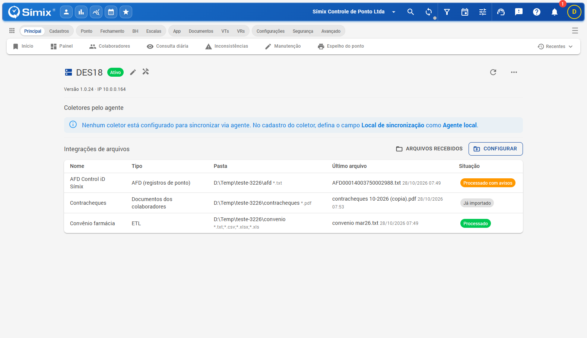
- Lista de integrações de arquivos:
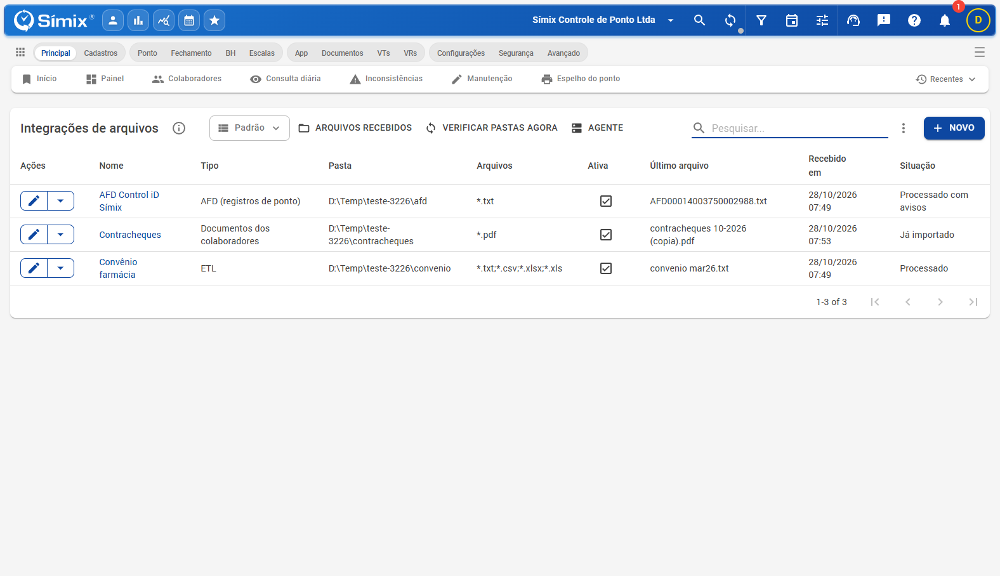
- Cadastro de uma integração de contracheques:
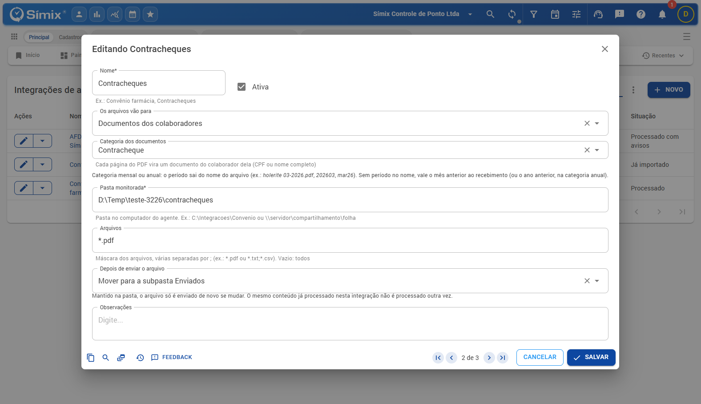
- Arquivos recebidos, com o resultado do processamento aberto (convênio pelo layout de integração, contracheques e AFD):
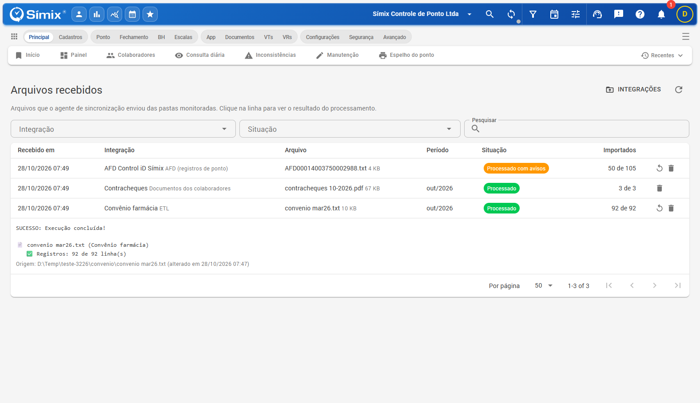
- Convênio gravando o valor da compra nos campos do colaborador no mês:
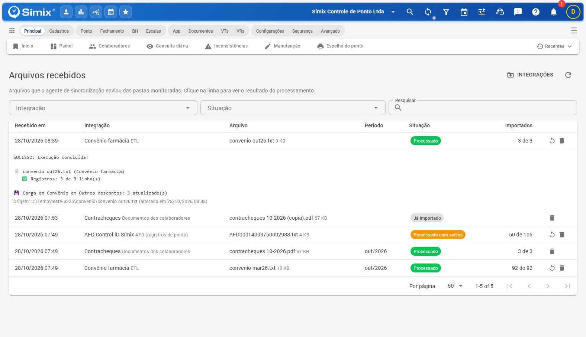
- Card da novidade na página de Novidades:
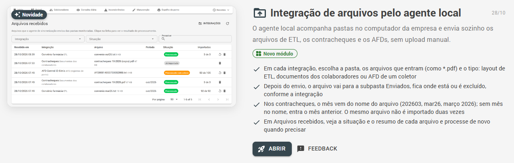

## Vale-transporte com o home office da escala ✨

Os dias de home office definidos em **Escalas › Home office** passam a valer no vale-transporte, e a Manutenção de VTs mostra de onde vem cada número.

- O dia sem local digitado recebe o local da escala do colaborador no mês, e os dias de home office saem dos dias previstos do VT, como o home office digitado. O local digitado no dia (na Manutenção ou em lote) continua valendo antes da escala.
- Na conferência do período anterior, só é descontado o home office que foi pago: o dia que já tinha ficado fora dos previstos não é descontado; o dia pago que virou home office depois é descontado; e o dia de home office não pago em que a pessoa veio à empresa conta como dia adicional. Meses gerados antes desta versão seguem o local do dia.
- Na **Manutenção de VTs**, novas colunas de **Home office**: **Previsto** (dias de home office que ficaram fora dos previstos e não foram pagos) e **Descontado** (dias pagos que viraram home office depois e entraram nas ausências). Passando o mouse, aparecem as datas.
- Novas colunas **Qtd./dia** e **Adicionais** (dias trabalhados fora do previsto, que somam na quantidade), no lugar da coluna Descontos, que não entrava no cálculo.
- Passando o mouse na **quantidade total** aparece a conta feita (previstos, ausências, quantidade manual e adicionais) e no **valor total**, a quantidade vezes o valor unitário.
- Manutenção de VTs e de VRs com visual novo: cartões de resumo do mês (colaboradores, quantidade total e valor total), filtro rápido, pesquisa e tabela mais limpa. As duas telas seguem o período escolhido na barra do topo.
- A quantidade manual é editada direto na tabela, a linha alterada fica destacada e o Salvar mostra quantas alterações serão gravadas; sair da tela ou trocar de mês com alteração pendente pede confirmação.
- As listas de colaboradores e de vales-transportes podem ser ordenadas por código, nome e totais, clicando no cabeçalho da coluna.
- Na Manutenção do cartão, os dias de home office da escala aparecem com a casinha esmaecida, com a dica de que vieram da escala (o local digitado no dia continua com o ícone normal).
- **VR de viagem**: o vale-refeição por dias de viagem considera a viagem prevista na escala. Na conferência do período anterior, só é descontado o dia de viagem que foi pago (a viagem cancelada depois da geração ou a falta no dia da viagem), e a viagem que não foi paga, com o dia trabalhado, soma como dia adicional. Falta em dia sem viagem não desconta mais o VR de viagem — antes qualquer falta descontava, e a quantidade podia ficar negativa.
- Corrigidos: a quantidade manual da Manutenção de VTs volta a somar no total quando o mês é gerado de novo; a lista de VTs do colaborador não mostra mais VTs de demitidos, de excluídos ou sem colaborador (os que apareciam com o nome em branco); a quantidade de colaboradores com VT nas informações da empresa deixa de contar os demitidos; a paginação da Manutenção de VTs mostra o total certo do mês e os nomes aparecem também em empresas com mais de 1000 colaboradores; e as linhas sem quantidade calculada, que o Salvar ignorava sem avisar, aparecem sinalizadas e sem campo de edição.

- Manutenção de VTs com as colunas Qtd./dia, Home office (Previsto e Descontado) e Adicionais, e os três cartões de resumo (nomes ofuscados):
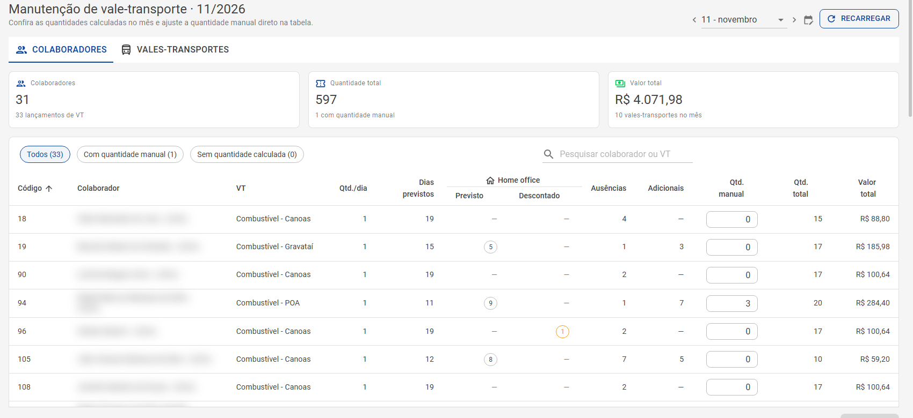
- A conta da quantidade total: (11 previstos − 1 ausência) × 1 + 3 manual + 7 adicionais × 1 = 20:
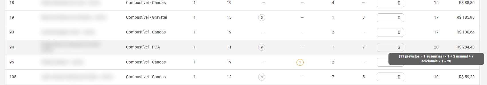

- A conta do valor total: 20 × R$ 14,22:
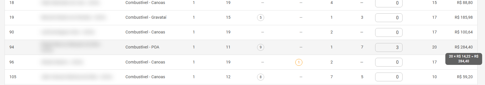
- Home office previsto: as segundas e quintas da escala, que ficaram fora dos dias previstos:
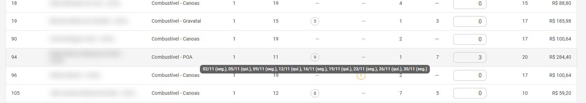
- Home office descontado: o dia 20/10 tinha sido pago e foi marcado como home office depois, então entrou nas ausências:

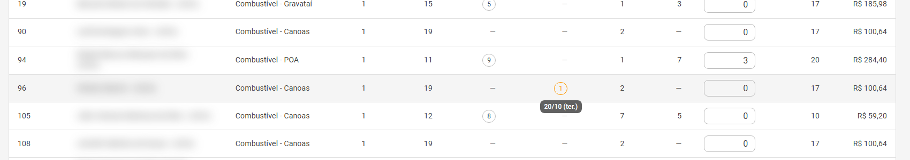
- Manutenção do cartão: os dias de home office da escala com a casinha esmaecida na coluna Observação:
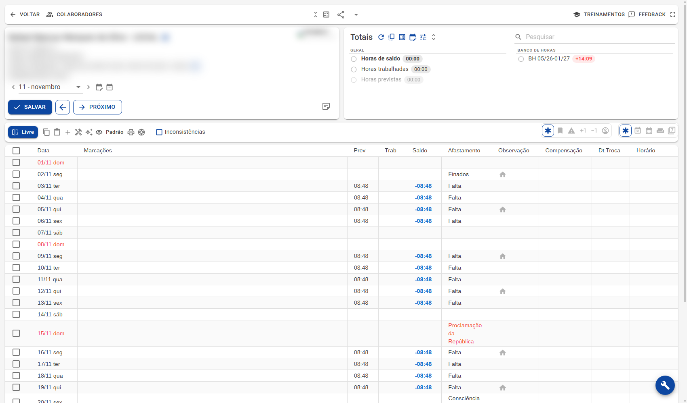

## Quitação parcial do banco de horas ✨

A quitação de saldo na **Consulta geral de banco de horas** ganha novas opções e fica mais rápida de aplicar.

- Três formas de quitar: **Integral** (zera o saldo), **Até X horas** (teto por colaborador; quem tem menos quita tudo) e **Percentual** (ex.: 50% quita metade das horas). O diálogo mostra quantas horas serão quitadas antes de confirmar.
- A consulta abre com o **período em andamento** já selecionado.
- Sem nenhum colaborador marcado, o botão **Ferramentas do período** fica ativo e vale para **todos** os colaboradores da lista (a exclusão continua exigindo a seleção).

- Período em andamento selecionado ao abrir:
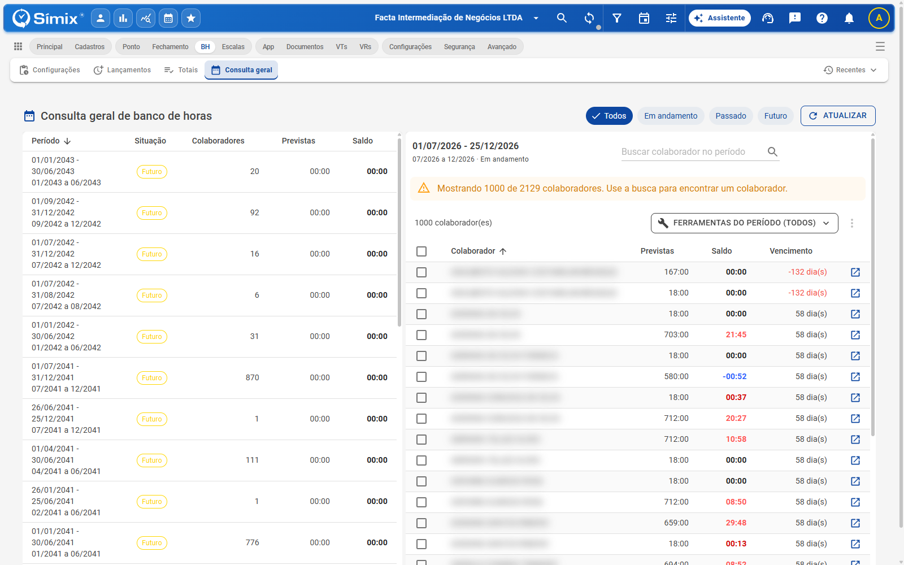
- Ferramentas do período para todos, sem seleção:
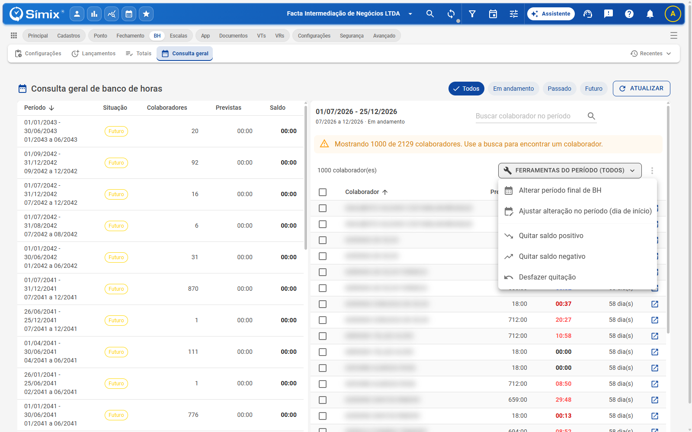
- Quitação até 08:00 por colaborador, com a prévia das horas:
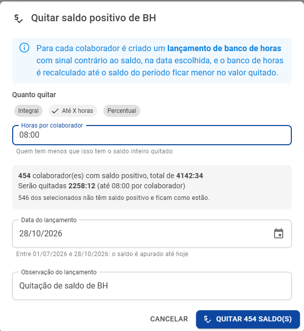
- Quitação de 50% do saldo:
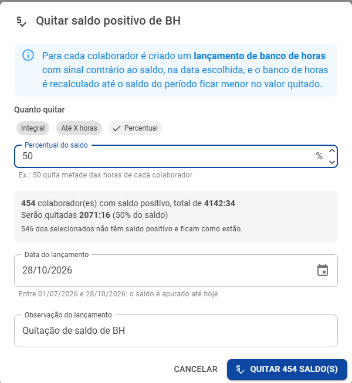

## Importação de colaboradores por planilha ✨

A importação por planilha passa a aceitar planilhas do jeito que chegam do cliente e, em vez de parar no primeiro problema, importa o que dá e lista o resto no fim.

- CPF e PIS com espaço, ponto ou outro caractere junto do número (". 03082900038") ficam só com os números. Se a célula tiver texto (o nome de outra pessoa, por exemplo), o colaborador entra sem o documento e aparece um aviso no fim.
- Cargo, departamento e setor escritos com maiúsculas, acento ou espaços diferentes ("AUX ADM ", "aux adm") usam o cadastro que já existe, em vez de parar com "já existe um registro ativo".
- **Estabelecimento pelo nome**: usa o que já existe com aquele nome ou cadastra um novo; o código numérico continua valendo como antes.
- Data de admissão com a barra faltando ("0802/2024") é lida como 08/02/2024; a data que não dá para ler vira aviso, em vez de ficar com a data de hoje sem avisar.
- A mesma pessoa (mesmo CPF) em mais de uma linha é importada uma vez só, com aviso. Importar a mesma planilha de novo não duplica quem já entrou.
- Uma linha com erro não interrompe mais a importação: ela fica de fora e aparece no fim com o número da linha e o motivo. Linha em branco no meio da planilha também não faz mais as de baixo serem ignoradas.
- **Todas as abas** da planilha são lidas (antes, só a primeira); a tela mostra as abas lidas, as que não têm colaboradores e as ocultas. O cabeçalho pode estar em qualquer linha ou coluna, com título acima.
- Avisos no fim quando um texto passa do tamanho do campo (nome, RG, matrícula, endereço…) e quando o CPF ou o PIS não confere pelo dígito verificador.
- A conferência antes de importar mostra só as colunas que têm dados, o estabelecimento, o cargo, o departamento e o setor com código e nome, e os avisos de cada colaborador embaixo do nome.
- Barra de progresso enquanto a planilha é lida, e tela no visual das telas novas, com cada etapa num cartão (enviar a planilha, colunas da planilha, conferir e importar). Enviar outra planilha, ou tirar o arquivo, limpa a conferência da anterior.
- Código do colaborador zero ou negativo na planilha recebe um código novo, sem repetir os que vieram nela.
- A importação pelo menu (Colaboradores › Importar) abria uma versão antiga da tela, sem estas correções: agora o menu, o painel admin e o assistente da implantação abrem a mesma tela.
- **Trocar código** no cadastro do colaborador: o campo aceita o código inteiro (cortava em 4 dígitos) e abre vazio; dá para digitar o código desejado ou usar o botão **Usar o próximo código livre** (fora da regra "Código na folha"); e o código já usado aparece no próprio diálogo, que continua aberto para tentar outro.
- O código na folha de pagamento do afastamento aceita 10 caracteres (eram 4), como o do estabelecimento.

- CPF com ponto e espaço gravado só com os números, estabelecimento criado e reaproveitado pelo nome, repetido importado uma vez e CPF com texto avisado:
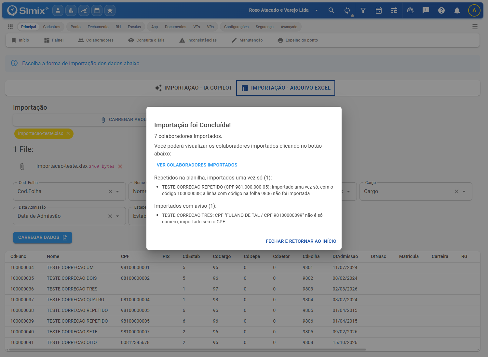
- Planilha com casos de erro: linha em branco pulada, cargo e departamento com grafias diferentes no mesmo cadastro, data inválida avisada e a linha com erro recusada sozinha:
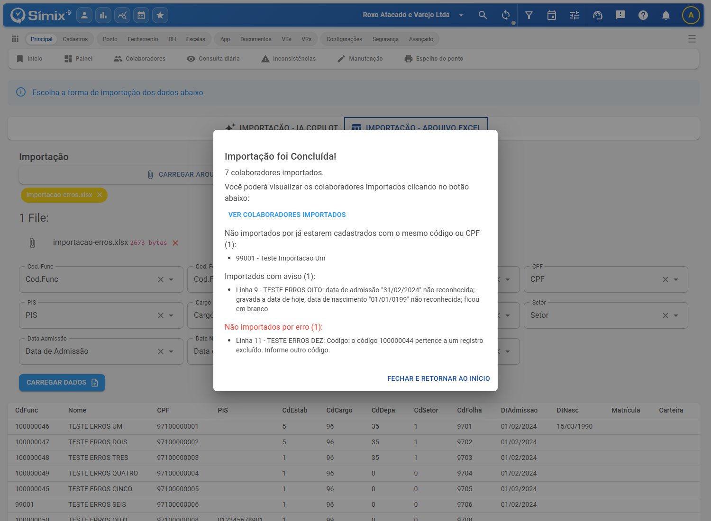
- Planilha com várias abas e cabeçalho fora da coluna A; na segunda importação todos são reconhecidos pelo CPF:
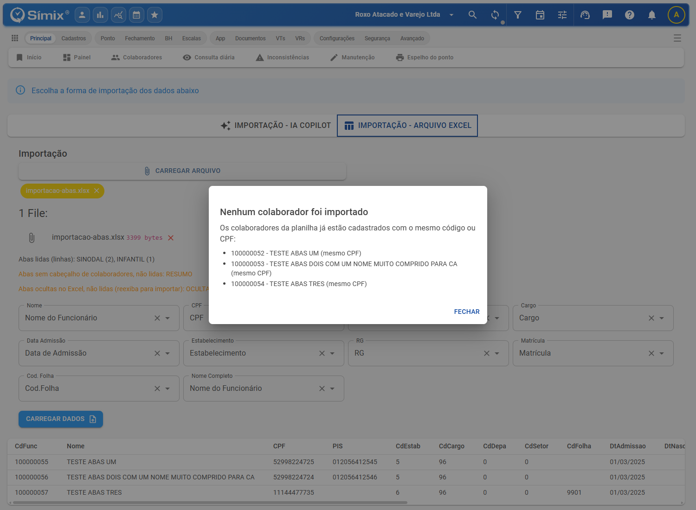
- Barra de progresso enquanto a planilha é lida:
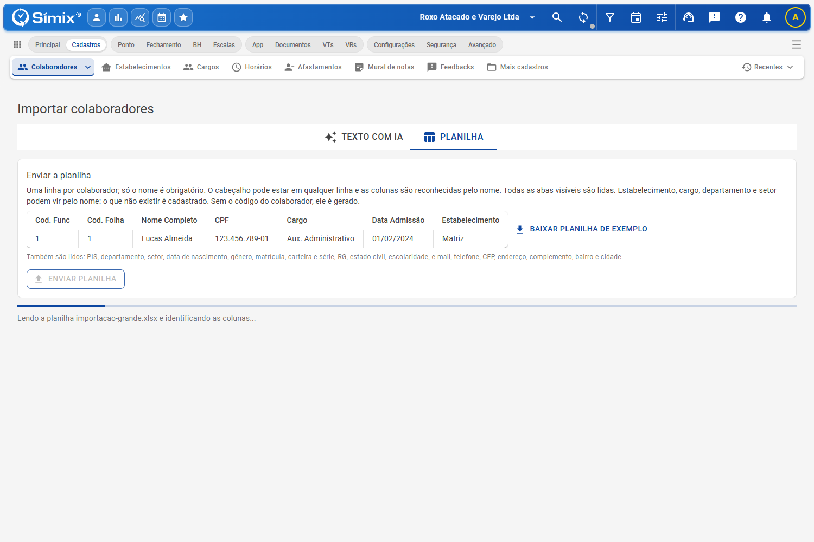
- Conferência só com as colunas que têm dados:
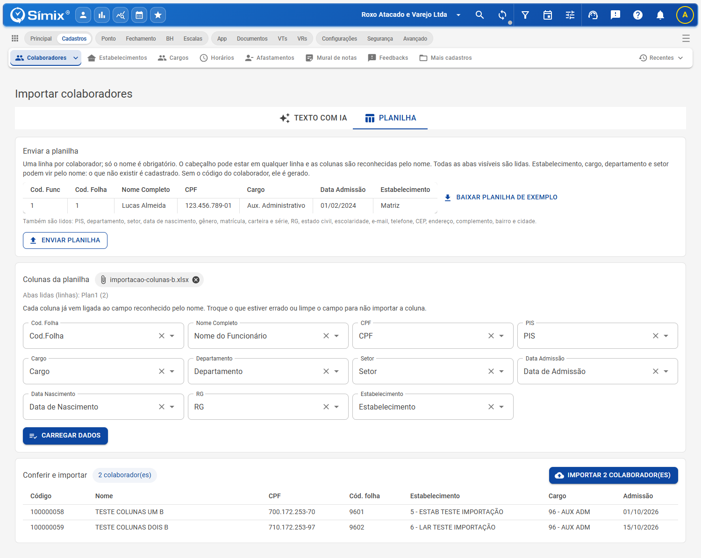
- O aviso de cada colaborador embaixo do nome:
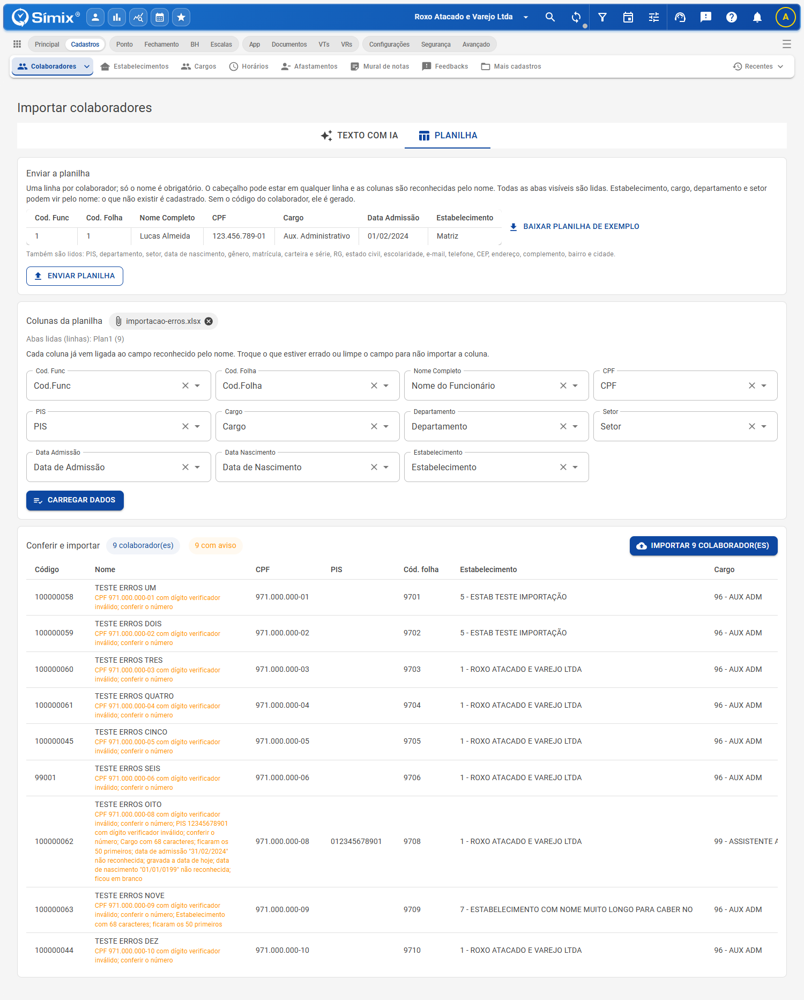
- Trocar código com o próximo código livre, de 9 dígitos, inteiro no campo:
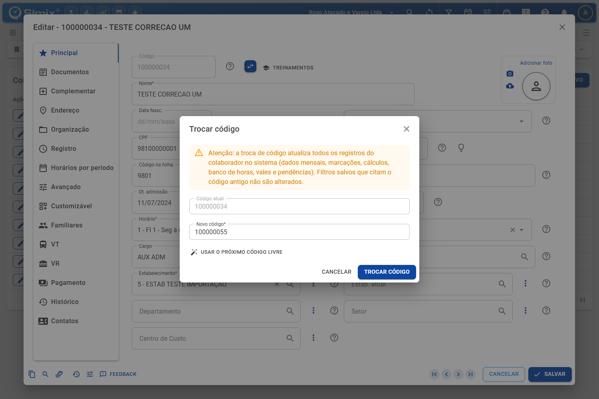
- Código já usado por outro colaborador: o motivo aparece no diálogo, que continua aberto:
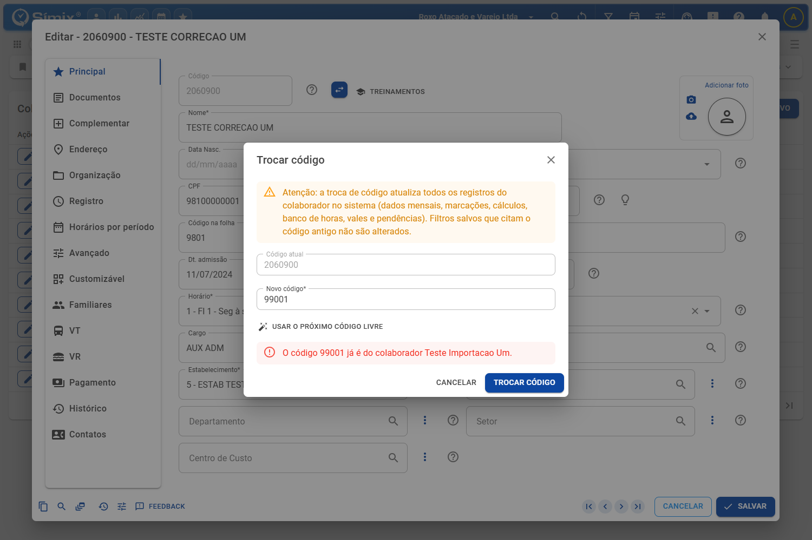
- Afastamento gravado com o código na folha de 10 caracteres:
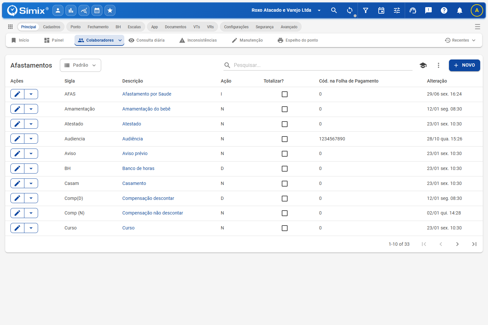

## Tarefas e equipamentos

- Nas **ações rápidas** do colaborador, o envio para os equipamentos só é disparado: a janela fica livre na hora para seguir com os outros cadastros, e o monitor de tarefas avisa o resultado de cada equipamento.
- As tarefas que mexem nos equipamentos do mesmo cliente (envio das ações rápidas, sincronização e reimportação dos coletores) rodam uma de cada vez. A que chega com outra em andamento aparece como "Aguardando outra tarefa do cliente terminar".
- **Monitor de tarefas** ligado para todos, com ícone próprio para as tarefas em andamento, diferente do de sincronização. As telas deixam de repetir o aviso de conclusão ou de erro que o monitor já mostra, e o monitor passa a mostrar também o resultado da exportação e do e-mail da folha.
- **Calcular dados** vem como Automático por padrão na geração do espelho, na exportação da folha e nas ações rápidas.
- Corrigidos: o espelho de um colaborador só, no modo Automático, deixava o mês inteiro como calculado, e as alterações dos outros colaboradores daquele mês não eram mais recalculadas; e a opção de calcular dados da exportação da folha não tinha efeito.

- Monitor com uma tarefa em andamento, com ícone próprio ao lado do de sincronização:
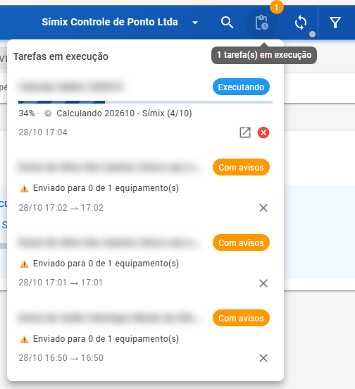
- Sincronização e envio do mesmo cliente: o envio terminou e a sincronização aguarda a vez:
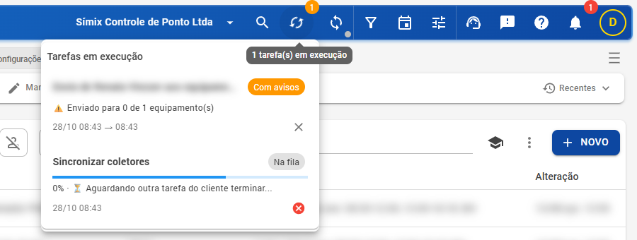
- Ações rápidas: o envio é disparado, a janela fica livre e o resultado chega pelo monitor:
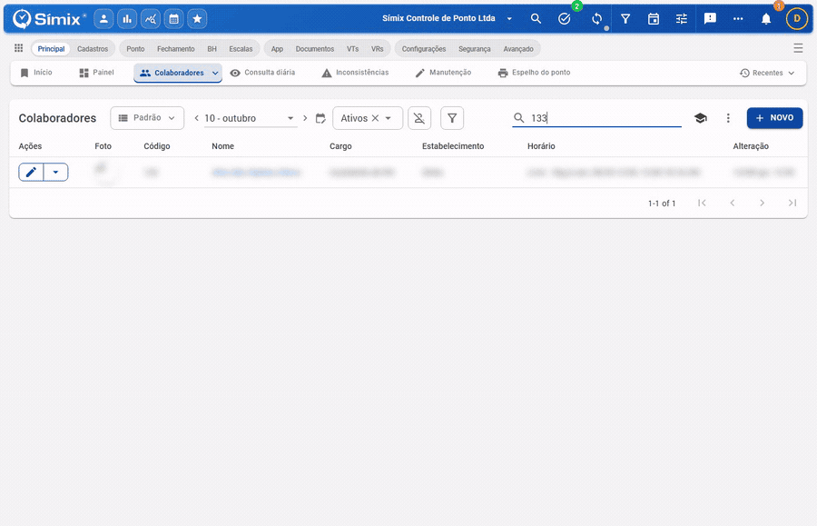

## Notas do mural no aplicativo ✨

- As notas ganham rotinas próprias do **aplicativo**: painel do colaborador, antes e depois do registro. As rotinas que já existiam passam a se chamar "na web", e cada nota escolhe se aparece na web, no app ou nos dois.
- As notas que já existem continuam só na web até que as rotinas do app sejam marcadas.
- O aplicativo passa a buscar os recados do mural do colaborador nessas rotinas (na próxima versão do aplicativo).

- Rotinas da nota, com as da web e as do aplicativo:
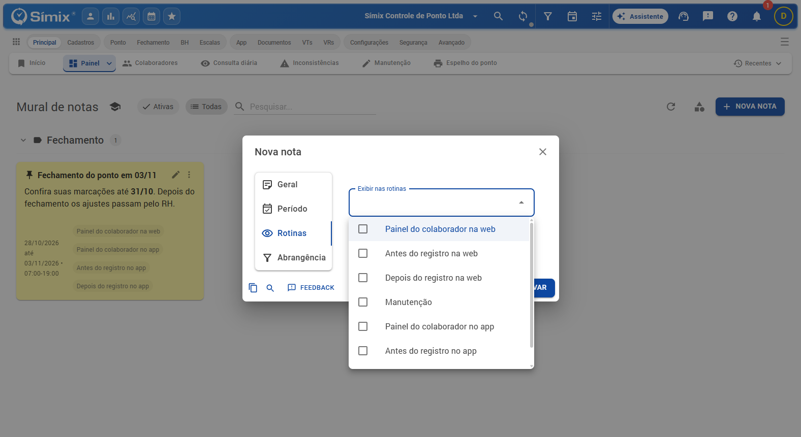
- Mural com a nota e as rotinas marcadas:
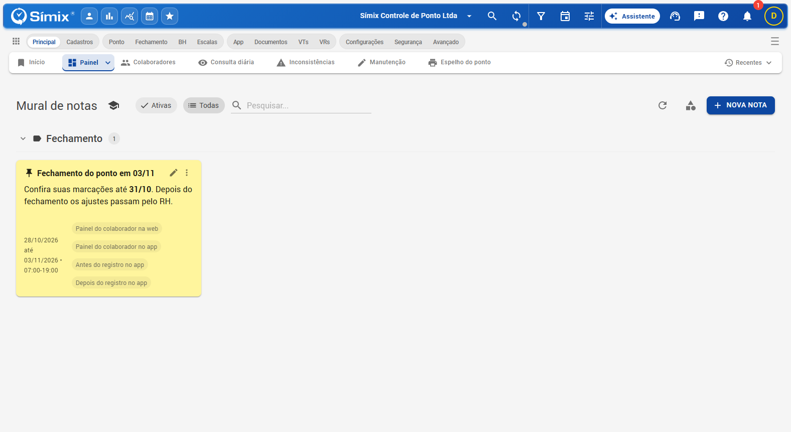

## Espelho de ponto

- O colaborador volta a **assinar (ou recusar) o próprio espelho pelo link**, no celular ou no computador. Desde 18/10, ao clicar em **Assinar Documento** aparecia um erro de autorização, e a assinatura não era gravada. A assinatura continua exigindo login.
- Ao recusar a assinatura, um erro passa a aparecer como aviso na tela, em vez de travar a página.

- Colaborador assinando o espelho:
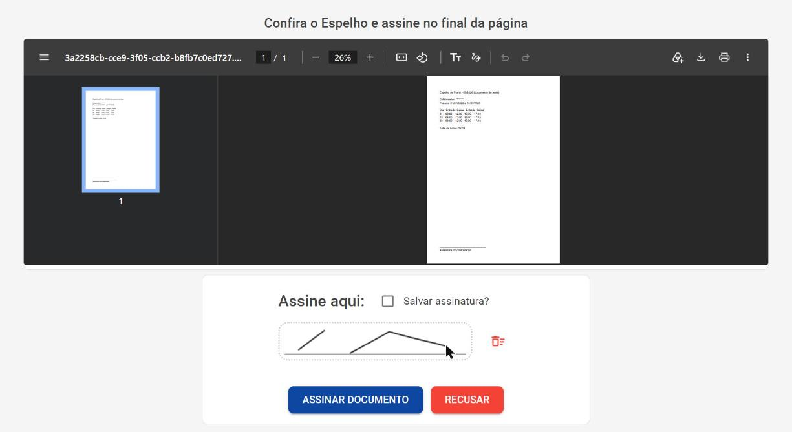
- Assinatura concluída:
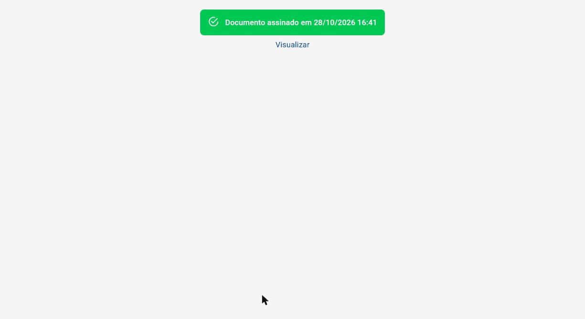
- Espelho com a assinatura aplicada:
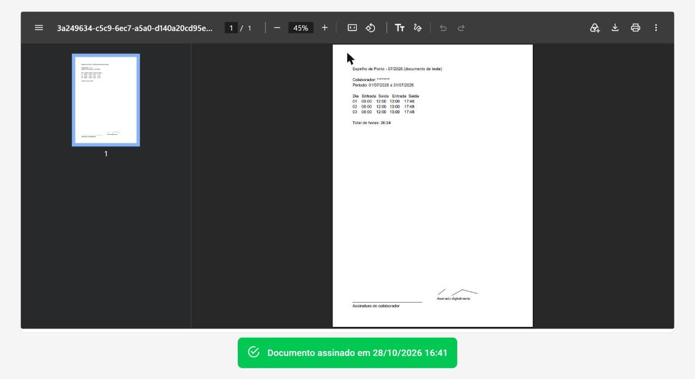

## Escalas, barra do topo e menus

- **Escalas**: o painel lateral da grade abre mais estreito, deixando mais espaço para os dias do mês, e pode ser alargado ou estreitado arrastando a divisória entre a grade e o painel. A largura escolhida fica guardada no navegador, e o duplo clique na divisória volta ao padrão. Com o painel estreito, as abas (Horários, Afastamentos, Pendências e Histórico) aparecem só com o texto.
- **Barra do topo**: o botão de Suporte vai para depois do Assistente, só com o ícone, e o botão de Escalas sai da barra (as telas continuam no menu Escalas).
- **Menu Escalas**: Regras e coberturas e Simulador da redução passam para o fim do grupo. Em Consultas, o atalho Monitor de registros sai da lista.
- **Novidades**: novos cards do painel de Manutenções e afastamentos, do painel de Locais de trabalho e dos favoritos da estrela — o "Me mostre" deste abre a estrela e mostra como adicionar um atalho ou, para quem ainda não tem atalhos, o assistente de perfis. O card das visões das listas passa a citar as colunas Departamento, Setor e Tags da lista de colaboradores.

- Card do painel de Manutenções e afastamentos:
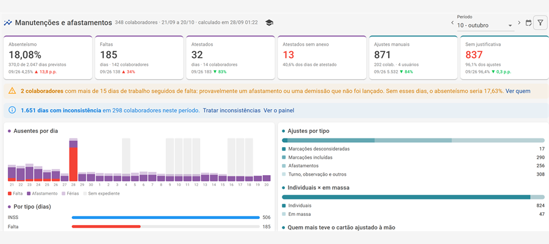
- Card do painel de Locais de trabalho:
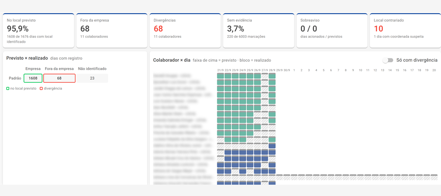
- Card dos favoritos da estrela:
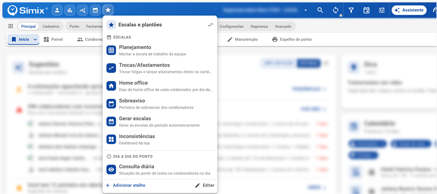

## Para a equipe Símix

- As atualizações de banco passam a pular os ajustes que já foram aplicados e a atualizar vários bancos ao mesmo tempo, o que encurta a implantação de cada versão. Se a estrutura de um banco mudou desde a última atualização, ele roda todos os ajustes, como antes.
- O Claude Code da equipe de desenvolvimento passa a consultar os bancos de teste locais, abrir o sistema local num navegador próprio para conferir telas e tirar prints, consultar a documentação da Microsoft e usar as operações de teste do próprio sistema em desenvolvimento. Nada disso existe em produção.

- Tela de login do ambiente local aberta pelo navegador do Claude Code:
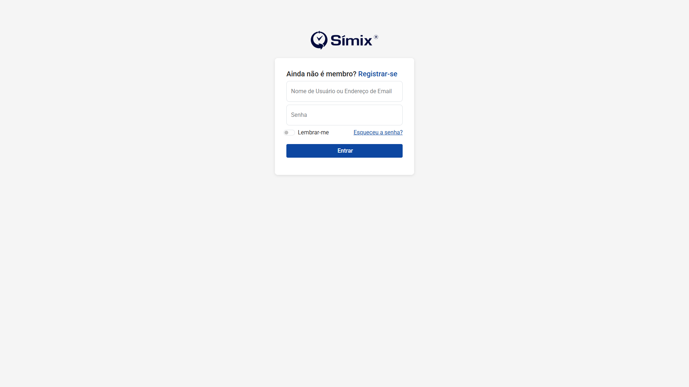

## Outras melhorias e correções

- **Manutenção de afastamentos**: nova coluna **Médico**, com o nome do médico informado no atestado.
- **Duplicar** nos cadastros (regras de prêmio, horários, afastamentos, contratos, EPIs…) falhava quando o nome com "Cópia" passava do tamanho do campo ou quando já existia uma cópia com o mesmo nome. Agora o nome da cópia sempre cabe e, se já existir, vira "Cópia 2", "Cópia 3"…
- O nome da regra de prêmio aceita até 100 caracteres (eram 30).
- "Clientes que usam esta opção", na ajuda dos campos do horário, mostra por ramo de atividade quantos clientes usam cada opção, sem o nome dos clientes; cada cliente aparece uma vez só, e a soma bate com o total.
- Na Manutenção, a opção **Destacar relevância dos totais** começa desligada.
- Salvar o colaborador não troca mais a escala do mês pela do quadro de horário.
- Reforço de segurança no cálculo: quem é só colaborador recalcula apenas o próprio cartão.

- Coluna Médico na Manutenção de afastamentos (nomes borrados):
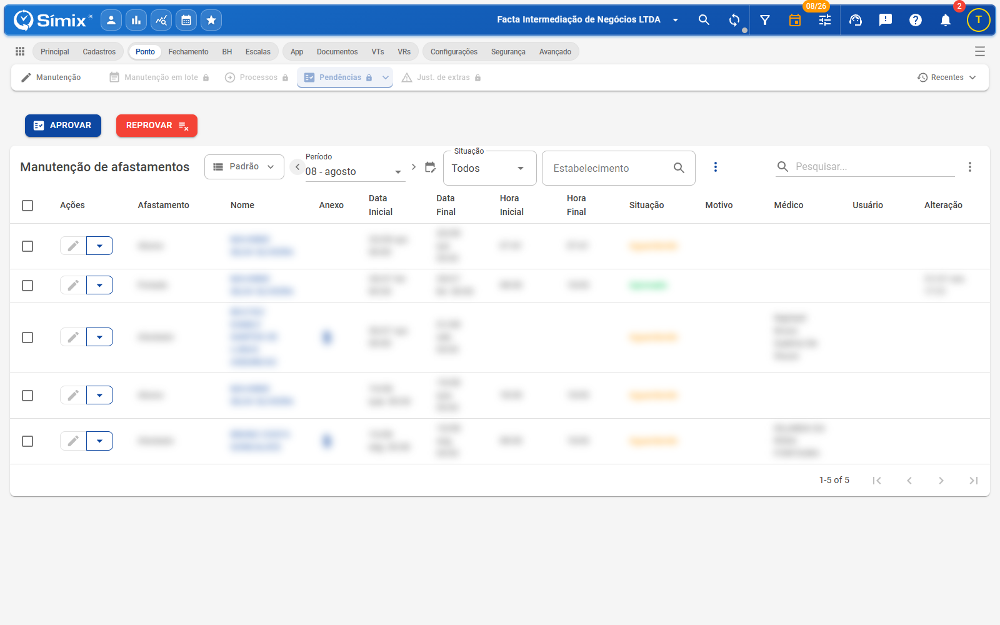
- "Clientes que usam esta opção" para um usuário do cliente, sem os nomes:
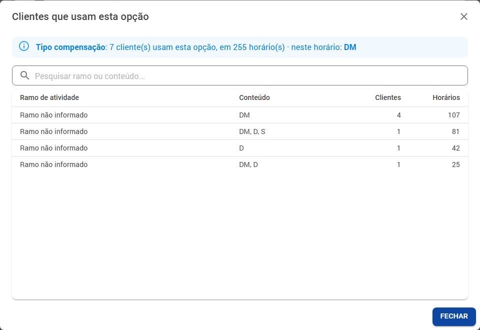

# 28/10/2026

## Resumo

- 🚨 Painel de inconsistências: o que trava o fechamento, risco trabalhista e regras a revisar
- 🩺 Painel de manutenções e afastamentos, com absenteísmo e os ajustes feitos no cartão
- 📍 Locais de trabalho: previsto × realizado, com painel e dashboard na loja
- 🔍 Consulta do dia e página de Registros mostram as marcações que ficaram fora do cálculo
- 📆 Consulta diária com intervalo de datas, totais em cards e faixas de extras
- 🕘 Horários por período no cadastro do colaborador e direto na Manutenção
- 🔁 Readmissão: o cadastro reconhece o CPF de quem já foi desligado
- 📜 Termos de responsabilidade e atestado técnico gerados pelo próprio sistema
- 🔄 Escalas: troca automática de domingos trabalhados, visão Semana e Excel
- 📱 Registro pelo aplicativo e pela web: Padrão, Sempre ou Nunca por colaborador
- 🧭 Menu do topo mais baixo, com Recentes e o menu com todas as telas
- ⭐ Estrela de Favoritos com grupos de atalhos
- 🚫 Cadastros não aceitam nome repetido
- 📥 Importação de colaboradores por planilha com todos os dados
- ⚖️ Forçar BH e Forçar sem compensação valem também para faltas e extras
- 🧮 Calcular dados segue nos outros colaboradores quando um cartão dá erro
- 🧹 Coletores: excluir do equipamento os colaboradores desligados
- 🔐 Permissões com nomes completos e mensagem clara quando falta acesso

## Painel de inconsistências ✨

Novo painel em **Inconsistências › Painel** (também em Consultas e dashboards), que separa as inconsistências pelo que cada uma pede de ação e compara com o mês anterior.

- Separa o que **trava o fechamento**, o **risco trabalhista**, o que é **erro de escala** e o que é **comportamento**.
- Lista de quem trava o fechamento (marcação faltando ou falta sem afastamento), a partir do dia mais antigo, com atalho para o cartão.
- Risco trabalhista por regra, com o artigo da CLT, e mapa por estabelecimento ou departamento colorido pela taxa por colaborador.
- **Regras a revisar**: a regra que atinge mais da metade dos colaboradores no mês sai das contagens e aparece à parte, com atalho para ajustar. O cadastro de regras também avisa quando isso acontece.
- Tendência dos últimos 6 meses por tipo de inconsistência.
- As listas de inconsistências (do dia e por mês) abrem já filtradas a partir do painel, do painel de manutenções e do Início, e os atalhos para o painel e para Inconsistências por mês respeitam o filtro de lotação escolhido no atalho.
- A regra padrão **"Acima de 4h trabalhadas no turno"** passa a valer acima de 6h (intervalo de 1 hora da CLT). Só muda onde a regra nunca foi editada, a partir do próximo cálculo.

- Painel de setembro: a regra de horas no turno atinge 87% do quadro e vai para "Regras a revisar":
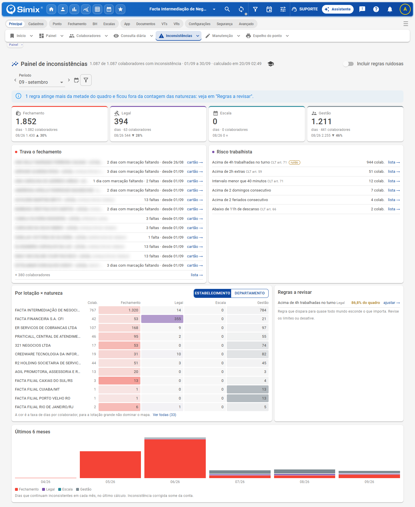

## Painel de manutenções e afastamentos ✨

Nova tela em **Ponto › Manutenção › Manutenções e afastamentos**, que junta as ausências e os ajustes feitos no cartão do período. Segue o período e o filtro global e tem o próprio botão de filtro.

- Cards de absenteísmo, faltas, atestados, atestados sem anexo, ajustes manuais e ajustes sem justificativa, comparados ao período anterior. O absenteísmo é calculado como no relatório de absenteísmo, e o card "Atestados sem anexo" abre a consulta de atestados já filtrada.
- Ausentes por dia, afastamentos por tipo (as férias aparecem à parte, fora dos totais) e mapa de ausências, com um colaborador por linha e atalho para o cartão.
- Ajustes por tipo, ajustes individuais × em massa (20 ou mais do mesmo usuário no mesmo minuto) e quem mais teve o cartão ajustado à mão.
- Alerta de quem tem mais de 15 dias de trabalho seguidos de falta — provável afastamento ou demissão que não foi lançado —, com o absenteísmo sem esses dias, e alerta das inconsistências em aberto.
- O histórico de alterações do cartão passa a guardar o mês do cartão: com o cartão começando fora do dia 1, os ajustes e o relatório de manutenções dos dashboards caem no mês certo. As alterações antigas foram corrigidas na atualização, e o relatório ficou mais rápido.
- Na loja de dashboards, o antigo "Dashboard de manutenções", que mostrava as solicitações de ajuste, passa a se chamar **Pendências**. Entra um novo dashboard **Manutenções**, com os ajustes do mês por tipo, por rotina, por usuário (os automáticos aparecem como "Sistema") e por colaborador, e a lista dos ajustes com a marcação antiga e a nova.

- Período 08/2026: cards comparados ao mês anterior, ausentes por dia, tipos, ajustes e mapa de ausências:
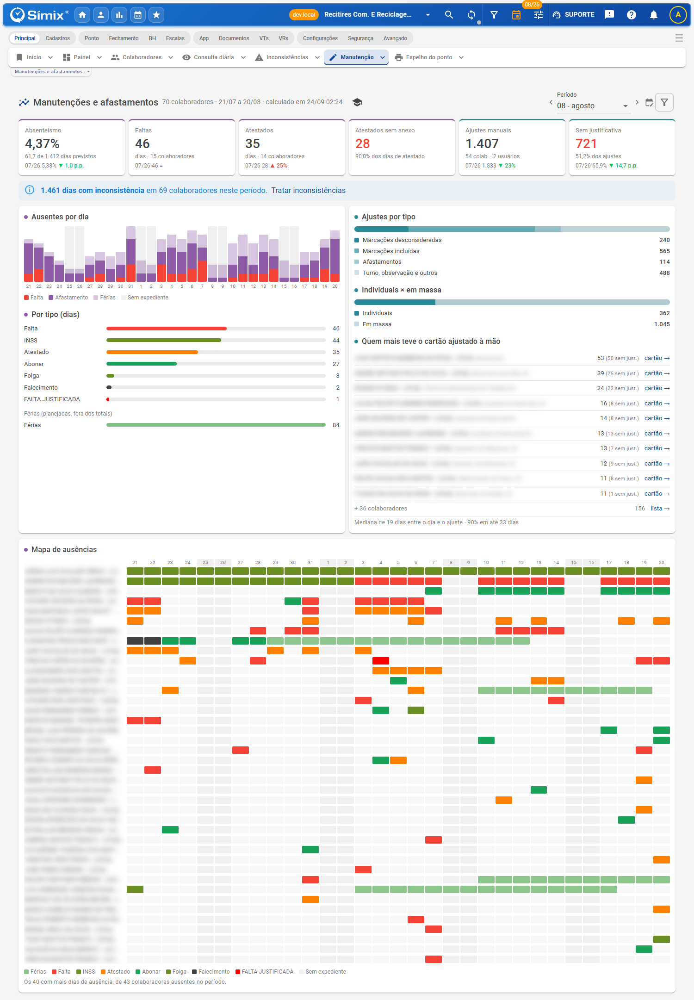
- Alerta das faltas corridas longas: sem esses dias, o absenteísmo cairia de 9,06% para 7,56%:
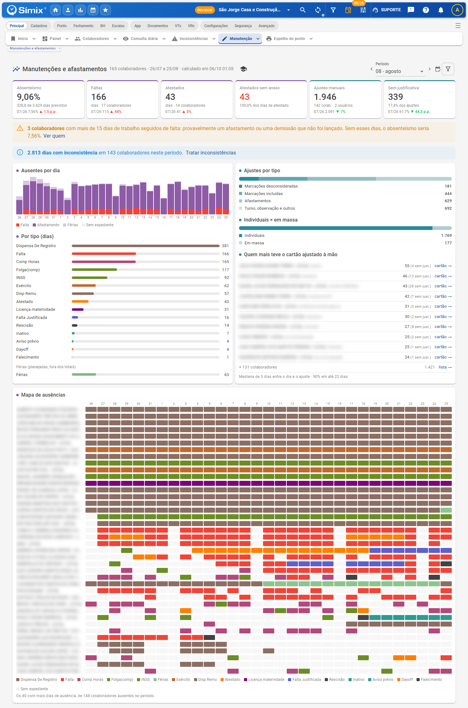
- No celular, dois cards por linha e o mapa rolando dentro do quadro:
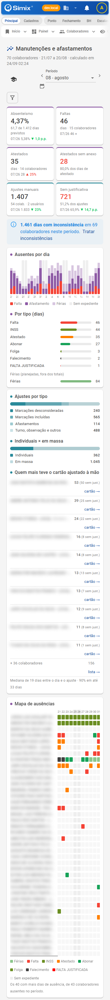
- Novo dashboard Manutenções na loja:
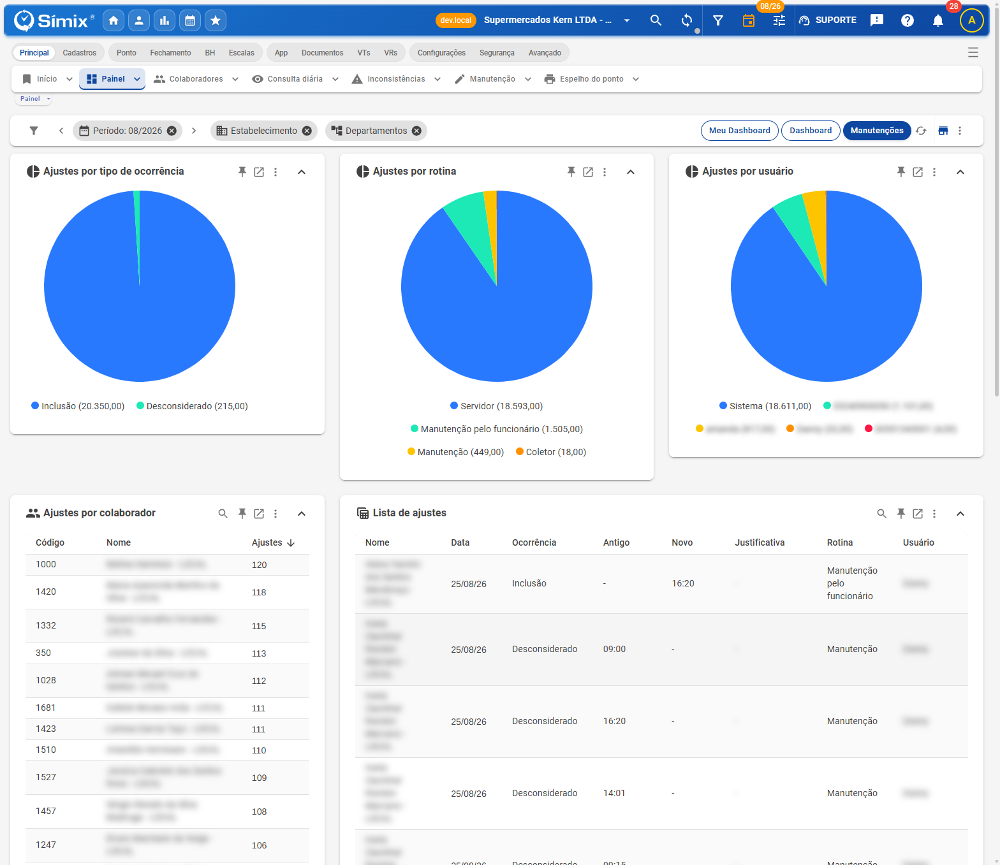
- Dashboard Pendências, com o nome e os títulos novos:
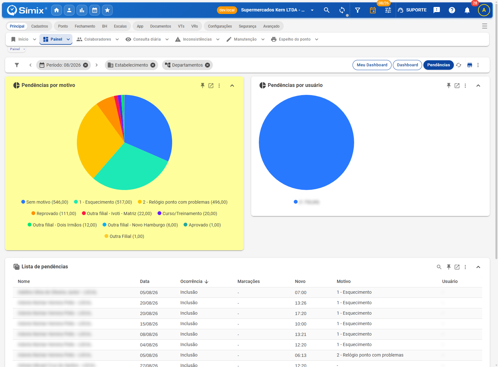

## Locais de trabalho: previsto × realizado ✨

Novo painel para acompanhar onde cada colaborador trabalhou no mês — empresa, fora da empresa, home office, sobreaviso, cliente ou viagem — comparado ao local previsto.

- Nova tela **Locais de trabalho** no menu da Manutenção: dias no local previsto, dias fora da empresa, divergências, marcações sem evidência de local, sobreaviso acionado e local informado que a localização contradiz.
- Quadro previsto × realizado e grade por colaborador e dia, com as divergências destacadas; o nome abre o cartão do colaborador.
- Lista das divergências do mês: marcando os dias, o local previsto é ajustado em lote (igual ao realizado ou outro escolhido), e os dias são recalculados, inclusive VT e VR de viagem.
- O local realizado vem do que a marcação informou; sem isso, do relógio de ponto (empresa) ou da localização do aplicativo e da web comparada à do estabelecimento. Localização a mais de 50 km do estabelecimento é tratada como coordenada errada do cadastro, e não como trabalho fora.
- Novo dashboard **Locais de trabalho** na loja, com os mesmos dados e os filtros de período, estabelecimento e departamento.
- O cadastro de estabelecimento avisa quando falta a latitude e a longitude, ou quando as marcações do aplicativo e da web do último mês ficam, na mediana, a mais de 50 km dele (sinal de coordenada errada). O painel também lista os estabelecimentos sem coordenada.
- O registro pela web passa a pedir a localização ao navegador mesmo quando a empresa não confere o local: ela fica guardada só para consulta e nunca impede o registro.
- Marcação feita sem a posição do aparelho deixa de gravar uma distância falsa até a empresa.
- O cálculo, a importação de registros e a Manutenção voltaram a enxergar a escala do quadro de horário do colaborador: a marcação web sem local passa a receber o local da escala (por exemplo, home office nos dias previstos). O Calendário explica de onde vem o local do dia com essa regra.

- Visão geral do painel, com os nomes borrados:
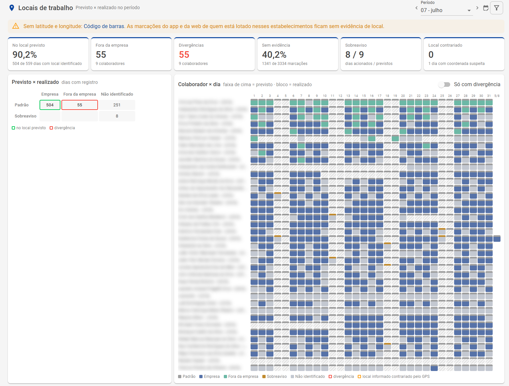
- Divergências do mês com dois dias marcados para ajustar o local previsto:
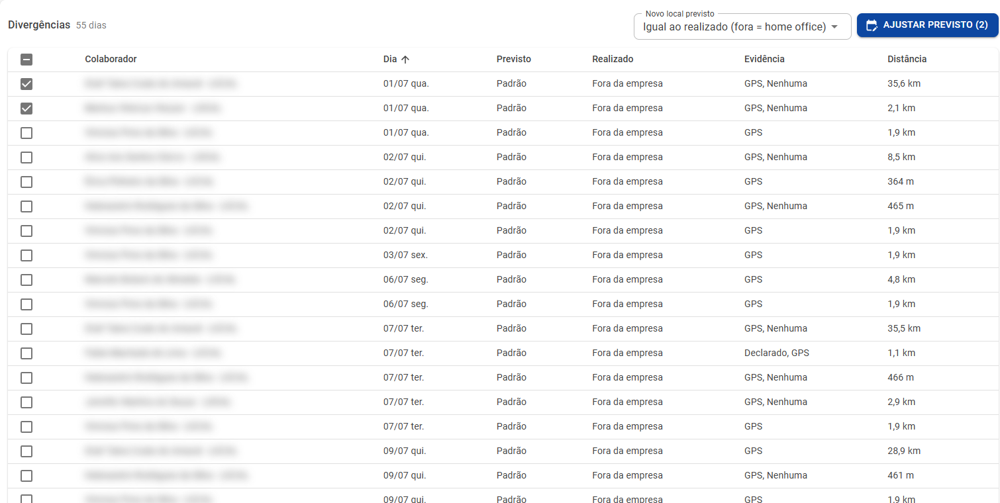
- Dashboard Locais de trabalho na loja:
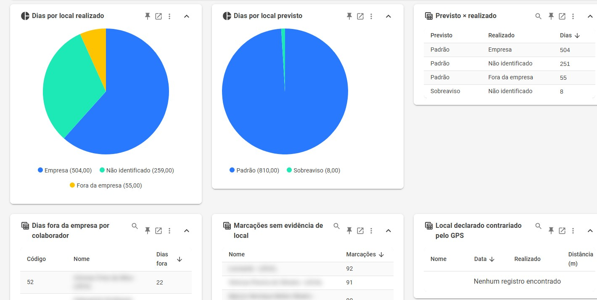
- O mesmo dashboard aberto sobre os dados de locais de trabalho:

- Aviso de coordenada suspeita no cadastro do estabelecimento, com marcações recentes a 534 km:
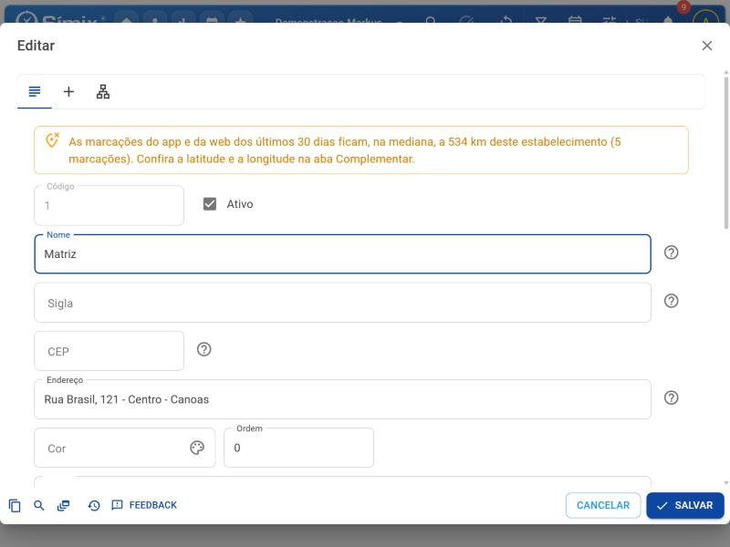

## Marcações fora do cálculo e nova página de Registros ✨

As consultas de registros passam a mostrar as marcações que foram guardadas mas não entraram no cálculo, e a consulta do dia e a página de Registros foram redesenhadas.

- Aviso **"N marcações não entraram no cálculo"** na consulta do dia (aberta pelo olho da Manutenção, pela Consulta diária e pelas Inconsistências) e nas páginas de Registros e Comprovantes, com a situação e o motivo.
- A consulta do dia virou uma lista só, **Marcações e Alterações do dia**: cada marcação mostra em que campo do cartão caiu (Ent 1, Sai lanche 2…) ou que ficou fora do cálculo, com os filtros Todas, No cartão e Fora do cálculo.
- Aberta pela Manutenção, a lista confere com o cartão da tela: a marcação reorganizada aparece no campo atual, e a editada ou apagada depois da importação aparece como alterada ou removida.
- Clicar na marcação abre o detalhe com a situação, o endereço e o comprovante (a aba Comprovantes deixou de existir). O título traz o nome do colaborador, e as setas trocam de dia sem fechar a janela.
- Turno noturno: a marcação que caiu no cartão do dia vizinho aparece nos dois dias, com a data junto da hora.
- **Página de Registros** numa visão só: total e período no cabeçalho; filtros numa linha (período, dispositivo, filtro de lotação com filtros salvos e pesquisa); as situações do filtro inteiro com a quantidade (Todas, No cartão, Fora do cálculo, Aguardando, Repetidas), servindo de filtro; e a nova coluna **Cartão**. Colunas sem nada na página saem da lista, e a linha fora do cálculo fica destacada.
- Clicar numa marcação da página de Registros abre ao lado as marcações daquele dia do colaborador; em telas menores, o painel abre por cima da lista.
- Corrigidos: a aba de comprovantes escondia a marcação de relógio que não entrou no cálculo; o selo "INATIVO" do comprovante saía sem cor; a coluna da hora da marcação se chamava "Data da alteração"; e a data final da página de Registros não entrava na consulta.

- Cartão reorganizado na Manutenção: marcações no campo de hoje, uma alterada e as fora do cálculo em laranja:
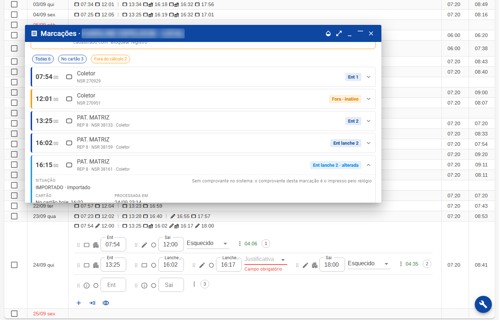
- Turno noturno: as marcações da noite anterior aparecem com a data junto da hora:

- Página de Registros com as situações, a coluna Cartão e as marcações do dia ao lado:

- No celular, as marcações do dia abrem por cima da lista:

## Consulta diária com intervalo de datas ✨

- Campos **Data inicial** e **Data final**: sem a data final, a consulta continua sendo do dia; com ela, traz todos os dias do intervalo (até 62), com a coluna Data. Os atalhos da linha (Manutenção, comprovantes) abrem no dia daquela linha.
- No intervalo, a opção **Por colaborador** mostra uma linha por pessoa com o total: dias, presenças, faltas, horas previstas e trabalhadas, saldo, extras por faixa, horas faltas e adicional noturno. "Ver os dias" volta aos dias daquele colaborador.
- Totais em **cards** no topo, no lugar da tabela do rodapé, com um card por faixa de extras, e a coluna Extras com as faixas de cada dia.
- Os totais passam a somar todos os dias filtrados — antes somavam só as linhas da página exibida.
- Quem é só colaborador consulta apenas o próprio cartão também por essa tela.
- A Consulta diária volta a abrir para quem já vê o ponto da equipe: basta a permissão de Consulta diária, de Manutenção do ponto ou de Dias calculados.

- Um dia, com os totais em cards e as faixas de extras:

- Intervalo de 01/10 a 20/10, com a coluna Data e os totais do período:

- O mesmo intervalo por colaborador:

## Horários por período ✨

- O cadastro do colaborador ganhou a guia **Horários por período**, para incluir, alterar e excluir os períodos junto com o cadastro. A opção "Horários" saiu do menu da lista de colaboradores.
- Ao trocar o horário do colaborador, escolha entre **No mês todo** (como era) ou **A partir de** uma data: ao salvar, o horário anterior continua valendo do início do cartão até a véspera.
- **Na Manutenção**, coluna Horário: um ícone de calendário ao lado do "+" cria o horário por período a partir do dia clicado, até o fim do cartão, já com o quadro de horário atual. Ao gravar, o cartão é recalculado.
- Os dias com horário por período mostram o nome do quadro; na edição do dia, clicar no nome abre o período para alterar ou excluir.
- O período precisa das duas datas e não pode se sobrepor a outro do mesmo colaborador (sem a data final, o cálculo ignorava o período).

- Calendário ao lado do "+" na coluna Horário:

- O período já vem do dia clicado até o fim do cartão:

- Depois de gravar e recalcular, os dias do período mostram o quadro:

- No dia em edição, o nome vira um botão para alterar o período:

- Alterar ou excluir o período:

- Período que se sobrepõe a outro é recusado:

- Guia Horários por período no cadastro do colaborador:

- Troca de horário "A partir de" uma data:

## Readmissão no cadastro do colaborador ✨

- Ao digitar o CPF de um colaborador novo, o cadastro confere se ele já foi de alguém desligado e mostra o aviso com o nome, o código e a data do desligamento.
- **Copiar dados cadastrais** preenche o cadastro novo com os dados pessoais do anterior (nome, nome social, nascimento, gênero, PIS, RG, carteira, estado civil, escolaridade, e-mails, telefone e endereço). Código, admissão, demissão, login, foto e os dados do mês continuam os do cadastro novo, e campo vazio no anterior não apaga o que já foi digitado.
- **Ver histórico anterior** abre o cadastro antigo numa janela, no mês do desligamento.

- Aviso logo abaixo do CPF:

- Depois de "Copiar dados cadastrais": dados pessoais preenchidos, organização e datas ainda vazias:

- "Ver histórico anterior" abre o cadastro do colaborador desligado:

## Termos de responsabilidade e atestado técnico ✨

Nova tela **Avançado › Termos de responsabilidade**, com os documentos que a Portaria MTP 671/2021 (art. 89) exige na fiscalização.

- A empresa gera o **Atestado Técnico e Termo de Responsabilidade do Símix Ponto** quando precisar, para a empresa ou para um estabelecimento (com o CNPJ dele), no papel timbrado da Símix e com a data do dia.
- O atestado sai assinado digitalmente pelo responsável técnico; quando não há certificado configurado, a tela avisa que ele sai sem assinatura.
- O atestado do fabricante de cada relógio (como o emitido pelo portal da Control iD) é anexado no cadastro do coletor e listado na mesma tela, com o que ainda falta anexar.

- Atestado da Símix gerado para a empresa e a lista dos relógios com o atestado do fabricante:

- Cadastro do coletor, aba Informações: abrir, substituir ou remover o PDF do fabricante:

## Escalas

### Troca automática de domingos trabalhados ✨

- Novo botão **Trocar domingos trabalhados** em Trocas/Afastamentos: liga cada domingo trabalhado sem jornada prevista (DSR ou folga) a um dia de falta integral — ou a uma folga que ainda não tem troca — da semana ao lado, o mais próximo do domingo. Analisa os colaboradores da página ou só os das células selecionadas.
- Escolha onde procurar: nas duas semanas (começando pela posterior ou pela anterior), só na posterior ou só na anterior. O dia travado pelo gestor, o alterado na grade e ainda não salvo e o dia para onde outra troca já aponta ficam de fora.
- Antes de aplicar, a tela mostra os pares, avisa quando o domingo teve menos horas que o previsto do dia trocado e lista os domingos que ficaram sem troca, com o motivo.
- Os dias trocados ficam circulados na grade, e um contador na barra filtra só quem teve troca. Cada troca pode ser desfeita no editor da célula, e Ctrl+Z desfaz todas. Nada vai para o cartão antes de salvar.
- Card da novidade na página de Novidades, com o passo a passo e a demonstração guiada (Me mostre).

- Os pares encontrados, o alerta de horas e o resumo dos domingos sem troca:

- Depois de aplicar: trocas circuladas, o contador filtrando e o botão Voltar:

- Card da novidade, com o "Me mostre":

- Demonstração guiada no passo da lista de pares:

- Os dias que compensam (falta e folga sem troca) e os pares antes de aplicar:

- Os dias trocados circulados na grade:

- O contador de trocas na barra, que mostra só os colaboradores com troca:

### Melhorias nas escalas

- **Visão Semana** na grade, com setas para andar no período, e **Copiar a semana anterior** para as pessoas da página (Ctrl+Z desfaz).
- **Exportar para Excel** a escala inteira, com os turnos de cada dia.
- Feriado municipal e estadual só na célula de quem é da cidade (o cabeçalho marca só o nacional), também no Excel e na impressão.
- Salvar recusa o dia de um colaborador que já está em outro planejamento aberto e diz qual.
- Barra da escala em duas linhas: em cima o plano, Mês/Semana, os atalhos para as telas relacionadas, exportar, imprimir e as ações; embaixo as ferramentas, as pendências e uma ajuda só, com os atalhos do teclado, os treinamentos e o feedback.
- Barra de status no pé da grade, com o que falta salvar, as células selecionadas, a legenda do dia selecionado e a navegação entre páginas, agora com 100 colaboradores por página.
- Pesquisa de colaborador no próprio cabeçalho "Colaborador"; clicar na foto abre o menu com o nome, a manutenção do mês e os atalhos de sempre.
- Painel lateral com largura fixa, deixando o resto da tela para a grade.
- **Trocas/Afastamentos**: filtro por setor ao lado do estabelecimento, com vários setores de uma vez e valendo também na impressão e no Excel; botão Voltar para a tela de onde a pessoa veio; e a impressão filtrada por estabelecimento sai com o CNPJ e o nome dele — antes saíam os da empresa quando os colaboradores tinham lotação em outros estabelecimentos no mês.
- Só quem tem a permissão de aprovar pode pedir a aplicação da escala no cartão.
- Corrigidos: espaço vazio entre o nome e o primeiro dia na visão Semana, texto das células aparecendo por baixo do nome ao rolar, marcas da troca de domingos na cor do fundo, seta do Aprovar separada do botão, erro ao abrir a grade vinda de outra tela e demonstrações guiadas que não abriam as telas pelo menu.

- Visão Semana:

- Feriado da cidade só na célula de quem é de lá (o feriado nacional fica na coluna):

- Barra em duas linhas e a barra de status com a legenda do dia (nomes ofuscados):

- Menu do colaborador pela foto:

- Atalhos para as telas relacionadas, por categoria:

- Trocas/Afastamentos com 100 colaboradores por página:

- Painel lateral com largura fixa:

- Trocas/Afastamentos com o filtro por setores:

- Impressão filtrada pelo estabelecimento 3, com o CNPJ e o nome dele:

- Filtrada pelo estabelecimento 2, com CNPJ de outra raiz:

## Registro pelo aplicativo e pela web: Padrão, Sempre ou Nunca ✨

- Nova opção **Permitir registro pelo aplicativo** em **App › Configurações do app**, aba Segurança. Desmarcada, ninguém registra pelo aplicativo, a não ser quem estiver com **Sempre** no cadastro.
- No cadastro do colaborador, **Permitir registro App** e **Permitir registro Web** passam a ter três opções: **Padrão** segue a configuração geral, **Sempre** libera mesmo com ela desligada e **Nunca** bloqueia mesmo com ela ligada. As mesmas opções valem na alteração em lote de colaboradores e nos valores padrão do cadastro.
- O cadastro avisa quando o colaborador está no Padrão e a configuração geral está desligada (ele não vai conseguir registrar), com atalho para revisar a configuração.
- O sistema confere a marcação quando ela chega do aplicativo — antes, a marcação era aceita mesmo com a opção desmarcada. A marcação recusada fica na consulta de registros como **Bloqueado**, com o motivo, sem comprovante e fora do cálculo.
- Reimportar os dias na Manutenção não traz mais para o cartão as marcações bloqueadas (pela web ou pelo aplicativo) nem as relidas do coletor que ainda aguardam aprovação.
- Os cadastros atuais foram convertidos sem mudar quem registra hoje, e o histórico passa a mostrar quem alterou as Configurações do app.

- Configurações do app com a opção ligada:

- Com a opção desligada:

## Aplicativo 📱

- Versão **4.0.03**: bloqueio do registro pelo aplicativo (Padrão, Sempre ou Nunca por colaborador), marcação recusada sem comprovante, tipo de horário especial e Km e Placa obrigatórios para motoristas, e registro sem GPS sem a distância errada ao estabelecimento.
- Detalhes e imagens em **[Novidades do aplicativo](Aplicativo.md)**.

## Barra do topo, menu e favoritos

### Menu do topo mais baixo ✨

O menu do topo ocupa menos altura antes do conteúdo da tela, e nenhum botão some em telas menores.

- Os grupos do menu ficam sempre numa linha só; os que não cabem rolam de lado.
- O histórico de telas virou **Recentes**, no fim da barra de botões, com abrir em nova guia, fixar e remover; os fixados continuam à vista. A faixa própria abaixo do menu saiu.
- Novo menu com **todos os grupos e telas** de uma vez (ícone à esquerda dos grupos), com filtro por nome sem acento.
- Nova forma de exibir o menu, **Barra única**: sem a linha de grupos, o grupo é escolhido nesse menu completo, e o topo fica com uma linha a menos.
- As setas de atalhos aparecem só no botão da tela aberta, ao passar o mouse e no foco do teclado.
- Em telas menores, suporte e ajuda vão para o botão "⋯" e a empresa fica só com o ícone. O ícone de casa saiu da barra (o Início está no grupo Principal), e o botão "Chat" passa a se chamar **Suporte** (continua abrindo o chat do atendimento).
- Os menus da estrela, de Consultas e de Escalas abrem na hora com o que já foi carregado e se atualizam em segundo plano, sem a barra de carregamento a cada clique.

- Antes, a 1280px:

- Depois, a 1280px:

- Antes e depois, a 1024px:

- Menu com todos os grupos e telas:

- Modo "Barra única":

### Estrela de Favoritos com grupos de atalhos ✨

- Os atalhos ficam em **grupos** dentro do layout, cada um com nome e ícone, e a estrela mostra os grupos em seções. A estrela volta à barra do topo, e o ícone de cada atalho aparece sobre a cor dele.
- Na estrela fica o uso: "Adicionar atalho" no rodapé (ou o + de cada grupo) e "Editar", que abre o cadastro completo do layout.
- Cadastro do layout: os grupos um embaixo do outro, atalhos que se arrastam para ordenar ou mudar de grupo, grupos que sobem e descem e um painel ao lado para editar o atalho ou o grupo escolhido. Tudo é gravado junto no Salvar.
- Novo atalho em passos: primeiro o tipo (tela ou comando, registro, dashboard, widget ou link), em cards com explicação e exemplo; depois as opções do tipo, com a explicação de cada uma.
- Para quem ainda não tem atalhos, um assistente por perfil (Departamento pessoal, Gestor de equipe, Escalas e plantões, Registros e dispositivos ou Tudo) monta o layout só com as telas que a pessoa pode abrir. Também dá para montar do seu jeito ou começar do zero.
- Os atalhos já criados continuam: cada layout antigo vira um grupo, com o mesmo nome e ícone. O card de atalhos do Início saiu.

- Estrela com os grupos em seções, Adicionar atalho e Editar no rodapé:

- Cadastro do layout: grupos, atalhos arrastáveis e o painel do atalho escolhido:

- Novo atalho, passo 1: o tipo em cards, com explicação e exemplo:

- Novo atalho, passo 2: as opções do widget e o que o clique faz:

- Assistente de atalhos: os perfis, cada um com os grupos que traz:

- Os grupos do perfil Departamento pessoal já marcados, com as telas de cada um:

## Colaborador e cadastros

### Cadastros não aceitam nome repetido ✨

- Os cadastros não aceitam mais dois registros ativos com o mesmo nome ou descrição. Na comparação não contam maiúsculas, acentos nem espaços sobrando: "Guaiba", "GUAIBA" e "Guaíba" são o mesmo nome. Ao salvar um repetido, a mensagem mostra o registro que já existe e o código dele.
- Registro inativo ou excluído não bloqueia o nome. Cidade com o mesmo nome em outra UF continua valendo, assim como bairro de outra cidade e motivo de outro tipo. Horários, feriados, colaboradores e médicos continuam podendo repetir o nome.
- Os repetidos que já existiam foram corrigidos na atualização: cidades, bairros, cargos, departamentos, setores, seções e grupos de estabelecimentos ficaram com um registro só, o ativo mais antigo, e tudo o que apontava para os outros passou para ele. Nos cadastros de configuração (escalas, horários por dia, coletores, motivos, afastamentos…), em que o mesmo nome pode ter conteúdo diferente, o repetido ganhou o código no nome — por exemplo, "Folga (21)" — e nada muda no cálculo.

- Pesquisa por "guaiba": as cidades repetidas viraram uma só, com tudo ligado a ela:

- Cadastrar "GUAÍBA" de novo é recusado, com a cidade que já existe:

### Importação de colaboradores por planilha ✨

- A importação por planilha passa a trazer data de nascimento, gênero, matrícula, carteira de trabalho com a série, RG, estado civil, escolaridade, e-mail, telefone, CEP, endereço, complemento, bairro e cidade.
- As colunas são reconhecidas sozinhas pelo nome do cabeçalho ("DATA NASCIMENTO", "CARTEIRA DE TRABALHO", "SERIE", "CIDADE"…), sem precisar escolher campo por campo.
- Datas aceitas como data do Excel ou em texto (15/03/1990, 15/03/90, 1990-03-15); CEP com ou sem máscara, inclusive quando o Excel perde o zero à esquerda; estado civil e escolaridade em texto livre ("ENSINO MEDIO COMPLETO", "Casado(a)") viram as opções do cadastro.
- Bairro e cidade são procurados pelo nome (aceitando "PELOTAS/RS" ou "CAMAQUÃ - RS") e só são cadastrados quando não existem.
- Planilha sem estabelecimento grava o colaborador no estabelecimento padrão da empresa ou, sem ele, no primeiro ativo — antes ele ficava sem estabelecimento e o cadastro não salvava depois.
- O RG aceita até 11 caracteres, só letras e números: ponto, traço, barra e espaços são retirados ao digitar ou colar, no cadastro e na importação. Antes o RG de 11 dígitos da planilha era cortado.
- Ao terminar, a janela mostra quantos foram importados e quais não entraram por já estarem cadastrados com o mesmo código; se nenhum entrou, ela avisa.
- A prévia mostra as colunas novas, e os campos para associar as colunas ficam numa grade que se ajusta à tela.

- Colunas associadas automaticamente e a prévia (dados fictícios):

- Colaborador importado com o estabelecimento padrão:

- Nascimento, gênero, matrícula e documentos importados:

- E-mail, telefone, estado civil e escolaridade importados:

- Planilha com todos já cadastrados: a janela avisa que nada foi importado e lista quem já existe:

### Cadastro do colaborador

- O código e o nome do colaborador ficam no título da janela ("Editar - 97 - Nome"), em qualquer guia, e acompanham a troca pelos botões Anterior e Próximo.
- Ao avançar ou voltar de colaborador depois de preencher a guia Customizável, o sistema pergunta se deseja salvar — antes trocava sem perguntar e o que foi preenchido se perdia. O que foi digitado nessa guia também não se perde mais ao passar por outra guia e voltar.
- Ao trocar cargo, estabelecimento, departamento, setor ou seção, a guia Customizável mostra os campos que valem para a nova escolha, mantendo o que já foi digitado.
- Voltaram a aparecer a pergunta "Dados mensais futuros" ao trocar horário, cargo, departamento, setor, estabelecimento, tipo, salário, escala etc., e a sugestão de histórico de cargo e tipo. O recálculo automático ao mudar a admissão ou a demissão de quem já está cadastrado também voltou.
- No cadastro de horário, a alteração de uma opção que muda o cálculo volta a perguntar a partir de quando ela vale e a criar o histórico do horário.
- Nas visões da lista de colaboradores dá para escolher as colunas **Departamento**, **Setor** e **Tags**; as tags aparecem como etiquetas, e a lista pode ser ordenada por departamento e por setor.

- Guia Customizável com o código e o nome no título:

- Ao clicar em Próximo com o campo alterado, o sistema pergunta se deseja salvar:

- O próximo colaborador abre na mesma guia, já com o nome dele no título:

- Colunas novas no editor da visão:

- Departamento, Setor e Tags na lista:

## Manutenção do cartão

### Aviso de DSR não descontado ✨

- Quando a semana tem falta, mas o dia do DSR tem um afastamento que impede o desconto do repouso remunerado, o ícone de explicações do dia fica **laranja** e o aviso aparece em destaque ao passar o mouse e na edição do dia.
- O aviso diz quanto deixou de ser descontado e sugere trocar o afastamento do dia ou marcar **Desconto DSR: Sim** no cadastro dele. O cálculo não muda: o desconto continua seguindo o cadastro do afastamento.

- Dia 04/10 com faltas na semana e o afastamento "Eleições" no domingo: ícone laranja e o aviso com a sugestão:

- O aviso nas explicações do dia:

### Forçar BH e Forçar sem compensação

As opções da coluna Compensação da Manutenção passam a valer também para as faltas e para as extras.

- **Forçar BH**: a falta do dia sai das horas faltas sem compensação e passa a descontar do saldo do banco de horas, também quando o horário ou o afastamento manda não compensar faltas.
- **Forçar sem compensação** em dia com extras: as extras que iriam para o banco de horas passam a ser pagas como horas extras, no percentual da faixa em que caem, mesmo com o período negativo.
- Os dias em Automático e as extras que já eram pagas continuam como antes.

- Antes, tudo em Automático: as faltas vão para as faltas sem compensação e o saldo fica em +03:50:

- Forçar BH em dois dias: as faltas desses dias descontam do saldo:

- Forçar sem compensação em dois dias com extras: elas saem do saldo e aparecem como extras 50%:

### Espelho de ponto

- **Imprimir** pela Manutenção abre o espelho com um clique: a nova guia abre na hora, com "Gerando espelho de ponto…", e recebe o PDF quando ele fica pronto. Se o navegador ainda assim bloquear a guia, o aviso traz o botão Abrir.
- Colaborador sem espelho no período (demitido antes do início) recebe o aviso de que nenhum espelho foi gerado, em vez de "gerado com sucesso" sem abrir nada.
- **Espelho assinado não volta como pendente**: gerar os espelhos de novo (pela tela de espelhos, pela Manutenção ou pelas ações rápidas) não cria mais um segundo espelho pendente num mês que o colaborador já assinou, e o aplicativo não volta a pedir a assinatura. Para pedir uma nova assinatura, use a ação "Gerar novamente" no próprio espelho. Nos meses que já ficaram com um pendente duplicado, a equipe Símix pode arquivá-lo, mantendo só o assinado.
- **Manutenção em lote com período de vários meses** grava cada dia no mês de cartão dele e recalcula cada mês do período — antes os dias iam para o último mês, e o espelho saía com os dias de outro mês.

- Antes: o mês assinado ganhou um segundo espelho, pendente:

- Depois do ajuste: o pendente duplicado fica arquivado e só o assinado vale:

- Gerando de novo o espelho de um colaborador que já assinou:

- Depois da geração, continua um só espelho, assinado:

### Outros ajustes da Manutenção

- **Turno especial sem tipo**: um turno especial cadastrado sem tipo impedia a abertura de todos os cartões, inclusive de quem não tinha relação com ele. Agora o turno sem tipo é gravado como Padrão, o turno novo já abre com o Padrão escolhido, e os que estavam sem tipo foram corrigidos na atualização.
- Usuários com o perfil **Gerencial** voltam a abrir o cartão na Manutenção, em modo somente leitura; salvar continua exigindo a permissão de edição do ponto.
- A justificativa da marcação fica na linha de baixo da hora, deixando a edição mais compacta.
- O tipo de layout "Mínimo" da consulta vale só para o portal do colaborador: quem é do RH e também tem acesso de colaborador volta a ver os totais completos na Manutenção.

- Antes: com um turno especial sem tipo, o cartão de outro colaborador não abria:

- O turno especial sem tipo:

- Depois de salvar, o tipo fica como Padrão:

- O cartão volta a abrir:

- Turno especial novo já vem com o tipo Padrão:

- Gerente só com o perfil Gerencial: o cartão abre em somente leitura, sem o Salvar e sem a barra de edição:

- Justificativa abaixo da hora:

- Usuário com Gestão e Colaborador e o layout "Mínimo": a Manutenção mostra todos os totais:

## Afastamentos e atestados

- Ao anexar o atestado, o botão mostra "Enviando…" e o Salvar fica bloqueado até o envio terminar — antes dava para salvar no meio do envio e aparecia "Esse afastamento exige um anexo" com o arquivo já escolhido.
- No RH, salvar um atestado sem anexo agora pergunta antes: "Voltar e anexar" mantém a tela aberta com tudo preenchido; "Salvar sem anexo" grava como antes. Antes o pedido era gravado e a tela fechava, e quem tentava de novo criava um pedido duplicado. O colaborador sem anexo continua bloqueado, mas a tela não fecha mais.
- Na solicitação de afastamento, médico, CID e anexo só aparecem quando o afastamento é um atestado ou está com "Obrigar anexo" (Férias não mostra mais esses campos). Ao salvar sem o anexo obrigatório, o colaborador é bloqueado e o RH recebe um aviso; os erros ao salvar mostram a mensagem real. O CID aceita até 10 caracteres, com contador.
- Pedido de afastamento com data depois da demissão ou antes da admissão é avisado com as datas e não é gravado, e aprovar um afastamento em dia em que o colaborador não está ativo explica o motivo.
- No RH, um pedido novo já marcado como Aprovado confere antes de gravar se o período está bloqueado ou se já existe outro afastamento nos mesmos dias: nesses casos avisa o motivo e a tela fica aberta para corrigir. Antes o pedido ficava "Aprovado" sem ir para o cartão.
- **Consulta de atestados**: passa a mostrar também os afastamentos sem tipo que têm "atestado" na descrição, e com a lista vazia avisa que só entram os afastamentos com **Tipo: Atestado**, com link para o cadastro. Na atualização, o afastamento padrão de atestado sem tipo recebeu o Tipo: Atestado, nos clientes que ainda não tinham nenhum com esse tipo.

- Pedido do colaborador com o atestado subindo: "Enviando…" e o Salvar desabilitado:

- Com um atestado aparecem médico, CID e Anexo; com Férias, só colaborador, datas, horas e situação:

- Consulta de atestados voltando a listar os atestados do mês (nomes e anexos ofuscados):

- Sem nenhum atestado no período, o aviso orienta a conferir o tipo no cadastro:

## Cálculo

- **Calcular dados** continua calculando os outros colaboradores quando o cartão de um deles dá erro. O erro aparece no processamento e no registro da tarefa com o código e o nome do colaborador, e o período com erro fica pendente para ser calculado de novo.
- Corrigidos erros que paravam o cálculo: cartão com dia de início 29, 30 ou 31 no mês cujo anterior não tem esse dia (agora começa no último dia do mês anterior); marcação com sigla de turno especial que não existe mais no cadastro (a sigla fica como está e o turno é calculado como normal); e regras de interjornada e de faltas em dia sem turno, como afastamento do dia inteiro ou domingo sem jornada.
- **Faltas integrais só no dia sem trabalho**: as horas de falta só contam como integrais no dia em que o colaborador não trabalhou — o mesmo dia que entra em "Dias de faltas". Dia com registro incompleto (só a entrada, por exemplo) passa a somar nas faltas parciais e a sair na exportação da folha. Faltas em horário com jornada prevista menor que meia hora também passam a ser classificadas corretamente.

- No meio do processamento, o período aparece com "1 colaborador não calculado" e o motivo, e o cálculo segue:

- A tarefa termina todas as rotinas, avisando os erros:

- Cartão que não abria por uma sigla de turno especial apagada:

- Cartão com dia de início 29 em março começando em 28/02:

- Cartão com dias de banco de horas e domingo sem jornada, que parava na regra de interjornada:

- Exportação da folha antes: as horas do dia com só a entrada não apareciam:

- Depois: essas horas entram nas faltas sem compensação parciais:

## Coletores (equipamentos de ponto)

- Novo menu **Excluir desligados**, ao lado do Enviar cadastros e no menu de cada coletor: a tela compara os cadastros do equipamento com o sistema e mostra só quem está no equipamento e já foi desligado, com o código, o nome e a data de demissão.
- Colaborador **readmitido** não aparece — tanto quem voltou no mesmo cadastro quanto quem ganhou um cadastro novo com o mesmo CPF ou PIS —, assim como quem sai hoje e quem não está no cadastro (como o administrador do equipamento). Todos vêm marcados, e a exclusão pede confirmação e vale para os coletores ligados direto e pelo agente local.
- A sincronização do **iDClass** e do **iDFace** voltou a não excluir nenhum colaborador do equipamento; a retirada dos desligados é feita pelo novo menu.
- Novo item **Atualizar agente** no menu de ferramentas do agente (Coletores › Agente): o agente procura a versão nova, mostra o resultado e reinicia sozinho para instalá-la. Pede confirmação, porque interrompe uma sincronização em andamento, e exige a permissão de edição de coletores.

- Menu Excluir desligados ao lado do Enviar cadastros:

- Excluir desligados no menu de cada coletor:

- Lista dos desligados que ainda estão no equipamento, com a data de demissão:

## Permissões e segurança

- Quando falta permissão para uma tela ou ação, a mensagem diz **qual permissão falta** e orienta a liberar no grupo de permissões do usuário — antes aparecia um erro técnico ou só "Forbidden".
- Tela de permissões com os **nomes completos** ("Afasta Pends" virou "Pendências de afastamentos", "Func V Rs" virou "VRs do colaborador"…), lista mais densa e, quando há um grupo só, sem a guia lateral. "Banco de horas" e "Menu de navegação" apareciam com o nome de outra permissão.
- Novo modelo de permissões **Colaborador**: espelho do ponto e as solicitações do portal (pedir ajuste de marcação e de afastamento, sem aprovar nem excluir).
- **Arquivos importados** e **Logs de usuários** só aparecem no menu para quem tem a permissão que a tela exige, em vez de aparecer e dar erro.
- As Trilhas do conhecimento passam a ser um módulo ligado por cliente, desligado por padrão.
- **Documentos do colaborador**: cada colaborador só abre, assina, recusa e baixa o comprovante dos próprios documentos; só o aplicativo e quem administra documentos tratam os de outro colaborador. As telas de documentos do RH passam a pedir a permissão de documentos.
- Reforço de segurança nas rotinas do sistema: a aprovação de pendências sempre exige a permissão de editar pendências, quem é só colaborador lê apenas os próprios campos customizados, e as consultas usadas por dashboards e listas ficam fora do alcance de quem é só colaborador.

- Usuário sem a permissão de Consulta diária: a mensagem diz qual é a permissão e onde liberar:

## Relatórios, dashboards e folha

- Widget com campo, filtro ou ordem que a visão não tem passa a mostrar no próprio widget qual campo corrigir, e os outros widgets do dashboard carregam normalmente. Ao trocar a visão de um widget, o editor avisa quais campos, filtros e ordens a nova visão não tem e pede para trocar ou remover antes de salvar — nada é removido sozinho.
- Widgets que repetiam uma coluna na consulta (um campo adicionado duas vezes, ou uma condição de cor, ícone ou turnos que usava outro campo do widget) deixam de dar erro ao carregar, e um campo somado com condição sobre ele mesmo voltou a somar.
- **Layout da folha**: ao escolher o campo Código, Valor ou Tipo do evento, o tipo do item passa para "Evento" sozinho (com o tipo "Ponto" a exportação inteira falhava), e a exportação diz qual item do layout corrigir em vez de uma mensagem técnica. Salvar depois do Testar/Rodar não dá mais erro nem troca o código do layout.

- O widget aponta o campo que a visão não tem; os outros seguem carregando:

- Escolhido o campo "Valor do evento", o tipo do item passa para "Evento":

- Trocando a visão do widget: o aviso lista os campos que a nova visão não tem:

## Integrações por arquivo ✨

Os layouts de integração passam a gravar no sistema os dados lidos do arquivo — até aqui eles só liam e validavam.

- Nova aba **Destinos**: cada destino é uma tabela do sistema (feriados, cargos, centros de custo…) ou um tipo de dado com regra própria, começando pelas marcações de ponto. Um mesmo arquivo pode gravar em mais de um destino, e o resultado mostra o que aconteceu em cada um.
- **Mapeamento de campos**: para cada campo do destino, escolhe o campo do arquivo ou um valor fixo; "Mapear pelos nomes" liga os de mesmo nome, e o campo marcado como chave localiza o registro que já existe.
- Estratégias "inserir ou atualizar" (padrão), "inserir" e "atualizar". Valor vazio no arquivo não apaga o que já está gravado, e o código do cadastro é gerado quando o arquivo não traz.
- **Marcações de ponto por planilha**: o colaborador é encontrado pelo código, CPF, PIS, código na folha ou código externo, e a marcação entra pendente, processada como as demais. Também dá para gravar os campos customizados do mês do colaborador, como nas integrações de convênio.
- A análise do arquivo e a pré-visualização mostram o que seria gravado, sem gravar, e o "Modo simulação" do layout vale na execução. Linha com valor inválido é recusada com o motivo, o resto do arquivo é gravado, e o resumo mostra inseridos, atualizados, sem alteração e com erro.
- Tabelas que só o sistema grava (marcações, cálculo, logs, configurações) ficam fora da gravação direta, e a gravação fica registrada no nome de quem executou o layout.

## Para a equipe Símix

- **Avisos no painel admin**: cadastro de avisos com título, texto, link, ícone, imagem de capa, período, ordem e permissão, como nas dicas. Eles aparecem no novo card **Avisos** do Início dos clientes.
- Admin: Clientes e Atendimentos sem o filtro de tags e sem cores nas tags e nas situações, e "Tenants/Bancos" saiu do menu (a tela continua pelo endereço).
- Teste automático da migração completa do PcPonto pela tela de implantação, e a exclusão de uma implantação passa a apagar tudo de forma definitiva (banco, empresa, cadastro do cliente e arquivo de backup).
- No ambiente de desenvolvimento, o primeiro login depois de subir o servidor local caiu de 20 a 30 segundos para cerca de 2,5 segundos. Em produção nada muda.

- Tempo do primeiro login no ambiente local, antes e depois:

## Outras melhorias e correções

- **Card Avisos no Início**, no topo da coluna da direita, com os comunicados da Símix: um aviso por vez, começando por um diferente a cada dia, com setas para os outros. O aviso pode ter imagem de capa ou ser só um banner, e clicar na imagem abre o link. O card não aparece quando não há aviso valendo.
- **Filtro global** em Facial, Registros, Comprovantes e Documentos dos colaboradores (e o filtro fixo do usuário), com o aviso de filtro ativo quando a lista fica vazia. No portal, o colaborador continua vendo as próprias marcações. No Facial, o total da paginação passou a contar com os mesmos filtros da lista.
- Documentos: o seletor de colaborador mostra os ativos e os demitidos há até 30 dias.
- **Modo escuro**: saldo, horas trabalhadas, faltas e previstas ficam legíveis na Manutenção, no banco de horas, no painel do colaborador e no espelho.
- A foto ampliada ao passar o mouse na lista de colaboradores não fica mais cortada nas últimas linhas: quando não cabe embaixo, abre para o outro lado.
- Configurações do app: quem nunca salvou a opção "Permitir registro" passa a ver a opção marcada (o registro pelo aplicativo já era liberado nesse caso).

- Facial com o filtro global ativo: sem marcações daquele estabelecimento, a tela avisa o filtro:

- Documentos dos colaboradores recortados pelo filtro global:

- Manutenção no modo escuro, com saldo e horas legíveis:

- Foto ampliada da última linha da lista abrindo para cima:

# 21/10/2026

## Resumo

- 📋 Visões salvas em qualquer lista, com as colunas e a ordem à escolha de cada usuário
- 🧮 Totais da Manutenção em duas colunas, com relevância, marcador e cadastro do layout refeito
- 🏠 Escala de home office: quadro por dia da semana e lista por colaborador
- 💬 Feedbacks: comentários no painel, áudio, previsão de entrega e reenvio do aviso
- 👁️ Visões: cada campo com Padrão, Sempre, Nunca ou Se preenchido
- 🖨️ Espelho do ponto com opção de sem os ícones de local e de dispositivo
- 📤 Compartilhar o resumo da Manutenção formatado, com print da tela
- 🔽 Filtro global: horário e cidade do estabelecimento
- 🔎 Pesquisa global encontra todas as telas do menu
- 🚫 Isento de registro no cadastro do colaborador
- 🏷️ Turnos especiais: trocar sigla e bloquear a exclusão de sigla em uso
- ⚡ Melhorias de performace no Calcular dados e nas listagens
- 🎬 Assistente (Me mostre) nos lançamentos de cálculo
- 🗂️ Arquivos fiscais: um AEJ por mês
- 📅 Prazos de solicitação e de aprovação definidos nas Configurações do portal
- 🖼️ Otimizações e ajustes nos dashboards com muitos widgets

## Listas do sistema: visões salvas e colunas melhores ✨

Todas as listas de cadastros do sistema passaram a ter visões salvas por usuário e melhorias de performance.

- **Cada usuário salva visões em qualquer lista**: escolhe o nome, as colunas e a ordem, e decide se a visão é só dele ou fica disponível para todos. Dá para editar e excluir depois, e a lista abre na última visão usada.
- Colaboradores ganhou a visão **Contrato** (admissão, demissão, mês, horário e motorista).
- Situação com cor em Clientes, Dispositivos e nas pendências de ponto e de afastamento (aguardando, aprovado, reprovado).
- A foto da lista carrega só quando aparece na tela e amplia ao passar o mouse.
- **Ofuscar dados** passou a borrar qualquer dado pessoal (nome, e-mail, CPF, PIS, RG, login, cargo, estabelecimento, valores, etc)
- Listas mais leves no navegador

> Nas imagens a seguir, as fotos foram trocadas por um avatar genérico e o "Ofuscar dados" está ligado.

- Colaboradores na visão Padrão, com os dados pessoais borrados:

- A foto amplia ao passar o mouse:

- Visão nova Contrato: datas, mês e a caixa do motorista:

- Situação dos dispositivos com cor; o último login agora é borrado:

- Pendências de ponto com a situação colorida e o tipo por extenso:

- Feriados com a data e o dia da semana:

- No celular, o nome de cada coluna continua legível com o Ofuscar dados ligado:

- O menu de visões, com Compartilhadas e Minhas visões:

- Criando uma visão disponível para todos os usuários:

- Criando uma visão: nome, colunas marcadas e ordem:

- A lista com a visão salva aplicada; ao recarregar a página ela continua selecionada:

## Totais da Manutenção ✨

Os totais da Manutenção ficaram mais fáceis de conferir, e o cadastro do layout de totais foi reestruturado.

- Totais em **duas colunas**, na coluna e na ordem definidas no layout de totais do horário.
- **Relevância**: o total de relevância alta sobe para o topo e fica em negrito, o informativo fica apagado. A opção "Destacar relevância" liga e desliga.
- Um botão à esquerda de cada total mostra o **marcador** (vermelho, azul ou verde) e abre o menu com a troca de marcador, a Explicação, a edição dos lançamentos e Copiar.
- Novas opções **Exibir categoria e código da folha** e **Horas em decimais**, guardadas no navegador.
- No celular a barra dos totais some e os totais aparecem inteiros, numa coluna.
- "Editar layout de totais" abre o layout do horário do colaborador e, ao gravar, a tela recalcula.
- **Cadastro do layout de totais refeito**: totais em cartões nas colunas, arrastados para ordenar ou trocar de coluna; painel do total escolhido com explicação, relevância, marcador, quando mostrar e o nome na tela; prévia de como os totais ficam na Manutenção; quantos horários usam o layout; e "Adicionar totais" pelo catálogo, com pesquisa, assuntos e vários de uma vez.

- O círculo à esquerda do total abre o menu: marcador, Explicação e Copiar:

- Cadastro do layout: colunas com arrastar, painel do total e prévia da Manutenção:

- No celular a barra some e os totais aparecem inteiros, numa coluna:

## Escala de home office ✨

Nova tela **Escalas › Home office**, com os dias de home office de cada colaborador.

- Os dias vêm da escala prevista do cadastro do colaborador; quando ele não tem, vale a escala do quadro de horário.
- Visão **Quadro**: uma coluna por dia da semana, mais a coluna "Não faz home office". Arrastar o colaborador para outro dia troca aquele dia; arrastar para "Não faz home office" tira todos.
- Visão **Lista**: uma linha por colaborador, com departamento, setor, os dias da semana e a escala. Clicar no dia liga ou desliga o home office.
- A alteração vale do mês escolhido em diante. A tela reaproveita uma escala que já tenha exatamente aqueles dias, ou cria uma nova.
- A tela segue o mês e o filtro global da barra do topo e tem pesquisa por colaborador, departamento ou setor. Colaborador com escala que tem horários por dia aparece com cadeado e é alterado pelo cadastro.
- Escala com dias sem local definido (comum nos bancos vindos do sistema antigo) dava erro ao abrir e agora abre normalmente.

- Quadro por dia da semana:

- Lista por colaborador: um clique na Terça grava o home office desse dia:

- Arrastando o colaborador da Terça para a Quarta:

### Cadastros abrem só para consulta quando falta permissão

- Usuário sem permissão para alterar um cadastro agora o abre **só para consulta**, em todos os cadastros (colaborador, cargos, horários, afastamentos, setores…): aviso no topo, campos e botões travados e apenas o botão **Fechar** — antes a tela deixava alterar tudo e só dava erro ao salvar.
- No cadastro do colaborador também ficam travados a troca de foto, o trocar código e os atalhos para as configurações gerais; a ajuda dos campos, Treinamentos e a navegação entre registros continuam funcionando.
- As guias que o usuário não tem permissão de consultar (Customizável, Familiares, VT, VR, Pagamento, Histórico, Contatos) e o quadro de tags deixam de aparecer, em vez de mostrar erro de autorização.

- Cadastro aberto por usuário sem permissão de alterar: aviso, campos travados e só o botão Fechar:

- O mesmo comportamento em outro cadastro, com consulta de Cargos e sem permissão de editar:

## Feedbacks ✨

O módulo de feedbacks ganhou áudio, previsão de entrega e um acompanhamento bem mais direto.

- **Comentários no próprio painel**: a seta da linha abre ali mesmo a descrição, os anexos e os comentários, com a caixa para comentar (inclusive comentário interno). Clicar no título abre o feedback completo numa janela, sem sair da lista.
- **Previsão de entrega**: ao mudar para Em análise, Planejado ou Em desenvolvimento, a Símix informa a previsão, que aparece no aviso ao cliente, no card do painel e no detalhe.
- **Gravar áudio** ao lado de "Anexar arquivo": o áudio entra como anexo (até uns 5 minutos), dá para ouvir antes de enviar e toca direto no painel e nos cards. Também aceita áudio pronto (WhatsApp, mp3, m4a, wav).
- O aviso do feedback no sino já vem com os comentários abertos para responder, junto das reações e da previsão de entrega, e pode ser reenviado pela Símix a qualquer momento.
- **Aviso especial**: ao salvar o status de um feedback, a Símix escolhe se avisa no sino, com comentário e link opcionais, e quem recebe. Quando há aviso, o sino ganha uma estrela animada; abrir o aviso mostra o comentário, o botão do link e o feedback com as opções de reagir, comentar e abrir — e, se foi concluído, solta confete.

- Comentários e anexos abertos embaixo da linha, com o áudio enviado pelo cliente:

- Detalhe completo numa janela, com "Notificar cliente" e a previsão de entrega:

- Reenvio do aviso: status atual, previsão, quem recebe, comentário e link:

- O cliente vê a previsão de entrega no card e ouve o áudio anexado:

- Áudio gravado pelo microfone, com a prévia antes de enviar:

## Espelho de ponto

### Visibilidade dos campos nas visões ✨

- Na edição das visões (Manutenção, Espelho e Monitor de registros), cada campo tem agora as opções **Padrão**, **Sempre**, **Nunca** e **Se preenchido**, no lugar da caixa de marcação.
- **Se preenchido**: na Manutenção a coluna aparece quando algum dia do período tem o valor; no Monitor, quando algum colaborador da lista tem; no espelho, o total sai quando está preenchido.
- O espelho gerado pela Manutenção voltou a mostrar **todos os totais** (Horas extras, Horas faltas…): ele estava usando a visão da grade, e a visão "Padrão" da grade ocultava essas colunas. A visão "Padrão" da Manutenção deixou de ocultar colunas.

- Totais do espelho gerado pela Manutenção, antes: sem "Horas extras" e "Horas faltas":

- Depois: os mesmos totais do cartão:

- Edição da visão: cada campo com Padrão, Sempre, Nunca ou Se preenchido:

- Manutenção na visão "Padrão", agora com as colunas de Extras, Faltas e as demais:

### Espelho sem os ícones das marcações ✨

- Nova opção na visão do espelho: **Ícones de local e dispositivo (Marcações)**. Em **Nunca**, o espelho sai só com os horários, sem os ícones de local (home office, cliente, viagem…) e de dispositivo (coletor, celular, web, digital, catraca, importação, alteração manual, pré-assinalada…).
- O divisor entre os turnos, o ícone de lanche e as siglas continuam aparecendo. Visões já existentes continuam com os ícones.
- Corrigida também a geração do espelho com totais no rodapé, que falhava em alguns layouts.

- Edição da visão do espelho com a nova opção:

- Marcações como saem hoje, com os ícones:

- Com a opção em Nunca: só os horários, mantendo o divisor entre os turnos:

## Manutenção do cartão

### Totais do filtro e notas do colaborador ✨

- **Notas do colaborador de volta na Manutenção**: ícone ao lado do mês, com a quantidade de notas. A nota é gravada no mural, na nova opção "Manutenção", e fica só para aquele colaborador. Notas do mural que valem para mais pessoas aparecem só para leitura.
- Totais do filtro selecionado: **Duplicar** e **Remover** voltaram a funcionar no menu "Mais", e a cópia duplicada fica marcada como "Manter".
- **Copiar** passou a copiar o filtro, os totais e a observação do grupo; o botão da seção copia todos os grupos. Na grade de Totais, Copiar copia os totais visíveis, prontos para colar em planilha.

- Notas do colaborador, gravadas no mural com a rotina Manutenção:

- Totais do filtro com um grupo mantido e o filtro atual:

- Menu "Mais" do grupo com Duplicar e Remover:

### Layout de turnos Informativo ✨

- O menu de layout da Manutenção (Ponto/Livre/Motorista) ganhou o item **Informativo**, que mostra as marcações informativas (catraca, rastreador, logs) numa linha abaixo das marcações de cada dia, para conferir com o que foi registrado.
- A linha do informativo pode ser editada como o layout Livre (entrada e saída por turno, adicionar turno), **sem pedir justificativa e sem gerar inconsistências** — o que é alterado nela não muda o cálculo do dia.
- Cadastro do coletor: novo turno preferencial **Gravar como informativo**, que leva todas as marcações do equipamento para essa linha.
- Conferências, contagem de dispositivos, refeições e o monitor de registros deixam o informativo de fora, para não somar como jornada. A reimportação do cartão passa a levar as marcações de catraca para o informativo, em vez de ignorá-las.

- Menu de layout da Manutenção com o novo item Informativo:

- Manutenção com o informativo ligado: a linha aparece abaixo das marcações do dia:

- Edição do dia: a seção Informativo funciona como o layout Livre:

- Cadastro do coletor: nova opção Gravar como informativo:

- Ajuda do campo explicando a opção:

- O mesmo layout visto pelo cálculo, com as marcações paralelas:

### Compartilhar o resumo da Manutenção ✨

- Novo botão **Copiar resumo para compartilhar** na barra da Manutenção, ao lado da Calculadora: um clique e o resumo do colaborador fica pronto para colar no Teams, num chamado ou no e-mail.
- O resumo vai **formatado**: no Teams e no e-mail o título e o nome do colaborador viram links, empresa e totais saem em negrito e os totais em lista.
- O botão é dividido: o clique copia **HTML com print** (o resumo mais a imagem da tela como ela está) e a seta escolhe outro formato — **HTML** (só o resumo) ou **Texto simples**, para campos sem formatação, com os links por extenso.
- Os avisos de "copiado" na tela não entram no print.

- Botão de compartilhar com a seta dos formatos, ao lado da Calculadora:

- A seta abre os três formatos; o clique no ícone copia o primeiro:

### Demonstração guiada dos lançamentos de cálculo ✨

- O card "Lançamentos de cálculo" da página de Novidades ganhou o botão **Me mostre**: o assistente abre a tela de lançamentos, mostra os exemplos prontos, escolhe "Mais uma hora extra" e explica a ação, o campo e o conteúdo, parando no Salvar.
- A demonstração continua na Manutenção do colaborador: o atalho da calculadora dos Totais, o asterisco do total ajustado e o "..." com Editar lançamento.
- A mesma demonstração aparece no botão Treinamentos das telas de Lançamentos e da Manutenção.

- Os exemplos prontos no topo da janela:

- Depois de escolher "Mais uma hora extra", a ação fica em Somar:

- O campo do total que o lançamento ajusta:

- Na Manutenção, o atalho da calculadora dos Totais:

- O asterisco no total alterado pelo lançamento:

- O "..." do total, com Editar lançamento e Explicação:

### Outros ajustes da Manutenção

- O botão **Voltar** volta para a tela de onde a Manutenção foi aberta (ex.: Colaboradores), mesmo depois de navegar entre colaboradores pelo Anterior/Próximo. Aberta direto por link, volta para a lista da Manutenção.
- Ao abrir a Manutenção pelo nome do colaborador aparece uma barra de carregamento no topo, logo no clique.
- Os grupos de botões de filtro voltaram a ter moldura, e os filtros não escolhidos ficam apagados. Os filtros da barra ficam selecionados com contorno.
- Ícone de notas sem cor, no canto inferior direito do quadro do colaborador; totais copiados como "Descrição = conteúdo"; resumo para compartilhar sem o horário e sem linhas em branco.
- O check "Inconsistências" vem desmarcado para quem nunca mexeu nele (quem marcou continua com a escolha salva).
- Corrigido o erro **"Filtro de consulta inválido"** ao entrar na lista da Manutenção, e o campo "Cidade do estabelecimento" voltou a listar as cidades.

- Filtros da Manutenção, antes:

- Depois, com a moldura e os filtros não escolhidos apagados:

## Filtro global e pesquisa

### Horário e cidade no filtro global ✨

- Novo campo **Horário**: ficam só os colaboradores com o horário escolhido no mês.
- Novo campo **Cidade do estabelecimento**: ficam os colaboradores dos estabelecimentos das cidades escolhidas, e a lista traz só as cidades que têm estabelecimento cadastrado.
- Os dois valem no filtro da barra do topo, no filtro do cadastro do usuário, no botão de filtro das telas (Colaboradores, Manutenção, Consulta diária, Inconsistências, Folha…), nos atalhos e nos painéis.
- Com o filtro de horário ativo, a escolha de horário nos cadastros mostra só os horários do filtro.
- **Campos que aceitam vários itens** (estabelecimentos, departamentos, colaboradores…) ficaram mais claros: os escolhidos aparecem dentro do próprio campo e a lupa abre a lista com pesquisa e uma caixa de marcar em cada item. A lista fica aberta enquanto se marca e fecha com um clique fora ou com Esc.
- Corrigido o item que às vezes aparecia duas vezes ao reabrir o filtro, e o ícone de alguns cadastros que vinha como o ícone padrão.
- Novos ícones para estabelecimento, grupo de estabelecimentos e tipo de turno.

- Os campos novos no filtro global; a lista traz só as cidades com estabelecimento:

- Com a cidade escolhida, a lista fica com os colaboradores de lá:

- Cidade e horário juntos:

- Campos de vários itens: os escolhidos ficam dentro do campo:

- O mesmo campo na Manutenção em lote:

- Novos ícones do filtro global:

### Pesquisa global encontra todas as telas ✨

- A pesquisa (Ctrl+Espaço) encontra **todas as telas do menu**, inclusive as que faltavam: Painel, Mural de notas, Férias, Documentos, Planejamento e Trocas das escalas, Alertas, Treinamentos, Consulta de atestados, Monitor, Consulta geral do banco de horas, Feedbacks e outras. Tela nova no menu já aparece na pesquisa.
- A pesquisa considera a descrição e os sinônimos de cada tela, sem diferenciar acentos e maiúsculas: "ferias" acha Férias, "dashboard" acha o Painel, "calcular vts" acha o cálculo de VTs.
- Cada resultado mostra a descrição e o grupo do menu, e só aparecem as telas que o usuário pode abrir.
- Quando o nome da tela bate, ela vem antes dos registros; a tela achada só pela descrição fica depois, para não atrapalhar quem procura um colaborador.

- "atestados" traz a Consulta de atestados primeiro:

- "férias" traz as telas do módulo Férias, depois o cadastro de Afastamentos:

- "painel" separa o Painel do início do Painel de Férias pelo grupo:

## Colaborador e cadastros

### Isento de registro ✨

- Nova opção **Isento de registro** na aba Registro do cadastro do colaborador, com data de início e data de fim (fim vazio = isento por tempo indeterminado).
- Nos dias do período o cálculo não conta falta, horas faltantes nem atraso, não gera inconsistência e não desconta o DSR; as inconsistências que já existiam nesses dias são apagadas no próximo cálculo.
- Marcações e horas extras continuam valendo para quem registrar mesmo isento. Na Manutenção, o dia isento mostra um ícone ao lado da data e "Isento de registro" no afastamento.

- Isenção de dois dias: os dias com marcação faltando passam a 00:00, com o ícone e "Isento de registro":

- A opção na aba Registro do cadastro, com as datas de início e fim:

### Clique no nome do colaborador ✨

- Na primeira vez que clica no nome na lista de Colaboradores, o usuário escolhe entre abrir a **manutenção** na mesma janela (novo padrão), abrir a manutenção em nova janela ou abrir o **cadastro**. A escolha já é executada e fica guardada.
- Para mudar depois: botão **Configurações** da barra do topo, em "Ao clicar no nome do colaborador".
- Com a manutenção escolhida, o nome vira um link comum: Ctrl+clique e "abrir em nova guia" funcionam. O lápis da linha continua abrindo o cadastro.
- A escolha fica salva no usuário e vale em qualquer computador ou navegador.

- Primeiro clique no nome:

- Para mudar depois, no menu do botão Configurações:

### Histórico de alterações dos cadastros

- O histórico de alterações (botão de logs da janela de edição) passa a registrar **o que é salvo pelas telas**: até agora boa parte das gravações não ficava registrada, nem quem alterou nem o que mudou.
- **Todos os cadastros com tela** passam a guardar o histórico campo a campo: estabelecimentos, cargos, níveis de cargo, departamentos, setores, seções, grupos, centros de custo, empresas, feriados, afastamentos, escalas, motivos, médicos, coletores, banco de horas, VT, VR, cidades, entre outros.
- Salvar um colaborador não marca mais o cargo, o estabelecimento e o horário dele como alterados — era por isso que cadastros que ninguém abriu apareciam com data e usuário de última alteração.
- Senhas não vão para o histórico, e o título mostra o código e a descrição do cadastro.

- Cargo inativado e reativado pela tela: o histórico mostra cada mudança, com data e usuário:

### Login nome.sobrenome ✨

- Com o formato de login **nome.sobrenome**, quando o login sugerido já pertence a outro usuário, o sistema tenta os outros sobrenomes do colaborador. Para "Maria Souza Lima Silva": maria.silva → maria.lima → maria.souza.
- Se todos já estiverem em uso, o login recebe um número: maria.silva2, maria.silva3…
- Vale para o usuário novo em Colaborador › Gerenciar usuário e para o registro de novo usuário na tela de login.

- Com maria.silva já em uso, a sugestão passa para maria.lima:

- Com os três sobrenomes em uso, a sugestão vira maria.silva2:

### Correções nos cadastros

- **Colaborador duplicado**: o botão Salvar fica desabilitado ("Salvando…") logo no primeiro clique. Antes isso só acontecia depois das conferências no servidor, e um segundo clique nesse intervalo gravava o colaborador de novo.
- **Troca de código do colaborador** virou tudo ou nada: o código muda em todas as tabelas ou em nenhuma. Antes o cadastro podia ficar com o código novo enquanto os dados mensais ficavam no antigo, e o colaborador sumia da Manutenção e da lista. Se a troca falhar, a tela avisa qual código continua valendo e o motivo.
- O espelho filtrado por estabelecimento voltou a encontrar todos os colaboradores nos clientes migrados do sistema antigo: num deles, o espelho de setembro de uma unidade gerava 4 colaboradores e agora gera os 57 ativos no período.
- Cadastro de colaborador novo abre com horário, estabelecimento, cargo, departamento, setor e seção **vazios** — em alguns bancos ele vinha preenchido com "0" e era salvo assim.
- Colaborador lotado em estabelecimento inativo voltou a ter o mês calculado; antes ele sumia da Manutenção.
- Cadastros com código repetido (cargo, departamento, setor, seção, horário e estabelecimento) e os com código zero recebem um código novo na atualização — era o que fazia o mesmo colaborador aparecer repetido nas telas que listam os colaboradores do mês.

- Duplo clique no Salvar: o segundo clique já encontra o botão desabilitado:

- Depois do duplo clique, o colaborador aparece uma única vez na lista:

- Horário e estabelecimento não vêm mais preenchidos com o código 0:

## Painel Início

- **Card Dica**, acima do Calendário: mostra uma dica por vez e, com mais de uma valendo, cada dia começa por uma diferente e as setas mostram as outras. A dica pode levar a uma tela do sistema ou a um endereço externo, e só aparece para quem tem acesso àquela parte do sistema. As dicas são cadastradas pela equipe Símix e mudam na hora, sem publicar o sistema.
- **Mural de notas no Início**: as notas ativas aparecem em miniatura abaixo do Calendário; clicar numa delas abre o mural.
- **Calendário**: cada colaborador aparece uma vez só, os feriados são só os cadastrados nas datas do período mostrado, e a tela acompanha o mês do filtro global. Ele abre nos próximos 15 dias e só busca os 90 dias quando a pessoa amplia; só aparecem os tipos (aniversários, tempo de casa, contratos, feriados) que têm eventos no período.
- **Sugestões** ficam guardadas por 10 minutos para cada usuário, com "Atualizado às" no rodapé e um botão Atualizar.
- Os cards do Início ocupam a mesma largura do menu, sem a margem extra, e os botões Implantação e Rotinas ficaram menores.

- Lista de dicas no painel admin:

- Card Dica no Início, acima do Calendário, com duas dicas valendo:

- A seta passa para a outra dica:

- Calendário em que o mesmo colaborador aparecia quatro vezes: agora cada aniversariante aparece uma vez:

- Notas ativas em miniatura no Início, abaixo do Calendário:

- Sugestões com "Atualizado às" no rodapé e Calendário nos próximos 15 dias:

### Mural de notas ✨

- Clicar no nome da categoria recolhe ou expande as notas dela, e as categorias recolhidas continuam assim na próxima vez que o mural for aberto.
- Ao editar uma nota, a caixa de texto acompanha o tamanho do conteúdo, em vez de ficar presa em 4 linhas com rolagem.
- Na edição, os botões Cancelar e Salvar passam para a linha de baixo quando a nota é estreita, em vez de ficarem cortados.

- Categoria recolhida pelo clique no cabeçalho:

- A caixa de edição cresce com o texto:

## Períodos e pendências

- **Prazos do portal**: novos campos **Solicitações até o dia** e **Aprovações até o dia** nas Configurações do portal. O prazo cai nesse dia do mês de cada período, às 23:59, e vale para todos os períodos sem data própria, inclusive os criados depois. A lista de períodos mostra o prazo que vale para cada um, marcado como "(herdado)" quando vem da configuração.
- Corrigido o erro **"Período não encontrado"** ao aprovar pendências quando o cartão de ponto começa depois do dia 1: o sistema considerava o mês do calendário da data, e não o período a que ela pertence. Na aprovação de várias de uma vez, cada período passa a ser conferido — antes o segundo podia ser aprovado num período bloqueado.
- As mensagens passaram a mostrar o período como 10/2026, e não 202610.
- O banco deixa de aceitar o mesmo mês de um colaborador ou o mesmo período gravado duas vezes, e ao cadastrar um período repetido o sistema avisa com uma mensagem clara em vez de um erro genérico.

- Configuração do portal com os prazos: solicitações até o dia 7 e aprovações até o dia 9:

- Períodos sem data própria seguindo a configuração, marcados como "herdado":

- Período com os prazos em branco: a tela mostra a data que vale para ele:

- Duas marcações de 26/09 aguardando aprovação, o caso que dava "Período não encontrado":

- Com a correção, as duas são aprovadas e entram no dia 26/09 do período 10/2026:

## Coletores (equipamentos de ponto)

- **Colaboradores desligados são excluídos do equipamento**: ao sincronizar um coletor **iDClass** ou **iDFace**, o sistema remove de lá quem já foi desligado — vale para a sincronização automática e para a feita pela tela, com o coletor ligado direto ou pelo agente local. Continuam no equipamento quem não tem cadastro no sistema, quem foi recontratado com o mesmo CPF/PIS e quem tem a demissão marcada para hoje ou uma data futura.
- **Coletores AFD não entram mais na sincronização**: ficam de fora do "Sincronizar todos" e da sincronização dos selecionados, e o card mostra o chip "AFD" no lugar do aviso de erro.
- Os **avisos da sincronização** aparecem agora em uma lista vertical, um por linha, com a orientação que se repetia mostrada uma vez só acima da lista e um botão para copiar tudo.
- **Marcações do iDFace pelo agente local** voltaram a ser lançadas no cartão: o arquivo do equipamento traz o código interno do usuário no lugar do CPF, e a nuvem respondia "CPF/PIS não encontrado". Agora o código é trocado pela Matrícula cadastrada no equipamento.
- **Ações rápidas do colaborador**: cada equipamento tem uma caixa de marcação e o envio vai só para os marcados, com o resultado ao lado de cada um. Nova opção no cadastro do coletor, **Ignorar nas ações rápidas do colaborador**, para tirar um equipamento dessa janela.

- Ações rápidas com dois equipamentos desmarcados:

- Coletor marcado para ser ignorado nas ações rápidas:

- Card do coletor AFD com o chip "AFD" e sem o botão Sincronizar:

- Menu do coletor AFD sem a opção Sincronizar:

- Sincronizando o coletor AFD selecionado: ele é ignorado, sem erro:

- Novo layout dos avisos da sincronização:

- Log do coletor antes da correção: marcações do agente sem colaborador:

- Arquivo do iDFace antes e depois da troca pela matrícula:

## Registro de ponto e aplicativo

- Depois de registrar o ponto pela web, aparece uma **animação de confirmação** acima da mensagem "Registro às HH:mm" (só quando o registro dá certo).
- **Tipo de horário especial no aplicativo**: a solicitação de marcação feita pelo app guarda o tipo escolhido pelo motorista (Fim de jornada, Início condução…) e, ao aprovar, a marcação entra no cartão com esse tipo.
- **Marcação de colaborador já desligado** deixa de ficar como "Colaborador não encontrado": a feita antes da demissão é importada normalmente, e a feita depois é salva como Inativa, com o motivo. A consulta de comprovantes passou a mostrar as situações Inativo, Inválido e Duplicado, que antes apareciam sem texto.
- **Ações rápidas do colaborador** (admissão e desligamento): o topo mostra o motivo, entrou o botão Feedback, "Enviar para equipamento" lista só os equipamentos que aceitam aquele colaborador e imprimir espelhos no desligamento gera os meses da admissão ao desligamento num PDF só.
- O **painel de filtros** das telas ganhou o ícone de cada cadastro nos campos, o botão igual/diferente alinhado e "Tipo de turno" como último campo.

- Registro feito: a animação começa com o anel e desenha o símbolo de confirmação:

- Fim da animação, acima da mensagem do registro:

- Painel de filtros com ícone por campo e o botão igual/diferente alinhado:

- Ações rápidas depois da admissão, com os botões no mesmo estilo:

- Manutenção aberta pela primeira vez: "Inconsistências" desmarcado:

- Motorista pedindo pelo aplicativo a marcação que faltou como "Fim Jornada":

- O pedido aguardando aprovação, com o tipo escolhido:

- Duas marcações do aplicativo de um colaborador demitido em 22/09:

- Reprocessadas: a de 15/09 foi importada, e a de 29/09 ficou Inativa, com o motivo:

## Cálculo

### Cálculo de vários colaboradores ao mesmo tempo ✨

- O **Calcular dados** passa a poder calcular vários colaboradores ao mesmo tempo. Com 4 de uma vez, um mês de 141 cartões caiu de 14,8 s para 4,2 s, e o resultado gravado é idêntico ao do cálculo um a um.
- Começa desligado e é ligado por configuração; o número de cálculos simultâneos é reduzido sozinho quando não caberia nas conexões disponíveis com o banco.
- Junto vieram ganhos que valem para todo mundo, mesmo sem ligar o paralelismo: o cálculo passou a ler os dados de vários colaboradores de uma vez e a gravar em lote, reduzindo bastante os comandos enviados ao banco em cada cartão.
- Reimportar registros e a exportação do cálculo continuam um colaborador por vez.

### Correções do cálculo

- **Extras do feriado trabalhado à noite**: só o que passa das horas de domingo/feriado vira hora extra. Num caso relatado, um colaborador do horário noturno que trabalhou 8:58 num feriado com 7:20 previstas aparecia com 4:58 de extras, e agora aparece com 1:38. O adicional noturno não muda.
- **Faixas de extras do horário por dia** (ex.: 150% no feriado) agora entram no total do mês: apareciam no dia e na Manutenção, mas ficavam de fora do total.
- **Regra de intervalo pelo registro**: a regra de Horas de intervalo ganhou a opção "Usar o intervalo registrado", que mede o intervalo entre a saída de um turno e a entrada do seguinte, mesmo fora do intervalo previsto no horário. Regras de inconsistência excluídas deixam de ser verificadas no cálculo.
- **Hora inválida no quadro de horário**: o campo só aceita hora no formato HH:MM. Antes qualquer texto de 5 caracteres era aceito, e uma dessas horas impedia o cartão de carregar para todos os colaboradores do horário. O sistema agora avisa qual dia e qual campo corrigir.

- Antes: 07/09 com +04:58 e 14/09 com +05:00, e 9:58 de extras noturnas no mês:

- Depois: 07/09 com +01:38 e 14/09 com +01:29, e 3:07 de extras noturnas:

- Extras da faixa de 150% do feriado agora no total do mês:

- Conferência por dia: as 08:58 a 150% do dia 07/09 são as mesmas que aparecem no mês:

- Regra de intervalo com a opção ligada: os intervalos feitos fora do previsto passam a aparecer:

- Horário já gravado com hora inválida: ao salvar, o sistema aponta o campo:

- Digitando uma hora inválida no quadro de horário:

- Ao sair do campo, a hora inválida não fica gravada:

## Turnos especiais ✨

- Novo botão **Trocar sigla** no cadastro de turnos especiais, como já existia no de afastamentos. A troca atualiza a sigla nas marcações, nos registros de ponto, no início/fim do dia dos layouts de horário, nas ações de layout e nas escalas especiais, e marca os meses afetados para recálculo.
- **Sigla em uso não pode mais ser excluída**: o sistema avisa onde ela está sendo usada e orienta a desmarcar "Ativo" ou usar a troca.
- Depois de criada, a sigla só muda pelo botão de troca — antes, editar o texto da sigla deixava as marcações com a sigla antiga, e os dias apareciam sem fim de jornada.

- Excluir uma sigla com marcações mostra onde ela é usada:

- Na edição, a sigla fica bloqueada e o botão ao lado abre a troca:

- Informando a nova sigla:

## Exportação da folha de pagamento

- **Layouts migrados do sistema antigo** com filtro de colaboradores (ex.: "Data de demissão igual a branco") voltam a exportar: o filtro é corrigido no banco e continua valendo como antes, deixando os demitidos do período de fora do arquivo. Layouts de novas implantações já chegam corrigidos.
- Estabelecimento sem código de folha preenchido não impede mais a exportação.
- Layout com campo fixo em branco não dá mais erro ao exportar.
- PIS e CPF em campo numérico inteiro saem completos, sem erro.

## Implantação

- A janela do passo **Estabelecimento** ganhou o campo **Código**: para um estabelecimento novo ele vem preenchido com o próximo código livre, e para o que já existe aparece só para consulta. Salvar pela janela não dá mais erro pedindo o código.
- Salvar pela janela do estabelecimento ou da empresa altera **só os campos que a janela mostra** — antes, os demais dados do cadastro (sigla, CEP, situação) eram apagados.
- No passo **Horários**, criar um horário com Extras 50%/100% marcado derrubava a tela e o horário ficava sem as faixas; agora as faixas são gravadas junto. Se a criação falhar, a janela mostra um aviso em vez de travar a tela.

- Estabelecimento novo: o código vem sugerido e pode ser alterado:

- Estabelecimento existente: o código aparece para consulta e o cadastro é mantido ao salvar:

- Depois de salvar, o passo fica concluído:

- Horários: com Extras 50% marcado, o horário é criado com as faixas de 50% e 100%:

## Arquivos fiscais

- Período com mais de um mês passa a gerar **um AEJ por mês** — antes vinha um arquivo só, com o nome do primeiro mês.
- Cada AEJ vai com o arquivo de assinatura (.p7s), assinado com o certificado digital configurado no ambiente. Sem certificado, ou com ele vencido, a tela avisa.

## Desempenho e estabilidade

- **Painel com muitos widgets volta a abrir**: quando o layout guardado passava de um certo tamanho, a conexão caía e aparecia "Erro ao carregar dashboard", sem os dashboards. A loja voltou a adicionar dashboards e widgets, e o layout volta a ser salvo quando a tela roda direto no navegador.
- **Configuração dos campos** dos widgets e dos relatórios ficou mais simples e compacta: uma linha por campo, com o campo escolhido editado ao lado.
- **Scripts e estilos atualizados após cada publicação**: a cada atualização que muda os arquivos gerais, o endereço deles muda junto e o navegador baixa a versão nova — antes as telas continuavam usando a versão anterior guardada em cache, e numa ocasião a Manutenção parou de abrir por isso.
- O **visual próprio de alguns componentes** passou a ser carregado em todas as telas: os filtros da Manutenção voltaram a ter moldura e a página de links ganhou o título, os ícones e os cartões como foram desenhados.
- Bibliotecas base do sistema atualizadas, com os pacotes de segurança corrigidos. Com elas voltaram a funcionar opções de tela que estavam sendo ignoradas: Importação e Importar dados de colaboradores abrem na aba do Excel e mantêm a aba escolhida, os botões Salvar das configurações e Testar do coletor mostram que estão processando, as categorias na escolha de dashboard vêm abertas, os botões de ícone mostram a dica ao passar o mouse e os campos compactos ficam como foram desenhados.
- Nos dashboards, voltaram a funcionar os editores de texto que crescem com o conteúdo, a área de arrastar e soltar do widget de upload, os campos compactos do filtro das colunas e o ícone de filtro da opção "Filtrável".
- Um erro do servidor ao ler as preferências de visão deixou de derrubar as telas: a tela segue sem a preferência, com o aviso registrado.

- Página de links, antes (a onda divisória saía preta):

- Depois:

- Importação abrindo na aba do Excel, com o espaçamento aplicado:

- Login com a biblioteca nova: a validação acontece no navegador:

- Configuração dos campos do widget: lista à esquerda e o campo escolhido ao lado:

## Para a equipe Símix

- **Atendimento do painel admin**: clicar no cliente abre um painel lateral com os dados dele sem sair da lista — situação, porte, última atividade, observação interna e links para o ambiente e a documentação. O painel traz também os usuários (com pesquisa e "entrar como"), os últimos feedbacks e os coletores do cliente, com o destaque de "sem sincronizar há mais de 3 dias". A divisória entre lista e painel pode ser arrastada.
- **Cadastro de dicas** em Principal › Dicas, que alimenta o card Dica no Início de todos os clientes.
- As opções do Suporte Símix (Beta/Oficial, ferramentas e treinamentos) foram para dentro do botão de Configurações, e o atalho do Admin saiu da barra do topo para a seção Suporte Símix das Preferências, junto do novo atalho Recursos.
- Testes automáticos novos cobrindo a Manutenção (navegação com o botão Próximo e impressão do espelho), a troca de código do colaborador e as telas que exigem uma permissão inexistente.

- Cliente selecionado: dados no topo, usuários, últimos feedbacks e coletores:

- Usuários do cliente no painel, com pesquisa e "entrar como":

## Outras melhorias e correções

- **Consulta diária**: os filtros Trabalhado, Dispositivo e Local ficam direto na barra, fora do botão de filtro.
- **Consulta de inconsistências**: cards centralizados.
- **Notificações**: abrem abaixo do sino, sem borda dupla, com o cabeçalho mostrando as não lidas.
- Corrigida a escolha "Ao clicar no nome do colaborador", que não ficava gravada em alguns bancos e fazia a pergunta voltar a cada clique.
- O aviso "Erro ao carregar empresas" deixou de aparecer na administração para quem ainda não entrou no sistema.
- A atualização do banco deixou de parar em bancos sem a tabela de Processos, e a verificação automática de saúde do sistema voltou a funcionar após a revisão de segurança.
