# 21/10/2026

## 🐛 Tratamento do erro ao carregar empresas no /admin sem login [#3090](https://github.com/simixsistemas/Simix.Ponto.Cloud/pull/3090)

### Objetivo

Corrigir o aviso "Erro ao carregar empresas: Exception of type 'Volo.Abp.Authorization.AbpAuthorizationException' was thrown." ao abrir https://admin.simixponto-beta.app/admin sem estar logado.

### Alterações
- 🐛 A barra do topo não busca mais a lista de empresas antes do login. O aviso de erro aparecia no `/admin` para quem ainda não tinha entrado, porque a lista passou a exigir login. O menu de empresas já só aparece para quem está logado, então nada muda para o usuário.

### Demonstração

Testado no local: sem login, o `/admin` mostra só o botão Login, sem o aviso. Logado, o `/admin` e o `/inicio` abrem normalmente e a lista de empresas continua carregando.

🤖 Generated with [Claude Code](https://claude.com/claude-code)


## 🐛 Migração de Processos em banco sem a tabela [#3087](https://github.com/simixsistemas/Simix.Ponto.Cloud/pull/3087)

### Objetivo

A atualização do banco parava com o erro `relation "ProcessoLayouts" does not exist` em bancos sem a tabela de Processos, como os bancos espelho mais antigos.

### Alterações
- 🐛 A atualização dos campos de Processos não falha mais quando a tabela não existe. A tabela e as colunas novas são criadas logo depois, pelos scripts que rodam em todo banco.

### Demonstração

🤖 Generated with [Claude Code](https://claude.com/claude-code)


## ♻ Janela de cadastro sem permissão declarada não derruba o deploy [#3086](https://github.com/simixsistemas/Simix.Ponto.Cloud/pull/3086)

### Objetivo

Evitar que o deploy falhe quando uma janela de cadastro não declara a permissão (como aconteceu com o cadastro de dicas: simixsistemas/Simix.Ponto.Cloud#3083).

### Alterações
- ♻ Janela de cadastro sem permissão declarada continua liberada, como já funcionava na tela, e deixa de falhar no teste que roda no deploy
- ♻ Quando a permissão é declarada, o teste continua conferindo se o nome existe e tem as ações de incluir e alterar

### PR's referências
- simixsistemas/Simix.Ponto.Cloud#3083

### Demonstração

🤖 Generated with [Claude Code](https://claude.com/claude-code)


## 🐛 Resumo da Manutenção formatado no Teams, com opção de print [#3084](https://github.com/simixsistemas/Simix.Ponto.Cloud/pull/3084)

### Objetivo

Colar o resumo da Manutenção no Teams com os links e o negrito funcionando — hoje aparecem os `[...](...)` e `**...**` do Markdown — e poder mandar junto o print da tela.

### Alterações
- 🐛 O resumo é copiado formatado: no Teams e no e-mail o título e o nome do colaborador viram links, empresa e totais saem em negrito e os totais em lista
- ✨ Botão de compartilhar dividido (sem borda, como os outros da barra): o clique copia **HTML com print** (o resumo + a imagem da tela como ela está) e a seta escolhe outro formato:
  - **HTML com print**
  - **HTML**: só o resumo formatado
  - **Texto simples**: para campos sem formatação, com os links por extenso (Manutenção e Colaborador em linhas próprias)
- ♻ Os avisos de "copiado" na tela não entram no print (vale também para o print do Feedback)

### PR's referências
- simixsistemas/Simix.Ponto.Cloud#3006

### Demonstração


Botão de compartilhar com a seta dos formatos, ao lado da Calculadora.


A seta abre os três formatos; o clique no ícone copia o primeiro.

🤖 Generated with [Claude Code](https://claude.com/claude-code)


## 🐛 Permissão no cadastro de dicas [#3083](https://github.com/simixsistemas/Simix.Ponto.Cloud/pull/3083)

### Objetivo

Corrigir o deploy do beta, que falhou no teste de permissões dos diálogos depois do cadastro de dicas (simixsistemas/Simix.Ponto.Cloud#3066).

### Alterações
- 🐛 A janela de cadastro de dicas passa a respeitar a permissão de Dicas: sem permissão de inclusão ou alteração, abre só para consulta, como os outros cadastros

### PR's referências
- simixsistemas/Simix.Ponto.Cloud#3066

### Demonstração

🤖 Generated with [Claude Code](https://claude.com/claude-code)


## ✨ Melhorias de feedbacks: comentários no painel, áudio, previsão de entrega e reenvio do aviso [#3081](https://github.com/simixsistemas/Simix.Ponto.Cloud/pull/3081)

### Objetivo

Fix: [#2867](https://github.com/simixsistemas/Simix.Ponto.Cloud/issues/2867)

### Alterações
- ✨ Painel de feedbacks (administração): a seta da linha abre ali mesmo a descrição, os anexos e os comentários, com a caixa para comentar (inclusive comentário interno)
- ✨ Painel de feedbacks (administração): clicar no título abre o feedback completo numa janela, sem sair da lista; o botão das ações continua abrindo em nova aba
- ✨ Detalhe do feedback: botão "Notificar cliente", que reenvia o aviso do status atual pela mesma janela do salvar status (quem recebe, comentário, link e prazo)
- ✨ Ao mudar para Em análise, Planejado ou Em desenvolvimento, a janela pede a previsão de entrega. Ela aparece no aviso do cliente, no card do painel do cliente e no detalhe; concluído e recusado ficam sem prazo
- ✨ Aviso do feedback no sino do cliente: os comentários já vêm abertos para responder, junto das reações e da previsão de entrega
- ✨ Envio de feedback: botão "Gravar áudio" ao lado de "Anexar arquivo". O áudio entra como anexo (até 1 MB, uns 5 minutos), dá para ouvir antes de enviar e toca direto no painel, no detalhe e nos cards. Também aceita anexar áudio pronto (WhatsApp, mp3, m4a, wav)

### PR's referências
- simixsistemas/Simix.Ponto.Cloud#2871

### Demonstração


Comentários e anexos abertos embaixo da linha, com o áudio enviado pelo cliente.


Detalhe completo numa janela, com "Notificar cliente" e a previsão de entrega.


Reenvio do aviso: status atual, previsão de entrega, quem recebe, comentário e link.


O cliente vê a previsão de entrega no card e ouve o áudio anexado.


Áudio gravado pelo microfone, com a prévia antes de enviar.

🤖 Generated with [Claude Code](https://claude.com/claude-code)


## ✨ Testes de UI da Manutenção: Próximo e impressão do espelho [#3080](https://github.com/simixsistemas/Simix.Ponto.Cloud/pull/3080)

### Objetivo

Testes automáticos da tela de Manutenção para evitar que voltem dois problemas: o erro "Filtro de consulta inválido" ao entrar na lista (corrigido em simixsistemas/Simix.Ponto.Cloud#3067) e a impressão do espelho.

### Alterações
- ✨ Teste da navegação: abre a lista da Manutenção, confere que o filtro "Cidade do estabelecimento" lista as cidades, abre um colaborador e avança com o botão Próximo duas vezes, sem nenhum erro na tela
- ✨ Teste da impressão: gera o espelho de ponto pelo botão Imprimir e confere que a nova guia abre um PDF válido
- Conferido que o teste da navegação falha quando a correção do #3067 é desfeita e volta a passar com ela

### Demonstração

🤖 Generated with [Claude Code](https://claude.com/claude-code)


## ✨ Escala home office: quadro por dia da semana e lista por colaborador [#3077](https://github.com/simixsistemas/Simix.Ponto.Cloud/pull/3077)

### Objetivo

Fix: [#3059](https://github.com/simixsistemas/Simix.Ponto.Cloud/issues/3059)

### Alterações
- ✨ Nova tela **Escalas > Home office**, com os dias de home office de cada colaborador. Os dias vêm da escala prevista do cadastro do colaborador; quando ele não tem, vale a escala do quadro de horário
- ✨ Visão **Quadro**: uma coluna por dia da semana (Segunda a Sexta; Sábado e Domingo só aparecem se alguém tiver home office neles) e a coluna "Não faz home office". Arrastar o colaborador para outro dia troca aquele dia, e arrastar para "Não faz home office" tira todos
- ✨ Visão **Lista**: uma linha por colaborador, com departamento, setor, os dias da semana e a escala. Clicar no dia liga ou desliga o home office
- ✨ A alteração vale do mês escolhido em diante. A tela usa uma escala que já tenha exatamente aqueles dias de home office, ou cria uma nova (ex.: "Home office Ter")
- ✨ A tela segue o mês e o filtro global da barra do topo e tem pesquisa por colaborador, departamento ou setor
- ✨ Colaborador com escala que tem horários por dia aparece com cadeado e é alterado pelo cadastro
- 🐛 A escala com dias sem local definido (comum nos bancos vindos do sistema antigo) dava erro ao abrir e agora abre normalmente

### Demonstração


Quadro por dia da semana. O colaborador com a escala "Seg e Qui" aparece na Segunda e na Quinta.


Lista por colaborador: um clique na Terça grava o home office desse dia.


Arrastando o colaborador da Terça para a Quarta. A tela reaproveitou a escala "Qua" já cadastrada.

🤖 Generated with [Claude Code](https://claude.com/claude-code)


## 🐛 Ajustes nos testes do deploy: colunas de prazo dos Períodos e proxy da lista de clientes [#3076](https://github.com/simixsistemas/Simix.Ponto.Cloud/pull/3076)

### Objetivo

Fix: deploy (beta) da dev parado nos testes — [run 39477513842](https://github.com/simixsistemas/Simix.Ponto.Cloud/actions/runs/39477513842/job/118817199660)

### Alterações
- 🐛 Na lista de Períodos, as colunas "Solicitações até" e "Aprovações até" da visão Padrão voltam a aparecer (tinham ficado fora da lista de colunas da tela depois do merge de duas alterações)
- 🐛 A lista de clientes usada pelo teste de saúde do sistema passa a constar nos proxies do navegador, como os demais métodos disponíveis pela API

### PR's referências

### Demonstração

🤖 Generated with [Claude Code](https://claude.com/claude-code)


## 🐛 Importação de marcações de desligados e validação de hora no horário [#3075](https://github.com/simixsistemas/Simix.Ponto.Cloud/pull/3075)

### Objetivo

Erros do log de tarefas de 20/10 (`/admin/tarefalogs`) na BlitzTransportes e na CSCTur.

### Alterações
- 🐛 Marcação do aplicativo de colaborador já desligado deixa de ficar como "Colaborador não encontrado". A marcação feita antes da demissão é importada normalmente (na Blitz, marcações de abril chegaram em outubro, depois da demissão). A feita depois da demissão é salva como Inativa, com o motivo.
- 🐛 O horário com hora inválida num dia (ex.: `2030]`) não é mais salvo: o sistema avisa qual dia e qual campo corrigir. Na CSCTur, essa hora impedia o cartão de carregar para todos os colaboradores do horário.
- 🐛 A consulta de comprovantes mostra as situações Inativo, Inválido e Duplicado, que antes apareciam sem texto. Passando o mouse, aparece o motivo.

### PR's referências
- simixsistemas/Simix.Ponto.Calc#536

### Demonstração


Horário já gravado com `1300]` na 2ª entrada de quinta: ao salvar, o sistema aponta o campo.


Digitando `1330]` no quadro de horário.


Ao sair do campo, a hora inválida não fica gravada (correção da Calc).


Duas marcações do aplicativo de um colaborador demitido em 22/09: uma de 15/09 e outra de 29/09.


Reprocessadas: a de 15/09 foi importada, e a de 29/09 ficou Inativa, com o motivo.

🤖 Generated with [Claude Code](https://claude.com/claude-code)


## 🐛 Filtro do layout da folha migrado do PcPonto [#3074](https://github.com/simixsistemas/Simix.Ponto.Cloud/pull/3074)

### Objetivo

Fix: [#3064](https://github.com/simixsistemas/Simix.Ponto.Cloud/issues/3064)

### Alterações
- 🐛 Layouts de folha migrados do PcPonto com filtro de colaboradores (ex.: "Data de demissão igual a branco") têm o filtro corrigido no banco e voltam a exportar. O filtro continua valendo como no PcPonto: os demitidos do período ficam de fora do arquivo
- 🐛 Layouts de novas implantações já chegam com o filtro corrigido
- Filtros que já estão no padrão do sistema não são alterados

### PR's referências
- simixsistemas/Simix.Ponto.Calc#535
- simixsistemas/Simix.Ponto.Migracao#37

### Demonstração

Backup da Sasset de 20/10/2026, layout **SuperSassetMetaAssessoria**:

| | Filtro gravado |
|---|---|
| Antes | `((Funcionarios.DtDemissao IS NULL OR Funcionarios.DtDemissao='00:00:00'))` |
| Depois | `(("VFuncionarios"."DtDemissao" IS NULL OR "VFuncionarios"."DtDemissao"='0001-01-01 00:00:00'))` |

- Rodar o ajuste de novo não altera mais nada, e os layouts do Indio (filtro já no padrão, `"Tipo" <> 'E'`) não são tocados
- Com o filtro corrigido, a exportação do período 09/2026 gera os arquivos: as 154 linhas dos colaboradores ativos são idênticas às da exportação sem filtro, e só ficam de fora os 9 demitidos de setembro, como no PcPonto
- 15 casos de conversão conferidos (filtro da Sasset, padrão do Cloud, campos de estabelecimento/cargo/grupo, colchetes, funções, subconsulta, filtro vazio), cada um também convertido duas vezes com o mesmo resultado


## ✨ Turnos especiais: trocar sigla e bloquear exclusão de sigla em uso [#3072](https://github.com/simixsistemas/Simix.Ponto.Cloud/pull/3072)

### Objetivo

Evitar marcações com sigla de turno especial que não existe mais no cadastro. Na Águia, as siglas do layout Motorista foram trocadas por siglas novas, e as marcações de abril ao início de julho ficaram com as antigas: os dias apareciam sem fim de jornada ("?") e pareciam duplicados.

### Alterações
- ✨ Botão **Trocar sigla** no cadastro de turnos especiais, como no de afastamentos. A troca atualiza a sigla nas marcações, nos registros de ponto, no início/fim do dia dos layouts de horário, nas ações de layout e nas escalas especiais, e marca os meses afetados para recálculo
- ✨ Sigla em uso não pode mais ser excluída: o sistema avisa onde ela está sendo usada e orienta a desmarcar "Ativo" ou usar a troca
- 🐛 Depois de criada, a sigla só muda pelo botão de troca. Antes, editar o texto da sigla no cadastro deixava as marcações com a sigla antiga
- A troca recusa uma sigla que já existe

### Demonstração


Excluir uma sigla com marcações e registros mostra onde ela é usada.


Na edição, a sigla fica bloqueada e o botão ao lado abre a troca.


Informando a nova sigla.

🤖 Generated with [Claude Code](https://claude.com/claude-code)


## ✨ Opção na visão do espelho para ocultar os ícones das marcações [#3070](https://github.com/simixsistemas/Simix.Ponto.Cloud/pull/3070)

### Objetivo

Fix: [#3071](https://github.com/simixsistemas/Simix.Ponto.Cloud/issues/3071)

Permitir gerar o espelho do cartão ponto com as marcações sem os ícones de local e de tipo de dispositivo, escolhendo isso na visão do espelho.

### Alterações
- ✨ Nova opção na visão do espelho: **Ícones de local e dispositivo (Marcações)**. Em **Nunca**, o espelho sai só com os horários, sem os ícones de local (home office, cliente, viagem…) e de dispositivo (coletor, celular, web, digital, catraca, importação, alteração manual, pré-assinalada…)
- O divisor entre os turnos, o ícone de lanche e as siglas continuam aparecendo
- Visões já existentes e o espelho gerado pela Manutenção continuam com os ícones, como hoje

### PR's referências
- simixsistemas/Simix.Ponto.Cloud#3068
- simixsistemas/Simix.Ponto.Cloud#3053

### Demonstração

Edição da visão do espelho com a nova opção dos ícones das marcações.


Marcações do espelho como saem hoje (opção em Padrão), com os ícones de coletor e o lápis da alteração manual no 10/09.


Com a opção em Nunca: só os horários, mantendo o divisor entre os turnos.


## ✨🐛 Visibilidade dos campos nas visões e totais do espelho gerado pela Manutenção [#3068](https://github.com/simixsistemas/Simix.Ponto.Cloud/pull/3068)

### Objetivo

Fix: [#3069](https://github.com/simixsistemas/Simix.Ponto.Cloud/issues/3069)

O espelho de ponto gerado pela Manutenção saía sem "Horas extras" e "Horas faltas" nos totais (caso da Super Ramos: colaboradora 931 em 09/2026), enquanto o gerado pela tela de espelhos mostrava. A Manutenção mandava ao espelho a visão da grade, e a visão "Padrão" da grade oculta as colunas de extras e faltas. Junto, as visões ganham a escolha de quando cada campo aparece.

### Alterações
- 🐛 O espelho gerado pela Manutenção volta a mostrar todos os totais (Horas extras, Horas faltas…); o espelho só considera as visões de espelho
- ✨ Na edição das visões (Manutenção, Espelho e Monitor de registros), cada campo tem as opções **Padrão**, **Sempre**, **Nunca** e **Se preenchido** no lugar da caixa de marcação
- ✨ **Se preenchido**: na Manutenção a coluna aparece quando algum dia do período tem o valor; no Monitor, quando algum colaborador da lista tem; no espelho, o total sai quando está vazio ou zerado
- ♻ A visão "Padrão" da Manutenção deixa de ocultar colunas; as já criadas são corrigidas na atualização do banco, se ninguém as alterou

### PR's referências
- simixsistemas/Simix.Ponto.Cloud#3053

### Demonstração

Totais do espelho gerado pela Manutenção, antes: sem "Horas extras" e "Horas faltas".


Depois: os mesmos totais do cartão, com "Horas extras 26:11" e "Horas faltas 00:00".


Edição da visão: cada campo com Padrão, Sempre, Nunca ou Se preenchido.


Manutenção na visão "Padrão", agora com as colunas de Extras, Faltas, Ad. Noturno e as demais.


## 🐛 Erro 'Filtro de consulta inválido' na lista da Manutenção [#3067](https://github.com/simixsistemas/Simix.Ponto.Cloud/pull/3067)

### Objetivo

Ao entrar na lista da Manutenção aparecia o erro "Filtro de consulta inválido". O campo "Cidade do estabelecimento" do botão de filtro lista só as cidades que têm estabelecimento, e a proteção das consultas dos campos de seleção (simixsistemas/Simix.Ponto.Cloud#3041) passou a recusar esse filtro.

### Alterações
- 🐛 A lista da Manutenção abre sem o erro "Filtro de consulta inválido", e o campo "Cidade do estabelecimento" do filtro volta a listar as cidades com estabelecimento
- A proteção das consultas continua igual para os filtros enviados pelas telas: só é aceito, além deles, o filtro de cidades definido pelo próprio sistema

### Demonstração


## ✨ Cadastro de dicas no painel admin e card Dica no Início [#3066](https://github.com/simixsistemas/Simix.Ponto.Cloud/pull/3066)

### Objetivo

Cadastrar dicas no painel admin e mostrá-las num card próprio no Início de todos os clientes.

### Alterações
- ✨ Novo cadastro de Dicas no painel admin (Principal → Dicas), só para a equipe Símix: título, texto, link, ícone, ordem, período em que aparece e permissão opcional
- ✨ Novo card Dica no Início, acima do Calendário: mostra uma dica por vez e, com mais de uma valendo, cada dia começa por uma diferente e as setas mostram as outras
- ✨ O link pode ser uma tela do sistema ou um endereço externo, que abre em nova guia; sem link, a dica é só o texto
- ✨ Com a permissão preenchida, só quem tem acesso àquela parte do sistema vê a dica
- ✨ Sem nenhuma dica valendo, o card não aparece
- ✨ A alteração no cadastro aparece na hora, sem publicar o sistema

### PR's referências

### Demonstração


Lista de dicas no painel admin, com a dica criada no teste.


Card Dica no Início, acima do Calendário, com duas dicas valendo (1 de 2) e link externo.


A seta passa para a outra dica, que abre uma tela do sistema.

🤖 Generated with [Claude Code](https://claude.com/claude-code)


## 🐛 Lista de tenants sem login para a verificação de Health Checks [#3065](https://github.com/simixsistemas/Simix.Ponto.Cloud/pull/3065)

### Objetivo

Fix: verificação de Health Checks do CI falhando com "Falha ao obter a lista de tenants… HTTP 302" ([execução](https://github.com/simixsistemas/Simix.Ponto.Cloud/actions/runs/39417370975/job/118609560575#step:3:18))

### Alterações
- 🐛 A lista de tenants usada pela verificação de Health Checks volta a responder sem login (ela devolve só os nomes dos tenants, que já são os subdomínios). Desde a revisão de autorização dos AppServices, a rota tinha saído da API e a verificação parava antes de testar qualquer tenant

### PR's referências

### Demonstração

🤖 Generated with [Claude Code](https://claude.com/claude-code)


## 🐛 Cadastros somente consulta para usuários sem permissão de alterar [#3063](https://github.com/simixsistemas/Simix.Ponto.Cloud/pull/3063)

### Objetivo

Fix: [#3058](https://github.com/simixsistemas/Simix.Ponto.Cloud/issues/3058)

### Alterações
- 🐛 Usuário sem permissão para alterar um cadastro agora o abre **só para consulta**, em **todos os cadastros** (colaborador, cargos, horários, afastamentos, setores...): aviso no topo, todos os campos, grades e botões travados e apenas o botão **Fechar** — antes a tela deixava alterar tudo e só dava erro ao salvar
- 🐛 A regra é a mesma do servidor: sem permissão de editar, o registro existente abre para consulta; sem permissão de incluir, o registro novo também
- 🐛 No cadastro do colaborador também ficam travados a troca de foto, o trocar código e os atalhos para as configurações gerais; a ajuda dos campos, Treinamentos e a navegação entre registros continuam funcionando (sem perguntar se quer salvar)
- 🐛 Guias do cadastro do colaborador que o usuário não tem permissão de consultar (Customizável, Familiares, VT, VR, Pagamento, Histórico, Contatos) e o quadro de tags não aparecem mais — antes mostravam erro de autorização
- ♻ Quem tem permissão de alterar continua com os cadastros como antes

### Demonstração


Usuário "Manutencao" (role "Gestor Somente Consulta") abrindo o cadastro pela Manutenção: aviso de somente consulta, campos travados, só o botão Fechar e apenas as guias que ele pode consultar.


O mesmo comportamento em outro cadastro: usuário com consulta de Cargos, mas sem permissão de editar.


## ✨ Ações rápidas: escolher os equipamentos do envio e opção de ignorar coletor [#3060](https://github.com/simixsistemas/Simix.Ponto.Cloud/pull/3060)

### Objetivo

Fix: [Feedback — Colocar como primeira sugestão o relógio 1](https://simixponto.app/feedbacks/3a2466a1-eb96-a876-7880-114bc8e61fb9)

### Alterações
- ✨ Nas ações rápidas do colaborador, cada equipamento agora tem uma caixa de marcação. Todos vêm marcados e o envio vai só para os marcados. O resultado do envio aparece ao lado de cada equipamento
- ✨ Nova opção no cadastro de coletores (aba Avançado): **Ignorar nas ações rápidas do colaborador**. O equipamento marcado deixa de aparecer nessa janela, e a sincronização e o envio de cadastros pela tela de coletores continuam iguais

### Demonstração


Ações rápidas com dois equipamentos desmarcados: o botão envia para os 4 marcados.


Coletor marcado para ser ignorado. Ele não aparece mais na lista das ações rápidas (imagem acima).

🤖 Generated with [Claude Code](https://claude.com/claude-code)


## 🐛 Geração do espelho de ponto com totais no rodapé [#3053](https://github.com/simixsistemas/Simix.Ponto.Cloud/pull/3053)

### Objetivo

A geração do espelho de ponto falhava com "Erro ao carregar dados do espelho: Nenhum handler registrado para OnGetData", tanto pela Manutenção do cartão quanto pela tela de espelhos. Acontece com os layouts de espelho que têm totais no rodapé e começou com a alteração de segurança das consultas (simixsistemas/Simix.Ponto.Cloud#3041).

### Alterações
- 🐛 O espelho de ponto volta a ser gerado com os totais do rodapé, na Manutenção do cartão, na tela de espelhos e na geração em lote

### Demonstração


## ✨🐛 Ajustes no Painel e editor de campos compacto [#3052](https://github.com/simixsistemas/Simix.Ponto.Cloud/pull/3052)

### Objetivo

Fix: [#3044](https://github.com/simixsistemas/Simix.Ponto.Cloud/issues/3044)

### Alterações
- 🐛 O Painel volta a mostrar os dashboards de quem tem um layout grande: o que o navegador guarda deixou de derrubar a conexão (era o "Erro ao carregar dashboard: A task was canceled." do feedback), e a loja volta a adicionar dashboards e widgets
- 🐛 O layout do Painel volta a ser salvo quando a tela roda direto no navegador (WebAssembly): com o layout grande, a gravação não chegava ao servidor ("Erro ao salvar layout do dashboard: Failed to fetch")
- ✨ Configuração dos campos dos widgets e dos relatórios mais simples e compacta (vem do PR da RX)

### PR's referências
- simixsistemas/DevShare.RX.Cloud#163 (publicar o pacote antes do release deste)

### Demonstração

Testado com o backup do demo-comercial2, o banco do feedback, cujo layout do Painel tem 33.294 bytes na mensagem (o limite é 32.768):

- Antes: o Painel não abria, a conexão caía ("The maximum message size of 32768B was exceeded") e, depois de 1 minuto, aparecia o mesmo erro do print do feedback; a loja não adicionava
- Agora: os 17 widgets abrem, a loja adiciona e as alterações no editor de campos são gravadas, no modo Server e no WebAssembly
- As 86 telas do menu foram abertas em sequência sem queda de conexão nem erro de leitura do navegador


## ✨ Módulo de Trilha do conhecimento [#3051](https://github.com/simixsistemas/Simix.Ponto.Cloud/pull/3051)

### Objetivo

Fix: [#2937](https://github.com/simixsistemas/Simix.Ponto.Cloud/issues/2937)

### Alterações
- ✨ Nova tela **Minhas trilhas** (`/trilhas`): trilhas do conhecimento para aprender o sistema no seu ritmo, com "Continuar de onde parou" e as guias Em andamento, Obrigatórias, Disponíveis e Concluídas
- ✨ Cada trilha tem etapas e itens (vídeo, documento, demonstração guiada e texto) e guarda o progresso de cada pessoa: o percentual, o item onde parou e a data de conclusão
- ✨ A demonstração guiada abre a tela certa e, ao terminar, conclui o item sozinha. O vídeo do YouTube conclui com 90% assistido e volta do ponto em que a pessoa parou
- ✨ Três trilhas prontas da Símix: **Primeiros passos**, **Fechamento do mês** e **Banco de horas**, montadas com as demonstrações guiadas que já existem
- ✨ Trilhas da empresa em **Módulos › Trilhas**: criar, montar as etapas (inclusive com itens do catálogo Símix), publicar, duplicar uma trilha da Símix e atribuir a colaboradores ou usuários. Gravar não muda a trilha para quem está fazendo; só o Publicar muda
- ✨ Catálogo Símix em `/admin/trilhas`, com o mesmo editor
- ✨ Portal do colaborador ganha o item **Trilhas**, com o número de obrigatórias pendentes, e um card no painel
- ✨ A página de Treinamentos ganha a faixa "Suas trilhas". O Início ganha o card do próximo passo, e o botão de treinamentos de cada tela destaca o próximo passo da trilha quando ele é daquela tela
- Esta é a primeira fase da definição. Questionário, prazos e reciclagem, inscrição automática, acompanhamento, certificado, pontos e conquistas ficam para as próximas
- Perfis **DP** já existentes nos clientes não recebem sozinhos as permissões novas de Trilhas: é preciso conceder em Permissões

### Demonstração

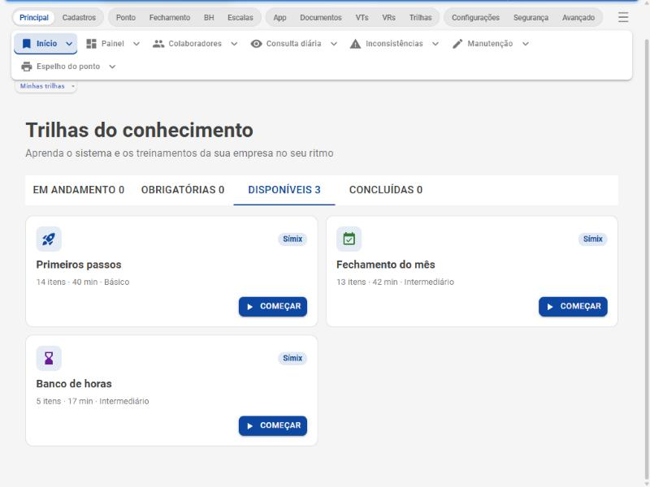
Minhas trilhas com as três trilhas iniciais da Símix.

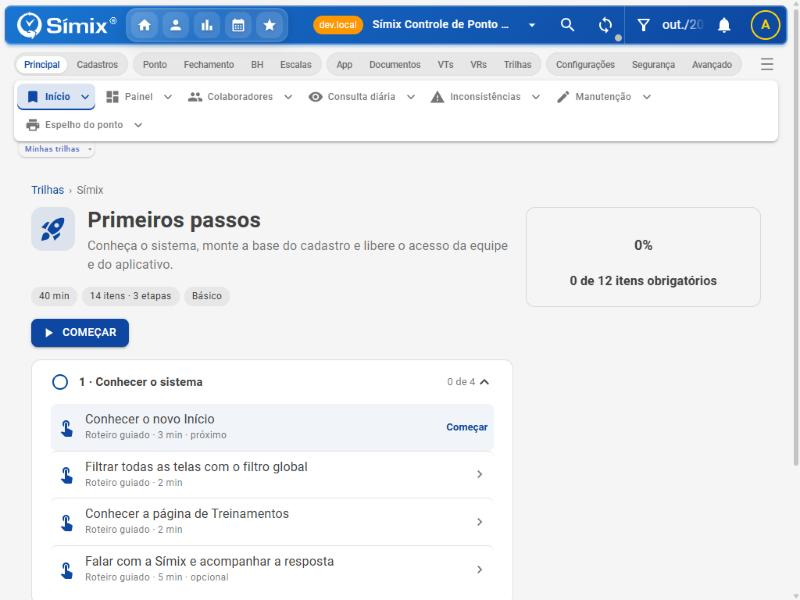
Visão da trilha: etapas, itens e o progresso ao lado.

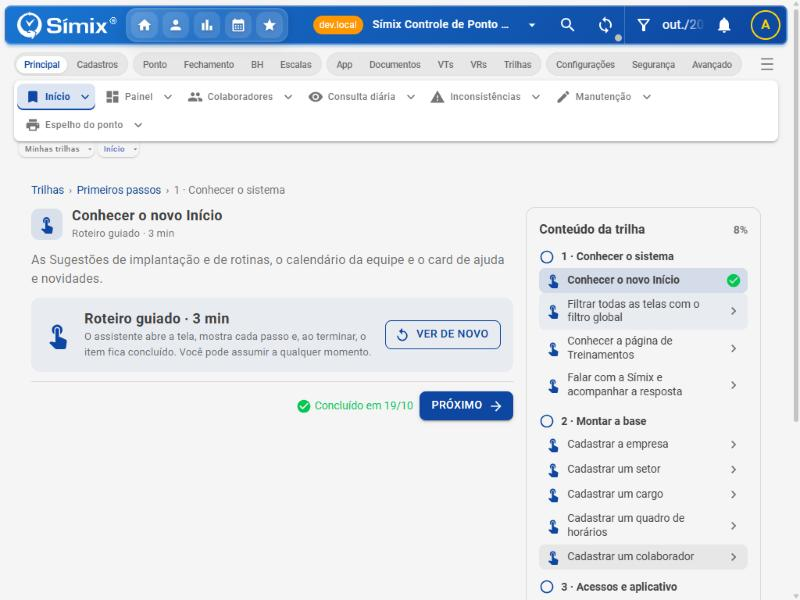
Item de demonstração guiada concluído pelo fim da demonstração, com o índice da trilha.

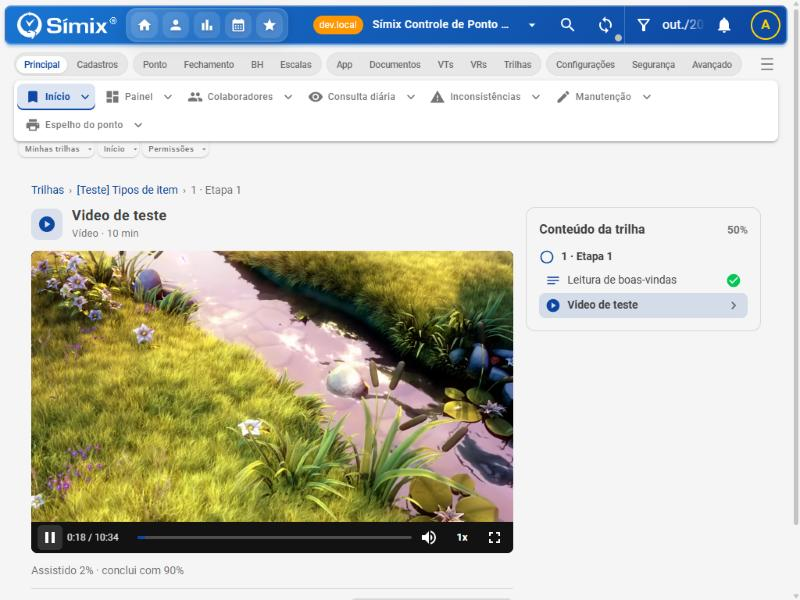
Vídeo do YouTube dentro da trilha, com o percentual assistido.

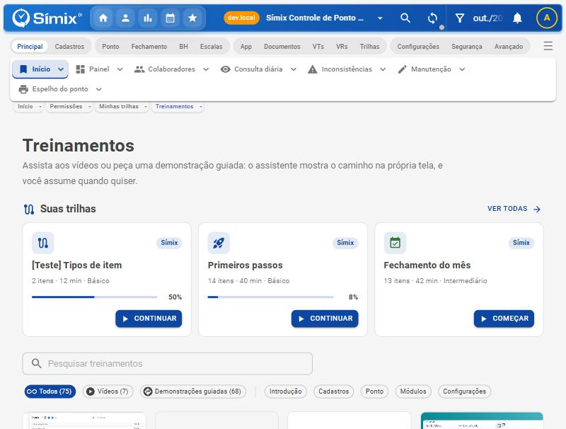
Faixa "Suas trilhas" na página de Treinamentos.

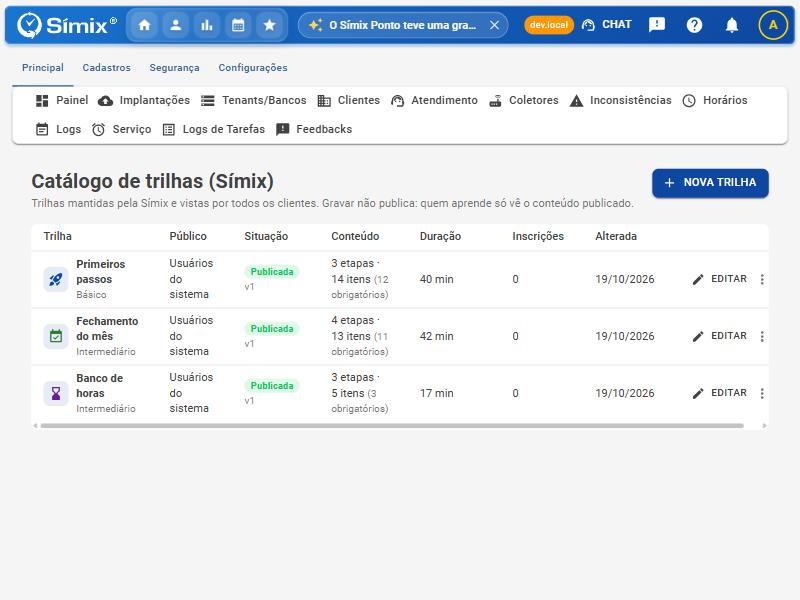
Catálogo de trilhas da Símix em /admin/trilhas.


## ✨ Isento de registro no cadastro do colaborador [#3050](https://github.com/simixsistemas/Simix.Ponto.Cloud/pull/3050)

### Objetivo

Fix: [#3045](https://github.com/simixsistemas/Simix.Ponto.Cloud/issues/3045)

### Alterações
- ✨ Nova opção **Isento de registro** na aba Registro do cadastro do colaborador, com data de início e data de fim (fim vazio = isento por tempo indeterminado)
- ✨ Nos dias do período o cálculo não conta falta, horas faltantes nem atraso, e não gera inconsistência; marcações e horas extras continuam valendo
- ✨ Na Manutenção, o dia isento mostra um ícone ao lado da data e "Isento de registro" no afastamento
- Data de fim sem início, ou anterior ao início, é recusada ao salvar

### PR's referências
- simixsistemas/Simix.Ponto.Calc#533

### Demonstração


Isenção de 24/09 a 25/09: os dois dias com marcação faltando passam de -02:46 e -08:00 para 00:00, com o ícone e "Isento de registro" no afastamento.


A opção na aba Registro do cadastro, com as datas de início e fim.

🤖 Generated with [Claude Code](https://claude.com/claude-code)


## ✨ Sincronização do iDClass e iDFace exclui os colaboradores desligados do equipamento [#3049](https://github.com/simixsistemas/Simix.Ponto.Cloud/pull/3049)

### Objetivo

Fix: [#3043](https://github.com/simixsistemas/Simix.Ponto.Cloud/issues/3043)

Os colaboradores desligados continuavam cadastrados nos coletores e precisavam ser excluídos manualmente do equipamento.

### Alterações
- ✨ Ao sincronizar um coletor **iDClass** ou **iDFace** (Control iD), o sistema exclui do equipamento os colaboradores já desligados — vale para a sincronização automática e para a feita pela tela, com o coletor ligado direto ou pelo agente local
- Continuam no equipamento: quem não tem cadastro no sistema (ex.: administrador do relógio), quem foi recontratado com o mesmo CPF/PIS e quem tem a demissão marcada para hoje ou uma data futura
- O log do coletor mostra quais colaboradores foram excluídos; se a exclusão falhar, a sincronização das marcações segue normalmente e o motivo vai para o log
- Os demais modelos de coletor não mudam

### Demonstração

Sem prints: o único equipamento Control iD acessível é de produção, de cliente, e a demonstração excluiria usuários dele. O comportamento está coberto por testes com o equipamento simulado (iDClass, iDClass 671, iDFace, outro modelo e pelo agente local): 29 testes de sincronização de coletores aprovados.

🤖 Generated with [Claude Code](https://claude.com/claude-code)


## 🐛 Deploy (dev): proxies gerados só depois que o dev roda a versão publicada [#3046](https://github.com/simixsistemas/Simix.Ponto.Cloud/pull/3046)

### Objetivo

Corrigir o [Deploy (dev)](https://github.com/simixsistemas/Simix.Ponto.Cloud/actions/runs/39178450877), que seguiu falhando na geração dos proxies depois do simixsistemas/Simix.Ponto.Cloud#3042.

### Alterações
- 🐛 A geração automática dos proxies do navegador espera o dev rodar a versão que acabou de ser publicada: logo depois do deploy a versão anterior ainda respondia, e os proxies saíam do código antigo e não compilavam
- ✨ O sistema informa, num endereço de verificação, qual execução do deploy gerou a versão no ar
- ♻ Proxies do navegador atualizados com as rotinas que passaram a ser só do servidor

### PR's referências
- simixsistemas/Simix.Ponto.Cloud#3042

### Demonstração

🤖 Generated with [Claude Code](https://claude.com/claude-code)


## 🐛 Ajustes no deploy do dev após a auditoria de segurança [#3042](https://github.com/simixsistemas/Simix.Ponto.Cloud/pull/3042)

### Objetivo

Corrigir o [Deploy (dev)](https://github.com/simixsistemas/Simix.Ponto.Cloud/actions/runs/39170708135) quebrado depois da auditoria de segurança dos AppServices (simixsistemas/Simix.Ponto.Cloud#3041).

### Alterações
- 🐛 A geração automática dos proxies do navegador depois do deploy volta a compilar: as rotinas que passaram a ser só do servidor deixam de ser exigidas no navegador
- 🐛 Salvar um colaborador volta a enfileirar o cálculo dos meses também quando a tela roda no navegador
- 🐛 A espera antes dos testes de UI (dev e beta) confere a disponibilidade pelo health check do host e do tenant de testes, já que a lista de tenants passou a pedir login

### PR's referências
- simixsistemas/Simix.Ponto.Cloud#3041

### Demonstração

🤖 Generated with [Claude Code](https://claude.com/claude-code)


## 🐛 Segurança: permissões e acesso aos dados em todas as operações [#3041](https://github.com/simixsistemas/Simix.Ponto.Cloud/pull/3041)

### Objetivo

Revisão de segurança do acesso aos dados pelo sistema: cada operação passa a conferir quem está pedindo e o que essa pessoa pode ver ou alterar.

### Alterações
- 🐛 Toda operação do sistema exige login, e as que gravam ou mostram dados de outras pessoas exigem a permissão da tela correspondente
- 🐛 No portal, o colaborador vê e altera só os próprios dados: cartão, marcações, espelhos, assinaturas, cadastro, notificações e solicitações
- 🐛 Solicitações feitas pelo colaborador ficam sempre pendentes até a aprovação da gestão (ou da aprovação automática, quando configurada)
- 🐛 Usuários, perfis de acesso, troca de senha e vínculo com colaborador só podem ser alterados por quem tem a permissão de usuários
- 🐛 Consultas dos dashboards, relatórios e listas de escolha só leem dados, sempre do próprio cliente
- 🐛 As senhas guardadas nas configurações não aparecem mais na tela; salvar as configurações mantém as senhas gravadas
- 🐛 Anexos aceitam só imagem, PDF e JSON
- ♻ Rotinas automáticas (cálculo, escalas, espelhos, folha, migração) continuam funcionando sem usuário logado
- ♻ Teste automático que impede publicar operação nova sem regra de acesso

### Demonstração

Testado no ambiente local (Release, banco espelho de cliente), entrando como colaborador e como gestor:
- 41 conferências de acesso pela API, todas como esperado (anônimo, colaborador, gestor, conta de serviço)
- Portal do colaborador (painel, registros, comprovantes, pendências, espelhos, consulta do ponto) e telas da gestão (painel, colaboradores, pendências, espelhos, horários, manutenção, gerar escalas, configurações) sem erro

🤖 Generated with [Claude Code](https://claude.com/claude-code)


## ♻ Ajustes visuais no painel Início [#3040](https://github.com/simixsistemas/Simix.Ponto.Cloud/pull/3040)

### Objetivo

Deixar o painel Início mais enxuto e alinhado com o resto da tela.

### Alterações
- ♻ Os cards do Início ocupam a mesma largura do menu, sem a margem extra nas laterais e no topo
- ♻ Os botões Implantação e Rotinas do card de Sugestões ficaram menores
- ♻ No Calendário, só aparecem os tipos (aniversários, tempo de casa, contratos, feriados) que têm eventos no período

### Demonstração

🤖 Generated with [Claude Code](https://claude.com/claude-code)


## ✨ Calcular dados com vários colaboradores ao mesmo tempo (Calc 12.8) [#3039](https://github.com/simixsistemas/Simix.Ponto.Cloud/pull/3039)

### Objetivo

Fase 5c da migração da Calc para async e performance: o Cloud passa a usar a Calc 12.8, que calcula vários colaboradores ao mesmo tempo.

### Alterações
- ✨ O "Calcular dados" pode calcular vários colaboradores ao mesmo tempo. Com 4 de uma vez, um mês de 141 cartões caiu de 14,8 s para 4,2 s, e o que foi gravado é idêntico ao do cálculo um a um
- ♻ Desligado por padrão (`Calc:GrauParalelismo` = 1). Acima de 1, vale para os clientes; o banco do host continua um a um
- ♻ O número de cálculos simultâneos é reduzido sozinho quando não caberia nas conexões disponíveis com o banco
- ♻ Reimportar registros e a exportação do cálculo continuam um colaborador por vez

### PR's referências
simixsistemas/Simix.Ponto.Calc#528

### Demonstração
Mesmo mês (09/2026) em duas cópias do `barcellos-local`, uma com 1 e outra com 4 ao mesmo tempo, pelo mesmo callback do Cloud:

| Tabela | 1 por vez | 4 ao mesmo tempo |
|---|---:|---:|
| PontoCalc | 1.206 | 1.206 (iguais) |
| PontoCalcDia | 36.956 | 36.956 (iguais) |
| PontoCalcTot | 7.466 | 7.466 (iguais) |
| PontoCalcIncons | 13.948 | 13.948 (iguais) |
| PontoCalcPremio | 1.266 | 1.266 (iguais) |
| FuncMes / Periodos | 3.502 / 46 | 3.502 / 46 (iguais, sem duplicatas) |
| Tempo | 14,8 s | 4,2 s |

🤖 Generated with [Claude Code](https://claude.com/claude-code)


## ✨ Colunas das listas declaradas em cada tela [#3038](https://github.com/simixsistemas/Simix.Ponto.Cloud/pull/3038)

### Objetivo

Cada lista do sistema passa a dizer como cada coluna dela aparece (foto, tags, situação colorida, data, horas…). Antes, todo esse conhecimento ficava misturado num único componente para as 82 listas. Proposta e desenho: [Colunas declaradas do SmxDataView](https://claude.ai/artifact/SKHdfJnYbyRXwH51emmRVE)

### Alterações
- ✨ As 82 listas declaram as próprias colunas; tela nova escolhe o tipo de cada coluna em vez de depender do nome do campo
- ✨ Situação com cor em Clientes, Dispositivos e nas pendências de ponto e de afastamento (aguardando, aprovado, reprovado)
- ✨ Cada usuário salva visões em qualquer lista: escolhe o nome, as colunas e a ordem, e decide se ela é só dele ou fica disponível para todos os usuários. Pode editar ou excluir depois, e a lista abre na última visão usada
- ✨ Colaboradores ganhou a visão **Contrato** (admissão, demissão, mês, horário e motorista)
- ✨ Foto da lista carrega só quando aparece na tela e amplia ao passar o mouse, sem abrir balão por linha
- ♻ Listas mais leves no navegador: cada célula sai como HTML simples, sem um componente por célula
- 🐛 "Ofuscar dados" borra o que é dado pessoal (nome, e-mail, CPF, PIS, RG, login, cargo, estabelecimento); antes CPF, PIS e RG ficavam legíveis e contagens como "Qtd. de colaboradores" eram borradas
- 🐛 No celular, o "Ofuscar dados" não borra mais o nome da coluna no cartão
- 🐛 Clientes: o link da documentação abre o endereço certo (antes abria o link do cliente)
- 🐛 Saíram das visões colunas que nunca tinham valor: Nome social, E-mail alternativo e Telefone em Colaboradores, e "QtdTotalDesc" nas listas de VR
- ♻ Teste que falha quando uma lista mostra um campo sem declarar a coluna dele

### Demonstração

Fotos trocadas por um avatar genérico (as dos bancos locais não existem no storage) e "Ofuscar dados" ligado em todos os prints.


Colaboradores na visão Padrão, com nome, cargo, estabelecimento e foto borrados pelo "Ofuscar dados".


A foto amplia ao passar o mouse.


Visão nova Contrato: datas, mês no formato MM/aaaa e caixa do motorista centralizada.


Situação dos dispositivos com cor; o último login agora é borrado.


Pendências de ponto com a situação colorida e o tipo de ocorrência por extenso.


Feriados com a data e o dia da semana.


No celular, o nome de cada coluna continua legível com o "Ofuscar dados" ligado.


O menu de visões com os grupos Compartilhadas e Minhas visões e as opções Nova, Editar e Excluir.


Criando uma visão disponível para todos os usuários.


Criando uma visão: nome, colunas marcadas e ordem (Cargo levado para o início, Foto e Alteração desmarcadas).


A lista com a visão salva aplicada; ao recarregar a página ela continua selecionada.

🤖 Generated with [Claude Code](https://claude.com/claude-code)


## 🐛 Clique em Entrar dos testes de UI aguenta o app frio no deploy dev [#3037](https://github.com/simixsistemas/Simix.Ponto.Cloud/pull/3037)

### Objetivo

Fix: [Deploy (dev) 39073644666](https://github.com/simixsistemas/Simix.Ponto.Cloud/actions/runs/39073644666/job/117521840409#step:7:208)

### Alterações
- 🐛 Os testes de navegação não falham mais no login quando são os primeiros a rodar depois do deploy no dev. Depois de clicar em "Entrar", o teste esperava só 30 s a tela inicial responder, e com o app frio ela demora mais. Agora todo o login usa o limite de 3 minutos.

### PR's referências
- simixsistemas/Simix.Ponto.Cloud#2946
- simixsistemas/Simix.Ponto.Cloud#2948

🤖 Generated with [Claude Code](https://claude.com/claude-code)


## 🐛 Scripts e estilos gerais atualizados no navegador após cada atualização [#3036](https://github.com/simixsistemas/Simix.Ponto.Cloud/pull/3036)

### Objetivo

Depois de uma atualização do sistema, as telas continuavam usando os scripts e estilos gerais da versão anterior, guardados no cache do navegador e do Cloudflare. Em 16/10 a Manutenção parou de abrir ("An error has occurred") porque dependia de um script novo que nunca chegava ao navegador.

### Alterações
- 🐛 A cada atualização que muda os scripts ou estilos gerais, o endereço deles muda junto, e o navegador baixa a versão nova na próxima abertura do sistema
- ♻ Sem atualização desses arquivos, o endereço continua o mesmo e o cache segue valendo (nada é baixado de novo à toa)


## ♻ Migrar ABP 10.7 e MudBlazor 9.11 [#3035](https://github.com/simixsistemas/Simix.Ponto.Cloud/pull/3035)

### Objetivo

Fix: [#3034](https://github.com/simixsistemas/Simix.Ponto.Cloud/issues/3034)

### Alterações
- ♻ ABP 10.6 → 10.7 em todos os projetos, com os pacotes do ASP.NET Core na versão que ele pede (10.0.11)
- ♻ MudBlazor 9.9 → 9.11 (e MudBlazor.Markdown 9.10): só correções e telas mais leves, sem mudança de uso
- ♻ Bibliotecas das páginas de login, Minha conta e Documentação na versão 10.7 (jQuery 4). Sem elas, o login deixaria de abrir depois da publicação
- ♻ Ajustes pedidos pelo guia do ABP: cadastro de usuários adaptado e proteção contra requisições forjadas aplicada na ordem recomendada
- ♻ Banco: colunas novas do módulo de IA do ABP, aplicadas pela atualização do banco e pelo script de ajustes
- 🐛 Pacotes de criptografia do .NET na versão corrigida dos alertas de segurança de 13/10
- 🐛 Opções de tela que estavam sendo ignoradas desde atualizações anteriores do MudBlazor voltam a funcionar: Importação e Importar dados de colaboradores abrem na aba do Excel e mantêm a aba escolhida, os botões Salvar das configurações e Testar do coletor mostram que estão processando, as categorias na escolha de dashboard vêm abertas, os botões de ícone mostram a dica ao passar o mouse e os campos compactos e espaçamentos ficam como foram desenhados
- ♻ Publicações (dev, beta, worker e manual) instalando o ABP CLI 10.7

### PR's referências
- simixsistemas/DevShare.RX.Cloud#162

### Demonstração
Importação abrindo na aba do Excel, com o espaçamento dos painéis aplicado:


Login com jQuery 4: a validação acontece no navegador ao enviar vazio:


## ✨ Melhorias no filtro global: horário e cidade do estabelecimento [#3033](https://github.com/simixsistemas/Simix.Ponto.Cloud/pull/3033)

### Objetivo

Filtrar os colaboradores pelo **horário** e pela **cidade do estabelecimento** no filtro global, e deixar claro que os campos de vários itens aceitam mais de um.

Fix: [#3026](https://github.com/simixsistemas/Simix.Ponto.Cloud/issues/3026)

Relacionado: [#2891](https://github.com/simixsistemas/Simix.Ponto.Cloud/issues/2891)

### Alterações
- ✨ Novo campo **Horário** no filtro global: ficam só os colaboradores com o horário escolhido no mês
- ✨ Novo campo **Cidade do estabelecimento**: ficam os colaboradores dos estabelecimentos das cidades escolhidas, e a lista de cidades traz só as que têm estabelecimento cadastrado
- ✨ Os dois campos valem no filtro da barra do topo, no filtro do cadastro do usuário, no botão de filtro das telas (Colaboradores, Manutenção, Consulta diária, Inconsistências, Folha…), nos atalhos e nos painéis
- ✨ Com o filtro de horário ativo, a escolha de horário nos cadastros mostra só os horários do filtro, como já acontece com departamento e setor. O filtro de cidade não limita a escolha de cidade no endereço do colaborador nem nos feriados
- ✨ Campos que aceitam vários itens (estabelecimentos, departamentos, colaboradores…, no filtro global e em telas como a Manutenção em lote): os escolhidos aparecem dentro do próprio campo e a lupa abre a lista com pesquisa e uma caixa de marcar em cada item. A lista fica aberta enquanto se marca e fecha com um clique fora ou com Esc
- 🐛 O ícone de alguns cadastros, como Horários, aparecia como o ícone padrão
- 🐛 O item escolhido num filtro de vários itens (estabelecimento, departamento, cidade…) às vezes aparecia duas vezes ao reabrir o filtro ou recarregar a página

### Demonstração

Os campos novos no filtro global; a lista de cidades traz só as 6 que têm estabelecimento:


Com a cidade Bom Principio, a lista de colaboradores fica com os 13 de lá:


Cidade e horário juntos:


Campos de vários itens: os escolhidos ficam dentro do campo e a lista tem caixa de marcar:


O mesmo campo na Manutenção em lote:


🤖 Generated with [Claude Code](https://claude.com/claude-code)


## ✨ Pesquisa global encontra todas as telas do menu [#3032](https://github.com/simixsistemas/Simix.Ponto.Cloud/pull/3032)

### Objetivo

Fix: [#3027](https://github.com/simixsistemas/Simix.Ponto.Cloud/issues/3027)

### Alterações
- ✨ A pesquisa (Ctrl+Espaço) encontra todas as telas do menu, inclusive as que faltavam: Painel, Mural de notas, Férias, Documentos, Planejamento e Trocas das escalas, Alertas, Treinamentos, Consulta de atestados, Monitor, Consulta geral do banco de horas, Feedbacks e outras. Tela nova no menu já aparece na pesquisa
- ✨ A pesquisa considera também a descrição e os sinônimos de cada tela, sem diferenciar acentos e maiúsculas ("ferias" acha Férias, "dashboard" acha o Painel, "calcular vts" acha o cálculo de VTs)
- ✨ Cada resultado mostra a descrição e o grupo do menu: o Painel do início e o de Férias aparecem separados
- ♻ Só aparecem as telas que o usuário pode abrir, pelas mesmas regras do menu (permissão, módulo contratado e licença)
- ♻ Quando o nome da tela bate, ela vem antes dos registros; a tela achada só pela descrição fica depois, para não atrapalhar quem procura um colaborador
- ♻ Ao criar um atalho de "Tela ou comando" no Início, a lista é a mesma da pesquisa.
- 🐛 "Painel/Dashboard" abria a tela inicial em vez do Painel, os ícones das telas não apareciam nos resultados e a Manutenção aparecia três vezes
- 🐛 Saiu da pesquisa o item "Cálculos", que levava a uma tela que não existe mais

### PR's referências
- simixsistemas/Simix.Ponto.Cloud#3028

### Demonstração


"atestados" traz a Consulta de atestados primeiro, e as outras telas que falam de atestados logo abaixo.


"férias" traz as telas do módulo Férias (com o módulo ligado), depois o cadastro de Afastamentos e o afastamento Férias.


"painel" separa o Painel do início do Painel de Férias pelo grupo, cada um com a sua descrição.

🤖 Generated with [Claude Code](https://claude.com/claude-code)


## 🐛 Carregar o CSS próprio dos componentes das telas [#3031](https://github.com/simixsistemas/Simix.Ponto.Cloud/pull/3031)

### Objetivo

Fazer valer o visual próprio de alguns componentes das telas, que nunca estava sendo carregado.

### Alterações
- 🐛 O CSS próprio dos componentes do sistema (arquivos `.razor.css`) não era carregado em nenhuma tela. Passa a ser, em todos os modos de carregamento
- 🐛 Manutenção: os dois grupos de botões de filtro voltam a ter moldura, e os filtros não escolhidos ficam apagados
- 🐛 Página de links (`/links`): título, ícones das plataformas e cartões com o visual que foi desenhado para ela
- ♻ Os layouts vazio e de foco e o aviso de reconexão também têm CSS próprio, mas nada muda neles hoje (o aviso de reconexão não está em uso)

### Demonstração

Filtros da Manutenção, antes:


Depois, com a moldura e os filtros não escolhidos apagados:


Página de links, antes (a onda divisória saía preta):


Depois:


🤖 Generated with [Claude Code](https://claude.com/claude-code)


## ✨ Melhorias nos totais da Manutenção [#3030](https://github.com/simixsistemas/Simix.Ponto.Cloud/pull/3030)

### Objetivo

Totais da Manutenção mais fáceis de conferir: duas colunas na ordem do layout, destaque pela relevância, marcador, categoria e código da folha, horas em decimais, e um cadastro do layout de totais refeito, mais simples de montar.

### Alterações
- ✨ Totais em duas colunas, na coluna e na ordem do layout de totais do horário
- ✨ Total de relevância alta sobe para o topo e fica em negrito; o informativo fica apagado. A opção "Destacar relevância" liga e desliga
- ✨ Um botão só à esquerda de cada total: mostra o marcador e abre o menu com a troca de marcador, a Explicação, a edição dos lançamentos e Copiar. Trocar o marcador muda só o ícone e vale para os próximos colaboradores, no mesmo navegador
- ✨ Opções "Exibir categoria e código da folha" e "Horas em decimais", que ficam guardadas no navegador
- ✨ No celular a barra dos totais some e os totais aparecem inteiros, numa coluna
- ✨ Nas opções dos totais, "Editar layout de totais" abre o layout do horário do colaborador (sem layout, abre o horário para escolher um); ao gravar, a tela recalcula
- ✨ Cadastro do layout de totais refeito:
  - totais em cartões nas colunas (Coluna 1, 2, 3…), arrastados para ordenar ou trocar de coluna, com "Nova coluna"
  - painel do total escolhido com a explicação do campo, relevância, marcador, quando mostrar e o nome na tela
  - prévia de como os totais ficam na Manutenção
  - quantos horários usam o layout
  - "Adicionar totais" pelo catálogo, com pesquisa, assuntos, aviso de "já no layout" e vários de uma vez
  - os campos que o cálculo ainda não usa ficam recolhidos
- 🐛 Layout de totais: incluir um total padrão (ex.: Horas previstas) criava uma segunda linha repetida na Manutenção, em vez de alterar a que já existe
- 🐛 Layout de totais: a Ação de cada item não era gravada (o combo mostrava a mesma em todas as linhas)
- 🐛 Layout de totais: gravar o layout apagava as condições dos itens
- 🐛 Layout de totais: trocar a ordem ou a coluna de um item criava outro e deixava o antigo
- 🐛 Layout de totais: desmarcar "Ativo" sumia com o item da tela, sem como reativar

Antes de publicar: rodar a migração do banco (colunas novas do layout de totais) e publicar a Calc.

### PR's referências
- simixsistemas/Simix.Ponto.Calc#532

### Demonstração


O círculo à esquerda do total abre o menu: marcador, Explicação e Copiar.


Cadastro do layout: colunas numeradas com arrastar, painel do total escolhido e prévia da Manutenção.


No celular a barra some e os totais aparecem inteiros, numa coluna.

🤖 Generated with [Claude Code](https://claude.com/claude-code)


## ✨ Nova tela de processos: cards, ações e execução em lote [#3029](https://github.com/simixsistemas/Simix.Ponto.Cloud/pull/3029)

### Objetivo

Fix: [#1104](https://github.com/simixsistemas/Simix.Ponto.Cloud/issues/1104)

### Alterações
- ✨ Tela de processos em cards, com pesquisa, filtro por rotina e por tags, favoritos primeiro, duplicar e excluir
- ✨ Cadastro do processo com descrição, ícone, tags, favorito e rotinas (Manutenção e/ou Em lote); o código do processo saiu
- ✨ Editor de ações: escolhe onde o processo age (dia, turno ou marcação), o que altera (ex.: local da marcação, afastamento, horário do dia) e em quais casos (ex.: só nos dias trabalhados), com um resumo em uma frase de cada ação
- ✨ Execução em lote: período (até 12 meses) e filtro de colaboradores, com opção de simular antes de gravar; roda em segundo plano, aparece no monitor de tarefas e pode ser cancelada
- ✨ Resultado com os dias alterados (antes e depois) e atalho para a manutenção de cada cartão
- ✨ Menu Processos de volta na barra da manutenção: aplica o processo no cartão aberto e deixa os dias marcados para conferir e salvar
- ✨ Nova permissão "Executar" nos processos, para quem pode gravar em lote
- ♻ Removidos a execução antiga e os componentes de processo que não eram usados

### PR's referências
- simixsistemas/Simix.Ponto.Calc#531

### Demonstração

Lista de processos em cards, com as rotinas e o botão de executar.
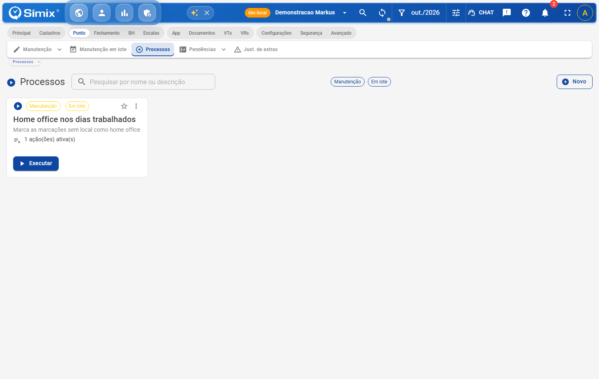

Cadastro: ação que marca como home office as marcações dos turnos trabalhados.
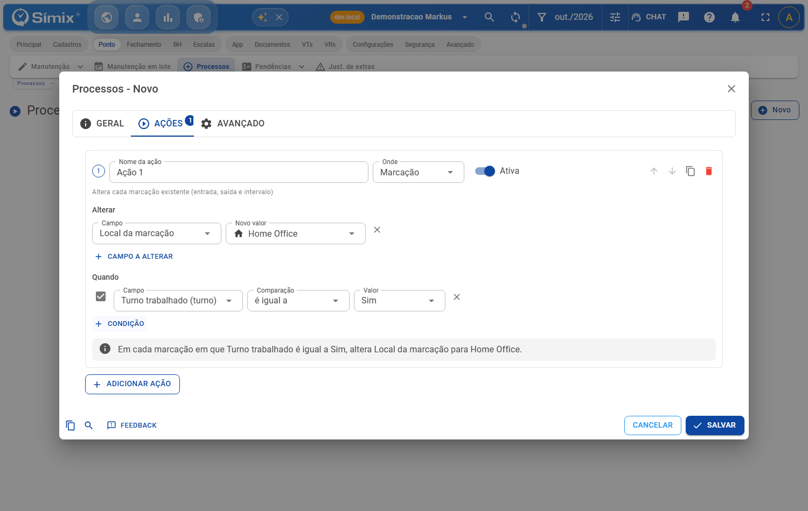

Simulação em lote: um dia mudaria, com o antes e o depois da marcação.
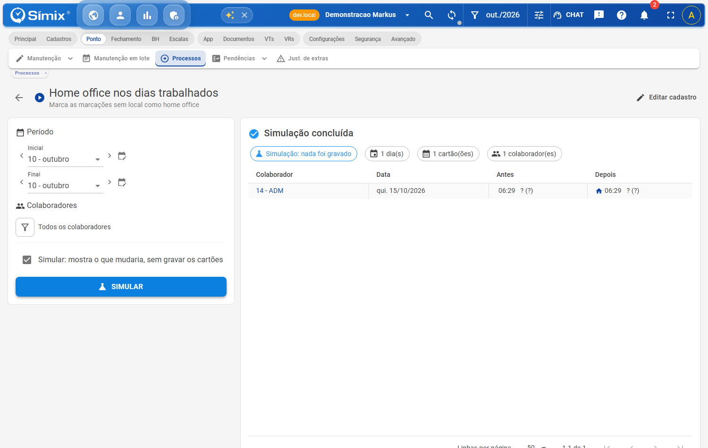

Menu Processos na barra da manutenção.
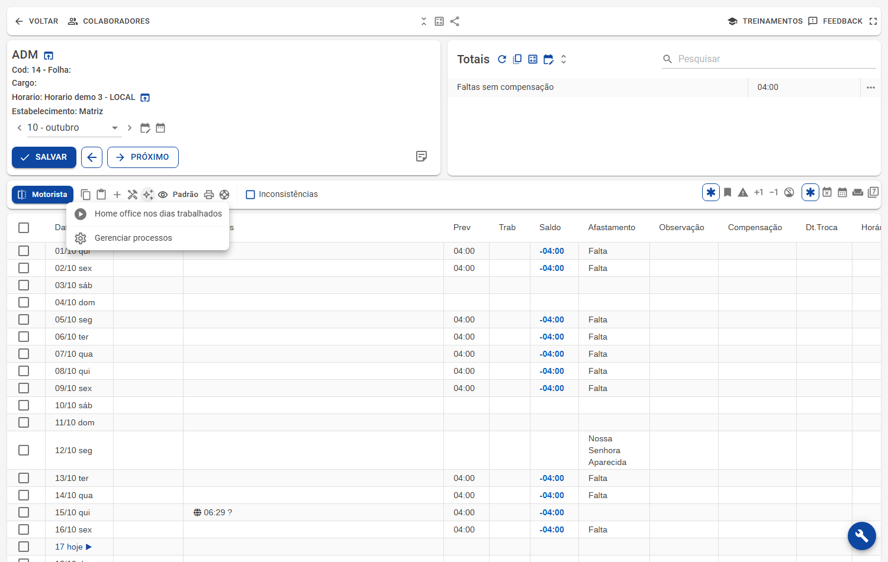

Processo aplicado no cartão aberto: o dia ganha o ícone de home office e fica para salvar.
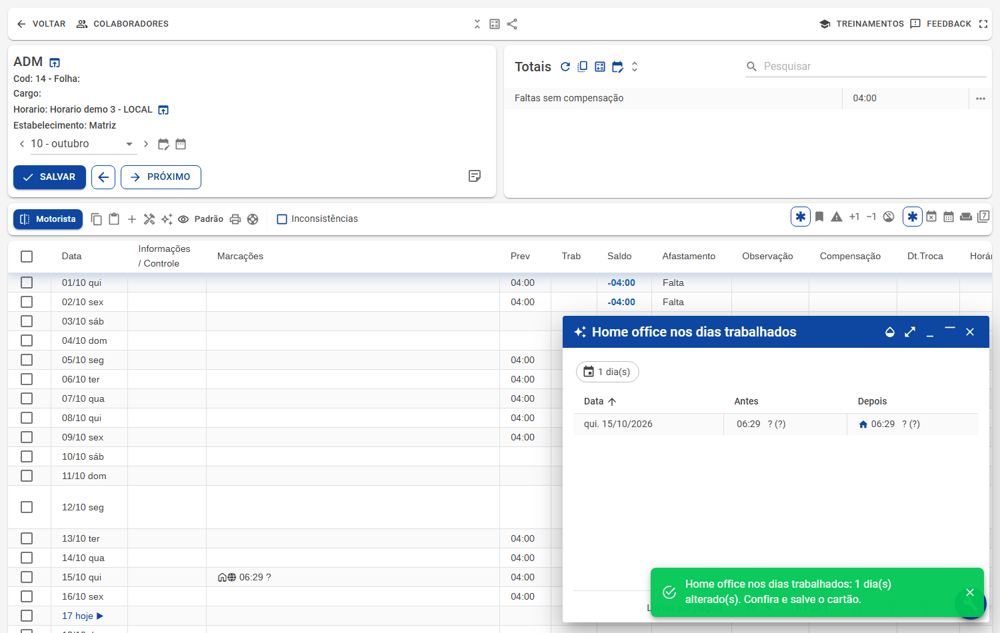

🤖 Generated with [Claude Code](https://claude.com/claude-code)


## ✨ Melhorias de UI na AppBar e foto do usuário [#3028](https://github.com/simixsistemas/Simix.Ponto.Cloud/pull/3028)

### Objetivo

Fix: [#3027](https://github.com/simixsistemas/Simix.Ponto.Cloud/issues/3027)

### Alterações
- ♻ Os atalhos ao lado do logo ficaram menores, sem contorno próprio e sem passar da altura da barra. Gestão ganhou o ícone de casa e entrou o atalho do Calendário. O atalho Gestão da área do colaborador segue o mesmo visual
- ✨ O avatar do topo mostra a foto do usuário. Quem já tinha foto no cadastro de colaborador recebe essa foto uma vez, na atualização; sem foto, continua a inicial do nome
- ✨ "Alterar foto" no menu do avatar e "Sua foto" em Minha conta, por arquivo ou pela webcam. A foto vale só para o usuário: a do cadastro do colaborador não muda
- ♻ O painel do botão de configurações da barra virou "Preferências", mais estreito, com ícone e explicação em Ofuscar dados e Som nas notificações. A engrenagem ao lado do som abre a tela de alertas (para quem pode configurar alertas). Com Ofuscar dados ligado, a foto do avatar também fica borrada
- ♻ O item "Configurações" do avatar virou "Minha conta" (senha e foto). "Configurações" fica só para a aba do sistema
- ♻ Todos os ícones da barra do topo mostram o nome ao passar o mouse (a pesquisa mostra também o atalho Ctrl+Espaço)
- ✨ Voltou a escolha da forma de exibir o menu (Normal, Compacto ou Escondido), no canto das abas. A escolha agora fica salva no usuário e vale em qualquer navegador
- ✨ Os botões do menu mostram a descrição ao parar o mouse em cima; botão com cadeado mostra o motivo
- ♻ No celular e em telas estreitas, a borda das faixas que rolam para o lado (abas, botões do menu e ferramentas da barra) esmaece quando há mais itens
- ♻ Os botões de VTs e VRs ganharam ícones próprios (lote, calcular, do colaborador, manutenção)
- ♻ O atalho do Admin saiu da barra e foi para a seção Suporte Símix das Preferências, junto do novo atalho Recursos (só a equipe Símix vê)
- ♻ O botão de tela cheia saiu da barra do topo; continua na Manutenção
- ✨ Estrela de Favoritos nos atalhos ao lado do logo, com os atalhos de um grupo (telas, comandos, registros, dashboards e widgets). Na primeira vez ela pede o grupo, ou cria um, e a escolha fica salva no usuário
- ✨ Pela estrela dá para criar, editar e excluir atalhos e renomear, compartilhar e excluir grupos (os atalhos saíram do Início)

### PR's referências
- simixsistemas/Simix.Ponto.Cloud#3032

### Demonstração

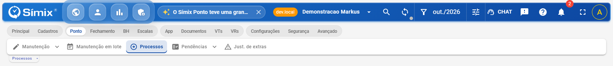
Antes: quatro atalhos grandes, o último é o Admin, e o botão de tela cheia ao lado do sino.

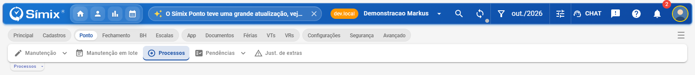
Depois: Home, Colaborador, Gerencial e Calendário menores logo depois do logo, avatar com foto (ilustração de teste), sem Admin e sem tela cheia.

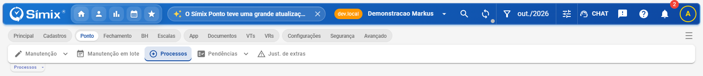
A estrela de Favoritos depois do Calendário.

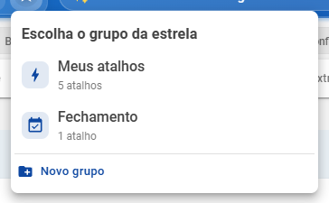
Na primeira vez a estrela pede o grupo de atalhos, ou cria um novo.

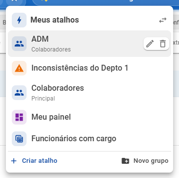
Os atalhos do grupo escolhido; editar e excluir aparecem ao passar o mouse.

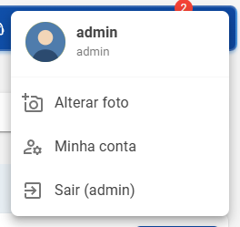
Menu do avatar com a foto, Alterar foto e Minha conta.

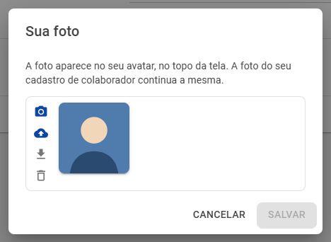
Troca da foto por arquivo ou webcam, só no usuário.

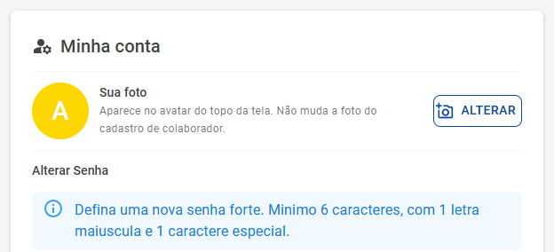
Seção "Sua foto" em Minha conta (sem foto, aparece a inicial).

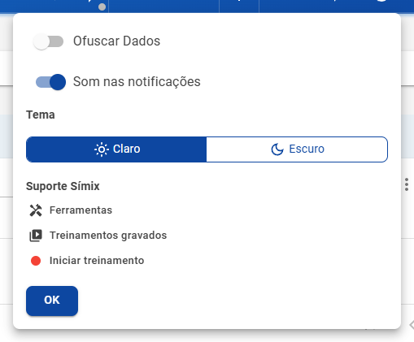
Antes: painel largo e opções sem explicação.

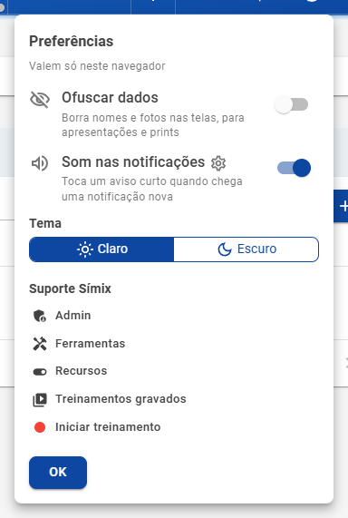
Depois: Preferências com ícone e descrição em cada opção, engrenagem para configurar as notificações e Admin e Recursos no Suporte Símix.

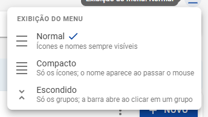
A escolha da forma de exibir o menu de volta, salva no usuário.

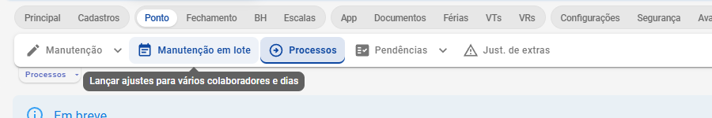
Descrição do botão ao parar o mouse em cima.

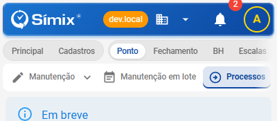
No celular, as abas e os botões do menu esmaecem na borda quando há mais itens para o lado.

🤖 Generated with [Claude Code](https://claude.com/claude-code)


## ♻ Ajustes no calendário do Início e nos prazos dos períodos [#3024](https://github.com/simixsistemas/Simix.Ponto.Cloud/pull/3024)

### Objetivo

Fix: [#3019](https://github.com/simixsistemas/Simix.Ponto.Cloud/issues/3019)

### Alterações
- 🐛 Calendário do Início: cada colaborador aparece uma vez só
- 🐛 Calendário do Início: feriados exibidos são só os cadastrados nas datas do período mostrado (feriados de outros anos não se repetem mais)
- ✨ Calendário do Início acompanha o mês do filtro global: no mês atual mostra os próximos 15 (ou 90) dias a partir de hoje; em outro mês, a partir do dia 1 dele
- 🐛 Cadastros com código repetido (cargo, departamento, setor, seção, horário e estabelecimento) e cargos, departamentos, setores e seções com código zero recebem um código novo na atualização. Com isso o colaborador deixa de aparecer repetido nas telas que listam os colaboradores do mês (era a causa do Leonardo aparecer quatro vezes no calendário)
- ♻ Períodos: o texto do bloqueio automático fica ao lado da hora, mantendo os campos alinhados
- ✨ Configurações do portal: novos campos **Solicitações até o dia** e **Aprovações até o dia**. O prazo cai nesse dia do mês de cada período, às 23:59, e vale para todos os períodos sem data própria, inclusive os criados depois. A data informada no período continua valendo só para ele
- ✨ Lista de períodos mostra o prazo que vale para cada período, marcado como "(herdado)" quando vem do período geral ou das Configurações do portal

### Demonstração


Calendário do Início no backup em que o mesmo colaborador aparecia quatro vezes: agora cada aniversariante aparece uma vez (nomes borrados).


Configuração Web com os prazos do portal: solicitações até o dia 7 e aprovações até o dia 9.


Períodos de 02/2027: o geral e o do estabelecimento 1 não têm data e seguem a configuração (07/02 e 09/02, às 23:59, "herdado"); o do estabelecimento 3 mantém a data própria.


Período do estabelecimento 1 com os prazos em branco: a tela mostra a data que vale para ele.


## 🐛 Histórico de alterações dos cadastros [#3023](https://github.com/simixsistemas/Simix.Ponto.Cloud/pull/3023)

### Objetivo

Fix: [#3022](https://github.com/simixsistemas/Simix.Ponto.Cloud/issues/3022)

### Alterações
- 🐛 O histórico de alterações dos cadastros (botão de logs da janela de edição) passa a registrar o que é salvo pelas telas. Até agora, boa parte das gravações feitas pela tela não ficava registrada, nem quem alterou nem o que mudou — por isso o estabelecimento não mostrava nada.
- ✨ Todos os cadastros com tela passam a guardar o histórico campo a campo, com quem alterou e quando: estabelecimentos, cargos, níveis de cargo, departamentos, setores, seções, grupos, centros de custo, empresas, feriados, afastamentos, escalas, motivos, médicos, coletores, banco de horas, VT, VR, cidades, entre outros. Antes eram só colaborador, horários, regras e mais alguns.
- 🐛 Salvar um colaborador não marca mais o cargo, o estabelecimento e o horário dele como alterados. Era por isso que cadastros que ninguém abriu apareciam com data e usuário de última alteração.
- ♻ Senhas (da configuração, do e-mail, do registro de ponto, temporária e do coletor) não vão mais para o histórico.
- ♻ O título do histórico mostra o código e a descrição do cadastro no lugar do identificador interno.

### Demonstração


Cargo inativado e reativado pela tela: o histórico mostra cada mudança do campo Ativo, com data e usuário.


## ✨ Login nome.sobrenome sugere outro sobrenome quando já existe [#3020](https://github.com/simixsistemas/Simix.Ponto.Cloud/pull/3020)

### Objetivo

Fix: [#2810](https://github.com/simixsistemas/Simix.Ponto.Cloud/issues/2810)

### Alterações
- ✨ Com o formato do login **nome.sobrenome**, quando o login sugerido já pertence a outro usuário, o sistema tenta os outros sobrenomes do colaborador (do penúltimo ao segundo). Exemplo para "Maria Souza Lima Silva": maria.silva → maria.lima → maria.souza
- ✨ Se todos os sobrenomes já estiverem em uso, o login recebe um número: maria.silva2, maria.silva3…
- ✨ Vale para o usuário novo em Colaborador > Gerenciar usuário e para o registro de novo usuário na tela de login (quando o campo usuário fica em branco)
- Os formatos CPF e E-mail continuam como antes. Login repetido segue barrado ao salvar

### Demonstração


Colaborador "Maria Souza Lima Silva" com maria.silva já em uso: a sugestão passa para maria.lima (nome fictício, aplicado só para o teste no banco local).


Com maria.silva, maria.lima e maria.souza em uso, a sugestão vira maria.silva2.

🤖 Generated with [Claude Code](https://claude.com/claude-code)


## ✨ Me mostre nos lançamentos de cálculo [#3016](https://github.com/simixsistemas/Simix.Ponto.Cloud/pull/3016)

### Objetivo

Fix: [#2932](https://github.com/simixsistemas/Simix.Ponto.Cloud/issues/2932)

### Alterações
- ✨ O card "Lançamentos de cálculo" da página de Novidades ganhou o botão **Me mostre**: o assistente abre a tela de lançamentos, mostra os exemplos prontos, escolhe "Mais uma hora extra" e explica a ação, o campo e o conteúdo, parando no Salvar
- ✨ A demonstração continua na Manutenção do colaborador: o atalho da calculadora dos Totais, o asterisco do total ajustado e o "..." com Editar lançamento
- ✨ A mesma demonstração aparece no botão Treinamentos das telas de Lançamentos e da Manutenção

### Demonstração

Os exemplos prontos no topo da janela:


Depois de escolher "Mais uma hora extra", a ação fica em Somar:


O campo do total que o lançamento ajusta:


Na Manutenção, o atalho da calculadora dos Totais:


O asterisco no total alterado pelo lançamento:


O "..." do total, com Editar lançamento e Explicação:


🤖 Generated with [Claude Code](https://claude.com/claude-code)


## ♻ Ajustes na Manutenção, barra do topo, notificações e consultas [#3013](https://github.com/simixsistemas/Simix.Ponto.Cloud/pull/3013)

### Objetivo

Ajustes de usabilidade na Manutenção, na barra do topo, nas notificações e nas consultas.

### Alterações
- ✨ O botão Voltar da Manutenção volta para a tela de onde ela foi aberta (ex.: Colaboradores), mesmo depois de navegar entre colaboradores pelo Anterior/Próximo; aberta direto (link, nova guia), vai para a lista da Manutenção
- 🐛 A escolha "Ao clicar no nome do colaborador" não ficava gravada em alguns bancos, e a pergunta voltava a cada clique
- ✨ Ao abrir a Manutenção pelo nome do colaborador aparece uma barra de carregamento no topo, logo no clique
- ♻ As opções do Suporte Símix (Beta/Oficial, ferramentas e treinamentos) foram para dentro do botão de Configurações; na barra do topo fica só o cronômetro durante a gravação
- ♻ Consulta diária: os filtros Trabalhado, Dispositivo e Local ficam direto na barra, fora do botão de filtro
- ♻ Filtro global: novos ícones para estabelecimento, grupo de estabelecimentos e tipo de turno
- ♻ Manutenção: ícone de notas sem cor, no canto inferior direito do quadro do colaborador; filtros da barra selecionados com contorno; totais copiados como "Descrição = conteúdo"; resumo para compartilhar sem o horário e sem linhas em branco
- ♻ Consulta de inconsistências: cards centralizados
- ♻ Notificações: abrem abaixo do sino, sem borda dupla, com cabeçalho mostrando as não lidas, e o excluir em contorno e na cor normal

### Demonstração


Novos ícones do filtro global (estabelecimento, grupo de estabelecimentos e tipo de turno).

🤖 Generated with [Claude Code](https://claude.com/claude-code)


## Visão Global: erro do servidor não derruba as telas [#3011](https://github.com/simixsistemas/Simix.Ponto.Cloud/pull/3011)

### Problema
O workflow **Testar UI (beta)** falhou depois do deploy de `2e49c231a` ([run 38859296956](https://github.com/simixsistemas/Simix.Ponto.Cloud/actions/runs/38859296956/job/116837688213)): `Novo_Horario` e `Calcular_Dados` pararam na barra de erro do Blazor, e `Novo_Funcionarios` estourou o timeout esperando o botão "Novo".

O `SmxConfigGlobalButton` fica no AppBar, então aparece em todas as telas, e carrega a visão Global no `OnAfterRenderAsync`. O `VisaoGlobalService` só tratava falha de conexão. No beta o `GetGlobalAsync` dá erro no servidor (provavelmente porque o banco ainda não tem a coluna `VisaoLayouts.UsuarioId`: o deploy beta não roda o DbMigrator), e essa exceção virava erro não tratado na tela.

### Mudança
- `VisaoGlobalService`: qualquer falha na leitura vira aviso no log, e a tela segue sem a preferência (do mesmo jeito que já acontecia com falha de conexão).
- `SmxConfigGlobalButton`: se gravar a escolha do clique no nome falhar, aparece um aviso no snackbar e as outras configurações são gravadas mesmo assim.

### Pendente
- Migrar os bancos de produção/beta (coluna `VisaoLayouts.UsuarioId`, tabelas `AtalhoLayouts` e `ManutencaoLoteLog`). Enquanto isso não for feito, a visão Global e o filtro de visões do `GridPonto` continuam falhando, agora sem derrubar a tela.
- Rodar de novo o **Testar UI (beta)** depois do deploy.

Compilação do `Simix.Ponto.Blazor.Client` ok; testes de UI não rodados localmente.

🤖 Generated with [Claude Code](https://claude.com/claude-code)

## ✨ Atalhos no painel inicial [#3009](https://github.com/simixsistemas/Simix.Ponto.Cloud/pull/3009)

### Objetivo

Atalhos no painel inicial: cada usuário monta grupos de atalhos para o que usa todo dia (telas, comandos, registros, dashboards e widgets), com recorte de colaboradores opcional.

### Alterações
- ✨ Card de atalhos no Início, acima do Calendário: mostra um grupo por vez, escolhido no topo do card, e a escolha fica salva no aparelho
- ✨ Grupos do usuário e grupos disponíveis para todos; cada atalho tem ícone, cor, nome, descrição e o recorte de colaboradores que usa
- ✨ Tipos de atalho: link (tela do sistema ou endereço externo), tela/comando da pesquisa global, registro (qualquer colaborador, horário, cargo… achado pela pesquisa, abre direto no cadastro dele), dashboard e widget de dashboard
- ✨ Widget abre num popup no próprio Início, com Nova guia, Imprimir e Exportar Excel
- ✨ O recorte do atalho soma ao filtro do sistema, que não muda. Consulta diária, Férias, Inconsistências, Manutenção, Colaboradores e Exportar folha abrem já filtradas pelo link
- ✨ "Criar atalho" (pino) no cabeçalho dos widgets do Painel e dos dashboards gerenciais; o dashboard abre pelo atalho sem trocar o que estava selecionado
- ✨ Organizar: arrastar para mudar a ordem; grupos podem ser renomeados e compartilhados com todos
- ✨ Atalho cujo destino foi excluído aparece como indisponível, com o motivo; sem permissão para a tela, o atalho não aparece

### PR's referências
- simixsistemas/DevShare.RX.Cloud#161

### Demonstração

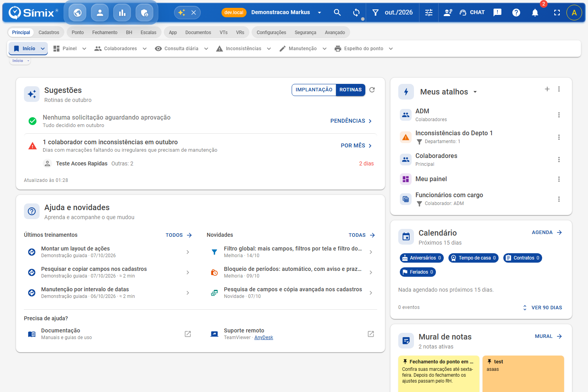

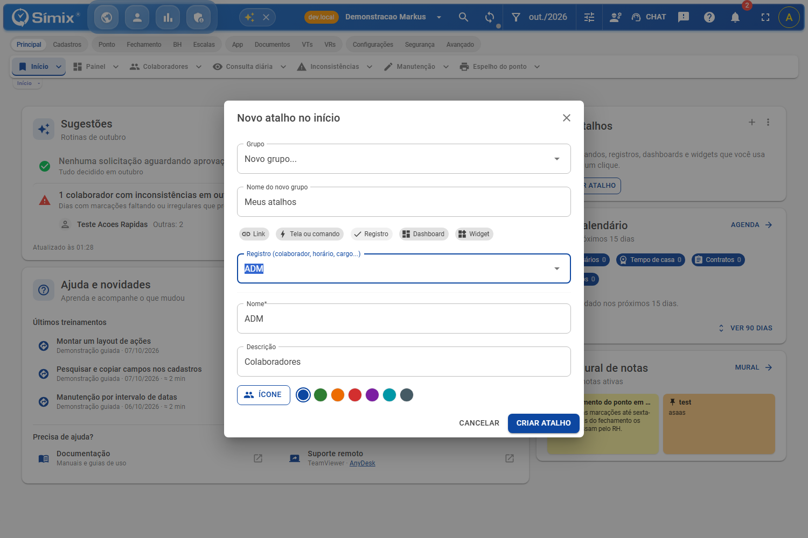

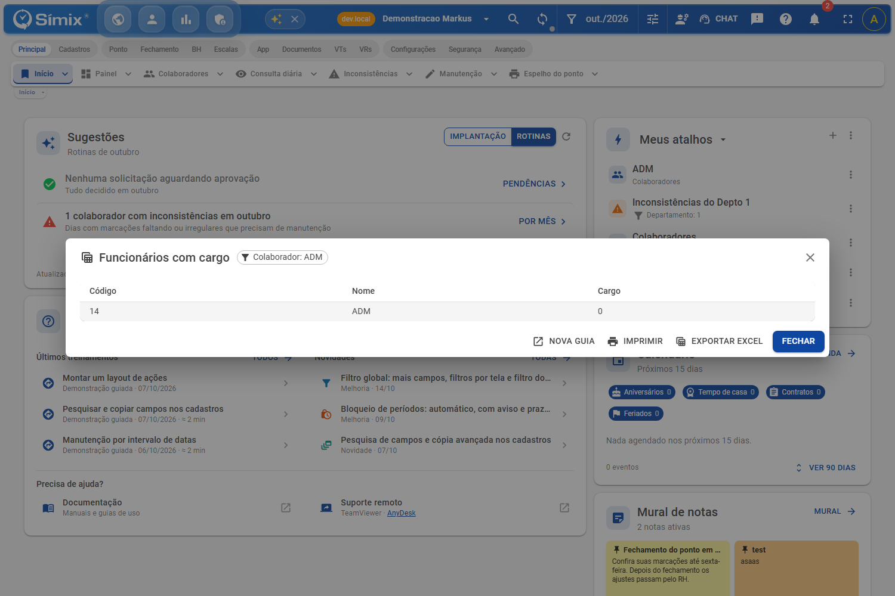

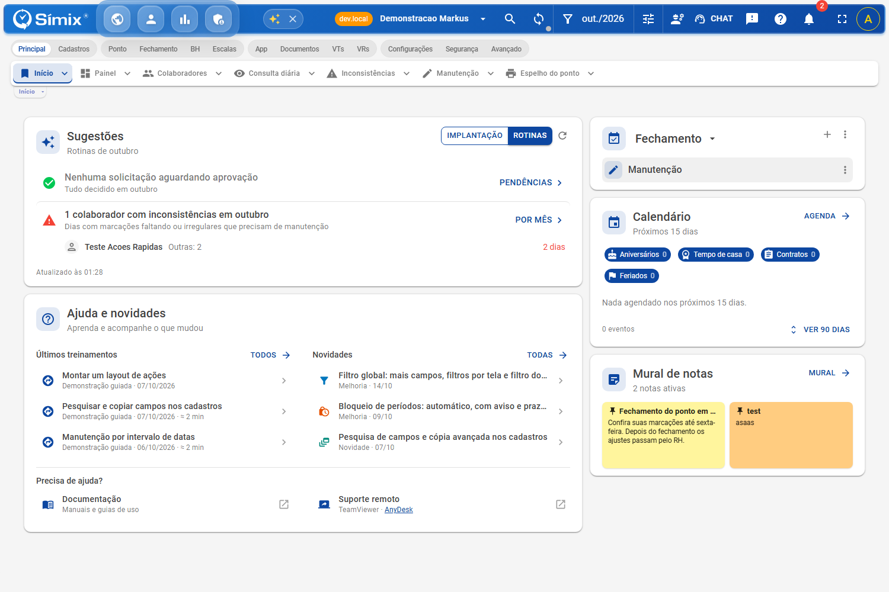

🤖 Generated with [Claude Code](https://claude.com/claude-code)


## ✨ Clique no nome do colaborador abre a manutenção ou o cadastro, à escolha do usuário [#3008](https://github.com/simixsistemas/Simix.Ponto.Cloud/pull/3008)

### Objetivo

Deixar o usuário escolher o que acontece ao clicar no nome do colaborador na lista de Colaboradores: abrir a manutenção (novo padrão) ou o cadastro (como era antes).

### Alterações
- ✨ Na primeira vez que clica no nome, o usuário escolhe entre abrir a manutenção na mesma janela (novo padrão), abrir a manutenção em nova janela ou abrir o cadastro. A escolha já é executada e fica guardada
- ✨ A própria janela de escolha explica como mudar depois: botão **Configurações** da barra do topo, em **Ao clicar no nome do colaborador** (menu com as opções e a de voltar a perguntar)
- ✨ Com a manutenção escolhida, o nome vira um link comum: Ctrl+clique e "abrir em nova guia" funcionam
- O lápis da linha continua abrindo o cadastro, e as outras listas não mudam
- ✨ A escolha fica salva no usuário (visão "Global" dele no servidor): vale em qualquer computador ou navegador, e cada usuário escolhe a sua
- ♻ A preferência é lida uma vez por aba e guardada no navegador enquanto a aba estiver aberta, sem consultar o servidor a cada tela

### Demonstração

Primeiro clique no nome:


Para mudar depois, no menu do botão Configurações:


🤖 Generated with [Claude Code](https://claude.com/claude-code)


## ✨ Melhorias no Mural de notas [#3007](https://github.com/simixsistemas/Simix.Ponto.Cloud/pull/3007)

### Objetivo

Melhorias no Mural de notas pedidas na apresentação.

### Alterações
- ✨ Clicar no nome da categoria recolhe ou expande as notas dela; as categorias recolhidas continuam assim na próxima vez que o mural for aberto no mesmo aparelho
- ✨ Ao editar uma nota, a caixa de texto acompanha o tamanho do conteúdo, em vez de ficar presa em 4 linhas com rolagem
- ✨ O painel Início mostra as notas ativas em miniatura, abaixo do Calendário; clicar numa delas abre o mural. O card só aparece para quem tem acesso ao mural e quando há nota ativa
- 🐛 Na edição, os botões Cancelar e Salvar passam para a linha de baixo quando a nota é estreita, em vez de ficarem cortados

### PR's referências

### Demonstração


Categoria "Avisos" recolhida pelo clique no cabeçalho.


A caixa de edição cresce com o texto (20 linhas).


Notas ativas em miniatura no painel Início, abaixo do Calendário.

🤖 Generated with [Claude Code](https://claude.com/claude-code)


## ✨ Compartilhar resumo da Manutenção [#3006](https://github.com/simixsistemas/Simix.Ponto.Cloud/pull/3006)

### Objetivo

Compartilhar a Manutenção de um colaborador com um clique: resumo pronto para colar no Teams, chamado ou e-mail, com os links.

### Alterações
- ✨ Novo botão **Copiar resumo para compartilhar** na barra da Manutenção, ao lado da Calculadora
- ✨ O resumo é copiado em Markdown com links: Manutenção do mês, colaborador (abre o cadastro), empresa (tenant), horário (abre o cadastro) e os principais totais — os mesmos que aparecem no modo compacto

Exemplo do texto copiado:

```
[Manutenção 10/2026](https://smx.simixponto.app/manutencao/{id}/202610) de [MARIA DA SILVA](https://smx.simixponto.app/colaboradores/{id}) em **smx**

Horário: [08:00-17:48 SEG-SEX](https://smx.simixponto.app/horarios/{id})

Principais totais:
- Horas trab.: **176:00**
- H.Extras 50%: **12:30**
```

### PR's referências

### Demonstração

🤖 Generated with [Claude Code](https://claude.com/claude-code)


## ✨ Aviso especial de feedback: status, comentário e link [#3004](https://github.com/simixsistemas/Simix.Ponto.Cloud/pull/3004)

### Objetivo

Destacar para o usuário quando a equipe da Símix conclui, muda o status ou responde o feedback que ele enviou, deixando a Símix decidir quando avisar.

### Alterações
- ✨ Ao salvar o status de um feedback no painel administrativo, abre uma janela para escolher se avisa no sino, com um comentário e um link opcionais
- ✨ Na mesma janela dá para escolher o cliente e quem recebe o aviso: o autor vem marcado e dá para adicionar outros usuários
- ♻ Mudar o status não avisa mais o autor automaticamente
- ✨ Quando há aviso de feedback, o sino ganha uma estrela animada além do contador
- ✨ O aviso aparece em destaque na lista do sino e, ao chegar, fica mais tempo na tela com o botão "Ver"
- ✨ Abrir o aviso mostra o comentário da Símix, o botão do link (quando informado) e o feedback com as opções de reagir, comentar e abrir; se foi concluído, solta confete
- ✨ "Abrir feedback" leva ao painel de feedbacks com ele no topo, em destaque e com os comentários abertos

### Demonstração

🤖 Generated with [Claude Code](https://claude.com/claude-code)


## 🐛 Ajustes na versão da Calc para os turnos informativos [#3002](https://github.com/simixsistemas/Simix.Ponto.Cloud/pull/3002)

### Objetivo

Fix: [#2935](https://github.com/simixsistemas/Simix.Ponto.Cloud/issues/2935)

### Alterações
- 🐛 O deploy do beta voltou a compilar: a versão publicada da biblioteca de cálculo passa a ser a que já tem os turnos informativos (12.7). A falha está em https://github.com/simixsistemas/Simix.Ponto.Cloud/actions/runs/38820245889

### PR's referências
- simixsistemas/Simix.Ponto.Cloud#2968
- simixsistemas/Simix.Ponto.Calc#526

🤖 Generated with [Claude Code](https://claude.com/claude-code)


## ✨ Melhorias no Atendimento do painel admin [#3000](https://github.com/simixsistemas/Simix.Ponto.Cloud/pull/3000)

### Objetivo

Fix: [#2985](https://github.com/simixsistemas/Simix.Ponto.Cloud/issues/2985)

### Alterações
- ✨ Clicar no cliente abre um painel lateral com os dados dele, sem sair da lista: situação, porte, última atividade, data de criação, observação interna completa e links para o ambiente e a documentação
- ✨ A lista de usuários (que antes abria numa janela) fica no painel, com a mesma pesquisa e o mesmo "entrar como" o usuário numa nova aba
- ✨ Últimos feedbacks do cliente no painel, com tipo, situação, autor, data, comentários e votos; o título abre o feedback numa nova aba
- ✨ Coletores do cliente com a situação de cada um, a última comunicação e o destaque de "sem sincronizar há mais de 3 dias", como no monitor de coletores
- ♻ Layout: a linha inteira do cliente é clicável e fica destacada; com o painel aberto a lista mostra só as colunas principais, e a divisória entre os dois pode ser arrastada. Cada lado rola sozinho; no celular a lista e o painel ficam um embaixo do outro

### Demonstração


Cliente selecionado: dados no topo, usuários, últimos feedbacks e coletores (nomes e títulos borrados).


Usuários do cliente no painel, com pesquisa e paginação; clicar no nome entra como ele numa nova aba (dados pessoais borrados).


## 🐛 Erro de período não encontrado ao aprovar pendências [#2999](https://github.com/simixsistemas/Simix.Ponto.Cloud/pull/2999)

### Objetivo

Fix: [#2997](https://github.com/simixsistemas/Simix.Ponto.Cloud/issues/2997)

### Alterações
- 🐛 Aprovar pendências de marcação, ajuste ou afastamento não dá mais "Período não encontrado" quando o cartão de ponto começa depois do dia 1. O sistema considerava o mês do calendário da data, e não o período a que ela pertence: na Peracchi, em que o cartão começa no dia 26, o dia 26/09 é do período 10/2026, mas era procurado o 09/2026
- 🐛 Na aprovação de várias pendências de uma vez, datas do mesmo mês do calendário que pertencem a períodos diferentes (por exemplo, 25/09 e 26/09 com o cartão começando no dia 26) passam a ter cada período conferido. Antes, o segundo era pulado e podia ser aprovado num período bloqueado
- ♻ Quando o estabelecimento não tem período próprio, vale o período geral, como no restante do sistema
- ♻ As mensagens mostram o período como 10/2026, e não 202610
- ♻ Testes automáticos cobrem os dias de início do cartão antes e depois do meio do mês, a virada do ano e a aprovação em lote

### Demonstração

Banco da Peracchi restaurado localmente (cartão começa no dia 26). No período 10, duas marcações de 26/09 aguardando aprovação. Antes da correção, esse era o caso que dava "Período 202609 não encontrado":


Com a correção, "Aprovar 2" aprova as duas e as batidas entram no dia 26/09 do período 10/2026:


## 🐛 Código do estabelecimento nas sugestões da implantação [#2998](https://github.com/simixsistemas/Simix.Ponto.Cloud/pull/2998)

### Objetivo

Fix: [#2988](https://github.com/simixsistemas/Simix.Ponto.Cloud/issues/2988)

### Alterações
- 🐛 A janela do passo **Estabelecimento** nas sugestões da implantação (tela Início) agora tem o campo **Código**: para um estabelecimento novo ele já vem preenchido com o próximo código livre (dá para trocar); para o estabelecimento que já existe ele aparece só para consulta
- 🐛 Salvar pela janela não dá mais o erro pedindo o código do estabelecimento
- 🐛 Salvar pela janela do estabelecimento ou da empresa altera só os campos que a janela mostra — antes, os demais dados do cadastro (sigla, CEP, situação ativo etc.) eram apagados
- 🐛 Passo **Horários** das sugestões: criar um horário com **Extras 50%/100%** marcado derrubava a tela e o horário ficava sem as faixas de horas extras. Agora as faixas são gravadas junto, com as mesmas permissões do cadastro de horários (o mesmo valia para as faixas do horário por dia)
- 🐛 Se a criação do horário falhar, a janela mostra um aviso em vez de travar a tela — e, se o horário chegou a ser criado sem as faixas, o aviso diz o código dele
- ♻ Teste automático que acusa qualquer tela/serviço que exija uma permissão inexistente (era a causa do erro dos Horários)

### Demonstração

Estabelecimento novo: o código vem sugerido e pode ser alterado.


Estabelecimento existente (código 2, mesmo caso do feedback): o código aparece para consulta e o restante do cadastro é mantido ao salvar.


Depois de salvar, o passo fica concluído.


Horários, antes da correção: com Extras 50% marcado, a tela travava ao criar. Depois da correção o horário é criado com as faixas de 50% e 100%.


## ✨ Histórico e novo layout da Manutenção em lote [#2996](https://github.com/simixsistemas/Simix.Ponto.Cloud/pull/2996)

### Objetivo

Registrar cada execução da manutenção em lote, para consultar depois o que foi lançado, por quem e com quais filtros, e reorganizar a tela no padrão das telas de processamento.

### Alterações
- ✨ Toda execução da manutenção em lote fica registrada: quem executou, quando, os filtros usados (com os nomes de cargo, quadro de horário, estabelecimento etc.), o que foi aplicado e quantos colaboradores e dias foram alterados, inclusive quando dá erro
- ✨ Histórico das execuções, com pesquisa: cada execução abre a lista dos dias alterados, com o valor antes e depois e o link para a manutenção do colaborador
- ✨ Nova tela: configuração do lote no painel à esquerda; à direita, os números do lote, a prévia e as últimas execuções
- ✨ A prévia se atualiza sozinha ao mudar os filtros, sem o passo Executar → Voltar
- ✨ O botão Aplicar mostra quantos dias serão alterados, pede confirmação e só libera com a alteração preenchida (remover afastamento continua possível com "Dias com afastamento: Sim")
- ♻ Filtros de estabelecimento, departamento, setor e seção ficam recolhidos, com a contagem dos que estão em uso
- ♻ Demonstração guiada da tela atualizada para o novo fluxo (os passos alterados usam a voz do navegador até a locução ser regravada)

### PR's referências

### Demonstração

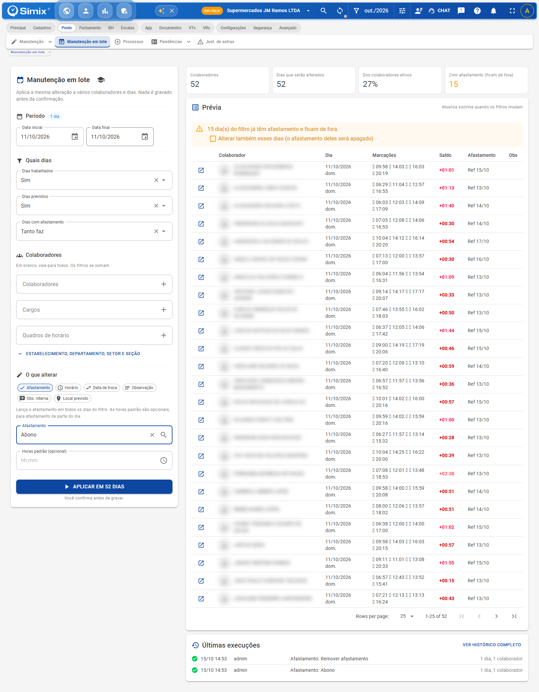
Período, dias trabalhados e previstos e o Abono escolhidos: a prévia e os números se atualizam sozinhos e o botão já mostra quantos dias serão alterados.

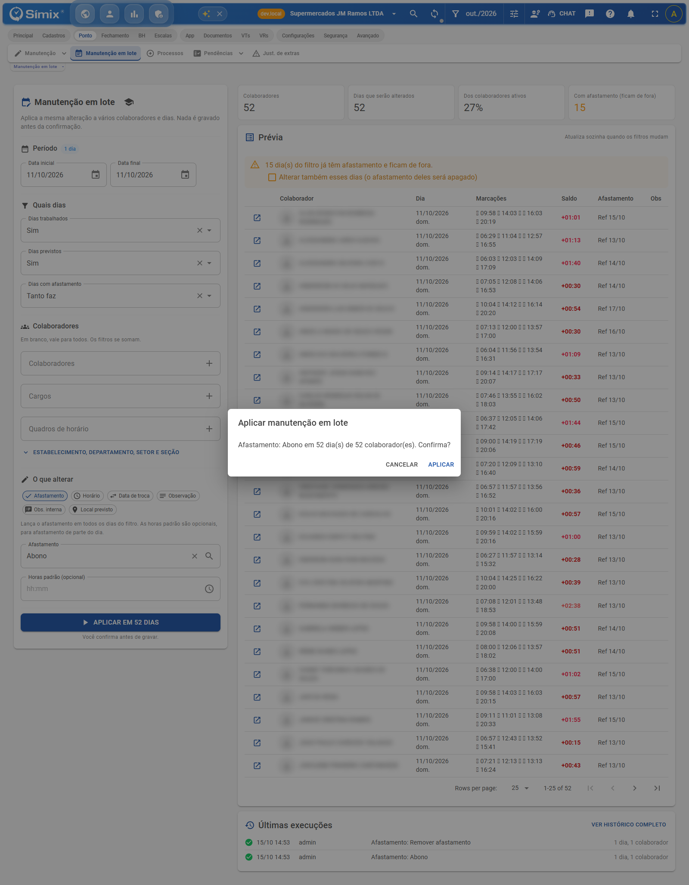
Aplicar pede confirmação com o resumo do que será feito.

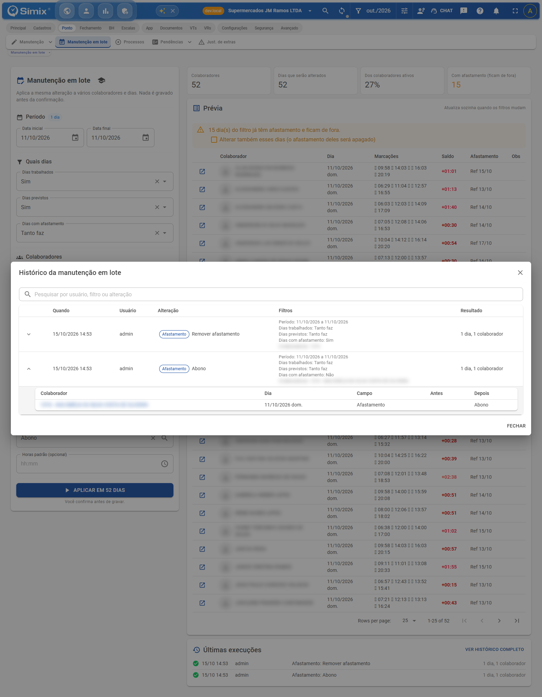
Histórico com usuário, filtros e resultado de cada execução, e os dias alterados com o antes e depois.


## 🐛 Troca de código do colaborador atômica [#2995](https://github.com/simixsistemas/Simix.Ponto.Cloud/pull/2995)

### Objetivo

Fix: [#2993](https://github.com/simixsistemas/Simix.Ponto.Cloud/issues/2993)

### Alterações
- 🐛 Trocar o código do colaborador agora é tudo ou nada: o código muda em todas as tabelas ou em nenhuma. Antes o cadastro podia ficar com o código novo enquanto os dados mensais ficavam no antigo, e o colaborador sumia da Manutenção e da lista de Colaboradores
- 🐛 Se a troca falhar, a tela avisa que o código não foi trocado, qual código continua valendo e o motivo (inclusive em qual tabela parou)
- 🐛 A troca passa a encontrar as tabelas do colaborador em todos os bancos, inclusive nos migrados do PcPonto, e aguarda mais tempo nos bancos grandes
- 🐛 Os descontos de adiantamento também passam a acompanhar o código novo
- 🐛 Espelho do ponto filtrado por estabelecimento: nos clientes migrados do PcPonto, os dados mensais vinham sem o vínculo com o estabelecimento, cargo e horário, e o espelho só encontrava quem já tinha sido salvo na tela. No Boi Gordo, o espelho de setembro do estabelecimento de Loanda gerava 4 colaboradores; agora gera todos os 57 ativos no período (o 58º foi desligado em 14/09). A migração passa a gravar esse vínculo direto (PR da migração); para os clientes já migrados, ele é refeito na publicação
- ♻ Novo teste automático, executado no deploy do beta: uma falha no meio da troca precisa desfazer também o código do cadastro
- ♻ A colaboradora da Facta (22070 → 22190) já foi corrigida em produção por script, e voltou a aparecer nas listas

### PR's referências
- simixsistemas/Simix.Ponto.Migracao#36

### Demonstração


## ✨ Tipo de horário especial na manutenção do app [#2994](https://github.com/simixsistemas/Simix.Ponto.Cloud/pull/2994)

### Objetivo

Fix: [#2984](https://github.com/simixsistemas/Simix.Ponto.Cloud/issues/2984)

### Alterações
- ✨ A solicitação de marcação feita pelo aplicativo guarda o tipo de horário especial escolhido pelo motorista (Fim de jornada, Início condução...). Ao aprovar, a marcação entra no cartão com esse tipo, como já acontece na manutenção do site

### PR's referências
- simixsistemas/Simix.Ponto.Cloud.Client#30
- simixsistemas/Simix.Ponto.App#504

### Demonstração
Motorista pedindo pelo aplicativo a marcação que faltou (18:30) como "Fim Jornada":


Depois de enviar, o pedido aparece aguardando aprovação com o tipo escolhido:


## 🐛 Colaborador duplicado ao clicar duas vezes em Salvar [#2992](https://github.com/simixsistemas/Simix.Ponto.Cloud/pull/2992)

### Objetivo

Ao cadastrar um novo colaborador, ele estava ficando duplicado na lista de colaboradores e na manutenção. Então ajustamos.

### Alterações
- 🐛 O botão Salvar dos cadastros fica desabilitado ("Salvando...") logo no primeiro clique. Antes isso só acontecia depois das conferências feitas no servidor (código e CPF do colaborador), e um segundo clique nesse intervalo gravava o colaborador de novo
- Se a gravação não passar nas conferências ou der erro, o botão volta a ficar disponível

### Demonstração

Duplo clique no Salvar: o segundo clique já encontra o botão desabilitado.


Depois do duplo clique, o colaborador aparece uma única vez na lista.


🤖 Generated with [Claude Code](https://claude.com/claude-code)


## ✨ Ignorar coletores AFD na sincronização e melhorar layout dos avisos [#2991](https://github.com/simixsistemas/Simix.Ponto.Cloud/pull/2991)

### Objetivo

Fix: [#2986](https://github.com/simixsistemas/Simix.Ponto.Cloud/issues/2986)

### Alterações
- ✨ Coletores AFD não entram mais na sincronização: ficam de fora do "Sincronizar todos", da sincronização dos selecionados e não mostram mais o botão Sincronizar no card nem no menu
- 🐛 O card do coletor AFD mostra o chip "AFD" no lugar do "Atenção" com o erro "Invalid URI: Invalid port specified"
- ✨ Avisos da sincronização em uma lista vertical com rolagem, um aviso por linha (antes cada aviso virava uma coluna estreita e a janela rolava para o lado)
- ✨ A orientação que se repetia em todos os avisos ("confira o cadastro do colaborador ou remova o usuário do relógio") aparece uma vez só, acima da lista, e há um botão para copiar os avisos

### Demonstração

Card do coletor AFD com o chip "AFD" e sem o botão Sincronizar, ao lado de coletores de rede:


Menu do coletor AFD sem a opção Sincronizar:


Sincronizando o coletor AFD selecionado: ele é ignorado, sem erro:


Novo layout dos avisos (exemplo com avisos de CPF/PIS não encontrado):


## ♻ Ajustes no cadastro de colaborador, painel Início, cálculo e AEJ [#2990](https://github.com/simixsistemas/Simix.Ponto.Cloud/pull/2990)

### Objetivo

Fix: [#2987](https://github.com/simixsistemas/Simix.Ponto.Cloud/issues/2987)

### Alterações
- 🐛 Cadastro de colaborador novo abre com horário, estabelecimento, cargo, departamento, setor e seção vazios — em bancos com cadastro de código 0 (Smx) ele já vinha preenchido com "0" e era salvo assim
- 🐛 Colaborador lotado em estabelecimento inativo volta a ter o mês calculado: o cálculo de dados só passava pelos estabelecimentos ativos, e o colaborador sumia da Manutenção (Madeireira São Jorge)
- 🐛 Arquivos fiscais: período com mais de um mês gera um AEJ por mês (antes vinha um arquivo só, com o nome do primeiro mês)
- ✨ Arquivos fiscais: cada AEJ vai com o arquivo de assinatura (.p7s), assinado com o certificado digital configurado no ambiente; sem certificado (ou com ele vencido), a tela avisa
- ♻ Início: as Sugestões ficam guardadas por 10 minutos para cada usuário, com "Atualizado às" no rodapé; o botão Atualizar busca os números na hora
- ♻ Início: o Calendário abre nos próximos 15 dias e só busca os 90 dias quando a pessoa amplia

### Demonstração


No banco Smx, horário e estabelecimento não vêm mais preenchidos com o código 0.


Sugestões com "Atualizado às" no rodapé e Calendário nos próximos 15 dias.


## 🐛 Impedir mês do colaborador e período repetidos no banco [#2989](https://github.com/simixsistemas/Simix.Ponto.Cloud/pull/2989)

### Objetivo

Fix: [#x](https://github.com/simixsistemas/Simix.Ponto.Cloud/issues/x)

Impedir que o mesmo mês de um colaborador (e o mesmo período) seja gravado duas vezes no banco. Isso prepara o cálculo mensal para rodar vários colaboradores ao mesmo tempo, sem que dois cálculos criem a mesma linha.

### Alterações

- 🐛 Linhas repetidas do mês do colaborador, do mês por centro de custo e do período são removidas na atualização do banco. De cada grupo repetido fica uma só: a primeira cadastrada, que é a mesma que o cálculo já usa. Nos bancos locais, só um tenant tinha repetição (na tabela de centro de custo, com linhas idênticas); os outros 84 não tinham nenhuma.
- ✨ O banco passa a não aceitar de novo o mesmo mês do colaborador, o mesmo mês por centro de custo nem o mesmo período (mesmo mês e mesmo estabelecimento, contando "sem estabelecimento" como um só). Registros excluídos não contam.
- ✨ Ao cadastrar um período que já existe, ou ao mudar o mês ou o estabelecimento de um período para os de outro que já existe, o sistema avisa com uma mensagem clara ("Já existe o período 10/2026 (estab. 2).") em vez de um erro genérico. Alterar outros dados de um período continua livre, mesmo em bancos que ainda tenham períodos repetidos antigos.
- ♻ A atualização do banco espera no máximo 10 segundos para conseguir reservar as tabelas. Se houver cálculo gravando naquela hora, ela desiste sem alterar nada e tenta de novo na próxima execução. O banco que já tinha uma regra equivalente não recebe uma segunda.
- ♻ Durante a atualização do banco, cada comando pode levar até 600 segundos (antes 30), porque a limpeza num tenant grande pode passar de 30 segundos.

### PR's referências

- simixsistemas/Simix.Ponto.Calc#528

### Demonstração

A única mudança visível é a mensagem ao tentar cadastrar um período repetido, no lugar do erro genérico.

> 📎 arrastar aqui: print da mensagem "Já existe o período…" ao cadastrar um período repetido

🤖 Generated with [Claude Code](https://claude.com/claude-code)


## ✨ Melhorias gerais no registro, painel de filtros e ações rápidas [#2979](https://github.com/simixsistemas/Simix.Ponto.Cloud/pull/2979)

### Objetivo

Melhorias gerais no registro de ponto, no painel de filtros das telas e nas Ações rápidas do colaborador.

### Alterações
- ✨ Depois de registrar o ponto pela web, aparece uma animação de confirmação acima da mensagem "Registro às HH:mm" (só quando o registro dá certo; quem prefere menos movimento no sistema vê direto o símbolo final)
- ♻ Painel de filtros: cada campo ganhou o ícone do seu cadastro, para achar o campo mais rápido
- ♻ Painel de filtros: o botão igual/diferente ficou do mesmo tamanho do campo e alinhado com ele
- ♻ Painel de filtros: menos espaço em branco abaixo do título "Filtros"
- ♻ Painel de filtros: "Tipo de turno" passou a ser o último campo
- ♻ Mais espaço entre o botão de filtro e o controle anterior na barra das telas
- ♻ Ações rápidas: "Adicionar outro colaborador" e "Feedback" ficaram no mesmo estilo e menores, em uma linha só
- ♻ Manutenção: o check "Inconsistências" vem desmarcado para quem nunca mexeu nele (quem marcou continua com a escolha salva)
- ♻ Ações rápidas: os equipamentos oferecidos para o colaborador agora são os ativos sem estabelecimento ou do mesmo estabelecimento dele (verificação mais simples e mais rápida)

### Demonstração


Registro feito: a animação começa com o anel e desenha o símbolo de confirmação.


Fim da animação, acima da mensagem do registro.


Painel de filtros com ícone por campo, botão igual/diferente alinhado (um deles como "diferente"), tipo de turno por último e o botão de filtro afastado do botão anterior.


Ações rápidas depois da admissão: "Adicionar outro colaborador" e "Feedback" no mesmo estilo, menores.


Manutenção aberta pela primeira vez: "Inconsistências" desmarcado.

🤖 Generated with [Claude Code](https://claude.com/claude-code)


## ✨ Melhorias nas Ações rápidas do colaborador [#2977](https://github.com/simixsistemas/Simix.Ponto.Cloud/pull/2977)

### Objetivo

Melhorias na janela de Ações rápidas do colaborador (admissão e desligamento).

### Alterações
- ✨ O topo mostra o motivo, "Admissão de Fulano" ou "Desligamento de Fulano", em cor normal
- ✨ Novo botão Feedback, que abre o mesmo formulário de feedback do sistema
- ✨ "Enviar para equipamento" lista só os equipamentos que aceitam o colaborador, pela mesma regra do envio (estabelecimento, grupo, cargo). Os nomes aparecem abaixo do botão, e a mensagem "colaborador não pertence ao estabelecimento do coletor" deixa de aparecer
- ♻ Ícone novo no envio ao equipamento; sai o botão "Abrir todos os documentos do colaborador"
- 🐛 Imprimir espelhos no desligamento agora gera os meses da admissão ao desligamento e abre direto, num PDF só, como a ficha cadastral
- ♻ Na consulta da manutenção, o nome do colaborador abre a Manutenção na mesma janela

### Demonstração

🤖 Generated with [Claude Code](https://claude.com/claude-code)


## ✨ Novo layout de turnos Informativo na Manutenção [#2968](https://github.com/simixsistemas/Simix.Ponto.Cloud/pull/2968)

### Objetivo

Fix: [#2935](https://github.com/simixsistemas/Simix.Ponto.Cloud/issues/2935)

### Alterações
- ✨ Na Manutenção do cartão, o menu de layout (Ponto/Livre/Motorista) ganhou o item **Informativo**, que marca e desmarca a exibição das marcações informativas (catraca, rastreador, logs) numa linha abaixo das marcações de cada dia, para conferir com o que foi registrado
- ✨ A linha do informativo pode ser editada como o layout Livre (entrada e saída por turno, adicionar turno), sem pedir justificativa e sem gerar inconsistências; o que é alterado nela não muda o cálculo do dia
- ✨ Cadastro do coletor: novo turno preferencial "Gravar como informativo", que leva as marcações do equipamento só para a linha do informativo
- ♻ Conferências, contagem de dispositivos, refeições e o monitor de registros deixam o informativo de fora, para não somar como jornada
- ♻ Solução de problemas da Manutenção não sugere reimportar as marcações do informativo

### PR's referências
- simixsistemas/Simix.Ponto.Calc#526

### Demonstração

Menu de layout da Manutenção com o novo item **Informativo**, que liga a linha abaixo das marcações de cada dia:


Manutenção com o informativo ligado: a linha aparece abaixo das marcações do dia. No dia 02/09 a marcação veio de um coletor "Gravar como informativo", e o `?` indica a saída que falta. No domingo 06/09 o informativo não gera inconsistência. Totais e saldos do dia continuam iguais:


Edição do dia: a seção Informativo funciona como o layout Livre, com entrada e saída por turno e o **+** para adicionar turno, sem justificativa:


Cadastro do coletor (aba Avançado): nova opção **Gravar como informativo** no turno preferencial:


Ajuda do campo explicando a opção:


## ✨ Totais do filtro e notas do colaborador na Manutenção [#2965](https://github.com/simixsistemas/Simix.Ponto.Cloud/pull/2965)

### Objetivo

Fix: [#2957](https://github.com/simixsistemas/Simix.Ponto.Cloud/issues/2957)

### Alterações
- ✨ Notas do colaborador de volta na Manutenção: ícone ao lado do mês, com a quantidade de notas. A nota é gravada no mural de notas, na nova opção "Manutenção", e fica só para aquele colaborador; ao abrir o colaborador de novo, as notas voltam
- ✨ Notas do mural que valem para mais pessoas aparecem só para leitura (excluir pela Manutenção não apaga a nota de todos). O ícone aparece para quem tem a permissão do mural de notas
- 🐛 Totais do filtro selecionado: Duplicar e Remover voltaram a aparecer no menu "Mais" e funcionam; a cópia duplicada fica marcada como "Manter"
- 🐛 Totais do filtro: Copiar copia o filtro, os totais e a observação do grupo; o botão da seção copia todos os grupos, um por linha
- ♻ Totais do filtro: removidos os botões "+" que não faziam nada
- 🐛 Grade de Totais: Copiar copia os totais visíveis (respeita a pesquisa), prontos para colar em planilha; removido o menu que só tinha um Copiar sem função

### Demonstração

Notas do colaborador, gravadas no mural com a rotina Manutenção:


Totais do filtro com um grupo mantido (Seg a Sex, com observação) e o filtro atual (Sáb e Dom):


Menu "Mais" do grupo com Duplicar e Remover:


🤖 Generated with [Claude Code](https://claude.com/claude-code)


# Atualizacao - Sem_Iteracao 🎉

### **Esta atualizacao atende a tickets de clientes**

# Documentacao 📝

## 🐛 Campo de hora recusa texto fora do formato HH:MM [#536](https://github.com/simixsistemas/Simix.Ponto.Calc/pull/536)

### Objetivo

Erros do log de tarefas de 20/10 (`/admin/tarefalogs`): na CSCTur, um horário gravado com `2030]` na 2ª entrada de quinta impedia o cartão de carregar ("Erro ao subtrair horas") para todos os colaboradores do horário.

### Alterações
- 🐛 O campo de hora do quadro de horário e da Manutenção só aceita hora no formato HH:MM. Antes, qualquer texto de 5 caracteres era aceito (`2030]`, `20300`, `20:75`); agora o campo fica vazio.

### PR's referências
- simixsistemas/Simix.Ponto.Cloud#3075

### Demonstração


Digitando `1330]` na 2ª entrada de quinta.


Ao sair do campo, a hora inválida não fica gravada.

🤖 Generated with [Claude Code](https://claude.com/claude-code)


## 🐛 Ajustes na exportação da folha de pagamento [#535](https://github.com/simixsistemas/Simix.Ponto.Calc/pull/535)

### Objetivo

Fix: [#3064](https://github.com/simixsistemas/Simix.Ponto.Cloud/issues/3064)

### Alterações
- 🐛 Estabelecimento sem código de folha preenchido não impede mais a exportação
- 🐛 Layout com campo fixo em branco não dá mais erro ao exportar
- 🐛 PIS/CPF em campo numérico inteiro sai completo, sem erro
- O filtro de colaboradores dos layouts migrados do PcPonto passou a ser corrigido no banco (PRs abaixo), sem conversão a cada exportação

### PR's referências
- simixsistemas/Simix.Ponto.Cloud#3074
- simixsistemas/Simix.Ponto.Migracao#37

### Demonstração

Regressão em 12 bancos locais (até 8 layouts por banco, último período calculado), comparando o TXT gerado antes e depois, com o filtro da Sasset já corrigido pelo ajuste do Cloud:

| Resultado | Exportações |
|---|---:|
| Arquivo idêntico ao de antes | 19 |
| Antes com erro, agora exporta | 11 |
| Erro de ambiente (banco local sem a view, igual antes) | 1 |

As 11 que passaram a exportar: Sasset (filtro do PcPonto corrigido no banco), Indio (campo fixo em branco + PIS) e 9 layouts de dois bancos de teste com estabelecimento sem código de folha.


## 🐛 Extras do feriado trabalhado à noite [#534](https://github.com/simixsistemas/Simix.Ponto.Calc/pull/534)

### Objetivo

Feriado trabalhado à noite gerava como hora extra todas as horas noturnas trabalhadas, mesmo quando o horário prevê horas no feriado. Caso relatado na Barcellos: colaborador do horário noturno trabalhou 8:58 no feriado de 07/09, com 7:20 previstas, e o cartão mostrava 4:58 de extras em vez de 1:38.

Acontece em horários com "Feriados como data de troca" e horas de domingo/feriado preenchidas (ex.: 07:20), quando o feriado é trabalhado sem data de troca.

### Alterações
- 🐛 Só o que passa das horas de domingo/feriado vira hora extra. No exemplo: 1:38 em vez de 4:58 no dia 07/09 e 1:29 em vez de 5:00 no dia 14/09
- 🐛 Quem trabalha no feriado até as horas de domingo/feriado não fica mais com horas extras noturnas
- 🐛 Com a opção "Ignorar extras das horas de domingo", as horas noturnas também deixam de virar extra
- O adicional noturno não muda, e quem trabalha de dia no feriado continua com o mesmo cálculo

### Demonstração

Antes: 07/09 com +04:58 e 14/09 com +05:00, e 9:58 de extras noturnas no mês (4:00 a 50% e 5:58 a 100%).


Depois: 07/09 com +01:38 e 14/09 com +01:29, e 3:07 de extras noturnas a 50% no mês.


## ✨ Colaborador isento de registro no cálculo [#533](https://github.com/simixsistemas/Simix.Ponto.Calc/pull/533)

### Objetivo

Fix: [#3045](https://github.com/simixsistemas/Simix.Ponto.Cloud/issues/3045)

### Alterações
- ✨ Colaborador com período de isenção de registro (data de início e, opcionalmente, de fim no cadastro): nos dias do período o cálculo não conta falta, horas faltantes nem atraso, e o desconto de DSR por falta deixa de acontecer
- ✨ Os dias isentos não geram inconsistência; as que já existiam para esses dias são apagadas no próximo cálculo
- ✨ Marcações e horas extras continuam valendo para quem registrar mesmo isento
- ✨ O dia isento aparece como "Isento de registro" no afastamento
- Banco ainda sem as colunas novas calcula como antes

### PR's referências
- simixsistemas/Simix.Ponto.Cloud#3050

### Demonstração

Testes novos em `IsentoRegistro` (banco facta-local): dia sem marcações vira falta e inconsistência sem a isenção, e deixa de ser com ela; fora do período o cálculo é o de sempre.

🤖 Generated with [Claude Code](https://claude.com/claude-code)


## ✨ Marcador, relevância e categoria nos totais [#532](https://github.com/simixsistemas/Simix.Ponto.Calc/pull/532)

### Objetivo

Totais da Manutenção mais fáceis de conferir: marcador e relevância configuráveis no layout de totais do horário, e categoria e código da folha em cada total.

### Alterações
- ✨ Cada total tem um marcador (vermelho, azul ou verde), configurado no layout de totais do horário
- ✨ A relevância do total (Informativo, Normal, Alta) também pode ser definida no layout; vazio mantém a do cálculo
- ✨ Os totais calculados passam a informar a categoria (trabalhadas, saldo, extras, faltas, prêmio, afastamento…) e, nos prêmios e campos customizados, o código da folha
- 🐛 Item do layout com visibilidade "Nunca" voltava a aparecer quando vinha depois de um item visível
- 🐛 Total criado pelo layout não respeitava a ordem nem a visibilidade definidas nele

Depende das colunas novas do layout de totais (migration do PR do Cloud): o banco precisa ser migrado antes desta versão da Calc entrar em uso.

### PR's referências
- simixsistemas/Simix.Ponto.Cloud#3030

### Demonstração

As telas estão no PR do Cloud.

🤖 Generated with [Claude Code](https://claude.com/claude-code)


## ✨ Processos: condições das ações, layout por tipo e vários meses [#531](https://github.com/simixsistemas/Simix.Ponto.Calc/pull/531)

### Objetivo

Fix: [simixsistemas/Simix.Ponto.Cloud#1104](https://github.com/simixsistemas/Simix.Ponto.Cloud/issues/1104)

### Alterações
- 🐛 As condições das ações do processo passam a ser conferidas antes de alterar o dia, o turno ou a marcação (antes a ação alterava tudo, sem olhar as condições)
- 🐛 O layout salvo do processo volta com o tipo de cada ação (dia, turno ou marcação); antes a ação lida do layout não fazia nada
- ✨ Valores digitados na tela (texto, número com vírgula, data, sim/não) são convertidos para o campo certo do cartão
- ✨ Execução por mais de um mês (período inicial e final) e aviso quando o processo para no limite de dias ou de cartões
- 🐛 O limite de cartões alterados usava o limite de dias; ação inativa não é mais executada
- ♻ Filtro de colaboradores por lista e texto com aspas escapadas
- ♻ A ação de marcação só age sobre marcações existentes

### PR's referências
- simixsistemas/Simix.Ponto.Cloud#3029

### Demonstração

🤖 Generated with [Claude Code](https://claude.com/claude-code)


## ✨🐛 Regra de intervalo pelo registro e regras excluídas fora do cálculo [#530](https://github.com/simixsistemas/Simix.Ponto.Calc/pull/530)

### Objetivo

> 📎 arrastar aqui: relato.png (relato do suporte: "Regra de inconsistência HrIntervalo - Barcellos")

### Alterações
- ✨ Regra de **Horas de intervalo** com a opção "Usar o intervalo registrado": mede o intervalo entre a saída de um turno e a entrada do seguinte, mesmo fora do intervalo previsto no horário, e respeita o filtro de turnos. Sem a opção, o cálculo continua igual.
- 🐛 Regras de inconsistência excluídas deixam de ser verificadas no cálculo (antes continuavam gerando inconsistências depois de excluídas).

### PR's referências
- simixsistemas/Simix.Ponto.Cloud#3005

### Demonstração


Barcellos (banco local) recalculado com a opção ligada: os intervalos feitos fora do previsto passam a aparecer.


## 🐛 Faixas de extras do horário por dia no total do mês [#529](https://github.com/simixsistemas/Simix.Ponto.Calc/pull/529)

### Objetivo

Horas extras de uma faixa que só existe no horário por dia (ex.: 150% no feriado) apareciam no dia e na manutenção, mas ficavam de fora do total do mês.

### Alterações
- 🐛 O total de extras do mês passa a incluir as faixas configuradas só no horário por dia: elas entram nas extras por percentual do mês, no total de horas extras e na consulta de extras por percentual (`VPontoCalcExtras`). Caso da Sulgraffmed: colaborador com 08:58 a 150% no feriado de 07/09/2026 tinha 34:22 de extras no mês, e agora tem 43:20 (com a faixa de 150%)
- Teste com o cartão desse caso, conferindo que as horas da faixa no dia chegam ao total do mês

### Demonstração

Dashboard gerencial de extras da Sulgraffmed em 09/2026, depois do recálculo: os colaboradores que trabalharam no feriado de 07/09 passam a ter a faixa de 150% no total do mês.


Conferência por dia de um desses colaboradores: as 08:58 a 150% do dia 07/09 são as mesmas que agora aparecem no mês.


## Fase 5b: pré-carga da coleção, gravação do cache em lote e cálculo em paralelo [#528](https://github.com/simixsistemas/Simix.Ponto.Calc/pull/528)

`async-fase5b` → `dev` (base: `dev` `e900da6`, 12.7.3) · lib `12.7.3` → `12.8.0`

### Objetivo

Fase 5b do design em `docs/superpowers/specs/2026-09-12-async-e-performance-design.md` (seções 4.6, 5 e 6): tirar da coleção (`PontoCalcs`) os comandos SQL repetidos por funcionário e a espera de I/O, sem mudar nenhum resultado de cálculo. Depois da 5a (CPU do cálculo), o `medir` com banco local mostrava 41 a 48 comandos SQL por funcionário numa coleção (`Ponto`, `FuncMes`, `FuncHorarios`, `Periodos` e outros lidos uma vez por cartão), 101 comandos soltos no `SalvarCache` de um cartão e um laço estritamente sequencial.

Entram P8 (pré-carga por coleção, só da carga principal), P8b (`SalvarCache` em lote, uma transação por cartão), o desempate por `Id` nas consultas por cartão, as inserções tolerantes ao índice único e P9 (`PontoCalcs.GrauParalelismo`). Nenhuma API pública é removida, nenhum golden master é regravado, e o padrão é `GrauParalelismo = 1` (comportamento sequencial de sempre).

### O que mudou por item

| Item | Resumo | Commits |
|---|---|---|
| Medição (T1) | `medir` ganha `--paralelismo` e `--salvar-cache`, e conta os comandos por `DepoisCarregarCartaoAsync` (um por cartão). Versão 12.8.0 e plano da fase | `b0a32ef` |
| Desempate por `Id` | `Id` no fim do `ORDER BY` das consultas por cartão de `Ponto`, `PontoTurnosEsp`, `FuncHorarios`, `PontoCalcLanc` e centros de custo, para a pré-carga (que lê todos os funcionários numa consulta) devolver a mesma ordem. Só muda o resultado quando há empate; nos 4 bancos de golden (kern, smx, recitires2, villatrentin), nenhum empate cai no mês de um golden | `16c4b65` |
| P8: pré-carga (`PrecargaPeriodo`) | Montada pela coleção em **blocos de 50 funcionários** (constante), 12 consultas por bloco com `= ANY(ids)`: `Ponto` da janela e `Ponto` com as saídas (11 dias anteriores), `PontoTurnosEsp` da janela e com as saídas (11 dias anteriores), `FuncHorarios`, `PontoCalcLanc`, `FuncMes`, `FuncMesCC` (existência e linhas), `FuncionariosCC` (campos personalizados), `VFuncionarios` e `PontoCalcDia` da janela (de onde saem as inconsistências do dia anterior); mais 2 leituras de `SchemaCampos` pelo memo da conexão. `Periodos` não é consulta em lote: são memos da coleção. Imutável depois de montada, ordem sempre vinda do SQL (nenhuma ordenação em memória: `uuid` e collation 1252 ordenam diferente no .NET). Cada acessor só serve com a mesma conexão (ou do conjunto da coleção), no recorte, dentro da janela e com a tabela não descartada; senão devolve `Nothing` e o cartão roda a consulta de hoje. **Qualquer escrita descarta a tabela** (`InvalidarCachePorComando`), e o rollback descarta tudo. Vale com `ModoEvento` verdadeiro e falso (com verdadeiro, a pré-carga é solta ao fim do laço de `CarregarAsync`; com falso, no `Terminar`, porque o consumidor ainda percorre os cartões); não monta em `MaisDeUmMes`, fora do Postgres nem em `ManutencaoLoteAsync` | `ef90144`, `307cdf6`, `5eb0625`, `238f1f7` |
| P8b: `SalvarCache` em lote | `SalvarCacheLote`: leitura dos `Id` existentes num comando, `DELETE` de inconsistências e totais, `UPDATE … FROM (VALUES …)` e `INSERT` de várias linhas em `PontoCalcDia`, `PontoCalcIncons`, `PontoCalc`, `PontoCalcPremio` e `PontoCalcTot`, **numa transação por cartão** (se já há transação do chamador, usa a dele; o rollback é assíncrono, fora do `Catch`). Func 12 de `meta-local`, 07/2026: `SalvarCache` de **101 para 4 comandos** (pior caso, com tudo misturado: 12); `Carregar` 55. O caminho por linha antigo continua no código | `42f8a7a`, `454f9c8` |
| Inserções tolerantes | `InserirSeNaoExisteAsync` trata a violação de índice único (23505) como "já existe" em `FazInsertAnoMesAsync` (`FuncMes` e `FuncMesCC`) e no `INSERT` de `Periodos`, com `SAVEPOINT` quando há transação aberta (a transação não é abortada) e releitura. A lib funciona com ou sem o índice único, que chega pelo Cloud (PR do Cloud) | `31b71ac` |
| P9: paralelismo | `PontoCalcs.GrauParalelismo` (padrão 1). Um produtor lê o `rcFunc` e entrega os cartões por um `Channel` limitado a N workers, cada um com **a sua conexão**, o seu `PontoLog` e o seu recordset de uma linha. Totais acumulados por worker e somados no fim (`Decimal`, exato); cancelamento e 1ª falha param os cartões que ainda não começaram, esperam os que começaram e sobem a exceção original. A pré-carga serve o conjunto de conexões da coleção, com descarte global e thread-safe, e cada bloco é solto quando o último cartão dele termina. O 1º bloco tem no máximo 3·N funcionários, para os workers começarem logo. Só vale com `ModoEvento = True`, sem assinante síncrono dos eventos por cartão, em conexão Postgres sem transação aberta e com `ConnectionString` não vazia (a conexão pode estar fechada ou abrir por comando, como no Cloud); senão roda sequencial. Corrigido na revisão: o memo por conexão é invalidado em todas as conexões da coleção, e uma segunda coleção na mesma conexão descarta a pré-carga da anterior | `eaa5928`, `17daa64` |

### Números medidos (antes → depois, na mesma máquina e no mesmo dia, 2026-10-15)

Base `e900da6` (worktree temporária) e HEAD `17daa64`, 3 rodadas intercaladas, mediana; builds `--no-incremental`, Debug e Debug com `-p:Optimize=true`. Sem `--paralelismo`, o depois roda com `GrauParalelismo = 1`. A tabela completa (com mínimo e máximo, o mesmo processo e o paralelismo em Debug e otimizado) está na seção 2.4 do spec, "Depois da fase 5b".

| Cenário | Debug | Otimizado |
|---|---|---|
| `medir smx-local 07/2026` (38 func.), tempo | 2,17 s (57 ms/func) → **1,57 s (41)** | 2,37 s (62) → **1,49 s (39)** |
| idem, comandos | 1.566 (41,2/func) → **402 (10,6/func)** | idem |
| idem `--sem-cache` | 2,25 s → **1,57 s** | 2,13 s → **1,48 s** |
| kern `"CdFunc" <= 300` (48 func.), tempo | 3,62 s (75 ms/func) → **2,21 s (46)** | 3,35 s (70) → **2,30 s (48)** |
| idem, comandos | 2.300 (47,9/func) → **308 (6,4/func)** | idem |
| kern `"CdFunc" <= 1000` (126 func.), tempo | 9,04 s (72 ms/func) → **6,11 s (48)** | 9,07 s (72) → **7,01 s (56)** |
| idem, comandos | 5.205 (41,3/func) → **747 (5,9/func)** | idem |
| `medir 2 kern-local 06/2026 --repetir 3`, #1 / #3 | 487 → 507 ms / 63 → 62 ms | 497 → 501 ms / 60 → 60 ms |
| idem, comandos | 62 / 33 / 33, **sem mudança** (a pré-carga é da coleção) | idem |
| `SalvarCache`, meta func 12 (comandos) | 101 → **4** | |

Paralelismo (só no código final; razão contra o N = 1 do mesmo build):

| Recorte | Processo novo, N = 2 / 4 / 8 (Debug) | Mesmo processo (`--repetir 4`), N = 2 / 4 / 8 (Debug) |
|---|---|---|
| kern ≤ 300 | 1,46× / **1,90×** / 1,70× | 2,04× / **3,89×** / 3,60× |
| smx | 1,35× / 1,66× / 1,58× | 2,51× / 3,36× / 3,29× |

No build otimizado: kern ≤ 300, processo novo 1,61× / 2,06× / 2,08× e mesmo processo 1,66× / 3,48× / 3,91×.

- **A meta de 2,5× com N = 4 em kern ≤ 300** é julgada num processo de longa duração (o caso do Cloud/Hangfire): 3,9× em Debug e 3,5× no otimizado. Num processo novo fica em 1,9× a 2,1×, porque cerca de 340 ms de preparo serial (JIT, primeiras conexões físicas, geração de `FuncMes`, `rcFunc` e cadastros) não paralelizam. Com GC de servidor, a Tarefa 7 mediu 2,1× (processo novo) e 3,7× (mesmo processo).
- **Comandos com N > 1:** sobem alguns (memo por conexão frio em cada worker e uma montagem a mais do 1º bloco), para N = 2 / 4 / 8 (Debug). Processo novo: +33 / +58 / +116 em kern ≤ 300 e +29 / +62 / +103 em smx. Mesmo processo: +26 / +36 / +53 em kern ≤ 300 e +29 / +39 / +46 em smx.
- **O ganho em tempo é menor que o em comandos**, porque o banco local tem latência ≈ 0 e o tempo já é quase todo CPU. Com banco remoto, cada comando a menos economiza uma ida e volta (estimativa para smx: 1.164 comandos a menos em 38 funcionários, ≈ 31 ms por funcionário a cada 1 ms de latência).

**Ressalva sobre a máquina.** Não estava ociosa: Visual Studio e VS Code abertos (ociosos), carga de CPU de cerca de 1 % antes de medir, nenhum `dotnet test` durante o `medir`. Os números absolutos valem para este dia e esta máquina; as medianas das 3 rodadas ficam a poucos por cento do mínimo e do máximo, exceto onde o intervalo está indicado no spec.

### Como foi verificado

- **Golden masters** (kern ≤ 300, smx, recitires2, villatrentin, mais `CopiasGolden`, `MdHoraOraculo`, `MemoTotaisTurnos`, `ComparacaoOrdinal` e `Maiusculas`) com **diff zero** em todas as tarefas. Nunca rodei com `GOLDEN_ATUALIZAR`. Com a pré-carga ligada e com N = 1, 2, 4 e 8 (kern ≤ 300 e smx), blocos de 7 funcionários (6 trocas de bloco), `ModoEvento` falso, cancelamento, falha de um cartão e `MaisDeUmMes` iguais ao sequencial.
- **Paridade de linhas** (`ParidadePrecargaTeste`): cada consulta da pré-carga contra a consulta por cartão (mesmo SQL, mesma conexão), por funcionário, comparando contagem, nomes e ordem das colunas, e o tipo .NET e o valor de cada célula. smx 41 func. / 7.204 linhas, kern ≤ 300 49 / 6.918, recitires2 80 / 14.573, villatrentin 34 / 2.793: **0 diferenças**. Mais `FuncMes`, `FuncMesCC`, campos personalizados, `VFuncionarios`, `Periodos` e inconsistências: 0 diferenças, e `FuncMesCC` com 0 `INSERT` e 0 consulta de origem.
- **Paridade de gravação do `SalvarCache`** (`SalvarCacheLoteTeste`): o lote grava as mesmas linhas que o caminho por linha nas 5 tabelas, nos estados "como está", "sem linhas" e "misturado", em meta func 12 e nos 41 cartões de smx; duplicata atualiza a de menor `Id`; falha no meio (no último comando e no `UPDATE` dos dias) não grava nada do cartão; usa a transação do chamador.
- **Paridade de gravação com N > 1, em cópias descartáveis** (`GravacaoParalelaTeste`): `CREATE DATABASE … TEMPLATE` de smx (apagada no `Finally`; os bancos originais não são tocados), com as linhas de `FuncMes`, `FuncMesCC` e `Periodos` do mês anterior removidas (geradas de novo pelos workers, com a corrida real), `SalvarCacheAsync` em cada cartão e uma falha forçada no `SalvarCache` de um cartão: o estado final das 8 tabelas com N = 4 é igual ao de N = 1. Lib com N = 4 e 8 contra uma cópia migrada pelo Cloud (índices únicos): 0 duplicatas.
- **Testes de mutação e de falha:** invalidação (cada ponto de escrita descarta a tabela certa; rollback descarta tudo; a escrita em outra conexão do conjunto descarta em todas), troca de bloco, `Soltar` sem derrubar o bloco seguinte, 23505 com e sem transação, e que sem o `SAVEPOINT` o 23505 abortaria a transação (25P02).
- **Revisões por tarefa** (a 3, a 5, a 7 e a 8 voltaram para correção e foram reaprovadas).
- **Suíte completa** (Debug, bancos locais, HEAD `17daa64`): **648 resultados** (base de `dev`: 594). Na 2ª execução, **564 aprovados e 84 com falha, 0 ignorados**, em 26 min 7 s, e as 84 são **exatamente** as de `falhas-base.txt`: zero falha nova. A 1ª execução teve 563 aprovados e 85 falhas, as 84 mais `ParidadePrecargaTeste.FuncMesCCSemOrigemNaoInsereNemProcuraOrigem` (teste da 5b que compara a contagem global de `FuncMesCC` e disputou o `smx-local` com um teste anterior à 5b que gera meses futuros; passou na 2ª execução e isolado, ver "Limites conhecidos"). Os 54 resultados novos em relação à base passam.

### Mudanças de resultado permitidas (lista fechada, Global Constraints)

Fora delas, o resultado é idêntico (golden com diff zero).

- **(a) Empate de ordem resolvido por `Id`** em `Ponto`, `PontoTurnosEsp`, `FuncHorarios`, `PontoCalcLanc` e nos centros de custo: só muda quando há dois registros empatados na chave da ordem, e o `Id` menor passa a vir primeiro. Medido: nenhum empate no mês do período dos 4 bancos de golden; em smx há 1 empate de `Ponto` e 1 de `PontoTurnosEsp` (com conteúdo diferente) na janela de um mês antes ou depois (06 ou 08/2026), fora do mês do golden, e o golden não muda.
- **(b) `PontoCalcDia` duplicado (`CdFunc`, `Data`):** atualiza-se **a de menor `Id`** (decisão do usuário). Antes, qual das linhas era atualizada não era definida.
- **(c) `SalvarCache` atômico por cartão:** uma falha no meio não deixa mais metade do cartão gravada.
- **R10, regra do menor `Id` estendida a `PontoCalc`, `PontoCalcPremio` e `PontoCalcTot`.** O brief só falava de `PontoCalcDia`; o lote precisa escolher uma linha também nessas três tabelas quando há duplicata, e hoje a linha atualizada ali também não é definida. O critério é o mesmo e os valores gravados são os mesmos. `PontoCalcTot` por estado final: o que hoje se apaga com `Ativo = false` continua fora, e a view do Cloud já filtra `Ativo = True`.
- **R9, a verificação em lote "sem origem" chega ao banco de horas.** O ramo em lote de `GerarTabAnoMesAsync` (`SELECT DISTINCT … ANY`) é compartilhado com o banco de horas, o `PontoFuncs` e o Cloud, e o `DiaInicioCartaoPeriodoAsync` e os campos personalizados do BH usam a pré-carga ligada à conexão. O resultado é equivalente (a revisão conferiu, inclusive com cache velho) e há menos comandos. A decisão do usuário de "só carga principal" foi sobre **não pôr as tabelas do BH** (`BHTot`, `BHMes`, `BHLanc`) na pré-carga, e isso vale: o BH continua lendo e gravando pelas consultas de sempre.

### Limites conhecidos

- **Janela de defasagem contra outras conexões.** A pré-carga de um bloco é lida de uma vez e só é avisada das escritas das conexões da própria coleção. Uma escrita de **outra** conexão (por exemplo, o usuário recalcula um cartão ou bloqueia um período no Cloud enquanto o laço mensal roda) só é vista no próximo bloco. Com blocos de 50, a janela é de alguns segundos (≈ 50 × 60–100 ms), da ordem da memória de 5 s de versão do worker do Cloud (ruling R7). O resultado do cartão continua correto para os dados lidos; o que pode acontecer é o laço mensal gravar um cálculo feito com leitura anterior à edição. "Período bloqueado" por outra conexão também só vale no próximo bloco.
- **Uma pré-carga por conexão.** Se outra coleção ligar a sua na mesma conexão, a anterior é descartada por inteiro (o resultado é o mesmo, só perde a velocidade).
- **`PontoCalcs.PontoCalc` fica `Nothing` depois de uma execução paralela** (cada worker termina o seu cartão); o XML doc diz que, com `GrauParalelismo > 1`, quem precisa do cartão usa o parâmetro do `DepoisCarregarCartaoAsync`. O `GravacaoLog` da coleção também não é tocado pelos cartões com N > 1.
- **Coleções repetidas no mesmo processo ficam mais lentas** (kern ≤ 300 com N = 1: 2,25 s na 1ª execução e 2,7 a 3,1 s nas seguintes). Já acontecia em `dev` (A/B em `31b71ac`: 2,25 → 3,10 / 3,06 / 2,50 s), não é regressão da 5b, e infla as razões do "mesmo processo".
- **Paralelismo e estado compartilhado:** `GrauParalelismo > 1` só vale com `ModoEvento = True`, sem assinante síncrono dos eventos por cartão, em conexão Postgres sem transação aberta e com `ConnectionString` não vazia (fechada ou por comando serve). Sem o índice único do Cloud, dois workers podem duplicar `FuncMes`/`FuncMesCC`/`Periodos` (a lib tolera o 23505 quando o índice existe). O cancelamento e a 1ª falha não interrompem um cartão: nenhum cartão novo começa e os que já começaram terminam. `bCancelado` (o `Cancelar`) é lido entre threads sem `Volatile`.
- **Pool de conexões:** cada worker abre a sua conexão, além da conexão da coleção; dimensionar workers do Hangfire × (N + 1) ≤ `Max Pool Size`.
- **Testes:** o teste da 5b que comparava a contagem global de `FuncMesCC` do `smx-local` (`ParidadePrecargaTeste.FuncMesCCSemOrigemNaoInsereNemProcuraOrigem`, falhou uma vez em duas suítes porque outro teste gerava linhas em paralelo) agora conta só os funcionários e meses da coleção. O `InsercaoToleranteTeste` deixou de contar a tabela inteira e de criar índice único na tabela real do `meta-local` (usa uma cópia `TEMP` das linhas de um funcionário), e o `GravacaoParalelaTeste` apaga as cópias que sobraram de uma execução interrompida e confere só as da própria execução. O `ParalelismoColecaoTeste` roda N > 1 nos bancos originais, que não têm o índice de `Periodos`: ele detecta escritas (afirma zero), mas não as impede. A suíte completa também **acrescenta** linhas de meses futuros em `FuncMes`, `FuncMesCC` e `Periodos` do `smx-local` (+350 / +264 / +59, criadas por um teste anterior à 5b, provavelmente `PontoBHTeste.TestarPontoBHCalc`, que usa a data de hoje); nenhum teste apaga linhas dessas tabelas no `smx-local`. Detalhes na seção 5 do spec, "Pendências achadas na 5b".

### Ordem de deploy

1. **Esta lib (12.8.0) com `GrauParalelismo = 1`** (o padrão): sem paralelismo, com a pré-carga, o `SalvarCache` em lote e a inserção tolerante já valendo. A inserção tolerante funciona sem o índice único.
2. **A migração do Cloud** (PR do Cloud, DbMigrator em todos os tenants, fora do horário de cálculo): remove as duplicatas e cria os índices únicos de `FuncMes`, `FuncMesCC` e `Periodos`.
3. **Só depois, a 5c** passa o laço mensal do Cloud para o callback com `ModoEvento = True` e liga `GrauParalelismo > 1`. **Pré-condição por tenant:** antes de passar um tenant para `GrauParalelismo > 1`, o Cloud confere no banco dele que os índices únicos existem (`UX_FuncMes*`, `UX_FuncMesCC*` e `UX_Periodos*`, ou um índice único completo equivalente em `(CdFunc, AnoMes)`); sem eles, o tenant fica em 1. Os tenants do banco compartilhado do host nunca recebem os índices e ficam sempre em 1.

**Antes de publicar o P8b, conferir triggers em produção** nas cinco tabelas gravadas em lote, em cada banco de tenant (um `INSERT` e um `UPDATE` de várias linhas disparam o trigger por linha, mas um trigger "por comando" ou que conte comandos veria menos execuções; hoje há 0 triggers nos 5 bancos locais):

```sql
SELECT event_object_table, trigger_name, action_timing, event_manipulation
FROM information_schema.triggers
WHERE event_object_table IN ('PontoCalc', 'PontoCalcDia', 'PontoCalcIncons', 'PontoCalcPremio', 'PontoCalcTot');
```

### Falhas de teste que já existiam (deriva)

A suíte completa de `dev` (`e900da6`, com o `medir` da Tarefa 1) deu **594 resultados, 510 aprovados e 84 com falha** (`falhas-base.txt`). Contra a lista da 5a, 4 falhas são novas e 1 deixou de falhar, por deriva dos dados locais (nenhuma toca código da 5b):

- `BancoHorasGoldenTeste.LeituraDosBancosDeHorasDeSmxIgualAoBaseline` e `PontoBHCarregarAsyncTeste.CarregarAsyncProduzAMesmaLeituraDoBaseline` (golden `bh-smx-072026-leitura`: saldo e previsão do BH 97 diferem; deriva de dados do banco `smx-local`);
- `ExtrasAposXHoras.TestarExtrasAposXHorasSeparandoNoturnas` (o cartão do `CdFunc` 71 não carrega no banco local);
- `ObsoletosTeste.ExcecoesSaoCandidatasReaisSemObsolete` (a lista de candidatas não contém `PontoSituacoes.Carregar`);
- deixou de falhar: `ReimportarResidualAsyncTeste.ImportarRegistroEspecialCarregaAEscalaPeloGemeo`.

Nenhum golden foi regravado.

### Fora de escopo

- **Banco de horas na pré-carga** (`PontoBH*`, `BHTot`/`BHMes`/`BHLanc`): por decisão do usuário. Cerca de 316 dos 402 comandos que sobram em smx são do BH.
- **5c, Cloud:** ligar o callback com `ModoEvento = True`, o `GrauParalelismo > 1`, e o opt-in "somente leitura" das cópias.
- **Repositório `Simix.Ponto.Migracao`:** `AjustarPeriodosSql` com `CdEstab` nulo vindo do legado viola o índice de `Periodos` (que conta nulo como zero) e deixa de criar os períodos por estabelecimento; ajuste sugerido no PR do Cloud.
- Remoção dos wrappers síncronos obsoletos, por decisão do usuário.
- Os defeitos anteriores do levantamento (`HorasExtrasNoturnasDec` que grava 0, `RemoverDaChave` sem `ToLower`, `b_Horas2Num(Date)` em 12 h) continuam como estão.
- O `Id` como desempate em `rcHorarioDia` (`Ponto`, `ORDER BY "Data"`) e em `HorariosCC` (sem coluna `Id`): fora da lista da fase.

🤖 Generated with [Claude Code](https://claude.com/claude-code)


## ✨ Novo layout de turnos Informativo para marcações paralelas [#526](https://github.com/simixsistemas/Simix.Ponto.Calc/pull/526)

### Objetivo

Fix: [#2935](https://github.com/simixsistemas/Simix.Ponto.Cloud/issues/2935)

### Alterações
- ✨ Novo layout de turnos **Informativo**, para marcações paralelas (catraca, rastreador, logs) que ficam ao lado do cartão para conferência
- ✨ As marcações do informativo não entram no cálculo, nos totais, nas inconsistências nem no resumo do dia, e não pedem justificativa
- ✨ Importação direta no informativo, em ordem de horário e sem recalcular o dia; a mesma hora importada de novo fica como duplicada
- ✨ Coletor com o turno preferencial "Gravar como informativo" manda todas as suas marcações para o informativo
- ✨ A reimportação do cartão passa a levar as marcações de catraca para o informativo, em vez de ignorá-las
- ♻ Consultas internas que olham as marcações efetivas deixam o informativo de fora

### PR's referências
- simixsistemas/Simix.Ponto.Cloud#2968


### Demonstração


# Atualizacao - Sem_Iteracao 🎉

### **Esta atualizacao atende a tickets de clientes**

# Documentacao 📝

## 🐛 Marcações do iDFace pelo agente local identificadas pela matrícula [#30](https://github.com/simixsistemas/Simix.Ponto.Integracoes/pull/30)

### Objetivo

As marcações dos equipamentos iDFace sincronizados pelo agente local não eram lançadas no cartão do colaborador: o arquivo de marcações do iDFace traz o código interno do usuário no lugar do CPF, e a nuvem respondia "CPF/PIS não encontrado".

### Alterações
- 🐛 Ao receber as marcações do iDFace, o código interno de cada usuário é trocado pela Matrícula cadastrada no equipamento (onde fica o CPF), e o colaborador passa a ser encontrado
- Usuário sem Matrícula numérica continua como veio do equipamento; NSR, data e hora das marcações não mudam

### Demonstração

Log do coletor antes da correção: todas as marcações recebidas pelo agente sem colaborador.


Arquivo do iDFace antes e depois da troca (CPFs fictícios no exemplo).


🤖 Generated with [Claude Code](https://claude.com/claude-code)


# Atualizacao - Sem_Iteracao 🎉

### **Esta atualizacao atende a tickets de clientes**

# Documentacao 📝

## ✨🐛 Ajustes no Painel e editor de campos compacto [#163](https://github.com/simixsistemas/DevShare.RX.Cloud/pull/163)

### Objetivo

Fix: [#3044](https://github.com/simixsistemas/Simix.Ponto.Cloud/issues/3044)

### Alterações
- 🐛 O Painel com muitos widgets volta a abrir. O layout que o navegador guarda, quando passava de 32 KB, derrubava a conexão e, depois de 1 minuto, aparecia "Erro ao carregar dashboard: A task was canceled.", sem os dashboards
- 🐛 Se o layout guardado no navegador não puder ser lido, o Painel segue funcionando e a loja volta a adicionar dashboards e widgets
- ✨ Configuração dos campos do widget mais simples e compacta: uma linha por campo (arrastar para ordenar, visível, nome) e o campo escolhido editado ao lado, como no cadastro do layout de totais. Vale também para a configuração de campos dos relatórios
- ♻ A dica abaixo do formato passa a mostrar o formato padrão do campo ("Padrão: dd/MM/yy")

### PR's referências
- simixsistemas/Simix.Ponto.Cloud#3052 (usa a versão nova deste pacote: publicar antes do release do Cloud)

### Demonstração

Testado com o backup do demo-comercial2, o banco do feedback: o layout do Painel do cliente tem 33.294 bytes na mensagem, acima do limite de 32.768. Antes, o Painel não abria e a loja não adicionava; agora abre os 17 widgets e a loja adiciona, no modo Server e no WebAssembly.


Configuração dos campos: lista à esquerda e o campo escolhido editado ao lado.


## ♻ Migrar MudBlazor 9.11 e corrigir parâmetros ignorados [#162](https://github.com/simixsistemas/DevShare.RX.Cloud/pull/162)

### Objetivo

Fix: [#3034](https://github.com/simixsistemas/Simix.Ponto.Cloud/issues/3034)

### Alterações
- ♻ MudBlazor 9.9 → 9.11 (e MudBlazor.Markdown 9.10), a mesma versão do sistema na migração para o ABP 10.7
- 🐛 Opções dos dashboards que estavam sendo ignoradas voltam a funcionar: editores de texto dos widgets crescem com o conteúdo em vez de ficar numa linha só, área de envio de arquivos do widget de upload com o visual de arrastar e soltar, campos compactos no filtro das colunas, espaçamento das abas, opção "Filtrável" com ícone de filtro e dica ao passar o mouse no botão da loja

### PR's referências
- simixsistemas/Simix.Ponto.Cloud#3035

### Demonstração
Conferido por build sem avisos do MudBlazor e pelos 258 testes da biblioteca.


## ✨ Id do widget, exportação reutilizável e criar atalho no widget [#161](https://github.com/simixsistemas/DevShare.RX.Cloud/pull/161)

### Objetivo

Atalhos do painel inicial do Símix Ponto apontam para widgets de dashboard: o widget precisava de um Id e a exportação Excel precisava funcionar fora da tela expandida.

### Alterações
- ✨ Cada widget passa a ter um Id gravado no dashboard. Dashboards salvos antes recebem um Id que não muda entre aberturas e fica gravado no próximo salvamento; widget novo ou colado recebe um Id próprio
- ✨ Botão "Criar atalho" (pino) no cabeçalho do widget, quando o app oferece atalhos
- ♻ A planilha do Exportar Excel saiu da tabela expandida para um serviço da lib, usado também pelos atalhos (mesmo resultado nas duas telas)

### PR's referências
- simixsistemas/Simix.Ponto.Cloud#3009

### Demonstração

🤖 Generated with [Claude Code](https://claude.com/claude-code)

