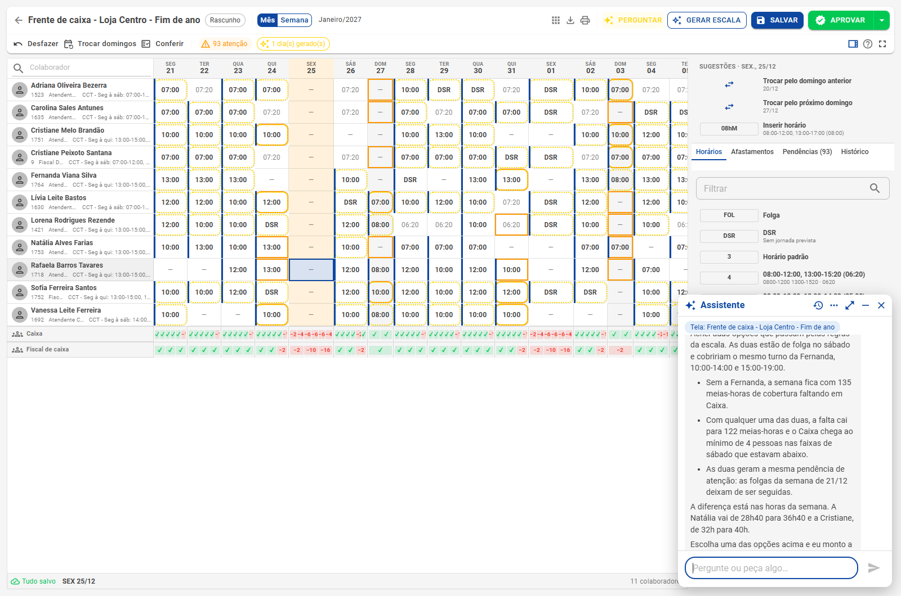

# Assistente na escala

**Botão Perguntar** · Explica pendências, encontra quem cobre uma falta, gera a semana e lê a convenção

Na grade do planejamento, o botão **Perguntar** abre o Assistente de IA já conectado àquela escala. Ele enxerga as pessoas, as regras, a cobertura e as pendências do plano, e responde em português, com números. Voltar à [visão geral](Escalas-inteligentes.md).

> O Assistente **não grava sozinho**. Toda alteração vira uma proposta que você confirma; ao aplicar, os dias entram circulados na grade (o Ctrl + Z desfaz) e o cartão de ponto só muda na aprovação.

## O que dá para pedir

| Pedido | Exemplo |
|---|---|
| **Entender a escala** | "O que merece atenção nesta semana?" · "Por que o dia 03/01 da Adriana está ocre?" · "Explique a escala da Lorena" |
| **Cobrir uma falta** | "A Fernanda vai faltar no sábado 26/12. Quem pode cobrir o turno dela?" · "Quem cobre uma falta amanhã?" |
| **Gerar** | "Gere a semana que vem" · "Refaça a escala do período a partir do dia 04/01" |
| **Criar regras** | "Na véspera de Natal a loja fecha às 18h" · "Ninguém fecha a loja mais de três vezes por semana" |
| **Ler a convenção** | Com o PDF enviado na política: "Leia a convenção e proponha as regras" |

Ao abrir, a janela sugere perguntas prontas: *O que merece atenção nesta semana?*, *Quem cobre uma falta amanhã?*, *Explique a escala de um colaborador* e *Gere a semana que vem*. O Assistente sabe a data de hoje, então "amanhã" e "semana que vem" funcionam como esperado.

## Quem pode cobrir uma falta

O Assistente procura quem pode assumir o turno **sem quebrar nenhuma regra** e mostra o efeito de cada opção: a cobertura do setor antes e depois, as horas da semana de cada pessoa e as pendências novas.

No exemplo, com a Fernanda fora no sábado 26/12, ele achou duas operadoras de folga naquele dia. As duas levam o Caixa ao mínimo de 4 pessoas nas faixas do sábado; a diferença está nas horas da semana (28h40 → 36h40 numa, 32h → 40h na outra). Escolhida a opção, ele monta a proposta.

## Aplicar na grade

A proposta vem num cartão com o colaborador, o dia e o horário de antes e de depois. **Aplicar na grade** coloca a alteração na escala, circulada; **Cancelar** descarta.

Antes de aplicar, o Assistente mede de novo: se a grade mudou desde a primeira resposta, ele avisa e mostra os números atualizados. Ele também lembra o que ficou pendente (no exemplo, o afastamento da Fernanda, que pode ser incluído na mesma proposta).

## Gerar pelo Assistente

Pedidos como *"refaça a escala da semana que vem"* usam o mesmo [gerador](Gerador.md) do botão Gerar escala, só para os dias pedidos. A prévia entra circulada, com o resumo de antes e depois.

## Regras em linguagem natural

Descreva a regra como falaria com alguém da equipe. O Assistente escolhe o tipo, preenche os parâmetros, mostra a frase da regra e só grava depois que você confirmar. As regras criadas assim ficam com a origem **Assistente**.

## Convenção em PDF

Envie o PDF da convenção coletiva pelo botão **Enviar PDF** da política (em [Regras e coberturas](Regras-e-coberturas.md)) e peça para o Assistente lê-lo. Ele propõe **uma regra por cláusula**, cada uma com o trecho e a página de onde saiu, e cada regra só é gravada depois de confirmada. Confira sempre o texto da cláusula: a regra é uma leitura, e a decisão é sua.

## Chegando na próxima atualização

Com a [previsão da demanda](Demanda.md), o Assistente responde sobre a demanda prevista de um setor e calcula o **quadro ideal** da semana com 44h hoje, 42h e 40h depois da EC 141.

## Para usar

- O Assistente depende do recurso de IA da empresa (o mesmo do botão Assistente da barra do topo) e tem limite de uso por usuário.
- As ações que mexem na grade só funcionam com a grade do planejamento aberta.
- Para aplicar alterações, vale a permissão de editar o planejamento; para criar regras, a de regras de escala.
