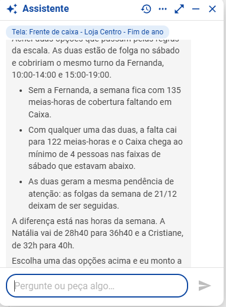
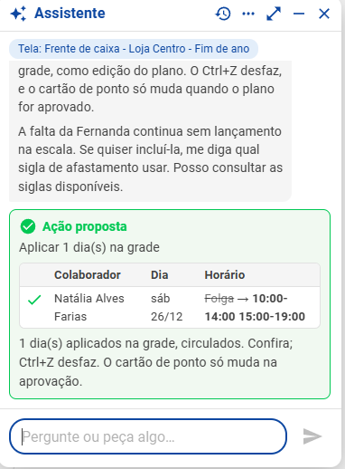

# Assistente na escala

**Botão Assistente** · Explica pendências, encontra quem cobre uma falta, muda a escala em lote, gera a semana e lê a convenção

Na grade do planejamento, o botão **Assistente**, na ponta direita da barra, abre o Assistente de IA já conectado àquela escala. Ele enxerga as pessoas, as regras, a cobertura e as pendências do plano, e responde em português, com números. Voltar à [visão geral](Escalas-inteligentes.md).

> O Assistente **não grava sozinho**. Toda alteração vira uma proposta que você confirma; ao aplicar, os dias entram circulados na grade (o Ctrl + Z desfaz) e o cartão de ponto só muda na aprovação.

## O que dá para pedir

| Pedido | Exemplo |
|---|---|
| **Entender a escala** | "O que merece atenção nesta semana?" · "Por que o dia 03/01 da Adriana está ocre?" · "Explique a escala da Lorena" |
| **Cobrir uma falta** | "A Fernanda vai faltar no sábado 26/12. Quem pode cobrir o turno dela?" · "Quem cobre uma falta amanhã?" |
| **Mudar muitos dias de uma vez** | "Home office segunda e quarta para o setor Caixa" · "Observação 'inventário' em todos os sábados" · "Quem trabalha de segunda a sábado?" |
| **Gerar** | "Gere a semana que vem" · "Refaça a escala do período a partir do dia 04/01" |
| **Criar regras e coberturas** | "Na véspera de Natal a loja fecha às 18h" · "Ninguém fecha a loja mais de três vezes por semana" · "Pelo menos 3 no caixa das 17h às 20h" |
| **Ler a convenção** | Com o PDF enviado na política: "Leia a convenção e proponha as regras" |
| **Demanda e quadro ideal** | "Qual a demanda prevista do Caixa na semana que vem?" · "Qual o quadro ideal do açougue com 42 horas?" |

Ao abrir, a janela sugere perguntas prontas: *O que merece atenção nesta semana?*, *Quem cobre uma falta amanhã?*, *Explique a escala de um colaborador* e *Gere a semana que vem*. O link **O que posso pedir?** mostra mais exemplos. O Assistente sabe a data de hoje, então "amanhã" e "semana que vem" funcionam como esperado. Ele também sabe a semana que está na tela e as células selecionadas, e o que você editou é salvo antes de cada pergunta.

## Quem pode cobrir uma falta

O Assistente procura quem do mesmo setor pode assumir o turno **sem quebrar nenhuma regra** e mostra o efeito de cada opção: a cobertura do setor antes e depois, as horas da semana de cada pessoa e as pendências novas.

No exemplo, com a Fernanda fora no sábado 26/12, ele achou duas operadoras de folga naquele dia. As duas levam o Caixa ao mínimo de 4 pessoas nas faixas do sábado; a diferença está nas horas da semana (28h40 → 36h40 numa, 32h → 40h na outra). Escolhida a opção, ele monta a proposta.

## Aplicar na grade

A proposta vem num cartão com o colaborador, o dia e o horário de antes e de depois. **Aplicar na grade** coloca a alteração na escala, circulada; **Cancelar** descarta. Com vários dias, cada linha tem a sua caixa de marcar: desmarque o que não quer, e o botão vira **Aplicar N na grade**.

Antes de aplicar, o Assistente mede de novo: se a grade mudou desde a primeira resposta, ele avisa e mostra os números atualizados. Ele também lembra o que ficou pendente (no exemplo, o afastamento da Fernanda, que pode ser incluído na mesma proposta). Dia que mudou depois da proposta (travado, trocado ou com afastamento) não entra.

**A proposta espera pela grade.** Se você confirmar com a grade do plano fechada (numa conversa aberta em outra tela, por exemplo), o cartão avisa *"Abra a grade do plano para aplicar."* e mostra o link **Abrir a grade**. Ele abre a grade com a mesma conversa, e o cartão aparece lá para você aplicar. Até isso, a proposta continua pendente. Plano já aprovado não aceita alteração.

## Muitos dias de uma vez

Para pedidos sobre a escala inteira, o Assistente olha o plano **por semana**: junta quem faz a mesma semana (o horário mais comum de cada dia, os dias de trabalho, as horas e os setores) e diz quantas pessoas há em cada grupo. É o que ele usa para responder "quem trabalha de segunda a sábado?" ou para preparar a passagem de 6x1 para 5x2, um grupo de cada vez. Quando a folga roda entre as semanas, ele avisa e confere a escala da pessoa antes de propor.

A mudança igual em muitos dias vem numa **proposta em lote**: o local previsto (home office, presencial, cliente, viagem, sobreaviso…), a observação ou o horário, para setores ou colaboradores, nos dias da semana e no intervalo pedidos. Um cartão leva até 400 dias, cada um com a sua caixa de marcar, e o horário passa pelas mesmas regras de uma alteração comum. A troca de folga continua pela grade (arrastando), porque leva o outro dia junto.

## Gerar pelo Assistente

Pedidos como *"refaça a escala da semana que vem"* usam o mesmo [gerador](Gerador.md) do botão Gerar escala, só para os dias pedidos. O Assistente propõe a geração num cartão com o botão **Gerar na grade**; a grade mostra o andamento, e a prévia entra circulada, com o resumo de antes e depois.

## Regras e coberturas em linguagem natural

Descreva a regra como falaria com alguém da equipe. O Assistente escolhe o tipo, preenche os parâmetros, mostra a frase da regra e só grava depois que você confirmar. As regras criadas assim ficam com a origem **Assistente**. Pedido que nenhum tipo de regra cobre, ele diz que ainda não sabe aplicar.

Do mesmo jeito, *"pelo menos 3 no caixa das 17h às 20h"* vira uma proposta de **cobertura** do setor, com as faixas por dia da semana ou numa data. Confirmada, ela vai para o cadastro de coberturas e a grade já a considera.

## Convenção em PDF

Envie o PDF da convenção coletiva pelo botão **Enviar PDF** da política (em [Regras e coberturas](Regras-e-coberturas.md)) e peça para o Assistente lê-lo. Ele propõe **uma regra por cláusula**, cada uma com o trecho e a página de onde saiu, e cada regra só é gravada depois de confirmada. Confira sempre o texto da cláusula: a regra é uma leitura, e a decisão é sua.

## Demanda e quadro ideal

Com a [previsão da demanda](Demanda.md) ligada, o Assistente responde sobre a **previsão** de um setor dia a dia: o movimento previsto, o pico de pessoas e a hora, as faixas que a previsão pede, os fatores (feriado, pagamento, eventos) e o erro da previsão nas últimas semanas.

Ele também calcula o **quadro ideal** do setor numa semana: as horas que a cobertura pede (a da previsão, quando houver) divididas pelo limite semanal da lei naquela semana (44h, 42h ou 40h, pela EC 141), comparado às pessoas lotadas no setor. A conta não desconta férias, afastamentos nem folgas de domingo: o [gerador](Gerador.md) e o [simulador](Simulador.md) mostram o número real.

Criar padrões e eventos da demanda continua na tela **Escalas › Demanda**.

## Para usar

- O Assistente depende do recurso de IA da empresa (o mesmo do botão Assistente da barra do topo) e tem limite de uso por usuário.
- As ações que mexem na grade só funcionam com a grade do planejamento aberta.
- Para aplicar alterações, vale a permissão de editar o planejamento; para criar regras e coberturas, a de regras de escala; para consultar a demanda, a de demanda das escalas.
