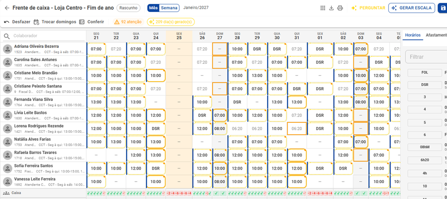
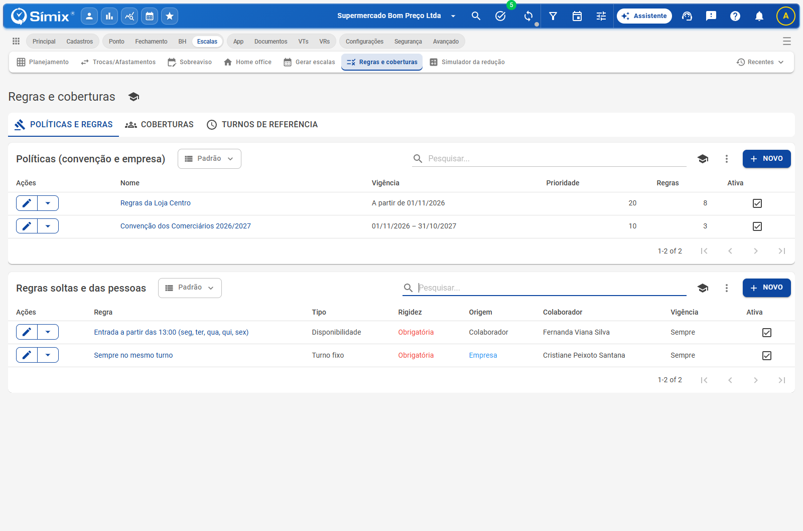
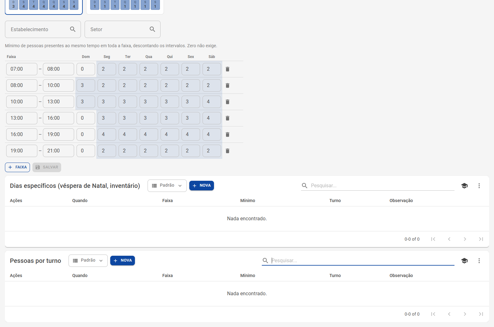
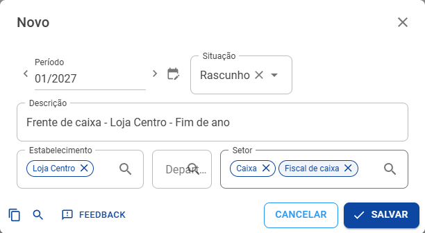
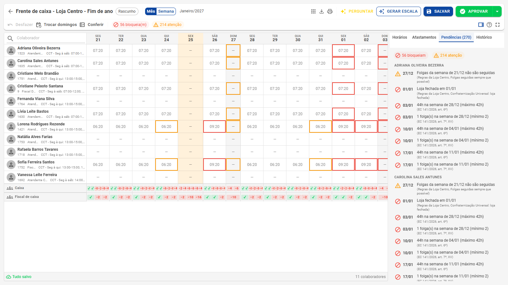
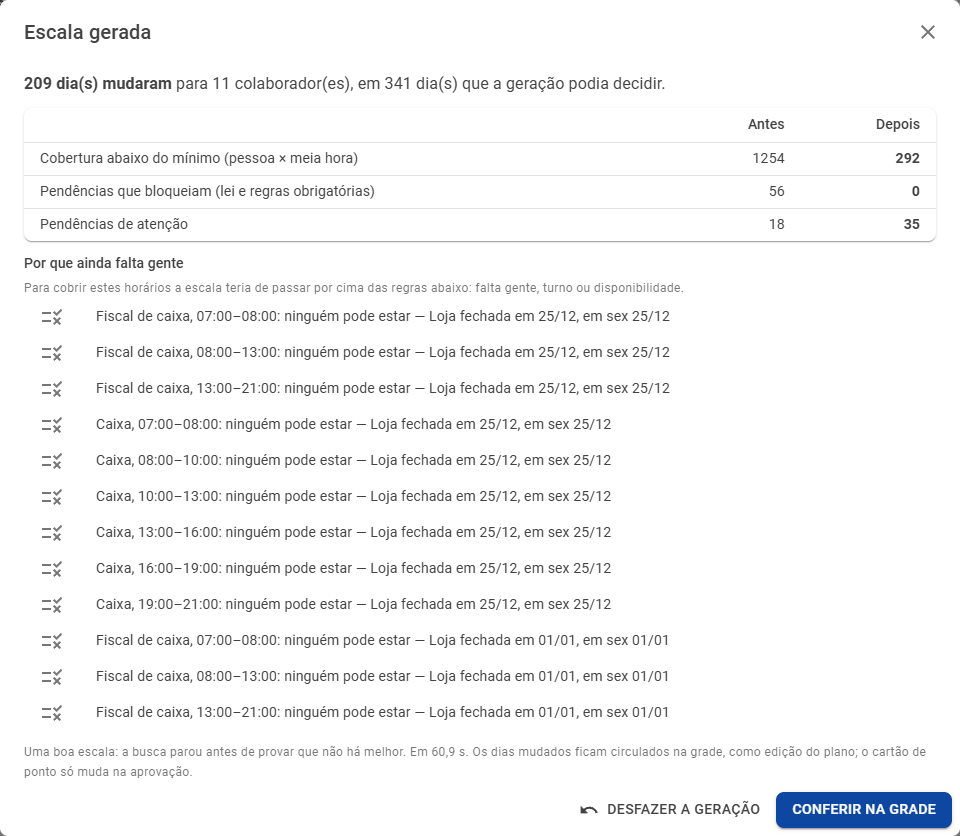
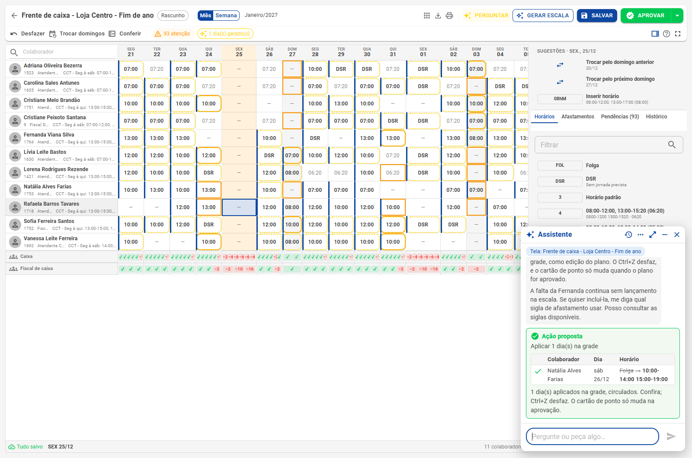

# Escalas inteligentes

**Visão geral** · Planejamento, regras, gerador automático, Assistente e simulador da redução de jornada

*Escala de fim de ano da frente de caixa de um supermercado, montada pelo gerador: cada dia circulado foi decidido por ele, cumprindo a lei, a convenção e as regras da loja.*

As **Escalas inteligentes** reúnem, num lugar só, tudo o que o RH, o DP e a gerência da loja precisam para montar a escala do mês com segurança:

- uma **grade** com um colaborador por linha e um dia por coluna, que funciona como uma planilha;
- **regras** da lei, da convenção coletiva e da empresa, conferidas enquanto você monta a escala;
- a **cobertura** que cada setor precisa, faixa por faixa de horário;
- um **gerador** que monta ou conserta a escala sozinho, cobrindo a loja o melhor possível;
- o **Assistente**, que explica pendências, diz quem pode cobrir uma falta e aplica a troca na grade;
- o **simulador da redução de jornada**, que mostra quantas pessoas faltam em cada setor com 42 e 40 horas.

Nada vai para o cartão de ponto antes da **aprovação**. Até lá, o planejamento é um rascunho: dá para montar o mês com calma, voltar no dia seguinte e ajustar.

> **Por que agora?** A Emenda Constitucional 141/2026 garante **dois repousos por semana** e reduz o limite para **42 horas a partir de 16/12/2026** e **40 horas a partir de 16/12/2027**. Quem trabalha em escala 6x1 precisa refazer a escala até lá. O sistema já confere essas regras na data certa. Veja também o guia [Escala 5x2 na prática](../Guias/Escala-5x2.md).

## Como funciona, em seis passos

O exemplo abaixo é o de um supermercado: a **frente de caixa da Loja Centro** (8 operadoras de caixa e 3 fiscais) no período de **21/12/2026 a 20/01/2027**, que tem Natal, Ano-Novo e a virada da EC 141.

### 1. Cadastre as regras

Em **Escalas › Regras e coberturas**, cadastre a convenção coletiva e as regras da empresa, cada uma com a sua vigência. As regras da lei (descanso de 11 horas, 7º dia seguido, domingos, feriados, menores e aprendizes, EC 141) **já vêm conferidas**: não é preciso cadastrar.

No exemplo: a *Convenção dos Comerciários* (trabalho em feriado com folga em até 7 dias, domingo de folga a cada 3 semanas, intervalo de 1h a 2h) e as *Regras da Loja Centro* (horário da loja, véspera de Natal e de Ano-Novo até mais cedo, loja fechada em 25/12 e 01/01, folgas seguidas sempre que possível). Detalhes em [Regras e coberturas](Regras-e-coberturas.md).

### 2. Diga quantas pessoas cada setor precisa

Na aba **Coberturas**, informe o mínimo de pessoas por faixa de horário e dia da semana. O botão **Sugerir coberturas** monta um rascunho a partir das marcações das últimas semanas.

### 3. Crie o planejamento do mês

Em **Escalas › Planejamento**, clique em **Novo**, escolha o período e o recorte (estabelecimento, departamento e setor). A grade abre com o que cada pessoa já cumpre hoje, ao fundo.

### 4. Veja o que a lei e as regras não aceitam

A grade confere tudo enquanto você edita: **contorno vermelho** no dia que impede a aprovação e **ocre** no que só pede atenção. A aba **Pendências** lista cada uma, com o motivo e a fonte (a lei, a cláusula, a regra da empresa).

No exemplo, a escala 6x1 de hoje gera **56 bloqueios** no período: semanas de 44 horas, uma folga só por semana e gente escalada no dia em que a loja está fechada.

### 5. Gere a escala

O botão **Gerar escala** monta a escala que cumpre a lei e as regras e cobre a loja o melhor possível. O resultado entra na grade como prévia, com os dias mudados circulados, e um resumo mostra o antes e o depois.

| No exemplo | Antes | Depois |
|---|---|---|
| Bloqueios (lei e regras obrigatórias) | 56 | **0** |
| Cobertura abaixo do mínimo (pessoa × meia hora) | 1.254 | **292** |
| Dias decididos pelo gerador | — | 209, em cerca de 1 minuto |

O que ainda falta tem explicação: no exemplo, são o Natal e o Ano-Novo, dias em que a loja está fechada e ninguém pode ser escalado. Veja [Gerar escala](Gerador.md).

### 6. Ajuste com o Assistente e aprove

Uma operadora vai faltar no sábado? Pergunte ao **Assistente** na própria grade. Ele mostra quem pode cobrir, o efeito de cada opção nas horas da semana e na cobertura, e aplica a escolhida na grade.

Com tudo certo, **Aprovar** leva o planejado para o cartão de ponto. Se ainda houver bloqueio, o sistema pede uma justificativa, que fica gravada com o usuário e a data. Veja [Validação e aprovação](Validacao-e-aprovacao.md) e [Assistente na escala](Assistente.md).

## As telas do menu Escalas

| Tela | Para que serve | Página |
|---|---|---|
| **Planejamento** | Montar a escala do mês numa grade, conferir e aprovar | [Planejamento](Planejamento.md) |
| **Trocas/Afastamentos** | Trocar folgas, lançar afastamentos e trocar domingos direto no cartão, sem planejamento | [Trocas e domingos](Trocas-e-domingos.md) |
| **Sobreaviso** | Escalas de sobreaviso por estabelecimento | [Outras escalas](Outras-escalas.md) |
| **Home office** | Dias de home office de cada colaborador | [Outras escalas](Outras-escalas.md) |
| **Gerar escalas** | Gerar as escalas fixas e variáveis do cadastro no período | [Outras escalas](Outras-escalas.md) |
| **Regras e coberturas** | Convenção, regras da empresa e das pessoas, coberturas e turnos de referência | [Regras e coberturas](Regras-e-coberturas.md) |
| **Simulador da redução** | Quantas pessoas faltam em cada setor com 42 e 40 horas | [Simulador](Simulador.md) |
| **Demanda** | Volumes do PDV e previsão da demanda virando cobertura | [Demanda do PDV](Demanda.md) |

A lista completa das regras conferidas está em [Referência das regras](Referencia-regras.md), e as dúvidas mais comuns, em [Perguntas frequentes](Perguntas-frequentes.md).

## Quem pode usar

O acesso é pelas permissões do usuário (Segurança › Permissões):

| Permissão | O que libera |
|---|---|
| **Planejamento de escala** | Ver os planejamentos, abrir a grade, o relatório e o simulador |
| **Planejamento de escala › Criar / Editar / Excluir** | Criar planejamentos, editar a grade, **gerar a escala** e calcular as vagas no simulador |
| **Planejamento de escala › Aprovar** | Aprovar e reprovar (é o que grava no cartão) e usar **Trocas/Afastamentos** |
| **Regras de escala** (e Criar / Editar / Excluir) | Políticas, regras, coberturas e turnos de referência |

O gerador, a validação e o simulador valem para todas as empresas, sem recurso a ligar. O **Assistente** depende do recurso de IA da empresa.

## Aprenda na prática

- Na página **Novidades**, o card **Escalas inteligentes** tem o botão **Me mostre**: uma demonstração guiada que percorre as regras, a cobertura, a grade, o gerador, o Assistente e a aprovação nas telas de verdade, sem gravar nada por você.
- O botão de **Treinamentos** de cada tela das escalas lista as demonstrações daquela tela.
- O botão **?** da grade reúne todos os atalhos de teclado e de mouse.

> **Aviso.** O sistema ajuda a cumprir a lei e a convenção, mas não substitui a análise do DP e do jurídico. Temas da EC 141 ainda em aberto (como o divisor da hora e o desconto por faltas) dependem de regulamentação, da convenção da categoria e dos tribunais.
