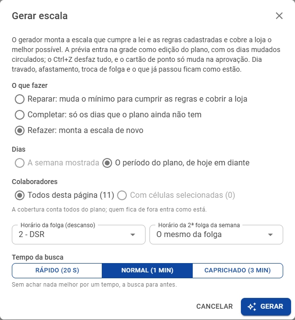
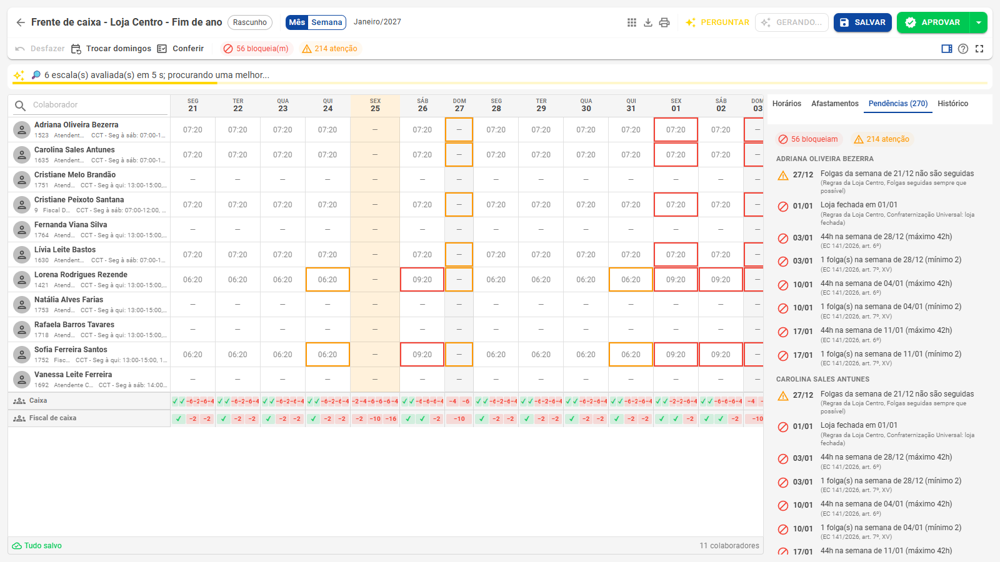
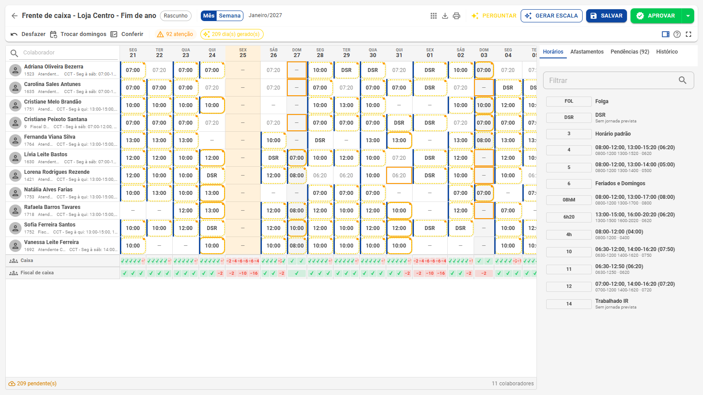

# Gerar escala

**O gerador da escala inteligente** · Monta, completa ou conserta a escala cumprindo as regras e cobrindo a loja

O botão **Gerar escala**, na barra da grade do planejamento, monta a escala que **cumpre a lei, a convenção e as regras da empresa** e **cobre a loja o melhor possível**. O resultado entra na grade como prévia, com os dias mudados circulados: você confere, ajusta e salva. O cartão de ponto só muda na aprovação. Voltar à [visão geral](Escalas-inteligentes.md).

## Antes de gerar

O gerador trabalha com o que estiver cadastrado em [Regras e coberturas](Regras-e-coberturas.md):

- as **coberturas** dos setores, que dizem quantas pessoas cada faixa precisa;
- os **turnos de referência**, com que ele monta os dias;
- as **regras** da convenção, da empresa e das pessoas (disponibilidade, turno fixo, limites).

Sem cobertura cadastrada, o gerador ainda cumpre as regras, mas não tem como saber onde falta gente.

## As opções

| Opção | Escolhas |
|---|---|
| **O que fazer** | **Reparar**: muda o mínimo para cumprir as regras e cobrir a loja. **Completar**: preenche só os dias que o plano ainda não tem. **Refazer**: monta a escala de novo |
| **Dias** | A semana mostrada (na visão Semana) ou o período do plano, de hoje em diante |
| **Colaboradores** | Todos da página ou só os das células selecionadas. A cobertura conta todos do plano; quem fica de fora entra como está |
| **Horário da folga** | O horário do dia usado no descanso (ex.: DSR) e, se quiser, outro para a 2ª folga da semana |
| **Tempo da busca** | Rápido (20 s), Normal (1 min) ou Caprichado (3 min). Sem achar nada melhor por um tempo, a busca para antes |

O gerador **não mexe** em dia travado, afastamento, troca de folga e dias que já passaram: eles ficam como estão e entram na conta.

## O andamento

A geração roda em segundo plano, e a barra da grade mostra o andamento. Você pode continuar olhando a escala enquanto isso.

## O resumo: antes e depois

Ao terminar, o resumo mostra quantos dias mudaram e a comparação entre antes e depois:

- **Cobertura abaixo do mínimo**, em pessoas × meia hora (uma pessoa faltando por meia hora conta 1);
- **Pendências que bloqueiam** (lei e regras obrigatórias);
- **Pendências de atenção** (preferências e avisos).

As atenções podem subir: para fechar a cobertura, o gerador às vezes abre mão de uma preferência (como folgas seguidas), e mostra isso.

### Por que ainda falta gente

Quando a cobertura não fecha, o resumo diz por quê, faixa por faixa:

- **o horário que nenhum turno alcança** (ex.: uma faixa que começa antes da entrada do primeiro turno de referência);
- **a regra que impede** (ex.: *"ninguém pode estar — Loja fechada em 25/12"*, feriado sem convenção, a disponibilidade de alguém);
- **a falta de pessoas**: quem pode trabalhar no dia não basta para as faixas juntas.

No exemplo, a falta que restou é quase toda no Natal e no Ano-Novo, com a loja fechada: o gerador não escala ninguém nesses dias, e o resumo explica.

O resumo termina dizendo se a busca provou que não há escala melhor ou se parou antes, e quanto tempo levou.

## A prévia na grade

**Conferir na grade** fecha o resumo. Os dias decididos pelo gerador ficam **circulados**, como edição do plano, e o chip **"N dia(s) gerado(s)"** da barra reabre o resumo.

- **Ctrl + Z** ou **Desfazer a geração** volta a escala como estava.
- A prévia é gravada no planejamento pelo salvamento automático (a cada minuto), como qualquer edição. O **cartão de ponto não muda** até a aprovação.
- Depois de gerar, ajuste o que quiser na grade ou peça ao [Assistente](Assistente.md).

## Exemplo: a virada para a 5x2 no supermercado

| Frente de caixa da Loja Centro, 21/12/2026 a 20/01/2027 | Antes | Depois |
|---|---|---|
| Escala | 6x1 do cadastro | 5x2 montada pelo gerador |
| Bloqueios | 56 (semanas de 44h, 1 folga por semana, loja fechada) | **0** |
| Cobertura abaixo do mínimo | 1.254 pessoas × meia hora | **292** (quase tudo no Natal e no Ano-Novo, com a loja fechada) |
| Tempo | — | cerca de 1 minuto para 11 pessoas e 31 dias |

## Vagas no simulador

O mesmo gerador calcula, no [Simulador da redução](Simulador.md), **quantas pessoas a mais** cada setor precisaria para fechar a cobertura respeitando todas as regras (**Calcular vagas**).

## Pelo Assistente

O [Assistente](Assistente.md) também gera: *"refaça a escala da semana que vem"* ou *"complete os dias que faltam do Caixa"*. A prévia entra na grade do mesmo jeito, circulada.

## Perguntas comuns

**O gerador substitui o "Gerar escalas" do menu?** Não. O **Gerar escalas** do menu continua igual: ele aplica as escalas fixas e variáveis do cadastro no período. O gerador da escala inteligente trabalha dentro do planejamento. Veja [Outras escalas](Outras-escalas.md).

**Gerei e não gostei. E agora?** Ctrl + Z (ou Desfazer a geração) volta tudo. Mesmo salvo, nada foi para o cartão.

**Posso gerar só para algumas pessoas?** Sim: selecione células delas e escolha **Com células selecionadas**. As demais entram como estão.

**Quem pode gerar?** Quem tem **Planejamento de escala › Editar**.
