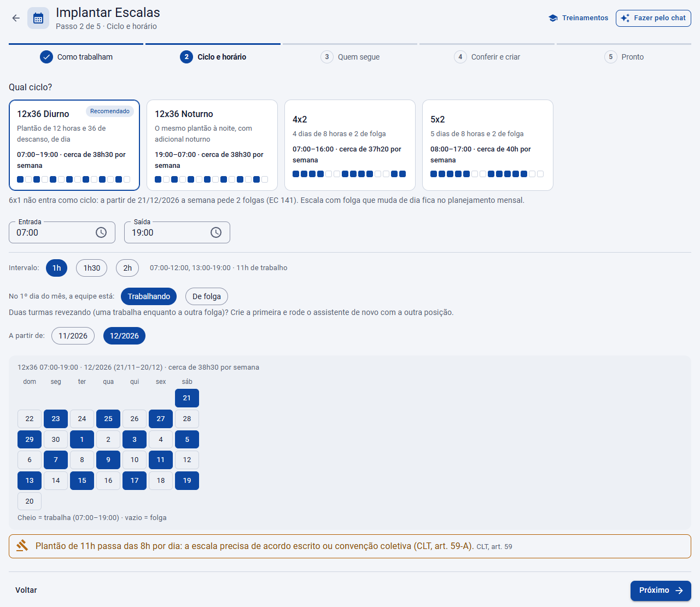

# Implantar Escalas

**Início › Módulos › Escalas** · O assistente que monta a escala que se repete ou mostra o caminho da escala planejada

Para quem ainda não usa escala, o assistente **Implantar Escalas** começa pela pergunta certa: a equipe trabalha num **ciclo que se repete** (12x36, 4x2, 5x2) ou numa **escala montada todo mês** pela cobertura da loja? Voltar à [visão geral](Escalas-inteligentes.md).

## Onde fica

Em **Início › Módulos**, o card **Escalas** mostra a situação do módulo (não configurado, configurado ou em uso), o que já existe (escalas que se repetem, planos em aberto, setores com cobertura e turnos) e os botões **Abrir** (a lista de planejamentos) e **Começar** (ou **Configurar**, quando já há algo configurado), que abre o assistente. O endereço direto é `/modulos/escalas/implantar`, e ele pede a permissão de **Escalas**.

O assistente anda em passos, com **Voltar** e **Próximo** no rodapé. O botão **Fazer pelo chat** abre o Assistente de IA, com sugestões como *"Quero 12x36 das 7 às 19 para a portaria"* e *"Qual a diferença entre o ciclo e a escala planejada?"*. Pedindo pelo chat (*"uma 12x36 das 7 às 19 para a portaria"*), o Assistente responde com um cartão que abre o assistente já no ciclo e no horário, sem gravar nada.

## 1. Como sua equipe trabalha?

| Opção | Quando usar |
|---|---|
| **O mesmo ciclo sempre** (recomendado) | 12x36, 4x2, 5x2: configura uma vez e o sistema gera a escala todo mês |
| **Escala montada todo mês** | Pela cobertura da loja: turnos de abertura e fechamento, folgas que mudam, a lei e a EC 141 conferidas. Veja [abaixo](#escala-montada-todo-mês) |

Quem trabalha sempre no mesmo horário da semana não precisa de escala: basta o quadro de horários. Só home office ou sobreaviso? Use **Escalas › Home office** ou **Escalas › Sobreaviso** (veja [Outras escalas](Outras-escalas.md)).

## O ciclo que se repete

### 2. Ciclo e horário

Escolha o ciclo. Cada um mostra o horário, as horas por semana e uma faixa de 14 dias (cheio = trabalha):

| Ciclo | O que é | Horário sugerido |
|---|---|---|
| **12x36 Diurno** (recomendado) | Plantão de 12 horas e 36 de descanso, de dia | 07:00 às 19:00 |
| **12x36 Noturno** | O mesmo plantão à noite, com adicional noturno | 19:00 às 07:00 |
| **4x2** | 4 dias de 8 horas e 2 de folga | 07:00 às 16:00 |
| **5x2** | 5 dias de 8 horas e 2 de folga | 08:00 às 17:00 |

O 6x1 não entra como ciclo: a partir de 21/12/2026 a semana pede 2 folgas (EC 141). Escala com folga que muda de dia fica no planejamento mensal.

Depois ajuste a **Entrada**, a **Saída** e o **Intervalo** (1h, 1h30 ou 2h), diga **como a equipe está no 1º dia do mês** (em que ponto do ciclo) e escolha o mês em **A partir de**. Duas turmas revezando (uma trabalha enquanto a outra folga)? Crie a primeira e rode o assistente de novo com a outra posição.

O mês aparece desenhado com os plantões e as folgas, e os avisos da lei vêm logo abaixo, sem gravar nada. Por exemplo: plantão acima de 8 horas por dia precisa de acordo escrito ou convenção coletiva (CLT, art. 59-A), e semanas com mais plantões passam do limite de 42 horas a partir de 21/12/2026 e dependem da compensação prevista no acordo.

### 3. Quem segue a escala

| Opção | O que faz |
|---|---|
| **Uma equipe** | Por estabelecimento, setor, cargo ou nome. A lista mostra quem entra, com o setor, o cargo e o quadro atual: desmarque quem fica no quadro de hoje |
| **Só o Demonstração** | Para ver no cartão do colaborador de demonstração antes de trocar a equipe (aparece quando ele existe) |
| **Ninguém agora** | Só cria a escala e o quadro; os colaboradores trocam pelo cadastro |

Os escolhidos passam para o quadro de horários da escala a partir do mês escolhido. Em **Copiar as regras do quadro**, escolha o quadro de onde vêm as regras de extras, banco de horas e adicional noturno; os horários da semana saem dele, e quem manda nos dias é a escala. Quem não altera o cadastro dos colaboradores só cria a escala e o quadro.

### 4. Conferir e criar

O assistente lista o que vai criar (o horário do plantão e o da folga, a escala e o quadro de horários dela), marcando o que **já existe** e será reaproveitado e o que é **novo**, e repete os avisos da lei. Marque **Gerar a escala do mês para eles logo depois de criar** para o cartão já mostrar os plantões. Este é o único passo que grava: o botão **Criar** faz tudo de uma vez.

### 5. Pronto

O resumo mostra quantos colaboradores passaram para o quadro novo e o mês desenhado, com os atalhos **Ver no cartão**, **Escalas**, **Quadros de horários** e **Gerar escalas**. Se a escala não foi gerada agora, a geração da madrugada preenche o mês no cartão. Plantão em feriado, troca de plantão e férias seguem pelo cartão e pela manutenção, como em qualquer escala.

## Escala montada todo mês

Escolhendo **Escala montada todo mês**, o assistente mostra o caminho das [Escalas inteligentes](Escalas-inteligentes.md), na ordem, com o que já existe em cada etapa:

1. **Turnos de referência**: abertura, intermediário e fechamento, os horários que a escala usa.
2. **Cobertura por setor**: quantas pessoas cada setor precisa em cada faixa do dia.
3. **Regras da convenção e da empresa**: opcional, porque a lei (8h por dia, 42h e 2 folgas a partir de 21/12/2026, 11h entre jornadas) já vale sem cadastrar.
4. **Plano do mês**: gerar a escala do mês, ajustar na grade e aprovar para ir ao cartão.

Cada etapa tem os botões **Sugerir**, que abre o [Sugerir turnos, coberturas ou regras](Regras-e-coberturas.md) ali mesmo, e **Abrir**, que leva à tela numa guia nova. Quem trabalha em 6x1 precisa de 2 folgas por semana a partir de 21/12/2026: o [Simulador da redução](Simulador.md) mostra quem passa do limite antes de montar o plano.
