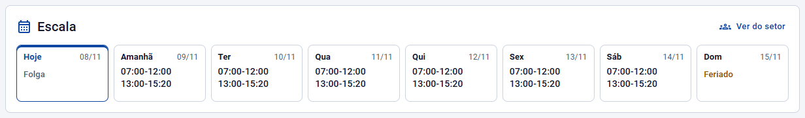
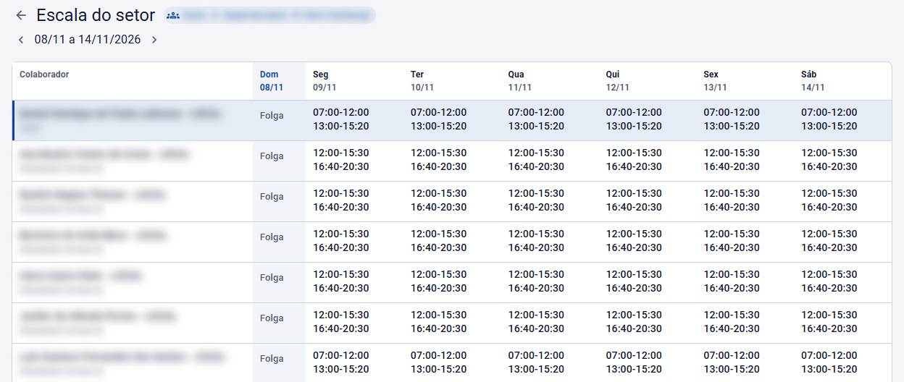

# Minha escala

**Portal e aplicativo do colaborador** · A escala de hoje e dos próximos dias, a do setor e o aviso de escala aprovada

Depois que o planejamento é aprovado, cada colaborador vê a própria escala no portal do colaborador e no aplicativo, e recebe um aviso. Voltar à [visão geral](Escalas-inteligentes.md).

> A escala do colaborador vem do **cartão de ponto**. O que está no planejamento em Rascunho ou Publicado ainda não aparece para ele: só o que foi **aprovado** (e o que foi gravado direto no cartão, como uma troca em Trocas/Afastamentos ou a escala gerada pelo cadastro).

## O card Minha escala

No painel do colaborador, o card **Minha escala** mostra **hoje e os próximos 7 dias** ("Hoje", "Amanhã" e os dias da semana), cada um com:

- o **horário previsto**, um trecho por turno (ex.: 08:00-12:00 e 13:00-17:00);
- **Folga**, **Feriado** ou o **afastamento** do dia (férias, atestado…);
- o **local previsto**, quando não é o padrão (home office, cliente, viagem…).

Enquanto os dias seguintes não foram calculados, o card avisa: *"A escala dos próximos dias ainda não foi calculada."*

Quando o gestor abre o painel de um colaborador, o mesmo card aparece com o título **Escala** e o botão **Ver do setor**, como na imagem.

## A escala do setor

O botão **Ver do meu setor**, no card, abre a **Escala do setor**: a escala dos colegas do mesmo setor e do mesmo estabelecimento, numa tabela com uma linha por pessoa e uma coluna por dia.

- A linha do colaborador vem primeiro, em destaque, com a marca **Você**; os colegas aparecem com o cargo, em ordem de nome.
- Cada tela mostra **7 dias**, a partir de hoje. As setas **Semana anterior** e **Próxima semana** andam de 7 em 7 dias, e o botão **Hoje** volta para o dia atual.
- Do colega aparecem só os turnos, a folga, o feriado e o local. O afastamento de um colega aparece como **Ausente**, sem o motivo; o motivo aparece só na linha do próprio colaborador.
- Sem setor no cadastro, a tela avisa e mostra só a escala do próprio colaborador.

O botão do card só aparece para quem tem setor nos dias calculados.

## O aviso de escala aprovada

Quando o gestor aprova o planejamento, cada colaborador que teve dias gravados no cartão recebe o aviso **Escala aprovada**, no site e no aplicativo: *"A escala de (nome) de 21/12/2026 a 20/01/2027 foi aprovada."* Tocar no aviso abre a escala do setor a partir do primeiro dia aprovado.

A regra do aviso já vem criada na tela **Alertas** (rotina **Escalas**, evento **Aprovado**, perfil Colaborador, alcance **Somente eu**, canais Site e Aplicativo), e a empresa pode ajustá-la. Veja [Validação e aprovação](Validacao-e-aprovacao.md#o-aviso-ao-colaborador).

## Perguntas comuns

**Aprovei a escala e o colaborador ainda não vê.** Confira se os dias estão calculados: o card e a escala do setor mostram o que o cálculo do ponto já tem, e dia sem cálculo aparece com "—".

**O colaborador vê o plano antes da aprovação?** Não. Rascunho e Publicado ficam só com a gestão.

**O colega vê por que eu faltei?** Não. Para os colegas, o afastamento aparece só como "Ausente".
