# Planejamento de escala

**Escalas › Planejamento** · Monte a escala do mês numa grade, confira e aprove

O planejamento é o rascunho da escala de um mês para um grupo de colaboradores. Você monta na grade, o sistema confere a lei, a convenção e a cobertura enquanto você edita, e só o que for **aprovado** vai para o cartão de ponto. Voltar à [visão geral](Escalas-inteligentes.md).

## A lista de planejamentos

Cada linha é a escala de um mês para um recorte de colaboradores, com a descrição, o mês e a situação. Clicar na **descrição** abre a escala na mesma guia (o botão de grade da linha faz o mesmo), e o botão de editar abre as configurações do planejamento.

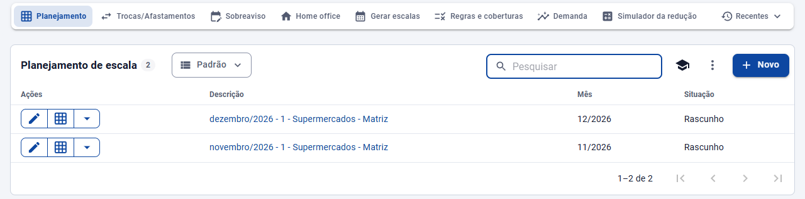

As situações são:

| Situação | O que significa |
|---|---|
| **Rascunho** | Em montagem. Tudo pode ser alterado e nada foi para o cartão |
| **Publicado** | Marcado como pronto para divulgar. Continua aberto para alteração e ainda não foi para o cartão. O colaborador ainda não vê: a escala dele, no portal e no aplicativo, vem do cartão de ponto, que só recebe o que foi aprovado |
| **Aprovado** | Gravado no cartão de ponto. A grade passa a ser só consulta |
| **Reprovado** | Marcado como recusado. Nada foi para o cartão |

## Criar um planejamento

Clique em **Novo** e preencha:

- **Período**: o mês do cartão de ponto. Ele segue o dia de início do cartão da empresa: quem fecha no dia 20 vê a escala de 21 a 20 do mês seguinte. As datas do cartão aparecem na dica do botão **Mês**, na grade.
- **Situação**: começa em Rascunho e vira Aprovado sozinha na aprovação.
- **Estabelecimento** e **Setor**: quem entra na grade. Cada um aceita **uma opção**, e vazio vale para todos. Faça um plano por loja, ou por setor quando a equipe for grande: na grade, o filtro de **Setores** mostra só uma parte sem mudar o plano.
- **Descrição**: como o plano aparece na lista e no topo da grade. Enquanto você não digita, o sistema sugere uma pelo mês, pelo estabelecimento e pelo setor.

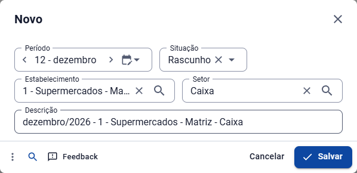

Ao salvar um planejamento novo, a grade dele abre na hora.

> O mesmo dia de um colaborador não pode estar em dois planejamentos abertos ao mesmo tempo. O Salvar recusa e diz em qual plano o dia já está.

> Os planejamentos antigos que tinham **departamento** no recorte perdem esse filtro quando são salvos de novo.

## A grade

Uma linha por colaborador e uma coluna por dia.

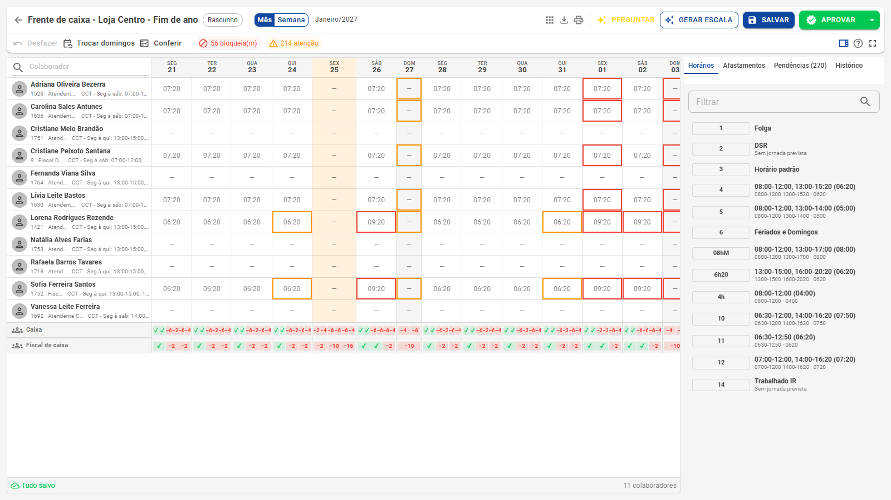

- **Colaborador**: foto, nome, cargo e o horário atual. Clicar na foto abre o menu com a manutenção do mês, o cadastro, os anexos e as impressões. A pesquisa fica no próprio cabeçalho *Colaborador* (nome, matrícula, CPF ou PIS).
- **Dias**: o que vem do cartão (o que a pessoa já cumpre) aparece esmaecido; o que foi planejado aparece em destaque. A célula mostra a sigla do horário ou do afastamento, e no canto entram o ícone do local previsto, a observação e a troca de folga. O botão [Exibir](#exibir) acrescenta embaixo os turnos, as horas previstas e as trabalhadas.
- **Domingos e feriados** ficam destacados. O feriado nacional aparece no cabeçalho da coluna; o municipal e o estadual aparecem só na célula de quem é daquela cidade, conforme a regra de feriado do horário.
- **Previsão do tempo**: nos próximos 16 dias, o cabeçalho do dia mostra a previsão da cidade do estabelecimento. É só informativa.
- **Rodapé de cobertura**: uma linha por setor, com a cobertura de cada dia (✓ quando atende, −N quando faltam pessoas). Veja [A linha do dia](#a-linha-do-dia).
- **Barra de status**: o que falta salvar, quantas células estão selecionadas, a legenda do dia selecionado (horário, pendências e a origem da alteração) e a navegação entre páginas (100 colaboradores por página).

O que cada cor, contorno e marca da célula quer dizer está em **Ajuda › Legendas**.

### Mês ou semana

O grupo **Mês / Semana** da barra troca a visão. O mês do plano e as datas do cartão ficam na dica do botão **Mês**. Na semana, as setas andam pelo período e o botão de copiar repete a **semana anterior** para as pessoas da página (o Ctrl+Z desfaz).

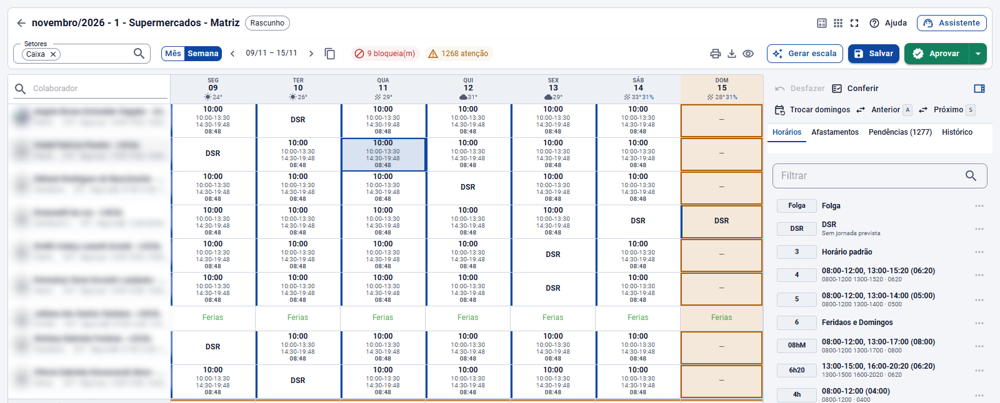

### Os filtros da grade

Os filtros estreitam quem aparece **só na tela**, sem mudar o planejamento:

- **Setores**, na linha de baixo da barra: lista os setores que têm linha no rodapé de cobertura. Com setor escolhido, a grade mostra só quem é dele e o rodapé mostra só as linhas dele.
- **Estabelecimento** e **Estabelecimento atual**, ao lado do nome do plano: aparecem quando o planejamento não tem estabelecimento no recorte (com um, o nome do plano já diz qual é).

## Editar como numa planilha

Tudo o que você lança vale para a **seleção inteira**: com 40 células marcadas, um afastamento marca as 40.

- **Selecionar**: clique numa célula, arraste para pintar um bloco, use **Ctrl + clique** para dias soltos e **Shift + clique** para um retângulo. As setas andam pela grade.
- **Aplicar um horário**: clique nele na aba **Horários** do painel lateral.
- **Aplicar um afastamento**: digite a **letra** do afastamento (a tecla de atalho do cadastro) ou clique nele na aba **Afastamentos**.
- **Copiar e mover**: **Ctrl + C / Ctrl + V**, ou arraste com **Ctrl** para copiar e **Ctrl + Shift** para mover.
- **Trocar uma folga**: arraste entre uma folga e um dia de trabalho. Os dois trocam de conteúdo e cada um registra a data do outro (aparece o ícone de troca e o dia trocado num círculo).
- **Trocar com o domingo**: a tecla **A** troca o dia selecionado com o domingo anterior e a **S**, com o próximo domingo. São os botões **Anterior** e **Próximo** do painel lateral.
- **Limpar e desfazer**: **Del** limpa o que foi planejado; **Ctrl + Z** desfaz a última alteração.

As teclas de letra só valem com a grade em foco: digitar no Assistente, num filtro ou num diálogo não lança afastamento nem troca domingos. Por isso **A** e **S** não podem ser a tecla de atalho de um afastamento na grade.

### O editor do dia

Duplo clique, botão direito, **Espaço**, **Enter** ou **F2** abrem o editor do dia.

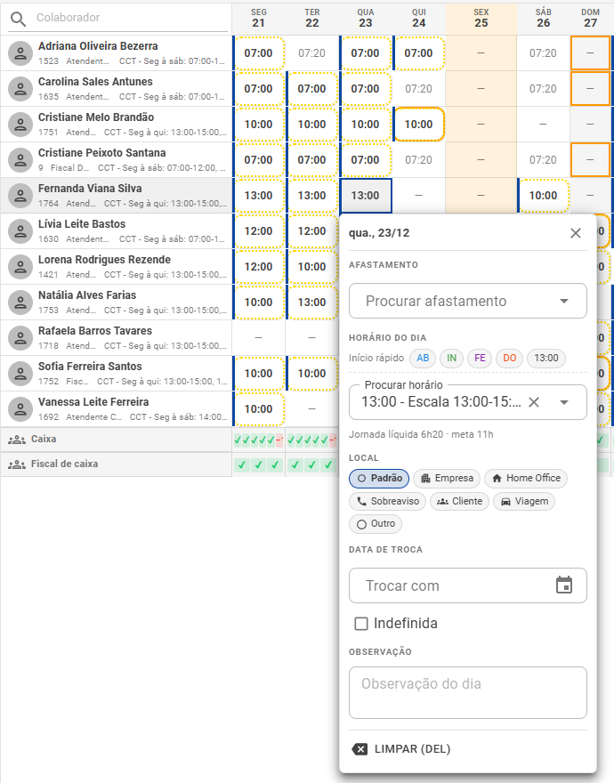

| Campo | Para que serve |
|---|---|
| **Afastamento** | Férias, atestado, folga compensada… com o campo **Horas** (já vem com as horas padrão do cadastro do afastamento) |
| **Horário do dia** | O horário daquele dia. O **Início rápido** monta o horário com um clique, pelos turnos de referência do setor (Abertura, Intermediário, Fechamento…) e pelas entradas mais usadas. Abaixo aparece a jornada líquida ao lado da meta do contrato |
| **Local** | Padrão, Empresa, Home Office, Sobreaviso, Cliente, Viagem ou Outro |
| **Data de troca** | O dia com que esta folga foi trocada, ou **Indefinida** |
| **Observação** | Um recado para o dia |
| **Limpar (Del)** | Tira o que foi planejado |

O horário criado pelo Início rápido não entra na lista de horários do dia da empresa: ele existe só para as escalas.

### O painel lateral

À direita da grade, com a largura ajustável (arraste a divisória; duplo clique volta ao padrão):

- **No topo**: **Desfazer** (Ctrl + Z), **Conferir** (as regras de inconsistência da empresa, veja [Validação e aprovação](Validacao-e-aprovacao.md#conferir-com-a-calc)) e o botão que recolhe o painel. Recolhido, sobra só um ícone na borda da grade para abrir de novo.
- **Domingos**: **Trocar domingos** (a troca automática, veja [Trocas e domingos](Trocas-e-domingos.md)) e **Anterior (A)** e **Próximo (S)**, que trocam o dia selecionado com o domingo anterior ou o próximo. A dica do botão diz o dia e o domingo.
- **Sugestões** para o dia selecionado: inserir o último afastamento e o último horário usados.
- **Horários**: os horários do dia da empresa, com filtro. Um clique aplica na seleção, e o **…** da linha abre o cadastro do horário (gravado, a grade passa a usar o horário alterado).
- **Afastamentos**: cada um com a sua cor e a sua tecla de atalho.
- **Pendências**: o que a lei e as regras não aceitam. Veja [Validação e aprovação](Validacao-e-aprovacao.md).
- **Histórico**: as alterações do dia selecionado, com o que era, o que passou a ser, quem alterou e quando.

### Atalhos

Em **Ajuda › Atalhos do teclado e do mouse** ficam os atalhos e as teclas dos afastamentos da sua empresa.

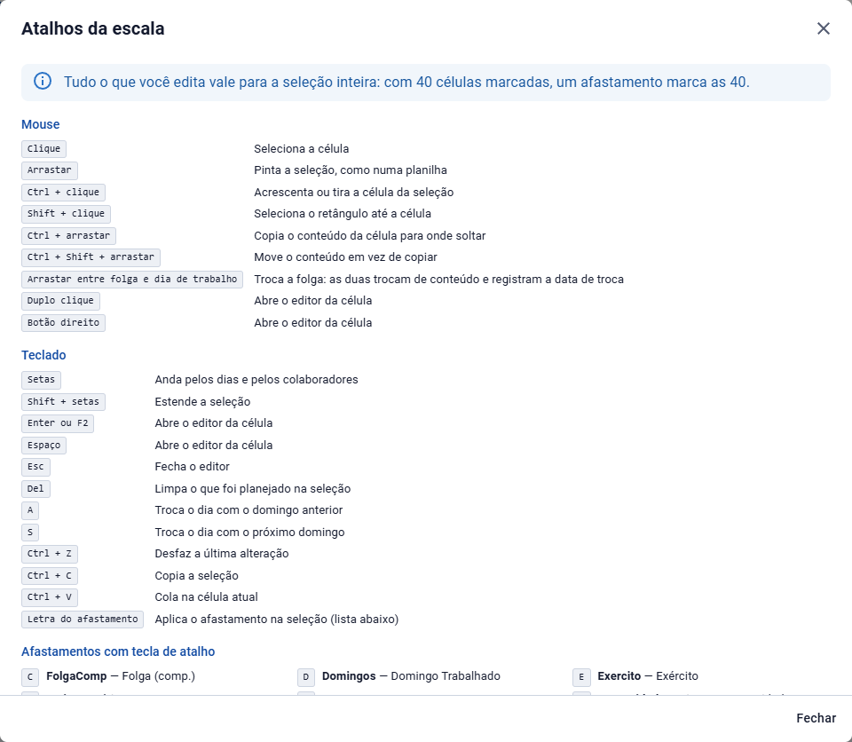

| Mouse | Ação |
|---|---|
| Clique | Seleciona a célula |
| Arrastar | Pinta a seleção, como numa planilha |
| Ctrl + clique | Acrescenta ou tira a célula da seleção |
| Shift + clique | Seleciona o retângulo até a célula |
| Ctrl + arrastar | Copia o conteúdo para onde soltar |
| Ctrl + Shift + arrastar | Move o conteúdo em vez de copiar |
| Arrastar entre folga e dia de trabalho | Troca a folga e registra a data de troca |
| Duplo clique ou botão direito | Abre o editor da célula |

| Teclado | Ação |
|---|---|
| Setas / Shift + setas | Anda pela grade / estende a seleção |
| Enter, F2 ou Espaço | Abre o editor da célula |
| Esc | Fecha o editor |
| Del | Limpa o que foi planejado na seleção |
| A / S | Troca o dia com o domingo anterior / com o próximo domingo |
| Ctrl + Z | Desfaz a última alteração |
| Ctrl + C / Ctrl + V | Copia a seleção / cola na célula atual |
| Letra do afastamento | Aplica o afastamento na seleção |

## Salvar

O que foi editado e ainda não gravado fica marcado e a barra de status conta os pendentes. O sistema **salva sozinho a cada minuto**, salva antes de virar a página ou pesquisar e avisa antes de sair da tela com alterações pendentes. O botão **Salvar** grava na hora.

Salvar grava o **planejamento**, não o cartão de ponto: o cartão só muda na aprovação.

## A linha do dia

O rodapé mostra, para cada setor e cada dia, se a escala atende a cobertura cadastrada. Clique no dia para abrir a **linha do dia**: o necessário e o escalado a cada meia hora, a falta em vermelho e a barra de cada pessoa da página, com o intervalo.

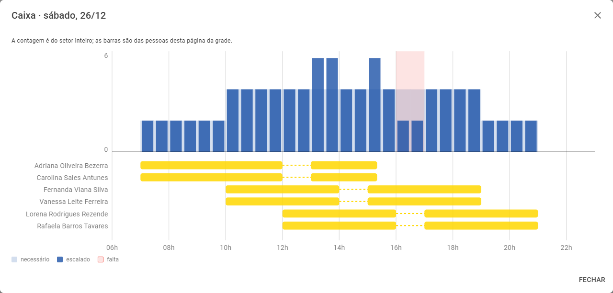

A contagem é do setor inteiro; as barras são das pessoas da página. Quando a cobertura do dia vem da [previsão da demanda](Demanda.md), o rodapé marca o dia.

## A barra da grade

A barra tem duas linhas. Em cima fica de onde é a escala e as ferramentas; embaixo, o período, as pendências e as ações.

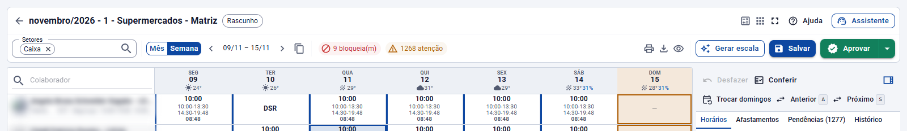

**Linha de cima**

| Botão | O que faz |
|---|---|
| **Voltar**, nome e situação | Volta para a lista de planejamentos. Ao lado do nome ficam os filtros de Estabelecimento (veja [Os filtros da grade](#os-filtros-da-grade)) |
| **Calculadora** | A calculadora de horas, numa janela sobre a grade |
| **Atalhos** | As telas ligadas à escala, por categoria (escala, outros tipos de escala, cadastros), abrindo em guia nova, e as **Configurações do planejamento** (o mesmo cadastro do Novo) |
| **Tela cheia** | Liga e desliga a tela cheia do navegador |
| **Ajuda** | **Atalhos do teclado e do mouse**, **Legendas**, [Regras](#a-janela-de-regras), **Documentação** (estas páginas, a partir da visão geral), **Treinamentos** e **Enviar feedback** |
| **Assistente** | Abre o [Assistente](Assistente.md) já ligado a esta escala |

**Linha de baixo**

| Botão | O que faz |
|---|---|
| **Setores** | Mostra só quem é dos setores escolhidos |
| **Mês / Semana** | Troca a visão |
| **Contadores** | Bloqueios e atenções da página; o chip de trocas de domingo mostra só quem teve troca automática, e o de dias gerados reabre o resumo do gerador |
| **Imprimir** | Abre o relatório de escalas numa nova guia (salva antes, se houver pendentes) |
| **Exportar** | Leva a escala inteira para o **Excel**, com os turnos de cada dia |
| **Exibir** | O que a célula mostra além do planejado. Veja [Exibir](#exibir) |
| **Gerar escala** | Abre o [gerador](Gerador.md) |
| **Salvar** | Grava o planejamento |
| **Aprovar** (e **Reprovar seleção**, na seta) | Leva o planejado para o cartão. Veja [Validação e aprovação](Validacao-e-aprovacao.md) |

**Desfazer**, **Conferir**, **Trocar domingos**, **Anterior (A)** e **Próximo (S)** ficam no topo do [painel lateral](#o-painel-lateral).

## Exibir

O botão **Exibir** (o ícone do olho, na linha de baixo da barra) diz o que a célula mostra além do planejado. Ele marca e desmarca, no próprio menu, o que aparece embaixo do planejado em cada dia:

| Item | O que mostra |
|---|---|
| **Turnos previstos** | Os turnos do dia, um por linha (ex.: 08:00-12:00 e 14:00-18:00). No mês, as colunas ficam mais largas |
| **Horas previstas** | As horas previstas do dia |
| **Horas trabalhadas** | As horas trabalhadas do cartão, em verde, nos dias que já têm cálculo |
| **Inconsistências** | Vem marcado. Desmarcado, as células deixam de mostrar o contorno vermelho e ocre das pendências; a dica da célula, os contadores da barra e a aba Pendências continuam |

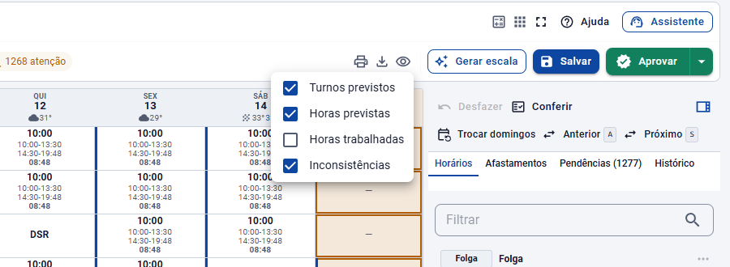

A escolha vale para o seu usuário, em qualquer navegador, e também na tela de Trocas/Afastamentos.

## A janela de regras

**Ajuda › Regras** mostra, numa janela com pesquisa, tudo o que esta escala confere:

- **Da lei: valem sempre**: cada regra da lei com o que ela exige e a fonte, com os números da data do plano (44h ou 42h na semana, 1 ou 2 folgas). A última coluna diz se a regra vale como na lei ou se há regra cadastrada que a muda.
- **Cadastradas em uso nesta escala**: as políticas e regras pessoais que valem para as pessoas da grade, cada uma com o que diz, se é obrigatória ou preferência, a origem, para quem vale, a vigência e a fonte.
- **Tipos que podem ser cadastrados**: os tipos de regra, para que serve cada um e se já estão em uso.

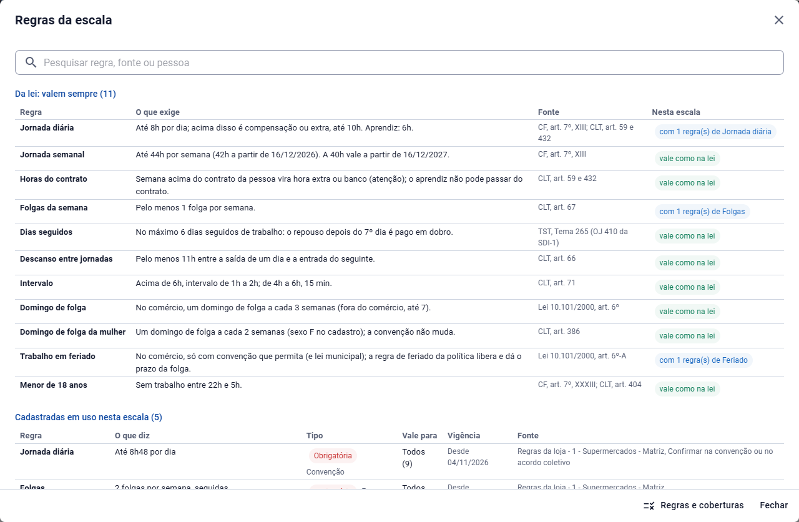

O botão **Regras e coberturas** abre o cadastro numa guia nova. A lista completa, com as fontes, está em [Referência das regras](Referencia-regras.md).

## Relatório de escalas

O **Imprimir** abre o relatório no mesmo desenho do PcPonto (Escalas/Afastamentos): um colaborador por linha, com nome e cargo, um dia por coluna e a coluna de assinatura. Sai em A4 paisagem pelo navegador (também em PDF), com o cabeçalho repetido em cada página, a legenda das siglas, os feriados do período e "Página N de M".

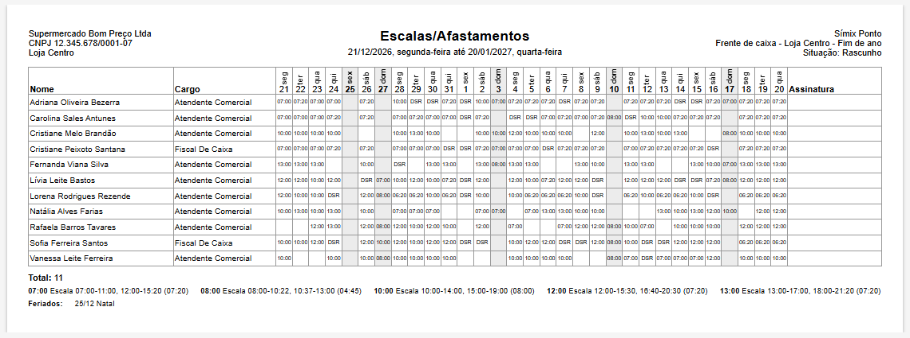

- O cabeçalho traz a razão social e o CNPJ (do estabelecimento, quando o plano é de um só), o período por extenso, o nome do plano e a situação.
- Domingos e feriados ficam destacados; a troca de folga aparece com o dia num círculo.
- Dia reprovado sai com o que vale no cartão, e os dias antes da admissão ou depois da demissão saem como "Inativo".
- **O relatório segue o Exibir da grade**: com turnos previstos, horas previstas ou horas trabalhadas marcados, cada dia sai com essas linhas embaixo da sigla, e a legenda ganha o "Embaixo do dia". Com os turnos, nome, cargo e assinatura estreitam para os dias caberem. As inconsistências não vão para o papel.

## Aprovar

Aprovar grava o planejado no cartão de ponto pela rotina **Manutenção de escala**, em segundo plano, com a tela acompanhando o andamento. Dá para aprovar o mês inteiro ou só as células selecionadas, e a seta ao lado tem o **Reprovar seleção**. Cada colaborador com dias gravados recebe o aviso **Escala aprovada**. Detalhes em [Validação e aprovação](Validacao-e-aprovacao.md) e em [Minha escala](Minha-escala.md).
