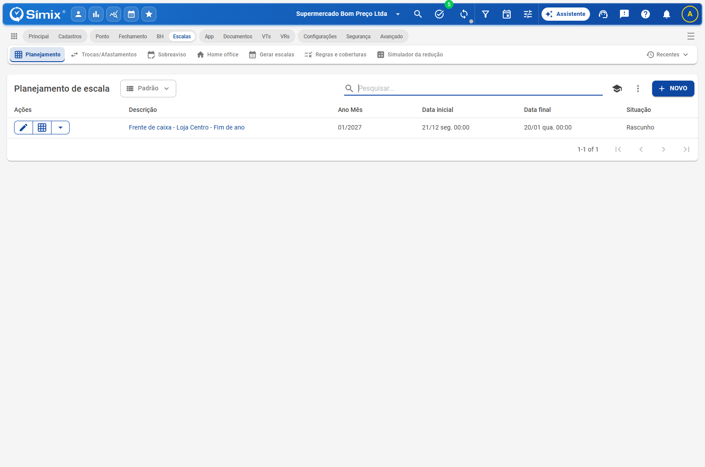
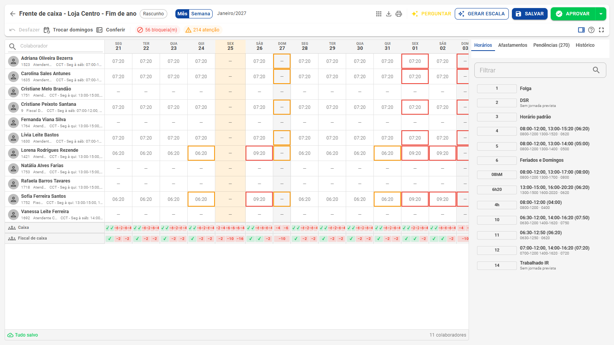
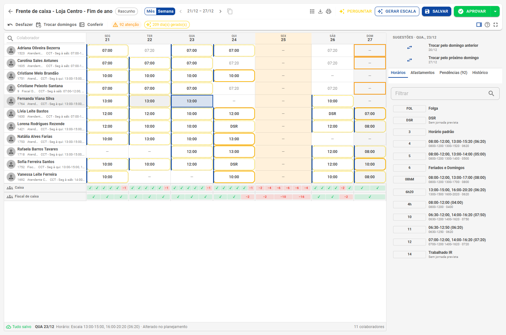
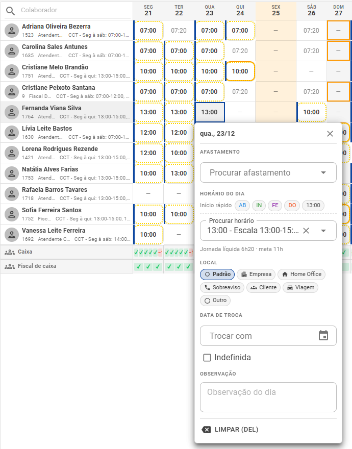
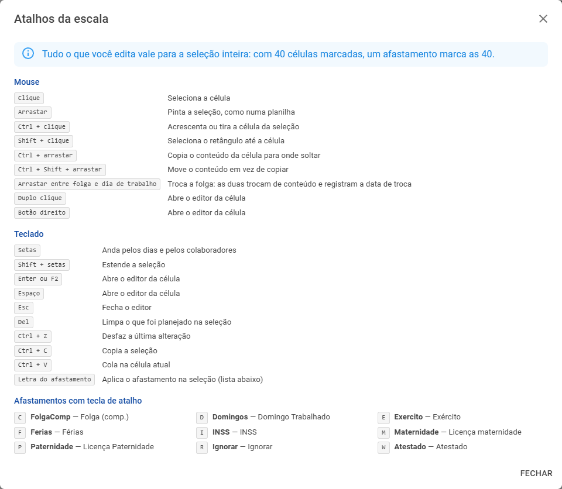
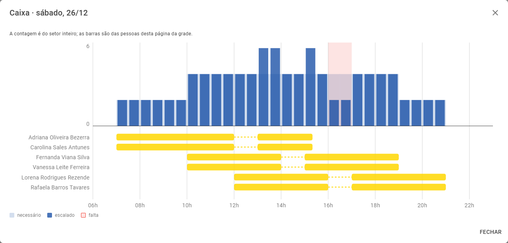
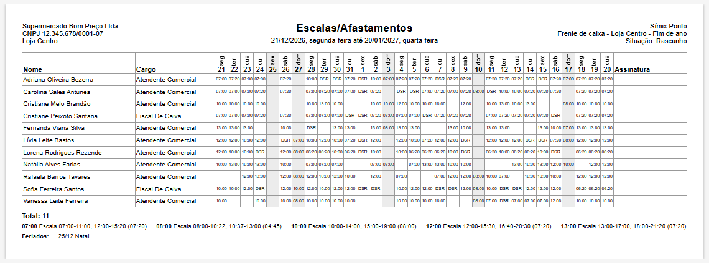

# Planejamento de escala

**Escalas › Planejamento** · Monte a escala do mês numa grade, confira e aprove

O planejamento é o rascunho da escala de um mês para um grupo de colaboradores. Você monta na grade, o sistema confere a lei, a convenção e a cobertura enquanto você edita, e só o que for **aprovado** vai para o cartão de ponto. Voltar à [visão geral](Escalas-inteligentes.md).

## A lista de planejamentos

Cada linha é a escala de um período para um recorte de colaboradores, com a descrição, o mês, as datas e a situação. O botão de grade ao lado do editar abre a escala na mesma guia.

As situações são:

| Situação | O que significa |
|---|---|
| **Rascunho** | Em montagem. Tudo pode ser alterado e nada foi para o cartão |
| **Publicado** | Marcado como divulgado para a equipe. Continua aberto para alteração e ainda não foi para o cartão |
| **Aprovado** | Gravado no cartão de ponto. A grade passa a ser só consulta |

## Criar um planejamento

Clique em **Novo** e preencha:

- **Período**: o mês do cartão de ponto. Ele segue o dia de início do cartão da empresa: quem fecha no dia 20 vê a escala de 21 a 20 do mês seguinte. O botão ao lado alterna para um intervalo de datas livre.
- **Descrição**: como o plano aparece na lista e no topo da grade. Em branco, o sistema escreve uma a partir do mês e dos filtros.
- **Estabelecimento, Departamento e Setor**: quem entra na grade. Os três aceitam mais de uma opção. Prefira um plano por equipe (a frente de caixa, a padaria, o açougue): fica mais fácil de montar e de conferir.
- **Situação**: começa em Rascunho e vira Aprovado sozinha na aprovação.

> O mesmo dia de um colaborador não pode estar em dois planejamentos abertos ao mesmo tempo. O Salvar recusa e diz em qual plano o dia já está.

## A grade

Uma linha por colaborador e uma coluna por dia.

- **Colaborador**: foto, nome, código, cargo e o horário atual. Clicar na foto abre o menu com a manutenção do mês, o cadastro, os anexos e as impressões. A pesquisa fica no próprio cabeçalho *Colaborador* (nome, matrícula, CPF ou PIS).
- **Dias**: o que vem do cartão (o que a pessoa já cumpre) aparece esmaecido; o que foi planejado aparece em destaque. A célula mostra a sigla do horário ou do afastamento, e no canto entram o ícone do local previsto, a observação e a troca de folga.
- **Domingos e feriados** ficam destacados. O feriado nacional aparece no cabeçalho da coluna; o municipal e o estadual aparecem só na célula de quem é daquela cidade, conforme a regra de feriado do horário.
- **Previsão do tempo**: nos próximos 16 dias, o cabeçalho do dia mostra a previsão da cidade do estabelecimento. É só informativa.
- **Rodapé de cobertura**: uma linha por setor, com a cobertura de cada dia (✓ quando atende, −N quando faltam pessoas). Veja [A linha do dia](#a-linha-do-dia).
- **Barra de status**: o que falta salvar, quantas células estão selecionadas, a legenda do dia selecionado (horário, pendências e a origem da alteração) e a navegação entre páginas (100 colaboradores por página).

### Mês ou semana

O grupo **Mês / Semana** da barra troca a visão. Na semana, as setas andam pelo período e o botão de copiar repete a **semana anterior** para as pessoas da página (o Ctrl+Z desfaz).

## Editar como numa planilha

Tudo o que você lança vale para a **seleção inteira**: com 40 células marcadas, um afastamento marca as 40.

- **Selecionar**: clique numa célula, arraste para pintar um bloco, use **Ctrl + clique** para dias soltos e **Shift + clique** para um retângulo. As setas andam pela grade.
- **Aplicar um horário**: clique nele na aba **Horários** do painel lateral.
- **Aplicar um afastamento**: digite a **letra** do afastamento (a tecla de atalho do cadastro) ou clique nele na aba **Afastamentos**.
- **Copiar e mover**: **Ctrl + C / Ctrl + V**, ou arraste com **Ctrl** para copiar e **Ctrl + Shift** para mover.
- **Trocar uma folga**: arraste entre uma folga e um dia de trabalho. Os dois trocam de conteúdo e cada um registra a data do outro (aparece o ícone de troca e o dia trocado num círculo).
- **Limpar e desfazer**: **Del** limpa o que foi planejado; **Ctrl + Z** desfaz a última alteração.

### O editor do dia

Duplo clique, botão direito, **Espaço**, **Enter** ou **F2** abrem o editor do dia.

| Campo | Para que serve |
|---|---|
| **Afastamento** | Férias, atestado, folga compensada… com o campo **Horas** (já vem com as horas padrão do cadastro do afastamento) |
| **Horário do dia** | O horário daquele dia. O **Início rápido** monta o horário com um clique, pelos turnos de referência do setor (Abertura, Intermediário, Fechamento…) e pelas entradas mais usadas. Abaixo aparece a jornada líquida ao lado da meta do contrato |
| **Local** | Padrão, Empresa, Home Office, Sobreaviso, Cliente, Viagem ou Outro |
| **Data de troca** | O dia com que esta folga foi trocada, ou **Indefinida** |
| **Observação** | Um recado para o dia |
| **Limpar (Del)** | Tira o que foi planejado |

O horário criado pelo Início rápido não entra na lista de horários do dia da empresa: ele existe só para as escalas.

### O painel lateral

À direita da grade, com a largura ajustável (arraste a divisória; duplo clique volta ao padrão):

- **Sugestões** para o dia selecionado: trocar pelo domingo anterior ou pelo próximo domingo, inserir o último afastamento e o último horário usados.
- **Horários**: os horários do dia da empresa, com filtro. Um clique aplica na seleção.
- **Afastamentos**: cada um com a sua cor e a sua tecla de atalho.
- **Pendências**: o que a lei e as regras não aceitam. Veja [Validação e aprovação](Validacao-e-aprovacao.md).
- **Histórico**: as alterações do dia selecionado, com o que era, o que passou a ser, quem alterou e quando.

### Atalhos

O botão **?** da barra reúne os atalhos e as teclas dos afastamentos da sua empresa.

| Mouse | Ação |
|---|---|
| Clique | Seleciona a célula |
| Arrastar | Pinta a seleção, como numa planilha |
| Ctrl + clique | Acrescenta ou tira a célula da seleção |
| Shift + clique | Seleciona o retângulo até a célula |
| Ctrl + arrastar | Copia o conteúdo para onde soltar |
| Ctrl + Shift + arrastar | Move o conteúdo em vez de copiar |
| Arrastar entre folga e dia de trabalho | Troca a folga e registra a data de troca |
| Duplo clique ou botão direito | Abre o editor da célula |

| Teclado | Ação |
|---|---|
| Setas / Shift + setas | Anda pela grade / estende a seleção |
| Enter, F2 ou Espaço | Abre o editor da célula |
| Esc | Fecha o editor |
| Del | Limpa o que foi planejado na seleção |
| Ctrl + Z | Desfaz a última alteração |
| Ctrl + C / Ctrl + V | Copia a seleção / cola na célula atual |
| Letra do afastamento | Aplica o afastamento na seleção |

## Salvar

O que foi editado e ainda não gravado fica marcado e a barra de status conta os pendentes. O sistema **salva sozinho a cada minuto**, salva antes de virar a página ou pesquisar e avisa antes de sair da tela com alterações pendentes. O botão **Salvar** grava na hora.

Salvar grava o **planejamento**, não o cartão de ponto: o cartão só muda na aprovação.

## A linha do dia

O rodapé mostra, para cada setor e cada dia, se a escala atende a cobertura cadastrada. Clique no dia para abrir a **linha do dia**: o necessário e o escalado a cada meia hora, a falta em vermelho e a barra de cada pessoa da página, com o intervalo.

A contagem é do setor inteiro; as barras são das pessoas da página. Quando a cobertura do dia vem da [previsão da demanda](Demanda.md), o rodapé marca o dia.

## A barra da grade

| Botão | O que faz |
|---|---|
| **Mês / Semana** | Troca a visão |
| **Atalhos** | Abre as telas relacionadas, por categoria (escala, outros tipos de escala, cadastros) |
| **Exportar** | Leva a escala inteira para o **Excel**, com os turnos de cada dia |
| **Imprimir** | Abre o relatório de escalas numa nova guia (salva antes, se houver pendentes) |
| **Perguntar** | Abre o [Assistente](Assistente.md) na grade |
| **Gerar escala** | Abre o [gerador](Gerador.md) |
| **Salvar** | Grava o planejamento |
| **Aprovar** (e **Reprovar**, na seta) | Leva o planejado para o cartão. Veja [Validação e aprovação](Validacao-e-aprovacao.md) |
| **Desfazer** | Desfaz a última alteração (Ctrl + Z) |
| **Trocar domingos** | Troca os domingos trabalhados. Veja [Trocas e domingos](Trocas-e-domingos.md) |
| **Conferir** | Roda as regras de inconsistência da empresa (Calc) nos dias planejados |
| **Contadores** | Bloqueios e atenções; o chip de dias gerados reabre o resumo do gerador |
| **Painel, ajuda e tela cheia** | Mostra ou esconde o painel lateral, os atalhos e a tela cheia |

## Relatório de escalas

O **Imprimir** abre o relatório no mesmo desenho do PcPonto (Escalas/Afastamentos): um colaborador por linha, com nome e cargo, um dia por coluna e a coluna de assinatura. Sai em A4 paisagem pelo navegador (também em PDF), com o cabeçalho repetido em cada página, a legenda das siglas, os feriados do período e "Página N de M".

- O cabeçalho traz a razão social e o CNPJ (do estabelecimento, quando o plano é de um só), o período por extenso, o nome do plano e a situação.
- Domingos e feriados ficam destacados; a troca de folga aparece com o dia num círculo.
- Dia reprovado sai com o que vale no cartão, e os dias antes da admissão ou depois da demissão saem como "Inativo".

## Aprovar

Aprovar grava o planejado no cartão de ponto pela rotina **Manutenção de escala**, em segundo plano, com a tela acompanhando o andamento. Dá para aprovar o mês inteiro ou só as células selecionadas, e a seta ao lado tem o **Reprovar**. Detalhes em [Validação e aprovação](Validacao-e-aprovacao.md).

## Chegando na próxima atualização

- Teclas **A** e **S** trocam o dia selecionado com o domingo anterior e com o próximo domingo (aparecem ao lado das sugestões do painel e na ajuda).
- Botão **Visão** com a opção **Exibir trabalhado**: as horas trabalhadas de cada dia embaixo do planejado. Já vêm as visões *Padrão* e *Planejado e trabalhado*, guardadas no navegador.
- Barra numa linha só: **Desfazer**, **Trocar domingos** e **Conferir** passam para o topo do painel lateral.
- Digitar no Assistente, nos filtros ou num diálogo com a grade aberta deixa de acionar a tecla de atalho dos afastamentos (as teclas A e S deixam de ser de afastamento).
