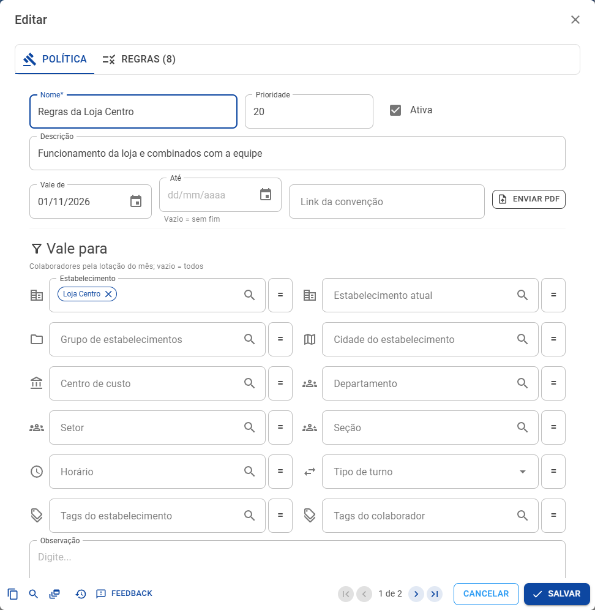
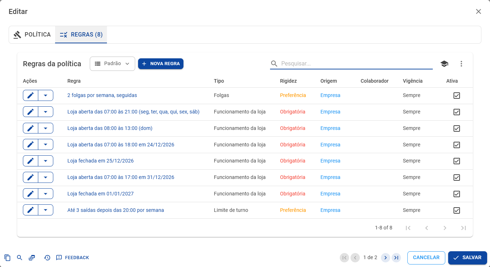
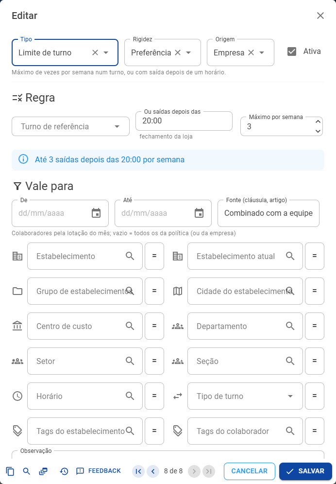
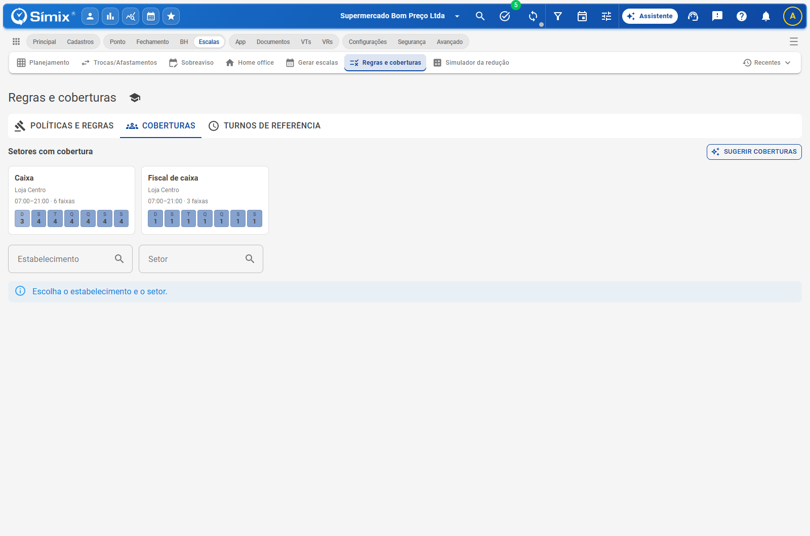
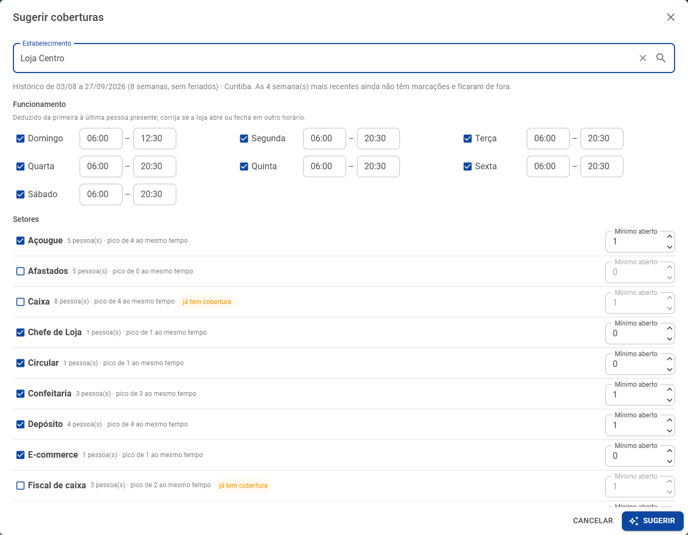
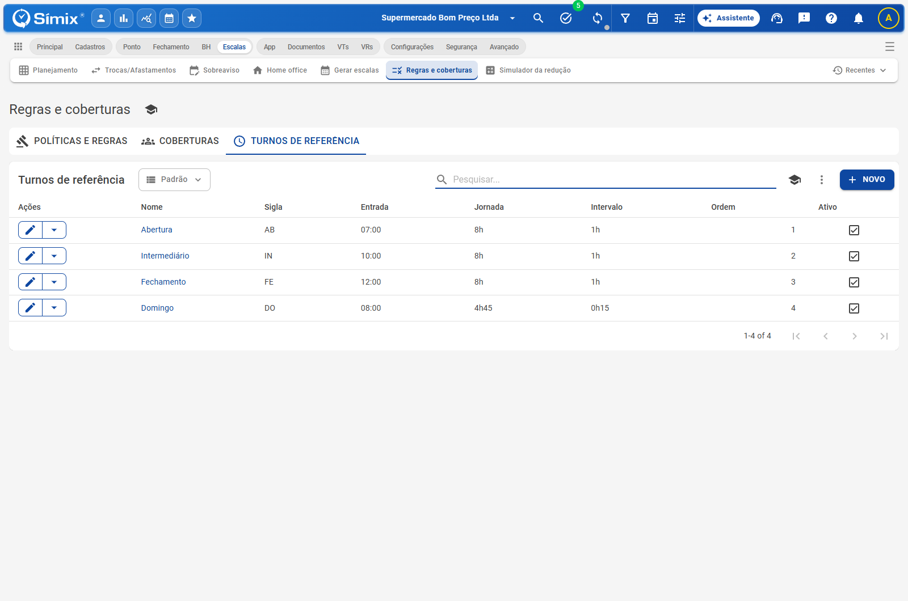

# Regras e coberturas

**Escalas › Regras e coberturas** · O que a escala precisa respeitar e quantas pessoas cada setor precisa

É aqui que a escala aprende as regras do seu negócio. A tela tem três abas: **Políticas e regras**, **Coberturas** e **Turnos de referência**. Tudo o que for cadastrado aqui vale na conferência da grade, no gerador, no Assistente e no simulador. Voltar à [visão geral](Escalas-inteligentes.md).

> As regras da **lei** já vêm prontas e não precisam de cadastro: descanso de 11h, 7º dia seguido, domingos, feriados, intervalos, menores, aprendizes e os limites da EC 141 na data certa. Cadastre aqui o que a **convenção** e a **empresa** acrescentam. A lista completa está em [Referência das regras](Referencia-regras.md).

## Políticas: a convenção e as regras da empresa

Uma **política** é um conjunto de regras com vigência. Normalmente há uma para a convenção coletiva da categoria e outra para os combinados da empresa ou da loja.

| Campo | Para que serve |
|---|---|
| **Nome** e **Descrição** | Como a política aparece nas listas e nas pendências (ex.: *Convenção dos Comerciários 2026/2027*) |
| **Vale para** | Quem segue a política, pela lotação do mês: estabelecimento, grupo ou cidade do estabelecimento, centro de custo, departamento, setor, seção, horário, tipo de turno, tags… Vazio vale para todos |
| **Prioridade** | Quando duas regras do mesmo tipo valem no mesmo dia, vence a da política com prioridade maior |
| **Vale de** e **Até** | De quando a quando a política vale (vazio = sem fim; a convenção costuma ter data de fim) |
| **Link da convenção** e **Enviar PDF** | O texto da convenção, por link ou pelo PDF. Com ele, o [Assistente](Assistente.md) propõe as regras cláusula por cláusula |
| **Ativa** e **Observação** | Liga ou desliga a política inteira; anotações internas |

Na aba **Regras** da política ficam as regras dela, cada uma com a frase que resume o que ela exige.

Abaixo das políticas, a lista **Regras soltas e das pessoas** traz as regras que não pertencem a uma política, como as de um colaborador específico (disponibilidade, turno fixo).

## Regras

Cada regra tem um **tipo**, os **parâmetros** do tipo, a **rigidez** e a **origem**.

### Rigidez: bloqueia ou só pede atenção

| Rigidez | Na grade | No gerador |
|---|---|---|
| **Obrigatória** | Contorno vermelho: impede aprovar sem justificativa | Nunca é quebrada |
| **Preferência** | Contorno ocre: só pede atenção | Respeitada sempre que possível; pode ceder para fechar a cobertura |

### Origem

**Convenção**, **Empresa**, **Assistente** (proposta pelo Assistente e confirmada por você) ou **Colaborador** (um pedido da própria pessoa, como a disponibilidade de quem estuda). Algumas regras só valem por convenção: o sistema recusa, por exemplo, mais de 8 horas por dia com origem Empresa.

### Os tipos de regra

| Tipo | O que exige | Parâmetros |
|---|---|---|
| **Jornada diária** | Limite de horas por dia, em todos ou em alguns dias. Acima de 8h, só com convenção ou acordo coletivo | Máximo (1h a 12h), dias da semana, se vale nos feriados |
| **Jornada semanal** | Limite de horas por semana menor que o da lei | Máximo (até 44h) |
| **Folgas** | Folgas por semana acima da lei, seguidas ou não, ou a média de 2 por semana no mês do regime compensatório (só por convenção) | 1 a 3 por semana, seguidas, média no mês |
| **Domingo de folga** | Domingo de folga a cada tantas semanas (no comércio, no máximo a cada 3) | A cada N semanas, fora do comércio |
| **Feriado** | Se a convenção permite trabalhar no feriado e em quantos dias vem a folga compensatória | Permitido, prazo da folga (1 a 60 dias) |
| **Intervalo** | Intervalo mínimo e máximo das jornadas acima de 6h | Mínimo (abaixo de 1h só por convenção), máximo (acima de 2h só por acordo escrito ou convenção) |
| **Funcionamento da loja** | Abertura e fechamento por dia da semana, ou um dia fechado (Natal, inventário) | Dias da semana **ou** uma data, abertura, fechamento, fechado |
| **Disponibilidade** *(da pessoa)* | Dias e horários em que a pessoa pode trabalhar (estudo, outro emprego) | Dias, entrada a partir de, saída até, indisponível |
| **Turno fixo** *(da pessoa)* | A pessoa sempre no mesmo turno de referência | Turno |
| **Limite de turno** | Máximo de vezes por semana num turno, ou com saída depois de um horário | Turno **ou** saída depois das, máximo por semana (0 a 7) |

### Vale para

Na parte **Vale para** do editor ficam a vigência da regra (**De** e **Até**), a **Fonte** (a cláusula ou o artigo, que aparece em cada pendência) e os filtros de quem segue a regra: estabelecimento, estabelecimento atual, grupo e cidade do estabelecimento, centro de custo, departamento, setor, seção, horário, tipo de turno e tags. Os colaboradores entram pela lotação do mês; vazio vale para todos os da política.

### Exemplos para um supermercado

| Situação | Como cadastrar |
|---|---|
| A loja abre das 7h às 21h de segunda a sábado e das 8h às 13h no domingo | Duas regras de **Funcionamento da loja** |
| Na véspera de Natal a loja fecha às 18h, e no Natal não abre | Funcionamento por **data**: 24/12 das 07:00 às 18:00; 25/12 **fechado** |
| A convenção permite trabalhar no feriado com folga em até 7 dias | **Feriado**: permitido, prazo de 7 dias, origem Convenção, fonte "Cláusula 21ª" |
| Ninguém fecha a loja mais de 3 vezes na semana | **Limite de turno**: saídas depois das 20:00, máximo 3, preferência |
| A operadora que estuda de manhã só entra a partir das 13h | **Disponibilidade** da pessoa: seg a sex, entrada a partir das 13:00 |
| A fiscal da abertura fica sempre na abertura | **Turno fixo** da pessoa: Abertura |

## Coberturas

A cobertura diz **quantas pessoas cada setor precisa** em cada faixa de horário. É o que o rodapé da grade confere, o que o gerador tenta atender e o que o simulador usa como necessário.

Os setores que já têm cobertura aparecem em cards, com o horário coberto, o número de faixas e o máximo de pessoas por dia. Clique no card para abrir a matriz do setor.

- **Faixas**: cada linha é uma faixa de horário (início e fim) e cada coluna, um dia da semana. O número é o **mínimo de pessoas presentes ao mesmo tempo em toda a faixa**, descontando os intervalos. Zero não exige ninguém.
- **+ Faixa** acrescenta uma linha; **Salvar** grava a matriz do setor.
- **Dias específicos**: uma data com exigência própria, como a véspera de Natal ou o inventário.
- **Pessoas por turno**: o mínimo de pessoas num turno de referência.

### Sugerir coberturas

Não sabe por onde começar? **Sugerir coberturas** monta o rascunho de todos os setores de um estabelecimento a partir da presença real:

1. Escolha o estabelecimento. O sistema lê as marcações das **8 últimas semanas** com marcação (sem os feriados) e calcula, por dia da semana e meia hora, quantas pessoas costumam estar presentes.
2. Confira o **funcionamento** deduzido (da primeira à última pessoa presente) e corrija se a loja abre ou fecha em outro horário. Cada setor aparece com o número de pessoas e o pico de presença; os que já têm cobertura vêm marcados.
3. O **Assistente** ajusta o rascunho com o funcionamento, o porte, os picos de movimento e as suas observações (por exemplo: "sexta à tarde tem fila no caixa").
4. Confira a prévia e **aceite setor a setor**. Nada é gravado antes disso.

Sem o Assistente, o rascunho sai só do histórico, em blocos de 2 horas.

## Turnos de referência

Os turnos de referência são os turnos que a operação usa: Abertura, Intermediário, Fechamento, Domingo…

| Campo | Para que serve |
|---|---|
| **Nome**, **Sigla** e **Cor** | Como o turno aparece no Início rápido e nas regras |
| **Entrada** | Horário de entrada (vazio = entrada livre) |
| **Jornada** | Horas do turno (vazio = a meta diária do contrato da pessoa) |
| **Intervalo** e **Intervalo após** | A duração do intervalo e depois de quantos minutos de trabalho ele começa |
| **Horário do dia** | Um horário do dia já cadastrado, quando o turno corresponde a ele |
| **Ordem** e **Ativo** | A ordem no Início rápido; liga ou desliga |
| **Vale para** | Os setores (ou outros filtros) que usam o turno |

Eles alimentam o **Início rápido** do editor do dia, o **gerador** (que monta os dias com esses turnos), as regras de **Turno fixo** e **Limite de turno** e as coberturas de **pessoas por turno**.
