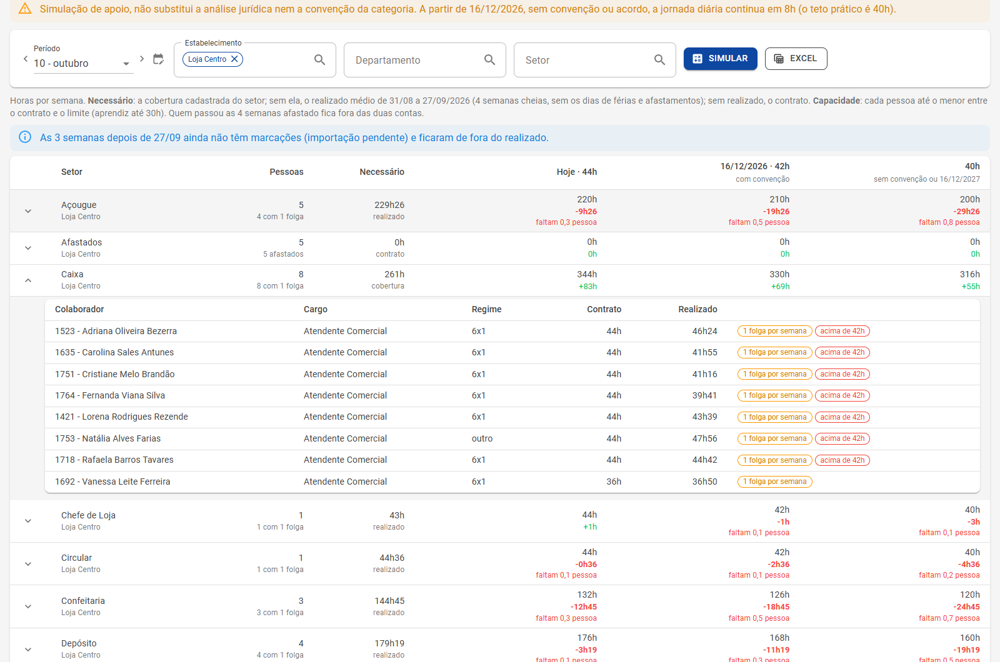

# Simulador da redução de jornada

**Escalas › Simulador da redução** · Quantas pessoas faltam em cada setor com 42 e 40 horas

A EC 141/2026 reduz o limite semanal para **42 horas a partir de 16/12/2026** e **40 horas a partir de 16/12/2027**, sem reduzir salário. O simulador mostra, setor por setor, se o quadro de hoje dá conta da operação nos novos limites, e quanto falta. Voltar à [visão geral](Escalas-inteligentes.md).

## Como usar

1. Escolha o **período** e, se quiser, o **estabelecimento**, o **departamento** e o **setor**.
2. Clique em **Simular**. Cada linha é um setor, com o subtotal do estabelecimento.
3. Abra o setor para ver as **pessoas**: cargo, regime (6x1, 5x2, 4x3, parcial ou outro, pelos dias trabalhados na semana), contrato, horas realizadas e as marcas de quem já tem **1 folga por semana** ou trabalha **acima de 42h**.
4. **Excel** exporta as abas *Setores* e *Pessoas*.

## Como ler cada coluna

| Coluna | O que é |
|---|---|
| **Pessoas** | Quantas pessoas o setor tem e quantas estão com 1 folga por semana (ou afastadas) |
| **Necessário** | As horas por semana que o setor precisa. Vem da **cobertura** cadastrada; sem ela, do **realizado** médio das últimas 4 semanas cheias (sem férias e afastamentos); sem realizado, do **contrato**. Com a [previsão da demanda](Demanda.md), passa a usar a previsão |
| **Hoje · 44h** | As horas que as pessoas cobrem no limite atual, e a sobra (+) ou a falta (−) |
| **16/12/2026 · 42h** | O mesmo com o limite de 42h (que só passa de 8h por dia com convenção) |
| **40h** | O limite sem convenção, ou o definitivo a partir de 16/12/2027 |
| **Faltam N pessoas** | A falta em horas convertida em pessoas |

A capacidade de cada pessoa é o menor entre o contrato e o limite (aprendiz até 30h). Quem passou as 4 semanas afastado fica fora das duas contas.

Abaixo da tabela, o quadro **Valor da hora com o salário mantido** mostra o divisor de hoje e o de 42h e 40h, com o aumento de cada um.

## Vagas pelo gerador

As horas totais nem sempre bastam: o setor pode ter horas sobrando no total e ainda faltar gente no pico de sexta à tarde. Em **Vagas pelo gerador**, escolha o limite (**42h** ou **40h**) e clique em **Calcular vagas**. Para cada setor com cobertura cadastrada, o [gerador](Gerador.md) monta a primeira semana do limite escolhido, primeiro só com a equipe e depois com vagas fictícias no limite da lei, que só entram se cobrirem. O resultado mostra, por setor, a cobertura abaixo do mínimo só com a equipe, o número de **vagas** (e as horas por semana delas) e o que ainda falta com as vagas: é a **menor equipe que fecha a cobertura** com as regras cadastradas. Pede a permissão de editar o planejamento.

## Exemplo no supermercado

Na Loja Centro, o Caixa tem 8 operadoras em 6x1 e precisa de 261h por semana pela cobertura. Em horas, o setor cabe até nas 40h (316h de capacidade). Mesmo assim, nos picos do fim de tarde e do sábado a escala fica no limite, e é isso que as **vagas pelo gerador** e a [linha do dia](Planejamento.md#a-linha-do-dia) mostram.

> **Simulação de apoio.** O simulador não substitui a análise jurídica nem a convenção da categoria. A partir de 16/12/2026, sem convenção ou acordo, a jornada diária continua em 8h, e o teto prático é de 40h.
