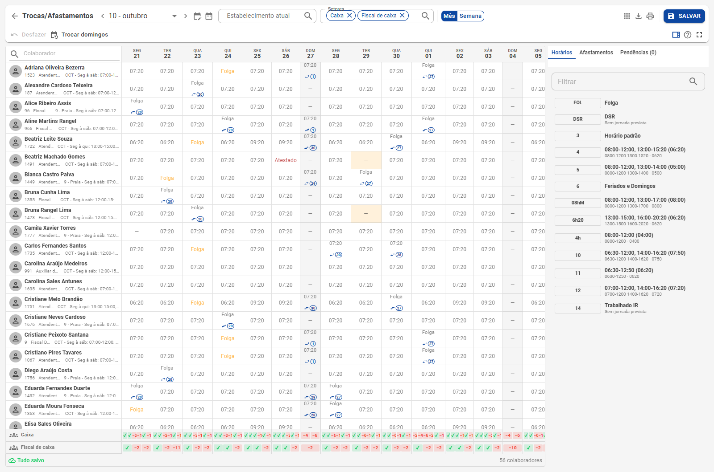
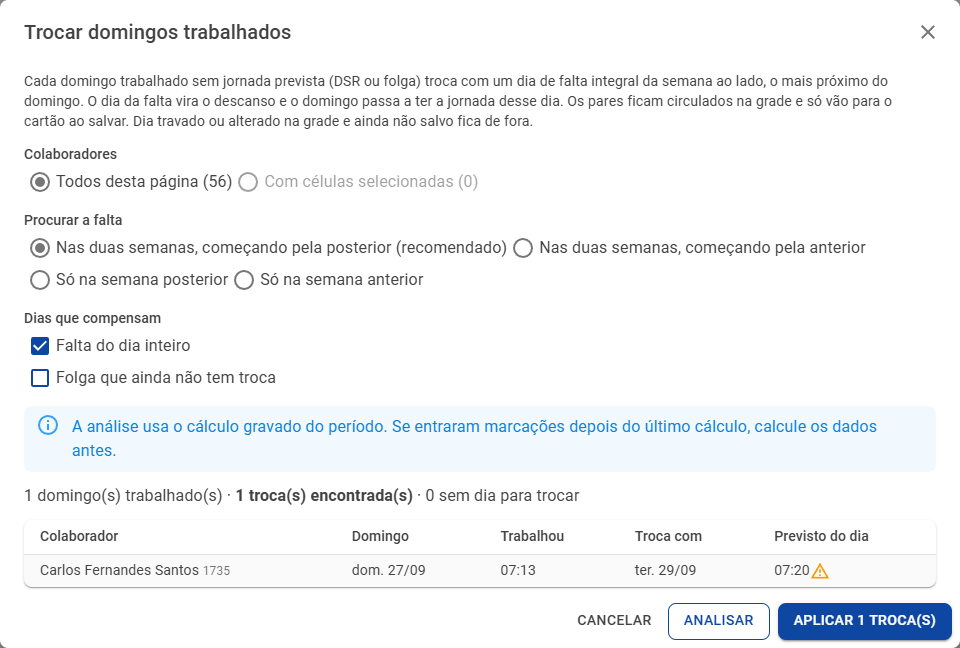

# Trocas, afastamentos e domingos

**Escalas › Trocas/Afastamentos** · A mesma grade do planejamento, gravando direto no cartão

Para o dia a dia, nem sempre é preciso um planejamento: trocar a folga de alguém, lançar um atestado ou compensar o domingo trabalhado. A tela **Trocas/Afastamentos** é a mesma grade da escala, mas o **Salvar grava direto no cartão de ponto**. Voltar à [visão geral](Escalas-inteligentes.md).

## Como é a tela

- **Período**: o mês do cartão, com a opção de **intervalo de datas** (que pode passar do fim do mês).
- **Estabelecimento atual** e **Setores**: filtros sempre visíveis, com vários setores de uma vez. Quando o estabelecimento já vem do filtro global da barra do topo, vale o dele. Os filtros valem também para o Excel e a impressão.
- **Mês / Semana**, **Atalhos**, **Exportar** e **Imprimir**, como no planejamento.
- **Salvar** grava no cartão (o log registra **Manutenção de escala**). Não há Aprovar nem salvamento automático: ao trocar de mês, de página ou sair com alterações, a tela pergunta se grava, descarta ou cancela.
- **Voltar** leva para a tela de onde você veio.
- A tela pede a permissão **Planejamento de escala › Aprovar**, a mesma de quem grava a escala no cartão.

A edição é a mesma do [planejamento](Planejamento.md#editar-como-numa-planilha): seleção com o mouse, teclas dos afastamentos, editor do dia, Ctrl + Z.

## Afastamento com horas

No editor do dia, o afastamento tem o campo **Horas**. Ao escolher um afastamento, ele já vem com as horas padrão do cadastro (ex.: atestado de meio período).

## Troca de folga

Arraste entre uma folga e um dia de trabalho: os dois trocam de conteúdo e cada um registra a data do outro. Na grade e na impressão, o dia trocado aparece num **círculo**, com o ícone de troca, e o texto **Folga** no dia que virou descanso (a legenda explica).

O painel lateral sugere, para o dia selecionado:

- **Trocar pelo domingo anterior** ou **pelo próximo domingo** (fora do domingo);
- **Inserir** o último afastamento e o último horário usados.

## Troca automática de domingos trabalhados

O botão **Trocar domingos** (também na grade do planejamento) compensa os domingos trabalhados de uma vez:

1. Cada **domingo trabalhado sem jornada prevista** (DSR ou folga) troca com um dia de **falta integral** da semana ao lado, o mais próximo do domingo. O dia da falta vira o descanso e o domingo fica com a jornada daquele dia.
2. Escolha **quem**: todos da página ou só os das células selecionadas.
3. Escolha **onde procurar**: nas duas semanas (começando pela posterior, recomendado, ou pela anterior), só na posterior ou só na anterior.
4. Escolha **os dias que compensam**: a falta do dia inteiro e, se quiser, a **folga que ainda não tem troca**.
5. **Analisar** lista os pares encontrados, avisa quando a pessoa trabalhou no domingo **menos** que o previsto do dia trocado e mostra os domingos que ficaram **sem troca**, com o motivo.
6. **Aplicar** coloca as trocas na grade, **circuladas**. Um chip na barra conta as trocas e, clicado, mostra só os colaboradores com troca.

Detalhes que evitam surpresa:

- Dia **travado** pelo gestor, com afastamento, já trocado ou **alterado na grade e ainda não salvo** fica de fora, e a troca procura o próximo.
- O dia para onde outra troca já aponta não é usado de novo.
- Cada troca se desfaz pelo editor da célula (**Desfazer troca do domingo**), e o Ctrl + Z desfaz todas.
- **Nada vai para o cartão antes de salvar** (em Trocas/Afastamentos) ou de aprovar (no planejamento).
- A análise usa o cálculo gravado do período: se entraram marcações depois do último cálculo, calcule os dados antes.

## Ver também

- **Manutenção**: a opção da visão **Ocultar a sigla do turno especial** (ex.: REG) nas marcações da listagem; a sigla continua no dia, no espelho e ao abrir o dia.
- Nas próximas atualizações, as teclas **A** e **S** trocam o dia selecionado com o domingo anterior e com o próximo domingo, e a visão **Planejado e trabalhado** mostra as horas trabalhadas embaixo do planejado.
