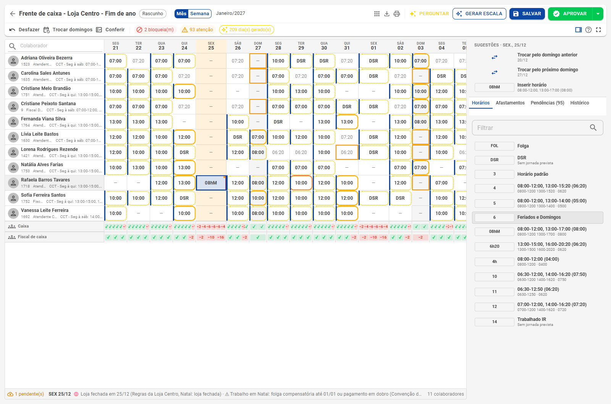
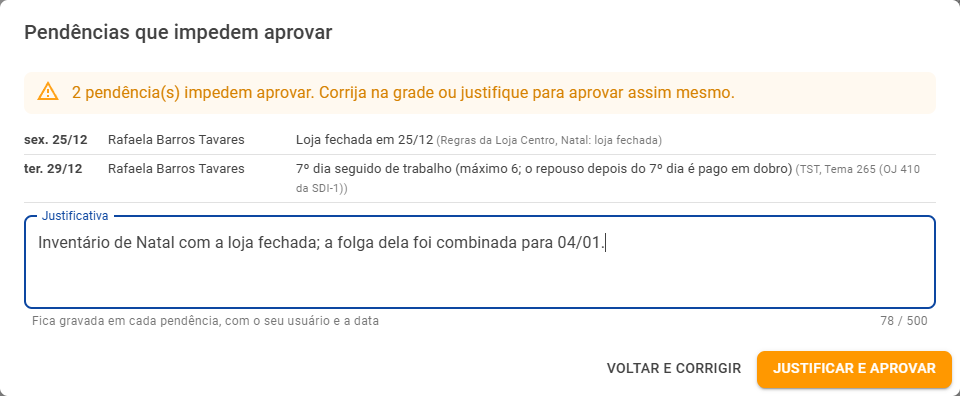

# Validação e aprovação

**A escala que se confere sozinha** · Pendências, justificativa, conferência pela Calc e a aprovação que grava no cartão

Enquanto você monta a escala, a grade confere a lei, a convenção, as regras da empresa e a cobertura. Assim, o problema aparece no planejamento, e não no fechamento do ponto. Voltar à [visão geral](Escalas-inteligentes.md).

## Conferência ao vivo

Cada alteração é conferida na hora, na própria tela, e de novo no servidor ao salvar.

- **Contorno vermelho**: o dia fere a lei ou uma regra obrigatória e **impede aprovar** sem justificativa.
- **Contorno ocre**: o dia só **pede atenção** (uma preferência, um turno fora do horário da loja, horas acima do contrato).
- A **dica** da célula e a **legenda** da barra de status dizem o motivo e a fonte de cada pendência.
- Na barra, os contadores mostram quantos dias **bloqueiam** e quantos pedem **atenção**.

No exemplo, ao escalar uma operadora no dia 25/12, a legenda mostra *"⛔ Loja fechada em 25/12 (Regras da Loja Centro, Natal: loja fechada) · ⚠ Trabalho em Natal: folga compensatória até 01/01 ou pagamento em dobro (Convenção dos Comerciários, Cláusula 21ª)"*.

## A aba Pendências

No painel lateral, a aba **Pendências** lista tudo o que a escala tem, agrupado por colaborador e por dia, com o motivo e a fonte. O clique leva ao dia na grade. No fim vem a **cobertura**: as faixas abaixo do mínimo em cada dia. **Ver todas do plano** mostra as pendências do planejamento inteiro, e não só da página.

## Conferir com a Calc

O botão **Conferir** roda as **regras de inconsistência da sua empresa** (as mesmas da Manutenção do ponto) nos dias planejados, como se a escala já estivesse no cartão, mas **sem gravar nada**. A conferência roda em segundo plano e o que a Calc acusar entra nas pendências como **atenção**, com o nome da regra.

- Regras sobre o **previsto** (como "domingos previstos seguidos") acusam em dias futuros.
- Regras sobre o **realizado** (marcações, horas trabalhadas) só acusam depois que o dia passa.
- Conferir de novo depois de aprovar limpa as pendências da Calc de quem já não tem dia a aprovar.

## Aprovar

**Aprovar** leva o planejado para o **cartão de ponto**. O processamento roda em segundo plano, a tela acompanha o andamento, e cada dia gravado fica no log como **Manutenção de escala**.

- **Sem seleção**, aprova o planejamento inteiro (todas as páginas). **Com células selecionadas**, aprova só elas.
- Na seta ao lado fica o **Reprovar**: a célula reprovada não vai para o cartão e não é reaproveitada por uma aprovação geral. No relatório, o dia reprovado sai com o que vale no cartão.
- Depois de aprovada, a escala passa a ser **só consulta**, e a tela diz isso. Para mudar um dia, use a Manutenção do colaborador, [Trocas/Afastamentos](Trocas-e-domingos.md) ou um novo planejamento para o período.
- Aprovar exige a permissão **Planejamento de escala › Aprovar**.

### Aprovar com bloqueio: a justificativa

Se ainda houver pendência que bloqueia, o Aprovar mostra cada uma e pede uma **justificativa**. Ela fica gravada em cada pendência, com o seu usuário e a data, para a auditoria.

**Voltar e corrigir** fecha a janela sem aprovar; **Justificar e aprovar** grava a justificativa e segue com a aprovação.

## O que acontece no cartão

| Na grade | No cartão de ponto, depois de aprovar |
|---|---|
| Horário do dia | O horário previsto do dia |
| Afastamento (com horas) | O afastamento lançado no dia |
| Local previsto | O local previsto (empresa, home office, sobreaviso…) |
| Data de troca | A troca de folga, com a data do outro dia |
| Observação | A observação do dia |

Depois da aprovação, o cálculo do ponto segue normalmente: horas, extras, faltas e banco de horas passam a considerar a nova escala.
