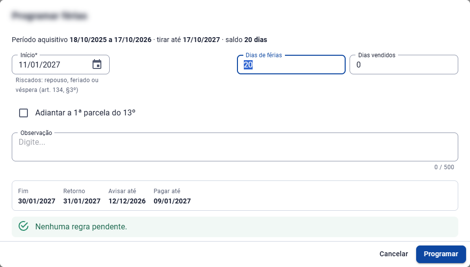
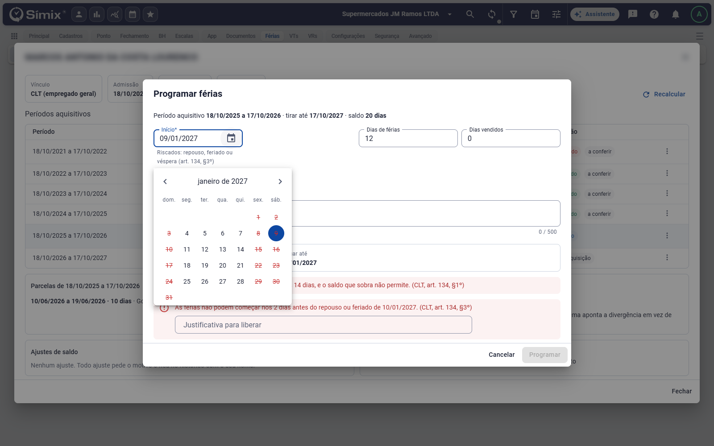
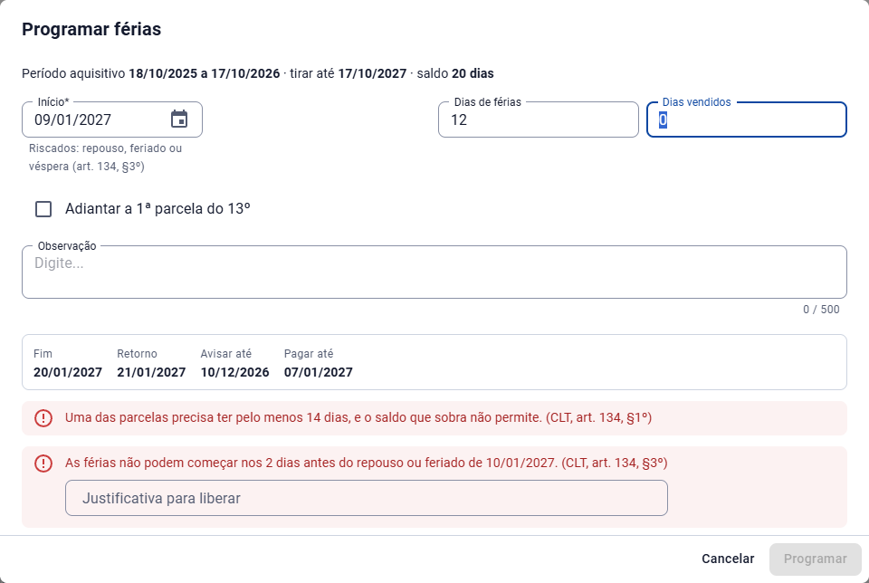

# Programar, remarcar e cancelar férias

**Férias** · O RH programa as férias pela ficha do colaborador. O sistema confere as regras da CLT e da política antes de gravar, e as férias vão para o espelho. Voltar à [visão geral](Visao-geral.md).

Precisa da permissão **Programar férias**.

## Programar

1. No [painel](Painel-e-ficha.md), abra a ficha do colaborador.
2. Escolha o período e use **Programar férias** (no menu **⋮** do período ou no quadro de parcelas).
3. Preencha:
   - **Início**. No calendário, os dias **riscados** são os que não podem ser início: repouso, feriado, os dias antes deles e os dias da semana vetados pela convenção.
   - **Dias de férias** (o padrão é o saldo do período, até 30).
   - **Dias vendidos** (abono pecuniário).
   - **Adiantar a 1ª parcela do 13º**, se for o caso.
   - **Observação**.
4. A cada mudança o sistema mostra **Fim**, **Retorno**, **Avisar até** (30 dias antes do início), **Pagar até** (2 dias antes do início) e, se houver, os dias **em dobro**.
5. Abaixo aparecem as regras: em vermelho o que impede, em amarelo os avisos. Sem nada pendente aparece "Nenhuma regra pendente".
6. **Programar** grava a parcela, leva as férias ao espelho e recalcula o saldo.

No calendário do início, os dias riscados em vermelho não podem ser o início das férias:

> Se o espelho ainda não chega ao mês das férias, aparece "O espelho ainda não chega a esse mês". A parcela fica gravada e a [rotina diária](Rotina-e-avisos.md) leva as férias ao espelho quando o mês entrar no cálculo. Na ficha a parcela mostra "ainda fora do espelho" até lá.

## Regras conferidas

| Regra | O que acontece | Base |
| --- | --- | --- |
| Período sem direito (perdido, encerrado ou zerado) | Impede | |
| Dias acima do saldo do período | Impede | |
| Mais parcelas do que a política permite (até 3; doméstico até 2) | Impede | CLT art. 134, §1º; LC 150 art. 17, §2º |
| Parcela com menos de 5 dias | Impede | CLT art. 134, §1º |
| Nenhuma parcela com 14 dias ou mais, e o saldo que sobra não permite | Impede | CLT art. 134, §1º |
| Sobra de menos de 5 dias para outra parcela | Impede (aviso, se já é a última parcela possível) | CLT art. 134, §1º |
| Venda acima de 1/3 do direito | Impede | CLT art. 143 |
| Venda por estagiário ou intermitente | Impede | |
| Venda depois do prazo do pedido | Aviso: depende de aceite da empresa | CLT art. 143, §1º |
| Início no repouso ou feriado, ou nos 2 dias antes deles | Impede, **liberável** com justificativa | CLT art. 134, §3º |
| Início num dia da semana vetado pela convenção | Impede, **liberável** com justificativa | Convenção |
| Outras férias nos mesmos dias | Impede | |
| Outro afastamento nos mesmos dias | Impede, **liberável**: grava as férias por cima | |
| Início antes de completar o período aquisitivo | Impede; vira aviso se a política permite por convenção | CLT art. 134 |
| Dias depois do "tirar até" | Aviso, com os dias em dobro | CLT art. 137 |
| Aviso com menos de 30 dias | Aviso | CLT art. 135 |
| Início no passado | Aviso: entra como lançamento retroativo | |
| Aprendiz menor de 18 anos | Aviso: as férias devem coincidir com as escolares | CLT art. 136, §2º |
| Limite de ausentes da unidade passado | Aviso ou impede, conforme o limite; o que impede é **liberável** | Política |

**Repouso** é o DSR ou feriado do cartão do colaborador. Em escala 12x36 o padrão da política é contar só domingos e feriados. Para dia que o cálculo ainda não alcança, conta o domingo.

### Liberar uma regra

As regras **liberáveis** mostram o campo **Justificativa para liberar**. Preenchida a justificativa, a regra passa a informativa e o botão Programar libera. A justificativa fica gravada na parcela e no histórico, com o nome de quem liberou.

Liberar a sobreposição com outro afastamento grava a sigla de férias por cima dos dias que tinham o outro afastamento.

## Remarcar

Na parcela futura, **⋮ › Remarcar** abre o mesmo diálogo, já com os dados da parcela. As regras são conferidas de novo. Ao gravar, a sigla de férias sai dos dias que deixaram de ser férias e entra nos novos. O histórico registra "De 05/01/2027, 20 dias para 12/01/2027 a 31/01/2027 (20 dias)".

## Cancelar

Na parcela futura, **⋮ › Cancelar** pede o motivo. Os dias voltam ao saldo e a sigla de férias sai do espelho, **só dos dias em que ela ainda estiver** (um dia alterado à mão na manutenção não é mexido). O cancelamento fica no histórico com o motivo.

## O que vai para o espelho

- Cada dia de férias recebe a sigla definida na [política](Politica.md) (*Afastamento usado no espelho*).
- Os dias vendidos não vão para o espelho.
- Se o mês estiver bloqueado ou outro afastamento tiver sido lançado no meio do caminho, a gravação é recusada com a lista dos dias em conflito e nada é gravado.
