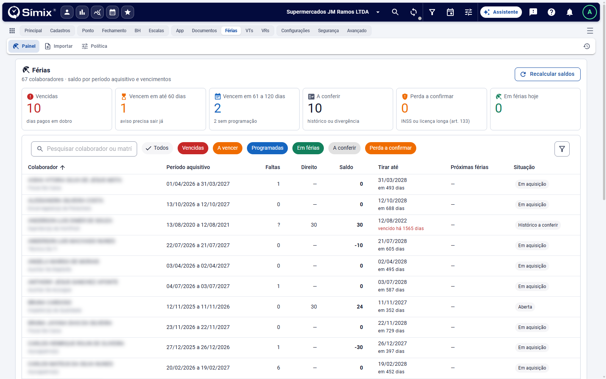

# Férias

**Módulo Férias** · O Símix calcula o saldo de férias de cada colaborador a partir do ponto, avisa o RH antes do vencimento e grava no espelho as férias que o RH programa, conferindo as regras da CLT antes de gravar.

## O que o módulo faz

- **Saldo por período aquisitivo.** Cada ano de trabalho vira um período, com o direito calculado pelas faltas do ponto (art. 130 da CLT), a perda do direito por afastamento longo (art. 133) e o proporcional na saída. Veja [Saldo e períodos](Saldo-e-periodos.md).
- **Painel de vencimentos.** Quem está com férias vencidas, quem vence nos próximos meses, quem está de férias hoje e o que precisa de conferência. Veja [Painel e ficha](Painel-e-ficha.md).
- **Programação pelo RH.** O RH escolhe o início, os dias e a venda; o sistema mostra o fim, o retorno, as datas-limite de aviso e de pagamento e confere a divisão em parcelas, o dia de início, a venda de 1/3 e o limite de ausentes. As férias gravadas vão para o espelho. Veja [Programar férias](Programar.md).
- **Política da empresa.** Sigla usada no espelho, dia de início, faltas, antecipação, avisos e limite de ausentes por unidade. Veja [Política de férias](Politica.md).
- **Importação do histórico.** As férias já lançadas no ponto e o controle que o RH fazia fora do sistema viram o saldo inicial, com conferência antes de gravar. Veja [Importar histórico](Importar-historico.md).
- **Rotina diária.** Toda madrugada os saldos são recalculados, as férias além do mês calculado vão para o espelho quando o mês chega e o RH recebe os avisos de vencimento. Veja [Rotina diária e avisos](Rotina-e-avisos.md).

## Onde fica

No menu **Módulos › Férias**:

| Item | O que tem | Permissão |
| --- | --- | --- |
| Painel | Saldos, vencimentos e quem está de férias; a ficha de cada colaborador | Férias |
| Importar | Adotar as férias já lançadas no ponto ou importar planilha | Ajustar saldo e importar histórico |
| Política | Regras de férias da empresa e limite de ausentes | Férias (ver) e Política de férias (alterar) |

## Antes de ligar

1. **Módulo contratado.** O módulo é ligado por cliente, em *Suporte › Features* (**Módulo de férias**), e vem desligado. Desligado, o grupo some do menu, as telas mostram "Módulo desativado" e a rotina diária não roda para o cliente.
2. **Permissões.** As ações têm permissão própria, no grupo **Férias**:

   | Permissão | Libera |
   | --- | --- |
   | Férias | Ver o painel, a ficha e a política |
   | Programar férias | Programar, remarcar e cancelar parcelas |
   | Ajustar saldo e importar histórico | Ajustar saldo, conferir período, confirmar perda, recalcular todos e importar |
   | Política de férias | Alterar a política e o limite de ausentes |

   A role **DP** recebe as permissões de férias. O modelo **Manutenção** tem a consulta das férias.
3. **Data de admissão no cadastro.** Sem admissão não há como calcular os períodos: a ficha avisa "Sem data de admissão no cadastro".
4. **Vínculo do colaborador.** O vínculo do mês (guia Principal do colaborador) decide as regras: estagiário tem recesso, intermitente não vende, doméstico divide em até 2 parcelas, aprendiz menor de 18 recebe o aviso das férias escolares.
5. **Afastamento de férias com o tipo Férias.** As férias são reconhecidas pelo **tipo** do afastamento, não pela sigla. Confira em *Cadastros › Afastamentos* se a sigla usada para férias tem o tipo Férias, a de INSS o tipo INSS e a de licença remunerada o tipo Licença remunerada.
6. **Importar o histórico.** Feito uma vez, ao ligar o módulo, em *Férias › Importar*. Depois use **Recalcular saldos** no painel.
7. **Revisar a política.** Ela já nasce com o padrão da CLT; ajuste o que a convenção do cliente muda.

## Ajuda dentro do sistema

O botão de treinamentos das telas Painel, Importar e Política abre as demonstrações guiadas de cada uma.

## Em resumo

- O saldo sai do ponto: faltas, INSS e licença remunerada lançados no espelho mudam o direito.
- A perda do direito por afastamento longo é só **sugerida**: o RH confirma.
- Depois da primeira programação o direito do período fica fixado; se o ponto mudar, aparece uma divergência para o RH decidir, em vez de o saldo mudar sozinho.
- Marcação de ponto durante as férias não é bloqueada.
- O módulo não calcula valores (remuneração, terço, INSS, IRRF): isso continua na folha.

Dúvidas comuns em [Perguntas frequentes](Perguntas-frequentes.md).
