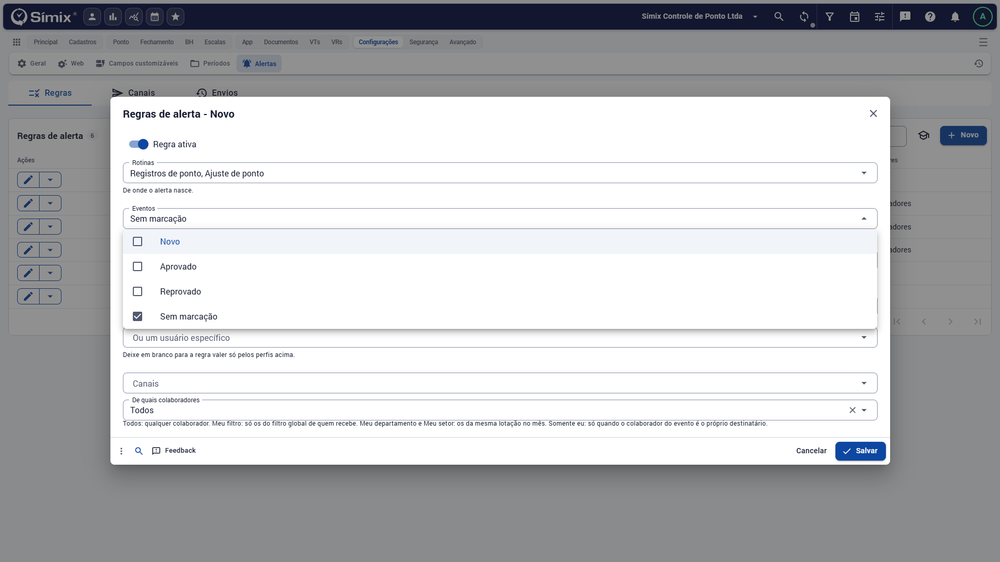
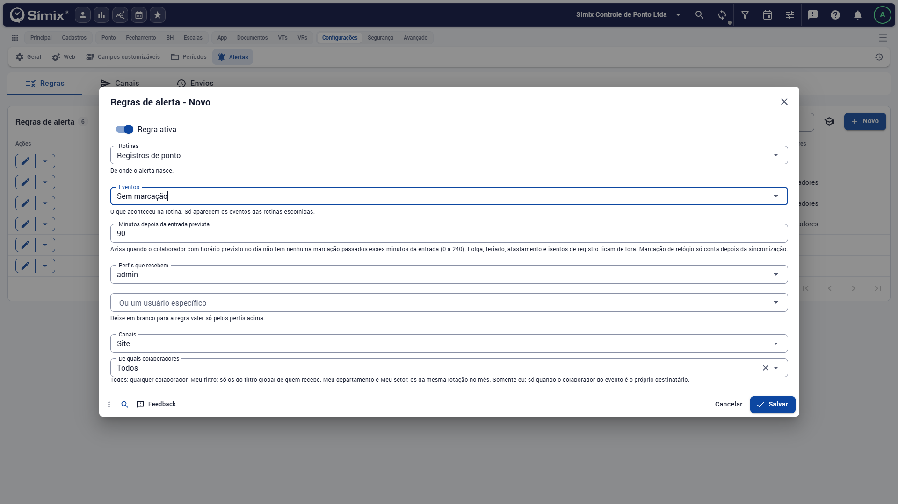
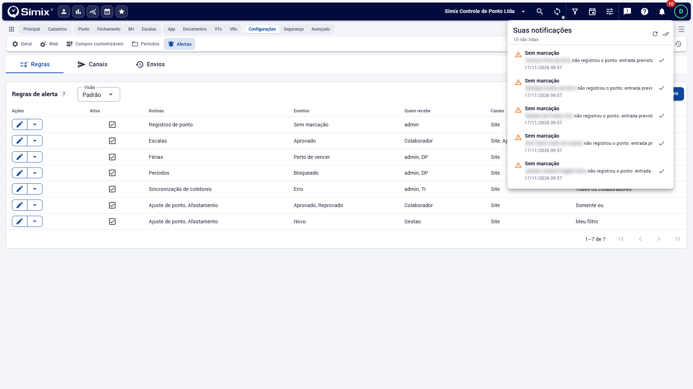
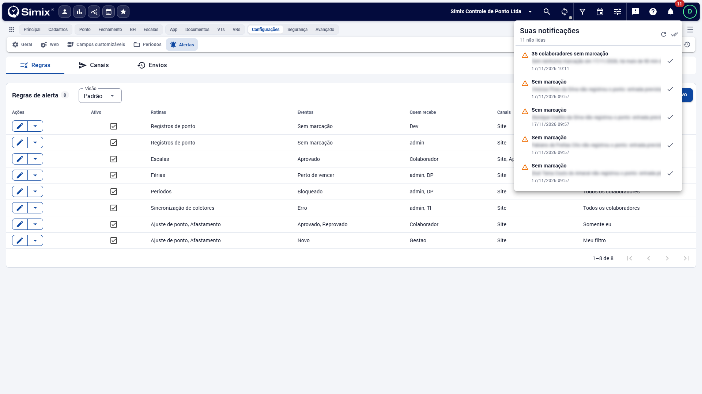

# Alertas e notificações

**Configurações › Alertas** · Regras que avisam o gestor, o RH ou o próprio colaborador quando algo acontece no sistema: uma solicitação nova, um coletor que não sincronizou, um colaborador que não registrou o ponto. O aviso chega no sino, por e-mail ou no aplicativo.

> Os lembretes que o aplicativo mostra ao próprio colaborador antes e depois da hora de marcar ficam em outra tela, **App › Alertas de registro**. Esta página trata dos avisos das regras.

## Como uma regra funciona

Cada regra responde a cinco perguntas:

| Campo | O que define |
| --- | --- |
| **Rotinas** | De onde o alerta nasce (ajuste de ponto, afastamento, registros de ponto…) |
| **Eventos** | O que aconteceu na rotina (novo, aprovado, sem marcação…) |
| **Perfis que recebem** ou **Ou um usuário específico** | Quem recebe o aviso |
| **Canais** | Por onde o aviso chega: Site (sino), E-mail ou Aplicativo |
| **De quais colaboradores** | De quais colaboradores o destinatário é avisado |

Quem causou o evento não recebe o próprio aviso, e quem é atingido por duas regras no mesmo canal recebe uma vez só.

## Rotinas e eventos

A lista de **Eventos** mostra só o que as rotinas escolhidas disparam. Sem rotina escolhida, ela fica desabilitada. Rotina com um evento só já vem com ele marcado.

| Rotina | Eventos |
| --- | --- |
| Ajuste de ponto | Novo, Aprovado, Reprovado |
| Afastamento | Novo, Aprovado, Reprovado |
| Sincronização de coletores | Erro |
| Períodos | Bloqueado |
| Férias | Perto de vencer |
| Uniformes e EPIs | Novo, Enviado, Aprovado, Reprovado, Perto de vencer, Estoque abaixo do mínimo |
| Escalas | Aprovado |
| Registros de ponto | Sem marcação |

## De quais colaboradores

| Opção | Quem o destinatário acompanha |
| --- | --- |
| **Todos** | Qualquer colaborador |
| **Meu filtro** | Só os do filtro global de quem recebe (estabelecimento, departamento, setor…) |
| **Meu departamento** | Os do mesmo departamento de quem recebe, no mês do evento |
| **Meu setor** | Os do mesmo setor de quem recebe, no mês do evento |
| **Somente eu** | Só quando o colaborador do evento é o próprio destinatário (ex.: o colaborador fica sabendo que o pedido dele foi aprovado) |

## Colaborador sem marcação

Avisa o gestor ou o RH quando um colaborador com horário previsto no dia **não tem nenhuma marcação** passados alguns minutos da entrada prevista.

1. Em **Rotinas**, escolha **Registros de ponto**. O evento **Sem marcação** já vem marcado.
2. Em **Minutos depois da entrada prevista**, informe a tolerância (padrão de 15 minutos, até 240).
3. Escolha quem recebe, os canais e de quais colaboradores.

**Como o sistema decide**

- O horário previsto é o do cartão de ponto do dia, já com a escala, o feriado e o afastamento.
- Ficam de fora folga, DSR, feriado, afastamento, demitidos e quem é isento de registro.
- Conta como marcação qualquer registro do dia (relógio, aplicativo ou web) e a marcação lançada direto no cartão.
- Vale a **primeira entrada do dia**. A volta do intervalo não gera aviso.
- A verificação roda a cada 10 minutos. Cada colaborador é avisado **uma vez por dia** em cada regra.
- Passadas 2 horas do limite, aquele dia não é mais avisado. Assim, uma regra criada à tarde não avisa as faltas da manhã.

**Um aviso por colaborador ou um resumo**

- Se na mesma verificação até **3 colaboradores** ficarem sem marcação para quem recebe, chega um aviso para cada: *"Fulano não registrou o ponto: entrada prevista às 08:00 de 17/11/2026, há mais de 15 min."*
- Acima de 3, chega **um aviso só**, por exemplo *"35 colaboradores sem marcação"*, com os primeiros nomes e a entrada prevista de cada um.
- A conta é feita para cada destinatário, depois do recorte em **De quais colaboradores**: o gestor de um setor com 2 faltas recebe 2 avisos, e o RH, que acompanha todos, recebe o resumo.
- Os avisos abrem a **Consulta diária** do dia.

> A marcação feita no relógio só chega ao sistema na sincronização do coletor. Quem bateu o ponto depois da última sincronização pode aparecer como sem marcação.

## Canais

A aba **Canais** mostra os canais do banco e se cada um está pronto:

- **Site**: o sino na barra do topo, em tempo real.
- **E-mail**: o e-mail do cadastro do usuário. Fica *Não configurado* enquanto o servidor de e-mail não estiver configurado.
- **Aplicativo**: o aviso aparece no aplicativo do colaborador, que busca as notificações ao abrir.

## Envios

A aba **Envios** lista cada entrega feita pelas regras, com data, canal, destino e situação (Enviado ou Erro), filtrando por período e situação. É o lugar para conferir se um aviso saiu e por que falhou, por exemplo para um usuário sem e-mail cadastrado.
