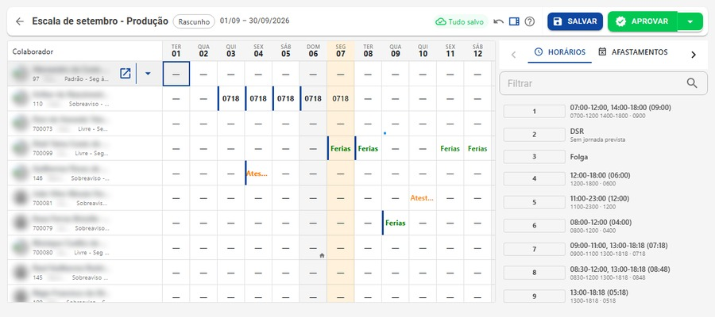

# Escala 5x2 na prática

**Guia prático · RH e DP** — Edição de outubro de 2026

Como a sua empresa sai da 6x1 sem perder o ritmo da operação. Com um capítulo especial para supermercados.

O que a Emenda Constitucional nº 141/2026 muda na jornada, nas escalas, no ponto e na folha de qualquer empresa, com exemplos de cálculo e um plano de ação semana a semana.

## Uma carta da Símix para o seu RH

Todo mês, a gente acompanha de perto a rotina de indústrias, lojas, supermercados, transportadoras e prestadoras de serviço que fecham ponto, montam escalas e respondem às dúvidas das equipes. Por isso sabemos que mudança de jornada não acontece no papel: ela aparece na grade de horários, no relógio de ponto e no holerite.

A nova regra é clara no objetivo, mas deixa muitas decisões nas mãos de cada empresa. Este guia foi escrito para ajudar você a tomar essas decisões com calma, com números na mão e com tempo para conversar com a equipe e com o sindicato.

Conte com a gente nessa travessia. **Time Símix**

## A Emenda 141 em cinco pontos

1. **Dois repousos por semana.** Cada colaborador ganha dois descansos remunerados na semana, que podem ou não ser em sequência.
2. **Teto de 42 horas, depois 40.** 42h semanais a partir de 16/12/2026 e 40h a partir de 16/12/2027.
3. **Salário intacto.** A redução de horas não autoriza nenhum corte de salário ou de piso.
4. **Limite de 8h por dia.** Passar disso na transição só com convenção ou acordo coletivo.
5. **Sindicato no centro.** Cláusulas coletivas que conflitam com a Emenda caem em 16/12/2026, e novas regras dependem de negociação.

## Resumo para a diretoria: o antes e o depois

| Item | Regra até 15/12/2026 | Nova regra |
|---|---|---|
| Limite semanal | 44 horas | 42h a partir de 16/12/2026 e 40h a partir de 16/12/2027 |
| Limite diário | 8 horas | Continua 8h. Na transição, pode subir só com norma coletiva |
| Descanso semanal remunerado | Um dia | Dois dias, que não precisam ser seguidos |
| Salário e piso da categoria | Calculados sobre 44h | Ficam iguais, sem desconto proporcional |
| Convenção coletiva | Vale como está | Cláusulas de jornada e repouso em conflito caem em 16/12/2026 |
| Alta remuneração com diploma | Jornada registrada | Pode ficar fora das regras de jornada e de horas extras |

## Onde o caixa sente: três pressões no custo da empresa

- **+ quadro:** em operações de 6 ou 7 dias, a segunda folga de cada pessoa precisa ser coberta: mais contratações ou mais horas extras.
- **+ DSR:** comissões e prêmios refletem em dois repousos por semana, e não mais em um.
- **+ hora:** o mesmo salário dividido por menos horas deixa cada hora, e cada hora extra, mais cara.

> **Primeira decisão da gestão**
>
> Sua operação precisa das 42 horas na transição? Então procure o sindicato agora, porque só a negociação coletiva permite passar de 8 horas por dia. Se a resposta for não, monte o planejamento como se a regra de 40 horas já valesse em dezembro de 2026.

## Calendário: três datas para marcar na agenda

| Data | Marco | O que acontece |
|---|---|---|
| **16/10/2026** | Promulgação | A Emenda entra na Constituição e começam a correr os prazos. |
| **16/12/2026** | Virada para a 5x2 | Dois repousos semanais e teto de 42 horas em até cinco dias. |
| **16/12/2027** | Regra definitiva | 40 horas por semana e 8 horas por dia, mantidos os dois repousos. |

Há prazos próprios para quem terceiriza mão de obra ao setor público, e pequenos negócios ainda aguardam uma lei específica. Veja [Casos especiais](#casos-especiais).

## Na vida do colaborador: a mesma semana, antes e depois

Exemplo de um colaborador que hoje cumpre 44 horas em escala 6x1.

| Cenário | Seg | Ter | Qua | Qui | Sex | Sáb | Dom | Total |
|---|---|---|---|---|---|---|---|---|
| Hoje (6x1) | 7h20 | 7h20 | 7h20 | 7h20 | 7h20 | 7h20 | DSR | **44h** |
| Dez/2026, sem norma coletiva | 8h | 8h | DSR | 8h | 8h | 8h | DSR | **40h** |
| Dez/2026, com norma coletiva | 8h24 | 8h24 | DSR | 8h24 | 8h24 | 8h24 | DSR | **42h** |
| Dez/2027 em diante | 8h | 8h | DSR | 8h | 8h | 8h | DSR | **40h** |

> **O detalhe que muda o planejamento**
>
> Faça a conta: 5 × 8 = 40. Para usar as 42 horas permitidas na transição, cada dia precisa passar de 8 horas, e isso só vale se o sindicato assinar junto. Se não houver negociação, sua empresa já opera, na prática, com 40 horas em dezembro de 2026.

## Montando a grade: quatro formatos de escala para a nova regra

Não existe um modelo único. A escolha depende de quantos dias a operação funciona e do que a convenção da categoria permite.

### 5x2 fixa — escritórios e administrativo

Trabalho de segunda a sexta, folga sábado e domingo. É a mais simples de gerir e já atende à Emenda.

### 5x2 com folgas alternadas — comércio, serviços e indústria

Cada pessoa folga dois dias diferentes, em rodízio, para a operação funcionar de domingo a domingo. As folgas se concentram nos dias de menor demanda.

### Rodízio de domingos — operações 7 dias

Uma das folgas cai no domingo sempre que possível. A Emenda trata o domingo como preferência, e o comércio já tem regra própria para isso.

### 12x36 — saúde, segurança e portaria

Continua permitida. Já fica na média de 42 horas e vai exigir ajuste de intervalos para chegar a 40 horas.

### Folgas distribuídas no mês, por acordo

Convenção ou acordo coletivo pode permitir que as folgas variem de uma semana para outra, desde que fechem a conta dentro do mesmo mês e que ninguém passe uma semana sem pelo menos uma folga. Veja um exemplo de mês com oito repousos:

| 1ª semana | 2ª semana | 3ª semana | 4ª semana | Total |
|---|---|---|---|---|
| 2 | 1 | 3 | 2 | **8** |

Esse mecanismo ajuda quem não para: comércio, saúde, indústria de processo contínuo, logística e serviços 24 horas.

## Conta de cobertura: quantas pessoas sua operação vai precisar?

Para muitas empresas, é aqui que está a maior parte da conta. Quando cada colaborador passa a trabalhar cinco dias em vez de seis, a mesma operação precisa de mais gente ou de mais horas extras.

**Exemplo:** um setor que funciona 7 dias por semana e precisa de 6 pessoas trabalhando todos os dias.

| Diárias a cobrir | Na 6x1 | Na 5x2 |
|---|---|---|
| 6 × 7 = **42** | 42 ÷ 6 = **7 colaboradores** | 42 ÷ 5 = **8,4 colaboradores** |

Na prática, o setor passa de 7 para 8 ou 9 pessoas, um aumento de cerca de 20% no quadro, ou precisa cobrir a diferença com horas extras.

### Como usar essa conta

- Faça a simulação por unidade, setor e turno, e não para a empresa inteira: cada área tem picos e necessidades diferentes.
- Considere férias, atestados e outros afastamentos, que já reduzem a cobertura hoje.
- Compare o custo de contratar com o custo de horas extras recorrentes, que ficarão mais caras (veja [Folha de pagamento](#folha-de-pagamento-as-contas-que-mudam-no-holerite)).

## Negociação coletiva: o que só o sindicato pode destravar

| Tema | Para quê |
|---|---|
| Dias acima de 8h | Para usar as 42h na transição. |
| Folgas no mês | Distribuição flexível dos repousos. |
| Escala diferente da 5x2 | Regime compensatório excepcional. |
| DSR de comissões | Regra de cálculo da categoria. |

Lembre que, em 16/12/2026, cláusulas de convenções e acordos sobre jornada e repouso que conflitem com a Emenda deixam de valer sozinhas. Revise a convenção da categoria agora.

## Folha de pagamento: as contas que mudam no holerite

O salário mensal continua o mesmo. O que muda é o valor de cada hora, porque ele passa a ser dividido por menos horas.

**Exemplo com salário de R$ 2.500,00**

| Período | Divisor | Valor da hora | Hora extra (50%) |
|---|---|---|---|
| Até 15/12/2026 (44h) | 220 | R$ 11,36 | R$ 17,05 |
| Transição (42h) | 210 | R$ 11,90 | R$ 17,86 |
| A partir de 16/12/2027 (40h) | 200 | R$ 12,50 | R$ 18,75 |

Os divisores 210 e 200 seguem a mesma lógica usada hoje para chegar ao 220. Existe um entendimento alternativo, minoritário, que levaria a divisores maiores e a uma hora mais barata. Enquanto não houver definição, o caminho mais seguro é adotar 210 e 200.

### Comissões e salário variável

Com dois repousos por semana, o reflexo das comissões no DSR fica maior. Quanto maior, depende da fórmula definida na convenção da categoria, por isso vale simular a folha dos comissionistas antes de dezembro.

### Faltas sem justificativa: atenção a um ponto em aberto

**Como é hoje:** pela Lei 605/1949, quem falta sem justificativa na semana perde o dia não trabalhado e a remuneração do repouso daquela semana.

**O que ainda não está definido:** com dois repousos, há quem defenda que a falta faz perder os dois, o que somaria o desconto de três dias. Mas a lei não diz se a perda é de um ou dos dois repousos, e esse ponto deve ser resolvido por regulamentação ou pelos tribunais. Antes de aplicar qualquer desconto maior, valide o procedimento com a assessoria jurídica.

## Casos especiais

### Jornadas de 40h ou menos

Quem já tem carga contratada igual ou menor que 40 horas não terá redução. O que muda é a garantia dos dois repousos.

### Escala 12x36

Segue valendo e não é afetada pelos dois repousos. Em duas semanas soma 84 horas, média de 42. Para chegar a 40, será preciso ajustar intervalos, o que pode ser feito individualmente.

### Alta remuneração com diploma

Empregados com nível superior e salário a partir de 2,5 vezes o teto do INSS ficam fora das regras de duração da jornada e de horas extras. Os dois repousos continuam garantidos.

### Contratos com o poder público

Para quem presta serviço com mão de obra dedicada, a redução depende de aditivo de reequilíbrio, com prazo máximo de 12 meses. Faça o pedido ao órgão contratante desde já.

### MEI, micro e pequenas empresas

Uma lei complementar ainda pode criar medidas de transição, ligadas à manutenção de empregos. Enquanto ela não existir, planeje com a regra geral.

### Trabalho no dia de repouso

O repouso não pode ser trocado por dinheiro. Se o colaborador trabalhar no dia de folga sem compensação, o pagamento é em dobro, como já acontece hoje.

## Capítulo especial: supermercados

### Por que a conta é diferente no supermercado

O supermercado reúne tudo o que torna a 5x2 desafiadora: loja aberta sete dias, picos concentrados no fim de semana, muitos setores com rotinas próprias e um quadro grande de colaboradores em 6x1.

| Setor | Desafio |
|---|---|
| Frente de caixa | Folgas fora de sexta, sábado e domingo e reforço nos horários de pico. |
| Reposição e depósito | Turnos de abertura e de recebimento de mercadoria precisam de cobertura fixa. |
| Açougue, padaria e hortifrúti | Produção diária e equipes especializadas, difíceis de substituir de uma hora para outra. |
| Prevenção e portaria | Costumam usar 12x36, que segue válida com ajuste de intervalos. |

### Domingos e feriados no comércio

- O trabalho aos domingos no comércio segue autorizado pela Lei 10.101/2000, respeitada a legislação municipal.
- A mesma lei exige que o repouso caia no domingo pelo menos uma vez a cada três semanas. Com a Emenda, o domingo continua sendo o dia preferencial de folga.
- Abrir em feriados depende de autorização em convenção coletiva e da lei do município.

### Boas práticas para a escala da loja

1. Concentre as folgas de segunda a quarta, quando o movimento costuma ser menor.
2. Escale por curva de movimento, hora a hora, e não só por dia.
3. Use o banco de folgas no mês, se a convenção permitir, para reforçar semanas de pagamento.
4. Planeje dezembro com antecedência: a virada da regra coincide com o maior pico do ano.

> **O que diz o setor**
>
> A Associação Brasileira de Supermercados apoia a adoção da 5x2, mas defende modelos de contratação mais flexíveis. Em maio de 2026, a entidade apontava mais de 300 mil vagas abertas em supermercados no país, o que torna o recrutamento um ponto crítico do plano.

## A Símix ao seu lado: escalas 5x2 montadas em poucos cliques

A maior parte do trabalho da transição está em redesenhar escalas. Na Símix, o RH e o DP montam a escala do mês por setor, enxergam cada colaborador dia a dia e aprovam tudo com segurança.

*Tela de criação de escalas na Símix: escala mensal do setor de Produção, com horários, DSR, folgas e afastamentos lado a lado.*

- **Escala do mês por setor:** cada colaborador em uma linha e cada dia em uma coluna. Fica fácil conferir se todos têm dois repousos na semana.
- **DSR e Folga separados:** DSR e Folga são horários próprios. Assim, você distingue o repouso remunerado das demais folgas da escala.
- **Biblioteca de horários:** cadastre jornadas com intervalos e carga diária, como 07:00 a 12:00 e 14:00 a 18:00 (09:00), e aplique na grade.
- **Afastamentos na mesma tela:** férias e atestados aparecem na escala, o que evita lacunas de cobertura no setor.
- **Rascunho, salvar e aprovar:** monte a escala como rascunho, ajuste com calma e aprove quando estiver pronta. Tudo é salvo automaticamente.
- **Domingos em destaque:** os domingos ficam sinalizados na grade, ajudando a distribuir o repouso preferencial ao longo do mês.

### Montando a escala 5x2 na Símix, em 4 passos

1. Cadastre os novos horários de até 8h diárias (ou o que a norma coletiva permitir).
2. Abra a escala do mês do setor.
3. Distribua dois DSRs por semana para cada colaborador, priorizando domingos.
4. Revise afastamentos e cobertura e aprove a escala.

## Plano de ação: oito semanas até a virada

Um roteiro para chegar a 16 de dezembro com escalas aprovadas, sistemas ajustados e equipe informada.

| Semana | Etapa | O que fazer |
|---|---|---|
| 26/10 a 01/11 | Raio-x do quadro | Liste quem está em 6x1, quem passa de 40h, comissionistas, 12x36 e casos de alta remuneração. |
| 02/11 a 08/11 | Leitura da convenção | Marque as cláusulas que vão cair e abra conversa com o sindicato. |
| 09/11 a 15/11 | Simulação de custos | Cobertura por setor, contratações, horas extras, DSR e novo valor da hora. |
| 16/11 a 22/11 | Decisão de modelo | Escolha o formato de escala de cada setor e aprove o plano de contratação. |
| 23/11 a 29/11 | Escalas de dezembro | Cadastre os novos horários e monte as escalas como rascunho no sistema de ponto. |
| 30/11 a 06/12 | Ponto e folha | Ajuste limites semanais, repousos, divisores e regras de DSR. Prepare os aditivos. |
| 07/12 a 13/12 | Comunicação | Converse com as equipes, assine os aditivos e aprove as escalas. |
| 14/12 a 18/12 | Virada | Acompanhe as primeiras marcações e corrija divergências logo na primeira semana. |

### Depois da virada, até dezembro de 2027

- Conferir os primeiros fechamentos de ponto e de folha no novo modelo.
- Acompanhar decreto de regulamentação, novas convenções e decisões dos tribunais.
- Preparar a passagem para 40 horas e para o divisor 200.

## Perguntas do dia a dia

### Posso reduzir o salário junto com as horas?

Não. A Emenda proíbe a redução, e o piso da categoria continua valendo integralmente.

### Quem já cumpre 40 horas ou menos muda?

A carga contratada fica igual. O que muda é a garantia dos dois repousos na semana.

### A empresa escolhe os dias de folga?

Sim. A organização da escala continua sendo da empresa, desde que respeite os dois repousos, a preferência pelo domingo e a norma coletiva.

### Os dois repousos precisam ser seguidos?

Não. Eles podem cair em dias separados da semana.

### Faltar um dia desconta três?

Ainda não há resposta definitiva. A lei fala na perda do repouso da semana, mas não diz se, com dois repousos, a perda é de um ou dos dois. Valide com o jurídico antes de aplicar.

### Posso pagar hora extra no lugar da segunda folga?

Não. O repouso é um direito. Trabalho no dia de folga sem compensação gera pagamento em dobro.

### O banco de horas acaba?

Não. O que perde sentido é a compensação semanal do sábado, porque esse dia útil deixa de existir.

### Preciso mudar tudo agora?

Não. Planeje desde já, mas implante nas datas previstas, de forma organizada.

> **Aviso.** Este guia tem finalidade informativa e reflete a Emenda Constitucional nº 141/2026 e o que se sabia publicamente em outubro de 2026. Temas como divisor da hora, desconto por faltas e cláusulas de contratos individuais ainda estão abertos e podem ser alterados por decreto, lei ou jurisprudência. Antes de decidir, leve a realidade da sua empresa para o DP e para o jurídico de confiança.