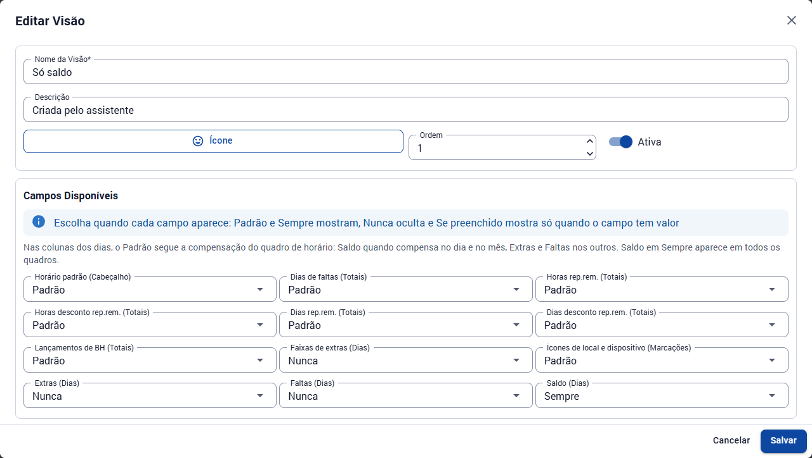
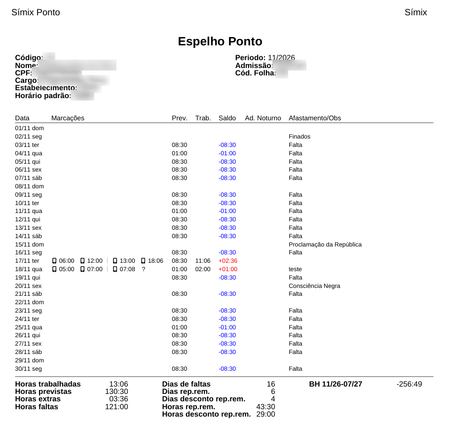

# Colunas do espelho de ponto

**Espelho do ponto › Gerar** · A visão do espelho escolhe o que sai no PDF: as colunas dos dias, o horário padrão no cabeçalho e alguns totais do rodapé. Ela vale para os espelhos gerados com ela; os que já foram gerados não mudam.

## O que cada dia mostra

Todo dia traz **Data**, **Marcações**, **Prev.** (horas previstas) e **Trab.** (horas trabalhadas). As colunas de horas que vêm depois dependem da compensação do [quadro de horário](../Cadastros/Horarios.md):

| Compensação do quadro de horário | Colunas de horas do dia |
| --- | --- |
| Sem compensação ou compensação no dia | **Faltas** e **Extras** |
| Compensação no dia e mês (banco de horas) | **Saldo** |

Depois vêm **Ad. Noturno** e **Afastamento/Obs**. Os totais do mês ficam no rodapé.

## Escolher as colunas pela visão

1. Em **Espelho do ponto**, clique em **Gerar**.
2. No diálogo, o botão do olho (**Visualizar / Gerenciar Visões do Espelho**) lista as visões. Crie uma em **Criar Novo Modo** ou edite uma das que já existem.
3. Em cada campo, escolha **Padrão**, **Sempre**, **Nunca** ou **Se preenchido** e salve.
4. Marque a visão, clique em **Aplicar** e depois em **Gerar**.

O espelho não guarda a visão: escolha-a cada vez que for gerar.

| Campo | O que faz |
| --- | --- |
| **Horário padrão (Cabeçalho)** | Em Nunca, o cabeçalho sai sem o horário padrão do colaborador |
| **Dias de faltas**, **Horas rep.rem.**, **Horas desconto rep.rem.**, **Dias rep.rem.**, **Dias desconto rep.rem.** e **Lançamentos de BH** (Totais) | Em Nunca, o total sai do rodapé; em Se preenchido, aparece só quando tem valor |
| **Faixas de extras (Dias)** | Marcado, a coluna Extras vira uma coluna por percentual (Ext. 50%, Ext. 100%…) |
| **Ícones de local e dispositivo (Marcações)** | Em Nunca, as marcações saem sem os ícones |
| **Extras (Dias)** e **Faltas (Dias)** | Em Nunca, a coluna sai do espelho |
| **Saldo (Dias)** | Em Sempre, a coluna Saldo aparece em qualquer compensação; em Nunca, sai do espelho |

Nas colunas dos dias, **Padrão** segue a compensação do quadro de horário (tabela acima) e **Se preenchido** vale como Padrão. Os outros totais do rodapé, como horas extras e horas de faltas, são do layout de totais do quadro de horário, que vale também na Manutenção (pelo Assistente: "tire o repouso remunerado dos totais").

## Exemplo: só a coluna Saldo

Numa empresa que compensa no dia, o espelho mostra Faltas e Extras. Para mostrar só o saldo de cada dia, crie a visão com **Extras (Dias)** e **Faltas (Dias)** em **Nunca** e **Saldo (Dias)** em **Sempre**. O espelho gerado com ela sai assim:

## Pelo Assistente

Peça, por exemplo, "No espelho, mostre só a coluna Saldo, sem Extras e Faltas". O Assistente monta a visão e mostra o cartão para você confirmar; nada é gravado antes. A visão fica disponível para todos os usuários e é escolhida no botão do olho ao gerar o espelho. Criar visões do espelho pede a permissão de editar a **Manutenção do ponto e registros**.

<!--Palavras-chave: espelho de ponto, colunas do espelho, coluna saldo, saldo no espelho, esconder extras, esconder faltas, visão do espelho, compensação no dia-->
