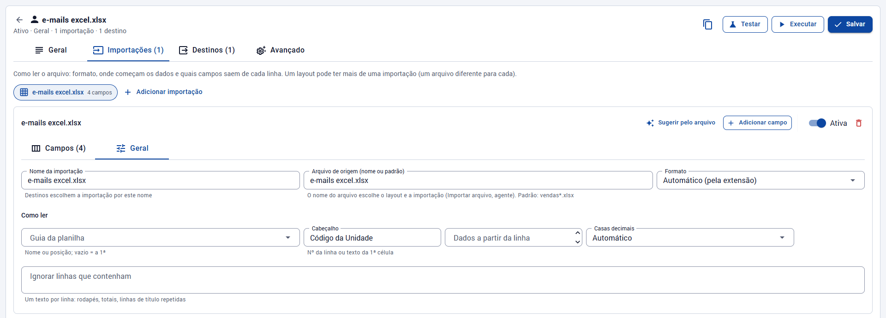
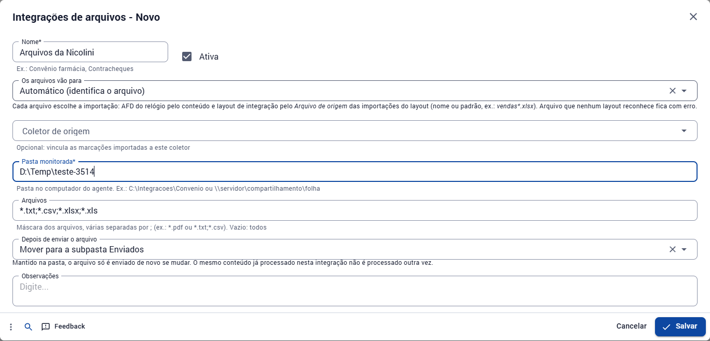
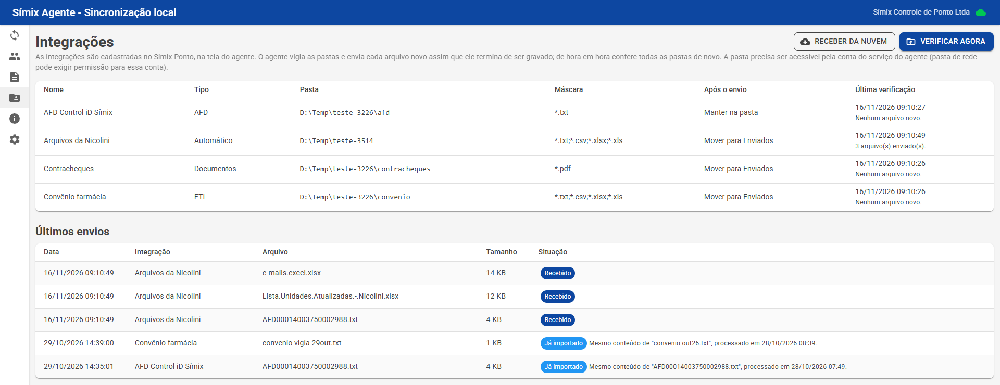
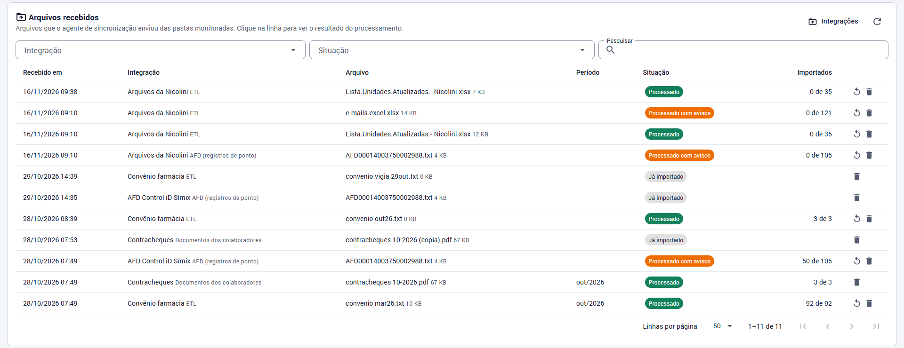
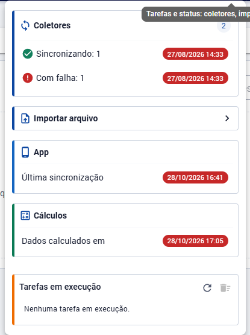
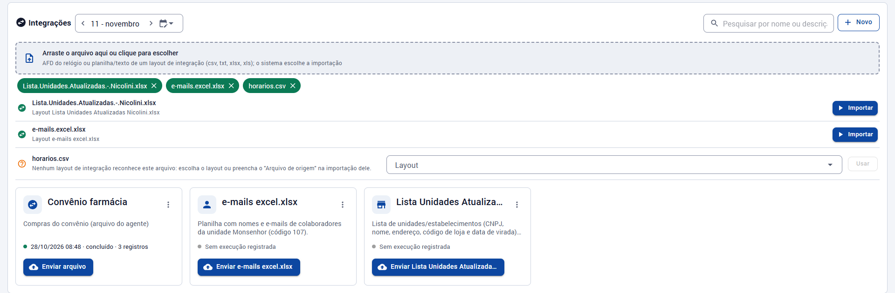

# Arquivos pelo Agente

**Integrações › Arquivos pelo Agente** · Envie para o Símix Ponto, sem abrir o sistema, os arquivos que o RH ou o ERP salvam numa pasta

O **Símix Agente**, o programa de sincronização instalado num computador da empresa, também vigia pastas. Cada arquivo novo ou alterado que cai numa pasta monitorada é enviado à nuvem e importado sozinho: o AFD do relógio, as planilhas e os textos dos layouts de integração e os PDFs de contracheque.

Use quando o arquivo chega sempre do mesmo jeito: a planilha de unidades que o financeiro atualiza, a lista de e-mails do RH, o quadro de horários, o AFD que o relógio grava na rede.

Quando o outro sistema guarda os dados num banco de dados da rede da empresa, o agente pode consultar o banco direto, sem ninguém exportar arquivo: veja [Banco de dados pelo Agente](Banco-de-dados.md).

## Como funciona

1. Você cadastra a **integração** no Símix Ponto: a pasta, quais arquivos pegar e para onde eles vão.
2. O agente confere a pasta a cada minuto. Ele espera o arquivo terminar de ser gravado e o envia à nuvem.
3. A nuvem importa o arquivo com as mesmas regras da tela e guarda o resultado em **Arquivos recebidos**.
4. Depois de enviar, o agente move o arquivo para a subpasta **Enviados**, ou o mantém ou exclui, conforme o cadastro.

O mesmo conteúdo já processado na integração não é importado de novo. Se o arquivo for **alterado** e salvo outra vez na pasta, ele é enviado e importado de novo.

## O que você precisa

- O **Símix Agente** instalado e conectado. Ele aparece no painel de coletores (botão de sincronização da barra do topo › **Coletores**), em **Agente**.
- Uma pasta que a conta do serviço do agente consiga ler. Pasta de rede pode exigir liberar o acesso para essa conta.
- Para planilhas e textos, um **layout de integração** que leia o arquivo, em **Fechamento › Integrações**.

## Passo 1: preparar o layout (planilhas e textos)

No layout, abra **Importações**, a importação e a guia **Geral**. O campo **Arquivo de origem** diz quais arquivos o layout lê:

- o **nome** do arquivo, como `e-mails excel.xlsx`. Acento, maiúsculas, espaços e pontuação não contam: `e-mails.excel.xlsx`, o nome que o arquivo ganha ao ser baixado do e-mail, também serve. Mês e loja no nome também não contam: `vendas 10-2026.xlsx` casa com `vendas.xlsx`;
- ou um **padrão** com `*`, como `vendas*.xlsx`. Separe vários com `;`.

O layout criado pelo assistente de **Novo layout** já vem com o arquivo de origem preenchido pelo arquivo de exemplo.

Confira o layout com o **Testar** antes de ligar a pasta: o agente grava de verdade. Na guia **Destinos**, a **Estratégia** diz o que o arquivo pode fazer:

| Estratégia | O que acontece |
|---|---|
| **Inserir ou atualizar** | Cria o que não existe e atualiza o que já existe |
| **Inserir** | Só cria |
| **Atualizar** | Só atualiza. O que não for encontrado fica de fora, sem erro. Use quando a planilha só completa cadastros, como a de e-mails |

## Passo 2: cadastrar a integração

No painel de coletores, abra **Agente** e, em **Integrações de arquivos**, clique em **Configurar** (ou abra `/agente/integracoes`). Clique em **Novo**:

- **Os arquivos vão para**:
  - **Automático**: cada arquivo escolhe a importação. O AFD do relógio é reconhecido pelo conteúdo e as planilhas e textos pelo **Arquivo de origem** dos layouts. Uma pasta só serve para vários layouts. O arquivo que nenhum layout reconhece fica com erro em Arquivos recebidos.
  - **ETL**: todos os arquivos da pasta vão para o layout escolhido.
  - **Documentos dos colaboradores**: PDFs de contracheque, um documento para cada colaborador. O período sai do nome do arquivo (`holerite 03-2026.pdf`).
  - **AFD**: marcações do relógio, com o coletor de origem opcional.
- **Pasta monitorada**: o caminho no computador do agente, como `C:\Integracoes\Nicolini` ou `\\servidor\rh\integracoes`.
- **Arquivos**: as máscaras dos arquivos, como `*.xlsx;*.csv`. Vazio pega todos.
- **Depois de enviar o arquivo**: mover para a subpasta **Enviados**, manter na pasta ou excluir.

Salvo o cadastro, o agente recebe a integração na hora, se estiver conectado. O botão **Verificar pastas agora** pede ao agente que confira as pastas sem esperar o próximo minuto.

## Passo 3: acompanhar

No computador do agente, a tela **Integrações** do Símix Agente mostra as pastas e os últimos envios:

No Símix Ponto, **Arquivos recebidos** mostra cada arquivo, a importação escolhida (ETL ou AFD), a situação e quantos registros entraram. Clique na linha para ver o resultado, com o erro de cada linha recusada:

| Situação | O que quer dizer |
|---|---|
| **Processado** | Tudo importado |
| **Processado com avisos** | Parte das linhas ficou de fora; veja o motivo no resultado |
| **Erro** | Nada importado: arquivo vazio, maior que 20 MB, sem layout que o reconheça ou com erro na leitura |
| **Já importado** | O mesmo conteúdo já foi processado nesta integração |

O botão de processar de novo, na linha, refaz a importação do arquivo, como depois de corrigir o layout.

## O período

Sem tela para escolher o mês, o período da importação é o do **nome do arquivo** (`vendas 10-2026.xlsx` vai para outubro de 2026) e, sem mês no nome, o **mês atual**. Isso vale para os layouts mensais, como o de campos do colaborador no mês.

## Mandar um arquivo na hora, sem o agente

O mesmo reconhecimento do tipo **Automático** está em dois outros lugares:

- **Importar arquivo**, no botão de sincronização da barra do topo (antes, Importar AFD). Arraste o arquivo ou clique para escolher: o sistema acha o layout ou o AFD e abre a importação com o arquivo carregado, para conferir antes de gravar.

  

- O topo da tela **Integrações**, que aceita vários arquivos de uma vez. O arquivo que nenhum layout reconhece pede para escolher o layout:

  

Pelo **Claude**, a ferramenta `arquivo_importar` do MCP faz o mesmo com uma chave que tenha a permissão *Enviar arquivos para importar pelo assistente*. Veja [Usar com assistentes de IA (MCP)](MCP.md).

## Perguntas frequentes

**O arquivo foi para Enviados e não aparece em Arquivos recebidos.** Confira a tela Integrações do agente: o envio mostra o motivo. O agente só envia arquivo que terminou de ser gravado há mais de 30 segundos e que não está aberto em outro programa.

**Mandei a mesma planilha de novo e nada mudou.** Com o mesmo conteúdo, o arquivo fica como *Já importado*. Altere e salve a planilha, ou use o botão de processar de novo em Arquivos recebidos.

**Dois layouts aceitam o mesmo arquivo.** No tipo Automático isso é erro. Deixe o arquivo de origem de cada layout mais específico (`vendas-loja*.xlsx` e `vendas-cd*.xlsx`), ou use uma integração do tipo ETL só para aquele layout.

**A planilha não tem CPF nem código do colaborador.** O destino Colaboradores acha o colaborador pelo **nome** quando a linha não traz código, CPF, PIS, matrícula da folha nem código externo. O nome é comparado sem acento nem maiúsculas. Com dois colaboradores ativos do mesmo nome, a linha fica de fora pedindo o código ou o CPF.
