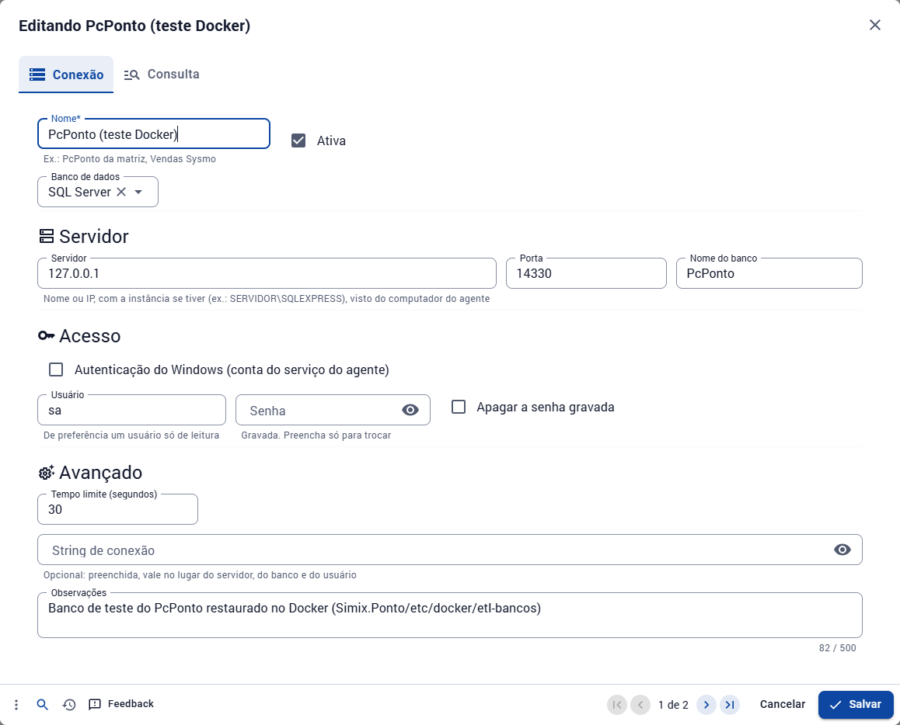
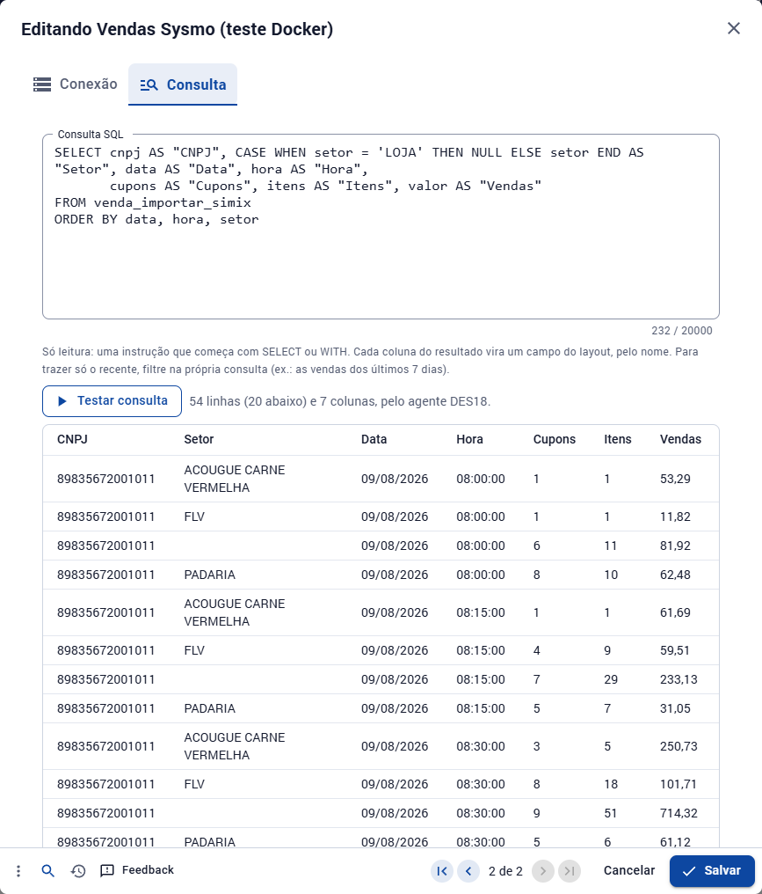
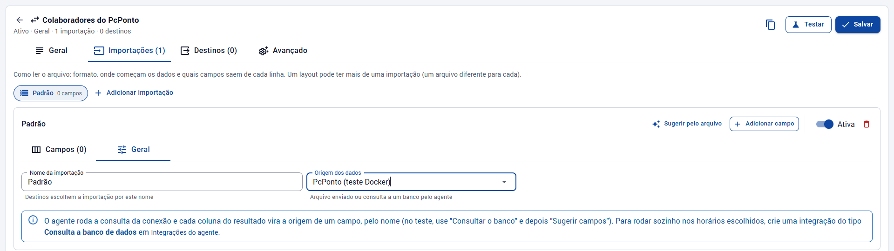
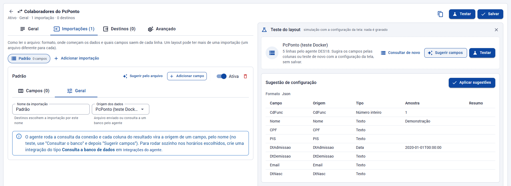
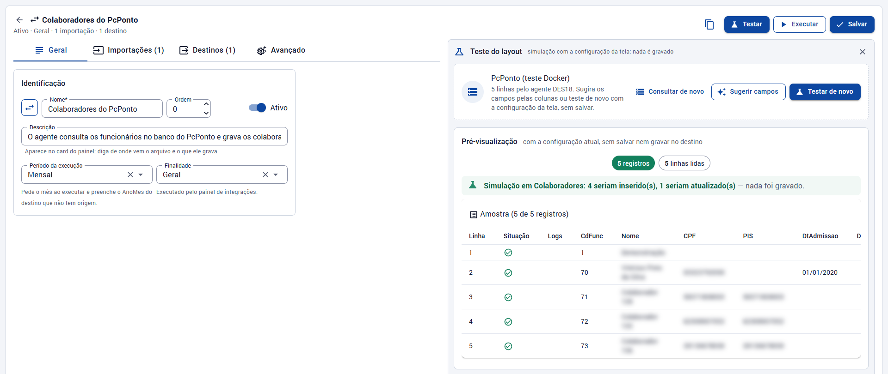
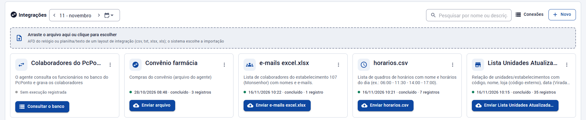
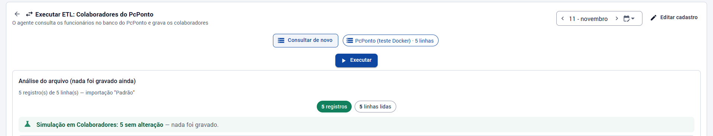
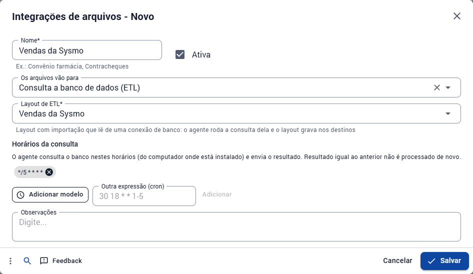
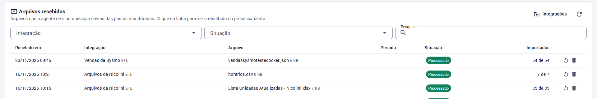
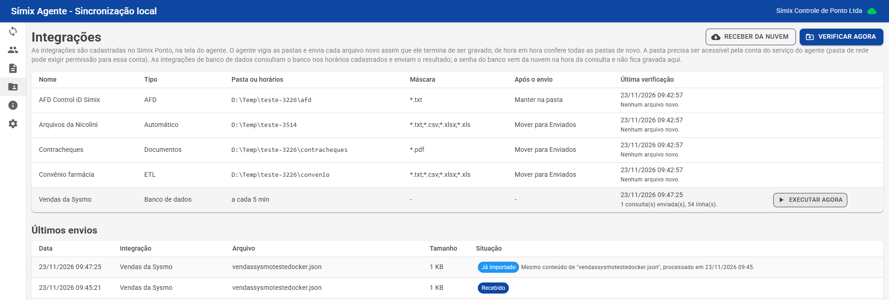

# Banco de dados pelo Agente

**Integrações › Conexões de banco de dados** · Traga os dados de outro sistema direto do banco dele, sem exportar planilha

O **Símix Agente**, o programa de sincronização instalado num computador da empresa, também consulta o banco de dados de outro sistema: o ponto antigo (PcPonto), o ERP, o PDV da loja (como a Sysmo). Ele roda a consulta que você cadastrar, manda o resultado para o Símix Ponto e um **layout de integração** grava os dados, com as mesmas regras de quando chega uma planilha.

Use quando o outro sistema guarda os dados num banco que fica na rede da empresa e ninguém precisa mais exportar arquivo: os colaboradores do ponto antigo, as vendas do PDV para a demanda das escalas.

## Como funciona

1. Você cadastra a **conexão**: onde fica o banco, o acesso e a consulta que traz os dados.
2. No **layout de integração**, a importação passa a ler da conexão em vez de um arquivo.
3. Na hora de importar, o Símix Ponto pede a consulta ao agente. O agente consulta o banco no computador dele e envia o resultado.
4. O layout grava nos destinos (colaboradores, vendas do PDV, campos do mês…), como faria com uma planilha.

Para rodar sozinho, todo dia ou de tempos em tempos, crie uma **integração do agente** com os horários (veja o Passo 4, abaixo).

## O que você precisa

- O **Símix Agente** instalado e conectado, num computador que **alcance o banco** do outro sistema (a mesma rede ou o próprio servidor). Ele aparece no painel de coletores (botão de sincronização da barra do topo › **Coletores**), em **Agente**.
- Um **usuário do banco só de leitura**. O Símix Ponto só aceita consulta de leitura, mas o usuário sem permissão de gravar é a garantia de que nada muda no outro sistema.
- O endereço do banco **visto do computador do agente**: o nome ou IP do servidor, a porta e o nome do banco.

Bancos aceitos: **SQL Server**, **PostgreSQL**, **MySQL**, **Firebird** e **Oracle**.

## Passo 1: cadastrar a conexão

Abra **Fechamento › Integrações › Conexões de banco de dados** (no painel de integrações, botão **Conexões**) e clique em **Novo**.



Na guia **Conexão**:

- **Banco de dados**: o tipo do banco. A porta padrão dele já vem preenchida.
- **Agente**: aparece quando a empresa tem mais de um agente. Escolha o que fica no computador que alcança o banco. Vazio: o primeiro agente conectado.
- **Servidor**, **Porta** e **Nome do banco**: onde o banco está. No SQL Server com instância nomeada, informe o servidor com a instância (`SERVIDOR\SQLEXPRESS`).
- **Usuário** e **Senha**. No SQL Server dá para usar a **Autenticação do Windows**: vale o usuário do Windows com que o serviço do agente roda.
- **Tempo limite**: quantos segundos a consulta pode demorar no banco.
- **String de conexão**: opcional, para casos especiais. Preenchida, vale no lugar do servidor, do banco e do usuário.

A **senha** e a **string de conexão** ficam guardadas protegidas e **não aparecem de novo** na tela: o campo mostra *Gravada*. Para trocar, digite a nova; para apagar, marque **Apagar a senha gravada**. O agente só recebe a senha na hora de consultar e não a guarda no computador dele.

## Passo 2: escrever e testar a consulta

Na guia **Consulta**, escreva o SQL que traz os dados. As regras:

- **Só leitura**: uma instrução que começa com `SELECT` ou `WITH`. Consulta que grava, apaga ou executa procedimento é recusada.
- **Cada coluna vira um campo** do layout, pelo nome. Dê o nome que quiser com `AS`: `SELECT cnpj AS "CNPJ", ...`.
- **Filtre na própria consulta** o que interessa, como só as vendas dos últimos dias. Assim a consulta fica rápida e o resultado, pequeno.

Clique em **Testar consulta**: o agente roda a consulta e traz as primeiras linhas. Enquanto ele consulta, a tela mostra o andamento. Nada é gravado no teste.



Salve a conexão.

## Passo 3: preparar o layout

Em **Fechamento › Integrações**, crie o layout (**Novo**, layout em branco) ou abra um que já existe. Na guia **Importações**, abra a importação e a guia **Geral**:

- Em **Origem dos dados**, escolha a **conexão**. Os campos que só servem para arquivo (nome do arquivo, formato, separador, guia da planilha, cabeçalho) somem.



Abra o **Testar** do topo. No lugar de enviar um arquivo, o teste mostra **Consultar o banco**: o agente traz uma amostra das primeiras linhas. Depois clique em **Sugerir campos**: cada coluna da consulta vira um campo, com o tipo (texto, número, data) pelo que veio do banco. **Aplicar sugestões** monta os campos da importação.



Na guia **Destinos**, ligue cada campo do destino ao campo da importação, como em qualquer layout. O **Testar** simula a gravação e mostra o que seria inserido e atualizado:



## Executar pelo painel

No painel de integrações, o card do layout que lê do banco mostra **Consultar o banco** no lugar de **Enviar arquivo**:



O agente roda a consulta inteira e a execução abre com o resultado, para conferir a análise antes de gravar. Na execução, **Consultar de novo** pede uma nova consulta ao agente. Clique em **Executar** para gravar:



## Passo 4: rodar sozinho nos horários

No painel de coletores, abra **Agente** e, em **Integrações de arquivos**, clique em **Configurar** (ou abra `/agente/integracoes`). Clique em **Novo**:



- **Os arquivos vão para**: **Consulta a banco de dados (ETL)**. A pasta e as máscaras somem.
- **Layout de ETL**: a lista só mostra os layouts que leem de uma conexão.
- **Horários da consulta**: use **Adicionar modelo** (a cada 1 hora, a cada 15 minutos, às 08:00…) ou escreva uma expressão cron em **Outra expressão**, como `30 18 * * 1-5` (às 18:30, de segunda a sexta). O intervalo mínimo é de 5 minutos. Os horários são os do computador do agente. Sem horário, a integração só roda pelo **Executar agora** da tela do agente.

Salvo o cadastro, o agente recebe os horários na hora, se estiver conectado.

Em cada horário, o agente consulta o banco e envia o resultado. **Resultado igual ao anterior** aparece como **Já importado** e não é gravado de novo: a consulta pode rodar várias vezes ao dia sem duplicar nada.

## Acompanhar

No Símix Ponto, **Arquivos recebidos** mostra cada consulta recebida, com a situação e quantos registros entraram. Clique na linha para ver o resultado, com o erro de cada linha recusada:



No computador do agente, a tela **Integrações** do Símix Agente mostra os horários, a última consulta e os últimos envios. O botão **Executar agora** roda a consulta sem esperar o horário:



## Exemplos

### Colaboradores do PcPonto

Conexão do tipo **SQL Server** no servidor do PcPonto, com a consulta:

```sql
SELECT f.CdFunc, f.Nome, f.CPF, f.PIS, f.DtAdmissao
FROM Funcionarios f
ORDER BY f.CdFunc
```

No layout, destino **Colaboradores**, com a estratégia **Inserir ou atualizar**. Ligue **Nome**, **CPF**, **PIS** e **DtAdmissao** aos campos de mesmo nome e o **CdFunc** do PcPonto ao **Código externo** do colaborador. Assim o colaborador é achado pelo CPF, pelo PIS ou pelo código externo, e o código do PcPonto não sobrescreve um colaborador do Símix Ponto que tenha o mesmo número.

### Vendas da Sysmo para a demanda das escalas

Conexão do tipo **PostgreSQL** no banco da Sysmo, com a consulta:

```sql
SELECT cnpj AS "CNPJ",
       CASE WHEN setor = 'LOJA' THEN NULL ELSE setor END AS "Setor",
       data AS "Data", hora AS "Hora",
       cupons AS "Cupons", itens AS "Itens", valor AS "Vendas"
FROM venda_importar_simix
WHERE data >= current_date - 7
ORDER BY data, hora, setor
```

- Os apelidos (`AS "CNPJ"`, `AS "Vendas"`…) deixam as colunas com o nome dos campos do destino.
- **LOJA** vira setor vazio: o total da loja inteira.
- O `WHERE` traz só os últimos 7 dias. Os dias que vierem de novo são substituídos, sem somar em dobro.

No layout, destino **Vendas do PDV**: **Estabelecimento** ← CNPJ, e Setor, Data, Hora, Cupons, Itens e Vendas pelos nomes. O setor do arquivo é achado pelo nome do cadastro, inclusive pelo começo (*ACOUGUE CARNE VERMELHA* casa com *Açougue*). Loja ou setor que não existe no Símix Ponto fica de fora, sem erro.

Depois crie a integração do agente com o horário em que as vendas do dia já fecharam, como às 23:30.

## Perguntas frequentes

**"O agente não está conectado ao servidor".** O serviço do Símix Agente está parado ou sem internet. Confira o computador do agente e o painel de coletores, em **Agente**. Se a empresa tem mais de um agente, confira se a conexão usa o que alcança o banco.

**A consulta foi recusada por não ser só de leitura.** A consulta precisa ser uma instrução só, começando com `SELECT` ou `WITH`, sem gravar, apagar ou executar procedimento. Tire o `;` do meio, o `INTO` e chamadas como `EXEC`.

**Falha ao conectar no banco.** O servidor é o endereço **visto do computador do agente**: `localhost` é o próprio computador do agente, não o servidor do Símix Ponto. Confira a porta, o firewall do servidor do banco e, na autenticação do Windows, o usuário com que o serviço do agente roda.

**A consulta passou do tempo limite.** Aumente o **Tempo limite** da conexão ou filtre mais a consulta, como só os últimos dias.

**Mudei os dados no outro sistema e a importação não aconteceu.** Ela acontece no próximo horário da integração. Para não esperar, use o **Executar agora** da tela do agente ou o **Consultar o banco** do painel.

**Rodou de novo e apareceu "Já importado".** A consulta trouxe exatamente o mesmo resultado da vez anterior. Nada mudou no outro sistema, então nada é gravado de novo.

Veja também: [Arquivos pelo Agente](Arquivos-agente.md).
